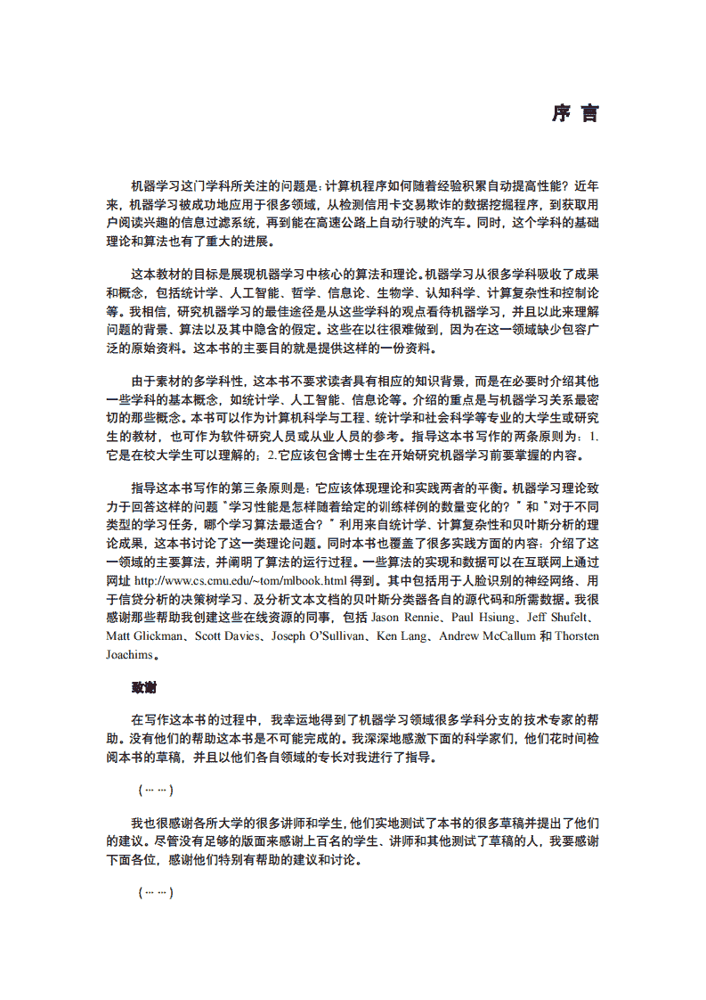
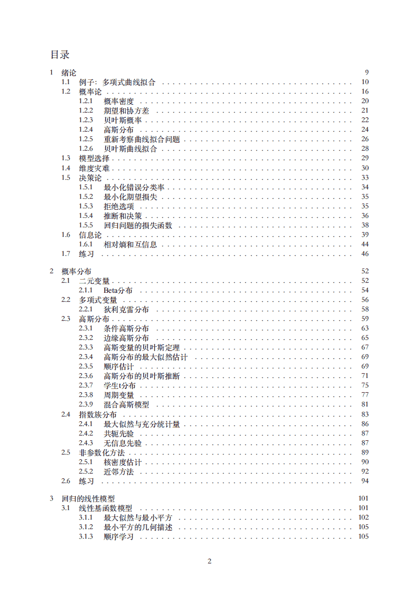
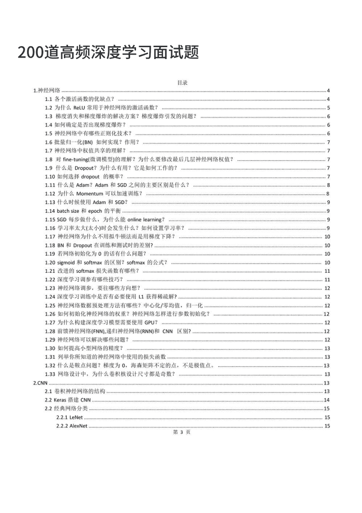
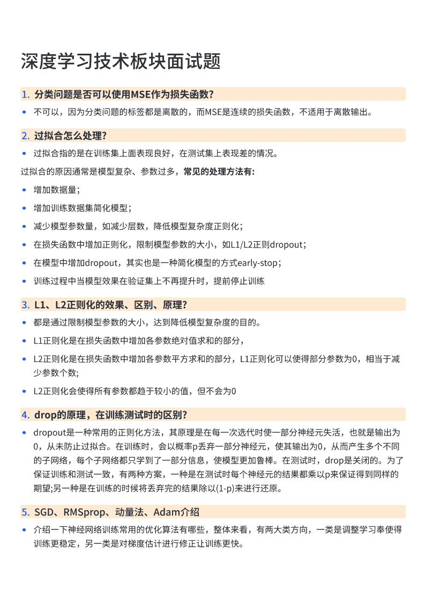

# AI 核心技术

> 来源：[https://qqs7y1hozd1.feishu.cn/docx/DqZPdL95io1a7HxSwRGcw3ARnke](https://qqs7y1hozd1.feishu.cn/docx/DqZPdL95io1a7HxSwRGcw3ARnke)

<https://qqs7y1hozd1.feishu.cn/sync/WsLwdK9UMsOqdhb16EFcUL0qn4d>

# 机器学习

| [机器学习入门](https://qqs7y1hozd1.feishu.cn/wiki/V5T3wE17iiLYYwkYZ6pcHHZan4d) | [k-近邻算法](https://qqs7y1hozd1.feishu.cn/wiki/OHYBw3YFViU0hCkWc8TcWibEnjh) |
| --- | --- |
| [决策树](https://qqs7y1hozd1.feishu.cn/wiki/L0CYwJG6LiQ6zFkzfj3cmfzCnNb) | [基于概率论的分类方法: 朴素贝叶斯](https://qqs7y1hozd1.feishu.cn/wiki/IC3IwI4eCij0Uikk3EAc751UnPf) |
| [Logistic回归](https://qqs7y1hozd1.feishu.cn/wiki/QoONwuJLGiiuqnk7Vs1cjnPanDc) | [支持向量机](https://qqs7y1hozd1.feishu.cn/wiki/JjK0wCvOyiZIfkkmhDXciahKnRe) |
| [集成方法 ensemble method](https://qqs7y1hozd1.feishu.cn/wiki/NaR8w7WyXiIZEHkc3NIcl1vknRd) | [预测数值型数据: 回归](https://qqs7y1hozd1.feishu.cn/wiki/MYu5wIwmviJDeUkBWdccZMlwnZd) |
| [树回归](https://qqs7y1hozd1.feishu.cn/wiki/Qrahwb9uNildUhkSrRicZcRzngd) | [K-Means（K-均值）聚类算法](https://qqs7y1hozd1.feishu.cn/wiki/IjuJwiSa6iEXpgk9eWicC1kjn4g) |
| [使用 Apriori 算法进行关联分析](https://qqs7y1hozd1.feishu.cn/wiki/S1clwLXCNit6RykBPsVcnElenlc) | [使用FP-growth算法来高效发现频繁项集](https://qqs7y1hozd1.feishu.cn/wiki/S66mw75a0ivZ0Ykz8WPcMSg4nOh) |
| [利用 PCA 来简化数据](https://qqs7y1hozd1.feishu.cn/wiki/UyIhwN3j1in9IBkNHwFc9KkSnUf) | [利用SVD简化数据](https://qqs7y1hozd1.feishu.cn/wiki/LJZJwA4QCis0fsk2rLRcOZTCnrd) |
| [大数据与MapReduce](https://qqs7y1hozd1.feishu.cn/wiki/O8TxwOhr9iQmeJkXdlJcHX1tnOe) | [推荐系统](https://qqs7y1hozd1.feishu.cn/wiki/UQYmwmBgiiX3G6kMyAVcU1ohnFh) |

##### ✅机器学习-tom mitchell

##### ✅prml模式识别与机器学习

[机器学习_Tom_Mitchell_中文版.pdf](https://internal-api-drive-stream.feishu.cn/space/api/box/stream/download/all/OpsJbNb2boLy5OxUIY8cL0cFnlb)

[PRML模式识别与机器学习_马春鹏翻译版.pdf](https://internal-api-drive-stream.feishu.cn/space/api/box/stream/download/all/KDMYbF5P3otecyx935gcBlAKnub)

---

| [1-AI入学指南.pdf](https://qqs7y1hozd1.feishu.cn/wiki/NOXBwkxzjiN7eFkPQdscj70Tnyc) | [2-回归算法.pdf](https://qqs7y1hozd1.feishu.cn/wiki/AlXtwX1qpif9zWk0oTAc0FZpn8d) |
| --- | --- |
| [3-决策树与集成算法.pdf](https://qqs7y1hozd1.feishu.cn/wiki/YylCwNet5ifNffkjTrPcxXLJnyc) | [4-聚类算法.pdf](https://qqs7y1hozd1.feishu.cn/wiki/VabgwfwXpiOd9XkpgOPcOmYfn6c) |
| [5-贝叶斯算法.pdf](https://qqs7y1hozd1.feishu.cn/wiki/Upc1wu5beiqfflkO1CncpeTVn6f) | [6-支持向量机.pdf](https://qqs7y1hozd1.feishu.cn/wiki/KLOJwE5fUiROU6kRIj5cH2HknSf) |
| [7-推荐系统.pdf](https://qqs7y1hozd1.feishu.cn/wiki/YsKOwzEQ1i1l2PkGQQVcxkuJnyg) | [8-xgboost.pdf](https://qqs7y1hozd1.feishu.cn/wiki/Wsx5wQrrGiirG0kshE5cfYzkncd) |
| [9-LDA与PCA算法.pdf](https://qqs7y1hozd1.feishu.cn/wiki/GlPNwKvJwiO3O2kIDwccAcpanDc) | [10-EM算法.pdf](https://qqs7y1hozd1.feishu.cn/wiki/HMp7wHywWid2zzkU9lpccVfLnkd) |
| [11-神经网络.pdf](https://qqs7y1hozd1.feishu.cn/wiki/IY6YwwCDPiWjjik5ChRciTkHn1e) | [12-word2vec.pdf](https://qqs7y1hozd1.feishu.cn/wiki/NhWCw97hxiCQAQkvDI4cmauHnqb) |
| [机器学习实战.pdf](https://qqs7y1hozd1.feishu.cn/wiki/CLGSwCKh7ijfjPkTgJIcUdfgnEn) | [时间序列分析.pdf](https://qqs7y1hozd1.feishu.cn/wiki/RDCNwrlquiNsaLkGdsucPViOnJe) |
| [文本分析.pdf](https://qqs7y1hozd1.feishu.cn/wiki/T27mwFmMMiAeVHkqqO7cOIpWniJ) | [面试速查（cheat sheets）](https://qqs7y1hozd1.feishu.cn/wiki/IFWiwPyXYizpdkkSy0Lc0QcGnfd) |
| [机器学习实战.pdf](https://qqs7y1hozd1.feishu.cn/wiki/Rkm3wFOL1iBf6ZksMZ3cqO0OnAc) |  |

---

# 深度学习

| [PyTorch 入门](https://qqs7y1hozd1.feishu.cn/wiki/YK3jwgscdiCbAykueFgcCVMNnCb) | [深度学习入门基础](https://qqs7y1hozd1.feishu.cn/wiki/LB4KwWEYqi3CRBk69t9c8JignCG) |
| --- | --- |
| [神经网络中的反向传播法—BackPropagation](https://qqs7y1hozd1.feishu.cn/wiki/MiGgwHzF0ipqMJkBdhBcJRyKnBc?from=from_copylink) | [卷积神经网络CNN基础](https://qqs7y1hozd1.feishu.cn/wiki/TruswRALAiMBfCk1z75cueaDn1X?from=from_copylink) |
| [循环神经网络（RNN）](https://qqs7y1hozd1.feishu.cn/wiki/NXz4wF3kminI15krFVVcdiQVnob?from=from_copylink) | [长短期记忆网络(LSTM）](https://qqs7y1hozd1.feishu.cn/wiki/X7vzwlN5kiP7ghkBovactFzDncg?from=from_copylink) |
| [卷积神经网络（CNN) ](https://qqs7y1hozd1.feishu.cn/wiki/HI9JwUqsaipvydkBjYucNWkUnAb) | [卷积层知识点 ](https://qqs7y1hozd1.feishu.cn/wiki/B30QwIyLXifoaXkGPPJcm8Qdn7e) |
| [卷积层知识点 ](https://qqs7y1hozd1.feishu.cn/wiki/B30QwIyLXifoaXkGPPJcm8Qdn7e) | [激活函数 ](https://qqs7y1hozd1.feishu.cn/wiki/EjanwZSQ0ih1XSkiS9qcon8hnMW) |

---

| [深度学习八大神经网络](https://qqs7y1hozd1.feishu.cn/wiki/Dw36wPvyBivltIkAn5qc09Q0nVf) | [17种常用激活函数汇总](https://qqs7y1hozd1.feishu.cn/wiki/FNu4wVAzBi1JDPkT5wocMalWnbh) |
| --- | --- |
| [神经网络损失函数详解](https://qqs7y1hozd1.feishu.cn/wiki/WaJ8w3bwOibbfFkzmvNcS2Z5nWd) | [深度学习应用实操](https://qqs7y1hozd1.feishu.cn/wiki/S97XwMLJPio30DkjfU0cWOMnnVc) |
| [深度学习应用实操](https://qqs7y1hozd1.feishu.cn/wiki/S97XwMLJPio30DkjfU0cWOMnnVc) | [深度学习100例](https://qqs7y1hozd1.feishu.cn/wiki/TrJGwfjKHiVZx4kBfCMckUQfnue) |
| [深度学习调参](https://qqs7y1hozd1.feishu.cn/wiki/PVssw592hipXZGkQUS6coZzmnDc) | [深度学习面试题](https://qqs7y1hozd1.feishu.cn/wiki/KctewBjfHiuqgZk4NzXc9FQHnLc) |
| [深度学习项目落地](https://qqs7y1hozd1.feishu.cn/wiki/ED0rwMXFpi0xcokS0IPc6FWunKd) | [深度学习12条调参经验](https://qqs7y1hozd1.feishu.cn/wiki/OOicw9ogWinuHckBcYkc1or0nwe) |

✅200道高频深度学习面试题

✅深度学习技术板块面试题

[200道高频深度学习面试题.pdf](https://internal-api-drive-stream.feishu.cn/space/api/box/stream/download/all/H2s4bbbLdofUCvxatOschsKenSM)

[深度学习技术板块面试题.pdf](https://internal-api-drive-stream.feishu.cn/space/api/box/stream/download/all/T2KBbrKDqoQwf9xrirecljfgntd)

---

# 强化学习

| [强化学习入门](https://qqs7y1hozd1.feishu.cn/wiki/Sx4CwZ9o8iVVKekbmwncSFKVnWb) | [RLHF 相关](https://qqs7y1hozd1.feishu.cn/wiki/LbvjwUvMoiNfcBkytmncKinanCe) |
| --- | --- |
| [强化学习](https://qqs7y1hozd1.feishu.cn/wiki/YRxHwqu9UiM9Eek1jsacocxOnPb) | [DPO](https://qqs7y1hozd1.feishu.cn/wiki/ZxQWwtikNiAJGlkIcrdckZH2nGc) |
| [大模型RLHF：PPO原理与源码解读](https://qqs7y1hozd1.feishu.cn/wiki/CT8Ewf87qiFBzTkRdqrcyrHvnkb) | [策略梯度（pg）](https://qqs7y1hozd1.feishu.cn/wiki/MzXTwXXuEiU7xCk9HOLc7TFensf) |
| [近端策略优化(ppo)](https://qqs7y1hozd1.feishu.cn/wiki/TjCPwS1gSix70LkemFZcow7Fnmg) |  |

---

# 多模态

| [多模态大模型—万字梳理视觉自回归图像生成 ](https://qqs7y1hozd1.feishu.cn/wiki/Nbx7wL0SkiC5dAkqXQVcWHeGnGc) | [多模态和大型多模态模型【LMMs】 ](https://qqs7y1hozd1.feishu.cn/wiki/NDIIw9yWbi2QKOkXklCcCwj5nfd) |
| --- | --- |
| [混合专家模型 (MoE) 详解 ](https://qqs7y1hozd1.feishu.cn/wiki/CxcLwAvnCikSHAkYaQ1cYk2dn5g) | [浅析多模态大模型的前世今生 ](https://qqs7y1hozd1.feishu.cn/wiki/BiCDwZSBKib6gVkz7a8cQd9Znbf) |

---

# 检索增强 RAG

| [大模型RAG（检索增强生成）含高级方法](https://qqs7y1hozd1.feishu.cn/wiki/L36VwW7fhisqDVk1mBbcFAg7n9b) | [RAG技术基本原理](https://qqs7y1hozd1.feishu.cn/wiki/X3hCwzcqkiXQ5xk4BTqcI4Ifnre) |
| --- | --- |
| [RAG技术实现流程](https://qqs7y1hozd1.feishu.cn/wiki/LMLPw5nMyiWUTlkNaCpcT364nXb) | [RAG技术应用场景](https://qqs7y1hozd1.feishu.cn/wiki/WRgGwMcBIistmjkLfrrc2l6vn2c) |

---

# Al Agent

| [Agent项目](https://qqs7y1hozd1.feishu.cn/wiki/N6Wfw9DtsiiI6ykIsXDc4pcMn0c) | [Agents 应用场景](https://qqs7y1hozd1.feishu.cn/wiki/QkkywXxkkicpbGkwxQDc4ClxnWg) |
| --- | --- |
| [AI Agents全景图](https://qqs7y1hozd1.feishu.cn/wiki/AiTKwTvqsiiZIpky8zvcDp7InAb) | [Agent技术](https://qqs7y1hozd1.feishu.cn/wiki/RlnpwCGebie8hhk0xCfc6I2DnIh) |
| [Agent 搭建](https://qqs7y1hozd1.feishu.cn/wiki/FbpDwAggfirijdkva0ucUXflnCg) | [各大厂Agent项目案例](https://qqs7y1hozd1.feishu.cn/wiki/Wh8hwQtiYiVHTnknC7Tczcs6n0c) |

---

# LLM

| [基于LLM构建知识问答系统 ](https://qqs7y1hozd1.feishu.cn/wiki/L21Fw2N0niWn1WkBk74cA1Vcnj6) | [LLM+Embedding构建问答系统的优化方案 ](https://qqs7y1hozd1.feishu.cn/wiki/EODjw1wH5iFH46kCRyYc8sEWnAU) |
| --- | --- |
| [LLM 各种技巧 | Prompt Engineering 指南 ](https://qqs7y1hozd1.feishu.cn/wiki/AMTpwv5x8iTgvek4GJpcbH2znHe) | [智能文档问答评估，提升 LLM 应用质量！](https://qqs7y1hozd1.feishu.cn/wiki/JfWZw2lJeimwvCkOmHEcItP0nRd) |
| [【LLM-RAG】知识库问答 | 检索 | embedding](https://qqs7y1hozd1.feishu.cn/wiki/T0JzwMMKJiWXjJkNTvscBkBMnmc) | [AI产品经理总结 | LLM中14种Prompt策略](https://qqs7y1hozd1.feishu.cn/wiki/MMqbwflUkieKZikfitIccvJsnit) |
| [基于LangChain+LLM的本地知识库问答：从企业单文档问答到批量文档问答](https://qqs7y1hozd1.feishu.cn/wiki/DPhqwALdUixJODkfa5ycA1RInub) | [LLMs中的幻觉问题](https://qqs7y1hozd1.feishu.cn/wiki/ITbDwxblFiWmpokgqEYckc2RnNe) |
| [LAMs.pdf](https://qqs7y1hozd1.feishu.cn/wiki/MGkZwp2OfiOyuWkINYwcRxPZnkg) | #####  |