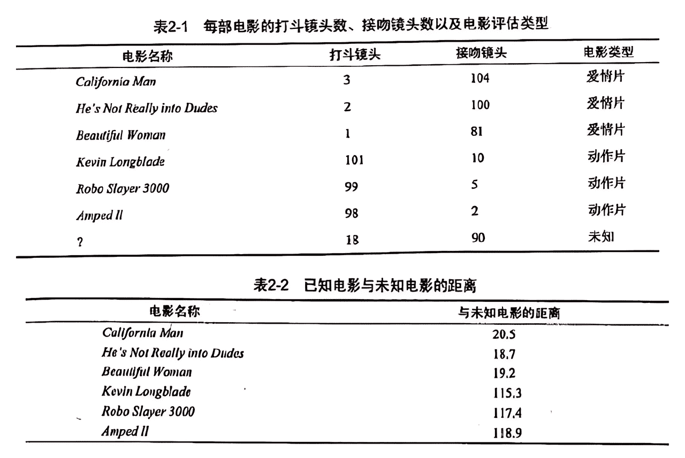
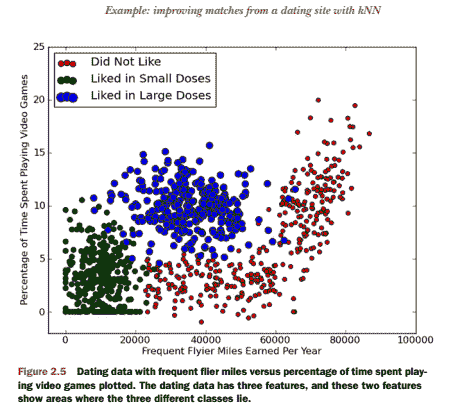
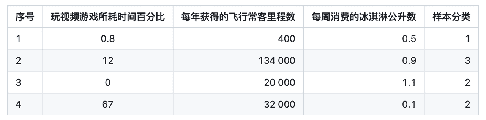
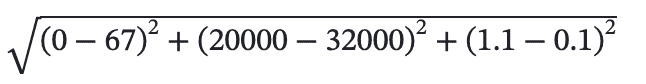
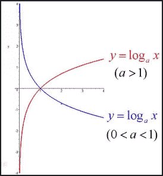
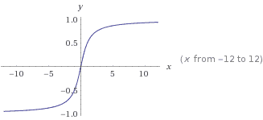
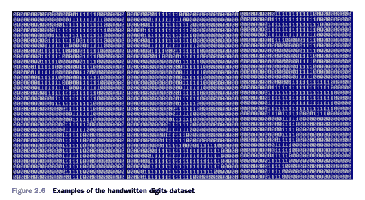

# k-近邻算法

> 来源：[https://qqs7y1hozd1.feishu.cn/docx/IyGWd7blGooQdxxusIhcs6XTn1d](https://qqs7y1hozd1.feishu.cn/docx/IyGWd7blGooQdxxusIhcs6XTn1d)

# **KNN 概述**

k-近邻（kNN, k-NearestNeighbor）算法是一种基本分类与回归方法，我们这里只讨论分类问题中的 k-近邻算法

一句话总结: 近朱者赤近墨者黑！

k 近邻算法的输入为实例的特征向量，对应于特征空间的点；输出为实例的类别，可以取多类。k 近邻算法假设给定一个训练数据集，其中的实例类别已定。分类时，对新的实例，根据其 k 个最近邻的训练实例的类别，通过多数表决等方式进行预测。因此，k近邻算法不具有显式的学习过程

k 近邻算法实际上利用训练数据集对特征向量空间进行划分，并作为其分类的“模型”。 k值的选择、距离度量以及分类决策规则是k近邻算法的三个基本要素

# **KNN 场景**

**电影可****以按照****题材分****类，那**么如何区分 动作片 和 爱情片 呢？

1.  动作片: 打斗次数更多

1.  爱情片: 亲吻次数更多

基于电影中的亲吻、打斗出现的次数，使用 k-近邻算法构造程序，就可以自动划分电影的题材类型



```
现在根据上面我们得到的样本集中所有电影与未知电影的距离，按照距离递增排序，可以找到 k 个距离最近的电影
假定 k=3，则三个最靠近的电影依次是， He&#x27;s Not Really into Dudes 、 Beautiful Woman 和 California Man
knn 算法按照距离最近的三部电影的类型，决定未知电影的类型，而这三部电影全是爱情片，因此我们判定未知电影是爱情片
```

# **KNN 原理**

## **KNN 工作原理**

1.  假设有一个带有标签的样本数据集（训练样本集），其中包含每条数据与所属分类的对应关系

1.  输入没有标签的新数据后，将新数据的每个特征与样本集中数据对应的特征进行比较

1.  计算新数据与样本数据集中每条数据的距离

1.  对求得的所有距离进行排序（从小到大，越小表示越相似）

1.  取前 k （k 一般小于等于 20 ）个样本数据对应的分类标签

1.  求 k 个数据中出现次数最多的分类标签作为新数据的分类

## **KNN 通俗理解**

给定一个训练数据集，对新的输入实例，在训练数据集中找到与该实例最邻近的 k 个实例，这 k 个实例的多数属于某个类，就把该输入实例分为这个类。

## **KNN 开发流程**

```
收集数据: 任何方法
准备数据: 距离计算所需要的数值，最好是结构化的数据格式
分析数据: 任何方法
训练算法: 此步骤不适用于 k-近邻算法
测试算法: 计算错误率
使用算法: 输入样本数据和结构化的输出结果，然后运行 k-近邻算法判断输入数据分类属于哪个分类，最后对计算出的分类执行后续处理
```

## **KNN 算法特点**

```
优点: 精度高、对异常值不敏感、无数据输入假定
缺点: 计算复杂度高、空间复杂度高
适用数据范围: 数值型和标称型
```

# **KNN 项目案例**

## 项目案例1: 优化约会网站的配对效果

### **完整代码：**

```
#!/usr/bin/env python
# coding: utf-8
&#x27;&#x27;&#x27;
Created on Sep 16, 2010
Update  on 2017-05-18
Author: Peter Harrington/羊三/小瑶
GitHub: https://github.com/apachecn/AiLearning
&#x27;&#x27;&#x27;
from __future__ import print_function
from numpy import *
# 导入科学计算包numpy和运算符模块operator
import operator
from os import listdir
from collections import Counter


def createDataSet():
    &quot;&quot;&quot;
    创建数据集和标签

     调用方式
     import kNN
     group, labels = kNN.createDataSet()
    &quot;&quot;&quot;
    group = array([[1.0, 1.1], [1.0, 1.0], [0, 0], [0, 0.1]])
    labels = [&#x27;A&#x27;, &#x27;A&#x27;, &#x27;B&#x27;, &#x27;B&#x27;]
    return group, labels


def classify0(inX, dataSet, labels, k):
    &quot;&quot;&quot;
    inx[1,2,3]
    DS=[[1,2,3],[1,2,0]]
    inX: 用于分类的输入向量
    dataSet: 输入的训练样本集
    labels: 标签向量
    k: 选择最近邻居的数目
    注意: labels元素数目和dataSet行数相同；程序使用欧式距离公式.

    预测数据所在分类可在输入下列命令
    kNN.classify0([0,0], group, labels, 3)
    &quot;&quot;&quot;

    # -----------实现 classify0() 方法的第一种方式----------------------------------------------------------------------------------------------------------------------------
    # 1. 距离计算
    dataSetSize = dataSet.shape[0]
    # tile生成和训练样本对应的矩阵，并与训练样本求差
    &quot;&quot;&quot;
    tile: 列-3表示复制的行数， 行-1／2表示对inx的重复的次数

    In [8]: tile(inx, (3, 1))
    Out[8]:
    array([[1, 2, 3],
        [1, 2, 3],
        [1, 2, 3]])

    In [9]: tile(inx, (3, 2))
    Out[9]:
    array([[1, 2, 3, 1, 2, 3],
        [1, 2, 3, 1, 2, 3],
        [1, 2, 3, 1, 2, 3]])
    &quot;&quot;&quot;
    diffMat = tile(inX, (dataSetSize, 1)) - dataSet
    &quot;&quot;&quot;
    欧氏距离:  点到点之间的距离
       第一行:  同一个点 到 dataSet的第一个点的距离。
       第二行:  同一个点 到 dataSet的第二个点的距离。
       ...
       第N行:  同一个点 到 dataSet的第N个点的距离。

    [[1,2,3],[1,2,3]]-[[1,2,3],[1,2,0]]
    (A1-A2)^2+(B1-B2)^2+(c1-c2)^2
    &quot;&quot;&quot;
    # 取平方
    sqDiffMat = diffMat ** 2
    # 将矩阵的每一行相加
    sqDistances = sqDiffMat.sum(axis=1)
    # 开方
    distances = sqDistances ** 0.5
    # 根据距离排序从小到大的排序，返回对应的索引位置
    # argsort() 是将x中的元素从小到大排列，提取其对应的index（索引），然后输出到y。
    # 例如: y=array([3,0,2,1,4,5]) 则，x[3]=-1最小，所以y[0]=3;x[5]=9最大，所以y[5]=5。
    # print &#x27;distances=&#x27;, distances
    sortedDistIndicies = distances.argsort()
    # print &#x27;distances.argsort()=&#x27;, sortedDistIndicies

    # 2. 选择距离最小的k个点
    classCount = {}
    for i in range(k):
        # 找到该样本的类型
        voteIlabel = labels[sortedDistIndicies[i]]
        # 在字典中将该类型加一
        # 字典的get方法
        # 如: list.get(k,d) 其中 get相当于一条if...else...语句,参数k在字典中，字典将返回list[k];如果参数k不在字典中则返回参数d,如果K在字典中则返回k对应的value值
        # l = {5:2,3:4}
        # print l.get(3,0)返回的值是4；
        # Print l.get（1,0）返回值是0；
        classCount[voteIlabel] = classCount.get(voteIlabel, 0) + 1
    # 3. 排序并返回出现最多的那个类型
    # 字典的 items() 方法，以列表返回可遍历的(键，值)元组数组。
    # 例如: dict = {&#x27;Name&#x27;: &#x27;Zara&#x27;, &#x27;Age&#x27;: 7}   print &quot;Value : %s&quot; %  dict.items()   Value : [(&#x27;Age&#x27;, 7), (&#x27;Name&#x27;, &#x27;Zara&#x27;)]
    # sorted 中的第2个参数 key=operator.itemgetter(1) 这个参数的意思是先比较第几个元素
    # 例如: a=[(&#x27;b&#x27;,2),(&#x27;a&#x27;,1),(&#x27;c&#x27;,0)]  b=sorted(a,key=operator.itemgetter(1)) &gt;&gt;&gt;b=[(&#x27;c&#x27;,0),(&#x27;a&#x27;,1),(&#x27;b&#x27;,2)] 可以看到排序是按照后边的0,1,2进行排序的，而不是a,b,c
    # b=sorted(a,key=operator.itemgetter(0)) &gt;&gt;&gt;b=[(&#x27;a&#x27;,1),(&#x27;b&#x27;,2),(&#x27;c&#x27;,0)] 这次比较的是前边的a,b,c而不是0,1,2
    # b=sorted(a,key=opertator.itemgetter(1,0)) &gt;&gt;&gt;b=[(&#x27;c&#x27;,0),(&#x27;a&#x27;,1),(&#x27;b&#x27;,2)] 这个是先比较第2个元素，然后对第一个元素进行排序，形成多级排序。
    # sortedClassCount = sorted(classCount.items(), key=operator.itemgetter(1), reverse=True)
    # return sortedClassCount[0][0]
    # 3.利用max函数直接返回字典中value最大的key
    maxClassCount = max(classCount, key=classCount.get)
    return maxClassCount
    
    # ------------------------------------------------------------------------------------------------------------------------------------------
    # 实现 classify0() 方法的第二种方式

    # &quot;&quot;&quot;
    # 1. 计算距离
    
    # 欧氏距离:  点到点之间的距离
    #    第一行:  同一个点 到 dataSet的第一个点的距离。
    #    第二行:  同一个点 到 dataSet的第二个点的距离。
    #    ...
    #    第N行:  同一个点 到 dataSet的第N个点的距离。

    # [[1,2,3],[1,2,3]]-[[1,2,3],[1,2,0]]
    # (A1-A2)^2+(B1-B2)^2+(c1-c2)^2
    
    # inx - dataset 使用了numpy broadcasting，见 https://docs.scipy.org/doc/numpy-1.13.0/user/basics.broadcasting.html
    # np.sum() 函数的使用见 https://docs.scipy.org/doc/numpy-1.13.0/reference/generated/numpy.sum.html
    # &quot;&quot;&quot;
        #   dist = np.sum((inx - dataset)**2, axis=1)**0.5
    
    # &quot;&quot;&quot;
    # 2. k个最近的标签
    
    # 对距离排序使用numpy中的argsort函数， 见 https://docs.scipy.org/doc/numpy-1.13.0/reference/generated/numpy.sort.html#numpy.sort
    # 函数返回的是索引，因此取前k个索引使用[0 : k]
    # 将这k个标签存在列表k_labels中
    # &quot;&quot;&quot;
    # k_labels = [labels[index] for index in dist.argsort()[0 : k]]
        # &quot;&quot;&quot;
    # 3. 出现次数最多的标签即为最终类别
    
    # 使用collections.Counter可以统计各个标签的出现次数，most_common返回出现次数最多的标签tuple，例如[(&#x27;lable1&#x27;, 2)]，因此[0][0]可以取出标签值
        # &quot;&quot;&quot;
    # label = Counter(k_labels).most_common(1)[0][0]
    # return label

    # ------------------------------------------------------------------------------------------------------------------------------------------


def test1():
    &quot;&quot;&quot;
    第一个例子演示
    &quot;&quot;&quot;
    group, labels = createDataSet()
    print(str(group))
    print(str(labels))
    print(classify0([0.1, 0.1], group, labels, 3))


# ----------------------------------------------------------------------------------------
def file2matrix(filename):
    &quot;&quot;&quot;
    导入训练数据
    :param filename: 数据文件路径
    :return: 数据矩阵returnMat和对应的类别classLabelVector
    &quot;&quot;&quot;
    fr = open(filename)
    # 获得文件中的数据行的行数
    numberOfLines = len(fr.readlines())
    # 生成对应的空矩阵
    # 例如: zeros(2，3)就是生成一个 2*3的矩阵，各个位置上全是 0 
    returnMat = zeros((numberOfLines, 3))  # prepare matrix to return
    classLabelVector = []  # prepare labels return
    fr = open(filename)
    index = 0
    for line in fr.readlines():
        # str.strip([chars]) --返回移除字符串头尾指定的字符生成的新字符串
        line = line.strip()
        # 以 &#x27;\t&#x27; 切割字符串
        listFromLine = line.split(&#x27;\t&#x27;)
        # 每列的属性数据
        returnMat[index, :] = listFromLine[0:3]
        # 每列的类别数据，就是 label 标签数据
        classLabelVector.append(int(listFromLine[-1]))
        index += 1
    # 返回数据矩阵returnMat和对应的类别classLabelVector
    return returnMat, classLabelVector


def autoNorm(dataSet):
    &quot;&quot;&quot;
    归一化特征值，消除属性之间量级不同导致的影响
    :param dataSet: 数据集
    :return: 归一化后的数据集normDataSet,ranges和minVals即最小值与范围，并没有用到

    归一化公式: 
        Y = (X-Xmin)/(Xmax-Xmin)
        其中的 min 和 max 分别是数据集中的最小特征值和最大特征值。该函数可以自动将数字特征值转化为0到1的区间。
    &quot;&quot;&quot;
    # 计算每种属性的最大值、最小值、范围
    minVals = dataSet.min(0)
    maxVals = dataSet.max(0)
    # 极差
    ranges = maxVals - minVals
    # -------第一种实现方式---start-------------------------
    normDataSet = zeros(shape(dataSet))
    m = dataSet.shape[0]
    # 生成与最小值之差组成的矩阵
    normDataSet = dataSet - tile(minVals, (m, 1))
    # 将最小值之差除以范围组成矩阵
    normDataSet = normDataSet / tile(ranges, (m, 1))  # element wise divide
    # -------第一种实现方式---end---------------------------------------------
    
    # # -------第二种实现方式---start---------------------------------------
    # norm_dataset = (dataset - minvalue) / ranges
    # # -------第二种实现方式---end---------------------------------------------
    return normDataSet, ranges, minVals


def datingClassTest():
    &quot;&quot;&quot;
    对约会网站的测试方法
    :return: 错误数
    &quot;&quot;&quot;
    # 设置测试数据的的一个比例（训练数据集比例=1-hoRatio）
    hoRatio = 0.1  # 测试范围,一部分测试一部分作为样本
    # 从文件中加载数据
    datingDataMat, datingLabels = file2matrix(&#x27;data/2.KNN/datingTestSet2.txt&#x27;)  # load data setfrom file
    # 归一化数据
    normMat, ranges, minVals = autoNorm(datingDataMat)
    # m 表示数据的行数，即矩阵的第一维
    m = normMat.shape[0]
    # 设置测试的样本数量， numTestVecs:m表示训练样本的数量
    numTestVecs = int(m * hoRatio)
    print(&#x27;numTestVecs=&#x27;, numTestVecs)
    errorCount = 0.0
    for i in range(numTestVecs):
        # 对数据测试
        classifierResult = classify0(normMat[i, :], normMat[numTestVecs:m, :], datingLabels[numTestVecs:m], 3)
        print(&quot;the classifier came back with: %d, the real answer is: %d&quot; % (classifierResult, datingLabels[i]))
        if (classifierResult != datingLabels[i]): errorCount += 1.0
    print(&quot;the total error rate is: %f&quot; % (errorCount / float(numTestVecs)))
    print(errorCount)


def img2vector(filename):
    &quot;&quot;&quot;
    将图像数据转换为向量
    :param filename: 图片文件 因为我们的输入数据的图片格式是 32 * 32的
    :return: 一维矩阵
    该函数将图像转换为向量: 该函数创建 1 * 1024 的NumPy数组，然后打开给定的文件，
    循环读出文件的前32行，并将每行的头32个字符值存储在NumPy数组中，最后返回数组。
    &quot;&quot;&quot;
    returnVect = zeros((1, 1024))
    fr = open(filename)
    for i in range(32):
        lineStr = fr.readline()
        for j in range(32):
            returnVect[0, 32 * i + j] = int(lineStr[j])
    return returnVect


def handwritingClassTest():
    # 1. 导入数据
    hwLabels = []
    trainingFileList = listdir(&#x27;data/2.KNN/trainingDigits&#x27;)  # load the training set
    m = len(trainingFileList)
    trainingMat = zeros((m, 1024))
    # hwLabels存储0～9对应的index位置， trainingMat存放的每个位置对应的图片向量
    for i in range(m):
        fileNameStr = trainingFileList[i]
        fileStr = fileNameStr.split(&#x27;.&#x27;)[0]  # take off .txt
        classNumStr = int(fileStr.split(&#x27;_&#x27;)[0])
        hwLabels.append(classNumStr)
        # 将 32*32的矩阵-&gt;1*1024的矩阵
        trainingMat[i, :] = img2vector(&#x27;data/2.KNN/trainingDigits/%s&#x27; % fileNameStr)

    # 2. 导入测试数据
    testFileList = listdir(&#x27;data/2.KNN/testDigits&#x27;)  # iterate through the test set
    errorCount = 0.0
    mTest = len(testFileList)
    for i in range(mTest):
        fileNameStr = testFileList[i]
        fileStr = fileNameStr.split(&#x27;.&#x27;)[0]  # take off .txt
        classNumStr = int(fileStr.split(&#x27;_&#x27;)[0])
        vectorUnderTest = img2vector(&#x27;data/2.KNN/testDigits/%s&#x27; % fileNameStr)
        classifierResult = classify0(vectorUnderTest, trainingMat, hwLabels, 3)
        print(&quot;the classifier came back with: %d, the real answer is: %d&quot; % (classifierResult, classNumStr))
        if (classifierResult != classNumStr): errorCount += 1.0
    print(&quot;\nthe total number of errors is: %d&quot; % errorCount)
    print(&quot;\nthe total error rate is: %f&quot; % (errorCount / float(mTest)))


if __name__ == &#x27;__main__&#x27;:
    # test1()
    # datingClassTest()
    handwritingClassTest()
```

### **项目概述**

海伦使用约会网站寻找约会对象。经过一段时间之后，她发现曾交往过三种类型的人:

+   不喜欢的人

+   魅力一般的人

+   极具魅力的人

她希望:

1.  工作日与魅力一般的人约会

1.  周末与极具魅力的人约会

1.  不喜欢的人则直接排除掉

现在她收集到了一些约会网站未曾记录的数据信息，这更有助于匹配对象的归类。

### **开发流程**

```
收集数据: 提供文本文件
准备数据: 使用 Python 解析文本文件
分析数据: 使用 Matplotlib 画二维散点图
训练算法: 此步骤不适用于 k-近邻算法
测试算法: 使用海伦提供的部分数据作为测试样本。
        测试样本和非测试样本的区别在于: 
            测试样本是已经完成分类的数据，如果预测分类与实际类别不同，则标记为一个错误。
使用算法: 产生简单的命令行程序，然后海伦可以输入一些特征数据以判断对方是否为自己喜欢的类型。
```

> 收集数据: 提供文本文件

海伦约会的对象主要包含以下 3 种特征:

+   每年获得的飞行常客里程数

+   玩视频游戏所耗时间百分比

+   每周消费的冰淇淋公升数

**文本文件数据格式如下:**

```
40920        8.326976        0.953952        3
14488        7.153469        1.673904        2
26052        1.441871        0.805124        1
75136        13.147394        0.428964        1
38344        1.669788        0.134296        1
```

> 准备数据: 使用 Python 解析文本文件

将文本记录转换为 NumPy 的解析程序

```
def file2matrix(filename):
   &quot;&quot;&quot;
   Desc:
       导入训练数据
   parameters:
       filename: 数据文件路径
   return: 
       数据矩阵 returnMat 和对应的类别 classLabelVector
   &quot;&quot;&quot;
   fr = open(filename)
   # 获得文件中的数据行的行数
   numberOfLines = len(fr.readlines())
   # 生成对应的空矩阵
   # 例如: zeros(2，3)就是生成一个 2*3的矩阵，各个位置上全是 0 
   returnMat = zeros((numberOfLines, 3))  # prepare matrix to return
   classLabelVector = []  # prepare labels return
   fr = open(filename)
   index = 0
   for line in fr.readlines():
       # str.strip([chars]) --返回已移除字符串头尾指定字符所生成的新字符串
       line = line.strip()
       # 以 &#x27;\t&#x27; 切割字符串
       listFromLine = line.split(&#x27;\t&#x27;)
       # 每列的属性数据
       returnMat[index, :] = listFromLine[0:3]
       # 每列的类别数据，就是 label 标签数据
       classLabelVector.append(int(listFromLine[-1]))
       index += 1
   # 返回数据矩阵returnMat和对应的类别classLabelVector
   return returnMat, classLabelVector
```

下图中采用矩阵的第一和第二列属性得到很好的展示效果，清晰地标识了三个不同的样本分类区域，具有不同爱好的人其类别区域也不同

+   归一化数据

+   [（归一化是一个让权重变为统一的过程，更](https://www.zhihu.com/question/19951858)多细节请参考: https://www.zhihu.com/question/19951858 ）





样本3和样本4的距离:



归一化特征值，消除特征之间量级不同导致的影响

归一化定义: 我是这样认为的，归一化就是要把你需要处理的数据经过处理后（通过某种算法）限制在你需要的一定范围内。首先归一化是为了后面数据处理的方便，其次是保证程序运行时收敛加快。 方法有如下:

1.  线性函数转换，表达式如下:

y=(x-MinValue)/(MaxValue-MinValue)

> **说明: x、y分别为转换前、后的值，MaxValue、M**inValue分别为样本的最大值和最小值

1.  对数函数转换，表达式如下:

y=log10(x)

> 说明: 以10为底的对数函数转换

如图:



1.  **反余切函数转换，表达式如下:**

y=arctan(x)*2/PI

如图:



1.  **式**(1)将输入值换算为[-1,1]区间的值，在输出层用式(2)换算回初始值，其中和分别表示训练样本集中负荷的最大值和最小值

在统计学中，归一化的具体作用是归纳统一样本的统计分布性。归一化在0-1之间是统计的概率分布，归一化在-1--+1之间是统计的坐标分布

```
def autoNorm(dataSet):
    &quot;&quot;&quot;
    Desc:
        归一化特征值，消除特征之间量级不同导致的影响
    parameter:
        dataSet: 数据集
    return:
        归一化后的数据集 normDataSet. ranges和minVals即最小值与范围，并没有用到

    归一化公式: 
        Y = (X-Xmin)/(Xmax-Xmin)
        其中的 min 和 max 分别是数据集中的最小特征值和最大特征值。该函数可以自动将数字特征值转化为0到1的区间。
    &quot;&quot;&quot;
    # 计算每种属性的最大值、最小值、范围
    minVals = dataSet.min(0)
    maxVals = dataSet.max(0)
    # 极差
    ranges = maxVals - minVals
    normDataSet = zeros(shape(dataSet))
    m = dataSet.shape[0]
    # 生成与最小值之差组成的矩阵
    normDataSet = dataSet - tile(minVals, (m, 1))
    # 将最小值之差除以范围组成矩阵
    normDataSet = normDataSet / tile(ranges, (m, 1))  # element wise divide
    return normDataSet, ranges, minVals
```

> 训练算法: 此步骤不适用于 k-近邻算法

因为测试数据每一次都要与全量的训练数据进行比较，所以这个过程是没有必要的。

kNN 算法伪代码:

```
对于每一个在数据集中的数据点: 
    计算目标的数据点（需要分类的数据点）与该数据点的距离
    将距离排序: 从小到大
    选取前K个最短距离
    选取这K个中最多的分类类别
    返回该类别来作为目标数据点的预测值
```

```
def classify0(inX, dataSet, labels, k):
    dataSetSize = dataSet.shape[0]
    #距离度量 度量公式为欧氏距离
    diffMat = tile(inX, (dataSetSize,1)) – dataSet
    sqDiffMat = diffMat**2
    sqDistances = sqDiffMat.sum(axis=1)
    distances = sqDistances**0.5
    
    #将距离排序: 从小到大
    sortedDistIndicies = distances.argsort()
    #选取前K个最短距离， 选取这K个中最多的分类类别
    classCount={}
    for i in range(k): 
        voteIlabel = labels[sortedDistIndicies[i]]
        classCount[voteIlabel] = classCount.get(voteIlabel,0) + 1 
    sortedClassCount = sorted(classCount.iteritems(), key=operator.itemgetter(1), reverse=True)
    return sortedClassCount[0][0]
```

> 测试算法: 使用海伦提供的部分数据作为测试样本。如果预测分类与实际类别不同，则标记为一个错误

kNN 分类器针对约会网站的测试代码

```
def datingClassTest():
    &quot;&quot;&quot;
    Desc:
        对约会网站的测试方法
    parameters:
        none
    return:
        错误数
    &quot;&quot;&quot;
    # 设置测试数据的的一个比例（训练数据集比例=1-hoRatio）
    hoRatio = 0.1  # 测试范围,一部分测试一部分作为样本
    # 从文件中加载数据
    datingDataMat, datingLabels = file2matrix(&#x27;data/2.KNN/datingTestSet2.txt&#x27;)  # load data setfrom file
    # 归一化数据
    normMat, ranges, minVals = autoNorm(datingDataMat)
    # m 表示数据的行数，即矩阵的第一维
    m = normMat.shape[0]
    # 设置测试的样本数量， numTestVecs:m表示训练样本的数量
    numTestVecs = int(m * hoRatio)
    print &#x27;numTestVecs=&#x27;, numTestVecs
    errorCount = 0.0
    for i in range(numTestVecs):
        # 对数据测试
        classifierResult = classify0(normMat[i, :], normMat[numTestVecs:m, :], datingLabels[numTestVecs:m], 3)
        print &quot;the classifier came back with: %d, the real answer is: %d&quot; % (classifierResult, datingLabels[i])
        if (classifierResult != datingLabels[i]): errorCount += 1.0
    print &quot;the total error rate is: %f&quot; % (errorCount / float(numTestVecs))
    print errorCount
```

> 使用算法: 产生简单的命令行程序，然后海伦可以输入一些特征数据以判断对方是否为自己喜欢的类型

约会网站预测函数

```
def classifyPerson():
    resultList = [&#x27;not at all&#x27;, &#x27;in small doses&#x27;, &#x27;in large doses&#x27;]
    percentTats = float(raw_input(&quot;percentage of time spent playing video games ?&quot;))
    ffMiles = float(raw_input(&quot;frequent filer miles earned per year?&quot;))
    iceCream = float(raw_input(&quot;liters of ice cream consumed per year?&quot;))
    datingDataMat, datingLabels = file2matrix(&#x27;datingTestSet2.txt&#x27;)
    normMat, ranges, minVals = autoNorm(datingDataMat)
    inArr = array([ffMiles, percentTats, iceCream])
    classifierResult = classify0((inArr-minVals)/ranges,normMat,datingLabels, 3)
    print &quot;You will probably like this person: &quot;, resultList[classifierResult - 1]
```

实际运行效果如下:

```
&gt;&gt;&gt; classifyPerson()
percentage of time spent playing video games?10
frequent flier miles earned per year?10000
liters of ice cream consumed per year?0.5
You will probably like this person: in small doses
```

## **项目案例2: 手写数字识别系统**

### **项目代码：**

```
#!/usr/bin/env python
# coding: utf-8
&#x27;&#x27;&#x27;
Created on Sep 16, 2010
Update  on 2017-05-18
Author: Peter Harrington/羊三/小瑶
GitHub: https://github.com/apachecn/AiLearning
&#x27;&#x27;&#x27;
from __future__ import print_function
from numpy import *
# 导入科学计算包numpy和运算符模块operator
import operator
from os import listdir
from collections import Counter


def createDataSet():
    &quot;&quot;&quot;
    创建数据集和标签

     调用方式
     import kNN
     group, labels = kNN.createDataSet()
    &quot;&quot;&quot;
    group = array([[1.0, 1.1], [1.0, 1.0], [0, 0], [0, 0.1]])
    labels = [&#x27;A&#x27;, &#x27;A&#x27;, &#x27;B&#x27;, &#x27;B&#x27;]
    return group, labels


def classify0(inX, dataSet, labels, k):
    &quot;&quot;&quot;
    inx[1,2,3]
    DS=[[1,2,3],[1,2,0]]
    inX: 用于分类的输入向量
    dataSet: 输入的训练样本集
    labels: 标签向量
    k: 选择最近邻居的数目
    注意: labels元素数目和dataSet行数相同；程序使用欧式距离公式.

    预测数据所在分类可在输入下列命令
    kNN.classify0([0,0], group, labels, 3)
    &quot;&quot;&quot;

    # -----------实现 classify0() 方法的第一种方式----------------------------------------------------------------------------------------------------------------------------
    # 1. 距离计算
    dataSetSize = dataSet.shape[0]
    # tile生成和训练样本对应的矩阵，并与训练样本求差
    &quot;&quot;&quot;
    tile: 列-3表示复制的行数， 行-1／2表示对inx的重复的次数

    In [8]: tile(inx, (3, 1))
    Out[8]:
    array([[1, 2, 3],
        [1, 2, 3],
        [1, 2, 3]])

    In [9]: tile(inx, (3, 2))
    Out[9]:
    array([[1, 2, 3, 1, 2, 3],
        [1, 2, 3, 1, 2, 3],
        [1, 2, 3, 1, 2, 3]])
    &quot;&quot;&quot;
    diffMat = tile(inX, (dataSetSize, 1)) - dataSet
    &quot;&quot;&quot;
    欧氏距离:  点到点之间的距离
       第一行:  同一个点 到 dataSet的第一个点的距离。
       第二行:  同一个点 到 dataSet的第二个点的距离。
       ...
       第N行:  同一个点 到 dataSet的第N个点的距离。

    [[1,2,3],[1,2,3]]-[[1,2,3],[1,2,0]]
    (A1-A2)^2+(B1-B2)^2+(c1-c2)^2
    &quot;&quot;&quot;
    # 取平方
    sqDiffMat = diffMat ** 2
    # 将矩阵的每一行相加
    sqDistances = sqDiffMat.sum(axis=1)
    # 开方
    distances = sqDistances ** 0.5
    # 根据距离排序从小到大的排序，返回对应的索引位置
    # argsort() 是将x中的元素从小到大排列，提取其对应的index（索引），然后输出到y。
    # 例如: y=array([3,0,2,1,4,5]) 则，x[3]=-1最小，所以y[0]=3;x[5]=9最大，所以y[5]=5。
    # print &#x27;distances=&#x27;, distances
    sortedDistIndicies = distances.argsort()
    # print &#x27;distances.argsort()=&#x27;, sortedDistIndicies

    # 2. 选择距离最小的k个点
    classCount = {}
    for i in range(k):
        # 找到该样本的类型
        voteIlabel = labels[sortedDistIndicies[i]]
        # 在字典中将该类型加一
        # 字典的get方法
        # 如: list.get(k,d) 其中 get相当于一条if...else...语句,参数k在字典中，字典将返回list[k];如果参数k不在字典中则返回参数d,如果K在字典中则返回k对应的value值
        # l = {5:2,3:4}
        # print l.get(3,0)返回的值是4；
        # Print l.get（1,0）返回值是0；
        classCount[voteIlabel] = classCount.get(voteIlabel, 0) + 1
    # 3. 排序并返回出现最多的那个类型
    # 字典的 items() 方法，以列表返回可遍历的(键，值)元组数组。
    # 例如: dict = {&#x27;Name&#x27;: &#x27;Zara&#x27;, &#x27;Age&#x27;: 7}   print &quot;Value : %s&quot; %  dict.items()   Value : [(&#x27;Age&#x27;, 7), (&#x27;Name&#x27;, &#x27;Zara&#x27;)]
    # sorted 中的第2个参数 key=operator.itemgetter(1) 这个参数的意思是先比较第几个元素
    # 例如: a=[(&#x27;b&#x27;,2),(&#x27;a&#x27;,1),(&#x27;c&#x27;,0)]  b=sorted(a,key=operator.itemgetter(1)) &gt;&gt;&gt;b=[(&#x27;c&#x27;,0),(&#x27;a&#x27;,1),(&#x27;b&#x27;,2)] 可以看到排序是按照后边的0,1,2进行排序的，而不是a,b,c
    # b=sorted(a,key=operator.itemgetter(0)) &gt;&gt;&gt;b=[(&#x27;a&#x27;,1),(&#x27;b&#x27;,2),(&#x27;c&#x27;,0)] 这次比较的是前边的a,b,c而不是0,1,2
    # b=sorted(a,key=opertator.itemgetter(1,0)) &gt;&gt;&gt;b=[(&#x27;c&#x27;,0),(&#x27;a&#x27;,1),(&#x27;b&#x27;,2)] 这个是先比较第2个元素，然后对第一个元素进行排序，形成多级排序。
    # sortedClassCount = sorted(classCount.items(), key=operator.itemgetter(1), reverse=True)
    # return sortedClassCount[0][0]
    # 3.利用max函数直接返回字典中value最大的key
    maxClassCount = max(classCount, key=classCount.get)
    return maxClassCount
    
    # ------------------------------------------------------------------------------------------------------------------------------------------
    # 实现 classify0() 方法的第二种方式

    # &quot;&quot;&quot;
    # 1. 计算距离
    
    # 欧氏距离:  点到点之间的距离
    #    第一行:  同一个点 到 dataSet的第一个点的距离。
    #    第二行:  同一个点 到 dataSet的第二个点的距离。
    #    ...
    #    第N行:  同一个点 到 dataSet的第N个点的距离。

    # [[1,2,3],[1,2,3]]-[[1,2,3],[1,2,0]]
    # (A1-A2)^2+(B1-B2)^2+(c1-c2)^2
    
    # inx - dataset 使用了numpy broadcasting，见 https://docs.scipy.org/doc/numpy-1.13.0/user/basics.broadcasting.html
    # np.sum() 函数的使用见 https://docs.scipy.org/doc/numpy-1.13.0/reference/generated/numpy.sum.html
    # &quot;&quot;&quot;
        #   dist = np.sum((inx - dataset)**2, axis=1)**0.5
    
    # &quot;&quot;&quot;
    # 2. k个最近的标签
    
    # 对距离排序使用numpy中的argsort函数， 见 https://docs.scipy.org/doc/numpy-1.13.0/reference/generated/numpy.sort.html#numpy.sort
    # 函数返回的是索引，因此取前k个索引使用[0 : k]
    # 将这k个标签存在列表k_labels中
    # &quot;&quot;&quot;
    # k_labels = [labels[index] for index in dist.argsort()[0 : k]]
        # &quot;&quot;&quot;
    # 3. 出现次数最多的标签即为最终类别
    
    # 使用collections.Counter可以统计各个标签的出现次数，most_common返回出现次数最多的标签tuple，例如[(&#x27;lable1&#x27;, 2)]，因此[0][0]可以取出标签值
        # &quot;&quot;&quot;
    # label = Counter(k_labels).most_common(1)[0][0]
    # return label

    # ------------------------------------------------------------------------------------------------------------------------------------------


def test1():
    &quot;&quot;&quot;
    第一个例子演示
    &quot;&quot;&quot;
    group, labels = createDataSet()
    print(str(group))
    print(str(labels))
    print(classify0([0.1, 0.1], group, labels, 3))


# ----------------------------------------------------------------------------------------
def file2matrix(filename):
    &quot;&quot;&quot;
    导入训练数据
    :param filename: 数据文件路径
    :return: 数据矩阵returnMat和对应的类别classLabelVector
    &quot;&quot;&quot;
    fr = open(filename)
    # 获得文件中的数据行的行数
    numberOfLines = len(fr.readlines())
    # 生成对应的空矩阵
    # 例如: zeros(2，3)就是生成一个 2*3的矩阵，各个位置上全是 0 
    returnMat = zeros((numberOfLines, 3))  # prepare matrix to return
    classLabelVector = []  # prepare labels return
    fr = open(filename)
    index = 0
    for line in fr.readlines():
        # str.strip([chars]) --返回移除字符串头尾指定的字符生成的新字符串
        line = line.strip()
        # 以 &#x27;\t&#x27; 切割字符串
        listFromLine = line.split(&#x27;\t&#x27;)
        # 每列的属性数据
        returnMat[index, :] = listFromLine[0:3]
        # 每列的类别数据，就是 label 标签数据
        classLabelVector.append(int(listFromLine[-1]))
        index += 1
    # 返回数据矩阵returnMat和对应的类别classLabelVector
    return returnMat, classLabelVector


def autoNorm(dataSet):
    &quot;&quot;&quot;
    归一化特征值，消除属性之间量级不同导致的影响
    :param dataSet: 数据集
    :return: 归一化后的数据集normDataSet,ranges和minVals即最小值与范围，并没有用到

    归一化公式: 
        Y = (X-Xmin)/(Xmax-Xmin)
        其中的 min 和 max 分别是数据集中的最小特征值和最大特征值。该函数可以自动将数字特征值转化为0到1的区间。
    &quot;&quot;&quot;
    # 计算每种属性的最大值、最小值、范围
    minVals = dataSet.min(0)
    maxVals = dataSet.max(0)
    # 极差
    ranges = maxVals - minVals
    # -------第一种实现方式---start-------------------------
    normDataSet = zeros(shape(dataSet))
    m = dataSet.shape[0]
    # 生成与最小值之差组成的矩阵
    normDataSet = dataSet - tile(minVals, (m, 1))
    # 将最小值之差除以范围组成矩阵
    normDataSet = normDataSet / tile(ranges, (m, 1))  # element wise divide
    # -------第一种实现方式---end---------------------------------------------
    
    # # -------第二种实现方式---start---------------------------------------
    # norm_dataset = (dataset - minvalue) / ranges
    # # -------第二种实现方式---end---------------------------------------------
    return normDataSet, ranges, minVals


def datingClassTest():
    &quot;&quot;&quot;
    对约会网站的测试方法
    :return: 错误数
    &quot;&quot;&quot;
    # 设置测试数据的的一个比例（训练数据集比例=1-hoRatio）
    hoRatio = 0.1  # 测试范围,一部分测试一部分作为样本
    # 从文件中加载数据
    datingDataMat, datingLabels = file2matrix(&#x27;data/2.KNN/datingTestSet2.txt&#x27;)  # load data setfrom file
    # 归一化数据
    normMat, ranges, minVals = autoNorm(datingDataMat)
    # m 表示数据的行数，即矩阵的第一维
    m = normMat.shape[0]
    # 设置测试的样本数量， numTestVecs:m表示训练样本的数量
    numTestVecs = int(m * hoRatio)
    print(&#x27;numTestVecs=&#x27;, numTestVecs)
    errorCount = 0.0
    for i in range(numTestVecs):
        # 对数据测试
        classifierResult = classify0(normMat[i, :], normMat[numTestVecs:m, :], datingLabels[numTestVecs:m], 3)
        print(&quot;the classifier came back with: %d, the real answer is: %d&quot; % (classifierResult, datingLabels[i]))
        if (classifierResult != datingLabels[i]): errorCount += 1.0
    print(&quot;the total error rate is: %f&quot; % (errorCount / float(numTestVecs)))
    print(errorCount)


def img2vector(filename):
    &quot;&quot;&quot;
    将图像数据转换为向量
    :param filename: 图片文件 因为我们的输入数据的图片格式是 32 * 32的
    :return: 一维矩阵
    该函数将图像转换为向量: 该函数创建 1 * 1024 的NumPy数组，然后打开给定的文件，
    循环读出文件的前32行，并将每行的头32个字符值存储在NumPy数组中，最后返回数组。
    &quot;&quot;&quot;
    returnVect = zeros((1, 1024))
    fr = open(filename)
    for i in range(32):
        lineStr = fr.readline()
        for j in range(32):
            returnVect[0, 32 * i + j] = int(lineStr[j])
    return returnVect


def handwritingClassTest():
    # 1. 导入数据
    hwLabels = []
    trainingFileList = listdir(&#x27;data/2.KNN/trainingDigits&#x27;)  # load the training set
    m = len(trainingFileList)
    trainingMat = zeros((m, 1024))
    # hwLabels存储0～9对应的index位置， trainingMat存放的每个位置对应的图片向量
    for i in range(m):
        fileNameStr = trainingFileList[i]
        fileStr = fileNameStr.split(&#x27;.&#x27;)[0]  # take off .txt
        classNumStr = int(fileStr.split(&#x27;_&#x27;)[0])
        hwLabels.append(classNumStr)
        # 将 32*32的矩阵-&gt;1*1024的矩阵
        trainingMat[i, :] = img2vector(&#x27;data/2.KNN/trainingDigits/%s&#x27; % fileNameStr)

    # 2. 导入测试数据
    testFileList = listdir(&#x27;data/2.KNN/testDigits&#x27;)  # iterate through the test set
    errorCount = 0.0
    mTest = len(testFileList)
    for i in range(mTest):
        fileNameStr = testFileList[i]
        fileStr = fileNameStr.split(&#x27;.&#x27;)[0]  # take off .txt
        classNumStr = int(fileStr.split(&#x27;_&#x27;)[0])
        vectorUnderTest = img2vector(&#x27;data/2.KNN/testDigits/%s&#x27; % fileNameStr)
        classifierResult = classify0(vectorUnderTest, trainingMat, hwLabels, 3)
        print(&quot;the classifier came back with: %d, the real answer is: %d&quot; % (classifierResult, classNumStr))
        if (classifierResult != classNumStr): errorCount += 1.0
    print(&quot;\nthe total number of errors is: %d&quot; % errorCount)
    print(&quot;\nthe total error rate is: %f&quot; % (errorCount / float(mTest)))


if __name__ == &#x27;__main__&#x27;:
    # test1()
    # datingClassTest()
    handwritingClassTest()
```

### **项目概述**

构造一个能识别数字 0 到 9 的基于 KNN 分类器的手写数字识别系统

需要识别的数字是存储在文本文件中的具有相同的色彩和大小: 宽高是 32 像素 * 32 像素的黑白图像

### **开发流程**

```
收集数据: 提供文本文件。
准备数据: 编写函数 img2vector(), 将图像格式转换为分类器使用的向量格式
分析数据: 在 Python 命令提示符中检查数据，确保它符合要求
训练算法: 此步骤不适用于 KNN
测试算法: 编写函数使用提供的部分数据集作为测试样本，测试样本与非测试样本的
         区别在于测试样本是已经完成分类的数据，如果预测分类与实际类别不同，
         则标记为一个错误
使用算法: 本例没有完成此步骤，若你感兴趣可以构建完整的应用程序，从图像中提取
         数字，并完成数字识别，美国的邮件分拣系统就是一个实际运行的类似系统
```

> 收集数据: 提供文本文件



> 准备数据: 编写函数 img2vector(), 将图像文本数据转换为分类器使用的向量

将图像文本数据转换为向量

```
def img2vector(filename):
    returnVect = zeros((1,1024))
    fr = open(filename)
    for i in range(32):
        lineStr = fr.readline()
        for j in range(32):
            returnVect[0,32*i+j] = int(lineStr[j])
    return returnVect
```

> 分析数据: 在 Python 命令提示符中检查数据，确保它符合要求

在 Python 命令行中输入下列命令测试 img2vector 函数，然后与文本编辑器打开的文件进行比较:

```
&gt;&gt;&gt; testVector = kNN.img2vector(&#x27;testDigits/0_13.txt&#x27;)
&gt;&gt;&gt; testVector[0,0:32]
array([0., 0., 0., 0., 0., 0., 0., 0., 0., 0., 0., 0., 0., 0., 1., 1., 1., 1., 0., 0., 0., 0., 0., 0., 0., 0., 0., 0., 0., 0., 0.])
&gt;&gt;&gt; testVector[0,32:64]
array([0., 0., 0., 0., 0., 0., 0., 0., 0., 0., 0., 0., 1., 1., 1., 1., 1., 1., 1., 0., 0., 0., 0., 0., 0., 0., 0., 0., 0., 0., 0.])
```

> 训练算法: 此步骤不适用于 KNN

因为测试数据每一次都要与全量的训练数据进行比较，所以这个过程是没有必要的

> 测试算法: 编写函数使用提供的部分数据集作为测试样本，如果预测分类与实际类别不同，则标记为一个错误

```
def handwritingClassTest():
    # 1. 导入训练数据
    hwLabels = []
    trainingFileList = listdir(&#x27;data/2.KNN/trainingDigits&#x27;)  # load the training set
    m = len(trainingFileList)
    trainingMat = zeros((m, 1024))
    # hwLabels存储0～9对应的index位置， trainingMat存放的每个位置对应的图片向量
    for i in range(m):
        fileNameStr = trainingFileList[i]
        fileStr = fileNameStr.split(&#x27;.&#x27;)[0]  # take off .txt
        classNumStr = int(fileStr.split(&#x27;_&#x27;)[0])
        hwLabels.append(classNumStr)
        # 将 32*32的矩阵-&gt;1*1024的矩阵
        trainingMat[i, :] = img2vector(&#x27;data/2.KNN/trainingDigits/%s&#x27; % fileNameStr)

    # 2. 导入测试数据
    testFileList = listdir(&#x27;data/2.KNN/testDigits&#x27;)  # iterate through the test set
    errorCount = 0.0
    mTest = len(testFileList)
    for i in range(mTest):
        fileNameStr = testFileList[i]
        fileStr = fileNameStr.split(&#x27;.&#x27;)[0]  # take off .txt
        classNumStr = int(fileStr.split(&#x27;_&#x27;)[0])
        vectorUnderTest = img2vector(&#x27;data/2.KNN/testDigits/%s&#x27; % fileNameStr)
        classifierResult = classify0(vectorUnderTest, trainingMat, hwLabels, 3)
        print &quot;the classifier came back with: %d, the real answer is: %d&quot; % (classifierResult, classNumStr)
        if (classifierResult != classNumStr): errorCount += 1.0
    print &quot;\nthe total number of errors is: %d&quot; % errorCount
    print &quot;\nthe total error rate is: %f&quot; % (errorCount / float(mTest))
```

> 使用算法: 本例没有完成此步骤，若你感兴趣可以构建完整的应用程序，从图像中提取数字，并完成数字识别，美国的邮件分拣系统就是一个实际运行的类似系统

# **KNN 小结**

KNN 是什么？定义: 监督学习？ 非监督学习？

KNN 是一个简单的无显示学习过程，非泛化学习的监督学习模型。在分类和回归中均有应用

## **基本原理**

简单来说: 通过距离度量来计算查询点（query point）与每个训练数据点的距离，然后选出与查询点（query point）相近的K个最邻点（K nearest neighbors），使用分类决策来选出对应的标签来作为该查询点的标签

## **KNN 三要素**

> K, K的取值

> 对查询点标签影响显著（效果拔群）k值小的时候 近似误差小，估计误差大。 k值大 近似误差大，估计误差小

> 如果选择较小的 k 值，就相当于用较小的邻域中的训练实例进行预测，“学习”的近似误差（approximation error）会减小，只有与输入实例较近的（相似的）训练实例才会对预测结果起作用。但缺点是“学习”的估计误差（estimation error）会增大，预测结果会对近邻的实例点非常敏感。如果邻近的实例点恰巧是噪声，预测就会出错。换句话说，k 值的减小就意味着整体模型变得复杂，容易发生过拟合

> 如果选择较大的 k 值，就相当于用较大的邻域中的训练实例进行预测。其优点是可以减少学习的估计误差。但缺点是学习的近似误差会增大。这时与输入实例较远的（不相似的）训练实例也会对预测起作用，使预测发生错误。 k 值的增大就意味着整体的模型变得简单

> 太大太小都不太好，可以用交叉验证（cross validation）来选取适合的k值。

> [近似误差和估计误差，请看这里: htt](https://www.zhihu.com/question/60793482)ps://www.zhihu.com/question/60793482

> 距离度量 Metric/Distance Measure

> 距离度量 通常为 欧式距离（Euclidean distance），还可以是 Minkowski 距离 或者 曼哈顿距离。也可以是 地理空间中的一些距离公式。（更多细节可以参看 sklearn 中 valid_metric 部分）

> 分类决策 （decision rule）

> 分类决策 在 分类问题中 通常为通过少数服从多数 来选取票数最多的标签，在回归问题中通常为 K个最邻点的标签的平均值

## 算法: （sklearn 上有三种）

> Brute Force 暴力计算/线性扫描

> KD Tree 使用二叉树根据数据维度来平分参数空间

> Ball Tree 使用一系列的超球体来平分训练数据集

> 树结构的算法都有建树和查询两个过程。Brute Force 没有建树的过程

> 算法特点:

> 优点: High Accuracy， No Assumption on data， not sensitive to outliers

> 缺点: 时间和空间复杂度高

> 适用范围: continuous values and nominal values

> 相似同源产物:

> radius neighbors 根据制定的半径来找寻邻点

> 影响算法因素:

> N 数据集样本数量(number of samples)， D 数据维度 (number of features)

> 总消耗:

> Brute Force: O[DN^2]

> 此处考虑的是最蠢的方法: 把所有训练的点之间的距离都算一遍。当然有更快的实现方式, 比如 O(ND + kN) 和 O(NDK) , 最快的是 O[DN] 。感兴趣的可以阅读这个链接: k-NN computational complexity

> KD Tree: O[DN log(N)]

> Ball Tree: O[DN log(N)] 跟 KD Tree 处于相同的数量级，虽然建树时间会比 KD Tree 久一点，但是在高结构的数据，甚至是高纬度的数据中，查询速度有很大的提升

> 查询所需消耗:

> Brute Force: O[DN]

> KD Tree: 当维度比较小的时候， 比如 D<20, O[Dlog(N)] 。相反，将会趋向于 O[DN]

> Ball Tree: O[Dlog(N)]

> 当数据集比较小的时候，比如 N<30的时候，Brute Force 更有优势

> Intrinsic Dimensionality(本征维数) 和 Sparsity（稀疏度）

> 数据的 intrinsic dimensionality 是指数据所在的流形的维数 d < D , 在参数空间可以是线性或非线性的。稀疏度指的是数据填充参数空间的程度(这与“稀疏”矩阵中使用的概念不同, 数据矩阵可能没有零项, 但是从这个意义上来讲,它的结构 仍然是 "稀疏" 的)

> Brute Force 的查询时间不受影响

> 对于 KD Tree 和 Ball Tree的查询时间, 较小本征维数且更稀疏的数据集的查询时间更快。KD Tree 的改善由于通过坐标轴来平分参数空间的自身特性 没有Ball Tree 显著

> k的取值 (k 个邻点)

> Brute Force 的查询时间基本不受影响

> 但是对于 KD Tree 和 Ball Tree , k越大，查询时间越慢

> k 在N的占比较大的时候，使用 Brute Force 比较好

> Number of Query Points （查询点数量， 即测试数据的数量）

> 查询点较少的时候用Brute Force。查询点较多的时候可以使用树结构算法

> 关于 sklearn 中模型的一些额外干货:

> 如果KD Tree，Ball Tree 和Brute Force 应用场景傻傻分不清楚，可以直接使用 含有algorithm='auto'的模组 algorithm='auto' 自动为您选择最优算法。 有 regressor 和 classifier 可以来选择

> metric/distance measure 可以选择。 另外距离 可以通过weight 来加权

> leaf size 对KD Tree 和 Ball Tree 的影响

> 建树时间: leaf size 比较大的时候，建树时间也就快点

> 查询时间: leaf size 太大太小都不太好。如果leaf size 趋向于 N（训练数据的样本数量），算法其实就是 brute force了。如果leaf size 太小了，趋向于1，那查询的时候 遍历树的时间就会大大增加。leaf size 建议的数值是 30，也就是默认值

> 内存: leaf size 变大，存树结构的内存变小

> Nearest Centroid Classifier

> 分类决策是哪个标签的质心与测试点最近，就选哪个标签

> 该模型假设在所有维度中方差相同。 是一个很好的base line

> 进阶版: Nearest Shrunken Centroid

> 可以通过shrink_threshold来设置

> 作用: 可以移除某些影响分类的特征，例如移除噪音特征的影响