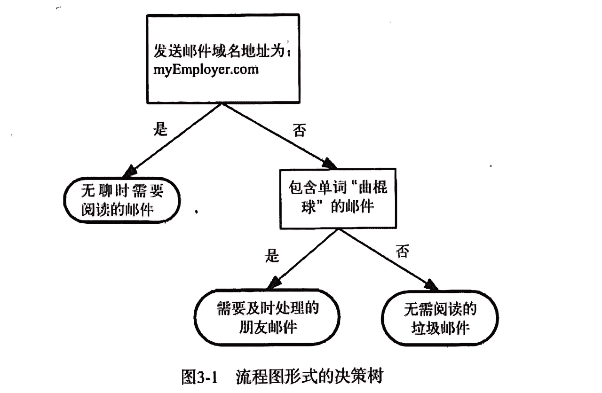
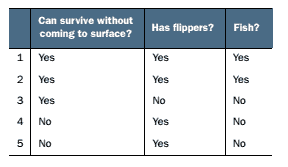
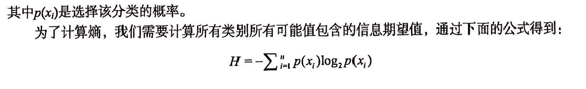

# 决策树

> 来源：[https://qqs7y1hozd1.feishu.cn/docx/Aq0AdhatzoPhIZxAZQIcpxxynRb](https://qqs7y1hozd1.feishu.cn/docx/Aq0AdhatzoPhIZxAZQIcpxxynRb)

## 决策树「概述」

决策树（Decision Tree）算法是一种基本的分类与回归方法，是最经常使用的数据挖掘算法之一。我们这章节只讨论用于分类的决策树

决策树模型呈树形结构，在分类问题中，表示基于特征对实例进行分类的过程。它可以认为是 `if-then` 规则的集合，也可以认为是定义在特征空间与类空间上的条件概率分布

决策树学习通常包括 3 个步骤: 特征选择、决策树的生成和决策树的修剪

## 决策树「场景」

一个叫做 "二十个问题" 的游戏，游戏的规则很简单: 参与游戏的一方在脑海中想某个事物，其他参与者向他提问，只允许提 20 个问题，问题的答案也只能用对或错回答。问问题的人通过推断分解，逐步缩小待猜测事物的范围，最后得到游戏的答案。

一个邮件分类系统，大致工作流程如下:



```
首先检测发送邮件域名地址。如果地址为 myEmployer.com, 则将其放在分类 &quot;无聊时需要阅读的邮件&quot;中
如果邮件不是来自这个域名，则检测邮件内容里是否包含单词 &quot;曲棍球&quot; , 如果包含则将邮件归类到 &quot;需要及时处理的朋友邮件&quot;, 
如果不包含则将邮件归类到 &quot;无需阅读的垃圾邮件&quot; 
```

### 决策树

分类决策树模型是一种描述对实例进行分类的树形结构。决策树由结点（node）和有向边（directed edge）组成。结点有两种类型: 内部结点（internal node）和叶结点（leaf node）。内部结点表示一个特征或属性(features)，叶结点表示一个类(labels)

用决策树对需要测试的实例进行分类: 从根节点开始，对实例的某一特征进行测试，根据测试结果，将实例分配到其子结点；这时，每一个子结点对应着该特征的一个取值。如此递归地对实例进行测试并分配，直至达到叶结点。最后将实例分配到叶结点的类中

## 决策树「原理」

### 决策树 须知概念

#### 信息熵 & 信息增益

熵（entropy）: 熵指的是体系的混乱的程度，在不同的学科中也有引申出的更为具体的定义，是各领域十分重要的参量

信息论（information theory）中的熵（香农熵）: 是一种信息的度量方式，表示信息的混乱程度，也就是说: 信息越有序，信息熵越低。例如: 火柴有序放在火柴盒里，熵值很低，相反，熵值很高

信息增益（information gain）: 在划分数据集前后信息发生的变化称为信息增益

#### 决策树 工作原理

如何构造一个决策树?

我们使用 `createBranch()` 方法，如下所示:

```
def createBranch():
&#x27;&#x27;&#x27;
此处运用了迭代的思想。 感兴趣可以搜索 迭代 recursion， 甚至是 dynamic programing。
&#x27;&#x27;&#x27;
    检测数据集中的所有数据的分类标签是否相同:
        If so return 类标签
        Else:
            寻找划分数据集的最好特征（划分之后信息熵最小，也就是信息增益最大的特征）
            划分数据集
            创建分支节点
                for 每个划分的子集
                    调用函数 createBranch （创建分支的函数）并增加返回结果到分支节点中
            return 分支节点
```

#### 决策树 算法流程

```
收集数据: 可以使用任何方法。
准备数据: 树构造算法 (这里使用的是ID3算法，只适用于标称型数据，这就是为什么数值型数据必须离散化。 还有其他的树构造算法，比如CART)
分析数据: 可以使用任何方法，构造树完成之后，我们应该检查图形是否符合预期。
训练算法: 构造树的数据结构。
测试算法: 使用训练好的树计算错误率。
使用算法: 此步骤可以适用于任何监督学习任务，而使用决策树可以更好地理解数据的内在含义。
```

#### 决策树 算法特点

```
优点: 计算复杂度不高，输出结果易于理解，数据有缺失也能跑，可以处理不相关特征。
缺点: 容易过拟合。
适用数据类型: 数值型和标称型。
```

## 决策树「项目案例」

### 项目案例1: 判定鱼类和非鱼类

#### 项目概述

根据以下 2 个特征，将动物分成两类: 鱼类和非鱼类。

特征:

1. 不浮出水面是否可以生存
2. 是否有脚蹼

#### 开发流程


```python
#!/usr/bin/python
# coding:utf-8
'''
Created on Oct 12, 2010
Update on 2017-05-18
Decision Tree Source Code for Machine Learning in Action Ch. 3
Author: Peter Harrington/片刻
GitHub: https://github.com/apachecn/AiLearning
'''
from __future__ import print_function
print(__doc__)
import operator
from math import log
import decisionTreePlot as dtPlot
from collections import Counter


def createDataSet():
    """DateSet 基础数据集

    Args:
        无需传入参数
    Returns:
        返回数据集和对应的label标签
    """
    dataSet = [[1, 1, 'yes'],
               [1, 1, 'yes'],
               [1, 0, 'no'],
               [0, 1, 'no'],
               [0, 1, 'no']]
    # dataSet = [['yes'],
    #         ['yes'],
    #         ['no'],
    #         ['no'],
    #         ['no']]
    # labels  露出水面   脚蹼
    labels = ['no surfacing', 'flippers']
    # change to discrete values
    return dataSet, labels


def calcShannonEnt(dataSet):
    """calcShannonEnt(calculate Shannon entropy 计算给定数据集的香农熵)

    Args:
        dataSet 数据集
    Returns:
        返回 每一组feature下的某个分类下，香农熵的信息期望
    """
    # -----------计算香农熵的第一种实现方式start--------------------------------------------------------------------------------
    # 求list的长度，表示计算参与训练的数据量
    numEntries = len(dataSet)
    # 下面输出我们测试的数据集的一些信息
    # 例如: <type 'list'> numEntries:  5 是下面的代码的输出
    # print type(dataSet), 'numEntries: ', numEntries

    # 计算分类标签label出现的次数
    labelCounts = {}
    # the the number of unique elements and their occurance
    for featVec in dataSet:
        # 将当前实例的标签存储，即每一行数据的最后一个数据代表的是标签
        currentLabel = featVec[-1]
        # 为所有可能的分类创建字典，如果当前的键值不存在，则扩展字典并将当前键值加入字典。每个键值都记录了当前类别出现的次数。
        if currentLabel not in labelCounts.keys():
            labelCounts[currentLabel] = 0
        labelCounts[currentLabel] += 1
        # print '-----', featVec, labelCounts

    # 对于label标签的占比，求出label标签的香农熵
    shannonEnt = 0.0
    for key in labelCounts:
        # 使用所有类标签的发生频率计算类别出现的概率。
        prob = float(labelCounts[key])/numEntries
        # log base 2 
        # 计算香农熵，以 2 为底求对数
        shannonEnt -= prob * log(prob, 2)
        # print '---', prob, prob * log(prob, 2), shannonEnt
    # -----------计算香农熵的第一种实现方式end--------------------------------------------------------------------------------

    # # -----------计算香农熵的第二种实现方式start--------------------------------------------------------------------------------
    # # 统计标签出现的次数
    # label_count = Counter(data[-1] for data in dataSet)
    # # 计算概率
    # probs = [p[1] / len(dataSet) for p in label_count.items()]
    # # 计算香农熵
    # shannonEnt = sum([-p * log(p, 2) for p in probs])
    # # -----------计算香农熵的第二种实现方式end--------------------------------------------------------------------------------
    return shannonEnt


def splitDataSet(dataSet, index, value):
    """splitDataSet(通过遍历dataSet数据集，求出index对应的colnum列的值为value的行)
        就是依据index列进行分类，如果index列的数据等于 value的时候，就要将 index 划分到我们创建的新的数据集中
    Args:
        dataSet 数据集                 待划分的数据集
        index 表示每一行的index列        划分数据集的特征
        value 表示index列对应的value值   需要返回的特征的值。
    Returns:
        index列为value的数据集【该数据集需要排除index列】
    """
    # -----------切分数据集的第一种方式 start------------------------------------
    retDataSet = []
    for featVec in dataSet: 
        # index列为value的数据集【该数据集需要排除index列】
        # 判断index列的值是否为value
        if featVec[index] == value:
            # chop out index used for splitting
            # [:index]表示前index行，即若 index 为2，就是取 featVec 的前 index 行
            reducedFeatVec = featVec[:index]
            '''
            请百度查询一下:  extend和append的区别
            list.append(object) 向列表中添加一个对象object
            list.extend(sequence) 把一个序列seq的内容添加到列表中
            1、使用append的时候，是将new_media看作一个对象，整体打包添加到music_media对象中。
            2、使用extend的时候，是将new_media看作一个序列，将这个序列和music_media序列合并，并放在其后面。
            result = []
            result.extend([1,2,3])
            print result
            result.append([4,5,6])
            print result
            result.extend([7,8,9])
            print result
            结果: 
            [1, 2, 3]
            [1, 2, 3, [4, 5, 6]]
            [1, 2, 3, [4, 5, 6], 7, 8, 9]
            '''
            reducedFeatVec.extend(featVec[index+1:])
            # [index+1:]表示从跳过 index 的 index+1行，取接下来的数据
            # 收集结果值 index列为value的行【该行需要排除index列】
            retDataSet.append(reducedFeatVec)
    # -----------切分数据集的第一种方式 end------------------------------------

    # # -----------切分数据集的第二种方式 start------------------------------------
    # retDataSet = [data for data in dataSet for i, v in enumerate(data) if i == axis and v == value]
    # # -----------切分数据集的第二种方式 end------------------------------------
    return retDataSet


def chooseBestFeatureToSplit(dataSet):
    """chooseBestFeatureToSplit(选择最好的特征)

    Args:
        dataSet 数据集
    Returns:
        bestFeature 最优的特征列
    """

    # -----------选择最优特征的第一种方式 start------------------------------------
    # 求第一行有多少列的 Feature, 最后一列是label列嘛
    numFeatures = len(dataSet[0]) - 1
    # label的信息熵
    baseEntropy = calcShannonEnt(dataSet)
    # 最优的信息增益值, 和最优的Featurn编号
    bestInfoGain, bestFeature = 0.0, -1
    # iterate over all the features
    for i in range(numFeatures):
        # create a list of all the examples of this feature
        # 获取每一个实例的第i+1个feature，组成list集合
        featList = [example[i] for example in dataSet]
        # get a set of unique values
        # 获取剔重后的集合，使用set对list数据进行去重
        uniqueVals = set(featList)
        # 创建一个临时的信息熵
        newEntropy = 0.0
        # 遍历某一列的value集合，计算该列的信息熵 
        # 遍历当前特征中的所有唯一属性值，对每个唯一属性值划分一次数据集，计算数据集的新熵值，并对所有唯一特征值得到的熵求和。
        for value in uniqueVals:
            subDataSet = splitDataSet(dataSet, i, value)
            prob = len(subDataSet)/float(len(dataSet))
            newEntropy += prob * calcShannonEnt(subDataSet)
        # gain[信息增益]: 划分数据集前后的信息变化， 获取信息熵最大的值
        # 信息增益是熵的减少或者是数据无序度的减少。最后，比较所有特征中的信息增益，返回最好特征划分的索引值。
        infoGain = baseEntropy - newEntropy
        print('infoGain=', infoGain, 'bestFeature=', i, baseEntropy, newEntropy)
        if (infoGain > bestInfoGain):
            bestInfoGain = infoGain
            bestFeature = i
    return bestFeature
    # -----------选择最优特征的第一种方式 end------------------------------------

    # # -----------选择最优特征的第二种方式 start------------------------------------
    # # 计算初始香农熵
    # base_entropy = calcShannonEnt(dataSet)
    # best_info_gain = 0
    # best_feature = -1
    # # 遍历每一个特征
    # for i in range(len(dataSet[0]) - 1):
    #     # 对当前特征进行统计
    #     feature_count = Counter([data[i] for data in dataSet])
    #     # 计算分割后的香农熵
    #     new_entropy = sum(feature[1] / float(len(dataSet)) * calcShannonEnt(splitDataSet(dataSet, i, feature[0])) \
    #                    for feature in feature_count.items())
    #     # 更新值
    #     info_gain = base_entropy - new_entropy
    #     print('No. {0} feature info gain is {1:.3f}'.format(i, info_gain))
    #     if info_gain > best_info_gain:
    #         best_info_gain = info_gain
    #         best_feature = i
    # return best_feature
    # # -----------选择最优特征的第二种方式 end------------------------------------


def majorityCnt(classList):
    """majorityCnt(选择出现次数最多的一个结果)

    Args:
        classList label列的集合
    Returns:
        bestFeature 最优的特征列
    """
    # -----------majorityCnt的第一种方式 start------------------------------------
    classCount = {}
    for vote in classList:
        if vote not in classCount.keys():
            classCount[vote] = 0
        classCount[vote] += 1
    # 倒叙排列classCount得到一个字典集合，然后取出第一个就是结果（yes/no），即出现次数最多的结果
    sortedClassCount = sorted(classCount.iteritems(), key=operator.itemgetter(1), reverse=True)
    # print 'sortedClassCount:', sortedClassCount
    return sortedClassCount[0][0]
    # -----------majorityCnt的第一种方式 end------------------------------------

    # # -----------majorityCnt的第二种方式 start------------------------------------
    # major_label = Counter(classList).most_common(1)[0]
    # return major_label
    # # -----------majorityCnt的第二种方式 end------------------------------------


def createTree(dataSet, labels):
    classList = [example[-1] for example in dataSet]
    # 如果数据集的最后一列的第一个值出现的次数=整个集合的数量，也就说只有一个类别，就只直接返回结果就行
    # 第一个停止条件: 所有的类标签完全相同，则直接返回该类标签。
    # count() 函数是统计括号中的值在list中出现的次数
    if classList.count(classList[0]) == len(classList):
        return classList[0]
    # 如果数据集只有1列，那么最初出现label次数最多的一类，作为结果
    # 第二个停止条件: 使用完了所有特征，仍然不能将数据集划分成仅包含唯一类别的分组。
    if len(dataSet[0]) == 1:
        return majorityCnt(classList)

    # 选择最优的列，得到最优列对应的label含义
    bestFeat = chooseBestFeatureToSplit(dataSet)
    # 获取label的名称
    bestFeatLabel = labels[bestFeat]
    # 初始化myTree
    myTree = {bestFeatLabel: {}}
    # 注: labels列表是可变对象，在PYTHON函数中作为参数时传址引用，能够被全局修改
    # 所以这行代码导致函数外的同名变量被删除了元素，造成例句无法执行，提示'no surfacing' is not in list
    del(labels[bestFeat])
    # 取出最优列，然后它的branch做分类
    featValues = [example[bestFeat] for example in dataSet]
    uniqueVals = set(featValues)
    for value in uniqueVals:
        # 求出剩余的标签label
        subLabels = labels[:]
        # 遍历当前选择特征包含的所有属性值，在每个数据集划分上递归调用函数createTree()
        myTree[bestFeatLabel][value] = createTree(splitDataSet(dataSet, bestFeat, value), subLabels)
        # print 'myTree', value, myTree
    return myTree


def classify(inputTree, featLabels, testVec):
    """classify(给输入的节点，进行分类)

    Args:
        inputTree  决策树模型
        featLabels Feature标签对应的名称
        testVec    测试输入的数据
    Returns:
        classLabel 分类的结果值，需要映射label才能知道名称
    """
    # 获取tree的根节点对于的key值
    firstStr = inputTree.keys()[0]
    # 通过key得到根节点对应的value
    secondDict = inputTree[firstStr]
    # 判断根节点名称获取根节点在label中的先后顺序，这样就知道输入的testVec怎么开始对照树来做分类
    featIndex = featLabels.index(firstStr)
    # 测试数据，找到根节点对应的label位置，也就知道从输入的数据的第几位来开始分类
    key = testVec[featIndex]
    valueOfFeat = secondDict[key]
    print('+++', firstStr, 'xxx', secondDict, '---', key, '>>>', valueOfFeat)
    # 判断分枝是否结束: 判断valueOfFeat是否是dict类型
    if isinstance(valueOfFeat, dict):
        classLabel = classify(valueOfFeat, featLabels, testVec)
    else:
        classLabel = valueOfFeat
    return classLabel


def storeTree(inputTree, filename):
    import pickle
    # -------------- 第一种方法 start --------------
    fw = open(filename, 'wb')
    pickle.dump(inputTree, fw)
    fw.close()
    # -------------- 第一种方法 end --------------

    # -------------- 第二种方法 start --------------
    with open(filename, 'wb') as fw:
        pickle.dump(inputTree, fw)
    # -------------- 第二种方法 start --------------


def grabTree(filename):
    import pickle
    fr = open(filename, 'rb')
    return pickle.load(fr)


def fishTest():
    # 1.创建数据和结果标签
    myDat, labels = createDataSet()
    # print myDat, labels

    # 计算label分类标签的香农熵
    # calcShannonEnt(myDat)

    # # 求第0列 为 1/0的列的数据集【排除第0列】
    # print '1---', splitDataSet(myDat, 0, 1)
    # print '0---', splitDataSet(myDat, 0, 0)

    # # 计算最好的信息增益的列
    # print chooseBestFeatureToSplit(myDat)

    import copy
    myTree = createTree(myDat, copy.deepcopy(labels))
    print(myTree)
    # [1, 1]表示要取的分支上的节点位置，对应的结果值
    print(classify(myTree, labels, [1, 1]))
    
    # 获得树的高度
    print(get_tree_height(myTree))

    # 画图可视化展现
    dtPlot.createPlot(myTree)


def ContactLensesTest():
    """
    Desc:
        预测隐形眼镜的测试代码
    Args:
        none
    Returns:
        none
    """

    # 加载隐形眼镜相关的 文本文件 数据
    fr = open('data/3.DecisionTree/lenses.txt')
    # 解析数据，获得 features 数据
    lenses = [inst.strip().split('\t') for inst in fr.readlines()]
    # 得到数据的对应的 Labels
    lensesLabels = ['age', 'prescript', 'astigmatic', 'tearRate']
    # 使用上面的创建决策树的代码，构造预测隐形眼镜的决策树
    lensesTree = createTree(lenses, lensesLabels)
    print(lensesTree)
    # 画图可视化展现
    dtPlot.createPlot(lensesTree)
    
    
def get_tree_height(tree):
    """
     Desc:
        递归获得决策树的高度
    Args:
        tree
    Returns:
        树高
    """

    if not isinstance(tree, dict):
        return 1

    child_trees = tree.values()[0].values()

    # 遍历子树, 获得子树的最大高度
    max_height = 0
    for child_tree in child_trees:
        child_tree_height = get_tree_height(child_tree)

        if child_tree_height > max_height:
            max_height = child_tree_height

    return max_height + 1


if __name__ == "__main__":
    fishTest()
    # ContactLensesTest()
```


# 决策树算法实现与应用

## 算法流程概述

- 收集数据: 可以使用任何方法
- 准备数据: 树构造算法（这里使用的是ID3算法，因此数值型数据必须离散化。）
- 分析数据: 可以使用任何方法，构造树完成之后，我们可以将树画出来
- 训练算法: 构造树结构
- 测试算法: 使用习得的决策树执行分类
- 使用算法: 此步骤可以适用于任何监督学习任务，而使用决策树可以更好地理解数据的内在含义

## 收集数据

可以使用任何方法



我们利用 `createDataSet()` 函数输入数据

```
def createDataSet():
    dataSet = [[1, 1, 'yes'],
            [1, 1, 'yes'],
            [1, 0, 'no'],
            [0, 1, 'no'],
            [0, 1, 'no']]
    labels = ['no surfacing', 'flippers']
    return dataSet, labels
```

## 准备数据

树构造算法（这里使用的是ID3算法，因此数值型数据必须离散化。）

此处，由于我们输入的数据本身就是离散化数据，所以这一步就省略了

## 分析数据

可以使用任何方法，构造树完成之后，我们可以将树画出来



### 计算香农熵

计算给定数据集的香农熵的函数

```
def calcShannonEnt(dataSet):
    # 求list的长度，表示计算参与训练的数据量
    numEntries = len(dataSet)
    # 计算分类标签label出现的次数
    labelCounts = {}
    # the the number of unique elements and their occurrence
    for featVec in dataSet:
        # 将当前实例的标签存储，即每一行数据的最后一个数据代表的是标签
        currentLabel = featVec[-1]
        # 为所有可能的分类创建字典，如果当前的键值不存在，则扩展字典并将当前键值加入字典。每个键值都记录了当前类别出现的次数。
        if currentLabel not in labelCounts.keys():
            labelCounts[currentLabel] = 0
        labelCounts[currentLabel] += 1

    # 对于 label 标签的占比，求出 label 标签的香农熵
    shannonEnt = 0.0
    for key in labelCounts:
        # 使用所有类标签的发生频率计算类别出现的概率。
        prob = float(labelCounts[key])/numEntries
        # 计算香农熵，以 2 为底求对数
        shannonEnt -= prob * log(prob, 2)
    return shannonEnt
```

### 按照给定特征划分数据集

将指定特征的特征值等于 `value` 的行剩下列作为子数据集

```
def splitDataSet(dataSet, index, value):
    """splitDataSet(通过遍历dataSet数据集，求出index对应的colnum列的值为value的行)
        就是依据index列进行分类，如果index列的数据等于 value的时候，就要将 index 划分到我们创建的新的数据集中
    Args:
        dataSet 数据集                 待划分的数据集
        index 表示每一行的index列        划分数据集的特征
        value 表示index列对应的value值   需要返回的特征的值。
    Returns:
        index列为value的数据集【该数据集需要排除index列】
    """
    retDataSet = []
    for featVec in dataSet: 
        # index列为value的数据集【该数据集需要排除index列】
        # 判断index列的值是否为value
        if featVec[index] == value:
            # chop out index used for splitting
            # [:index]表示前index行，即若 index 为2，就是取 featVec 的前 index 行
            reducedFeatVec = featVec[:index]
            '''
            请百度查询一下:  extend和append的区别
            music_media.append(object) 向列表中添加一个对象object
            music_media.extend(sequence) 把一个序列seq的内容添加到列表中 (跟 += 在list运用类似， music_media += sequence)
            1、使用append的时候，是将object看作一个对象，整体打包添加到music_media对象中。
            2、使用extend的时候，是将sequence看作一个序列，将这个序列和music_media序列合并，并放在其后面。
            music_media = []
            music_media.extend([1,2,3])
            print music_media
            #结果: 
            #[1, 2, 3]
            
            music_media.append([4,5,6])
            print music_media
            #结果: 
            #[1, 2, 3, [4, 5, 6]]
            
            music_media.extend([7,8,9])
            print music_media
            #结果: 
            #[1, 2, 3, [4, 5, 6], 7, 8, 9]
            '''
            reducedFeatVec.extend(featVec[index+1:])
            # [index+1:]表示从跳过 index 的 index+1行，取接下来的数据
            # 收集结果值 index列为value的行【该行需要排除index列】
            retDataSet.append(reducedFeatVec)
    return retDataSet
```

### 选择最好的数据集划分方式

```
def chooseBestFeatureToSplit(dataSet):
    """chooseBestFeatureToSplit(选择最好的特征)

    Args:
        dataSet 数据集
    Returns:
        bestFeature 最优的特征列
    """
    # 求第一行有多少列的 Feature, 最后一列是label列嘛
    numFeatures = len(dataSet[0]) - 1
    # 数据集的原始信息熵
    baseEntropy = calcShannonEnt(dataSet)
    # 最优的信息增益值, 和最优的Featurn编号
    bestInfoGain, bestFeature = 0.0, -1
    # iterate over all the features
    for i in range(numFeatures):
        # create a list of all the examples of this feature
        # 获取对应的feature下的所有数据
        featList = [example[i] for example in dataSet]
        # get a set of unique values
        # 获取剔重后的集合，使用set对list数据进行去重
        uniqueVals = set(featList)
        # 创建一个临时的信息熵
        newEntropy = 0.0
        # 遍历某一列的value集合，计算该列的信息熵 
        # 遍历当前特征中的所有唯一属性值，对每个唯一属性值划分一次数据集，计算数据集的新熵值，并对所有唯一特征值得到的熵求和。
        for value in uniqueVals:
            subDataSet = splitDataSet(dataSet, i, value)
            # 计算概率
            prob = len(subDataSet)/float(len(dataSet))
            # 计算信息熵
            newEntropy += prob * calcShannonEnt(subDataSet)
        # gain[信息增益]: 划分数据集前后的信息变化， 获取信息熵最大的值
        # 信息增益是熵的减少或者是数据无序度的减少。最后，比较所有特征中的信息增益，返回最好特征划分的索引值。
        infoGain = baseEntropy - newEntropy
        print 'infoGain=', infoGain, 'bestFeature=', i, baseEntropy, newEntropy
        if (infoGain > bestInfoGain):
            bestInfoGain = infoGain
            bestFeature = i
    return bestFeature
```

问: 上面的 `newEntropy` 为什么是根据子集计算的呢？
答: 因为我们在根据一个特征计算香农熵的时候，该特征的分类值是相同，这个特征这个分类的香农熵为 0；
这就是为什么计算新的香农熵的时候使用的是子集。

## 训练算法: 构造树的数据结构

创建树的函数代码如下:

```
def createTree(dataSet, labels):
    classList = [example[-1] for example in dataSet]
    # 如果数据集的最后一列的第一个值出现的次数=整个集合的数量，也就说只有一个类别，就只直接返回结果就行
    # 第一个停止条件: 所有的类标签完全相同，则直接返回该类标签。
    # count() 函数是统计括号中的值在list中出现的次数
    if classList.count(classList[0]) == len(classList):
        return classList[0]
    # 如果数据集只有1列，那么最初出现label次数最多的一类，作为结果
    # 第二个停止条件: 使用完了所有特征，仍然不能将数据集划分成仅包含唯一类别的分组。
    if len(dataSet[0]) == 1:
        return majorityCnt(classList)

    # 选择最优的列，得到最优列对应的label含义
    bestFeat = chooseBestFeatureToSplit(dataSet)
    # 获取label的名称
    bestFeatLabel = labels[bestFeat]
    # 初始化myTree
    myTree = {bestFeatLabel: {}}
    # 注: labels列表是可变对象，在PYTHON函数中作为参数时传址引用，能够被全局修改
    # 所以这行代码导致函数外的同名变量被删除了元素，造成例句无法执行，提示'no surfacing' is not in list
    del(labels[bestFeat])
    # 取出最优列，然后它的branch做分类
    featValues = [example[bestFeat] for example in dataSet]
    uniqueVals = set(featValues)
    for value in uniqueVals:
        # 求出剩余的标签label
        subLabels = labels[:]
        # 遍历当前选择特征包含的所有属性值，在每个数据集划分上递归调用函数createTree()
        myTree[bestFeatLabel][value] = createTree(splitDataSet(dataSet, bestFeat, value), subLabels)
        # print 'myTree', value, myTree
    return myTree
```

## 测试算法: 使用决策树执行分类

```
def classify(inputTree, featLabels, testVec):
    """classify(给输入的节点，进行分类)

    Args:
        inputTree  决策树模型
        featLabels Feature标签对应的名称
        testVec    测试输入的数据
    Returns:
        classLabel 分类的结果值，需要映射label才能知道名称
    """
    # 获取tree的根节点对于的key值
    firstStr = list(inputTree.keys())[0]
    # 通过key得到根节点对应的value
    secondDict = inputTree[firstStr]
    # 判断根节点名称获取根节点在label中的先后顺序，这样就知道输入的testVec怎么开始对照树来做分类
    featIndex = featLabels.index(firstStr)
    # 测试数据，找到根节点对应的label位置，也就知道从输入的数据的第几位来开始分类
    key = testVec[featIndex]
    valueOfFeat = secondDict[key]
    print '+++', firstStr, 'xxx', secondDict, '---', key, '>>>', valueOfFeat
    # 判断分枝是否结束: 判断valueOfFeat是否是dict类型
    if isinstance(valueOfFeat, dict):
        classLabel = classify(valueOfFeat, featLabels, testVec)
    else:
        classLabel = valueOfFeat
    return classLabel
```

## 使用算法

此步骤可以适用于任何监督学习任务，而使用决策树可以更好地理解数据的内在含义

## 项目案例2: 使用决策树预测隐形眼镜类型

### **开发流程**


```python
#!/usr/bin/python
# coding:utf-8
&#x27;&#x27;&#x27;
Created on Oct 12, 2010
Update on 2017-05-18
Decision Tree Source Code for Machine Learning in Action Ch. 3
Author: Peter Harrington/片刻
GitHub: https://github.com/apachecn/AiLearning
&#x27;&#x27;&#x27;
from __future__ import print_function
print(__doc__)
import operator
from math import log
import decisionTreePlot as dtPlot
from collections import Counter


def createDataSet():
    &quot;&quot;&quot;DateSet 基础数据集

    Args:
        无需传入参数
    Returns:
        返回数据集和对应的label标签
    &quot;&quot;&quot;
    dataSet = [[1, 1, &#x27;yes&#x27;],
               [1, 1, &#x27;yes&#x27;],
               [1, 0, &#x27;no&#x27;],
               [0, 1, &#x27;no&#x27;],
               [0, 1, &#x27;no&#x27;]]
    # dataSet = [[&#x27;yes&#x27;],
    #         [&#x27;yes&#x27;],
    #         [&#x27;no&#x27;],
    #         [&#x27;no&#x27;],
    #         [&#x27;no&#x27;]]
    # labels  露出水面   脚蹼
    labels = [&#x27;no surfacing&#x27;, &#x27;flippers&#x27;]
    # change to discrete values
    return dataSet, labels


def calcShannonEnt(dataSet):
    &quot;&quot;&quot;calcShannonEnt(calculate Shannon entropy 计算给定数据集的香农熵)

    Args:
        dataSet 数据集
    Returns:
        返回 每一组feature下的某个分类下，香农熵的信息期望
    &quot;&quot;&quot;
    # -----------计算香农熵的第一种实现方式start--------------------------------------------------------------------------------
    # 求list的长度，表示计算参与训练的数据量
    numEntries = len(dataSet)
    # 下面输出我们测试的数据集的一些信息
    # 例如: &lt;type &#x27;list&#x27;&gt; numEntries:  5 是下面的代码的输出
    # print type(dataSet), &#x27;numEntries: &#x27;, numEntries

    # 计算分类标签label出现的次数
    labelCounts = {}
    # the the number of unique elements and their occurance
    for featVec in dataSet:
        # 将当前实例的标签存储，即每一行数据的最后一个数据代表的是标签
        currentLabel = featVec[-1]
        # 为所有可能的分类创建字典，如果当前的键值不存在，则扩展字典并将当前键值加入字典。每个键值都记录了当前类别出现的次数。
        if currentLabel not in labelCounts.keys():
            labelCounts[currentLabel] = 0
        labelCounts[currentLabel] += 1
        # print &#x27;-----&#x27;, featVec, labelCounts

    # 对于label标签的占比，求出label标签的香农熵
    shannonEnt = 0.0
    for key in labelCounts:
        # 使用所有类标签的发生频率计算类别出现的概率。
        prob = float(labelCounts[key])/numEntries
        # log base 2 
        # 计算香农熵，以 2 为底求对数
        shannonEnt -= prob * log(prob, 2)
        # print &#x27;---&#x27;, prob, prob * log(prob, 2), shannonEnt
    # -----------计算香农熵的第一种实现方式end--------------------------------------------------------------------------------

    # # -----------计算香农熵的第二种实现方式start--------------------------------------------------------------------------------
    # # 统计标签出现的次数
    # label_count = Counter(data[-1] for data in dataSet)
    # # 计算概率
    # probs = [p[1] / len(dataSet) for p in label_count.items()]
    # # 计算香农熵
    # shannonEnt = sum([-p * log(p, 2) for p in probs])
    # # -----------计算香农熵的第二种实现方式end--------------------------------------------------------------------------------
    return shannonEnt


def splitDataSet(dataSet, index, value):
    &quot;&quot;&quot;splitDataSet(通过遍历dataSet数据集，求出index对应的colnum列的值为value的行)
        就是依据index列进行分类，如果index列的数据等于 value的时候，就要将 index 划分到我们创建的新的数据集中
    Args:
        dataSet 数据集                 待划分的数据集
        index 表示每一行的index列        划分数据集的特征
        value 表示index列对应的value值   需要返回的特征的值。
    Returns:
        index列为value的数据集【该数据集需要排除index列】
    &quot;&quot;&quot;
    # -----------切分数据集的第一种方式 start------------------------------------
    retDataSet = []
    for featVec in dataSet: 
        # index列为value的数据集【该数据集需要排除index列】
        # 判断index列的值是否为value
        if featVec[index] == value:
            # chop out index used for splitting
            # [:index]表示前index行，即若 index 为2，就是取 featVec 的前 index 行
            reducedFeatVec = featVec[:index]
            &#x27;&#x27;&#x27;
            请百度查询一下:  extend和append的区别
            list.append(object) 向列表中添加一个对象object
            list.extend(sequence) 把一个序列seq的内容添加到列表中
            1、使用append的时候，是将new_media看作一个对象，整体打包添加到music_media对象中。
            2、使用extend的时候，是将new_media看作一个序列，将这个序列和music_media序列合并，并放在其后面。
            result = []
            result.extend([1,2,3])
            print result
            result.append([4,5,6])
            print result
            result.extend([7,8,9])
            print result
            结果: 
            [1, 2, 3]
            [1, 2, 3, [4, 5, 6]]
            [1, 2, 3, [4, 5, 6], 7, 8, 9]
            &#x27;&#x27;&#x27;
            reducedFeatVec.extend(featVec[index+1:])
            # [index+1:]表示从跳过 index 的 index+1行，取接下来的数据
            # 收集结果值 index列为value的行【该行需要排除index列】
            retDataSet.append(reducedFeatVec)
    # -----------切分数据集的第一种方式 end------------------------------------

    # # -----------切分数据集的第二种方式 start------------------------------------
    # retDataSet = [data for data in dataSet for i, v in enumerate(data) if i == axis and v == value]
    # # -----------切分数据集的第二种方式 end------------------------------------
    return retDataSet


def chooseBestFeatureToSplit(dataSet):
    &quot;&quot;&quot;chooseBestFeatureToSplit(选择最好的特征)

    Args:
        dataSet 数据集
    Returns:
        bestFeature 最优的特征列
    &quot;&quot;&quot;

    # -----------选择最优特征的第一种方式 start------------------------------------
    # 求第一行有多少列的 Feature, 最后一列是label列嘛
    numFeatures = len(dataSet[0]) - 1
    # label的信息熵
    baseEntropy = calcShannonEnt(dataSet)
    # 最优的信息增益值, 和最优的Featurn编号
    bestInfoGain, bestFeature = 0.0, -1
    # iterate over all the features
    for i in range(numFeatures):
        # create a list of all the examples of this feature
        # 获取每一个实例的第i+1个feature，组成list集合
        featList = [example[i] for example in dataSet]
        # get a set of unique values
        # 获取剔重后的集合，使用set对list数据进行去重
        uniqueVals = set(featList)
        # 创建一个临时的信息熵
        newEntropy = 0.0
        # 遍历某一列的value集合，计算该列的信息熵 
        # 遍历当前特征中的所有唯一属性值，对每个唯一属性值划分一次数据集，计算数据集的新熵值，并对所有唯一特征值得到的熵求和。
        for value in uniqueVals:
            subDataSet = splitDataSet(dataSet, i, value)
            prob = len(subDataSet)/float(len(dataSet))
            newEntropy += prob * calcShannonEnt(subDataSet)
        # gain[信息增益]: 划分数据集前后的信息变化， 获取信息熵最大的值
        # 信息增益是熵的减少或者是数据无序度的减少。最后，比较所有特征中的信息增益，返回最好特征划分的索引值。
        infoGain = baseEntropy - newEntropy
        print(&#x27;infoGain=&#x27;, infoGain, &#x27;bestFeature=&#x27;, i, baseEntropy, newEntropy)
        if (infoGain &gt; bestInfoGain):
            bestInfoGain = infoGain
            bestFeature = i
    return bestFeature
    # -----------选择最优特征的第一种方式 end------------------------------------

    # # -----------选择最优特征的第二种方式 start------------------------------------
    # # 计算初始香农熵
    # base_entropy = calcShannonEnt(dataSet)
    # best_info_gain = 0
    # best_feature = -1
    # # 遍历每一个特征
    # for i in range(len(dataSet[0]) - 1):
    #     # 对当前特征进行统计
    #     feature_count = Counter([data[i] for data in dataSet])
    #     # 计算分割后的香农熵
    #     new_entropy = sum(feature[1] / float(len(dataSet)) * calcShannonEnt(splitDataSet(dataSet, i, feature[0])) \
    #                    for feature in feature_count.items())
    #     # 更新值
    #     info_gain = base_entropy - new_entropy
    #     print(&#x27;No. {0} feature info gain is {1:.3f}&#x27;.format(i, info_gain))
    #     if info_gain &gt; best_info_gain:
    #         best_info_gain = info_gain
    #         best_feature = i
    # return best_feature
    # # -----------选择最优特征的第二种方式 end------------------------------------


def majorityCnt(classList):
    &quot;&quot;&quot;majorityCnt(选择出现次数最多的一个结果)

    Args:
        classList label列的集合
    Returns:
        bestFeature 最优的特征列
    &quot;&quot;&quot;
    # -----------majorityCnt的第一种方式 start------------------------------------
    classCount = {}
    for vote in classList:
        if vote not in classCount.keys():
            classCount[vote] = 0
        classCount[vote] += 1
    # 倒叙排列classCount得到一个字典集合，然后取出第一个就是结果（yes/no），即出现次数最多的结果
    sortedClassCount = sorted(classCount.iteritems(), key=operator.itemgetter(1), reverse=True)
    # print &#x27;sortedClassCount:&#x27;, sortedClassCount
    return sortedClassCount[0][0]
    # -----------majorityCnt的第一种方式 end------------------------------------

    # # -----------majorityCnt的第二种方式 start------------------------------------
    # major_label = Counter(classList).most_common(1)[0]
    # return major_label
    # # -----------majorityCnt的第二种方式 end------------------------------------


def createTree(dataSet, labels):
    classList = [example[-1] for example in dataSet]
    # 如果数据集的最后一列的第一个值出现的次数=整个集合的数量，也就说只有一个类别，就只直接返回结果就行
    # 第一个停止条件: 所有的类标签完全相同，则直接返回该类标签。
    # count() 函数是统计括号中的值在list中出现的次数
    if classList.count(classList[0]) == len(classList):
        return classList[0]
    # 如果数据集只有1列，那么最初出现label次数最多的一类，作为结果
    # 第二个停止条件: 使用完了所有特征，仍然不能将数据集划分成仅包含唯一类别的分组。
    if len(dataSet[0]) == 1:
        return majorityCnt(classList)

    # 选择最优的列，得到最优列对应的label含义
    bestFeat = chooseBestFeatureToSplit(dataSet)
    # 获取label的名称
    bestFeatLabel = labels[bestFeat]
    # 初始化myTree
    myTree = {bestFeatLabel: {}}
    # 注: labels列表是可变对象，在PYTHON函数中作为参数时传址引用，能够被全局修改
    # 所以这行代码导致函数外的同名变量被删除了元素，造成例句无法执行，提示&#x27;no surfacing&#x27; is not in list
    del(labels[bestFeat])
    # 取出最优列，然后它的branch做分类
    featValues = [example[bestFeat] for example in dataSet]
    uniqueVals = set(featValues)
    for value in uniqueVals:
        # 求出剩余的标签label
        subLabels = labels[:]
        # 遍历当前选择特征包含的所有属性值，在每个数据集划分上递归调用函数createTree()
        myTree[bestFeatLabel][value] = createTree(splitDataSet(dataSet, bestFeat, value), subLabels)
        # print &#x27;myTree&#x27;, value, myTree
    return myTree


def classify(inputTree, featLabels, testVec):
    &quot;&quot;&quot;classify(给输入的节点，进行分类)

    Args:
        inputTree  决策树模型
        featLabels Feature标签对应的名称
        testVec    测试输入的数据
    Returns:
        classLabel 分类的结果值，需要映射label才能知道名称
    &quot;&quot;&quot;
    # 获取tree的根节点对于的key值
    firstStr = inputTree.keys()[0]
    # 通过key得到根节点对应的value
    secondDict = inputTree[firstStr]
    # 判断根节点名称获取根节点在label中的先后顺序，这样就知道输入的testVec怎么开始对照树来做分类
    featIndex = featLabels.index(firstStr)
    # 测试数据，找到根节点对应的label位置，也就知道从输入的数据的第几位来开始分类
    key = testVec[featIndex]
    valueOfFeat = secondDict[key]
    print(&#x27;+++&#x27;, firstStr, &#x27;xxx&#x27;, secondDict, &#x27;---&#x27;, key, &#x27;&gt;&gt;&gt;&#x27;, valueOfFeat)
    # 判断分枝是否结束: 判断valueOfFeat是否是dict类型
    if isinstance(valueOfFeat, dict):
        classLabel = classify(valueOfFeat, featLabels, testVec)
    else:
        classLabel = valueOfFeat
    return classLabel


def storeTree(inputTree, filename):
    import pickle
    # -------------- 第一种方法 start --------------
    fw = open(filename, &#x27;wb&#x27;)
    pickle.dump(inputTree, fw)
    fw.close()
    # -------------- 第一种方法 end --------------

    # -------------- 第二种方法 start --------------
    with open(filename, &#x27;wb&#x27;) as fw:
        pickle.dump(inputTree, fw)
    # -------------- 第二种方法 start --------------


def grabTree(filename):
    import pickle
    fr = open(filename,&#x27;rb&#x27;)
    return pickle.load(fr)


def fishTest():
    # 1.创建数据和结果标签
    myDat, labels = createDataSet()
    # print myDat, labels

    # 计算label分类标签的香农熵
    # calcShannonEnt(myDat)

    # # 求第0列 为 1/0的列的数据集【排除第0列】
    # print &#x27;1---&#x27;, splitDataSet(myDat, 0, 1)
    # print &#x27;0---&#x27;, splitDataSet(myDat, 0, 0)

    # # 计算最好的信息增益的列
    # print chooseBestFeatureToSplit(myDat)

    import copy
    myTree = createTree(myDat, copy.deepcopy(labels))
    print(myTree)
    # [1, 1]表示要取的分支上的节点位置，对应的结果值
    print(classify(myTree, labels, [1, 1]))
    
    # 获得树的高度
    print(get_tree_height(myTree))

    # 画图可视化展现
    dtPlot.createPlot(myTree)


def ContactLensesTest():
    &quot;&quot;&quot;
    Desc:
        预测隐形眼镜的测试代码
    Args:
        none
    Returns:
        none
    &quot;&quot;&quot;

    # 加载隐形眼镜相关的 文本文件 数据
    fr = open(&#x27;data/3.DecisionTree/lenses.txt&#x27;)
    # 解析数据，获得 features 数据
    lenses = [inst.strip().split(&#x27;\t&#x27;) for inst in fr.readlines()]
    # 得到数据的对应的 Labels
    lensesLabels = [&#x27;age&#x27;, &#x27;prescript&#x27;, &#x27;astigmatic&#x27;, &#x27;tearRate&#x27;]
    # 使用上面的创建决策树的代码，构造预测隐形眼镜的决策树
    lensesTree = createTree(lenses, lensesLabels)
    print(lensesTree)
    # 画图可视化展现
    dtPlot.createPlot(lensesTree)
    
    
def get_tree_height(tree):
    &quot;&quot;&quot;
     Desc:
        递归获得决策树的高度
    Args:
        tree
    Returns:
        树高
    &quot;&quot;&quot;

    if not isinstance(tree, dict):
        return 1

    child_trees = tree.values()[0].values()

    # 遍历子树, 获得子树的最大高度
    max_height = 0
    for child_tree in child_trees:
        child_tree_height = get_tree_height(child_tree)

        if child_tree_height &gt; max_height:
            max_height = child_tree_height

    return max_height + 1


if __name__ == &quot;__main__&quot;:
    fishTest()
    # ContactLensesTest()
```


# 项目概述

隐形眼镜类型包括硬材质、软材质以及不适合佩戴隐形眼镜。我们需要使用决策树预测患者需要佩戴的隐形眼镜类型

## 开发流程

1. 收集数据: 提供的文本文件
2. 解析数据: 解析 `tab` 键分隔的数据行
3. 分析数据: 快速检查数据，确保正确地解析数据内容，使用 `createPlot()` 函数绘制最终的树形图
4. 训练算法: 使用 `createTree()` 函数
5. 测试算法: 编写测试函数验证决策树可以正确分类给定的数据实例
6. 使用算法: 存储树的数据结构，以便下次使用时无需重新构造树

### 收集数据: 提供的文本文件

文本文件数据格式如下:

```
young        myope        no        reduced        no lenses
pre        myope        no        reduced        no lenses
presbyopic        myope        no        reduced        no lenses
```

### 解析数据: 解析 `tab` 键分隔的数据行

```
lecses = [inst.strip().split('\t') for inst in fr.readlines()]
lensesLabels = ['age', 'prescript', 'astigmatic', 'tearRate']
```

### 分析数据: 快速检查数据，确保正确地解析数据内容，使用 `createPlot()` 函数绘制最终的树形图

```
>>> treePlotter.createPlot(lensesTree)
```

### 训练算法: 使用 `createTree()` 函数

```
>>> lensesTree = trees.createTree(lenses, lensesLabels)
>>> lensesTree
{'tearRate': {'reduced': 'no lenses', 'normal': {'astigmatic':{'yes': {
'prescript':{'hyper':{'age':{'pre':'no lenses', 'presbyopic':
'no lenses', 'young':'hard'}}, 'myope':'hard'}}, 'no':{'age':{'pre':
'soft', 'presbyopic':{'prescript': {'hyper':'soft', 'myope':
'no lenses'}}, 'young':'soft'}}}}}
```

### 测试算法: 编写测试函数验证决策树可以正确分类给定的数据实例

### 使用算法: 存储树的数据结构，以便下次使用时无需重新构造树

使用 `pickle` 模块存储决策树

```
def storeTree(inputTree, filename):
    import pickle
    fw = open(filename, 'wb')
    pickle.dump(inputTree, fw)
    fw.close()

def grabTree(filename):
    import pickle
    fr = open(filename, 'rb')
    return pickle.load(fr)
```
