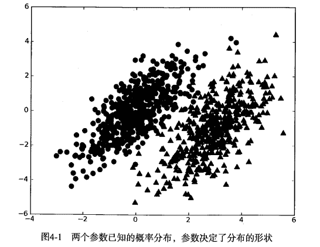
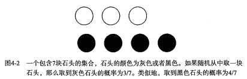
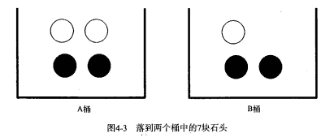
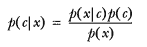
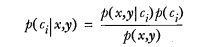

# 朴素贝叶斯

> 来源：[https://qqs7y1hozd1.feishu.cn/docx/SRwYdx3dXoBgFNxw2V6cvsQXnch](https://qqs7y1hozd1.feishu.cn/docx/SRwYdx3dXoBgFNxw2V6cvsQXnch)

# **朴素贝叶斯 概述**

贝叶斯分类是一类分类算法的总称，这类算法均以贝叶斯定理为基础，故统称为贝叶斯分类。本章首先介绍贝叶斯分类算法的基础——贝叶斯定理。最后，我们通过实例来讨论贝叶斯分类的中最简单的一种: 朴素贝叶斯分类

# **贝叶斯理论 & 条件概率**

## **贝叶斯理论**

我们现在有一个数据集，它由两类数据组成，数据分布如下图所示:



我们现在用 p1(x,y) 表示数据点 (x,y) 属于类别 1（图中用圆点表示的类别）的概率，用 p2(x,y) 表示数据点 (x,y) 属于类别 2（图中三角形表示的类别）的概率，那么对于一个新数据点 (x,y)，可以用下面的规则来判断它的类别:

+   如果 p1(x,y) > p2(x,y) ，那么类别为1

+   如果 p2(x,y) > p1(x,y) ，那么类别为2

也就是说，我们会选择高概率对应的类别。这就是贝叶斯决策理论的核心思想，即选择具有最高概率的决策

## **条件概率**

如果你对 p(x,y|c1) 符号很熟悉，那么可以跳过本小节

有一个装了 7 块石头的罐子，其中 3 块是白色的，4 块是黑色的。如果从罐子中随机取出一块石头，那么是白色石头的可能性是多少？由于取石头有 7 种可能，其中 3 种为白色，所以取出白色石头的概率为 3/7 。那么取到黑色石头的概率又是多少呢？很显然，是 4/7 。我们使用 P(white) 来表示取到白色石头的概率，其概率值可以通过白色石头数目除以总的石头数目来得到



如果这 7 块石头如下图所示，放在两个桶中，那么上述概率应该如何计算？



计算 P(white) 或者 P(black) ，如果事先我们知道石头所在桶的信息是会改变结果的。这就是所谓的条件概率（conditional probablity）。假定计算的是从 B 桶取到白色石头的概率，这个概率可以记作 P(white|bucketB) ，我们称之为“在已知石头出自 B 桶的条件下，取出白色石头的概率”。很容易得到，P(white|bucketA) 值为 2/4 ，P(white|bucketB) 的值为 1/3 。

条件概率的计算公式如下:

P(white|bucketB) = P(white and bucketB) / P(bucketB)

首先，我们用 B 桶中白色石头的个数除以两个桶中总的石头数，得到 P(white and bucketB) = 1/7 .其次，由于 B 桶中有 3 块石头，而总石头数为 7 ，于是 P(bucketB) 就等于 3/7 。于是又 P(white|bucketB) = P(white and bucketB) / P(bucketB) = (1/7) / (3/7) = 1/3

另外一种有效计算条件概率的方法称为贝叶斯准则。贝叶斯准则告诉我们如何交换条件概率中的条件与结果，即如果已知 P(x|c)，要求 P(c|x)，那么可以使用下面的计算方法:



## **使用条件概率来分类**

上面我们提到贝叶斯决策理论要求计算两个概率 p1(x, y) 和 p2(x, y):

+   如果 p1(x, y) > p2(x, y), 那么属于类别 1;

+   如果 p2(x, y) > p1(X, y), 那么属于类别 2.

这并不是贝叶斯决策理论的所有内容。使用 p1() 和 p2() 只是为了尽可能简化描述，而真正需要计算和比较的是 p(c1|x, y) 和 p(c2|x, y) .这些符号所代表的具体意义是: 给定某个由 x、y 表示的数据点，那么该数据点来自类别 c1 的概率是多少？数据点来自类别 c2 的概率又是多少？注意这些概率与概率 p(x, y|c1) 并不一样，不过可以使用贝叶斯准则来交换概率中条件与结果。具体地，应用贝叶斯准则得到:



使用上面这些定义，可以定义贝叶斯分类准则为:

+   如果 P(c1|x, y) > P(c2|x, y), 那么属于类别 c1

+   如果 P(c2|x, y) > P(c1|x, y), 那么属于类别 c2

在文档分类中，整个文档（如一封电子邮件）是实例，而电子邮件中的某些元素则构成特征。我们可以观察文档中出现的词，并把每个词作为一个特征，而每个词的出现或者不出现作为该特征的值，这样得到的特征数目就会跟词汇表中的词的数目一样多

我们假设特征之间**相互独立** 。所谓 独立(**independ**ence) 指的是统计意义上的独立，即一个特征或者单词出现的可能性与它和其他单词相邻没有关系，比如说，“我们”中的“我”和“们”出现的概率与这两个字相邻没有任何关系。这个假设正是朴素贝叶斯分类器中 朴素(naive) 一词的含义。朴素贝叶斯分类器中的另一个假设是，每个特征同等重要

**Note:** 朴素贝叶斯分类器通常有两种实现方式: 一种基于伯努利模型实现，一种基于多项式模型实现。这里采用前一种实现方式。该实现方式中并不考虑词在文档中出现的次数，只考虑出不出现，因此在这个意义上相当于假设词是等权重的

# **朴素贝叶斯 场景**

机器学习的一个重要应用就是文档的自动分类

在文档分类中，整个文档（如一封电子邮件）是实例，而电子邮件中的某些元素则构成特征。我们可以观察文档中出现的词，并把每个词作为一个特征，而每个词的出现或者不出现作为该特征的值，这样得到的特征数目就会跟词汇表中的词的数目一样多

朴素贝叶斯是上面介绍的贝叶斯分类器的一个扩展，是用于文档分类的常用算法。下面我们会进行一些朴素贝叶斯分类的实践项目

# **朴素贝叶斯 原理**

## **朴素贝叶斯 工作原理**

```
提取所有文档中的词条并进行去重
获取文档的所有类别
计算每个类别中的文档数目
对每篇训练文档: 
    对每个类别: 
        如果词条出现在文档中--&gt;增加该词条的计数值（for循环或者矩阵相加）
        增加所有词条的计数值（此类别下词条总数）
对每个类别: 
    对每个词条: 
        将该词条的数目除以总词条数目得到的条件概率（P(词条|类别)）
返回该文档属于每个类别的条件概率（P(类别|文档的所有词条)）
```

## **朴素贝叶斯 ****算法****流程**

```
收集数据: 可以使用任何方法。
准备数据: 需要数值型或者布尔型数据。
分析数据: 有大量特征时，绘制特征作用不大，此时使用直方图效果更好。
训练算法: 计算不同的独立特征的条件概率。
测试算法: 计算错误率。
使用算法: 一个常见的朴素贝叶斯应用是文档分类。可以在任意的分类场景中使用朴素贝叶斯分类器，不一定非要是文本。
```

## **朴素贝叶斯 算法特点**

```
优点: 在数据较少的情况下仍然有效，可以处理多类别问题。
缺点: 对于输入数据的准备方式较为敏感。
适用数据类型: 标称型数据。
```

# **朴素贝叶斯 项目案例**

## **项目案例1: 屏蔽社区留言板的****负面****言论**

```
#!/usr/bin/env python
# -*- coding:utf-8 -*-
&#x27;&#x27;&#x27;
Created on Oct 19, 2010
Update  on 2017-05-18
Author: Peter Harrington/羊三/小瑶
GitHub: https://github.com/apachecn/AiLearning
&#x27;&#x27;&#x27;
from __future__ import print_function
from numpy import *
&quot;&quot;&quot;
p(xy)=p(x|y)p(y)=p(y|x)p(x)
p(x|y)=p(y|x)p(x)/p(y)
&quot;&quot;&quot;


# 项目案例1: 屏蔽社区留言板的侮辱性言论

def loadDataSet():
    &quot;&quot;&quot;
    创建数据集
    :return: 单词列表postingList, 所属类别classVec
    &quot;&quot;&quot;
    postingList = [[&#x27;my&#x27;, &#x27;dog&#x27;, &#x27;has&#x27;, &#x27;flea&#x27;, &#x27;problems&#x27;, &#x27;help&#x27;, &#x27;please&#x27;], #[0,0,1,1,1......]
                   [&#x27;maybe&#x27;, &#x27;not&#x27;, &#x27;take&#x27;, &#x27;him&#x27;, &#x27;to&#x27;, &#x27;dog&#x27;, &#x27;park&#x27;, &#x27;stupid&#x27;],
                   [&#x27;my&#x27;, &#x27;dalmation&#x27;, &#x27;is&#x27;, &#x27;so&#x27;, &#x27;cute&#x27;, &#x27;I&#x27;, &#x27;love&#x27;, &#x27;him&#x27;],
                   [&#x27;stop&#x27;, &#x27;posting&#x27;, &#x27;stupid&#x27;, &#x27;worthless&#x27;, &#x27;garbage&#x27;],
                   [&#x27;mr&#x27;, &#x27;licks&#x27;, &#x27;ate&#x27;, &#x27;my&#x27;, &#x27;steak&#x27;, &#x27;how&#x27;, &#x27;to&#x27;, &#x27;stop&#x27;, &#x27;him&#x27;],
                   [&#x27;quit&#x27;, &#x27;buying&#x27;, &#x27;worthless&#x27;, &#x27;dog&#x27;, &#x27;food&#x27;, &#x27;stupid&#x27;]]
    classVec = [0, 1, 0, 1, 0, 1]  # 1 is abusive, 0 not
    return postingList, classVec


def createVocabList(dataSet):
    &quot;&quot;&quot;
    获取所有单词的集合
    :param dataSet: 数据集
    :return: 所有单词的集合(即不含重复元素的单词列表)
    &quot;&quot;&quot;
    vocabSet = set([])  # create empty set
    for document in dataSet:
        # 操作符 | 用于求两个集合的并集
        vocabSet = vocabSet | set(document)  # union of the two sets
    return list(vocabSet)


def setOfWords2Vec(vocabList, inputSet):
    &quot;&quot;&quot;
    遍历查看该单词是否出现，出现该单词则将该单词置1
    :param vocabList: 所有单词集合列表
    :param inputSet: 输入数据集
    :return: 匹配列表[0,1,0,1...]，其中 1与0 表示词汇表中的单词是否出现在输入的数据集中
    &quot;&quot;&quot;
    # 创建一个和词汇表等长的向量，并将其元素都设置为0
    returnVec = [0] * len(vocabList)# [0,0......]
    # 遍历文档中的所有单词，如果出现了词汇表中的单词，则将输出的文档向量中的对应值设为1
    for word in inputSet:
        if word in vocabList:
            returnVec[vocabList.index(word)] = 1
        else:
            print(&quot;the word: %s is not in my Vocabulary!&quot; % word)
    return returnVec


def _trainNB0(trainMatrix, trainCategory):
    &quot;&quot;&quot;
    训练数据原版
    :param trainMatrix: 文件单词矩阵 [[1,0,1,1,1....],[],[]...]
    :param trainCategory: 文件对应的类别[0,1,1,0....]，列表长度等于单词矩阵数，其中的1代表对应的文件是侮辱性文件，0代表不是侮辱性矩阵
    :return:
    &quot;&quot;&quot;
    # 文件数
    numTrainDocs = len(trainMatrix)
    # 单词数
    numWords = len(trainMatrix[0])
    # 侮辱性文件的出现概率，即trainCategory中所有的1的个数，
    # 代表的就是多少个侮辱性文件，与文件的总数相除就得到了侮辱性文件的出现概率
    pAbusive = sum(trainCategory) / float(numTrainDocs)
    # 构造单词出现次数列表
    p0Num = zeros(numWords) # [0,0,0,.....]
    p1Num = zeros(numWords) # [0,0,0,.....]

    # 整个数据集单词出现总数
    p0Denom = 0.0
    p1Denom = 0.0
    for i in range(numTrainDocs):
        # 遍历所有的文件，如果是侮辱性文件，就计算此侮辱性文件中出现的侮辱性单词的个数
        if trainCategory[i] == 1:
            p1Num += trainMatrix[i] #[0,1,1,....]-&gt;[0,1,1,...]
            p1Denom += sum(trainMatrix[i])
        else:
            # 如果不是侮辱性文件，则计算非侮辱性文件中出现的侮辱性单词的个数
            p0Num += trainMatrix[i]
            p0Denom += sum(trainMatrix[i])
    # 类别1，即侮辱性文档的[P(F1|C1),P(F2|C1),P(F3|C1),P(F4|C1),P(F5|C1)....]列表
    # 即 在1类别下，每个单词出现次数的占比
    p1Vect = p1Num / p1Denom# [1,2,3,5]/90-&gt;[1/90,...]
    # 类别0，即正常文档的[P(F1|C0),P(F2|C0),P(F3|C0),P(F4|C0),P(F5|C0)....]列表
    # 即 在0类别下，每个单词出现次数的占比
    p0Vect = p0Num / p0Denom
    return p0Vect, p1Vect, pAbusive


def trainNB0(trainMatrix, trainCategory):
    &quot;&quot;&quot;
    训练数据优化版本
    :param trainMatrix: 文件单词矩阵
    :param trainCategory: 文件对应的类别
    :return:
    &quot;&quot;&quot;
    # 总文件数
    numTrainDocs = len(trainMatrix)
    # 总单词数
    numWords = len(trainMatrix[0])
    # 侮辱性文件的出现概率
    pAbusive = sum(trainCategory) / float(numTrainDocs)
    # 构造单词出现次数列表
    # p0Num 正常的统计
    # p1Num 侮辱的统计 
    # 避免单词列表中的任何一个单词为0，而导致最后的乘积为0，所以将每个单词的出现次数初始化为 1
    p0Num = ones(numWords)#[0,0......]-&gt;[1,1,1,1,1.....]
    p1Num = ones(numWords)

    # 整个数据集单词出现总数，2.0根据样本/实际调查结果调整分母的值（2主要是避免分母为0，当然值可以调整）
    # p0Denom 正常的统计
    # p1Denom 侮辱的统计
    p0Denom = 2.0
    p1Denom = 2.0
    for i in range(numTrainDocs):
        if trainCategory[i] == 1:
            # 累加辱骂词的频次
            p1Num += trainMatrix[i]
            # 对每篇文章的辱骂的频次 进行统计汇总
            p1Denom += sum(trainMatrix[i])
        else:
            p0Num += trainMatrix[i]
            p0Denom += sum(trainMatrix[i])
    # 类别1，即侮辱性文档的[log(P(F1|C1)),log(P(F2|C1)),log(P(F3|C1)),log(P(F4|C1)),log(P(F5|C1))....]列表
    p1Vect = log(p1Num / p1Denom)
    # 类别0，即正常文档的[log(P(F1|C0)),log(P(F2|C0)),log(P(F3|C0)),log(P(F4|C0)),log(P(F5|C0))....]列表
    p0Vect = log(p0Num / p0Denom)
    return p0Vect, p1Vect, pAbusive


def classifyNB(vec2Classify, p0Vec, p1Vec, pClass1):
    &quot;&quot;&quot;
    使用算法: 
        # 将乘法转换为加法
        乘法: P(C|F1F2...Fn) = P(F1F2...Fn|C)P(C)/P(F1F2...Fn)
        加法: P(F1|C)*P(F2|C)....P(Fn|C)P(C) -&gt; log(P(F1|C))+log(P(F2|C))+....+log(P(Fn|C))+log(P(C))
    :param vec2Classify: 待测数据[0,1,1,1,1...]，即要分类的向量
    :param p0Vec: 类别0，即正常文档的[log(P(F1|C0)),log(P(F2|C0)),log(P(F3|C0)),log(P(F4|C0)),log(P(F5|C0))....]列表
    :param p1Vec: 类别1，即侮辱性文档的[log(P(F1|C1)),log(P(F2|C1)),log(P(F3|C1)),log(P(F4|C1)),log(P(F5|C1))....]列表
    :param pClass1: 类别1，侮辱性文件的出现概率
    :return: 类别1 or 0
    &quot;&quot;&quot;
    # 计算公式  log(P(F1|C))+log(P(F2|C))+....+log(P(Fn|C))+log(P(C))
    # 使用 NumPy 数组来计算两个向量相乘的结果，这里的相乘是指对应元素相乘，即先将两个向量中的第一个元素相乘，然后将第2个元素相乘，以此类推。
    # 我的理解是: 这里的 vec2Classify * p1Vec 的意思就是将每个词与其对应的概率相关联起来
    # 可以理解为 1.单词在词汇表中的条件下，文件是good 类别的概率 也可以理解为 2.在整个空间下，文件既在词汇表中又是good类别的概率
    p1 = sum(vec2Classify * p1Vec) + log(pClass1)
    p0 = sum(vec2Classify * p0Vec) + log(1.0 - pClass1)
    if p1 &gt; p0:
        return 1
    else:
        return 0


def bagOfWords2VecMN(vocabList, inputSet):
    returnVec = [0] * len(vocabList)
    for word in inputSet:
        if word in vocabList:
            returnVec[vocabList.index(word)] += 1
    return returnVec


def testingNB():
    &quot;&quot;&quot;
    测试朴素贝叶斯算法
    &quot;&quot;&quot;
    # 1. 加载数据集
    listOPosts, listClasses = loadDataSet()
    # 2. 创建单词集合
    myVocabList = createVocabList(listOPosts)
    # 3. 计算单词是否出现并创建数据矩阵
    trainMat = []
    for postinDoc in listOPosts:
        # 返回m*len(myVocabList)的矩阵， 记录的都是0，1信息
        trainMat.append(setOfWords2Vec(myVocabList, postinDoc))
    # 4. 训练数据
    p0V, p1V, pAb = trainNB0(array(trainMat), array(listClasses))
    # 5. 测试数据
    testEntry = [&#x27;love&#x27;, &#x27;my&#x27;, &#x27;dalmation&#x27;]
    thisDoc = array(setOfWords2Vec(myVocabList, testEntry))
    print(testEntry, &#x27;classified as: &#x27;, classifyNB(thisDoc, p0V, p1V, pAb))
    testEntry = [&#x27;stupid&#x27;, &#x27;garbage&#x27;]
    thisDoc = array(setOfWords2Vec(myVocabList, testEntry))
    print(testEntry, &#x27;classified as: &#x27;, classifyNB(thisDoc, p0V, p1V, pAb))


# ------------------------------------------------------------------------------------------
# 项目案例2: 使用朴素贝叶斯过滤垃圾邮件

# 切分文本
def textParse(bigString):
    &#x27;&#x27;&#x27;
    Desc:
        接收一个大字符串并将其解析为字符串列表
    Args:
        bigString -- 大字符串
    Returns:
        去掉少于 2 个字符的字符串，并将所有字符串转换为小写，返回字符串列表
    &#x27;&#x27;&#x27;
    import re
    # 使用正则表达式来切分句子，其中分隔符是除单词、数字外的任意字符串
    listOfTokens = re.split(r&#x27;\W*&#x27;, bigString)
    return [tok.lower() for tok in listOfTokens if len(tok) &gt; 2]


def spamTest():
    &#x27;&#x27;&#x27;
    Desc:
        对贝叶斯垃圾邮件分类器进行自动化处理。
    Args:
        none
    Returns:
        对测试集中的每封邮件进行分类，若邮件分类错误，则错误数加 1，最后返回总的错误百分比。
    &#x27;&#x27;&#x27;
    docList = []
    classList = []
    fullText = []
    for i in range(1, 26):
        # 切分，解析数据，并归类为 1 类别
        wordList = textParse(open(&#x27;data/4.NaiveBayes/email/spam/%d.txt&#x27; % i).read())
        docList.append(wordList)
        classList.append(1)
        # 切分，解析数据，并归类为 0 类别
        wordList = textParse(open(&#x27;data/4.NaiveBayes/email/ham/%d.txt&#x27; % i).read())
        docList.append(wordList)
        fullText.extend(wordList)
        classList.append(0)
    # 创建词汇表    
    vocabList = createVocabList(docList)
    trainingSet = range(50)
    testSet = []
    # 随机取 10 个邮件用来测试
    for i in range(10):
        # random.uniform(x, y) 随机生成一个范围为 x - y 的实数
        randIndex = int(random.uniform(0, len(trainingSet)))
        testSet.append(trainingSet[randIndex])
        del(trainingSet[randIndex])
    trainMat = []
    trainClasses = []
    for docIndex in trainingSet:
        trainMat.append(setOfWords2Vec(vocabList, docList[docIndex]))
        trainClasses.append(classList[docIndex])
    p0V, p1V, pSpam = trainNB0(array(trainMat), array(trainClasses))
    errorCount = 0
    for docIndex in testSet:
        wordVector = setOfWords2Vec(vocabList, docList[docIndex])
        if classifyNB(array(wordVector), p0V, p1V, pSpam) != classList[docIndex]:
            errorCount += 1
    print(&#x27;the errorCount is: &#x27;, errorCount)
    print(&#x27;the testSet length is :&#x27;, len(testSet))
    print(&#x27;the error rate is :&#x27;, float(errorCount)/len(testSet))


def testParseTest():
    print(textParse(open(&#x27;data/4.NaiveBayes/email/ham/1.txt&#x27;).read()))


# -----------------------------------------------------------------------------------
# 项目案例3: 使用朴素贝叶斯从个人广告中获取区域倾向

# 将文本文件解析成 词条向量
def setOfWords2VecMN(vocabList,inputSet):
    returnVec=[0]*len(vocabList)  # 创建一个其中所含元素都为0的向量
    for word in inputSet:
        if word in vocabList:
                returnVec[vocabList.index(word)]+=1
    return returnVec


#文件解析
def textParse(bigString):
    import re
    listOfTokens=re.split(r&#x27;\W*&#x27;, bigString)
    return [tok.lower() for tok in listOfTokens if len(tok)&gt;2]


#RSS源分类器及高频词去除函数
def calcMostFreq(vocabList,fullText):
    import operator
    freqDict={}
    for token in vocabList:  #遍历词汇表中的每个词
        freqDict[token]=fullText.count(token)  #统计每个词在文本中出现的次数
    sortedFreq=sorted(freqDict.iteritems(),key=operator.itemgetter(1),reverse=True)  #根据每个词出现的次数从高到底对字典进行排序
    return sortedFreq[:30]   #返回出现次数最高的30个单词
def localWords(feed1,feed0):
    import feedparser
    docList=[];classList=[];fullText=[]
    minLen=min(len(feed1[&#x27;entries&#x27;]),len(feed0[&#x27;entries&#x27;]))
    for i in range(minLen):
        wordList=textParse(feed1[&#x27;entries&#x27;][i][&#x27;summary&#x27;])   #每次访问一条RSS源
        docList.append(wordList)
        fullText.extend(wordList)
        classList.append(1)
        wordList=textParse(feed0[&#x27;entries&#x27;][i][&#x27;summary&#x27;])
        docList.append(wordList)
        fullText.extend(wordList)
        classList.append(0)
    vocabList=createVocabList(docList)
    top30Words=calcMostFreq(vocabList,fullText)
    for pairW in top30Words:
        if pairW[0] in vocabList:vocabList.remove(pairW[0])    #去掉出现次数最高的那些词
    trainingSet=range(2*minLen);testSet=[]
    for i in range(20):
        randIndex=int(random.uniform(0,len(trainingSet)))
        testSet.append(trainingSet[randIndex])
        del(trainingSet[randIndex])
    trainMat=[];trainClasses=[]
    for docIndex in trainingSet:
        trainMat.append(bagOfWords2VecMN(vocabList,docList[docIndex]))
        trainClasses.append(classList[docIndex])
    p0V,p1V,pSpam=trainNB0(array(trainMat),array(trainClasses))
    errorCount=0
    for docIndex in testSet:
        wordVector=bagOfWords2VecMN(vocabList,docList[docIndex])
        if classifyNB(array(wordVector),p0V,p1V,pSpam)!=classList[docIndex]:
            errorCount+=1
    print(&#x27;the error rate is:&#x27;,float(errorCount)/len(testSet))
    return vocabList,p0V,p1V


# 最具表征性的词汇显示函数
def getTopWords(ny,sf):
    import operator
    vocabList,p0V,p1V=localWords(ny,sf)
    topNY=[];topSF=[]
    for i in range(len(p0V)):
        if p0V[i]&gt;-6.0:topSF.append((vocabList[i],p0V[i]))
        if p1V[i]&gt;-6.0:topNY.append((vocabList[i],p1V[i]))
    sortedSF=sorted(topSF,key=lambda pair:pair[1],reverse=True)
    print(&quot;SF**SF**SF**SF**SF**SF**SF**SF**SF**SF**SF**SF**SF**SF**&quot;)
    for item in sortedSF:
        print(item[0])
    sortedNY=sorted(topNY,key=lambda pair:pair[1],reverse=True)
    print(&quot;NY**NY**NY**NY**NY**NY**NY**NY**NY**NY**NY**NY**NY**NY**&quot;)
    for item in sortedNY:
        print(item[0])


if __name__ == &quot;__main__&quot;:
    # testingNB()
    spamTest()
    # laTest()
```

## **项目概述**

构建一个快速过滤器来屏蔽在线社区留言板上的侮辱性言论。如果某条留言使用了负面或者侮辱性的语言，那么就将该留言标识为内容不当。对此问题建立两个类别: 侮辱类和非侮辱类，使用 1 和 0 分别表

## **开发流程**

```
收集数据: 可以使用任何方法
准备数据: 从文本中构建词向量
分析数据: 检查词条确保解析的正确性
训练算法: 从词向量计算概率
测试算法: 根据现实情况修改分类器
使用算法: 对社区留言板言论进行分类
```