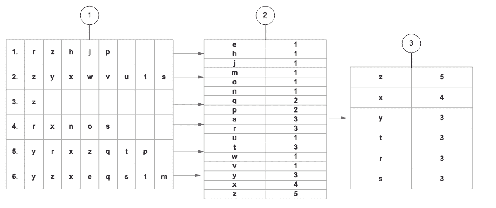
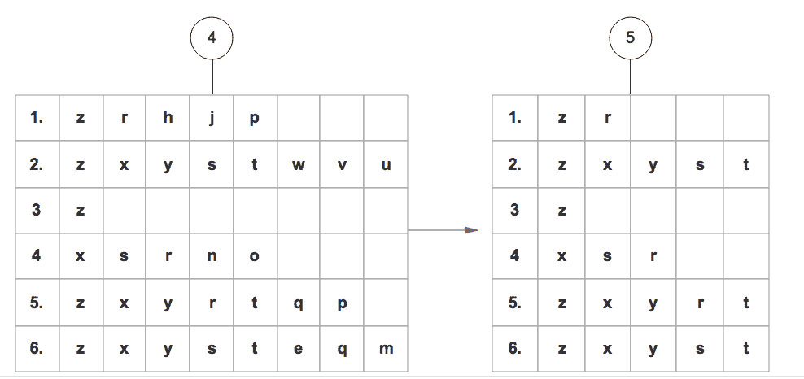
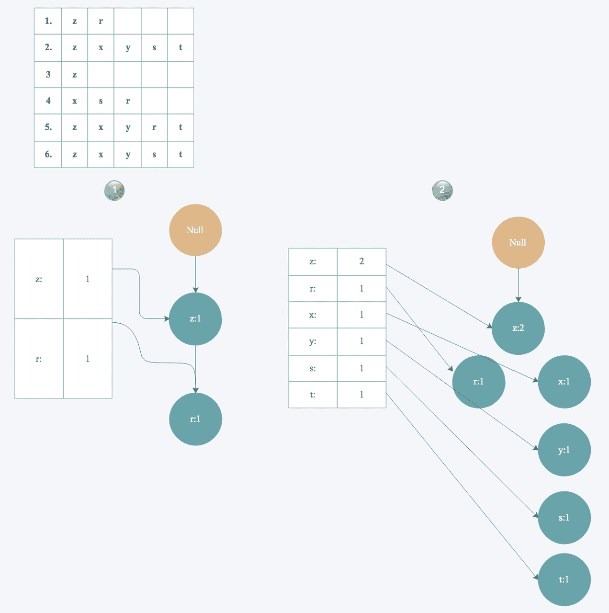
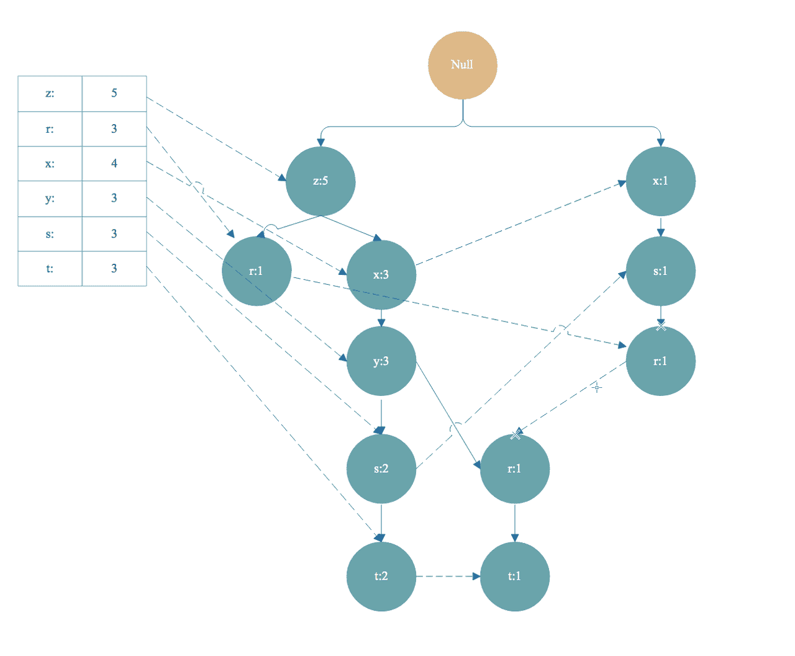
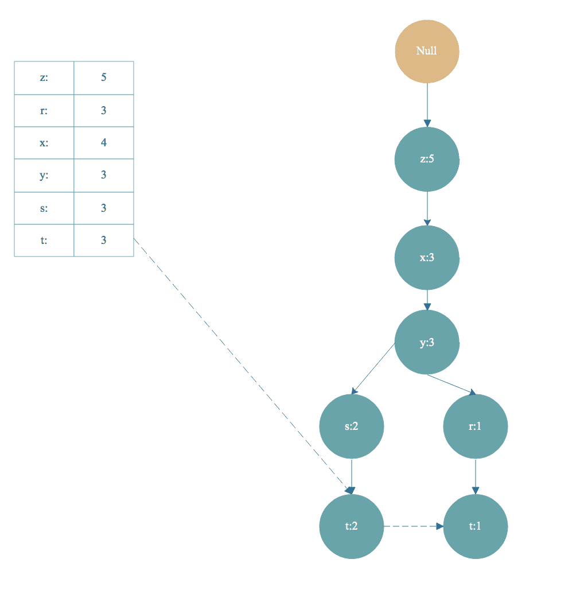
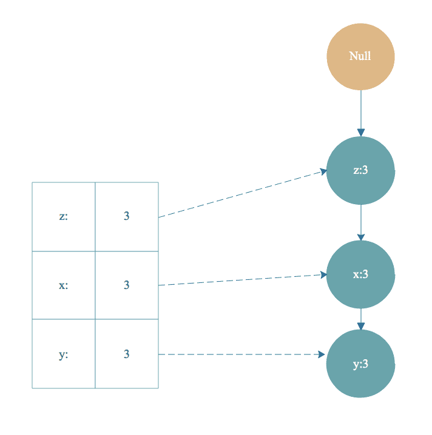

# 使用FP-growth算法来高效发现频繁项集

> 来源：[https://qqs7y1hozd1.feishu.cn/docx/CV9qdwqosoEApNxCAaTcHJ2LnvK](https://qqs7y1hozd1.feishu.cn/docx/CV9qdwqosoEApNxCAaTcHJ2LnvK)

## 前言

在前面我们已经介绍了用 Apriori 算法发现 频繁项集 与 关联规则

本章将继续关注发现 频繁项集 这一任务，并使用 FP-growth 算法更有效的挖掘 频繁项集

## FP-growth 算法简介

+ 一种非常好的发现频繁项集算法

+ 基于 Apriori 算法构建,但是数据结构不同，使用叫做 FP树 的数据结构结构来存储集合。下面我们会介绍这种数据结构

## FP-growth 算法步骤

+ 基于数据构建FP树

+ 从FP树种挖掘频繁项集

## FP树 介绍

+ FP树的节点结构如下:

```
class treeNode:
    def __init__(self, nameValue, numOccur, parentNode):
        self.name = nameValue     # 节点名称
        self.count = numOccur     # 节点出现次数
        self.nodeLink = None      # 不同项集的相同项通过nodeLink连接在一起
        # needs to be updated
        self.parent = parentNode  # 指向父节点
        self.children = {}        # 存储叶子节点
```

## FP-growth 原理

+ FP树的节点结构如下:

```
class treeNode:
    def __init__(self, nameValue, numOccur, parentNode):
        self.name = nameValue     # 节点名称
        self.count = numOccur     # 节点出现次数
        self.nodeLink = None      # 不同项集的相同项通过nodeLink连接在一起
        # needs to be updated
        self.parent = parentNode  # 指向父节点
        self.children = {}        # 存储叶子节点
```

### 基于数据构建 FP树

#### 步骤1

1. 遍历所有的数据集合，计算所有项的支持度

1. 丢弃非频繁的项

1. 基于 支持度 降序排序所有的项



1. 所有数据集合按照得到的顺序重新整理

1. 重新整理完成后，丢弃每个集合末尾非频繁的项



#### 步骤2

6. 读取每个集合插入FP树中，同时用一个头部链表数据结构维护不同集合的相同项



最终得到下面这样一棵FP树

### 从 FP树 中挖掘出频繁项集

#### 步骤3

1. 对头部链表进行降序排序

1. 对头部链表节点从小到大遍历，得到条件模式基，同时获得一个频繁项集



如上图，从头部链表 `t` 节点开始遍历，`t` 节点加入到频繁项集。找到以 `t` 节点为结尾的路径如下:



1. 去掉FP树中的 `t` 节点，得到条件模式基 `<左边路径, 右边是值>` `[z,x,y,s,t]:2`，`[z,x,y,r,t]:1` 。条件模式基的值取决于末尾节点 `t` ，因为 `t` 的出现次数最小，一个频繁项集的支持度由支持度最小的项决定。所以 `t` 节点的条件模式基的值可以理解为对于以 `t` 节点为末尾的前缀路径出现次数。

1. 条件模式基继续构造条件 FP树 ，得到频繁项集，和之前的频繁项组合起来，这是一个递归遍历头部链表生成 FP树 的过程，递归截止条件是生成的 FP树 的头部链表为空。 根据步骤 2 得到的条件模式基 `[z,x,y,s,t]:2，[z,x,y,r,t]:1` 作为数据集继续构造出一棵 FP树 ，计算支持度，去除非频繁项，集合按照支持度降序排序，重复上面构造 FP树 的步骤。最后得到下面 `t`-条件FP树 :



1. 然后根据 `t`-条件FP树 的头部链表进行遍历，从 `y` 开始。得到频繁项集 `ty` 。然后又得到 `y` 的条件模式基，构造出 `ty` 的条件 FP树 ，即 `ty`-条件 FP树 。继续遍历 `ty`-条件 FP树 的头部链表，得到频繁项集 `tyx`，然后又得到频繁项集 `tyxz`。 然后得到构造 `tyxz`-条件 FP树 的头部链表是空的，终止遍历。我们得到的频繁项集有 `t`->`ty`->`tyx`->`tyxz`，这只是一小部分。

+ 条件模式基:头部链表中的某一点的前缀路径组合就是条件模式基，条件模式基的值取决于末尾节点的值。

+ 条件FP树:以条件模式基为数据集构造的FP树叫做条件FP树。

## FP-growth 算法优缺点

* 优点: 1. 因为 FP-growth 算法只需要对数据集遍历两次，所以速度更快。
    2. FP树将集合按照支持度降序排序，不同路径如果有相同前缀路径共用存储空间，使得数据得到了压缩。
    3. 不需要生成候选集。
    4. 比 Apriori 更快。
* 缺点: 1. FP-Tree 第二次遍历会存储很多中间过程的值，会占用很多内存。
    2. 构建 FP-Tree 是比较昂贵的。
* 适用数据类型: 标称型数据(离散型数据)。

## FP-growth 代码讲解

完整代码：


```python
#!/usr/bin/python
# coding:utf8

'''
Created on Jun 14, 2011
Update  on 2017-05-18
FP-Growth FP means frequent pattern
the FP-Growth algorithm needs:
1. FP-tree (class treeNode)
2. header table (use dict)
This finds frequent itemsets similar to apriori but does not find association rules.
Author: Peter/片刻
GitHub: https://github.com/apachecn/AiLearning
'''
from __future__ import print_function
print(__doc__)


class treeNode:
    def __init__(self, nameValue, numOccur, parentNode):
        self.name = nameValue
        self.count = numOccur
        self.nodeLink = None
        # needs to be updated
        self.parent = parentNode
        self.children = {}

    def inc(self, numOccur):
        """inc(对count变量增加给定值)
        """
        self.count += numOccur

    def disp(self, ind=1):
        """disp(用于将树以文本形式显示)

        """
        print('  '*ind, self.name, ' ', self.count)
        for child in self.children.values():
            child.disp(ind+1)


def loadSimpDat():
    simpDat = [['r', 'z', 'h', 'j', 'p'],
               ['z', 'y', 'x', 'w', 'v', 'u', 't', 's'],
               ['z'],
               ['r', 'x', 'n', 'o', 's'],
            #    ['r', 'x', 'n', 'o', 's'],
               ['y', 'r', 'x', 'z', 'q', 't', 'p'],
               ['y', 'z', 'x', 'e', 'q', 's', 't', 'm']]
    return simpDat


def createInitSet(dataSet):
    retDict = {}
    for trans in dataSet:
        if not retDict.has_key(frozenset(trans)):
            retDict[frozenset(trans)] = 1
        else:
            retDict[frozenset(trans)] += 1
    return retDict


# this version does not use recursion
def updateHeader(nodeToTest, targetNode):
    """updateHeader(更新头指针，建立相同元素之间的关系，例如:  左边的r指向右边的r值，就是后出现的相同元素 指向 已经出现的元素)

    从头指针的nodeLink开始，一直沿着nodeLink直到到达链表末尾。这就是链表。
    性能: 如果链表很长可能会遇到迭代调用的次数限制。

    Args:
        nodeToTest  满足minSup {所有的元素+(value, treeNode)}
        targetNode  Tree对象的子节点
    """
    # 建立相同元素之间的关系，例如:  左边的r指向右边的r值
    while (nodeToTest.nodeLink is not None):
        nodeToTest = nodeToTest.nodeLink
    nodeToTest.nodeLink = targetNode


def updateTree(items, inTree, headerTable, count):
    """updateTree(更新FP-tree，第二次遍历)

    # 针对每一行的数据
    # 最大的key,  添加
    Args:
        items       满足minSup 排序后的元素key的数组（大到小的排序）
        inTree      空的Tree对象
        headerTable 满足minSup {所有的元素+(value, treeNode)}
        count       原数据集中每一组Kay出现的次数
    """
    # 取出 元素 出现次数最高的
    # 如果该元素在 inTree.children 这个字典中，就进行累加
    # 如果该元素不存在 就 inTree.children 字典中新增key，value为初始化的 treeNode 对象
    if items[0] in inTree.children:
        # 更新 最大元素，对应的 treeNode 对象的count进行叠加
        inTree.children[items[0]].inc(count)
    else:
        # 如果不存在子节点，我们为该inTree添加子节点
        inTree.children[items[0]] = treeNode(items[0], count, inTree)
        # 如果满足minSup的dist字典的value值第二位为null， 我们就设置该元素为 本节点对应的tree节点
        # 如果元素第二位不为null，我们就更新header节点
        if headerTable[items[0]][1] is None:
            # headerTable只记录第一次节点出现的位置
            headerTable[items[0]][1] = inTree.children[items[0]]
        else:
            # 本质上是修改headerTable的key对应的Tree，的nodeLink值
            updateHeader(headerTable[items[0]][1], inTree.children[items[0]])
    if len(items) > 1:
        # 递归的调用，在items[0]的基础上，添加item0[1]做子节点， count只要循环的进行累计加和而已，统计出节点的最后的统计值。
        updateTree(items[1:], inTree.children[items[0]], headerTable, count)


def createTree(dataSet, minSup=1):
    """createTree(生成FP-tree)

    Args:
        dataSet  dist{行: 出现次数}的样本数据
        minSup   最小的支持度
    Returns:
        retTree  FP-tree
        headerTable 满足minSup {所有的元素+(value, treeNode)}
    """
    # 支持度>=minSup的dist{所有元素: 出现的次数}
    headerTable = {}
    # 循环 dist{行: 出现次数}的样本数据
    for trans in dataSet:
        # 对所有的行进行循环，得到行里面的所有元素
        # 统计每一行中，每个元素出现的总次数
        for item in trans:
            # 例如:  {'ababa': 3}  count(a)=3+3+3=9   count(b)=3+3=6
            headerTable[item] = headerTable.get(item, 0) + dataSet[trans]
    # 删除 headerTable中，元素次数<最小支持度的元素
    for k in headerTable.keys():
        if headerTable[k] < minSup:
            del(headerTable[k])

    # 满足minSup: set(各元素集合)
    freqItemSet = set(headerTable.keys())
    # 如果不存在，直接返回None
    if len(freqItemSet) == 0:
        return None, None
    for k in headerTable:
        # 格式化:  dist{元素key: [元素次数, None]}
        headerTable[k] = [headerTable[k], None]

    # create tree
    retTree = treeNode('Null Set', 1, None)
    # 循环 dist{行: 出现次数}的样本数据
    for tranSet, count in dataSet.items():
        # print 'tranSet, count=', tranSet, count
        # localD = dist{元素key: 元素总出现次数}
        localD = {}
        for item in tranSet:
            # 判断是否在满足minSup的集合中
            if item in freqItemSet:
                # print 'headerTable[item][0]=', headerTable[item][0], headerTable[item]
                localD[item] = headerTable[item][0]
        # print 'localD=', localD
        if len(localD) > 0:
            # p=key,value; 所以是通过value值的大小，进行从大到小进行排序
            # orderedItems 表示取出元组的key值，也就是字母本身，但是字母本身是大到小的顺序
            orderedItems = [v[0] for v in sorted(localD.items(), key=lambda p: p[1], reverse=True)]
            # print 'orderedItems=', orderedItems, 'headerTable', headerTable, '\n\n\n'
            # 填充树，通过有序的orderedItems的第一位，进行顺序填充 第一层的子节点。
            updateTree(orderedItems, retTree, headerTable, count)

    return retTree, headerTable


def ascendTree(leafNode, prefixPath):
    """ascendTree(如果存在父节点，就记录当前节点的name值)

    Args:
        leafNode   查询的节点对于的nodeTree
        prefixPath 要查询的节点值
    """
    if leafNode.parent is not None:
        prefixPath.append(leafNode.name)
        ascendTree(leafNode.parent, prefixPath)


def findPrefixPath(basePat, treeNode):
    """findPrefixPath 基础数据集

    Args:
        basePat  要查询的节点值
        treeNode 查询的节点所在的当前nodeTree
    Returns:
        condPats 对非basePat的倒叙值作为key,赋值为count数
    """
    condPats = {}
    # 对 treeNode的link进行循环
    while treeNode is not None:
        prefixPath = []
        # 寻找改节点的父节点，相当于找到了该节点的频繁项集
        ascendTree(treeNode, prefixPath)
        # 避免 单独`Z`一个元素，添加了空节点
        if len(prefixPath) > 1:
            # 对非basePat的倒叙值作为key,赋值为count数
            # prefixPath[1:] 变frozenset后，字母就变无序了
            # condPats[frozenset(prefixPath)] = treeNode.count
            condPats[frozenset(prefixPath[1:])] = treeNode.count
        # 递归，寻找改节点的下一个 相同值的链接节点
        treeNode = treeNode.nodeLink
        # print treeNode
    return condPats


def mineTree(inTree, headerTable, minSup, preFix, freqItemList):
    """mineTree(创建条件FP树)

    Args:
        inTree       myFPtree
        headerTable  满足minSup {所有的元素+(value, treeNode)}
        minSup       最小支持项集
        preFix       preFix为newFreqSet上一次的存储记录，一旦没有myHead，就不会更新
        freqItemList 用来存储频繁子项的列表
    """
    # 通过value进行从小到大的排序， 得到频繁项集的key
    # 最小支持项集的key的list集合
    bigL = [v[0] for v in sorted(headerTable.items(), key=lambda p: p[1])]
    print('-----', sorted(headerTable.items(), key=lambda p: p[1]))
    print('bigL=', bigL)
    # 循环遍历 最频繁项集的key，从小到大的递归寻找对应的频繁项集
    for basePat in bigL:
        # preFix为newFreqSet上一次的存储记录，一旦没有myHead，就不会更新
        newFreqSet = preFix.copy()
        newFreqSet.add(basePat)
        print('newFreqSet=', newFreqSet, preFix)

        freqItemList.append(newFreqSet)
        print('freqItemList=', freqItemList)
        condPattBases = findPrefixPath(basePat, headerTable[basePat][1])
        print('condPattBases=', basePat, condPattBases)

        # 构建FP-tree
        myCondTree, myHead = createTree(condPattBases, minSup)
        print('myHead=', myHead)
        # 挖掘条件 FP-tree, 如果myHead不为空，表示满足minSup {所有的元素+(value, treeNode)}
        if myHead is not None:
            myCondTree.disp(1)
            print('\n\n\n')
            # 递归 myHead 找出频繁项集
            mineTree(myCondTree, myHead, minSup, newFreqSet, freqItemList)
        print('\n\n\n')


# import twitter
# from time import sleep
# import re


# def getLotsOfTweets(searchStr):
#     """
#     获取 100个搜索结果页面
#     """
#     CONSUMER_KEY = ''
#     CONSUMER_SECRET = ''
#     ACCESS_TOKEN_KEY = ''
#     ACCESS_TOKEN_SECRET = ''
#     api = twitter.Api(consumer_key=CONSUMER_KEY, consumer_secret=CONSUMER_SECRET, access_token_key=ACCESS_TOKEN_KEY, access_token_secret=ACCESS_TOKEN_SECRET)

#     # you can get 1500 results 15 pages * 100 per page
#     resultsPages = []
#     for i in range(1, 15):
#         print "fetching page %d" % i
#         searchResults = api.GetSearch(searchStr, per_page=100, page=i)
#         resultsPages.append(searchResults)
#         sleep(6)
#     return resultsPages


# def textParse(bigString):
#     """
#     解析页面内容
#     """
#     urlsRemoved = re.sub('(http:[/][/]|www.)([a-z]|[A-Z]|[0-9]|[/.]|[~])*', '', bigString)    
#     listOfTokens = re.split(r'\W*', urlsRemoved)
#     return [tok.lower() for tok in listOfTokens if len(tok) > 2]


# def mineTweets(tweetArr, minSup=5):
#     """
#     获取频繁项集
#     """
#     parsedList = []
#     for i in range(14):
#         for j in range(100):
#             parsedList.append(textParse(tweetArr[i][j].text))
#     initSet = createInitSet(parsedList)
#     myFPtree, myHeaderTab = createTree(initSet, minSup)
#     myFreqList = []
#     mineTree(myFPtree, myHeaderTab, minSup, set([]), myFreqList)
#     return myFreqList


if __name__ == "__main__":
    # rootNode = treeNode('pyramid', 9, None)
    # rootNode.children['eye'] = treeNode('eye', 13, None)
    # rootNode.children['phoenix'] = treeNode('phoenix', 3, None)
    # # 将树以文本形式显示
    # # print rootNode.disp()

    # load样本数据
    simpDat = loadSimpDat()
    # print simpDat, '\n'
    # frozen set 格式化 并 重新装载 样本数据，对所有的行进行统计求和，格式: {行: 出现次数}
    initSet = createInitSet(simpDat)
    print(initSet)

    # 创建FP树
    # 输入: dist{行: 出现次数}的样本数据  和  最小的支持度
    # 输出: 最终的PF-tree，通过循环获取第一层的节点，然后每一层的节点进行递归的获取每一行的字节点，也就是分支。然后所谓的指针，就是后来的指向已存在的
    myFPtree, myHeaderTab = createTree(initSet, 3)
    myFPtree.disp()

    # 抽取条件模式基
    # 查询树节点的，频繁子项
    print('x --->', findPrefixPath('x', myHeaderTab['x'][1]))
    print('z --->', findPrefixPath('z', myHeaderTab['z'][1]))
    print('r --->', findPrefixPath('r', myHeaderTab['r'][1]))

    # 创建条件模式基
    freqItemList = []
    mineTree(myFPtree, myHeaderTab, 3, set([]), freqItemList)
    print(freqItemList)

    # # 项目实战
    # # 1.twitter项目案例
    # # 无法运行，因为没发链接twitter
    # lotsOtweets = getLotsOfTweets('RIMM')
    # listOfTerms = mineTweets(lotsOtweets, 20)
    # print len(listOfTerms)
    # for t in listOfTerms:
    #     print t

    # # 2.新闻网站点击流中挖掘，例如: 文章1阅读过的人，还阅读过什么？
    # parsedDat = [line.split() for line in open('data/12.FPGrowth/kosarak.dat').readlines()]
    # initSet = createInitSet(parsedDat)
    # myFPtree, myHeaderTab = createTree(initSet, 100000)

    # myFreList = []
    # mineTree(myFPtree, myHeaderTab, 100000, set([]), myFreList)
    # print myFreList
```


## `main` 方法大致步骤:

```
if __name__ == &quot;__main__&quot;:
    simpDat = loadSimpDat()                       #加载数据集。
    initSet = createInitSet(simpDat)              #对数据集进行整理，相同集合进行合并。
    myFPtree, myHeaderTab = createTree(initSet, 3)#创建FP树。
    freqItemList = []
    mineTree(myFPtree, myHeaderTab, 3, set([]), freqItemList) #递归的从FP树中挖掘出频繁项集。
    print freqItemList
```

大家看懂原理，再仔细跟踪一下代码。基本就没有问题了
