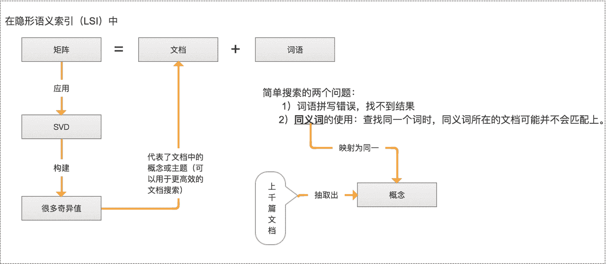
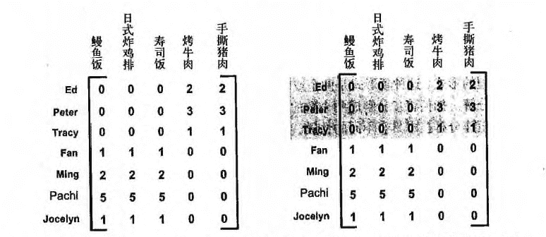
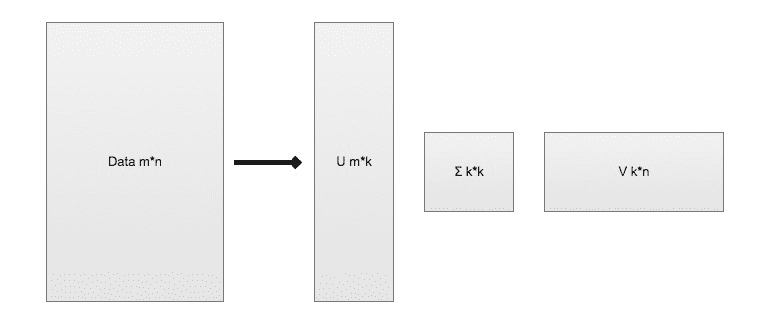
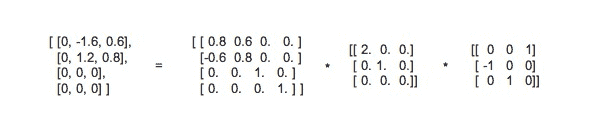
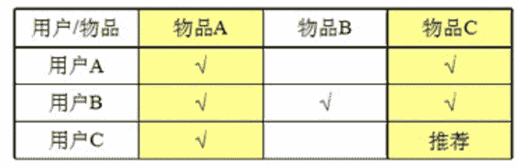
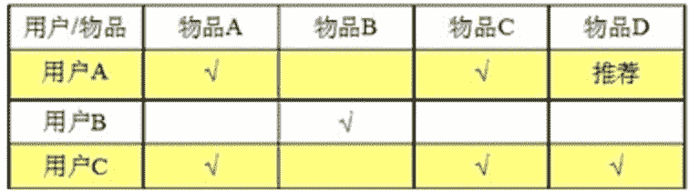
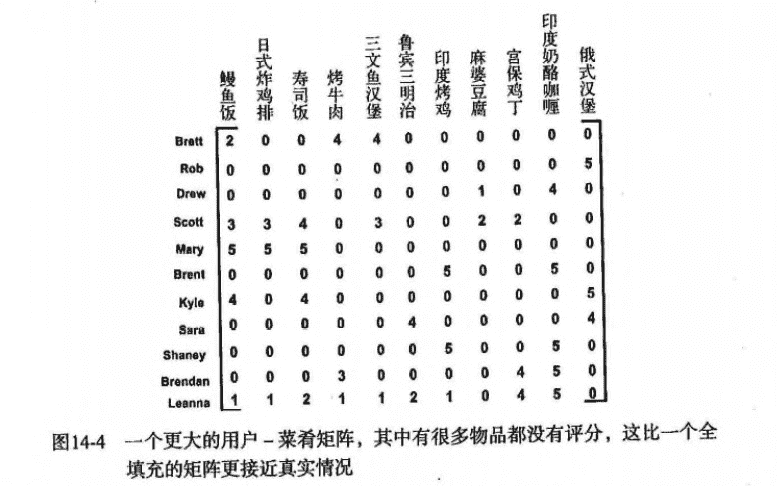
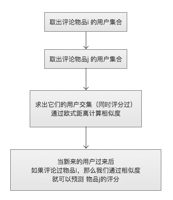
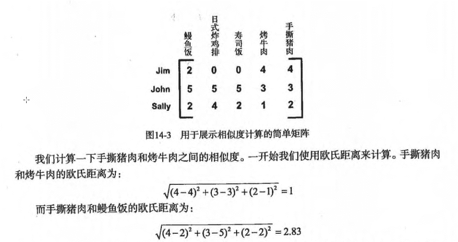
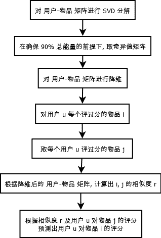

# 利用SVD简化数据

> 来源：[https://qqs7y1hozd1.feishu.cn/docx/KEOFdPHXvoTqfKxgCMLceFVhnVh](https://qqs7y1hozd1.feishu.cn/docx/KEOFdPHXvoTqfKxgCMLceFVhnVh)

# **SVD 概述**

```
奇异值分解（SVD, Singular Value Decomposition）:
    提取信息的一种方法，可以把 SVD 看成是从噪声数据中抽取相关特征。从生物信息学到金融学，SVD 是提取信息的强大工具
```

# **SVD 场景**

> 信息检索-隐性语义检索（Latent Semantic Indexing, LSI）或 隐形语义分析（Latent Semantic Analysis, LSA）

隐性语义索引: 矩阵 = 文档 + 词语

+   是最早的 SVD 应用之一，我们称利用 SVD 的方法为隐性语义索引（LSI）或隐性语义分析（LSA）



> 推荐系统

1.  利用 SVD 从数据中构建一个主题空间

1.  再在该空间下计算其相似度。(从高维-低维空间的转化，在低维空间来计算相似度，SVD 提升了推荐系统的效率)



+   上图右边标注的为一组共同特征，表示美式 BBQ 空间；另一组在上图右边未标注的为日式食品 空间。

> 图像压缩

例如: 32*32=1024 => 32*2+2*1+32*2=130(2*1表示去掉了除对角线的0), 几乎获得了10倍的压缩比


# **SVD 原理**

## **SVD 工作原理**

> 矩阵分解

+   矩阵分解是将数据矩阵分解为多个独立部分的过程。

+   矩阵分解可以将原始矩阵表示成新的易于处理的形式，这种新形式是两个或多个矩阵的乘积。（类似代数中的因数分解）

+   举例: 如何将12分解成两个数的乘积？（1，12）、（2，6）、（3，4）都是合理的答案。

> SVD 是矩阵分解的一种类型，也是矩阵分解最常见的技术

+   SVD 将原始的数据集矩阵 Data 分解成三个矩阵 U、 、V

+   举例: 如果原始矩阵 是m行n列

+    表示m行k列

+    表示k行k列

+    表示k行n列



[具](https://wenku.baidu.com/view/b7641217866fb84ae45c8d17.html)体的案例: （大家可以试着推导一下: https://wenku.baidu.com/view/b7641217866fb84ae45c8d17.html ）



+   上述分解中会构建出一个矩阵  ，该矩阵只有对角元素，其他元素均为0(近似于0)。另一个惯例就是， 的对角元素是从大到小排列的。这些对角元素称为奇异值

+   奇异值与特征值(PCA 数据中重要特征)是有关系的。这里的奇异值就是矩阵 特征值的平方根

+   普遍的事实: 在某个奇异值的数目(r 个=>奇异值的平方和累加到总值的90%以上)之后，其他的奇异值都置为0(近似于0)这意味着数据集中仅有 r 个重要特征，而其余特征则都是噪声或冗余特征

## **SVD 算法特点**

```
优点: 简化数据，去除噪声，优化算法的结果
缺点: 数据的转换可能难以理解
使用的数据类型: 数值型数据
```

# **推荐系统**

## **推荐系统 概述**

推荐系统是利用电子商务网站向客户提供商品信息和建议，帮助用户决定应该购买什么产品，模拟销售人员帮助客户完成购买过程

## **推荐系统 场景**

1.  Amazon 会根据顾客的购买历史向他们推荐物品

1.  Netflix 会向其用户推荐电影

1.  新闻网站会对用户推荐新闻频道

## **推荐系统 要点**

> 基于协同过滤(collaborative filtering) 的推荐引擎

+   利用Python 实现 SVD(Numpy 有一个称为 linalg 的线性代数工具箱)

+   协同过滤: 是通过将用户和其他用户的数据进行对比来实现推荐的

+   当知道了两个用户或两个物品之间的相似度，我们就可以利用已有的数据来预测未知用户的喜好

> 基于物品的相似度和基于用户的相似度: 物品比较少则选择物品相似度，用户比较少则选择用户相似度。【矩阵还是小一点好计算】

+   基于物品的相似度: 计算物品之间的距离。【耗时会随物品数量的增加而增加】

+   由于物品A和物品C 相似度(相关度)很高，所以给买A的人推荐C



+   基于用户的相似度: 计算用户之间的距离。【耗时会随用户数量的增加而增加】

+   由于用户A和用户C 相似度(相关度)很高，所以A和C是兴趣相投的人，对于C买的物品就会推荐给A



> 相似度计算

+   inA, inB 对应的是 列向量

1.  欧氏距离: 指在m维空间中两个点之间的真实距离，或者向量的自然长度（即该点到原点的距离）。二维或三维中的欧氏距离就是两点之间的实际距离。

+   相似度= 1/(1+欧式距离)

+   相似度= 1.0/(1.0 + la.norm(inA - inB))

+   物品对越相似，它们的相似度值就越大

1.  皮尔逊相关系数: 度量的是两个向量之间的相似度

+   相似度= 0.5 + 0.5*corrcoef() 【皮尔逊相关系数的取值范围从 -1 到 +1，通过函数0.5 + 0.5*corrcoef()这个函数计算，把值归一化到0到1之间】

+   相似度= 0.5 + 0.5 * corrcoef(inA, inB, rowvar = 0)[0][1]

+   相对欧氏距离的优势: 它对用户评级的量级并不敏感

1.  余弦相似度: 计算的是两个向量夹角的余弦值

+   余弦值 = (A·B)/(||A||·||B||) 【余弦值的取值范围也在-1到+1之间】

+   相似度= 0.5 + 0.5*余弦值

+   相似度= 0.5 + 0.5*( float(inA.T*inB) / la.norm(inA)*la.norm(inB))

+   如果夹角为90度，则相似度为0；如果两个向量的方向相同，则相似度为1.0

> 推荐系统的评价

+   采用交叉测试的方法。【拆分数据为训练集和测试集】

+   推荐引擎评价的指标: 最小均方根误差(Root mean squared error, RMSE)，也称标准误差(Standard error)，就是计算均方误差的平均值然后取其平方根

+   如果RMSE=1, 表示相差1个星级；如果RMSE=2.5, 表示相差2.5个星级

### **推荐系统 原理**

+   推荐系统的工作过程: 给定一个用户，系统会为此用户返回N个最好的推荐菜

+   实现流程大致如下:

1.  寻找用户没有评级的菜肴，即在用户-物品矩阵中的0值

1.  在用户没有评级的所有物品中，对每个物品预计一个可能的评级分数。这就是说: 我们认为用户可能会对物品的打分（这就是相似度计算的初衷）

1.  对这些物品的评分从高到低进行排序，返回前N个物品

## **项目案例: 餐馆菜肴推荐系统**

### **项目概述**

假如一个人在家决定外出吃饭，但是他并不知道该到哪儿去吃饭，该点什么菜。推荐系统可以帮他做到这两点。

### **开发流程**

> 收集 并 准备数据



```
def loadExData3():
    # 利用SVD提高推荐效果，菜肴矩阵
    &quot;&quot;&quot;
    行: 代表人
    列: 代表菜肴名词
    值: 代表人对菜肴的评分，0表示未评分
    &quot;&quot;&quot;
    return[[2, 0, 0, 4, 4, 0, 0, 0, 0, 0, 0],
           [0, 0, 0, 0, 0, 0, 0, 0, 0, 0, 5],
           [0, 0, 0, 0, 0, 0, 0, 1, 0, 4, 0],
           [3, 3, 4, 0, 3, 0, 0, 2, 2, 0, 0],
           [5, 5, 5, 0, 0, 0, 0, 0, 0, 0, 0],
           [0, 0, 0, 0, 0, 0, 5, 0, 0, 5, 0],
           [4, 0, 4, 0, 0, 0, 0, 0, 0, 0, 5],
           [0, 0, 0, 0, 0, 4, 0, 0, 0, 0, 4],
           [0, 0, 0, 0, 0, 0, 5, 0, 0, 5, 0],
           [0, 0, 0, 3, 0, 0, 0, 0, 4, 5, 0],
           [1, 1, 2, 1, 1, 2, 1, 0, 4, 5, 0]]
```

> 分析数据: 这里不做过多的讨论(当然此处可以对比不同距离之间的差别)

> 训练算法: 通过调用 recommend() 函数进行推荐

recommend() 会调用 基于物品相似度 或者是 基于SVD，得到推荐的物品评分

+   1.基于物品相似度





```
# 基于物品相似度的推荐引擎
def standEst(dataMat, user, simMeas, item):
    &quot;&quot;&quot;standEst(计算某用户未评分物品中，以对该物品和其他物品评分的用户的物品相似度，然后进行综合评分)

    Args:
        dataMat         训练数据集
        user            用户编号
        simMeas         相似度计算方法
        item            未评分的物品编号
    Returns:
        ratSimTotal/simTotal     评分（0～5之间的值）
    &quot;&quot;&quot;
    # 得到数据集中的物品数目
    n = shape(dataMat)[1]
    # 初始化两个评分值
    simTotal = 0.0
    ratSimTotal = 0.0
    # 遍历行中的每个物品（对用户评过分的物品进行遍历，并将它与其他物品进行比较）
    for j in range(n):
        userRating = dataMat[user, j]
        # 如果某个物品的评分值为0，则跳过这个物品
        if userRating == 0:
            continue
        # 寻找两个用户都评级的物品
        # 变量 overLap 给出的是两个物品当中已经被评分的那个元素的索引ID
        # logical_and 计算x1和x2元素的真值。
        overLap = nonzero(logical_and(dataMat[:, item].A &gt; 0, dataMat[:, j].A &gt; 0))[0]
        # 如果相似度为0，则两着没有任何重合元素，终止本次循环
        if len(overLap) == 0:
            similarity = 0
        # 如果存在重合的物品，则基于这些重合物重新计算相似度。
        else:
            similarity = simMeas(dataMat[overLap, item], dataMat[overLap, j])
        # print &#x27;the %d and %d similarity is : %f&#x27;(iten,j,similarity)
        # 相似度会不断累加，每次计算时还考虑相似度和当前用户评分的乘积
        # similarity  用户相似度，   userRating 用户评分
        simTotal += similarity
        ratSimTotal += similarity * userRating
    if simTotal == 0:
        return 0
    # 通过除以所有的评分总和，对上述相似度评分的乘积进行归一化，使得最后评分在0~5之间，这些评分用来对预测值进行排序
    else:
        return ratSimTotal/simTotal
```

+   2.基于SVD(参考地址: [http://www.codeweblog.com/svd](http://www.codeweblog.com/svd-%E7%AC%94%E8%AE%B0/)-%E7%AC%94%E8%AE%B0/)



```
# 基于SVD的评分估计
# 在recommend() 中，这个函数用于替换对standEst()的调用，该函数对给定用户给定物品构建了一个评分估计值
def svdEst(dataMat, user, simMeas, item):
    &quot;&quot;&quot;svdEst(计算某用户未评分物品中，以对该物品和其他物品评分的用户的物品相似度，然后进行综合评分)

    Args:
        dataMat         训练数据集
        user            用户编号
        simMeas         相似度计算方法
        item            未评分的物品编号
    Returns:
        ratSimTotal/simTotal     评分（0～5之间的值）
    &quot;&quot;&quot;
    # 物品数目
    n = shape(dataMat)[1]
    # 对数据集进行SVD分解
    simTotal = 0.0
    ratSimTotal = 0.0
    # 奇异值分解
    # 在SVD分解之后，我们只利用包含了90%能量值的奇异值，这些奇异值会以NumPy数组的形式得以保存
    U, Sigma, VT = la.svd(dataMat)

    # # 分析 Sigma 的长度取值
    # analyse_data(Sigma, 20)

    # 如果要进行矩阵运算，就必须要用这些奇异值构建出一个对角矩阵
    Sig4 = mat(eye(4) * Sigma[: 4])

    # 利用U矩阵将物品转换到低维空间中，构建转换后的物品(物品+4个主要的“隐形”特征)
    # 公式1(目的是: 降维-改变形状，也改变大小)  xformedItems = dataMat.T * U[:, :4] * Sig4.I
    # 公式2(目的是: 压缩-不改变形状，改变大小)      reconMat = U[:, :4] * Sig4.I * VT[:4, :]
        # 其中: imgCompress() 是详细的案例
    # 最近看到一篇文章描述，感觉挺有道理的，我就顺便补充一下注释: https://blog.csdn.net/qq_36523839/article/details/82347332
    xformedItems = dataMat.T * U[:, :4] * Sig4.I
    # 对于给定的用户，for循环在用户对应行的元素上进行遍历，
    # 这和standEst()函数中的for循环的目的一样，只不过这里的相似度计算时在低维空间下进行的。
    for j in range(n):
        userRating = dataMat[user, j]
        if userRating == 0 or j == item:
            continue
        # 相似度的计算方法也会作为一个参数传递给该函数
        similarity = simMeas(xformedItems[item, :].T, xformedItems[j, :].T)
        # for 循环中加入了一条print语句，以便了解相似度计算的进展情况。如果觉得累赘，可以去掉
        print &#x27;the %d and %d similarity is: %f&#x27; % (item, j, similarity)
        # 对相似度不断累加求和
        simTotal += similarity
        # 对相似度及对应评分值的乘积求和
        ratSimTotal += similarity * userRating
    if simTotal == 0:
        return 0
    else:
        # 计算估计评分
        return ratSimTotal/simTotal
```

排序获取最后的推荐结果

```
# recommend()函数，就是推荐引擎，它默认调用standEst()函数，产生了最高的N个推荐结果。
# 如果不指定N的大小，则默认值为3。该函数另外的参数还包括相似度计算方法和估计方法
def recommend(dataMat, user, N=3, simMeas=cosSim, estMethod=standEst):
    # 寻找未评级的物品
    # 对给定的用户建立一个未评分的物品列表
    unratedItems = nonzero(dataMat[user, :].A == 0)[1]
    # 如果不存在未评分物品，那么就退出函数
    if len(unratedItems) == 0:
        return &#x27;you rated everything&#x27;
    # 物品的编号和评分值
    itemScores = []
    # 在未评分物品上进行循环
    for item in unratedItems:
        estimatedScore = estMethod(dataMat, user, simMeas, item)
        # 寻找前N个未评级物品，调用standEst()来产生该物品的预测得分，该物品的编号和估计值会放在一个元素列表itemScores中
        itemScores.append((item, estimatedScore))
        # 按照估计得分，对该列表进行排序并返回。列表逆排序，第一个值就是最大值
    return sorted(itemScores, key=lambda jj: jj[1], reverse=True)[: N]
```

> 测试 和 项目调用，可直接参考我们的代码

完整代码：

```
#!/usr/bin/python
# coding: utf-8

&#x27;&#x27;&#x27;
Created on Mar 8, 2011
Update  on 2017-05-18
Author: Peter Harrington/山上有课树/片刻
GitHub: https://github.com/apachecn/AiLearning
&#x27;&#x27;&#x27;
from __future__ import print_function
from numpy import linalg as la
from numpy import *


def loadExData3():
    # 利用SVD提高推荐效果，菜肴矩阵
    return[[2, 0, 0, 4, 4, 0, 0, 0, 0, 0, 0],
           [0, 0, 0, 0, 0, 0, 0, 0, 0, 0, 5],
           [0, 0, 0, 0, 0, 0, 0, 1, 0, 4, 0],
           [3, 3, 4, 0, 3, 0, 0, 2, 2, 0, 0],
           [5, 5, 5, 0, 0, 0, 0, 0, 0, 0, 0],
           [0, 0, 0, 0, 0, 0, 5, 0, 0, 5, 0],
           [4, 0, 4, 0, 0, 0, 0, 0, 0, 0, 5],
           [0, 0, 0, 0, 0, 4, 0, 0, 0, 0, 4],
           [0, 0, 0, 0, 0, 0, 5, 0, 0, 5, 0],
           [0, 0, 0, 3, 0, 0, 0, 0, 4, 5, 0],
           [1, 1, 2, 1, 1, 2, 1, 0, 4, 5, 0]]


def loadExData2():
    # 书上代码给的示例矩阵
    return[[0, 0, 0, 0, 0, 4, 0, 0, 0, 0, 5],
           [0, 0, 0, 3, 0, 4, 0, 0, 0, 0, 3],
           [0, 0, 0, 0, 4, 0, 0, 1, 0, 4, 0],
           [3, 3, 4, 0, 0, 0, 0, 2, 2, 0, 0],
           [5, 4, 5, 0, 0, 0, 0, 5, 5, 0, 0],
           [0, 0, 0, 0, 5, 0, 1, 0, 0, 5, 0],
           [4, 3, 4, 0, 0, 0, 0, 5, 5, 0, 1],
           [0, 0, 0, 4, 0, 4, 0, 0, 0, 0, 4],
           [0, 0, 0, 2, 0, 2, 5, 0, 0, 1, 2],
           [0, 0, 0, 0, 5, 0, 0, 0, 0, 4, 0],
           [1, 0, 0, 0, 0, 0, 0, 1, 2, 0, 0]]


def loadExData():
    &quot;&quot;&quot;
    # 推荐引擎示例矩阵
    return[[4, 4, 0, 2, 2],
           [4, 0, 0, 3, 3],
           [4, 0, 0, 1, 1],
           [1, 1, 1, 2, 0],
           [2, 2, 2, 0, 0],
           [1, 1, 1, 0, 0],
           [5, 5, 5, 0, 0]]
    &quot;&quot;&quot;
    # # 原矩阵
    # return[[1, 1, 1, 0, 0],
    #        [2, 2, 2, 0, 0],
    #        [1, 1, 1, 0, 0],
    #        [5, 5, 5, 0, 0],
    #        [1, 1, 0, 2, 2],
    #        [0, 0, 0, 3, 3],
    #        [0, 0, 0, 1, 1]]

    # 原矩阵
    return[[0, -1.6, 0.6],
           [0, 1.2, 0.8],
           [0, 0, 0],
           [0, 0, 0]]


# 相似度计算，假定inA和inB 都是列向量
# 基于欧氏距离
def ecludSim(inA, inB):
    return 1.0/(1.0 + la.norm(inA - inB))


# pearsSim()函数会检查是否存在3个或更多的点。
# corrcoef直接计算皮尔逊相关系数，范围[-1, 1]，归一化后[0, 1]
def pearsSim(inA, inB):
    # 如果不存在，该函数返回1.0，此时两个向量完全相关。
    if len(inA) &lt; 3:
        return 1.0
    return 0.5 + 0.5 * corrcoef(inA, inB, rowvar=0)[0][1]


# 计算余弦相似度，如果夹角为90度，相似度为0；如果两个向量的方向相同，相似度为1.0
def cosSim(inA, inB):
    num = float(inA.T*inB)
    denom = la.norm(inA)*la.norm(inB)
    return 0.5 + 0.5*(num/denom)


# 基于物品相似度的推荐引擎
def standEst(dataMat, user, simMeas, item):
    &quot;&quot;&quot;standEst(计算某用户未评分物品中，以对该物品和其他物品评分的用户的物品相似度，然后进行综合评分)

    Args:
        dataMat         训练数据集
        user            用户编号
        simMeas         相似度计算方法
        item            未评分的物品编号
    Returns:
        ratSimTotal/simTotal     评分（0～5之间的值）
    &quot;&quot;&quot;
    # 得到数据集中的物品数目
    n = shape(dataMat)[1]
    # 初始化两个评分值
    simTotal = 0.0
    ratSimTotal = 0.0
    # 遍历行中的每个物品（对用户评过分的物品进行遍历，并将它与其他物品进行比较）
    for j in range(n):
        userRating = dataMat[user, j]
        # 如果某个物品的评分值为0，则跳过这个物品
        if userRating == 0:
            continue
        # 寻找两个用户都评级的物品
        # 变量 overLap 给出的是两个物品当中已经被评分的那个元素的索引ID
        # logical_and 计算x1和x2元素的真值。
        overLap = nonzero(logical_and(dataMat[:, item].A &gt; 0, dataMat[:, j].A &gt; 0))[0]
        # 如果相似度为0，则两着没有任何重合元素，终止本次循环
        if len(overLap) == 0:
            similarity = 0
        # 如果存在重合的物品，则基于这些重合物重新计算相似度。
        else:
            similarity = simMeas(dataMat[overLap, item], dataMat[overLap, j])
        # print &#x27;the %d and %d similarity is : %f&#x27;(iten,j,similarity)
        # 相似度会不断累加，每次计算时还考虑相似度和当前用户评分的乘积
        # similarity  用户相似度，   userRating 用户评分
        simTotal += similarity
        ratSimTotal += similarity * userRating
    if simTotal == 0:
        return 0
    # 通过除以所有的评分总和，对上述相似度评分的乘积进行归一化，使得最后评分在0~5之间，这些评分用来对预测值进行排序
    else:
        return ratSimTotal/simTotal


# 基于SVD的评分估计
# 在recommend() 中，这个函数用于替换对standEst()的调用，该函数对给定用户给定物品构建了一个评分估计值
def svdEst(dataMat, user, simMeas, item):
    &quot;&quot;&quot;svdEst( )

    Args:
        dataMat         训练数据集
        user            用户编号
        simMeas         相似度计算方法
        item            未评分的物品编号
    Returns:
        ratSimTotal/simTotal     评分（0～5之间的值）
    &quot;&quot;&quot;
    # 物品数目
    n = shape(dataMat)[1]
    # 对数据集进行SVD分解
    simTotal = 0.0
    ratSimTotal = 0.0
    # 奇异值分解
    # 在SVD分解之后，我们只利用包含了90%能量值的奇异值，这些奇异值会以NumPy数组的形式得以保存
    U, Sigma, VT = la.svd(dataMat)

    # # 分析 Sigma 的长度取值
    # analyse_data(Sigma, 20)

    # 如果要进行矩阵运算，就必须要用这些奇异值构建出一个对角矩阵
    Sig4 = mat(eye(4) * Sigma[: 4])

    # 利用U矩阵将物品转换到低维空间中，构建转换后的物品(物品+4个主要的特征)
    xformedItems = dataMat.T * U[:, :4] * Sig4.I
    print(&#x27;dataMat&#x27;, shape(dataMat))
    print(&#x27;U[:, :4]&#x27;, shape(U[:, :4]))
    print(&#x27;Sig4.I&#x27;, shape(Sig4.I))
    print(&#x27;VT[:4, :]&#x27;, shape(VT[:4, :]))
    print(&#x27;xformedItems&#x27;, shape(xformedItems))

    # 对于给定的用户，for循环在用户对应行的元素上进行遍历
    # 这和standEst()函数中的for循环的目的一样，只不过这里的相似度计算时在低维空间下进行的。
    for j in range(n):
        userRating = dataMat[user, j]
        if userRating == 0 or j == item:
            continue
        # 相似度的计算方法也会作为一个参数传递给该函数
        similarity = simMeas(xformedItems[item, :].T, xformedItems[j, :].T)
        # for 循环中加入了一条print语句，以便了解相似度计算的进展情况。如果觉得累赘，可以去掉
        print(&#x27;the %d and %d similarity is: %f&#x27; % (item, j, similarity))
        # 对相似度不断累加求和
        simTotal += similarity
        # 对相似度及对应评分值的乘积求和
        ratSimTotal += similarity * userRating
    if simTotal == 0:
        return 0
    else:
        # 计算估计评分
        return ratSimTotal/simTotal


# recommend()函数，就是推荐引擎，它默认调用standEst()函数，产生了最高的N个推荐结果。
# 如果不指定N的大小，则默认值为3。该函数另外的参数还包括相似度计算方法和估计方法
def recommend(dataMat, user, N=3, simMeas=cosSim, estMethod=standEst):
    &quot;&quot;&quot;svdEst( )

    Args:
        dataMat         训练数据集
        user            用户编号
        simMeas         相似度计算方法
        estMethod       使用的推荐算法
    Returns:
        返回最终 N 个推荐结果
    &quot;&quot;&quot;
    # 寻找未评级的物品
    # 对给定的用户建立一个未评分的物品列表
    unratedItems = nonzero(dataMat[user, :].A == 0)[1]
    # 如果不存在未评分物品，那么就退出函数
    if len(unratedItems) == 0:
        return &#x27;you rated everything&#x27;
    # 物品的编号和评分值
    itemScores = []
    # 在未评分物品上进行循环
    for item in unratedItems:
        # 获取 item 该物品的评分
        estimatedScore = estMethod(dataMat, user, simMeas, item)
        itemScores.append((item, estimatedScore))
    # 按照评分得分 进行逆排序，获取前N个未评级物品进行推荐
    return sorted(itemScores, key=lambda jj: jj[1], reverse=True)[: N]


def analyse_data(Sigma, loopNum=20):
    &quot;&quot;&quot;analyse_data(分析 Sigma 的长度取值)

    Args:
        Sigma         Sigma的值
        loopNum       循环次数
    &quot;&quot;&quot;
    # 总方差的集合（总能量值）
    Sig2 = Sigma**2
    SigmaSum = sum(Sig2)
    for i in range(loopNum):
        SigmaI = sum(Sig2[:i+1])
        &#x27;&#x27;&#x27;
        根据自己的业务情况，就行处理，设置对应的 Singma 次数

        通常保留矩阵 80% ～ 90% 的能量，就可以得到重要的特征并取出噪声。
        &#x27;&#x27;&#x27;
        print(&#x27;主成分: %s, 方差占比: %s%%&#x27; % (format(i+1, &#x27;2.0f&#x27;), format(SigmaI/SigmaSum*100, &#x27;4.2f&#x27;)))


# 图像压缩函数
# 加载并转换数据
def imgLoadData(filename):
    myl = []
    # 打开文本文件，并从文件以数组方式读入字符
    for line in open(filename).readlines():
        newRow = []
        for i in range(32):
            newRow.append(int(line[i]))
        myl.append(newRow)
    # 矩阵调入后，就可以在屏幕上输出该矩阵
    myMat = mat(myl)
    return myMat


# 打印矩阵
def printMat(inMat, thresh=0.8):
    # 由于矩阵保护了浮点数，因此定义浅色和深色，遍历所有矩阵元素，当元素大于阀值时打印1，否则打印0
    for i in range(32):
        for k in range(32):
            if float(inMat[i, k]) &gt; thresh:
                print(1, end=&#x27; &#x27;)
            else:
                print(0, end=&#x27; &#x27;)
        print(&#x27;&#x27;)


# 实现图像压缩，允许基于任意给定的奇异值数目来重构图像
def imgCompress(numSV=3, thresh=0.8):
    &quot;&quot;&quot;imgCompress( )

    Args:
        numSV       Sigma长度   
        thresh      判断的阈值
    &quot;&quot;&quot;
    # 构建一个列表
    myMat = imgLoadData(&#x27;data/14.SVD/0_5.txt&#x27;)

    print(&quot;****original matrix****&quot;)
    # 对原始图像进行SVD分解并重构图像e
    printMat(myMat, thresh)

    # 通过Sigma 重新构成SigRecom来实现
    # Sigma是一个对角矩阵，因此需要建立一个全0矩阵，然后将前面的那些奇异值填充到对角线上。
    U, Sigma, VT = la.svd(myMat)
    # SigRecon = mat(zeros((numSV, numSV)))
    # for k in range(numSV):
    #     SigRecon[k, k] = Sigma[k]

    # 分析插入的 Sigma 长度
    analyse_data(Sigma, 20)

    SigRecon = mat(eye(numSV) * Sigma[: numSV])
    reconMat = U[:, :numSV] * SigRecon * VT[:numSV, :]
    print(&quot;****reconstructed matrix using %d singular values *****&quot; % numSV)
    printMat(reconMat, thresh)


if __name__ == &quot;__main__&quot;:

    # # 对矩阵进行SVD分解(用python实现SVD)
    # Data = loadExData()
    # print &#x27;Data:&#x27;, Data
    # U, Sigma, VT = linalg.svd(Data)
    # # 打印Sigma的结果，因为前3个数值比其他的值大了很多，为9.72140007e+00，5.29397912e+00，6.84226362e-01
    # # 后两个值比较小，每台机器输出结果可能有不同可以将这两个值去掉
    # print &#x27;U:&#x27;, U
    # print &#x27;Sigma&#x27;, Sigma
    # print &#x27;VT:&#x27;, VT
    # print &#x27;VT:&#x27;, VT.T

    # # 重构一个3x3的矩阵Sig3
    # Sig3 = mat([[Sigma[0], 0, 0], [0, Sigma[1], 0], [0, 0, Sigma[2]]])
    # print U[:, :3] * Sig3 * VT[:3, :]

    &quot;&quot;&quot;
    # 计算欧氏距离
    myMat = mat(loadExData())
    # print myMat
    print ecludSim(myMat[:, 0], myMat[:, 4])
    print ecludSim(myMat[:, 0], myMat[:, 0])

    # 计算余弦相似度
    print cosSim(myMat[:, 0], myMat[:, 4])
    print cosSim(myMat[:, 0], myMat[:, 0])

    # 计算皮尔逊相关系数
    print pearsSim(myMat[:, 0], myMat[:, 4])
    print pearsSim(myMat[:, 0], myMat[:, 0])

    &quot;&quot;&quot;

    # 计算相似度的方法
    myMat = mat(loadExData3())
    # print myMat
    # 计算相似度的第一种方式
    print(recommend(myMat, 1, estMethod=svdEst))
    # 计算相似度的第二种方式
    print(recommend(myMat, 1, estMethod=svdEst, simMeas=pearsSim))

    # 默认推荐（菜馆菜肴推荐示例）
    print(recommend(myMat, 2))

    &quot;&quot;&quot;
    # 利用SVD提高推荐效果
    U, Sigma, VT = la.svd(mat(loadExData2()))
    print Sigma                 # 计算矩阵的SVD来了解其需要多少维的特征
    Sig2 = Sigma**2             # 计算需要多少个奇异值能达到总能量的90%
    print sum(Sig2)             # 计算总能量
    print sum(Sig2) * 0.9       # 计算总能量的90%
    print sum(Sig2[: 2])        # 计算前两个元素所包含的能量
    print sum(Sig2[: 3])        # 两个元素的能量值小于总能量的90%，于是计算前三个元素所包含的能量
    # 该值高于总能量的90%，这就可以了

    &quot;&quot;&quot;

    # 压缩图片
    # imgCompress(2)
```

#### **要点补充**

> 基于内容(content-based)的推荐

1.  通过各种标签来标记菜肴

1.  将这些属性作为相似度计算所需要的数据

1.  这就是: 基于内容的推荐。

> 构建推荐引擎面临的挑战

问题

+   1）在大规模的数据集上，SVD分解会降低程序的速度

+   2）存在其他很多规模扩展性的挑战性问题，比如矩阵的表示方法和计算相似度得分消耗资源。

+   3）如何在缺乏数据时给出好的推荐-称为冷启动【简单说: 用户不会喜欢一个无效的物品，而用户不喜欢的物品又无效】

建议

+   1）在大型系统中，SVD分解(可以在程序调入时运行一次)每天运行一次或者其频率更低，并且还要离线运行。

+   2）在实际中，另一个普遍的做法就是离线计算并保存相似度得分。(物品相似度可能被用户重复的调用)

+   3）冷启动问题，解决方案就是将推荐看成是搜索问题，通过各种标签／属性特征进行基于内容的推荐。

## 项目案例: 基于 SVD 的图像压缩

> 收集 并 准备数据

将文本数据转化为矩阵

```
# 加载并转换数据
def imgLoadData(filename):
    myl = []
    # 打开文本文件，并从文件以数组方式读入字符
    for line in open(filename).readlines():
        newRow = []
        for i in range(32):
            newRow.append(int(line[i]))
        myl.append(newRow)
    # 矩阵调入后，就可以在屏幕上输出该矩阵
    myMat = mat(myl)
    return myMat
```

> 分析数据: 分析 Sigma 的长度个数

通常保留矩阵 80% ～ 90% 的能量，就可以得到重要的特征并去除噪声

```
def analyse_data(Sigma, loopNum=20):
    &quot;&quot;&quot;analyse_data(分析 Sigma 的长度取值)

    Args:
        Sigma         Sigma的值
        loopNum       循环次数
    &quot;&quot;&quot;
    # 总方差的集合（总能量值）
    Sig2 = Sigma**2
    SigmaSum = sum(Sig2)
    for i in range(loopNum):
        SigmaI = sum(Sig2[:i+1])
        &#x27;&#x27;&#x27;
        根据自己的业务情况，就行处理，设置对应的 Singma 次数

        通常保留矩阵 80% ～ 90% 的能量，就可以得到重要的特征并取出噪声。
        &#x27;&#x27;&#x27;
        print &#x27;主成分: %s, 方差占比: %s%%&#x27; % (format(i+1, &#x27;2.0f&#x27;), format(SigmaI/SigmaSum*100, &#x27;4.2f&#x27;))
```

> 使用算法: 对比使用 SVD 前后的数据差异对比，对于存储大家可以试着写写

例如: 32*32=1024 => 32*2+2*1+32*2=130(2*1表示去掉了除对角线的0), 几乎获得了10倍的压缩比

```
# 打印矩阵
def printMat(inMat, thresh=0.8):
    # 由于矩阵保护了浮点数，因此定义浅色和深色，遍历所有矩阵元素，当元素大于阀值时打印1，否则打印0
    for i in range(32):
        for k in range(32):
            if float(inMat[i, k]) &gt; thresh:
                print 1,
            else:
                print 0,
        print &#x27;&#x27;


# 实现图像压缩，允许基于任意给定的奇异值数目来重构图像
def imgCompress(numSV=3, thresh=0.8):
    &quot;&quot;&quot;imgCompress( )

    Args:
        numSV       Sigma长度   
        thresh      判断的阈值
    &quot;&quot;&quot;
    # 构建一个列表
    myMat = imgLoadData(&#x27;data/14.SVD/0_5.txt&#x27;)

    print &quot;****original matrix****&quot;
    # 对原始图像进行SVD分解并重构图像e
    printMat(myMat, thresh)

    # 通过Sigma 重新构成SigRecom来实现
    # Sigma是一个对角矩阵，因此需要建立一个全0矩阵，然后将前面的那些奇异值填充到对角线上。
    U, Sigma, VT = la.svd(myMat)
    # SigRecon = mat(zeros((numSV, numSV)))
    # for k in range(numSV):
    #     SigRecon[k, k] = Sigma[k]

    # 分析插入的 Sigma 长度
    analyse_data(Sigma, 20)

    SigRecon = mat(eye(numSV) * Sigma[: numSV])
    reconMat = U[:, :numSV] * SigRecon * VT[:numSV, :]
    print &quot;****reconstructed matrix using %d singular values *****&quot; % numSV
    printMat(reconMat, thresh)
```

完整代码：

```
#!/usr/bin/python
# coding: utf-8

&#x27;&#x27;&#x27;
Created on Mar 8, 2011
Update  on 2017-05-18
Author: Peter Harrington/山上有课树/片刻
GitHub: https://github.com/apachecn/AiLearning
&#x27;&#x27;&#x27;
from __future__ import print_function
from numpy import linalg as la
from numpy import *


def loadExData3():
    # 利用SVD提高推荐效果，菜肴矩阵
    return[[2, 0, 0, 4, 4, 0, 0, 0, 0, 0, 0],
           [0, 0, 0, 0, 0, 0, 0, 0, 0, 0, 5],
           [0, 0, 0, 0, 0, 0, 0, 1, 0, 4, 0],
           [3, 3, 4, 0, 3, 0, 0, 2, 2, 0, 0],
           [5, 5, 5, 0, 0, 0, 0, 0, 0, 0, 0],
           [0, 0, 0, 0, 0, 0, 5, 0, 0, 5, 0],
           [4, 0, 4, 0, 0, 0, 0, 0, 0, 0, 5],
           [0, 0, 0, 0, 0, 4, 0, 0, 0, 0, 4],
           [0, 0, 0, 0, 0, 0, 5, 0, 0, 5, 0],
           [0, 0, 0, 3, 0, 0, 0, 0, 4, 5, 0],
           [1, 1, 2, 1, 1, 2, 1, 0, 4, 5, 0]]


def loadExData2():
    # 书上代码给的示例矩阵
    return[[0, 0, 0, 0, 0, 4, 0, 0, 0, 0, 5],
           [0, 0, 0, 3, 0, 4, 0, 0, 0, 0, 3],
           [0, 0, 0, 0, 4, 0, 0, 1, 0, 4, 0],
           [3, 3, 4, 0, 0, 0, 0, 2, 2, 0, 0],
           [5, 4, 5, 0, 0, 0, 0, 5, 5, 0, 0],
           [0, 0, 0, 0, 5, 0, 1, 0, 0, 5, 0],
           [4, 3, 4, 0, 0, 0, 0, 5, 5, 0, 1],
           [0, 0, 0, 4, 0, 4, 0, 0, 0, 0, 4],
           [0, 0, 0, 2, 0, 2, 5, 0, 0, 1, 2],
           [0, 0, 0, 0, 5, 0, 0, 0, 0, 4, 0],
           [1, 0, 0, 0, 0, 0, 0, 1, 2, 0, 0]]


def loadExData():
    &quot;&quot;&quot;
    # 推荐引擎示例矩阵
    return[[4, 4, 0, 2, 2],
           [4, 0, 0, 3, 3],
           [4, 0, 0, 1, 1],
           [1, 1, 1, 2, 0],
           [2, 2, 2, 0, 0],
           [1, 1, 1, 0, 0],
           [5, 5, 5, 0, 0]]
    &quot;&quot;&quot;
    # # 原矩阵
    # return[[1, 1, 1, 0, 0],
    #        [2, 2, 2, 0, 0],
    #        [1, 1, 1, 0, 0],
    #        [5, 5, 5, 0, 0],
    #        [1, 1, 0, 2, 2],
    #        [0, 0, 0, 3, 3],
    #        [0, 0, 0, 1, 1]]

    # 原矩阵
    return[[0, -1.6, 0.6],
           [0, 1.2, 0.8],
           [0, 0, 0],
           [0, 0, 0]]


# 相似度计算，假定inA和inB 都是列向量
# 基于欧氏距离
def ecludSim(inA, inB):
    return 1.0/(1.0 + la.norm(inA - inB))


# pearsSim()函数会检查是否存在3个或更多的点。
# corrcoef直接计算皮尔逊相关系数，范围[-1, 1]，归一化后[0, 1]
def pearsSim(inA, inB):
    # 如果不存在，该函数返回1.0，此时两个向量完全相关。
    if len(inA) &lt; 3:
        return 1.0
    return 0.5 + 0.5 * corrcoef(inA, inB, rowvar=0)[0][1]


# 计算余弦相似度，如果夹角为90度，相似度为0；如果两个向量的方向相同，相似度为1.0
def cosSim(inA, inB):
    num = float(inA.T*inB)
    denom = la.norm(inA)*la.norm(inB)
    return 0.5 + 0.5*(num/denom)


# 基于物品相似度的推荐引擎
def standEst(dataMat, user, simMeas, item):
    &quot;&quot;&quot;standEst(计算某用户未评分物品中，以对该物品和其他物品评分的用户的物品相似度，然后进行综合评分)

    Args:
        dataMat         训练数据集
        user            用户编号
        simMeas         相似度计算方法
        item            未评分的物品编号
    Returns:
        ratSimTotal/simTotal     评分（0～5之间的值）
    &quot;&quot;&quot;
    # 得到数据集中的物品数目
    n = shape(dataMat)[1]
    # 初始化两个评分值
    simTotal = 0.0
    ratSimTotal = 0.0
    # 遍历行中的每个物品（对用户评过分的物品进行遍历，并将它与其他物品进行比较）
    for j in range(n):
        userRating = dataMat[user, j]
        # 如果某个物品的评分值为0，则跳过这个物品
        if userRating == 0:
            continue
        # 寻找两个用户都评级的物品
        # 变量 overLap 给出的是两个物品当中已经被评分的那个元素的索引ID
        # logical_and 计算x1和x2元素的真值。
        overLap = nonzero(logical_and(dataMat[:, item].A &gt; 0, dataMat[:, j].A &gt; 0))[0]
        # 如果相似度为0，则两着没有任何重合元素，终止本次循环
        if len(overLap) == 0:
            similarity = 0
        # 如果存在重合的物品，则基于这些重合物重新计算相似度。
        else:
            similarity = simMeas(dataMat[overLap, item], dataMat[overLap, j])
        # print &#x27;the %d and %d similarity is : %f&#x27;(iten,j,similarity)
        # 相似度会不断累加，每次计算时还考虑相似度和当前用户评分的乘积
        # similarity  用户相似度，   userRating 用户评分
        simTotal += similarity
        ratSimTotal += similarity * userRating
    if simTotal == 0:
        return 0
    # 通过除以所有的评分总和，对上述相似度评分的乘积进行归一化，使得最后评分在0~5之间，这些评分用来对预测值进行排序
    else:
        return ratSimTotal/simTotal


# 基于SVD的评分估计
# 在recommend() 中，这个函数用于替换对standEst()的调用，该函数对给定用户给定物品构建了一个评分估计值
def svdEst(dataMat, user, simMeas, item):
    &quot;&quot;&quot;svdEst( )

    Args:
        dataMat         训练数据集
        user            用户编号
        simMeas         相似度计算方法
        item            未评分的物品编号
    Returns:
        ratSimTotal/simTotal     评分（0～5之间的值）
    &quot;&quot;&quot;
    # 物品数目
    n = shape(dataMat)[1]
    # 对数据集进行SVD分解
    simTotal = 0.0
    ratSimTotal = 0.0
    # 奇异值分解
    # 在SVD分解之后，我们只利用包含了90%能量值的奇异值，这些奇异值会以NumPy数组的形式得以保存
    U, Sigma, VT = la.svd(dataMat)

    # # 分析 Sigma 的长度取值
    # analyse_data(Sigma, 20)

    # 如果要进行矩阵运算，就必须要用这些奇异值构建出一个对角矩阵
    Sig4 = mat(eye(4) * Sigma[: 4])

    # 利用U矩阵将物品转换到低维空间中，构建转换后的物品(物品+4个主要的特征)
    xformedItems = dataMat.T * U[:, :4] * Sig4.I
    print(&#x27;dataMat&#x27;, shape(dataMat))
    print(&#x27;U[:, :4]&#x27;, shape(U[:, :4]))
    print(&#x27;Sig4.I&#x27;, shape(Sig4.I))
    print(&#x27;VT[:4, :]&#x27;, shape(VT[:4, :]))
    print(&#x27;xformedItems&#x27;, shape(xformedItems))

    # 对于给定的用户，for循环在用户对应行的元素上进行遍历
    # 这和standEst()函数中的for循环的目的一样，只不过这里的相似度计算时在低维空间下进行的。
    for j in range(n):
        userRating = dataMat[user, j]
        if userRating == 0 or j == item:
            continue
        # 相似度的计算方法也会作为一个参数传递给该函数
        similarity = simMeas(xformedItems[item, :].T, xformedItems[j, :].T)
        # for 循环中加入了一条print语句，以便了解相似度计算的进展情况。如果觉得累赘，可以去掉
        print(&#x27;the %d and %d similarity is: %f&#x27; % (item, j, similarity))
        # 对相似度不断累加求和
        simTotal += similarity
        # 对相似度及对应评分值的乘积求和
        ratSimTotal += similarity * userRating
    if simTotal == 0:
        return 0
    else:
        # 计算估计评分
        return ratSimTotal/simTotal


# recommend()函数，就是推荐引擎，它默认调用standEst()函数，产生了最高的N个推荐结果。
# 如果不指定N的大小，则默认值为3。该函数另外的参数还包括相似度计算方法和估计方法
def recommend(dataMat, user, N=3, simMeas=cosSim, estMethod=standEst):
    &quot;&quot;&quot;svdEst( )

    Args:
        dataMat         训练数据集
        user            用户编号
        simMeas         相似度计算方法
        estMethod       使用的推荐算法
    Returns:
        返回最终 N 个推荐结果
    &quot;&quot;&quot;
    # 寻找未评级的物品
    # 对给定的用户建立一个未评分的物品列表
    unratedItems = nonzero(dataMat[user, :].A == 0)[1]
    # 如果不存在未评分物品，那么就退出函数
    if len(unratedItems) == 0:
        return &#x27;you rated everything&#x27;
    # 物品的编号和评分值
    itemScores = []
    # 在未评分物品上进行循环
    for item in unratedItems:
        # 获取 item 该物品的评分
        estimatedScore = estMethod(dataMat, user, simMeas, item)
        itemScores.append((item, estimatedScore))
    # 按照评分得分 进行逆排序，获取前N个未评级物品进行推荐
    return sorted(itemScores, key=lambda jj: jj[1], reverse=True)[: N]


def analyse_data(Sigma, loopNum=20):
    &quot;&quot;&quot;analyse_data(分析 Sigma 的长度取值)

    Args:
        Sigma         Sigma的值
        loopNum       循环次数
    &quot;&quot;&quot;
    # 总方差的集合（总能量值）
    Sig2 = Sigma**2
    SigmaSum = sum(Sig2)
    for i in range(loopNum):
        SigmaI = sum(Sig2[:i+1])
        &#x27;&#x27;&#x27;
        根据自己的业务情况，就行处理，设置对应的 Singma 次数

        通常保留矩阵 80% ～ 90% 的能量，就可以得到重要的特征并取出噪声。
        &#x27;&#x27;&#x27;
        print(&#x27;主成分: %s, 方差占比: %s%%&#x27; % (format(i+1, &#x27;2.0f&#x27;), format(SigmaI/SigmaSum*100, &#x27;4.2f&#x27;)))


# 图像压缩函数
# 加载并转换数据
def imgLoadData(filename):
    myl = []
    # 打开文本文件，并从文件以数组方式读入字符
    for line in open(filename).readlines():
        newRow = []
        for i in range(32):
            newRow.append(int(line[i]))
        myl.append(newRow)
    # 矩阵调入后，就可以在屏幕上输出该矩阵
    myMat = mat(myl)
    return myMat


# 打印矩阵
def printMat(inMat, thresh=0.8):
    # 由于矩阵保护了浮点数，因此定义浅色和深色，遍历所有矩阵元素，当元素大于阀值时打印1，否则打印0
    for i in range(32):
        for k in range(32):
            if float(inMat[i, k]) &gt; thresh:
                print(1, end=&#x27; &#x27;)
            else:
                print(0, end=&#x27; &#x27;)
        print(&#x27;&#x27;)


# 实现图像压缩，允许基于任意给定的奇异值数目来重构图像
def imgCompress(numSV=3, thresh=0.8):
    &quot;&quot;&quot;imgCompress( )

    Args:
        numSV       Sigma长度   
        thresh      判断的阈值
    &quot;&quot;&quot;
    # 构建一个列表
    myMat = imgLoadData(&#x27;data/14.SVD/0_5.txt&#x27;)

    print(&quot;****original matrix****&quot;)
    # 对原始图像进行SVD分解并重构图像e
    printMat(myMat, thresh)

    # 通过Sigma 重新构成SigRecom来实现
    # Sigma是一个对角矩阵，因此需要建立一个全0矩阵，然后将前面的那些奇异值填充到对角线上。
    U, Sigma, VT = la.svd(myMat)
    # SigRecon = mat(zeros((numSV, numSV)))
    # for k in range(numSV):
    #     SigRecon[k, k] = Sigma[k]

    # 分析插入的 Sigma 长度
    analyse_data(Sigma, 20)

    SigRecon = mat(eye(numSV) * Sigma[: numSV])
    reconMat = U[:, :numSV] * SigRecon * VT[:numSV, :]
    print(&quot;****reconstructed matrix using %d singular values *****&quot; % numSV)
    printMat(reconMat, thresh)


if __name__ == &quot;__main__&quot;:

    # # 对矩阵进行SVD分解(用python实现SVD)
    # Data = loadExData()
    # print &#x27;Data:&#x27;, Data
    # U, Sigma, VT = linalg.svd(Data)
    # # 打印Sigma的结果，因为前3个数值比其他的值大了很多，为9.72140007e+00，5.29397912e+00，6.84226362e-01
    # # 后两个值比较小，每台机器输出结果可能有不同可以将这两个值去掉
    # print &#x27;U:&#x27;, U
    # print &#x27;Sigma&#x27;, Sigma
    # print &#x27;VT:&#x27;, VT
    # print &#x27;VT:&#x27;, VT.T

    # # 重构一个3x3的矩阵Sig3
    # Sig3 = mat([[Sigma[0], 0, 0], [0, Sigma[1], 0], [0, 0, Sigma[2]]])
    # print U[:, :3] * Sig3 * VT[:3, :]

    &quot;&quot;&quot;
    # 计算欧氏距离
    myMat = mat(loadExData())
    # print myMat
    print ecludSim(myMat[:, 0], myMat[:, 4])
    print ecludSim(myMat[:, 0], myMat[:, 0])

    # 计算余弦相似度
    print cosSim(myMat[:, 0], myMat[:, 4])
    print cosSim(myMat[:, 0], myMat[:, 0])

    # 计算皮尔逊相关系数
    print pearsSim(myMat[:, 0], myMat[:, 4])
    print pearsSim(myMat[:, 0], myMat[:, 0])

    &quot;&quot;&quot;

    # 计算相似度的方法
    myMat = mat(loadExData3())
    # print myMat
    # 计算相似度的第一种方式
    print(recommend(myMat, 1, estMethod=svdEst))
    # 计算相似度的第二种方式
    print(recommend(myMat, 1, estMethod=svdEst, simMeas=pearsSim))

    # 默认推荐（菜馆菜肴推荐示例）
    print(recommend(myMat, 2))

    &quot;&quot;&quot;
    # 利用SVD提高推荐效果
    U, Sigma, VT = la.svd(mat(loadExData2()))
    print Sigma                 # 计算矩阵的SVD来了解其需要多少维的特征
    Sig2 = Sigma**2             # 计算需要多少个奇异值能达到总能量的90%
    print sum(Sig2)             # 计算总能量
    print sum(Sig2) * 0.9       # 计算总能量的90%
    print sum(Sig2[: 2])        # 计算前两个元素所包含的能量
    print sum(Sig2[: 3])        # 两个元素的能量值小于总能量的90%，于是计算前三个元素所包含的能量
    # 该值高于总能量的90%，这就可以了

    &quot;&quot;&quot;

    # 压缩图片
    # imgCompress(2)
```