# 机器学习进阶

> 来源：[https://qqs7y1hozd1.feishu.cn/docx/BpoSdBg9joHv1jx1oAWclQ53ng4](https://qqs7y1hozd1.feishu.cn/docx/BpoSdBg9joHv1jx1oAWclQ53ng4)

# 使用**lightgbm**进行饭店流量预测

[GBDT.zip](https://internal-api-drive-stream.feishu.cn/space/api/box/stream/download/all/YUbzbJcNdoy4e7xiVLZcTewFnWe)

# 机器学习项目实战流程

[机器学习项目实战流程.zip](https://internal-api-drive-stream.feishu.cn/space/api/box/stream/download/all/E9m2be3nWo2doUxktd6cUoQvnyf)

[机器学习项目实战-1-数据预处理.ipynb](https://internal-api-drive-stream.feishu.cn/space/api/box/stream/download/all/SfSZbfHiWoG8hMxqMHEcN9yWn1d)

[机器学习项目实战-2-建模.ipynb](https://internal-api-drive-stream.feishu.cn/space/api/box/stream/download/all/IUgEbhblLoXRPkxdOrvcIbRjnzn)

[机器学习项目实战-3-分析.ipynb](https://internal-api-drive-stream.feishu.cn/space/api/box/stream/download/all/HKscbiTOGo6TJ1xINvycU2NTnJe)

---

> **data**

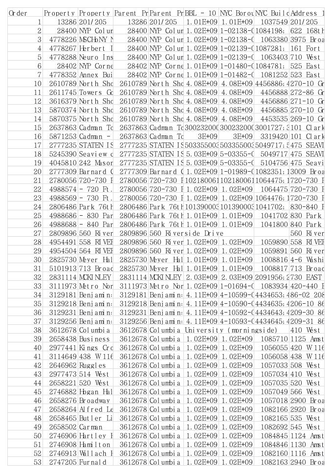

[cleaned_data.csv](https://internal-api-drive-stream.feishu.cn/space/api/box/stream/download/all/H7ObbFDpEoxMyrxNoXxcnbqHnRb)

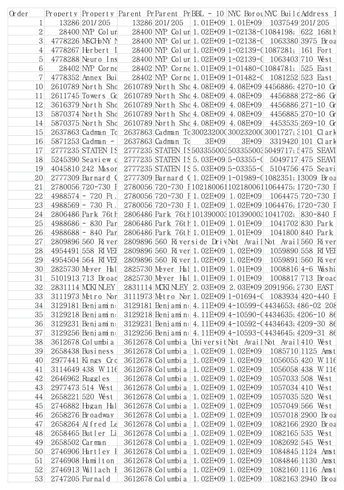

[Energy_and_Water_Data_Disclosure_for_Local_Law_84_2017__Data_for_Calendar_Year_2016_.csv](https://internal-api-drive-stream.feishu.cn/space/api/box/stream/download/all/EblRbJ06HoeSSWxsT8Pc2YFynSb)

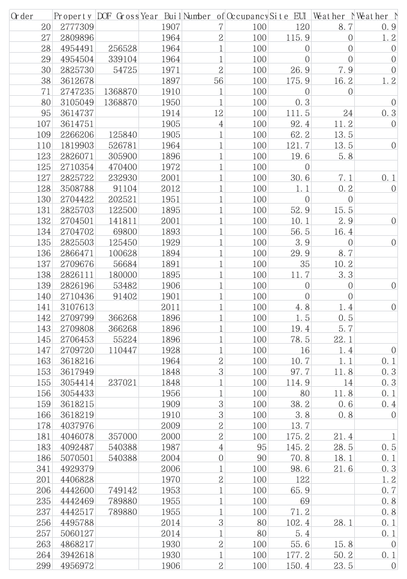

[no_score.csv](https://internal-api-drive-stream.feishu.cn/space/api/box/stream/download/all/ZdF1bnGduoVPkRxRhUScVrPSnXb)

[testing_features.csv](https://internal-api-drive-stream.feishu.cn/space/api/box/stream/download/all/Y3uybhmk6oqeg8xva35cEx3KnTf)

[testing_labels.csv](https://internal-api-drive-stream.feishu.cn/space/api/box/stream/download/all/Q7VdbGyzgobdlIxkFvwclflenkg)

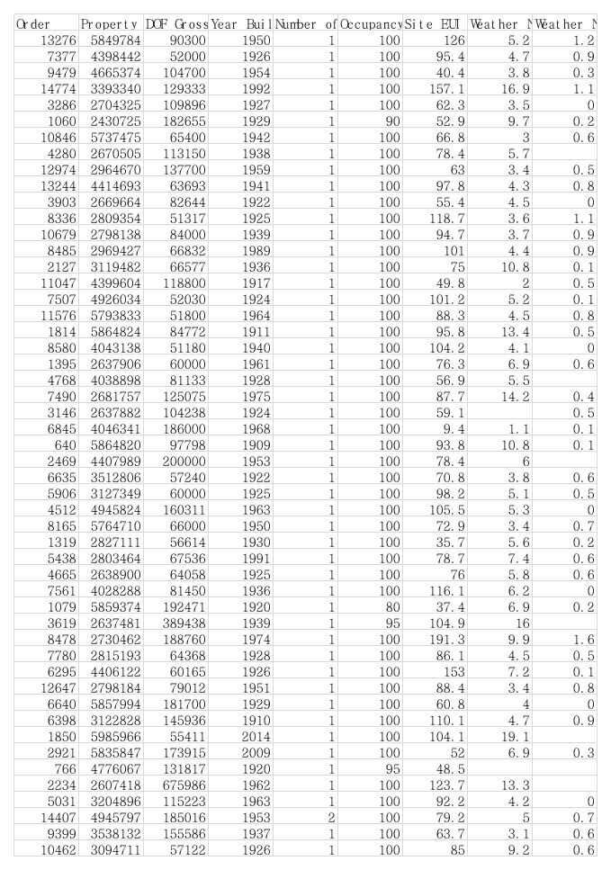

[training_features.csv](https://internal-api-drive-stream.feishu.cn/space/api/box/stream/download/all/Vkw8bAbi5onbCbxdKq5cMPrGnMc)

[training_labels.csv](https://internal-api-drive-stream.feishu.cn/space/api/box/stream/download/all/Y0uybJB7rojiLOxcnfQcli23nJe)

[X_test.csv](https://internal-api-drive-stream.feishu.cn/space/api/box/stream/download/all/FA8jbceskojDNaxFX6gcS3Vvnuc)

[Y_test.csv](https://internal-api-drive-stream.feishu.cn/space/api/box/stream/download/all/EsiAbun6eo8aM9x45IecPux0neg)

[Y_train.csv](https://internal-api-drive-stream.feishu.cn/space/api/box/stream/download/all/FpUabgp7HoxzPjxPfqecIKUFnoc)

[X_train.csv](https://internal-api-drive-stream.feishu.cn/space/api/box/stream/download/all/F1rlbWTjUouLNtxBSpecUh3SnLx)

> **images**

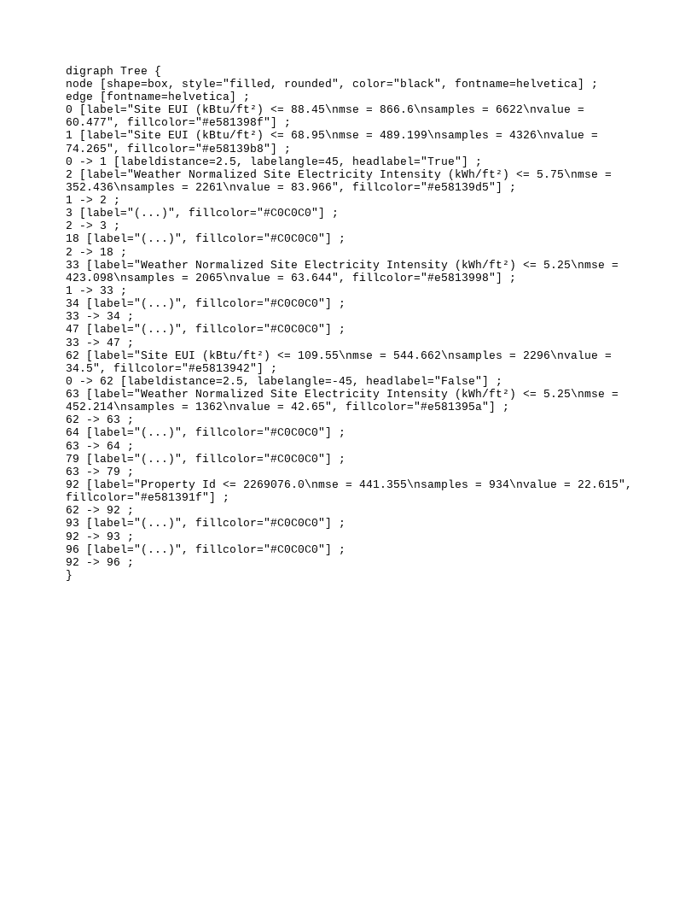

[tree_single_small.dot](https://internal-api-drive-stream.feishu.cn/space/api/box/stream/download/all/C3inbMEBaotr4NxzFgmcWHRunEf)

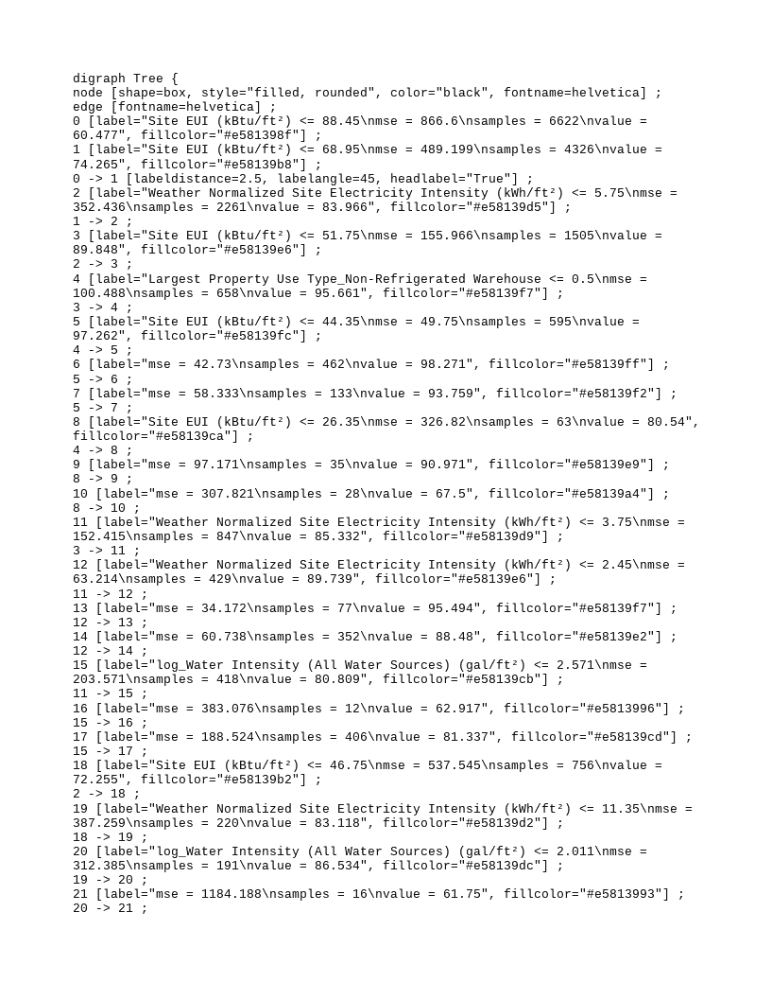

[tree_single.dot](https://internal-api-drive-stream.feishu.cn/space/api/box/stream/download/all/JXrkbOWnEok05bxuAxNcgVpHnlh)

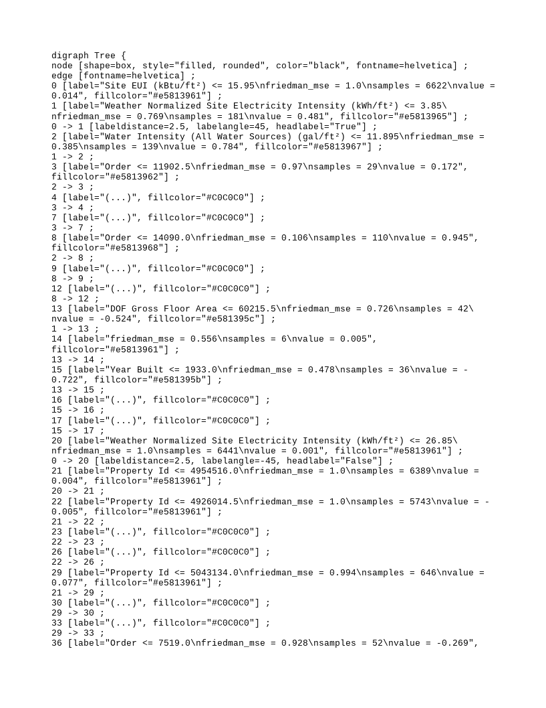

[tree_small.dot](https://internal-api-drive-stream.feishu.cn/space/api/box/stream/download/all/WndRbTjD5omurRxb9lJcDxQrn5d)

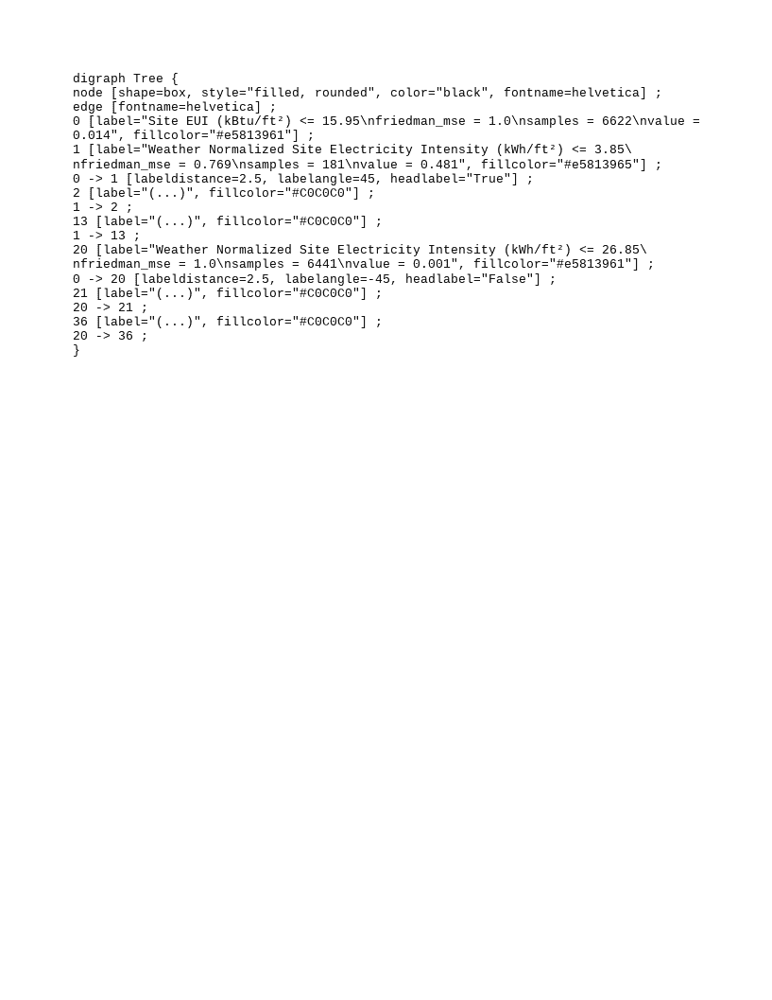

[tree_verysmall.dot](https://internal-api-drive-stream.feishu.cn/space/api/box/stream/download/all/NoFfbJg6co0KrYxdHu4c7TpcnBg)

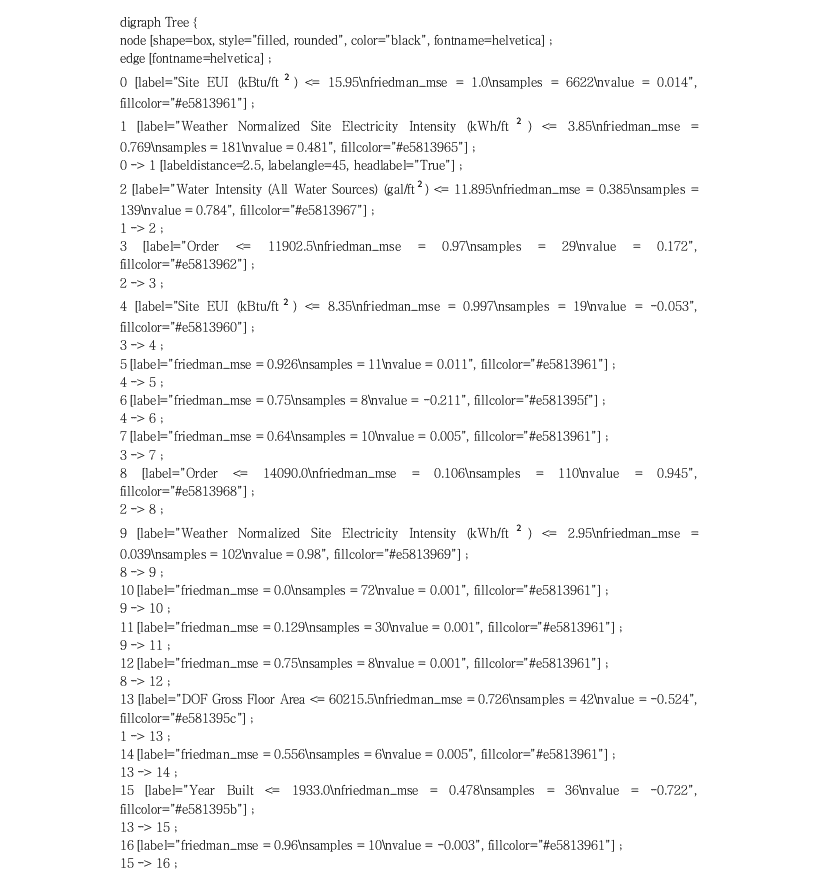

[tree.dot](https://internal-api-drive-stream.feishu.cn/space/api/box/stream/download/all/D5BybaY9bonIRBxmNpdcBtYCnCg)

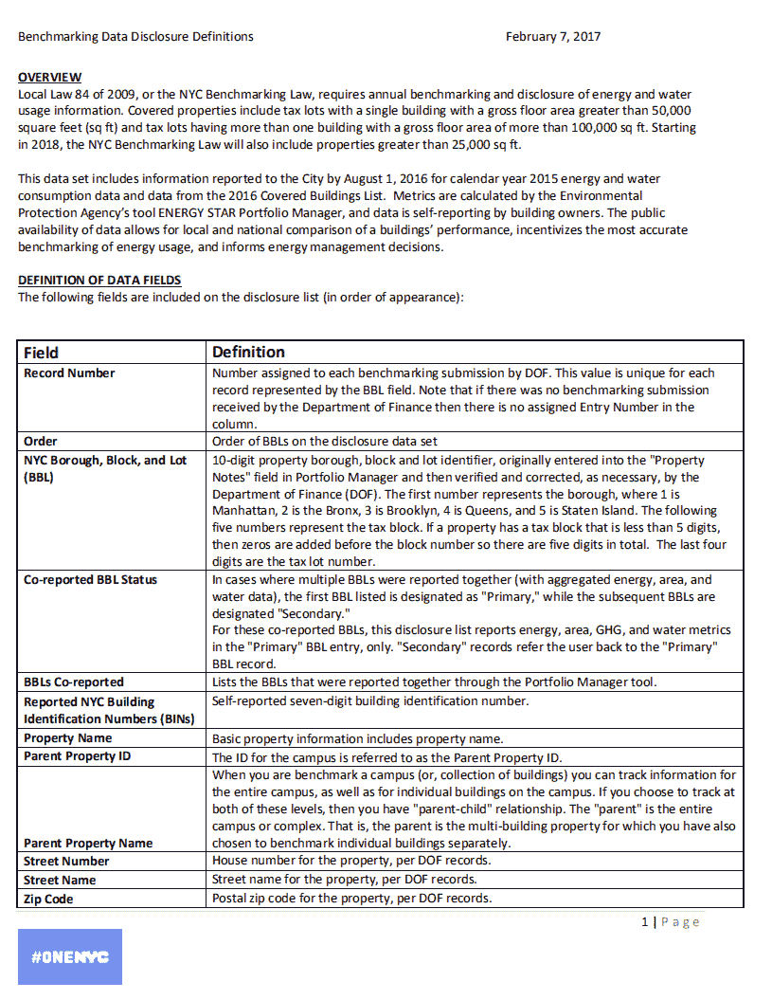

[2016_nyc_benchmarking_data_disclosure_definitions.pdf](https://internal-api-drive-stream.feishu.cn/space/api/box/stream/download/all/CYXibJXsfo3UwbxxqBPcauWFnHb)

# 贝叶斯优化实战及其工具包使用

[贝叶斯优化：Hyperopt.zip](https://internal-api-drive-stream.feishu.cn/space/api/box/stream/download/all/WAMDb29Dqoq9O9xIn36cSHosnkh)

# 隐马尔科夫模型

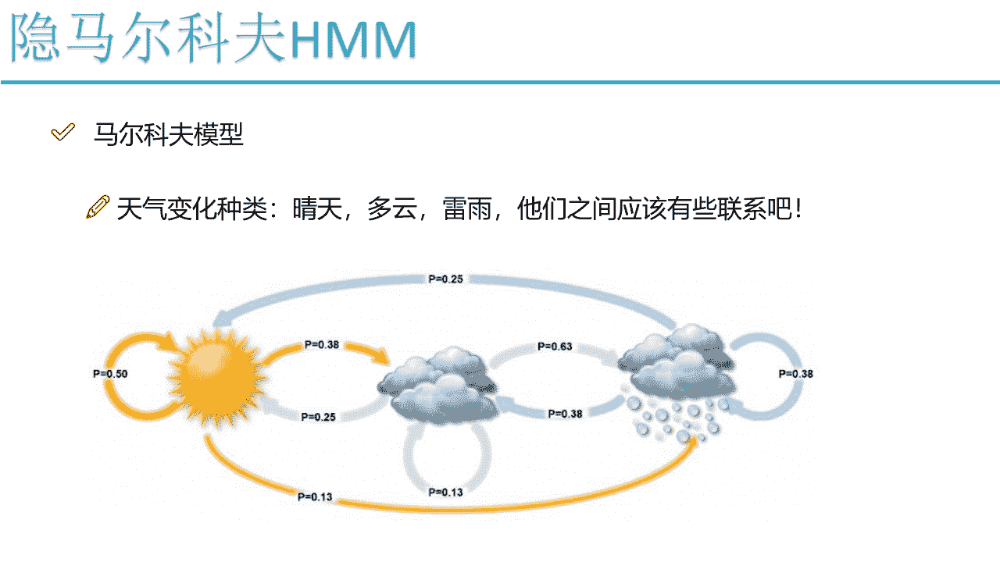

[HMM.pdf](https://internal-api-drive-stream.feishu.cn/space/api/box/stream/download/all/KfSMbOTO9oac6gxEh1Fc2vsanqg)

# GBDT 提升算法

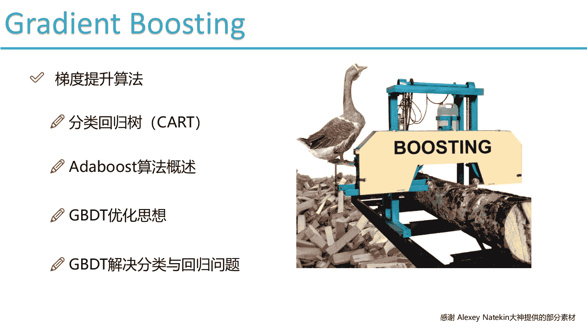

[GBDT.pdf](https://internal-api-drive-stream.feishu.cn/space/api/box/stream/download/all/T6IobHpS9owJqGxJ2k0cIh14nGb)

# HMM案例实战

[时间序列.ipynb](https://internal-api-drive-stream.feishu.cn/space/api/box/stream/download/all/J705bhxBPoOcHKxQFQfczj2Mnch)

[hmm实践.ipynb](https://internal-api-drive-stream.feishu.cn/space/api/box/stream/download/all/CBzjbsRslokLjKx7h9vcxc4ZnOh)

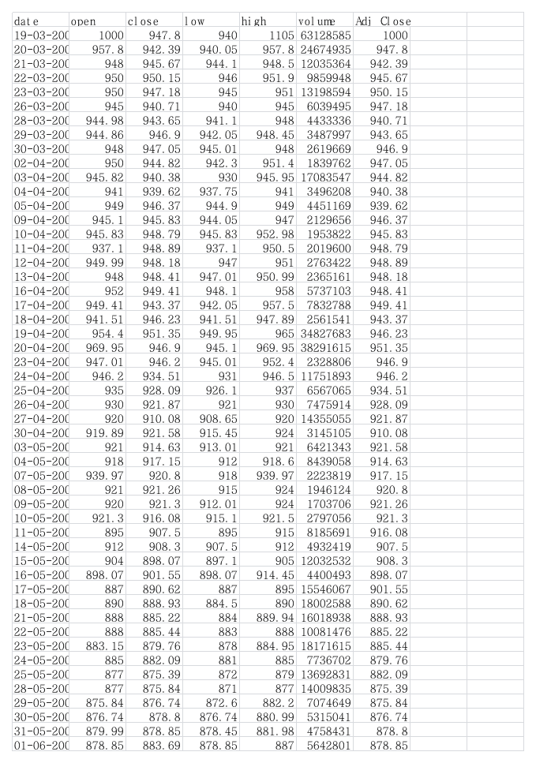

[data2.csv](https://internal-api-drive-stream.feishu.cn/space/api/box/stream/download/all/NUNqbdQm3oGFypx3GObcjqcknth)

[data.py](https://internal-api-drive-stream.feishu.cn/space/api/box/stream/download/all/YP5Rb5zeNosYoIxWnEjcO8Z9nre)

[get_hmm_param.py](https://internal-api-drive-stream.feishu.cn/space/api/box/stream/download/all/H2kpbO31PoiCdsxPOqoc4l07nfh)

[hmm_start.py](https://internal-api-drive-stream.feishu.cn/space/api/box/stream/download/all/VblzbjjLkozpw0xmvWhcRYemnNr)

[data.cpython-36.pyc](https://internal-api-drive-stream.feishu.cn/space/api/box/stream/download/all/HCNYbsrGGo2i4PxdvoJcMgsGnkk)

[get_hmm_param.cpython-36.pyc](https://internal-api-drive-stream.feishu.cn/space/api/box/stream/download/all/PBNQboqN3oalfzxkNLncclKFnkd)

# 制作自己常用工具包

[制作自己常用工具包.zip](https://internal-api-drive-stream.feishu.cn/space/api/box/stream/download/all/WUXGbaRxdovMYLxEpemcuhoNnLh)