# 机器学习 - 模型构建全流程（案例）

> 来源：[https://qqs7y1hozd1.feishu.cn/docx/RVUKd7S6BomOhgxDdZecirabnzg](https://qqs7y1hozd1.feishu.cn/docx/RVUKd7S6BomOhgxDdZecirabnzg)

本文旨在以简明易懂的方式，梳理 AI 的基础概念，帮助AI产品小伙伴零帧起手，顺利开启 AI 学习之旅。

之所以是 -1 开始是因为里面有部分我们高中学过的但已经被遗忘的知识。

## 一、机器学习基础概念

机器学习的核心流程可以概括为三个阶段：

1. 记忆：收集和准备数据
2. 制定：构建和训练模型
3. 预测：使用训练好的模型进行预测和决策

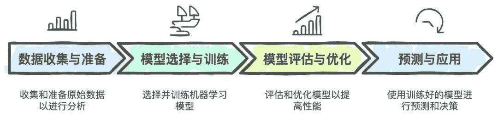

我们用一个例子来理解数据相关的几个核心概念，假设我们希望建立一个机器学习模型，根据房屋的各种属性（如面积、位置等）来预测房价。

### 1.1 数据、特征与标签

数据是用于训练和测试机器学习模型的原始信息。在预测房价的例子中，数据包含了关于不同房屋的信息以及它们对应的价格。

+ 结构化数据：以表格形式存储的数据，如电子表格或数据库表。每一行代表一个房屋，每一列代表一个属性。
+ 非结构化数据：如图片、文本等，不宜以表格形式表示。在预测房价时，非结构化数据可能包括房屋的照片或地段描述，但通常我们使用结构化数据作为主要输入。

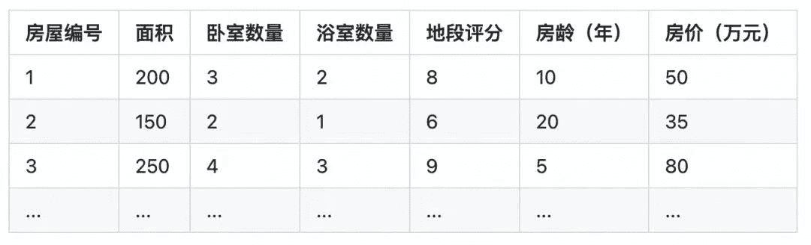

特征表示数据的属性或性质，也是另外一个经常会提到的概念，如果数据在表格中，那么特征就是表格的列。

> 在房价预测数据集中，每个房屋有 5 个特征（面积、卧室数量、浴室数量、地段评分、房龄）

> 这个数据集得**维度**是 5，其实房价也是房子的一个特征，但我们把房价这个希望模型预测的目标变量称为标签。

另外还有个常用的概念——**数据点**，也称为样本（Sample）或实例（Instance），是在数据集中代表一个具体实体或观测的单个记录，简单来讲每一行代表一个数据点，每一列代表一个特征或标签。

### 1.2 线性回归

线性函数是指其图像在平面直角坐标系中呈现为一条直线的函数。

其基本数学表达式为：`f(x)=ax+b`，其中 `a` 表示斜率，`b` 表示截距。

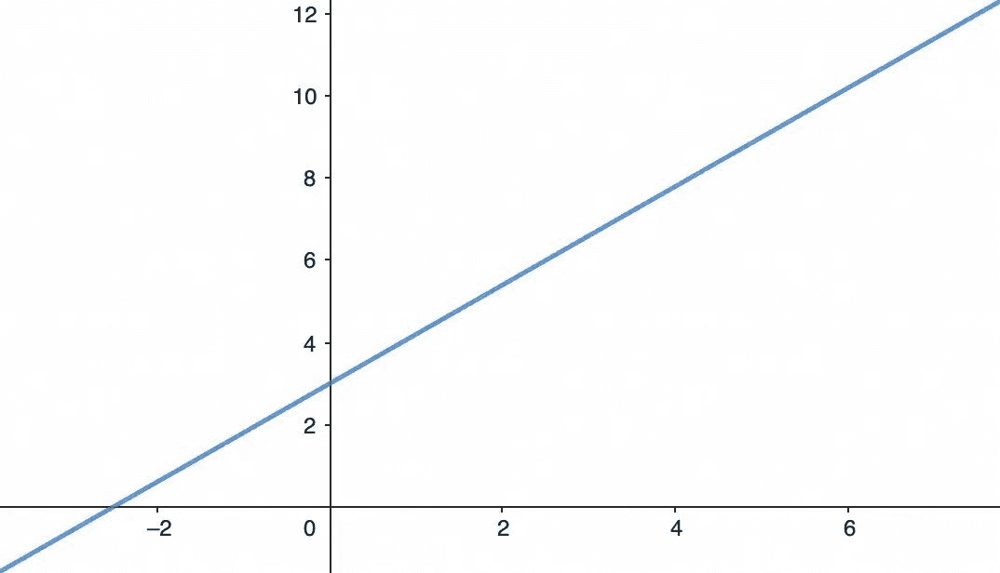

机器学习中的线性回归正是基于线性函数构建的模型，其核心是通过线性函数对输入特征和输出目标之间的关系进行建模。

假设目标变量（标签，房价）与一个或多个特征之间存在线性关系：

+ ：目标变量或者叫因变量，也就是预测值，在预测房价的例子中，目标变量是房价；
+ ：自变量，也就是输入特征，房屋的各项属性，如面积、卧室数量、浴室数量等；
+ 线性函数的斜率（slope），用于描述输入特征对预测值的贡献程度，因此被称为权重（weight）；
+ `b`：线性函数的截距，在模型中称为偏置量（bias），在房价预测模型中代表当所有特征值为零时的预测房价。

线性回归根据现有的特征数据集，通过不断调整模型中的参数，拟合出一条最贴近数据分布趋势的直线，从而用于预测目标变量（标签）的数值。

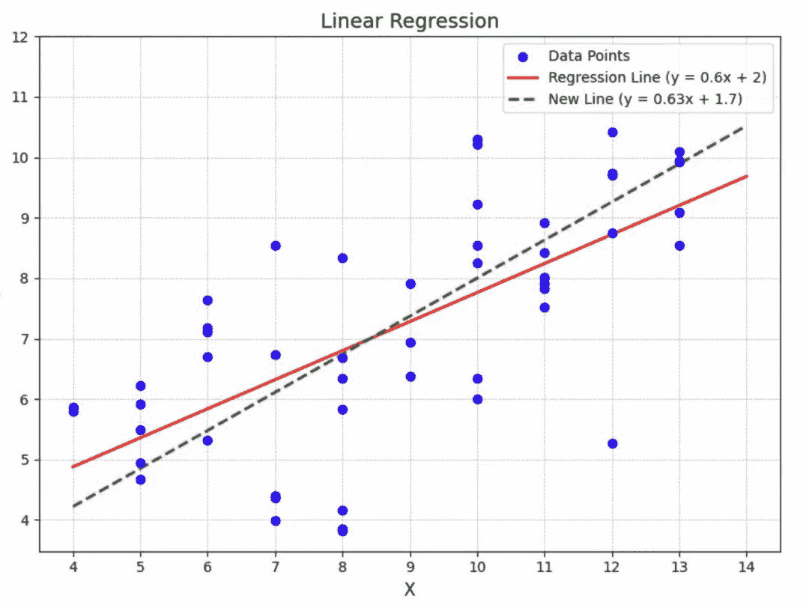

也许经过复杂学习与训练后房价预测模型可以写成：

模型是否可靠很大程度上取决于关联特征数量与对应的权重调整，因此我们经常会听到算法同学戏称自己是调参工程师。

### 1.3 数据分类

在机器学习中，理解数据的类型和结构是至关重要的，根关注点不同数据有不同的分类方式

如果我们关注数据表中列的维度，根据特征中值的类型可以把数据分为

+ 数值数据（Numerical Data）：由数值表示的数据，可以进行数学运算，用于度量和预测具体的数值结果，比如房屋面积（平方米）、价格（万元）、房龄（年）
+ 分类数据（Categorical Data）：表示类别或状态的数据，用于分类和分组任务，比如房屋所在地区（中心区、郊区）、房屋类型（独栋、联排）、销售状态（已售出、待售）

> 还记得标签和数据点的概念吗？表格中的一行数据记录称之为一个数据点，标签是指模型试图预测或分类的值，也就是说每个标签对应一个数据点的结果或类别。

> 如果我们关注数据表中行的维度，根据数据点是否包含标签可以把数据分为

+ 标签数据（Lebeled Data）：每个数据点都附带有标签的数据。
+ 无标签数据（Unlabeled Data）：数据点没有标签的数据。

很多初学者可能会有疑惑，怎么会存在没有标签的数据？其实这种数据才是常态，举个最简单的例子，我们需要细分网站客户群体。

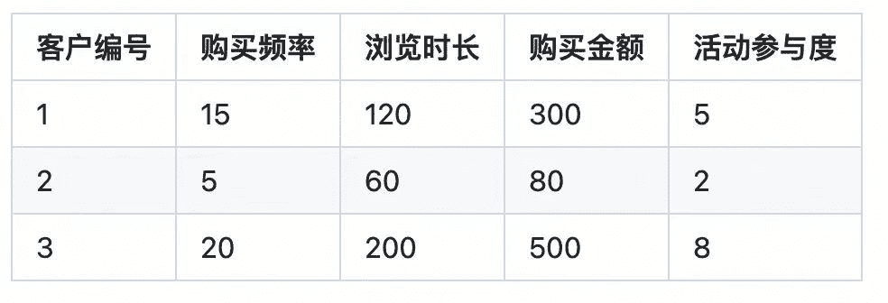

### 1.4 监督学习与无监督学习

监督学习（Supervised Learning）是一种处理标签数据的机器学习分支，其目标是学习特征与标签之间的映射关系，以便在新数据上进行准确的预测。

**监督学习主要分为两类：**

+ 回归模型（Regression Models）：用于预测连续数值型目标变量的模型，比如前面一直在用的预测房价模型正是回归模型
+ 分类模型（Classification Models）：将数据分类到预定义的类别中的模型，比如判断邮件是否为垃圾邮件、图像识别中的物体分类

监督学习之所以被称为“监督”，主要因为模型在训练过程中有明确的标签作为指导，就像教师指导学生一样。

> 标签为模型提供了学习的目标，使其能够理解和掌握输入特征与输出目标之间的关系，从而在新数据上实现准确的预测或分类。

> 监督学习有几个优势：

+ **准确性高：**由于有明确的标签指导，模型通常在预测和分类任务中表现出较高的准确性。
+ **可解释性强：**模型的输出可以直接与标签对比，便于解释模型的决策过程。
+ **广泛应用：**适用于各种实际问题，如图像识别、语音识别、医疗、金融预测等。

无监督学习（Unsupervised Learning）是一种处理无标签数据的机器学习分支，其目标是发现数据中潜在的结构，无需预先定义的标签。

无监督学习主要包括以下几种分支：

+ 聚类算法：基于相似度将数据分组的算法，例如客户细分、市场分群、图像分割
+ 降维算法：减少数据维度，用更少特征进行如实描述的算法，比如把房屋模型中的 5 个维度转化为面积综合分、地段分、房龄 3 个维度
+ 生成算法：可以生成类似于现有数据的新数据点的算法，是不是听起来和 GPT 的 G 有些关系

无监督学习之所以称为“无监督”，是因为在训练过程中，模型不依赖于任何预先定义的标签。模型需要自行发掘数据中的潜在结构或规律，类似于学生自主学习，不依赖于教师的答案。

> 无监督学习有几个应用：

+ **发现隐藏模式：**能够揭示数据中难以察觉的隐藏模式或结构。
+ **数据探索：**适用于初步的数据分析和探索，帮助理解数据的内在关系。
+ **数据预处理：**如降维方法，可以优化数据，使后续的监督学习模型更加高效。

两张好玩的图片帮大家理解监督学习与无监督学习，不断给婴儿看各种各样冰激凌的图片，让其分辨下一张是不是冰激凌，这是监督学习

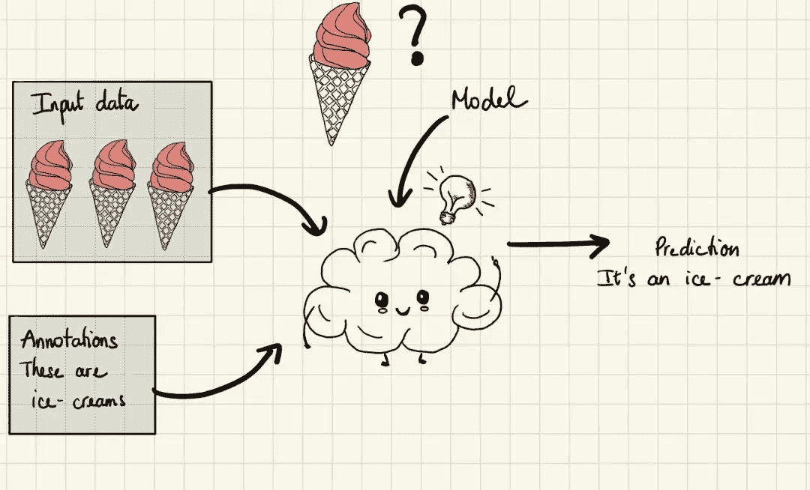

给婴儿看各种各样的图片，并没有这些图片是什么的答案，让婴儿将图片做分组这是无监督学习。

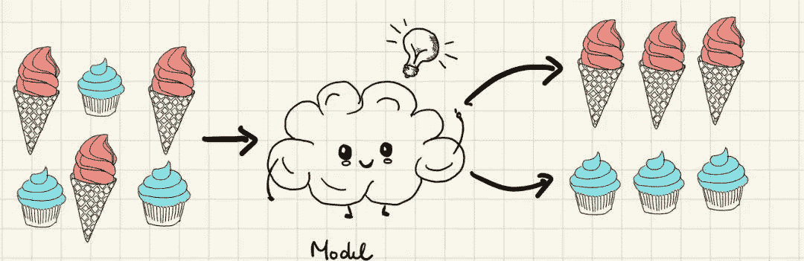

当然如果我们有每张图片所代表的含义（标签），然后让应该对其分类就变成了监督学习，从这里也能看出来很多任务其实需要监督学习和无监督学习混合使用。

可以按照这样的步骤求解：

1. 用无监督学习对图片聚类，发现潜在类别（如相似颜色 / 形状的商品）
2. 人工标注聚类结果，数据有了标签
3. 监督学习模型训练，自动化分类网站服饰、电子产品图片

这个方法还有一个专门的名字 —— 半监督学习（Semi-Supervised Learning， SSL），这是一种结合少量标注数据和大量未标注数据进行模型训练的方法

### 1.5 强化学习

强化学习中同样有大量的概念，通过一个走迷宫的例子来理解强化学习：

> 想象你是一个机器人（智能体），被扔进一个迷宫（环境）。
>
> 迷宫的出口有宝藏（奖励），但路径错综复杂，墙上有陷阱（负奖励）。
>
> 你的目标是通过不断尝试，找到走出迷宫的最佳路径（策略优化）。

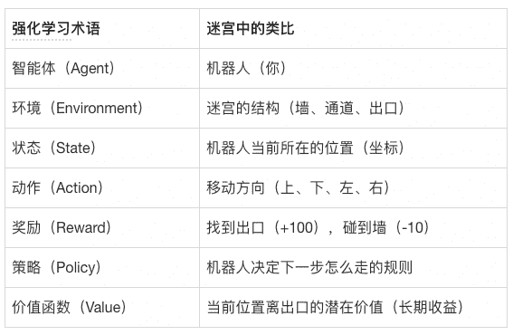

强化学习通过 Agent 与环境的交互来学习最优决策策略，以最大化累积奖励（Reward），通过“实践-反馈-改进”的循环机制，使 Agent 在无明确指导的情况下逐步掌握实现目标的最佳策略

+ 目标导向性：Agent 通过试错（Trial and Error）学习，在动态环境中自主选择动作，目标是通过长期策略获得最大化预期收益；
+ 无需监督信号：不同于监督学习依赖标注数据，强化学习仅通过环境提供的奖励信号调整策略，无需预先给定正确答案；

## 二、特征工程

特征工程是指通过数据清洗、转换、组合等方法，从原始数据中提取或构造对预测目标更有用的信息的过程。

### 2.1 核心工作

#### 特征工程主要有几个工作：

+ **特征选择：**从大量特征中筛选出对目标最相关的部分。假设有一个包含10个特征的房价预测数据集，通过特征选择发现其中3个特征（面积、位置评分、房龄）对房价影响最大，可以只保留这3个特征进行建模。
+ **特征提取：**从原始数据中创建新的特征，更好地表示数据中的信息。在图像识别中，可以使用卷积神经网络（CNN）自动提取图像的高级特征。
+ **数据清洗：**处理脏数据，剔除噪声、填补缺失值、修正异常值。比如在医疗数据中，患者的某些检测指标可能缺失，可以使用该指标的平均值填补缺失部分。
+ **特征转换：**将数据转换为模型更易处理的格式。最典型就是归一化，也称之为特征缩放，将特征值调整到同一尺度，避免某些特征对模型训练产生不均衡的影响。
+ **编码类别：**是将非数值型特征转换为数值型特征，以便机器学习模型能够处理。比如数据集中性别特征 {男性, 女性} ，可以通过独热编码转换为两个新的特征：[1,0]、[0,1]。

### 2.2 向量化、Token 和 Embedding

在特征工程领域，Token、向量化、Embedding 这三个概念犹如构建数据大厦的基石，它们在处理各类数据，尤其是文本数据时，发挥着至关重要的作用，后面大模型的学习中也会反复出现。

#### Tokenization 分词

Token 是文本预处理过程中的基本单元，代表文本中的最小有意义部分，对模型而言 Token 不一定是单词，取决于模型要求，它们可以是单词、字符、词组等

+ **字符级：**将文本分割为单个字符。例如，"机器学习" 分割为 ["机", "器", "学", "习"]，适用于需要处理细粒度语言特征的任务，如拼写纠正、语言模型训练等。
+ **子词级：**将单词拆分为子词或更小的单位。例如，"unhappiness" 可能被分割为 ["un", "happiness"]，在处理未知词汇和减少词汇表大小时尤为有效，广泛应用于 NLP 中
+ **单词级：**将句子分割为独立的单词或词语。例如，句子 "机器学习很有趣。" 分割为 ["机器学习", "很", "有趣"]，常用于大多数文本分析任务，如情感分析、主题建模等。
+ **词组级：**将常见的多词表达合并为单个 Token。例如，"New York" 作为一个整体 Token，有助于捕捉特定短语的语义，例如人名、地名等。

分词是文本预处理的第一步，然而计算机只能处理数值运算，无法直接理解文本或符号。还需要将分词结果转化为数字，模型内部一般都会内置词汇表与 Token ID 映射的编码表，模型使用这些编号而非原始文本进行计算。

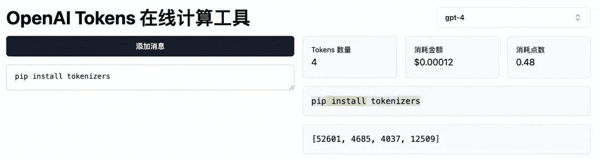

#### Vectorization 向量化

在数学中向量（Vector）是具有大小和方向的量，几何向量用于描述位移、力等物理量，其长度表示大小，箭头指向表示方向，矩阵可视为由多个行向量或列向量有序排列而成：

高中学习向量和矩阵时候很不理解这东西有什么用，现在可以回答了，至少大模型要用！

**向量化**是将非结构化数据（如文本、图像、声音等）转换为数值向量的过程，通过将 Token ID 转换为向量，模型可以：

+ 数学运算：向量化后数据可以进行各种数学运算，如矩阵乘法，满足模型训练和推理的需求；
+ 处理批量数据：向量化允许同时处理多个样本，提高训练效率；

**有**非常多将 Token 转为数值向量的方法，最常见的有 `Bag-of-Words`、`TF-IDF`、`One-Hot Encoding` 等。

> 这类传统方法如短文本分类等简单场景中仍具实用性，但其语义缺失、稀疏性、静态表示的核心缺陷限制了在复杂任务的性能。

#### Embedding 嵌入

Embedding 是向量化的一种高级形式，解决传统向量化技术缺陷，旨在将高维稀疏的离散数据转换为低维稠密向量，同时捕捉数据之间的语义关系。

> **高维稀疏：**数据特征的维度（数量）非常高，在每一份数据样本中，大多数特征的值接近 0，空间利用率低、计算复杂度高、模型训练困难（过拟合、收敛慢）。

有几种常见的 Embedding 方法：

+ `Word2Vec` 是一种通过上下文预测生成词向量的模型，通过词共现学习语义，使语义相近的词向量距离接近。例如，`Word2Vec` 中 “猫” 和 “狗” 的余弦相似度可能为 0.8，而 “猫” 和 “石头” 为 0.2。
+ `BERT` 基于上下文动态编码，同一词在不同语境中向量不同。例如，`BERT` 中 “苹果” 在 “吃苹果” 和 “苹果手机” 中的向量差异显著。

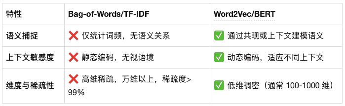

```
from gensim.models import Word2Vec

sentences = [
    ["机器学习", "很", "有趣"],
    ["让", "我们", "一起", "学习"],
    ["机器学习", "是", "人工智能", "的", "一个", "分支"]
]

# 训练Word2Vec模型
model = Word2Vec(sentences, vector_size=50, window=2, min_count=1, workers=4)

# 获取词向量
word_vector_ml = model.wv['机器学习']
word_vector_ai = model.wv['人工智能']

print("机器学习的词向量：", word_vector_ml)
print("人工智能的词向量：", word_vector_ai)

# 计算词向量之间的相似度
similarity = model.wv.similarity('机器学习', '人工智能')
print("机器学习与人工智能的相似度：", similarity)
```

```
机器学习的词向量： [ 0.00123456  0.00234567 ...  0.00345678]
人工智能的词向量： [ 0.00456789  0.00567890 ...  0.00678901]
机器学习与人工智能的相似度： 0.85
```

前面介绍的主要是 AI 相关最基础的概念，接下来还有深度学习基本知识、模型训练、Transformer 架构、`TensorFlow` 框架、`RAG` & `Langchain` 等大模型工程知识。

但在开始之前可以先了解模型被应用在业务中的过程，这将有助于理解上述介绍的概念。

> 1. **需求分析** → 明确目标、指标、资源。
> 2. **数据收集** → EDA、清洗、预处理。
> 3. **划分数据集** → 训练集 / 验证集 / 测试集。
> 4. **特征工程** → 特征选择、生成、转换。
> 5. **模型选择** → 基于任务和数据选择候选模型。
> 6. **训练与调优** → 基线训练、超参数调优、防止过拟合，`TensorFlow` 和 `PyTorch` 最主要的应用阶段。
> 7. **模型评估** → 测试集评估、误差分析。
> 8. **优化改进** → 数据、特征、模型层面的迭代。
> 9. **部署与监控** → 服务化部署、性能监控、文档记录。
> 10. **反馈与迭代** → 根据反馈持续改进。

## 三、使用机器学习模型解决业务问题--房价预测

机器学习核心是通过数据训练模型，并用这些模型解决实际问题。

以下将以一个简单的“房价预测”问题为例，一步步拆解AI产品经理跟进模型开发到落地的完整过程。

### 3.1 使用模型解决业务问题流程

**模型**就是机器学习、深度学习中从数据中学习到的、用于做预测或决策的规则集合。当业务需求有清晰的规则执行，一般由工程同学编写 `CRUD` 进行实现。

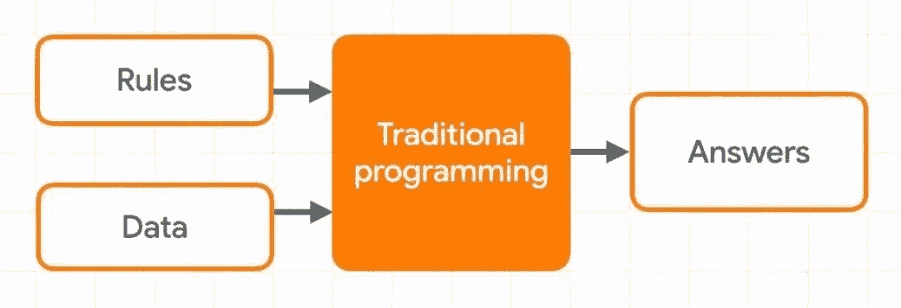

当业务只有一些数据、现象，没有这些数据的规则时候就需要算法同学训练、产出这个规则，也就是模型。

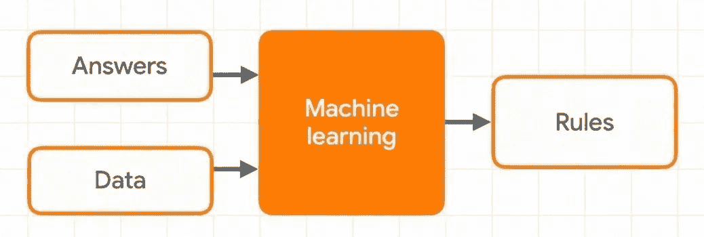

从这个角度想算法同学和工程同学的工作有点逆操作，但实际开发过程两者非常相似。

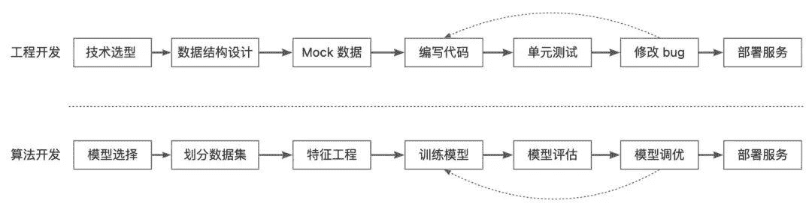

接下来按照以下流程来训练一个预测房价的回归任务：


1. **需求分析** → 明确目标、指标、资源。

2. **数据收集** → `EDA`、清洗、预处理。

3. **划分数据集** → 训练集 / 验证集 / 测试集。

4. **特征工程** → 特征选择、生成、转换。

5. **模型选择** → 基于任务和数据选择候选模型。

6. **训练与调优** → 基线训练、超参数调优。

7. **模型评估** → 测试集评估、误差分析。

8. **优化改进** → 数据、特征、模型层面的迭代。

9. **部署与监控** → 服务化部署、性能监控、文档记录。

10. **反馈与迭代** → 根据反馈持续改进。

### 3.2 需求分析

**目标：**房价预测需求的目标是根据房屋的一些特征（如面积、房间数量等），预测房屋的价格。

**指标：**这里我们采用均方误差（`MSE`）来衡量模型预测效果的标准，它是预测值与真实值差值平方的平均值，值越小说明模型预测越准确。

**资源：**包括使用的数据集、编程语言、库和框架等

**数据集：**`kaggle` 公开的房价数据集。

**工具：**`Python` 编程语言，使用 `pandas`、`numpy`、`scikit-learn` 等库。

**计算资源：**个人电脑即可完成，数据量不大。

> 衡量模型预测结果与真实结果之间差异的函数被称之为损失函数，使用 `MSE` 会带来两个好处：

> 1. 消除正负号的影响，让误差 “绝对值化”，防止求和之后误差互相抵消；
> 2. 放大误差便于模型优化，例如误差为 3 和 0.4，平方后变为 9 和 0.16，差异更明显。

### 3.3 数据收集

首先，我们需要获取数据并进行初步的探索性数据分析（`EDA`），了解数据的基本情况，并进行必要的清洗和预处理。

1. **下载数据集：**前往 Kaggle 竞赛页面下载 `train.csv` 和 `test.csv` 文件。

2. **加载数据：**使用 `pandas` 加载数据集。

3. **探索数据：**查看数据的基本信息、统计描述，以及缺失值情况。

4. **可视化：**了解目标变量（房价）及其与各特征的关系。

```
import pandas as pd
import matplotlib.pyplot as plt
import seaborn as sns

# 加载数据
train = pd.read_csv('data/raw/train.csv')
test = pd.read_csv('data/raw/test.csv')

# 查看数据集前几行
print(train.head())

# 基本统计信息
print(train.describe())

# 数据集信息
print(train.info())

# 缺失值统计
missing_values = train.isnull().sum()
print(missing_values[missing_values > 0])

# 可视化目标变量分布
plt.rcParams['font.family'] = 'SimSong' # 设置中文字体
plt.figure(figsize=(10,6)) # 创建 10x6 的窗口
sns.histplot(train['SalePrice'], kde=True, color='blue') # 自动统计数据在不同区间的频数，绘制直方图
plt.title('房价分布')
plt.xlabel('价格')
plt.ylabel('频数')
plt.show()

# # 可视化房价与一些特征的关系
plt.figure(figsize=(10,6))
sns.scatterplot(x=train['GrLivArea'], y=train['SalePrice'], color='green')
plt.title('房价与居住面积的关系')
plt.xlabel('居住面积')
plt.ylabel('价格')
plt.show()
```

根据程序输出，数据质量还可以，暂时不用进一步的处理

### 3.4 划分数据集

拆出一部分数据做模型的评估

1. **训练集：**训练集是用于训练模型的数据，一般占总数据集的 60%-80%。

2. **验证集：**验证集不参与模型的训练，而是用来评估模型在未见过的数据上的表现，一般占总数据集的 10%-20%。

3. **测试集：**模拟真实世界的未知数据，用于最终评估模型的泛化能力，一般占总数据集的 10%-20%。

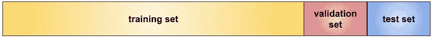

我们从训练集中划分出验证集，以便在模型开发过程中评估模型性能。

```
from sklearn.model_selection import train_test_split

# 分离特征和目标变量（标签）
X = train.drop(['SalePrice', 'Id'], axis=1) # 特征矩阵
y = train['SalePrice'] # 目标变量

# 划分训练集和验证集
X_train, X_val, y_train, y_val = train_test_split(
    X, y, test_size=0.2, random_state=42
)

print(f'训练集大小: {X_train.shape}')
print(f'验证集大小: {X_val.shape}')
```

程序执行后训练数据被分为两部分：

```
训练集大小: (1168, 79)
验证集大小: (292, 79)
```

### 3.5 特征工程

特征工程是提升模型性能的重要步骤，涉及选择有用的特征、生成新特征以及对特征进行转换。Kaggle 的 House Prices 数据集包含大量有用的特征，其中既有数值型特征，也有类别型特征。我们对数据做几个处理

#### 处理缺失值

+ 对于类别型特征，使用众数（出现次数最多的值）进行填充。

+ 对于数值型特征，使用中位数进行填充。

+ 编码类别变量：

  + 使用 `One-Hot` 编码将类别型特征转换为数值型。

  + 使用 `align` 确保训练集和验证集具有相同的特征，缺失的特征填充为 0。

#### 特征缩放

+ 使用 `StandardScaler` 对数值型特征进行标准化，使其具有均值为 0，标准差为 1 的分布，有助于模型更好地收敛。

```
# 复制训练集和验证集
X_train_fe = X_train.copy()
X_val_fe = X_val.copy()

# 处理缺失值
for dataset in [X_train_fe, X_val_fe]:
    for column in dataset.columns:
      if dataset[column].dtype == 'object':
          # 对于类别型变量，使用众数填充缺失值
          dataset[column].fillna(dataset[column].mode()[0], inplace=True)
      else:
          # 对于数值型变量，使用中位数填充缺失值
          dataset[column].fillna(dataset[column].median(), inplace=True)

# 验证缺失值是否处理完成
print(X_train_fe.isnull().sum().max()) # 输出 0
print(X_val_fe.isnull().sum().max())   # 输出 0

# 使用 One-Hot 编码处理类别型变量
X_train_fe = pd.get_dummies(X_train_fe)
X_val_fe = pd.get_dummies(X_val_fe)
# 对齐训练集和验证集的特征矩阵
X_train_fe, X_val_fe = X_train_fe.align(X_val_fe, join='left', axis=1, fill_value=0) 

# 特征缩放
scaler = StandardScaler()
X_train_scaled = scaler.fit_transform(X_train_fe)
X_val_scaled = scaler.transform(X_val_fe)
print(f'特征缩放后，训练集大小: {X_train_scaled.shape}')
print(f'特征缩放后，验证集大小: {X_val_scaled.shape}')
```

> `One-Hot` 编码是将类别型变量转换为数值型变量的一种常用方法，它会为每个类别创建一个新的二进制列，该列的值为 1 表示该样本属于该类别，为 0 表示不属于该类别。

> 特征缩放是对数据集中的特征进行转换，使得不同特征的取值范围大致相同。例如一个特征的取值范围在 0～10 之间，而另一个特征的取值范围在 1000～10000 之间，通过特征缩放可以将这些特征的取值范围调整到相近的区间，从而使模型能够更加公平地对待每个特征。

### 3.6 模型选择

房价预测是一个典型的回归任务，常用的模型包括线性回归、岭回归、决策树、随机森林、梯度提升树（如 `XGBoost`、`LightGBM`）等，为了更好的选择模型，首先来了解一些基础概念。

#### 拟合

拟合（Fitting）是机器学习和统计学中的一个基本概念，指的是构建一个模型，使其能够准确地描述或预测给定数据集中的模式和关系：

+ 欠拟合（Underfitting）：模型在训练数据和测试数据上都表现不佳，通常是由于模型过于简单，无法捕捉数据中的潜在模式。

+ 过拟合（Overfitting）：模型在训练数据上表现良好，但在未见过的测试数据上表现较差，通常是由于模型过于复杂，捕捉到了数据中的噪声，只是记忆了训练数据本身，没有找到背后的模式规律。

泛化是与拟合相对的概念，模型的泛化能力是用来衡量模型在训练数据以外数据上表现的指标，一个具有良好泛化能力的模型不仅能准确拟合训练数据，还能有效地预测和处理新的、看不见的数据。

#### 模型复杂度

> 模型复杂度是一个用来衡量机器学习模型在结构、参数等方面复杂程度的指标，用来反映模型对数据的拟合与泛化之间的平衡关系。

> 通常来讲复杂度低的模型容易欠拟合，复杂度高的模型容易过度拟合训练数据中的噪声和细节，泛化能力差。

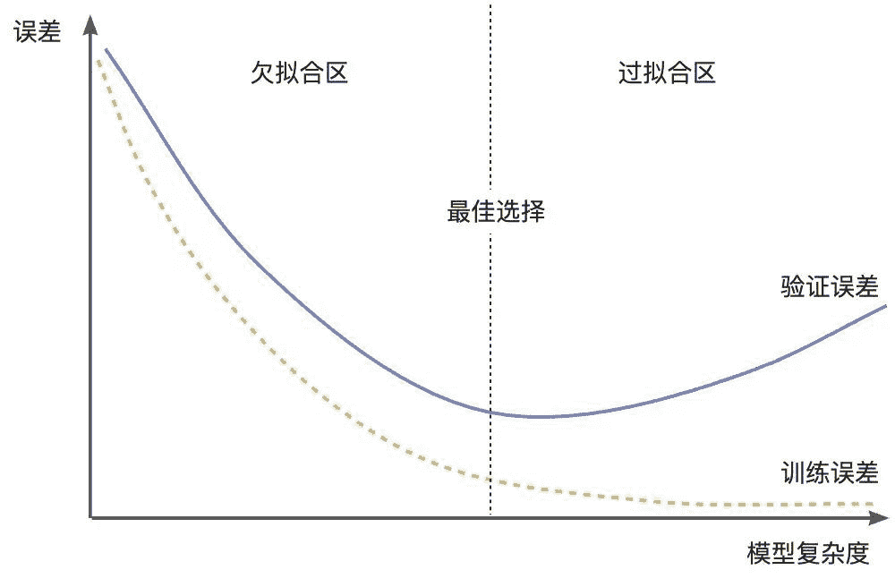

为了获得良好的泛化性能，需要在模型复杂度和过拟合、欠拟合之间找到一个平衡。

> 从上图可以发现当模型复杂度太低时候，训练误差和验证误差都很大，模型欠拟合；当训练误差越来越小但验证误差越来越大时候意味着模型已经过拟合，而验证误差开始上升的点是我们想要的模型。

模型复杂度图有一个好处，无论数据集有多大，它看起来总是有两条曲线，训练误差总在下降，理想情况下验证误差先下降再上升。

> 通常可以使用交叉验证、正则化等方法来调整模型复杂度，选择合适的模型结构和参数，使模型在训练数据上能够充分学习到数据的规律，同时在新数据上也具有较好的泛化能力。

#### 正则化

正则化是用于防止模型过拟合、提高模型泛化能力的技术，通常过拟合是因为模型复杂，学习到了训练数据中的噪声和细节，而不是数据的真实规律。

正则化的基本思想是在模型的损失函数中添加一个正则化项，对模型的复杂度进行惩罚，从而限制模型的参数取值范围，使得模型更加简单平滑，减少对训练数据的过拟合。

有两种常见的正则化类型：

+ `L1` 正则化（`Lasso` 正则化）：在损失函数中添加参数绝对值之和作为正则化项，具有特征选择的作用，它会使一些参数变为零，从而可以自动筛选出对模型重要的特征，减少模型的复杂度。

+ **`L2` 正则化（岭回归）：**在损失函数中添加参数平方和作为正则化项，会使参数的值变小，但不会使参数变为零。它可以防止模型的参数过大，使得模型更加稳定，减少过拟合的风险。

使用正则化后，在训练过程中模型不仅要最小化原始的损失函数，还要考虑正则化项的影响，从而避免参数取值过大，使模型更加平滑。

#### 决策树与随机森林

决策树是一种基于树形结构的模型。在模型中，每个内部节点表示一个特征的判断，每个分支代表判断结果，而每个叶子节点则给出最终的预测或决策。

比如预测一张图片内的动物是否为 `dog`，每个叶子都包含一组可能的物种中的一种动物物种。

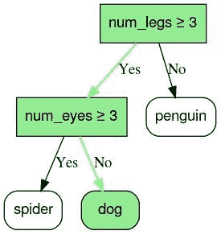

构建决策树主要是对每个候选特征，尝试找出一个分裂标准或阈值，使得数据依据这个特征被分成两个或多个子集后，子集内的样本更加同质，对于回归问题，通常使用 `MSE` 的降低量作为评价指标。

> 这一过程是递归的，从根节点开始，直到满足一定的停止条件。

> 建成整棵树后，可以通过剪枝技术进一步简化模型，剪除对总模型预测贡献不大的分支，从而提高模型对新数据的泛化能力。

随机森林通过构建并结合多个决策树的预测结果，以获得更加稳定和准确的最终结果。主要构建过程是：

+ 从原始训练集随机地抽取若干子样本，建立多个数据集。

+ 在每个节点进行分裂时，不是考查所有特征，而是从随机选择的一部分特征中选择最佳分裂点。

+ 训练完毕后，对于新的输入数据，每棵树给出一个预测，然后通过多数投票（或平均）的方式来决定最终结果。

这种随机性和多个模型的结合，使得随机森林在应对高维数据和具有噪声的数据时，通常比单一决策树有更好的泛化能力。

初次尝试可以从线性回归和随机森林开始

```
from sklearn.linear_model import LinearRegression, Ridge
from sklearn.ensemble import RandomForestRegressor

# 初始化模型
lr = LinearRegression()
ridge = Ridge(alpha=1.0)
rf = RandomForestRegressor(n_estimators=100, random_state=42)
```

> `LinearRegression`：是一种基本的线性回归模型，它通过 `MSE` 来拟合数据，从而找到最优的回归系数。

> `Ridge`：是线性回归的一种扩展，也称为岭回归，它在普通线性回归的基础上增加了一个 `L2` 正则化，可以有效防止模型过拟合。

> `RandomForestRegressor`：是一种基于决策树的集成学习模型，通过构建多个决策树并对它们的预测结果进行平均来进行回归预测。随机森林可以处理高维数据，具有较好的泛化能力和抗过拟合能力。

### 3.7 训练与调优

首先训练基线模型，然后通过调整超参数提升模型性能，使用交叉验证防止过拟合

+ 训练基线模型：训练线性回归、岭回归和随机森林模型。

+ 评估基线模型：使用验证集评估每个模型的均方误差（`MSE`）。

+ 超参数调优：使用 `GridSearchCV` 对随机森林模型的超参数进行网格搜索，寻找最佳参数组合。

开始之前还是了解一些基础概念。

#### 基础模型

基线模型是指在进行模型改进和优化之前，建立的一个简单、基础的模型。这个模型通常使用默认的参数设置和较为常规的方法构建，作为后续模型改进的参考标准。

#### 超参数

超参数（`Hyperparameter`）是指在模型训练开始前，由用户预先设置的参数，用于控制整个训练过程和模型结构。

超参数的选择可以显著影响模型的性能、有效性和效率，因此正确设置它们是机器学习模型优化过程中的重要步骤。

常见的超参数包括：

1. 学习率（`Learning Rate`）：控制模型的权重更新幅度。学习率过大可能导致模型不稳定，过小则可能导致收敛速度过慢。

2. `正则化参数`：例如 `L1` 或 `L2` 正则化，用于控制模型复杂度和防止过拟合。

3. 批次大小（`Batch Size`）：每次训练模型时使用的数据样本数量。较大的批次可以提高训练效率，但可能需要更多的内存。

4. 隐藏层数量和单元（`Hidden Layers and Units`）：在神经网络中决定架构的复杂性。

5. 决策树的最大深度（`Max Depth` of Decision Tree）：限制树的最大层数，以防止过拟合。

#### 交叉验证

基本思想：

+ 当我们使用一个数据集来训练模型时，如果只在这个数据集上评估，很可能得到一个对训练数据很好的表现，但在面对新数据时可能效果不佳，这就是过拟合问题。

+ 交叉验证通过把数据集划分成多个子集，让每个子集都轮流作为验证集，其余的数据作为训练集，从而可以对模型在不同数据划分下的表现进行充分的评估。

+ 这种方法能够充分利用数据，每个样本既参与训练又参与验证，最终将多个验证结果汇总，给出更稳定、更可靠的模型性能估计。

#### 开始训练

`GridSearchCV` 是 `scikit-learn` 库中用于超参数调优的工具，其主要作用是帮助你自动遍历预定义的超参数组合，通过交叉验证（`Cross Validation`）来寻找最佳的参数设置，从而优化模型性能。

+ 根据提供的参数字典，生成所有可能的参数组合。如果有两个超参数，每个都有三个候选值，那么最终会有 3 × 3 = 9 种组合。

+ 对于每一种超参数组合，`GridSearchCV` 都会使用交叉验证在训练数据上进行评估。

+ 比较所有超参数组合对应的评估指标，根据指定的评分标准（如准确率、`F1` 分数、均方 `MSE` 等）选择出表现最好的超参数组合。

当然参数组合越多，交叉验证次数越多，总计算量成倍增加，对于计算开销较大的模型或大数据集，可考虑缩小参数范围或使用随机搜索（`RandomizedSearchCV`）。


```python
from sklearn.metrics import mean_squared_error
from sklearn.model_selection import GridSearchCV

# 训练线性回归模型
lr.fit(X_train_scaled, y_train)
lr_preds = lr.predict(X_val_scaled)
lr_mse = mean_squared_error(y_val, lr_preds)
print(f'线性回归验证集MSE: {lr_mse}')

# 训练岭回归模型
ridge.fit(X_train_scaled, y_train)
ridge_preds = ridge.predict(X_val_scaled)
ridge_mse = mean_squared_error(y_val, ridge_preds)
print(f'岭回归验证集MSE: {ridge_mse}')

# 训练随机森林模型
rf.fit(X_train_fe, y_train)
rf_preds = rf.predict(X_val_fe)
rf_mse = mean_squared_error(y_val, rf_preds)
print(f'随机森林验证集MSE: {rf_mse}')

# 超参数调优，使用网格搜索优化随机森林
param_grid = {
    'n_estimators': [100, 200], # 随机森林中树的个数，尝试 100 和 200 两种设置
    'max_depth': [None, 10, 20], # 每棵树的最大深度，尝试不限制、10 和 20 三种设置
    'min_samples_split': [2, 5], # 继续分裂节点所需的最小样本数
}

grid_search = GridSearchCV(
    estimator=RandomForestRegressor(random_state=42), # 要优化的模型
    param_grid=param_grid, # 参数网格
    cv=5, # 将训练数据自动分为 5 个大致相等的子集，用于交叉验证
    scoring='neg_mean_squared_error', # 评估指标（负均方误差）
    n_jobs=-1 # 并行计算，使用所有可用的CPU核来加速计算
)

grid_search.fit(X_train_fe, y_train)
print(f'最佳参数: {grid_search.best_params_}')
print(f'最佳CV得分: {-grid_search.best_score_}')

# 使用最佳参数重新训练随机森林
best_rf = grid_search.best_estimator_
best_rf.fit(X_train_fe, y_train)
best_rf_preds = best_rf.predict(X_val_fe)
best_rf_mse = mean_squared_error(y_val, best_rf_preds)
print(f'优化后的随机森林验证集MSE: {best_rf_mse}')
```

执行后可以看到结果：

```
线性回归验证集MSE: 14189816400.231485
岭回归验证集MSE: 14289020855.107927
随机森林验证集MSE: 807947915.1960852
最佳参数: {'max_depth': 10, 'min_samples_split': 2, 'n_estimators': 100}
最佳CV得分: 957882699.9007219
优化后的随机森林验证集MSE: 834781203.5691917
```

优化后的随机森林验证集 MSE 竟然略大于随机森林验证集 MSE，略尴尬。。。可以使用不同的超参数组合“调参”或者使用贝叶斯优化等更高级的调优方法。

### 3.8 模型评估

在选择最优模型后，使用验证集进行最终评估，并进行误差分析以了解模型的不足。

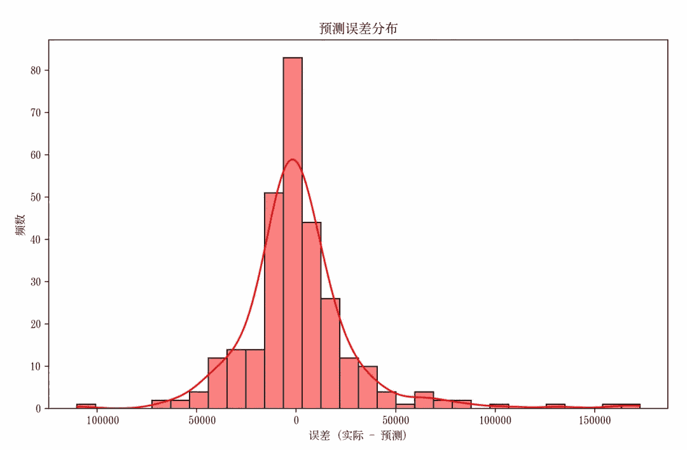

RMSE 是“均方根误差”，也就是 MSE 的平方根，其单位与目标变量的原始单位一致，可以更直观地反映了预测误差的平均水平。

```python
final_rmse = sqrt(best_rf_mse)
print(f'最终随机森林验证集RMSE: {final_rmse}')

# 误差分析
errors = y_val - best_rf_preds
plt.rcParams['font.family'] = 'SimSong' # 设置中文字体
plt.figure(figsize=(10,6))
sns.histplot(errors, bins=30, kde=True, color='red')
plt.title('预测误差分布')
plt.xlabel('误差 (实际 - 预测)')
plt.ylabel('频数')
plt.show()

# 绘制实际值与预测值对比图
plt.figure(figsize=(10,6))
sns.scatterplot(x=y_val, y=best_rf_preds)
plt.plot([y_val.min(), y_val.max()], [y_val.min(), y_val.max()], color='black', linestyle='--')
plt.title('实际房价 vs 预测房价')
plt.xlabel('实际房价 (美元)')
plt.ylabel('预测房价 (美元)')
plt.show()
```

图中 RMSE 在 0 附近的频数最高，表明模型的大部分预测值与实际值较为接近，这是一个积极的信号，说明模型在多数情况下能够给出相对合理的预测。

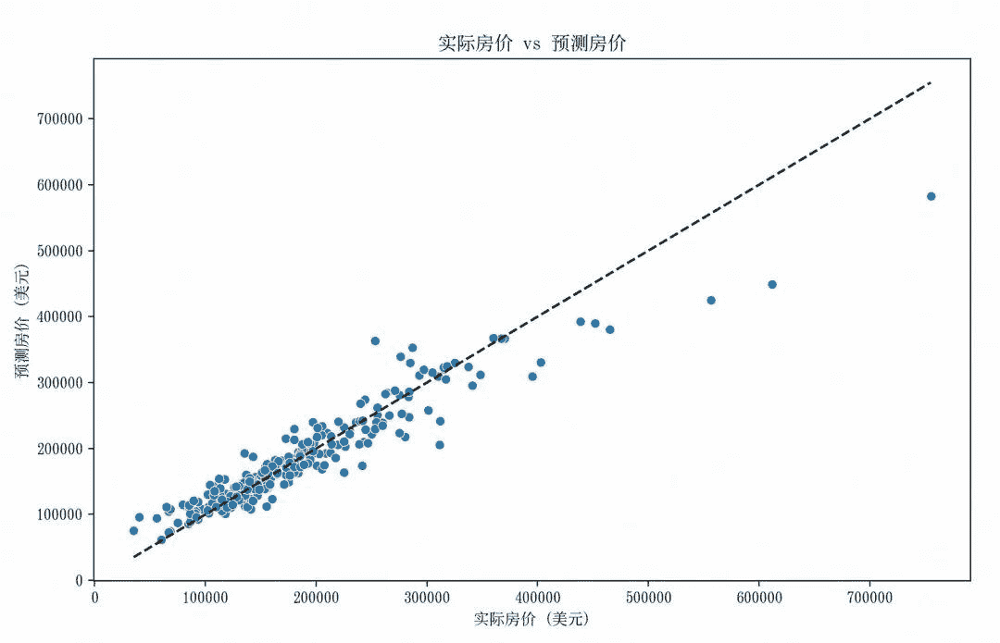

+ 图中大部分点分布在对角线（理想预测线）附近，表明模型在一定程度上能够反映实际房价的趋势，对中低房价区域的预测有一定合理性。

+ 然而在高房价区域（横轴和纵轴较大值处），点的分散程度明显增加，部分点偏离对角线较远，说明模型对高房价的预测准确性较差，可能在处理高价值样本或相关特征时存在不足。

### 3.9 优化改进

基于评估结果，可以从数据、特征和模型多个层面进行优化：

#### 数据层面

+ **获取更多数据：**采集更多相关数据，提升模型的泛化能力。

+ **处理异常值：**识别并处理数据中的异常值，以减少其对模型的负面影响。

#### 特征层面

+ **生成新特征：**如房屋总面积、房屋价值比率等。

+ **特征选择：**去除低相关性或冗余的特征，简化模型。

+ **特征转换：**对数变换、`Box-Cox`变换等，处理偏态分布的特征。

#### 模型层面

+ **尝试其它模型：**如梯度提升树（`XGBoost`、`LightGBM`）、支持向量机（`SVM`）等。

+ **进一步超参数调优：**扩展搜索范围或使用更高级的搜索方法（如随机搜索、贝叶斯优化）。

+ **集成方法：**结合多个模型的预测结果，提升整体性能。

#### 三个手段优化模型

+ **生成新特征：**通过组合现有特征生成新的特征，如总房间数，可能提升模型的表现。

+ **特征选择：**通过相关性分析选择与目标变量高度相关的特征，减少模型复杂度，提升性能。

+ **重新训练模型：**使用优化后的特征集重新训练随机森林模型，并评估其性能。

```python
# 生成新特征：总房间数
X_train_fe['TotalRooms'] = X_train_fe['TotalBsmtSF'] + X_train_fe['1stFlrSF'] + X_train_fe['2ndFlrSF']
X_val_fe['TotalRooms'] = X_val_fe['TotalBsmtSF'] + X_val_fe['1stFlrSF'] + X_val_fe['2ndFlrSF']

# 特征选择：选择与目标变量相关性较高的特征
corr_matrix = train.corr(numeric_only=True)

# 假设选择相关性绝对值大于 0.12（反复试出来的）的特征
high_corr_features = corr_matrix['SalePrice'][corr_matrix['SalePrice'].abs() > 0.12].index
high_corr_features = high_corr_features.drop(['SalePrice'])  # 去除目标变量本身

# 重建特征集
X_train_selected = X_train_fe[high_corr_features]
X_val_selected = X_val_fe[high_corr_features]

# 重新特征缩放
X_train_selected_scaled = scaler.fit_transform(X_train_selected)
X_val_selected_scaled = scaler.transform(X_val_selected)

# 使用新的特征训练随机森林
best_rf.fit(X_train_selected, y_train)
new_rf_preds = best_rf.predict(X_val_selected)
new_rf_mse = mean_squared_error(y_val, new_rf_preds)
print(f'优化后随机森林验证集MSE: {new_rf_mse}')
```

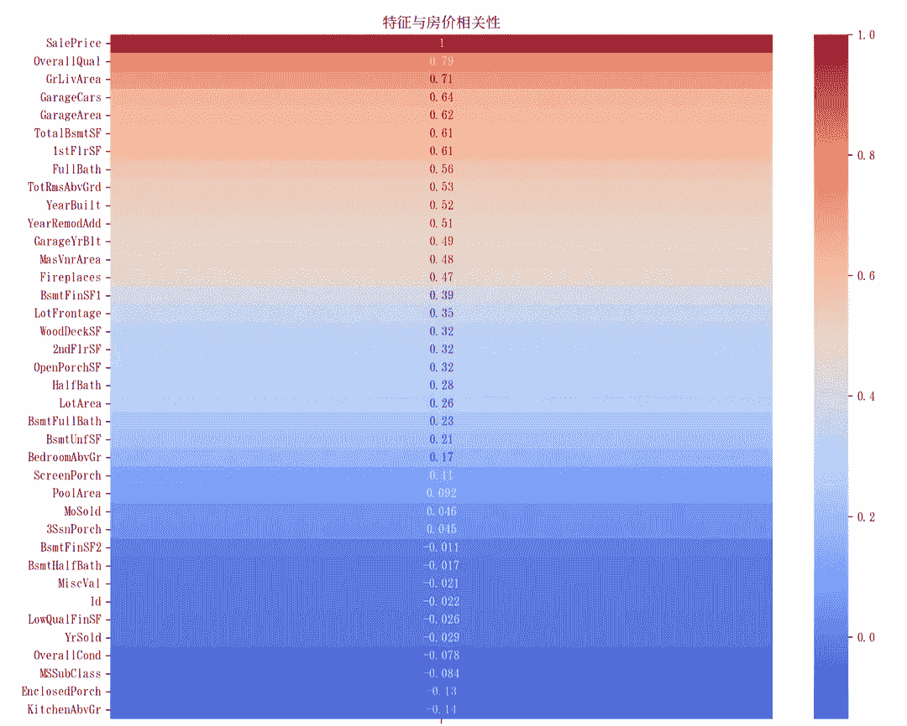

```
线性回归验证集MSE: 12564956652.760109
岭回归验证集MSE: 12710807374.91197
随机森林验证集MSE: 760862367.6638939
最佳参数: {'max_depth': 20, 'min_samples_split': 2, 'n_estimators': 200}
最佳CV得分: 1096686290.3257225
优化后的随机森林验证集MSE: 756838039.5099173
最终随机森林验证集RMSE: 27510.68954988074
优化后随机森林验证集MSE: 755321480.0326563
```

### 3.10 部署与监控

一旦模型表现满意，就可以将其部署为服务，使其能够接受新数据并返回预测结果。同时，建立监控机制，确保模型在实际应用中的性能。

使用`joblib`将训练好的模型和`Scaler`持久化保存，以便在 API 中加载使用。

```python
import joblib

# 保存最佳模型和 Scaler
joblib.dump(best_rf, 'best_rf_model.joblib')
joblib.dump(scaler, 'scaler.joblib')
```

可以使用`Flask`写一个简单的测试：

```python
from flask import Flask, request, jsonify
import joblib
import numpy as np
import pandas as pd

app = Flask(__name__)

# 加载模型和Scaler
model = joblib.load('best_rf_model.joblib')
scaler = joblib.load('scaler.joblib')

@app.route('/predict', methods=['POST'])
def predict():
    try:
        data = request.get_json()
        features = pd.DataFrame(data['features'])
        
        # 预处理特征
        # 需要与训练时的特征工程步骤一致
        # 例如，生成新特征、编码类别变量、填充缺失值等
        # 这里假设数据已经按模型要求处理完毕
        prediction = model.predict(features)
        return jsonify({'prediction': prediction.tolist()})
    except Exception as e:
        return jsonify({'error': str(e)})

if __name__ == '__main__':
    app.run(debug=True)
```

### 3.11 反馈与迭代

部署后的模型需要持续监控其表现，并根据实际反馈进行改进。

1. **监控模型性能：**定期评估模型在新数据上的表现，确保其准确性。

2. **数据更新：**随着时间推移，数据分布发生变化，需要定期更新训练数据以保持模型的有效性。

3. **迭代优化：**基于监控和反馈结果，进行特征工程、模型调整或选择新模型。

假设我们发现模型在特定区域 `LotArea` 较小时预测误差较大，我们可以为这类房屋生成一个新的特征，例如是否小地块：

```python
X_train_fe['Is_Small_Lot'] = X_train_fe['LotArea'] < 5000
X_val_fe['Is_Small_Lot'] = X_val_fe['LotArea'] < 5000

# 重新特征选择和缩放
high_corr_features = corr_matrix['SalePrice'][corr_matrix['SalePrice'].abs() > 0.5].index
high_corr_features = high_corr_features.drop(['SalePrice'])  # 去除目标变量本身

X_train_selected = X_train_fe[high_corr_features]
X_val_selected = X_val_fe[high_corr_features]

# 重新缩放
X_train_selected_scaled = scaler.fit_transform(X_train_selected)
X_val_selected_scaled = scaler.transform(X_val_selected)

# 重新训练模型
best_rf.fit(X_train_selected, y_train)
new_rf_preds = best_rf.predict(X_val_selected)
new_rf_mse = mean_squared_error(y_val, new_rf_preds)
print(f'优化后随机森林验证集MSE: {new_rf_mse}')
```

## 小结

通过以上步骤，我们完成了从需求分析到模型部署开发房价预测模型的过程。

**作为AI产品经理，学习强大的机器学习库，也可以轻松地跟进构建、评估和部署模型。**

希望本文能帮助AI产品同学迈出机器学习的第一步。
