# 机器学习算法

> 来源：[https://qqs7y1hozd1.feishu.cn/docx/NhM2dTEgeoAu9mxDxs5ceWiln1k](https://qqs7y1hozd1.feishu.cn/docx/NhM2dTEgeoAu9mxDxs5ceWiln1k)

多维表格（JO2gbHkvJaAajDskhq7chSS7nyd_tblknC16IMLFloX6）

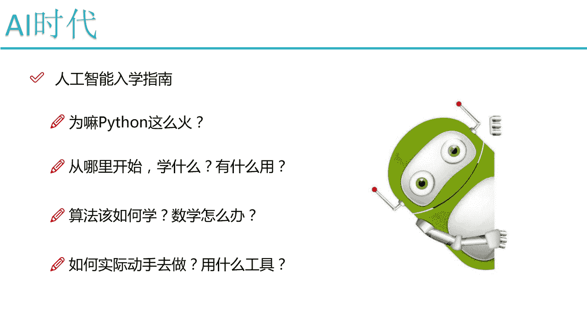

[1-AI入学指南.pdf](https://internal-api-drive-stream.feishu.cn/space/api/box/stream/download/all/YJAbb0097o1KlgxVUW0cKUtanVe)

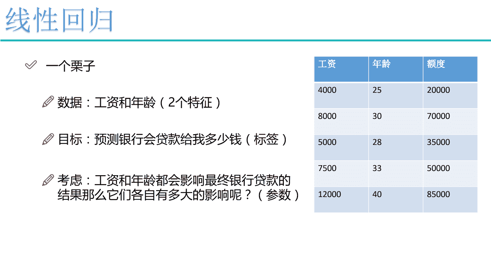

[2-回归算法.pdf](https://internal-api-drive-stream.feishu.cn/space/api/box/stream/download/all/Jji1bwgyAoovewxEhQNcP8A3nTd)

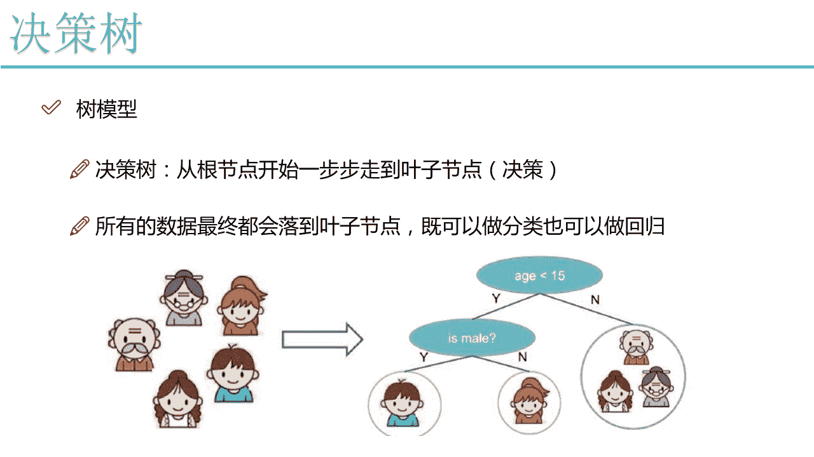

[3-决策树与集成算法.pdf](https://internal-api-drive-stream.feishu.cn/space/api/box/stream/download/all/WktqbxhdjoDux5xGc0sc7Sn6n4e)

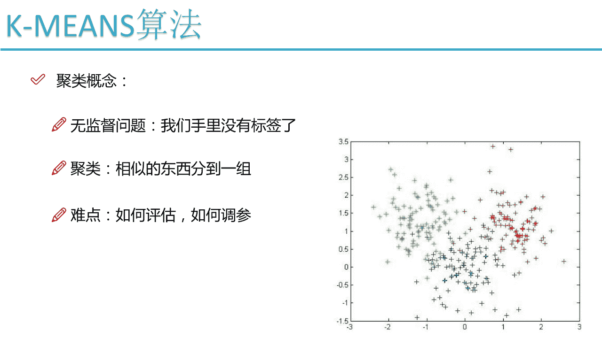

[4-聚类算法.pdf](https://internal-api-drive-stream.feishu.cn/space/api/box/stream/download/all/EFZRbnRR8oYlOaxypXOcJ9t3n6c)

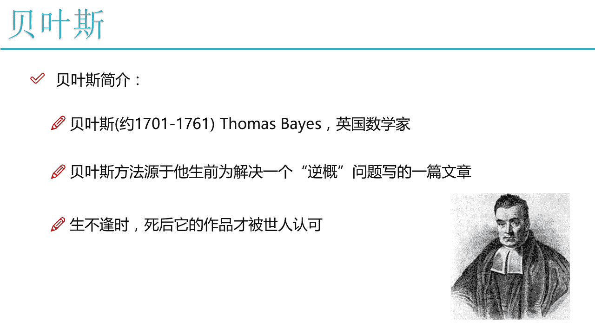

[5-贝叶斯算法.pdf](https://internal-api-drive-stream.feishu.cn/space/api/box/stream/download/all/STLcbe72yoAVZWxwt4IcslVmnth)

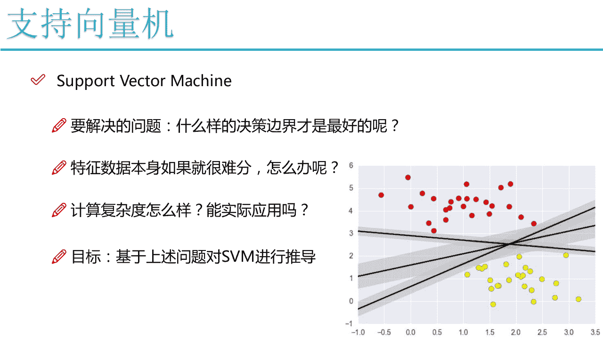

[6-支持向量机.pdf](https://internal-api-drive-stream.feishu.cn/space/api/box/stream/download/all/Sn7bb9hQpone5wxyob9cUo85nDh)

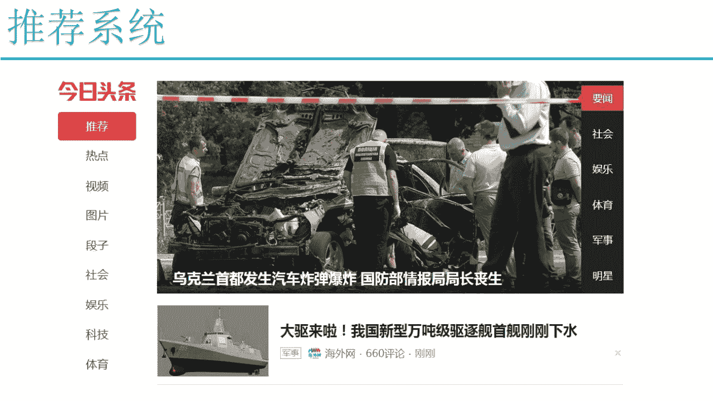

[7-推荐系统.pdf](https://internal-api-drive-stream.feishu.cn/space/api/box/stream/download/all/GZXobGnYHoyneDxQV9ecP0Canbf)

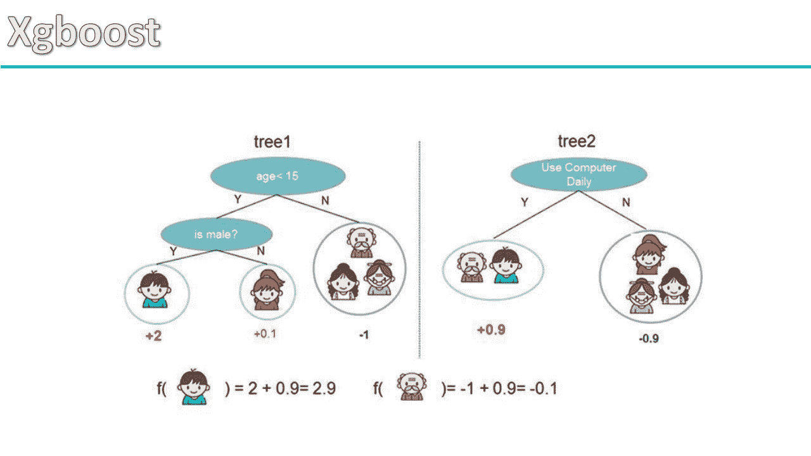

[8-xgboost.pdf](https://internal-api-drive-stream.feishu.cn/space/api/box/stream/download/all/Hr3Gb6KSHonQMBxRSwfcW1kbnPh)

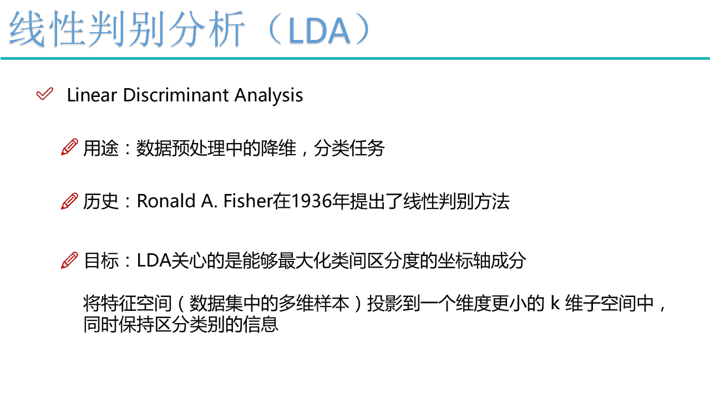

[9-LDA与PCA算法.pdf](https://internal-api-drive-stream.feishu.cn/space/api/box/stream/download/all/Ks8jbxbvxob3DgxD52BcGnUbnyg)

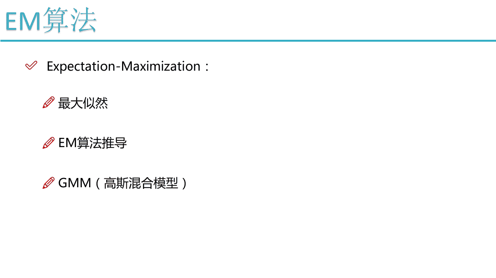

[10-EM算法.pdf](https://internal-api-drive-stream.feishu.cn/space/api/box/stream/download/all/Nq75b0Xk9o1eHBx2UMKc1QhQnGe)

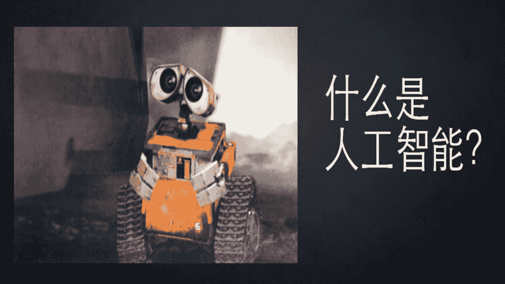

[11-神经网络.pdf](https://internal-api-drive-stream.feishu.cn/space/api/box/stream/download/all/JZeTbfdi3oFJoZx1HPvcGM20niE)

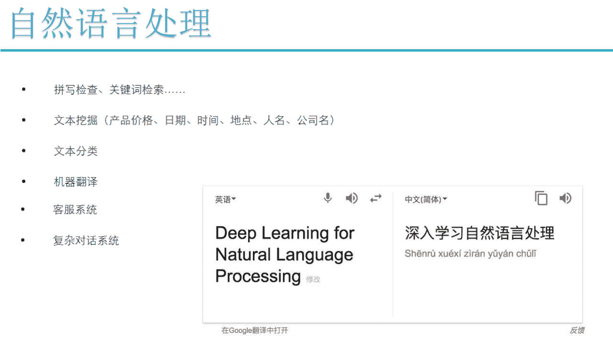

[12-word2vec.pdf](https://internal-api-drive-stream.feishu.cn/space/api/box/stream/download/all/Xq9mbf7TyokHcIx4NdccX0IdnnO)

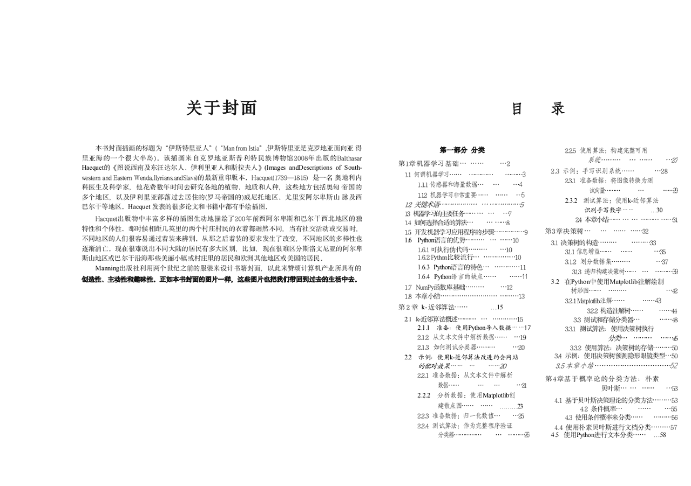

[机器学习实战.pdf](https://internal-api-drive-stream.feishu.cn/space/api/box/stream/download/all/MR3DbvunWoGaMkxLMA3cH8Cknrd)

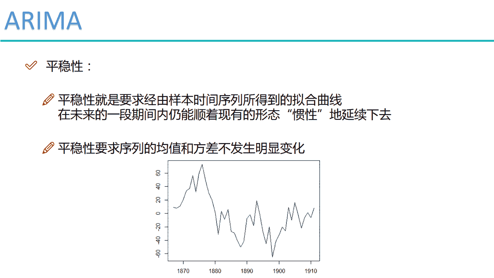

[时间序列分析.pdf](https://internal-api-drive-stream.feishu.cn/space/api/box/stream/download/all/I3iubncZYo2jFMxjhiEc7daKn2g)

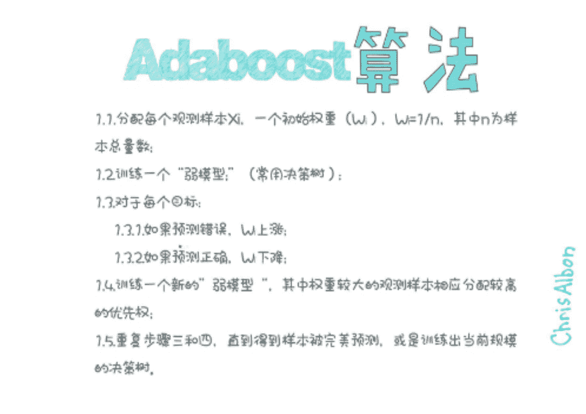

[机器学习漫画书.pdf](https://internal-api-drive-stream.feishu.cn/space/api/box/stream/download/all/Ids4bPGf2o9MC1xB4kpcSN1Dnqb)

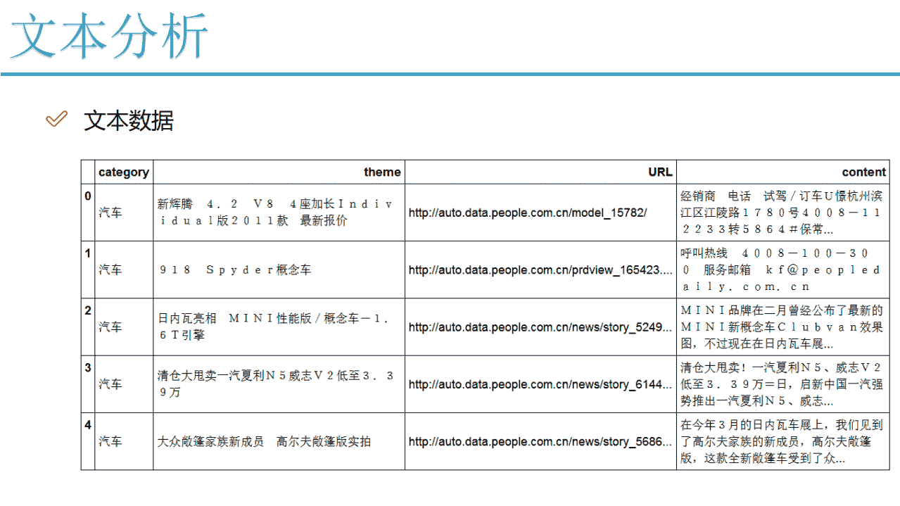

[文本分析.pdf](https://internal-api-drive-stream.feishu.cn/space/api/box/stream/download/all/X9xEbOnCCoSODpxnyfBcslFNnWc)