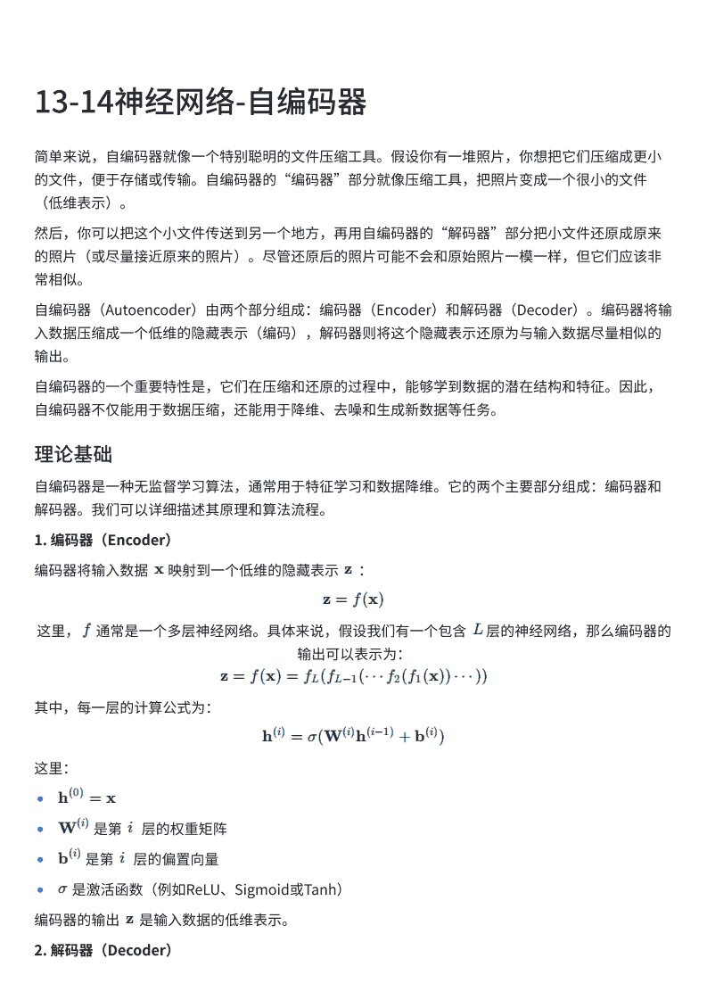

# 机器学习算法模型【134个】

> 来源：[https://qqs7y1hozd1.feishu.cn/docx/HEt1d5MeWonVEhx4UDwc0BxqnOf](https://qqs7y1hozd1.feishu.cn/docx/HEt1d5MeWonVEhx4UDwc0BxqnOf)

## 01回归算法（14个）

[回归算法-K近邻回归](https://qqs7y1hozd1.feishu.cn/wiki/FQvmwoVhWiVZGYkpRv0cCNpenPg)

[回归算法-Lasso回归](https://qqs7y1hozd1.feishu.cn/wiki/MY9BwfJdWiYRxqkL5h1coSPxnAh)

[回归算法-Ridge回归](https://qqs7y1hozd1.feishu.cn/wiki/HhOgwOX4KiuKCwkS83lc2nmOnCh)

[回归算法-贝叶斯回归](https://qqs7y1hozd1.feishu.cn/wiki/HhGWwyd7liF3Z6kVagRcVfpsnb7)

[回归算法-弹性网络回归](https://qqs7y1hozd1.feishu.cn/wiki/DsaQwWwW4iWJGcklwOkcY5n6nDe)

[回归算法-多项式核回归](https://qqs7y1hozd1.feishu.cn/wiki/X6lhwhCUfil4pykhGbVc12lxnqO)

[回归算法-多项式回归](https://qqs7y1hozd1.feishu.cn/wiki/JYTRwX1GyiFF0vkCVTVcK6dZnRg)

[回归算法-高斯过程](https://qqs7y1hozd1.feishu.cn/wiki/LnKmw0YnpiZxQckjrbGcveJanEd)

[回归算法-广义线性模型](https://qqs7y1hozd1.feishu.cn/wiki/Dr3jwwTMciKPXhkcQbSckp0gnCd)

[回归算法-局部加权回归](https://qqs7y1hozd1.feishu.cn/wiki/FGbDwPxv9ie1B3kjka9cs3O7nfe)

[回归算法-决策树回归](https://qqs7y1hozd1.feishu.cn/wiki/V8y4w86jYi2dhikAdZJcnKN6nDd)

[回归算法-随机森林回归](https://qqs7y1hozd1.feishu.cn/wiki/AuBywhpDwijiDzk51yecG3TOn1f)

[回归算法-梯度提升回归](https://qqs7y1hozd1.feishu.cn/wiki/PJZMw79cgiLyaNkj8zBcQWVdnRd)

[回归算法-线性回归](https://qqs7y1hozd1.feishu.cn/wiki/NXNkwyMU3i2QoQkRk6gcBl3QnDg)

[01-15回归算法-支持向量回归](https://qqs7y1hozd1.feishu.cn/wiki/VzNXwrc3LiEfcrkV02hcBxi9nUd)

## 02分类算法（12个）

[分类算法-C4.5](https://qqs7y1hozd1.feishu.cn/wiki/UidjwpqaAiyRoKksTmYcdZpTnrd)

[分类算法-ID3算法](https://qqs7y1hozd1.feishu.cn/wiki/DPakwdfKairrJdk1vuMczbQGnYg)

[分类算法-KNN](https://qqs7y1hozd1.feishu.cn/wiki/Oc7JwMcAUifIdykBfLFcFSXZnBc)

[分类算法-LightGBM](https://qqs7y1hozd1.feishu.cn/wiki/R5t0waNUqiIG6dkjFG8cQp9Unwh)

[分类算法-XGBoost](https://qqs7y1hozd1.feishu.cn/wiki/Mgqtww7qGio1VUkl8CYcbduUnzc)

[分类算法-多层感知机分类器](https://qqs7y1hozd1.feishu.cn/wiki/QeMkwqzzdiF63okyc7vcuPzbn9M)

[分类算法-高斯混合模型](https://qqs7y1hozd1.feishu.cn/wiki/SFdqwlb5aihO1ukb7alceYAsnFb)

[分类算法-决策树](https://qqs7y1hozd1.feishu.cn/wiki/CNk8wlK3xiCH2AkskCkc3BbbnHd)

[分类算法-逻辑回归](https://qqs7y1hozd1.feishu.cn/wiki/S1o6wKVrviKQmwkUuvqcAEQbn9f)

[分类算法-朴素贝叶斯](https://qqs7y1hozd1.feishu.cn/wiki/S75IwHjz3im8U6ksBFtc3eL4nfc)

[分类算法-随机森林.pdf](https://internal-api-drive-stream.feishu.cn/space/api/box/stream/download/all/WA3vbTkEkoEzrYxTlgXcEBmmncd)

[分类算法-支持向量机.pdf](https://internal-api-drive-stream.feishu.cn/space/api/box/stream/download/all/NCsubLl6Uo5glbxgvPecyqWJnvh)

[分类算法-随机森林](https://qqs7y1hozd1.feishu.cn/wiki/XG77wlUosij84ukxUYWcgVUonUc)

[分类算法-支持向量机](https://qqs7y1hozd1.feishu.cn/wiki/Z5jww9G3Ni2qu8kq589c0jIdnEg)

## 03集成算法（12个）

[集成算法-AdaBoost](https://qqs7y1hozd1.feishu.cn/wiki/GvOIwcFPsi0mqhkX7IgcvIuAnHh)

[集成算法-Bagging算法](https://qqs7y1hozd1.feishu.cn/wiki/Kr0Vwx7xEioHPikgw6jcuADTnSc)

[集成算法-Boosting算法](https://qqs7y1hozd1.feishu.cn/wiki/MFiqwV9gBilMUrkWfLBcg7Uzndh)

[集成算法-LightGBM](https://qqs7y1hozd1.feishu.cn/wiki/MrUxwKu2OidyllkxmNkcg1EynHg)

[集成算法-XGBoost](https://qqs7y1hozd1.feishu.cn/wiki/VAoGwtw01iED7zkuuMscQfQbnag)

[集成算法-堆叠](https://qqs7y1hozd1.feishu.cn/wiki/Fbuhwo9JbiS4Yvkugaxc5k5knCf)

[集成算法-极端随机森林](https://qqs7y1hozd1.feishu.cn/wiki/NdcPwQyE2iq2pAkNfzjcTDNhnde)

[集成算法-随机森林](https://qqs7y1hozd1.feishu.cn/wiki/KHvOwafMOieDhakX1xbcqbv5nob)

[集成算法-梯度提升](https://qqs7y1hozd1.feishu.cn/wiki/MldpwvKhUieXQlk9k2ecNRXOnLd)

[集成算法-梯度提升决策树（GBDT）](https://qqs7y1hozd1.feishu.cn/wiki/KPxLwQ17piRiMPkxyzsczpK5ntg)

[集成算法-投票法](https://qqs7y1hozd1.feishu.cn/wiki/XIwswPXrIiOF3MkcfBZcbK3Gnee)

[集成学习-因果推断](https://qqs7y1hozd1.feishu.cn/wiki/Tc0RwCEjaibscxk25nucgYZwntd)

## 04概率分布（13个）

[概率分布-Beta分布](https://qqs7y1hozd1.feishu.cn/wiki/JLTwwbzBiiCIU4kL9kZcXL9OnXf)

[概率分布-Dirichlet分布](https://qqs7y1hozd1.feishu.cn/wiki/GyWuwbcL2iL7zEk6XEMcc2IwnTe)

[概率分布-t分布](https://qqs7y1hozd1.feishu.cn/wiki/JuE4wNkWQiwn2QkGFxhcB7psnpe)

[概率分布-伯努利分布](https://qqs7y1hozd1.feishu.cn/wiki/W3SUwuAOQiM3KhkUkl7cIolwndL)

[概率分布-多项分布](https://qqs7y1hozd1.feishu.cn/wiki/Nc3iwrEyki5dECkNyxacckzEnob)

[概率分布-二项分布](https://qqs7y1hozd1.feishu.cn/wiki/WK86wzcQni2VOPkaPvOciGRfnS7)

[概率分布-伽玛分布](https://qqs7y1hozd1.feishu.cn/wiki/BwH4w0XAYif5TukgiwQc8nIPnsd)

[概率分布-几何分布](https://qqs7y1hozd1.feishu.cn/wiki/DGUIwNVaLiVnoEkR0VXc5zRUnEf)

[概率分布-均匀分布](https://qqs7y1hozd1.feishu.cn/wiki/CebwwNbdSi6nnQkkjkPcePE3nmb)

[概率分布-卡方分布](https://qqs7y1hozd1.feishu.cn/wiki/UQZWwuvtIijaV7k6E5Tc7dKdnSc)

[概率分布-泊松分布](https://qqs7y1hozd1.feishu.cn/wiki/Kf6Ww6fM0iPyy8kOv5HcvU2ynth)

[概率分布-正态分布](https://qqs7y1hozd1.feishu.cn/wiki/CyqowmJpUinoENkx2pMcHbyzn2g)

[概率分布-指数分布](https://qqs7y1hozd1.feishu.cn/wiki/CZyUwjkmiiOIqck5X8Cc1OlOngc)

[概率分布-泊松分布.pdf](https://internal-api-drive-stream.feishu.cn/space/api/box/stream/download/all/PIfPbkCqLoEIydxH0lBcxGK9nub)

[概率分布-正态分布.pdf](https://internal-api-drive-stream.feishu.cn/space/api/box/stream/download/all/GRkGbsn1yokYMvxSr5EcQiJUnoc)

## 05特征选择方法（10个）

[特征选择方法-L1 正则化](https://qqs7y1hozd1.feishu.cn/wiki/WDfmwVvyniEYcdkgfi3cUYXzn9g)

[特征选择方法-L2 正则化](https://qqs7y1hozd1.feishu.cn/wiki/IhhsweRQNiXzUjkn9OsckGx6nrg)

[特征选择方法-单变量特征选择](https://qqs7y1hozd1.feishu.cn/wiki/YtuAwYXTNigAZ6k55Jec83gonkb)

[特征选择方法-方差阈值法](https://qqs7y1hozd1.feishu.cn/wiki/YVlwwuNeAiGTuJkXbPbcxuTinnb)

[特征选择方法-互信息法](https://qqs7y1hozd1.feishu.cn/wiki/AfWiwDJKoi7YtlkKrbicwP33nbc)

[特征选择方法-基于树模型的特征选择](https://qqs7y1hozd1.feishu.cn/wiki/U2CBwBcNmineRHk3LiLcb6yZnle)

[特征选择方法-嵌入法](https://qqs7y1hozd1.feishu.cn/wiki/Gyw7ws285isaq5kvA1OcBtPCnkf)

[特征选择方法-相关系数法](https://qqs7y1hozd1.feishu.cn/wiki/KvK0w9IFEic1JMkUdNlcr8m7nnf)

[特征选择方法-信息增益](https://qqs7y1hozd1.feishu.cn/wiki/PrNAwxnTZiAaVvkZbKWcLE7TnMi)

[特征选择方法-主成分分析](https://qqs7y1hozd1.feishu.cn/wiki/POCgw7wmqilRJukMrEAcrlrPnwc)

## 06优化算法（13个）

[优化算法-AdaGrad](https://qqs7y1hozd1.feishu.cn/wiki/R9lRw0OysiEj3OkDjHncap4Snie)

[优化算法-Adam优化器](https://qqs7y1hozd1.feishu.cn/wiki/UdHYwwjzCimEHtk6tl0c4rBunMc)

[优化算法-BFGS](https://qqs7y1hozd1.feishu.cn/wiki/M0uAwz5plirhOvkhpBNcjgFCnRd)

[优化算法-RMSProp](https://qqs7y1hozd1.feishu.cn/wiki/CG7gwaf05in6H6kRId3cpnK5nQf)

[优化算法-贝叶斯优化](https://qqs7y1hozd1.feishu.cn/wiki/JIP7wWQpxiNEGSkO6bWch5D6n0e)

[优化算法-超参数优化](https://qqs7y1hozd1.feishu.cn/wiki/SqYkw0lkFiUo6ak2SN1chI6Unxc)

[优化算法-动量法](https://qqs7y1hozd1.feishu.cn/wiki/RdpOwK9E2i5IAukrWEWc3K9fnIh)

[优化算法-共轭梯度法](https://qqs7y1hozd1.feishu.cn/wiki/G3rzwAhWHi6V3mkcZpcc0M5Pnpg)

[优化算法-牛顿方法](https://qqs7y1hozd1.feishu.cn/wiki/KfHxwTV9jiI82ykrUF8cPTUEnNb)

[优化算法-梯度下降法](https://qqs7y1hozd1.feishu.cn/wiki/AfJ3wEfIsiJwRskGf1mc8rIXnIe)

[优化算法-批量梯度下降法](https://qqs7y1hozd1.feishu.cn/wiki/PoKgwvWSViLqJmkKiC3ccoNvnXf)

[优化算法-随机梯度下降法](https://qqs7y1hozd1.feishu.cn/wiki/VnMRwxuosiwiDaknR5hcWKswniz)

[优化算法-网格搜索](https://qqs7y1hozd1.feishu.cn/wiki/TgD5w3WQriOc2hkkUX2cOMohnDY)

[优化算法-批量梯度下降法.pdf](https://internal-api-drive-stream.feishu.cn/space/api/box/stream/download/all/NTKFbnaGwoRgQ9xaJuacgSMynXe)

[优化算法-随机梯度下降法.pdf](https://internal-api-drive-stream.feishu.cn/space/api/box/stream/download/all/LmHmbeVFGo2pF6xkLVQcKAk1nVe)

## 07聚类算法（10个）

[聚类算法-Birch](https://qqs7y1hozd1.feishu.cn/wiki/V6KrwYf6LiPEazkwxN2cLorznNc)

[聚类算法-DBSCAN](https://qqs7y1hozd1.feishu.cn/wiki/FD8rwPtkcikcSYkCzmIc80AlnVe)

[聚类算法-GMM](https://qqs7y1hozd1.feishu.cn/wiki/TFsGwM818iRlAXk0LOtcsHCWnHb)

[聚类算法-K-均值聚类](https://qqs7y1hozd1.feishu.cn/wiki/XyLXwOG3XicF3rkVbm7cenIzn7d)

[聚类算法-Mini-Batch K-means](https://qqs7y1hozd1.feishu.cn/wiki/RLHbwzmuMiQ9cKkxMgscAsL6nQb)

[聚类算法-层次聚类](https://qqs7y1hozd1.feishu.cn/wiki/F4biwQIJaiZTQvk2G44cnLCfnWg)

[聚类算法-均值漂移](https://qqs7y1hozd1.feishu.cn/wiki/WrBxwH2kzivFwUkJBxVcVvmGnLc)

[聚类算法-模糊C均值](https://qqs7y1hozd1.feishu.cn/wiki/JJiEwge01ikqslk4lDOcpzwCnEg)

[聚类算法-谱聚类](https://qqs7y1hozd1.feishu.cn/wiki/BaWlwznoCimofOk5d4GcgUp2nic)

[聚类算法-期望最大化算法](https://qqs7y1hozd1.feishu.cn/wiki/FWzMwJspOior1Mk9DI8cf5zjn9d)

## 08强化学习（2个）

[强化学习-Q-Learning](https://qqs7y1hozd1.feishu.cn/wiki/AX8SwaRDSiOV27kxWnQcEcxvn8G)

[强化学习-SARSA](https://qqs7y1hozd1.feishu.cn/wiki/VIUqwbCMUilpzvk7iHcc6aPfnYd)

## 09数据预处理（12个）

[数据预处理方法-降维](https://qqs7y1hozd1.feishu.cn/wiki/At1ewydowi6TDBkdq7KcZiOrnue)

# 机器学习方法索引

## 数据预处理方法

[数据预处理方法-类别编码](https://qqs7y1hozd1.feishu.cn/wiki/LgDUwHzd7itM7skhtRXcaZV7n0e)

[数据预处理方法-数据编码](https://qqs7y1hozd1.feishu.cn/wiki/FnnCwfp7YieWIJkQ7WVcR8d8ncE)

[数据预处理方法-数据标准化](https://qqs7y1hozd1.feishu.cn/wiki/MpPowrZvrinWIlkRNfSc50bHnjg)

[数据预处理方法-数据拆分](https://qqs7y1hozd1.feishu.cn/wiki/BM81w1eBNiihFXkrysacRMUJn5b)

[数据预处理方法-数据归一化](https://qqs7y1hozd1.feishu.cn/wiki/TfVOwbd3si1iazkDJ7Jchvp5nz1)

[数据预处理方法-数据平衡](https://qqs7y1hozd1.feishu.cn/wiki/HIf0wovvBiItQ9kG31VchyyNnyh)

[数据预处理方法-数据增强](https://qqs7y1hozd1.feishu.cn/wiki/V77ywPdM2iwrBdk11lEcOuzsn9e)

[数据预处理方法-数据转换](https://qqs7y1hozd1.feishu.cn/wiki/A55Aw7MD2iLLs6kW3EAcLzXMnBk)

[数据预处理方法-特征构造](https://qqs7y1hozd1.feishu.cn/wiki/OTCWwkevPivEOzk3cyvc0dxOneg)

[数据预处理方法-特征缩放](https://qqs7y1hozd1.feishu.cn/wiki/BwCswfco5i2XkrkaC1IcpXq1nRh)

[数据预处理方法-特征选择](https://qqs7y1hozd1.feishu.cn/wiki/CzLlw1T97iI2vAkm5DNcfr3Hn0b)

[数据预处理方法-特征缩放.pdf](https://internal-api-drive-stream.feishu.cn/space/api/box/stream/download/all/FWiwb6Y0WocwRdxzDqGcstrpnJe)

[数据预处理方法-特征选择.pdf](https://internal-api-drive-stream.feishu.cn/space/api/box/stream/download/all/H72fbz5qboCRhSxQpijcUoKBnKb)

## 10损失函数（10个）

[损失函数-Huber损失](https://qqs7y1hozd1.feishu.cn/wiki/OuZUwXjDfiy1GfkI7dXcDBqWnSb)

[损失函数-KL散度](https://qqs7y1hozd1.feishu.cn/wiki/VWaswGP1iiE3wtkbizJc1Igmneb)

[损失函数-对数似然损失](https://qqs7y1hozd1.feishu.cn/wiki/FRH9w79LviCRbgkn7fJcvtYunAd)

[损失函数-二元交叉熵损失](https://qqs7y1hozd1.feishu.cn/wiki/TD99wWXK1i6MzgkugahcND8nnng)

[损失函数-交叉熵损失](https://qqs7y1hozd1.feishu.cn/wiki/AN8nw0j6fiEPLokn2xocCXylngd)

[损失函数-均方根误差](https://qqs7y1hozd1.feishu.cn/wiki/SraIwzxPmiq9ZXkfd5Kc4zvdnsd)

[损失函数-均方误差](https://qqs7y1hozd1.feishu.cn/wiki/Lgt9wyvXqiNVL1kKSBTcLK0Yndf)

[损失函数-平方合页损失](https://qqs7y1hozd1.feishu.cn/wiki/CepFwix44itGxBkWfrIct2ennvh)

[损失函数-平均绝对误差](https://qqs7y1hozd1.feishu.cn/wiki/BxQXwZf6zin7Ipkakm5cLpyUn9c)

[损失函数-余弦相似性损失](https://qqs7y1hozd1.feishu.cn/wiki/UJSGwq5TFiXzBlkDdzvcEyfAnfe)

## 11正则化方法（2个）

[正则化方法-弹性网络正则化](https://qqs7y1hozd1.feishu.cn/wiki/PGafwUJ2ViUzupkookLcfnEKnXg)

[正则化方法-正则化](https://qqs7y1hozd1.feishu.cn/wiki/XoVxwfM2UimHUBkU3lPcfqoanwd)

## 12机器学习模型评估方法（9个）

[机器学习模型评估方法-AUC](https://qqs7y1hozd1.feishu.cn/wiki/BoJAwT7N3if29wkm8bucapRunY4)

[机器学习模型评估方法-F1 分数](https://qqs7y1hozd1.feishu.cn/wiki/TV5awUCFei9GRzk7sxDctFiRnmd)

[机器学习模型评估方法-ROC 曲线](https://qqs7y1hozd1.feishu.cn/wiki/T5Z7wRm4BiyfjHkhMOUc7hEWn8e)

[机器学习模型评估方法-混淆矩阵](https://qqs7y1hozd1.feishu.cn/wiki/Ylu5wBhYGi5aH3kFDDvcLnDAnZd)

[机器学习模型评估方法-交叉验证](https://qqs7y1hozd1.feishu.cn/wiki/UDQIwIQ77i7k9NkQqHycr4Flntb)

[机器学习模型评估方法-精确率](https://qqs7y1hozd1.feishu.cn/wiki/NTllwW4YniC7eukWuSCcWhP7n5d)

[机器学习模型评估方法-均方误差](https://qqs7y1hozd1.feishu.cn/wiki/Spdzw3i6ci8cKkk7FYkcLAqOn3g)

[机器学习模型评估方法-召回率](https://qqs7y1hozd1.feishu.cn/wiki/OIDSw6vRWijF4aklki8cejZTngh)

[机器学习模型评估方法-准确率](https://qqs7y1hozd1.feishu.cn/wiki/ZHkPwRgsFiwN6IkG2Pbc1FGLnYb)

[机器学习模型评估方法-均方误差.pdf](https://internal-api-drive-stream.feishu.cn/space/api/box/stream/download/all/TaN5b3o57o4SFPxvs1GcmWA6nQe)

[机器学习模型评估方法-召回率.pdf](https://internal-api-drive-stream.feishu.cn/space/api/box/stream/download/all/OXzkbSzyko9GbzxeTj2cWIV9nac)

## 13神经网络（14个）

[神经网络-AlexNet](https://qqs7y1hozd1.feishu.cn/wiki/MOZLwDLprie9InkqOPvcD5mqnNg)

[神经网络-CNN](https://qqs7y1hozd1.feishu.cn/wiki/IHUfwlzAPisJclkoCmFc17bOnZf)

[神经网络-DenseNet](https://qqs7y1hozd1.feishu.cn/wiki/EWyPwf5K6ig9gykN3tLcswSZnOW)

[神经网络-GRU (门控循环单元)](https://qqs7y1hozd1.feishu.cn/wiki/SWE9w70YMibvnQk2OlAcCC4fnjc)

[神经网络-LSTM](https://qqs7y1hozd1.feishu.cn/wiki/JNNHwX9E9iCtYeka1M1cUjNpnKc)

[神经网络-RNN](https://qqs7y1hozd1.feishu.cn/wiki/HShRwbb2yi3wjkk30YWcqoGonxg)

[神经网络-Transformer](https://qqs7y1hozd1.feishu.cn/wiki/JuCDwZ9nviLA8LkAyfjcVfj8n0g)

[神经网络-残差网络（ResNet）](https://qqs7y1hozd1.feishu.cn/wiki/EBp3w80Iti369JkmIpacgjtrnee)

[神经网络-多层感知机](https://qqs7y1hozd1.feishu.cn/wiki/RrwNwb2ooiox1mk7wzUchkX2nYf)

[神经网络-感知机](https://qqs7y1hozd1.feishu.cn/wiki/FYxHwOW9niefl2kra0Tc2FvIn4f)

[神经网络-人工神经网络 ANN](https://qqs7y1hozd1.feishu.cn/wiki/HdP3wqt1diKfsqkPAejcHTkkngb)

[神经网络-生成对抗网络 GAN](https://qqs7y1hozd1.feishu.cn/wiki/PAlowl0cIiA4qGkcQRPco5MTnGf)

[神经网络-注意力机制](https://qqs7y1hozd1.feishu.cn/wiki/XQF8wZYYGi6AOmk8702cPsyqn3A)

[神经网络-自编码器](https://qqs7y1hozd1.feishu.cn/wiki/IttIwCev0iGCv0k6RLLckPURnuh)

[13-13神经网络-注意力机制.pdf](https://internal-api-drive-stream.feishu.cn/space/api/box/stream/download/all/Xb8ubEzeVoErgMxR245cBiaYncf)

[13-14神经网络-自编码器.pdf](https://internal-api-drive-stream.feishu.cn/space/api/box/stream/download/all/ZvsBb28xuosNclxZNcRc4XTUngh)
