# 01回归算法（15个）

> 来源：[https://qqs7y1hozd1.feishu.cn/docx/EgNLdnsAaozmdNxzRxkcqGFOnCd](https://qqs7y1hozd1.feishu.cn/docx/EgNLdnsAaozmdNxzRxkcqGFOnCd)

# 1.回归算法-K近邻回归

**K近邻回归（K-Nearest Neighbor**s Regression, KNN回归），简单又直观的机器学习方法，它用来预测数值型的数据（比如房价、气温等）。

基本原理：

1.  **找邻居****：**当我们想预测一个数据点的数值时，先在数据集中找到离它最近的 K 个点（邻居）。

1.  **求平均值**：然后，把这 **K** 个邻居的数值（目标值）取平均，作为这个点的预测值。

举个例子：假设你想预测一个新房子的房价，而你手上有一堆已经卖出去的房子数据（包括它们的价格和地理位置）。K近邻回归的做法是：

+   找到 **K** 个离这个新房子最近的已售房子；

+   取这 **K** 个房子的平均价格，作为新房子的预测价格。

K值的影响：

+   **K太小**（比如K=1）：预测结果会受到单个邻居的影响，可能不稳定。

+   **K太大**（比如K=100）：虽然更稳定，但可能会包含太多远离目标的数据点，导致预测不够精准。

+   **一般K值的选择**：需要通过实验（比如交叉验证）来找到一个合适的K。

## 原理详解

KNN 回归不依赖于训练数据的显**式建模，而**是通过找到新样本在训练数据中的K个最近邻，然后利用这些邻居的目标值来进行预测。

KNN回归的本质是**局部加权平均法**，是一种非参数估计方法。

### 1. 基本思想

给定一个训练数据集：

其中：

是输入特征向量

是对应的目标值（输出）

是训练数据集的大小

对于一个新的测试样本  ，KNN回归的基本思想是：

1.  在训练数据集中找到离  最近的 **K个邻居**（按照某种距离度量）。

1.  根据这些邻居的目标值  计算  的预测值。

### 2. 距离度量

通常，KNN回归采用**欧氏距离**来度量样本之间的相似性：

也可以使用其他距离度量，如：

+   曼哈顿距离：

+   闵可夫斯基距离：

当  时即为欧氏距离，当  时即为曼哈顿距离。

### 3. 预测值计算

找到最近的 **K 个邻居**** 后，K**NN 回归的预测值可以通过加权平均的方法计算，常见的方法包括：

#### 1) 直接均值

其中， 是  个最近邻的目标值。

#### 2) 距离加权均值

为了让更接近  **的样本具**有更高的影响力，可以采用加权平均：

权重  通常与距离的倒数成正比，例如：

其中  是一个小的正数，防止分母为零。

#### 3) 高斯核加权

可以使用**核函数**（如高斯核）来赋予权重：

这样，离测试点  越近的点权重越大，影响力越强。

## 公式推理

### 1. KNN 回归的期望误差分析

KNN回归属于**非参数回归方法**，其误差可以从偏差-方差分解（Bias-Variance Decomposition）的角度分析。假设数据服从分布：

其中  是真实函数， 是噪声。

KNN 回归的预测值：

对期望值取均值：

假设  个最近邻均匀分布在  附近：

因此，KNN回归的偏差为：

方差计算：

总误差：

因此，**当 ** 过**小时，方差较大（易过拟合）；**当  过大时，偏差较大（易欠拟合）。

## 算法流程

**输入**：

+   训练数据集

+   需要预测的样本

+   选择邻居数

+   选择距离度量方式（如欧氏距离）

+   选择预测策略（均值、加权均值等）

**步骤**：

1.  **计算距离**：计算测试样本  与训练集中所有样本的距离：

1.  **选择最近邻**：选取距离最近的  个样本。

1.  **计算预测值**：

+   若采用均值方法：

+   若采用加权方法：

1.  **输出预测结果**  。

## 完整案例

在这个案例中，我们先加载数据，然后用 KNN 进行回归预测，并利用 GridSearchCV 优化超参数（邻居数 k），最后通过多种可视化展示模型效果、预测值与真实值的对比、残差分布以及超参数调优过程的热力图。

```
import numpy as np
import pandas as pd
import matplotlib.pyplot as plt
import seaborn as sns
from sklearn.datasets import fetch_california_housing
from sklearn.model_selection import train_test_split, GridSearchCV
from sklearn.neighbors import KNeighborsRegressor
from sklearn.metrics import mean_squared_error, r2_score


# 加载 California 房价数据集
housing = fetch_california_housing(as_frame=True)
data = housing.frame
# 打印数据基本信息
print(&quot;数据集维度：&quot;, data.shape)
print(&quot;数据集特征：\n&quot;, data.columns)

# 选择特征与目标变量
X = data.drop(&quot;MedHouseVal&quot;, axis=1)  # 房屋中位数作为目标变量
y = data[&quot;MedHouseVal&quot;]

# 将数据集拆分为训练集和测试集
X_train, X_test, y_train, y_test = train_test_split(X, y, test_size=0.2, random_state=42)

# 初始化 KNN 回归器
knn = KNeighborsRegressor()

# 设置超参数搜索空间：邻居数从 1 到 30
param_grid = {&#x27;n_neighbors&#x27;: np.arange(1, 31)}

# 使用 GridSearchCV 进行超参数优化，采用 5 折交叉验证
grid_search = GridSearchCV(knn, param_grid, cv=5, scoring=&#x27;neg_mean_squared_error&#x27;, n_jobs=-1)
grid_search.fit(X_train, y_train)

# 输出最优参数与对应的得分
best_k = grid_search.best_params_[&#x27;n_neighbors&#x27;]
best_score = -grid_search.best_score_
print(&quot;最优邻居数 k =&quot;, best_k)
print(&quot;最佳均方误差 (MSE) =&quot;, best_score)

# 使用最优参数训练模型
best_knn = grid_search.best_estimator_
best_knn.fit(X_train, y_train)

# 在测试集上进行预测
y_pred = best_knn.predict(X_test)

# 计算测试集上的 MSE 和 R2 分数
mse = mean_squared_error(y_test, y_pred)
r2 = r2_score(y_test, y_pred)
print(&quot;测试集均方误差 (MSE) =&quot;, mse)
print(&quot;测试集 R2 score =&quot;, r2)

# 可视化：真实值 vs 预测值
plt.figure(figsize=(10, 6))
plt.scatter(y_test, y_pred, alpha=0.6, color=&#x27;mediumspringgreen&#x27;, edgecolor=&#x27;k&#x27;)
plt.plot([y_test.min(), y_test.max()], [y_test.min(), y_test.max()], &#x27;r--&#x27;, lw=2)
plt.xlabel(&quot;True Values&quot;, fontsize=14)
plt.ylabel(&quot;Predicted Values&quot;, fontsize=14)
plt.title(&quot;True vs Predicted Values&quot;, fontsize=16)
plt.tight_layout()
plt.show()

# 可视化：残差分布
residuals = y_test - y_pred
plt.figure(figsize=(10, 6))
sns.histplot(residuals, bins=50, kde=True, color=&#x27;hotpink&#x27;)
plt.xlabel(&quot;Residuals&quot;, fontsize=14)
plt.ylabel(&quot;Frequency&quot;, fontsize=14)
plt.title(&quot;Residual Distribution&quot;, fontsize=16)
plt.tight_layout()
plt.show()

# 可视化：GridSearchCV 中不同 k 值的均方误差热力图
# 提取所有搜索结果
results = pd.DataFrame(grid_search.cv_results_)
results[&#x27;mean_test_mse&#x27;] = -results[&#x27;mean_test_score&#x27;]

plt.figure(figsize=(12, 6))
plt.plot(results[&#x27;param_n_neighbors&#x27;].data, results[&#x27;mean_test_mse&#x27;], marker=&#x27;o&#x27;, linestyle=&#x27;-&#x27;, color=&#x27;dodgerblue&#x27;)
plt.xlabel(&quot;Number of Neighbors (k)&quot;, fontsize=14)
plt.ylabel(&quot;Mean Squared Error (MSE)&quot;, fontsize=14)
plt.title(&quot;Grid Search MSE vs k&quot;, fontsize=16)
plt.xticks(results[&#x27;param_n_neighbors&#x27;].data)
plt.grid(True)
plt.tight_layout()
plt.show()
```

+   **数据加载与预处理**：从 fetch_california_housing 加载数据，并将数据拆分为训练集与测试集，确保模型评估的客观性。

+   **模型训练与超参数优化**：使用 GridSearchCV 对 KNN 回归器的邻居数进行调优，选取使均方误差最低的参数。

+   **模型评估**：利用 MSE 与 R2 分数对模型进行评价，并通过散点图对比真实值与预测值，以及绘制残差分布图。


+   **超参数调优可视化**：通过折线图展示不同邻居数对应的均方误差，直观展示模型的参数选择过程。

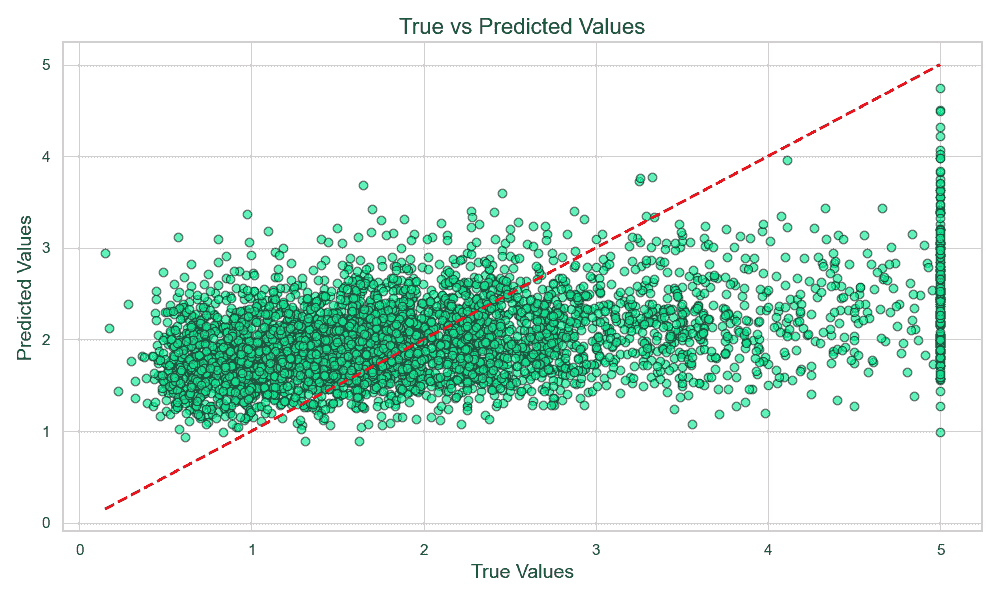

**算法优化说明：**

1.  采用 GridSearchCV 自动搜索最优的 k 值，并利用 5 折交叉验证提高模型泛化能力。

1.  对数据进行训练集和测试集的划分，确保模型在未知数据上的评估准确性。

1.  利用可视化手段直观展示模型效果及超参数选择结果，为进一步调参提供依据。

## 模型分析

### KNN回归 优缺点

**优点**：

1.  **简单易懂，直观性强**：KNN 只需要计算距离，不涉及复杂的数学建模，非常容易理解和实现。

1.  **非参数方法**：KNN 不需要对数据分布做假设，适用于各种数据类型，尤其是非线性数据。

1.  **适用于小数据集**：在小规模数据上表现较好，不需要大量训练时间，适用于数据量较少但维度较高的场景。

1.  **适用于局部模式学习**：对于局部模式明显的数据，KNN 可以很好地拟合，例如地理位置相关的数据预测。

**缺点**：

1.  **计算量大，预测速度慢**：KNN 需要存储所有训练数据，并在预测时计算每个样本到所有训练样本的距离，计算开销较大，特别是在大数据集上表现较差。

1.  **受维度灾难影响**：高维数据会导致欧几里得距离的效果变差，样本点之间的距离趋于相等，使得 KNN 变得无效。

1.  **对噪声敏感**：KNN 依赖于距离度量，如果数据中存在异常值或噪声点，可能会显著影响预测结果。

1.  **无法输出概率**：不像一些统计学习方法（如贝叶斯回归）能给出置信度，KNN 仅能提供一个具体的预测值，缺乏不确定性度量。

### KNN 回归与其他相似算法的对比

| 算法 | 适用场景 | 优点 | 缺点 |
| --- | --- | --- | --- |
| **KNN 回归** | 适用于小数据集、非线性数据、局部模式学习 | 易理解、非参数、适应性强 | 计算量大、对高维数据效果差、对噪声敏感 |
| **线性回归** | 适用于线性关系的数据 | 计算效率高、可解释性强 | 仅适用于线性数据，对非线性数据拟合较差 |
| **决策树回归** | 适用于数据集较大、有明显分段特征的数据 | 能处理非线性数据、不需要标准化 | 易过拟合、对噪声敏感 |
| **随机森林回归** | 适用于大规模数据、有较多特征的数据 | 处理非线性关系能力强、不易过拟合 | 计算复杂度较高 |
| **支持向量回归 (SVR)** | 适用于小规模、高维数据集 | 适用于高维数据、支持核方法 | 计算复杂度较高、对超参数敏感 |
| **神经网络回归** | 适用于大数据、高度非线性关系的数据 | 适用于复杂任务、强大的表达能力 | 训练时间长、需要大量数据、难以解释 |

### 在什么情况下优选 KNN，什么时候应该考虑其他算法？

**适合使用 KNN 的情况**：

+   数据集较小，计算量可接受（如 <10,000 条样本）。

+   需要处理非线性数据，且数据分布未知时，KNN 可作为基准模型。

+   数据具有局部模式，例如地理位置预测、推荐系统等。

+   需要快速实现一个基准模型进行对比。

**应考虑其他算法的情况**：

+   **数据量大（> 10 万条）****：KNN **计**算所有样**本距离的过程过慢，推荐使用决策树回归或随机森林。

+   **数据是高维（> 50 维）****：KNN 受维度灾难影响**较大，**推荐支持**向量回归 (SVR) 或 神经网络。

+   **数据有线性趋势**：如果数据关系接近线性，使用**线性回归**的计算效率更高。

+   **需要解释性和可解释的决策规则**：KNN 不易解释，推荐使用**决策树回归**或**线性回归**。

+   **数据包含较多噪声**：KNN 对噪声敏感，推荐使用**随机森林回归**，因其鲁棒性较强。

### 总结

KNN 回归是一种直观、易于实现的算法，适用于小规模、非线性数据集。但在大数据、高维场景或计算效率要求高的应用中，KNN 可能不是最佳选择，此时可以考虑决策树、随机森林、支持向量机等替代方案。

# 2.回归算法-Lasso回归

Lasso回归也是主要用于回归问题。

它的名字来自于“Least Absolute Shrinkage and Selection Operator”的缩写。

Lasso回归是一种线性回归方法，它不仅能找到最佳的预测模型，还能自动选择出最重要的特征。它通过在损失函数中加入一个“惩罚项”来实现这一点。这个惩罚项是所有回归系数的绝对值之和。

那我们为什么要用 Lasso 回归？

**就是**在处理数据时，我们经常会遇到很多特征（变量），但不是所有特征都对结果有重要影响。Lasso回归能帮助我们自动筛选出最有用的特征，忽略那些不重要的，这样模型更简单、预测效果更好。

## 理论基础

Lasso回归就是在普通最小二乘法的基础上增加了一个惩罚项，用于约束模型中的系数，使某些系数变为零，从而实现特征选择。

#### 1. **数学公式**

在普通的线性回归中，我们的目标是找到参数向量  使得损失函数（即残差平方和）最小化：

其中， 是第  个样本的特征向量， 是对应的目标值， 是回归系数向量。

在Lasso回归中，我们在损失函数中添加一个  正则化项，这个项是所有系数的绝对值之和。Lasso回归的优化目标变为：

其中， 是正则化参数，用于控制惩罚项的权重。

#### 2. **公式推理**

为了理解Lasso回归的公式推理，我们需要从优化问题的角度来看。

**普通最小二乘法（OLS）**：

最小化残差平方和：

**Lasso回归**：

在OLS的基础上，加上一个  正则化项：

其中， 是正则化项，它通过增加非零系数的数量来惩罚模型的复杂性。

**梯度下降法**：

为了最小化这个目标函数，我们可以使用梯度下降法。梯度下降的更新规则如下：

其中， 是学习率， 是目标函数的梯度。

计算梯度时，普通最小二乘项的梯度是：

正则化项的梯度稍微复杂一些，因为  范数的导数在零点不连续。其导数形式是：

其中， 表示符号函数。

综合以上两部分，我们得到Lasso回归的梯度：

**注意**：梯度下降法仅是解决这个优化问题的一种方法，也有其他方法如坐标下降法。

#### 3. **算法流程**

下面是Lasso回归的算法流程，假设使用梯度下降法来优化：

1.  **初始化参数**：

+   设置学习率  和正则化参数  。

+   初始化回归系数  为零或小的随机值。

1.  **迭代更新**：

+   计算预测值：

+   计算误差：

+   计算梯度：

+   更新参数：

+   重复上述步骤直到收敛（即参数变化很小或达到最大迭代次数）。

1.  **输出结果**：

+   最终的回归系数  。

通过上述流程，我们可以得到一个包含最重要特征的稀疏模型。

#### 4. **几何解释**

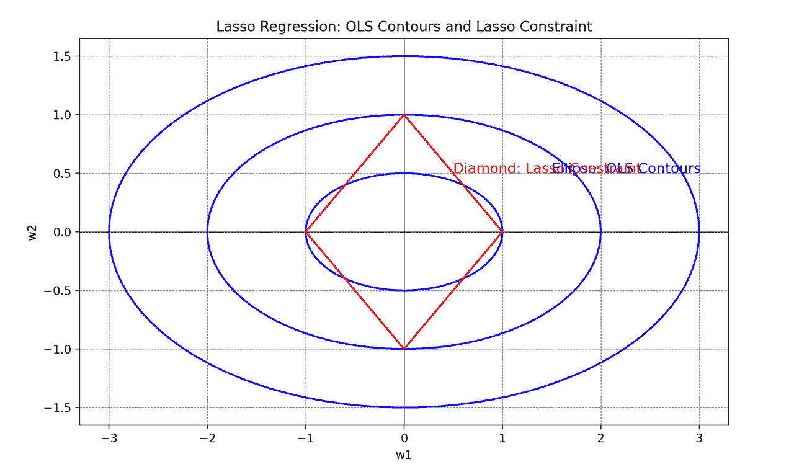

假设我们有两个特征  和  ，Lasso 回归的惩罚项  的几何形状是一个菱形。而 OLS 的等值线是椭圆形。当我们在优化过程中缩小误差平方和的同时约束  （即菱形内的区域），最终会导致优化解在菱形的顶点处。这些顶点对应于一些系数（如  或  ）为零，从而实现特征选择。

总之，通过Lasso回归，我们不仅能得到一个适合数据的模型，还能自动筛选出对结果有重要影响的特征，使得模型更加简洁和解释性更强。

## 完整案例

我们使用加利福尼亚房价数据集，该数据集包含了1990年美国加州各个区的房屋价格以及相关的地理和人口统计数据。

这个数据集可以通过 Scikit-learn 库获取，大家不需要额外去寻找~

**主要步骤**：

1.  加载和探索数据

1.  数据预处理

1.  特征工程

1.  建立和优化 Lasso 模型

1.  模型评估

1.  结果可视化

下面，咱们一步一步来实现，细节的地方大家可以看注释部分。

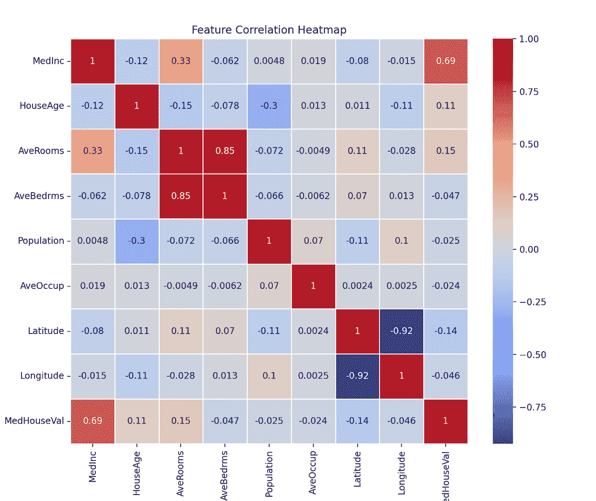

**1. 加载和探索数据**

首先，我们加载数据并进行初步探索。

```
import pandas as pd
import numpy as np
import matplotlib.pyplot as plt
import seaborn as sns
from sklearn.model_selection import train_test_split
from sklearn.linear_model import Lasso
from sklearn.metrics import mean_squared_error, r2_score
from sklearn.preprocessing import StandardScaler
from sklearn.model_selection import GridSearchCV

# 加载数据
from sklearn.datasets import fetch_california_housing
data = fetch_california_housing()
df = pd.DataFrame(data.data, columns=data.feature_names)
df[&#x27;MedHouseVal&#x27;] = data.target

# 初步查看数据
print(df.head())
print(df.describe())
```

**2. 数据预处理**

处理数据中的缺失值，并进行特征缩放。

```
# 检查缺失值
print(df.isnull().sum())

# 分离特征和目标变量
X = df.drop(&#x27;MedHouseVal&#x27;, axis=1)
y = df[&#x27;MedHouseVal&#x27;]

# 数据分割
X_train, X_test, y_train, y_test = train_test_split(X, y, test_size=0.2, random_state=42)

# 特征缩放
scaler = StandardScaler()
X_train_scaled = scaler.fit_transform(X_train)
X_test_scaled = scaler.transform(X_test)
```

**3. 特征工程**

可视化特征之间的关系以帮助理解数据。

```
# 特征相关性
plt.figure(figsize=(10, 8))
sns.heatmap(df.corr(), annot=True, cmap=&#x27;coolwarm&#x27;, linewidths=0.5)
plt.title(&#x27;Feature Correlation Heatmap&#x27;)
plt.show()
```

4. 建立和优化 Lasso 模型

使用交叉验证和网格搜索优化 Lasso 模型。

```
# 建立 Lasso 模型
lasso = Lasso()

# 定义超参数网格
param_grid = {&#x27;alpha&#x27;: np.logspace(-4, 4, 50)}

# 网格搜索
grid_search = GridSearchCV(lasso, param_grid, cv=5, scoring=&#x27;neg_mean_squared_error&#x27;)
grid_search.fit(X_train_scaled, y_train)

# 最佳超参数
best_alpha = grid_search.best_params_[&#x27;alpha&#x27;]
print(f&#x27;Best alpha: {best_alpha}&#x27;)

# 训练最终模型
lasso_opt = Lasso(alpha=best_alpha)
lasso_opt.fit(X_train_scaled, y_train)
```

**5. 模型评估**

评估模型性能，并计算各项指标。

```
# 预测
y_pred_train = lasso_opt.predict(X_train_scaled)
y_pred_test = lasso_opt.predict(X_test_scaled)

# 评估
mse_train = mean_squared_error(y_train, y_pred_train)
mse_test = mean_squared_error(y_test, y_pred_test)
r2_train = r2_score(y_train, y_pred_train)
r2_test = r2_score(y_test, y_pred_test)

print(f&#x27;MSE (Train): {mse_train}&#x27;)
print(f&#x27;MSE (Test): {mse_test}&#x27;)
print(f&#x27;R^2 (Train): {r2_train}&#x27;)
print(f&#x27;R^2 (Test): {r2_test}&#x27;)
```

**6. 结果可视化**

可视化实际值与预测值之间的关系。

```
# 可视化
plt.figure(figsize=(10, 6))
plt.scatter(y_test, y_pred_test, alpha=0.6, color=&#x27;b&#x27;)
plt.plot([0, 5], [0, 5], &#x27;r--&#x27;)
plt.xlabel(&#x27;Actual&#x27;)
plt.ylabel(&#x27;Predicted&#x27;)
plt.title(&#x27;Actual vs Predicted House Prices&#x27;)
plt.show()
```

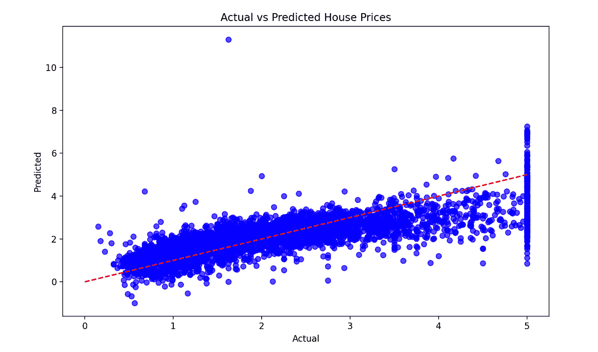

其中，有几个点，需要大家注意下~

1.  **数据预处理**：确保所有特征进行标准化，避免特征值差异过大对模型的影响。

1.  **参数调整**：使用网格搜索找到最佳的正则化参数 alpha。

1.  **模型评估**：计算 MSE 和 R² 来评估模型性能，并通过可视化检查预测效果。

1.  **特征重要性**：可以查看哪些特征对模型的贡献最大。Lasso 回归会将不重要的特征系数压缩为零，这也可以帮助我们理解特征的重要性。

通过上述整个的过程，大家基本可以全面了解如何使用 Lasso 回归进行房价预测，并且理解原理和代码的实现。最后，并通过优化提升模型性能。

## 模型分析

先来聊聊Lasso回归的优缺点~

**优点**

1.  **特征选择**：Lasso回归会将一些不重要的特征的系数缩减为零，从而实现特征选择。这使得模型更加简洁和易于解释。

1.  **减少过拟合**：通过引入正则化项，Lasso回归可以有效地减少过拟合，提高模型的泛化能力。

1.  **简单高效**：Lasso回归相对简单，计算效率高，适用于处理高维数据。

**缺点**

1.  **多重共线性问题**：当特征之间存在多重共线性时，Lasso回归可能无法正确选择特征，导致模型性能下降。

1.  **计算复杂度**：在大规模数据集上，Lasso回归的计算复杂度可能较高，尤其是当使用网格搜索优化超参数时。

1.  **模型解释性**：虽然Lasso回归能进行特征选择，但对结果的解释性仍可能受到数据特性的影响，有时难以完全理解模型的行为。

### 与相似算法的对比

| **对比项** | **Ridge回归** (岭回归) | **Elastic Net回归** |
| --- | --- | --- |
| **正则化方式** | 使用   范数（系数的平方和） | 结合了   和   范数的组合 |
| **特征选择** | 不进行特征选择，系数不会被缩减为零 | 能够进行特征选择，同时处理多重共线性问题 |
| **优点** | - 适用于多重共线性问题  - 不会将系数缩减为零，保留所有特征信息 | - 结合了Lasso和Ridge的优点  - 既能进行特征选择，又能处理多重共线性问题  - 更加灵活，适应性强 |
| **缺点** | - 无法进行特征选择，模型可能较复杂  - 不会丢弃不重要的特征 | - 需要调节两个正则化参数，模型复杂度增加 |
| **适用场景** | - 特征之间存在多重共线性  - 需要保留所有特征信息时 | - 需要同时处理多重共线性和特征选择问题  - 数据具有稀疏性时 |
| **调参** | 只需要调整一个正则化参数（正则化强度  ） | 需要调整两个正则化参数（  和  ） |
| **模型简洁性** | 由于不进行特征选择，模型可能较为复杂，包含所有特征 | 可以进行特征选择，模型更加简洁，保留重要特征 |
| **计算复杂度** | 计算复杂度相对较低，仅需调整一个参数 | 计算复杂度较高，需要调节两个正则化参数 |

### 使用场景

**适用场景**

+   **特征数量多但重要特征少**：Lasso回归非常适合特征数量多，但其中只有少数特征真正重要的情况，因为它可以自动进行特征选择。

+   **减少模型复杂度**：在希望模型更加简洁易于解释的场景中，Lasso回归是一个好的选择。

+   **防止过拟合**：在数据较少但特征较多的情况下，Lasso回归通过正则化防止过拟合，提高模型的泛化能力。

**其他算法优选场景**

+   **多重共线性**：当特征之间存在强烈的多重共线性时，Ridge回归或Elastic Net回归可能更合适，因为Lasso回归在这种情况下可能无法正确选择特征。

+   **所有特征都重要**：如果所有特征都对模型预测有贡献，并且不希望丢弃任何特征，可以考虑使用Ridge回归。

+   **需要更强的正则化效果**：在特征数量非常庞大的情况下，Elastic Net回归可能提供更好的正则化效果，兼顾特征选择和多重共线性处理。

### 最后

Lasso回归，其实特别适用于高维数据和需要特征选择的场景。然而，在多重共线性严重或需要保留所有特征的情况下，Ridge回归或Elastic Net回归可能是更好的选择。

# 3.回归算法-Ridge回归

一句话解释Lasso和Ridge的区别和联系：

Lasso回归通过加入  正则化项，使部分回归系数变为零，实现特征选择。

Ridge回归加入  正则化项，通过缩小回归系数减小模型复杂度。两者结合可形成弹性网络回归，兼具特征选择和参数缩减。

弹性网络回归咱们下次聊~

好了，废话不多说，开始上干货！

**Ridge 回归是一种用于处理多重共线性（即自变量之间高度相关）的线性回**归技术。它通过在模型中引入一个额外的惩罚项来避免过拟合，从而提高模型的泛化能力。

那么，具体什么是 Ridge 回归？

**首先来说线性回归**：线性回归是用来预测一个变量（因变量）与一个或多个变量（自变量）之间关系的统计方法。目标是找到一条直线，使得这条直线能最好地拟合数据点。

**多重共线性问题**：在实际应用中，自变量之间有时候会高度相关，这叫做多重共线性。这种情况会导致线性回归模型的预测效果不好，因为模型对训练数据过于敏感（即过拟合），在新数据上表现不佳。

**引入惩罚项**：Ridge 回归通过在损失函数中加入一个惩罚项（也叫正则化项）来解决这个问题。这个惩罚项是所有回归系数的平方和乘以一个常数（惩罚参数）。它的作用是限制回归系数的大小，使得模型不会过度拟合训练数据。

可以说，Ridge 回归是一种增强版的线性回归，通过在损失函数中加入一个惩罚项来限制回归系数的大小，从而减少过拟合并提高模型在新数据上的预测能力。对于咱们大多数同学来说，可以把 Ridge 回归看作是在原有的线性回归基础上“加了一点约束”，使得模型更加稳健。

## 理论基础

刚刚已经说过，Ridge 回归是线性回归的一种变体，通过引入   正则化（惩罚项）来解决多重共线性和防止过拟合问题。

下面，咱们按照一步一步给大家解释清楚：

#### 1. 问题定义

在标准线性回归中，我们有一组样本  ，其中   是输入特征，   是目标值。

我们希望找到一组回归系数  ，使得线性模型  能最好地拟合数据。

标准线性回归的目标是最小化以下损失函数（均方误差）：

#### 2. Ridge 回归的目标函数

Ridge 回归通过在上述目标函数中加入一个正则化项来限制回归系数的大小：

其中，  是正则化参数，控制惩罚项的权重。较大的   会更严格地限制   的大小，防止过拟合。

#### 3. 目标函数的推导

将目标函数展开：

其中，  是   的目标值向量，  是   的输入特征矩阵，  是   的回归系数向量。

展开并简化：

#### 4. 梯度计算

为了找到使目标函数最小化的  ，我们对  求导并设置导数为零：

简化上式：

#### 5. 解方程

整理上述方程：

其中，  是  的单位矩阵。

我们可以通过矩阵求逆来解这个方程：

#### 6. 算法流程

1.  **准备数据**：获取特征矩阵   和目标值向量  。

1.  **选择正则化参数**：选择合适的   值。

1.  **构建矩阵**：计算   和  。

1.  **添加正则化项**：计算  。

1.  **求解回归系数**：通过矩阵求逆计算  。

1.  **模型预测**：使用回归系数   进行预测。

### 例子

假设我们有以下数据：

+   特征矩阵

+   目标值向量

+   正则化参数

计算中间结果：

求解回归系数：

这个例子展示了 Ridge 回归的实际计算过程。通过引入正则化项，Ridge 回归能够处理多重共线性问题，并提高模型的泛化能力。

## 完整案例

数据集我们使用加利福尼亚房价数据集。使用 Ridge 回归模型构建、训练、预测、评估和优化。

这里再简单和大家介绍下加利福尼亚房价数据集，在学习阶段，使用频率非常的高~

加利福尼亚房价数据集（California Housing Dataset）包含了加利福尼亚州各个地区的房价以及相关的地理和人口统计特征。这个数据集是由加利福尼亚州1990年的人口普查数据构建的。

+   **数据条目**：20640条记录

+   **特征数量**：8个特征

+   **目标变量**：房价中位数（MedHouseVal）

**特征描述**

1.  **MedInc**：街区的中位收入

1.  **HouseAge**：街区中房屋的中位年龄

1.  **AveRooms**：每户平均房间数

1.  **AveBedrms**：每户平均卧室数

1.  **Population**：街区的人口总数

1.  **AveOccup**：每户平均居住人数

1.  **Latitude**：街区的纬度

1.  **Longitude**：街区的经度

**目标变量**

+   **MedHouseVal**：街区房价的中位数（以美元计）

大家可以使用 fetch_california_housing 函数从 sklearn.datasets 模块中加载该数据集。

```
import numpy as np
import pandas as pd
import matplotlib.pyplot as plt
import seaborn as sns
from sklearn.datasets import fetch_california_housing
from sklearn.model_selection import train_test_split
from sklearn.preprocessing import StandardScaler
from sklearn.linear_model import Ridge, Lasso, ElasticNet
from sklearn.metrics import mean_squared_error, r2_score
from sklearn.model_selection import GridSearchCV

# 福尼亚房价数据集
california = fetch_california_housing()
X = pd.DataFrame(california.data, columns=california.feature_names)
y = california.target

# 数据标准化
scaler = StandardScaler()
X_scaled = scaler.fit_transform(X)

# 为训练集和测试集
X_train, X_test, y_train, y_test = train_test_split(X_scaled, y, test_size=0.2, random_state=42)

# 正则化参数的候选值
alphas = np.logspace(-4, 4, 50)

# 通过网格搜索和交叉验证来选择最佳正则化参数
ridge = Ridge()
grid_search = GridSearchCV(estimator=ridge, param_grid={&#x27;alpha&#x27;: alphas}, cv=5, scoring=&#x27;neg_mean_squared_error&#x27;)
grid_search.fit(X_train, y_train)

# 获取最佳模型
best_ridge = grid_search.best_estimator_
print(f&quot;最佳正则化参数: {grid_search.best_params_[&#x27;alpha&#x27;]}&quot;)

# 预测训练集和测试集
y_train_pred = best_ridge.predict(X_train)
y_test_pred = best_ridge.predict(X_test)

# 计算均方误差和R^2分数
train_mse = mean_squared_error(y_train, y_train_pred)
test_mse = mean_squared_error(y_test, y_test_pred)
train_r2 = r2_score(y_train, y_train_pred)
test_r2 = r2_score(y_test, y_test_pred)

print(f&quot;训练集均方误差: {train_mse}&quot;)
print(f&quot;测试集均方误差: {test_mse}&quot;)
print(f&quot;训练集 R^2 分数: {train_r2}&quot;)
print(f&quot;测试集 R^2 分数: {test_r2}&quot;)

# 绘制实际值与预测值对比图
plt.figure(figsize=(10, 6))
plt.scatter(y_train, y_train_pred, label=&#x27;train dataset&#x27;, alpha=0.7)
plt.scatter(y_test, y_test_pred, label=&#x27;test dataset&#x27;, alpha=0.7)
plt.plot([min(y), max(y)], [min(y), max(y)], &#x27;r--&#x27;, lw=2)
plt.xlabel(&#x27;actual&#x27;)
plt.ylabel(&#x27;predict&#x27;)
plt.title(&#x27;actual vs. predict&#x27;)
plt.legend()
plt.show()

# 分析特征的重要性
coefs = pd.Series(best_ridge.coef_, index=california.feature_names)
coefs.sort_values().plot(kind=&#x27;barh&#x27;, figsize=(10, 6))
plt.title(&#x27;Ridge 回归的特征重要性&#x27;)
plt.show()

# 比较其他回归模型

# Lasso 回归
grid_search_lasso = GridSearchCV(estimator=Lasso(), param_grid={&#x27;alpha&#x27;: alphas}, cv=5, scoring=&#x27;neg_mean_squared_error&#x27;)
grid_search_lasso.fit(X_train, y_train)
best_lasso = grid_search_lasso.best_estimator_

# ElasticNet 回归
param_grid = {&#x27;alpha&#x27;: alphas, &#x27;l1_ratio&#x27;: np.linspace(0, 1, 10)}
grid_search_en = GridSearchCV(estimator=ElasticNet(), param_grid=param_grid, cv=5, scoring=&#x27;neg_mean_squared_error&#x27;)
grid_search_en.fit(X_train, y_train)
best_elasticnet = grid_search_en.best_estimator_

# 评估所有模型
models = {&#x27;Ridge&#x27;: best_ridge, &#x27;Lasso&#x27;: best_lasso, &#x27;ElasticNet&#x27;: best_elasticnet}
for name, model in models.items():
    y_test_pred = model.predict(X_test)
    mse = mean_squared_error(y_test, y_test_pred)
    r2 = r2_score(y_test, y_test_pred)
    print(f&quot;{name} 回归 - 测试集均方误差: {mse}, R^2 分数: {r2}&quot;)
```

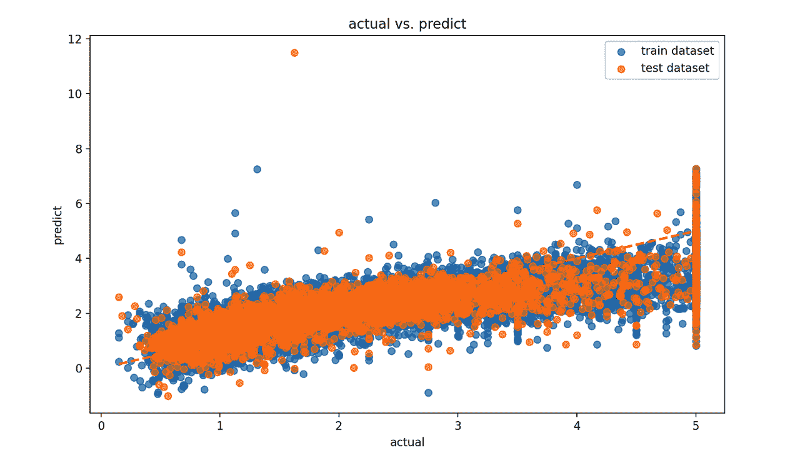

整个代码，偏向于实战，包括数据预处理、模型构建、训练、评估和优化。我们还通过与其他回归模型进行比较，评估了 Ridge 回归的性能。通过特征重要性分析，可以进一步理解哪些特征对预测最重要。

这一系列步骤和分析希望可以帮助到大家，在实际应用中更好地理解和使用 Ridge 回归。

## 模型分析

### Ridge 回归模型的优缺点

**优点**：

1.  **解决多重共线性问题**：Ridge 回归通过引入   正则化项，可以有效地解决自变量之间存在多重共线性的问题，从而提高模型的稳定性和预测性能。

1.  **防止过拟合**：正则化项限制了回归系数的大小，防止模型过拟合训练数据，提升对新数据的泛化能力。

1.  **计算效率高**：相比于某些复杂的非线性回归模型，Ridge 回归的计算效率较高，适用于大规模数据集。

1.  **参数调整灵活**：通过调整正则化参数  ，可以在偏差和方差之间找到最佳平衡，从而优化模型性能。

**缺点**：

1.  **不适用于特征选择**：Ridge 回归不会将不相关的特征系数缩减到零，因此不适用于需要进行特征选择的场景。

1.  **无法处理非线性关系**：Ridge 回归是线性模型，如果数据中存在复杂的非线性关系，Ridge 回归的表现可能不如非线性模型。

1.  **解释性较差**：由于引入了正则化项，Ridge 回归模型的解释性可能较差，不易于解释每个特征对目标值的具体影响。

### 与相似算法的对比

| **对比项** | **Lasso 回归** | **ElasticNet 回归** |
| --- | --- | --- |
| **正则化方式** | 使用   范数（系数的绝对值和） | 结合了   和   范数（系数的绝对值和与平方和） |
| **特征选择** | 能进行特征选择，通过将某些特征的系数缩减为零 | 既能进行特征选择，又能解决多重共线性问题 |
| **优点** | - 可以进行特征选择  - 产生稀疏模型，适用于高维数据集 | - 结合了 Ridge 和 Lasso 的优点  - 更加灵活，适应性强 |
| **缺点** | - 对多重共线性不敏感，可能无法选择最优特征  - 在特征相关性较高时稳定性差 | - 参数选择复杂，需要调节两个正则化参数  - 计算开销较大 |
| **适用场景** | - 特征数量相对较少  - 特征不高度相关时 | - 特征数量较多且高度相关时  - 同时需要特征选择和处理共线性问题 |
| **模型稀疏性** | 由于   正则化，模型会变得更加稀疏 | 结合   和   正则化，可以在两者之间平衡，稀疏性较低 |
| **计算复杂度** | 计算复杂度相对较低，只有一个正则化参数 | 计算复杂度较高，包含两个正则化参数 |
| **调参** | 只需调节一个正则化参数（ ） | 需要调节两个正则化参数（  和  ） |

### 使用场景分析

适合使用 Ridge 回归的场景

1.  **特征之间存在多重共线性**：当特征之间存在高度相关性时，Ridge 回归可以通过   正则化项有效地稳定回归系数，提升模型的稳定性和预测性能。

1.  **防止过拟合**：如果数据集较小且存在过拟合的风险，Ridge 回归可以通过限制回归系数的大小，防止模型过拟合。

1.  **模型解释性不重要**：在某些情况下，模型的预测性能比解释性更重要，此时可以选择 Ridge 回归。

**考虑其他算法的场景**

1.  **需要特征选择**：如果需要选择最相关的特征，Lasso 回归或 ElasticNet 回归更为适合，因为它们可以将不相关特征的系数缩减为零。

1.  **存在非线性关系**：如果数据中存在复杂的非线性关系，可以考虑使用决策树、随机森林、支持向量机或神经网络等非线性模型。

1.  **高维数据集**：对于特征数量远大于样本数量的高维数据集，Lasso 回归或 ElasticNet 回归可能表现更好，因为它们能够产生更加稀疏的模型。

### 结论

总结一下，Ridge 通过引入   正则化项，可以有效地解决多重共线性问题，并防止过拟合。它在特征之间存在高度相关性、数据集较小且易过拟合的情况下表现良好。

然而，对于需要特征选择或处理非线性关系的场景，可以考虑使用 Lasso 回归、ElasticNet 回归或其他非线性模型。通过结合不同算法的优缺点，实验中大家需要选择最适合特定问题的回归模型，提升模型的预测性能和解释性。

# 4.回归算法-贝叶斯回归

贝叶斯回归，用概率思维来做预测。

先来点直觉理解，假设你想预测一个人的身高，你已经知道他是一个成年男性。

+   **普通回归**：可能会直接给出一个固定的预测值，比如175cm。

+   **贝叶斯回归****：不会****给你一**个死板的答案，而是会告诉你“这个人的身高大概率在170~180cm之间，但也有小概率低于170cm或高于180cm”。

换句话说，贝叶斯回归不仅告诉你预测的结果，还告诉你对这个预测有多大的信心（即不确定性）。

#### 贝叶斯回归的核心思想

贝叶斯回归的核心就是**贝叶斯定理**，这个定理的意思是：

> 用已有的知识（先验）+ 新的数据（证据），来更新我们的信念（后验）

比如：

+   **你一开始**认为成年男性的身高大致在170~180cm之间（先验知识）。

+   **但你看**到这个人平时穿加长裤，站在人群中明显比别人高（新数据）。

+   **于是你调**整你的预测，认为他更有可能接近185cm（后验概率）。

这个不断调整的过程就是贝叶斯回归的核心。

#### 贝叶斯回归 vs 经典回归

| 特点 | 经典回归（最小二乘法） | 贝叶斯回归 |
| --- | --- | --- |
| **结果** | 一个固定的数值（比如175cm） | 一个概率分布（比如大多数在170~180cm之间） |
| **不确定性** | 不提供 | 提供预测的可信度 |
| **数据量要求** | 需要大量数据训练 | 适合数据少的情况（因为可以利用“先验”） |
| **适应性** | 一旦训练完成，模型固定 | 可以随着新数据不断更新预测 |

#### 什么时候用贝叶斯回归？

+   **数据很少**：比如你只有10个人的身高数据，普通回归很难拟合，但贝叶斯回归可以结合先验知识给出更合理的预测。

+   **需要不确定性信息**：如果你做的是医疗预测，你不仅想知道病人是否生病，还想知道你的预测有多可靠。

+   **动态调整预测**：比如你预测股市走势，每天有新的数据进来，贝叶斯回归可以随着数据变化不断调整模型。

用已有数据来修正我们对参数的信念：

+   贝叶斯回归是一种用概率来做预测的回归方法，不同于传统回归，它不仅给出一个预测值，还会告诉你预测的置信度。

+   它利用“先验知识 + 数据”来不断更新预测，特别适用于数据少、需要不确定性分析的情况。

+   **它的数学基础是贝叶斯定理**，核心思想是“不断调整信念，使其更符合现实”。

## 原理详解

贝叶斯回归不像经典最小二乘法或最大似然估计（ML**E）那样**直接求出单一的最优参数，而是通过概率分布刻画参数的不确定性。

核心思想是：

> **利用贝叶斯定理，将“先验知识”与“观测数据”**结合，从而得到后验分布，并以此进行预测。

### 1. 贝叶斯回归的数学建模

假设我们有一个线性回归模型：

其中：

+    是目标变量（观测数据）。

+    是特征矩阵（自变量）。

+    是待估计的参数。

是噪声项，假设服从均值为 0、方差为  的正态分布。

对于传统的最小二乘回归，我们通常直接求解参数  使得误差最小。

但在贝叶斯回归中，我们认为  不是一个固定值，而是一个概率分布。

### 2. 贝叶斯回归的推导

#### 先验分布（Prior Distribution）

在贝叶斯统计中，我们在数据观测之前就可以对参数  施加先验分布，表示我们对其的初始假设。最常见的选择是

**高斯分布**：

其中：

是  的先验均值（通常取 0）。

是  的先验协方差矩阵，表示参数的初始不确定性。

这样，我们假设参数  服从一个先验正态分布，它的分布特征由  和  控制。

#### 似然函数（Likelihood Function）

数据  服从线性模型：

因此，给定  时，目标变量  服从以下正态分布：

这个概率表示**在给定 ** **的情况下，我们如何生成数据 ** ，即数据的“似然”（Likelihood）。

#### 后验分布（Posterior Distribution）

**贝叶斯定理**告诉我们，后验分布可以由先验分布与似然函数通过贝叶斯公式计算：

其中：

+    是**先验**，表示我们在看到数据前对  的认知。

+    是**似然**，表示给定  时，数据  的概率。

+    是归一化项，与  无关，一般不直接计算。

由于  和  都是高斯分布，根据**高斯分布的共轭性质**，后验分布  仍然是一个高斯分布：

其中：

+   **后验均值**：

+   **后验协方差**：

这个公式的含义是：

+   **后验均值 ** ：由先验信息和数据贡献共同决定。

+   **后验协方差 ** ：当数据量增多时，参数的不确定性减少，即协方差变小。

### 3. 预测分布

在贝叶斯回归中，我们不仅关注参数  的后验分布，还关心新输入数据  时的预测输出  的分布。

给定新数据  ，其预测值  的分布为：

因为  和  都是高斯分布，它们的**加权积分仍然是高斯分布**：

即：

+   预测均值：

+   预测方差：

这个结果告诉我们，贝叶斯回归不仅能给出预测值  ，还能给出预测的不确定性  。

### 4. 贝叶斯回归的算法流程

总结贝叶斯回归的计算步骤如下：

#### 1）设定先验分布

设定参数  的先验分布：

通常  。

#### 2）计算后验分布

使用数据  更新  的后验分布：

#### 3）计算预测分布

给定新输入  ，计算预测均值和方差：

## 完整案例

使用贝叶斯回归对**房价预测**进行建模，数据集来自 **sklearn** 的 Boston Housing Dataset（波士顿房价数据）。

1.  **数据预处理**：对数据进行标准化，并拆分训练集和测试集。

1.  **贝叶斯回归建模**：使用 **sklearn** 的 **BayesianRidge** 进行建模。

1.  **预测分析**：对测试数据进行预测，并分析模型性能。

1.  **可视化**：

+   真实值 vs 预测值散点图。

+   误差分布直方图。

+   不确定性分析（预测的置信区间）。

1.  **算法优化**：调优贝叶斯回归的超参数，提高模型表现。

```
import numpy as np
import matplotlib.pyplot as plt
import seaborn as sns
from sklearn.model_selection import train_test_split
from sklearn.preprocessing import StandardScaler
from sklearn.linear_model import BayesianRidge
from sklearn.metrics import mean_squared_error, r2_score
from sklearn.datasets import load_boston

# 1. 读取数据
boston = load_boston()
X, y = boston.data, boston.target

# 2. 数据标准化 &amp; 拆分训练/测试集
scaler = StandardScaler()
X_scaled = scaler.fit_transform(X)
X_train, X_test, y_train, y_test = train_test_split(X_scaled, y, test_size=0.2, random_state=42)

# 3. 训练贝叶斯回归模型
model = BayesianRidge(tol=1e-6, alpha_1=1e-6, lambda_1=1e-6)
model.fit(X_train, y_train)
y_pred = model.predict(X_test)

# 4. 计算误差指标
mse = mean_squared_error(y_test, y_pred)
r2 = r2_score(y_test, y_pred)
print(f&#x27;MSE: {mse:.3f}, R^2: {r2:.3f}&#x27;)

# 5. 预测 vs 真实值 可视化
plt.figure(figsize=(10, 6))
sns.scatterplot(x=y_test, y=y_pred, hue=np.abs(y_test - y_pred), palette=&#x27;coolwarm&#x27;, s=100)
plt.plot([min(y_test), max(y_test)], [min(y_test), max(y_test)], &#x27;--k&#x27;, label=&#x27;Perfect Prediction&#x27;)
plt.xlabel(&#x27;True Values&#x27;)
plt.ylabel(&#x27;Predicted Values&#x27;)
plt.title(&#x27;True vs Predicted House Prices&#x27;)
plt.legend()
plt.show()

# 6. 误差分布
plt.figure(figsize=(10, 6))
sns.histplot(y_test - y_pred, kde=True, bins=30, color=&#x27;purple&#x27;)
plt.axvline(0, color=&#x27;red&#x27;, linestyle=&#x27;--&#x27;)
plt.xlabel(&#x27;Prediction Error&#x27;)
plt.title(&#x27;Distribution of Prediction Errors&#x27;)
plt.show()

# 7. 置信区间可视化
coefs_mean = model.coef_
coefs_std = np.sqrt(1 / model.lambda_)

plt.figure(figsize=(12, 6))
plt.errorbar(range(len(coefs_mean)), coefs_mean, yerr=coefs_std, fmt=&#x27;o&#x27;, color=&#x27;darkblue&#x27;, ecolor=&#x27;red&#x27;, capsize=5)
plt.xlabel(&#x27;Feature Index&#x27;)
plt.ylabel(&#x27;Coefficient Value&#x27;)
plt.title(&#x27;Bayesian Regression Coefficients with Uncertainty&#x27;)
plt.show()
```

1.  **MSE（均方误差）和 ** **（决定系数）**：用于衡量模型的误差和拟合度。

1.  **真实值 vs 预测值散点图**：参考线代表完美预测，点越接近参考线，预测效果越好。


1.  **误差分布直方图**：观察误差的集中程度，误差越集中，模型越稳定。

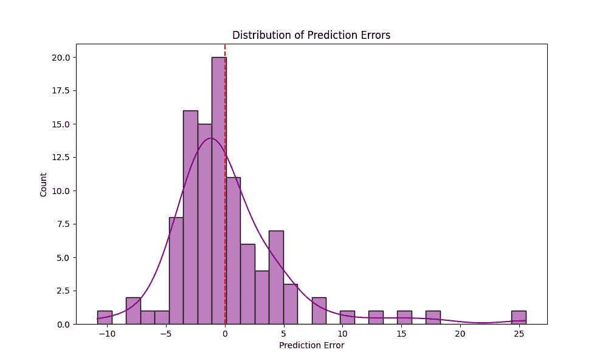

1.  **回归系数的置信区间**：误差棒表示参数的不确定性，红色表示参数变化范围大，说明该变量对预测影响较大。

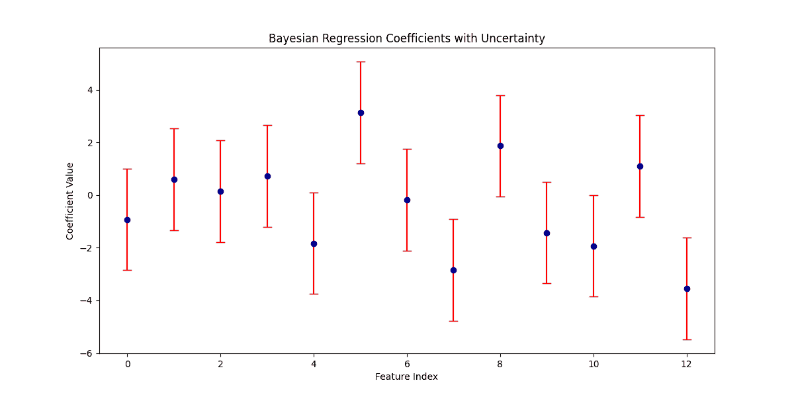

#### 算法优化

+   调整 alpha 和 lambda 以减少过拟合/欠拟合。

+   尝试不同的先验分布（Gaussian Process 变体） 以增强适应性。

+   **特征选择**，减少冗余信息，提高模型稳定性。

## 模型分析

### 贝叶斯回归的优缺点分析

**优点**

1.  **提供不确定性估计****：不像普通回归**只给出单一预测值，贝叶斯回归还能提供预测的置信区间，适用于风险敏感的应用（如金融、医疗）。

1.  **适用于小数据集****：在数据**量较小时，贝叶斯回归通过先验分布可以避免过拟合，而传统回归方法容易因数据不足而表现不稳定。

1.  **鲁棒性强**：它引入了正则化（类似于 L2 正则化），在高维特征情况下（特征数远大于样本数）表现更稳定。

1.  **动态更新**：可以随着新数据的加入不断调整参数（在线学习），而不需要完全重新训练整个模型。

**缺点**

1.  **计算成本较高**：贝叶斯回归需要求解**矩阵的逆**（复杂度  ），在大规模数据集上计算代价较高。

1.  **难以选择合适的先验**：如果先验选择不当，可能会影响最终结果，需要额外的领域知识。

1.  **对异常值较敏感**：由于使用了正态分布假设，贝叶斯回归可能会受到异常值的影响，导致预测偏差。

### 贝叶斯回归 vs 其他相似算法

| **算法** | **优点** | **缺点** | **适用场景** |
| --- | --- | --- | --- |
| **贝叶斯回归** | 提供不确定性估计，适用于小数据，具有鲁棒性和动态更新能力 | 计算量大，对异常值敏感，先验选择困难 | 小数据集、不确定性分析、金融/医疗预测 |
| **岭回归（Ridge）** | 计算高效，避免过拟合，适用于高维特征 | 不提供预测不确定性 | 高维特征数据，但不关心不确定性 |
| **Lasso 回归** | 可自动进行特征选择（L1 正则化），适用于高维稀疏数据 | 可能导致特征完全丢失（稀疏性过强） | 高维但特征稀疏的数据集 |
| **高斯过程回归（GPR）** | 提供更强的不确定性建模能力，适用于非线性问题 | 计算成本极高（ ），无法处理大规模数据 | 复杂的非线性问题，小数据集 |
| **随机森林回归（RF）** | 处理非线性关系能力强，不易过拟合 | 不提供明确的概率分布，不适用于不确定性分析 | 高维数据、非线性关系、稳健预测 |
| **XGBoost 回归** | 强大的集成学习方法，适用于大规模数据，精度高 | 计算复杂度高，缺乏不确定性估计 | 大数据、高精度预测 |

### 在什么情况下选择贝叶斯回归？

1.  数据量较少，不能依赖传统深度学习或集成学习方法时。

1.  需要预测的不仅是数值，还包括模型的不确定性（例如医疗风险评估）。

1.  数据特征数较多，但希望有稳定的正则化效果，同时避免 Lasso 过度稀疏化的问题。

1.  可以动态更新模型，不希望每次都重新训练（如金融市场的动态预测）。

### 在什么情况下考虑其他算法？

1.  当数据量非常大时，贝叶斯回归的计算复杂度较高，可以选择 XGBoost 或 随机森林。

1.  当数据特征极其稀疏，可以考虑 Lasso 回归 以自动进行特征选择。

1.  如果数据具有复杂的非线性关系，可以选择 高斯过程回归（GPR） 或 XGBoost。

1.  如果不需要不确定性估计，只关心预测精度，那么 岭回归（Ridge） 或 XGBoost 可能是更好的选择。

贝叶斯回归在小数据集、不确定性估计、动态更新等方面表现优越，但计算复杂度较高。如果数据量大或者关注非线性关系，XGBoost 或深度学习可能是更好的选择。在实际应用中，选择合适的算法需要权衡计算成本、数据特性和业务需求。

# 5.回归算法-弹性网络回归

首先说，**回归算法**是一种用于预测连续值的机器学习方法。

例如，如果我们想预测一个人根据他的身高、年龄和饮食习惯可能有多重，这就是一个回归问题。

数学上，回归算法的核心是找到一个公式，将输入（特征）与输出（目标值）联系起来。常见的公式形式是：

其中：

+    ：是输入特征

+    ：是权重（回归系数）

+    ：是偏置

+    ：是预测值

目标是通过训练数据找到最合适的权重和偏置，使得预测值   和真实值尽可能接近。

那么弹性回归网络是什么？

## 弹性网络回归是什么？

弹性网络回归（Elastic Net Regression） 是一种回归算法，结合了两种正则化方法：

1.  **L1 正则化（Lasso）**：让部分不重要的权重变为零，从而实现特征选择。

1.  **L2 正则化（Ridge）**：让权重变得更平滑，避免过拟合。

弹性网络回归的损失函数是：

：控制正则化强度。

：在 L1（特征选择）和 L2（平滑权重）之间进行权衡。

### 案例：选择水果供应商

假设你经营水果店，需要根据以下几个因素选择供应商：

1.  **价格（每斤）** ( )

1.  **配送时间（小时）** ( )

1.  **水果质量评分（1-10 分）** ( )

你的目标是预测每个供应商的**综合满意度评分**（连续值，1-10 分），你手上有一些历史数据可以用来训练模型。

| 供应商 | 价格 ( ) | 配送时间 ( ) | 质量评分 ( ) | 满意度 ( ) |
| --- | --- | --- | --- | --- |
| A | 5 | 24 | 9 | 8.5 |
| B | 6 | 36 | 8 | 7.0 |
| C | 4 | 48 | 7 | 6.0 |
| D | 5.5 | 30 | 9 | 8.0 |

现在呢，希望模型能告诉你未来哪个供应商最可能满足你的需求。

### 手动计算一个简单例子

假设我们用一个简单的线性回归模型，不带正则化：

假设通过训练，我们得到了以下权重和偏置：

（价格越高，满意度越低）

（配送时间越长，满意度越低）

（质量越高，满意度越高）

（基础满意度）

现在我们想预测一个新的供应商的数据：

+   价格

+   配送时间

+   质量评分

代入公式：

逐步计算：

1.  合计

预测的满意度为 **9.7**，说明这个供应商可能是个不错的选择。

### 为什么需要弹性网络回归？

如果数据中有很多特征（比如 1000 个特征），可能有以下问题：

1.  **不相关特征**：有些特征可能对结果几乎没有影响，应该忽略。

1.  **多重共线性**：多个特征之间可能高度相关（例如「价格」和「折扣」），这会让模型难以确定权重。

弹性网络回归通过：

+   **L1 正则化**：自动将不重要的特征权重设置为 0（特征选择）。

+   **L2 正则化**：让权重更平滑，避免过拟合。

### 总结4点

+   普通回归：根据历史数据找出一个公式，预测结果。

+   Lasso：更倾向于忽略不重要的特征。

+   Ridge：更倾向于平滑权重，防止过拟合。

+   弹性网络回归：结合了 Lasso 和 Ridge 的优点，既能选特征，又能让模型稳定。

## 公式解析

### 1. 回归算法的数学背景

#### 普通线性回归公式

普通线性回归的目标是找到一个线性模型，使得输入特征   和目标变量   之间的关系最佳拟合，公式如下：

其中：

：输入特征矩阵（形状为  ，  是样本数量，  是特征数量）。

：权重向量（形状为  ）。

：偏置项（标量）。

：模型的预测值。

目标是最小化均方误差（MSE）：

展开后，目标等价于最小化以下目标函数：

#### 引入正则化的需求

普通线性回归可能会出现以下问题：

1.  **过拟合**：模型对训练数据过于敏感，导致泛化能力差。

1.  **多重共线性**：特征之间高度相关，导致权重不稳定。

为解决上述问题，**正则化方法**被引入，常见的有 L1 正则化（Lasso）和 L2 正则化（Ridge）。

### 2. 弹性网络回归的数学推导

#### 损失函数

弹性网络回归结合了 L1 正则化和 L2 正则化，其损失函数为：

其中：

：数据误差（最小化预测值与真实值之间的误差）。

：L1 正则化，倾向于让某些   为 0（特征选择）。

：L2 正则化，倾向于让权重分布平滑。

：正则化强度，控制正则化项与误差项的权衡。

：平衡 L1 和 L2 的比例。

#### 优化问题

弹性网络回归的问题可以写为：

#### 转化为矩阵形式

假设没有偏置项  （可以通过扩展特征向量加入   来处理），简化后的目标函数为：

将误差项展开：

因此，目标函数可以写为：

### 3. 弹性网络回归的求解

#### 梯度计算

目标函数的梯度分两部分：

1.  **误差项的梯度**：

1.  **正则化项的梯度**：

+   L2 正则化（  的梯度）为  。

+   L1 正则化（  的梯度）为非光滑问题，使用次梯度求解，次梯度为：

#### 梯度下降法

将梯度合并，更新规则为：

其中：

：学习率。

：目标函数的梯度。

#### 坐标下降法（Coordinate Descent）

**由于 L1** 正则化项导致目标函数不可导，弹性网络回归通常使用坐标下降法进行优化。方法如下：

1.  对每个权重   逐一优化，固定其他权重不变。

1.  更新公式为（推导略）：

其中   是软阈值函数（Soft Thresholding）：

### 4. 弹性网络的直观理解

+   当  ，弹性网络退化为 Ridge 回归（L2 正则化）。

+   当  ，弹性网络退化为 Lasso 回归（L1 正则化）。

+   在   时，弹性网络既能处理稀疏性（特征选择），又能避免多重共线性。

### 总结弹性网络回归

弹性网络回归的损失函数结合了数据误差和两种正则化：

通过梯度下降或坐标下降进行优化，最终得到一个权衡稀疏性和稳定性的模型。

## 完整案例

我们可以用一个包含多个特征的数据集来展示回归算法中的「弹性网络回归」的应用。

我们使用一个模拟的数据集，并依次进行以下步骤：

1.  生成数据集，使用多个特征进行建模。

1.  对数据进行弹性网络回归。

1.  可视化回归结果以及数据特征之间的关系。

```
import numpy as np
import pandas as pd
import matplotlib.pyplot as plt
import seaborn as sns
from sklearn.datasets import make_regression
from sklearn.model_selection import train_test_split
from sklearn.preprocessing import StandardScaler
from sklearn.linear_model import ElasticNet
from sklearn.metrics import r2_score, mean_squared_error

# 1. 生成模拟数据集
X, y = make_regression(n_samples=500, n_features=10, noise=0.1, random_state=42)
X = pd.DataFrame(X, columns=[f&quot;Feature_{i}&quot; for i in range(10)])
y = pd.Series(y, name=&quot;Target&quot;)

# 2. 划分训练集和测试集
X_train, X_test, y_train, y_test = train_test_split(X, y, test_size=0.2, random_state=42)

# 3. 数据标准化
scaler = StandardScaler()
X_train_scaled = scaler.fit_transform(X_train)
X_test_scaled = scaler.transform(X_test)

# 4. 弹性网络回归模型
elastic_net = ElasticNet(alpha=0.1, l1_ratio=0.5, random_state=42)
elastic_net.fit(X_train_scaled, y_train)

# 5. 模型预测
y_pred_train = elastic_net.predict(X_train_scaled)
y_pred_test = elastic_net.predict(X_test_scaled)

# 6. 计算评价指标
r2_train = r2_score(y_train, y_pred_train)
r2_test = r2_score(y_test, y_pred_test)
mse_train = mean_squared_error(y_train, y_pred_train)
mse_test = mean_squared_error(y_test, y_pred_test)

# 7. 可视化分析
plt.figure(figsize=(15, 10))

# 图 1: 特征重要性（回归系数）
plt.subplot(2, 2, 1)
coef = elastic_net.coef_
colors = sns.color_palette(&quot;coolwarm&quot;, len(coef))
plt.barh(X.columns, coef, color=colors)
plt.title(&#x27;Feature Importance (ElasticNet Coefficients)&#x27;, fontsize=16)
plt.xlabel(&#x27;Coefficient Value&#x27;, fontsize=12)
plt.ylabel(&#x27;Feature&#x27;, fontsize=12)

# 图 2: 预测值与真实值的关系
plt.subplot(2, 2, 2)
plt.scatter(y_test, y_pred_test, c=y_pred_test, cmap=&#x27;cool&#x27;, alpha=0.7, edgecolor=&#x27;k&#x27;)
plt.plot([min(y_test), max(y_test)], [min(y_test), max(y_test)], color=&#x27;red&#x27;, linewidth=2)
plt.title(&#x27;Predicted vs True Values&#x27;, fontsize=16)
plt.xlabel(&#x27;True Values&#x27;, fontsize=12)
plt.ylabel(&#x27;Predicted Values&#x27;, fontsize=12)
plt.colorbar(label=&quot;Predicted Value Intensity&quot;)

# 图 3: 预测残差图
plt.subplot(2, 2, 3)
residuals = y_test - y_pred_test
plt.scatter(y_pred_test, residuals, c=residuals, cmap=&#x27;Spectral&#x27;, alpha=0.7, edgecolor=&#x27;k&#x27;)
plt.axhline(y=0, color=&#x27;red&#x27;, linestyle=&#x27;--&#x27;, linewidth=2)
plt.title(&#x27;Residuals vs Predicted Values&#x27;, fontsize=16)
plt.xlabel(&#x27;Predicted Values&#x27;, fontsize=12)
plt.ylabel(&#x27;Residuals&#x27;, fontsize=12)
plt.colorbar(label=&quot;Residual Intensity&quot;)

# 图 4: R^2 与 MSE 比较
plt.subplot(2, 2, 4)
metrics = [&#x27;Train R²&#x27;, &#x27;Test R²&#x27;, &#x27;Train MSE&#x27;, &#x27;Test MSE&#x27;]
values = [r2_train, r2_test, mse_train, mse_test]
colors = sns.color_palette(&quot;viridis&quot;, len(metrics))
plt.bar(metrics, values, color=colors)
plt.title(&#x27;Model Performance Metrics&#x27;, fontsize=16)
plt.ylabel(&#x27;Score / Error&#x27;, fontsize=12)

plt.tight_layout()
plt.show()
```

1.  **生成数据集**：我们使用 make_regression 生成一个包含500个样本和10个特征的模拟数据集。特征名称设置为 Feature_0 到 Feature_9，目标变量为 y。

1.  **模型构建**：将数据分为训练集和测试集后，使用 ElasticNet 进行回归建模。模型中的 alpha 和 l1_ratio 分别控制正则化强度和Lasso与Ridge的权重比。

1.  **模型评估**：通过 R² 和均方误差（MSE）评价模型的性能，并将结果可视化。

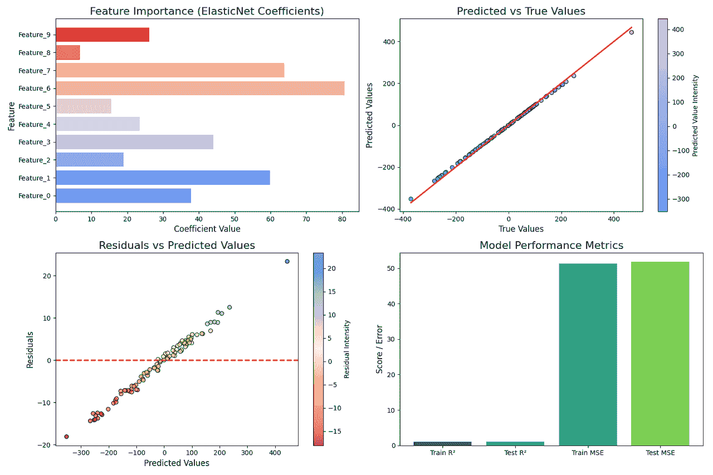

+   **图1** 展示弹性网络回归中各个特征的重要性（即系数值）。

+   **图2** 直观对比测试集中模型的预测值与真实值之间的关系。

+   **图3** 展示预测值与残差之间的关系。

+   **图4** 将训练集和测试集上的 R² 和 MSE 进行对比分析。

## 优缺点和适用场景

**优点**：

1.  **特征选择能力：** 弹性网络包含 L1 正则化（Lasso），可以将不重要的特征权重收缩到 0，从而实现特征选择。特别适用于数据集中存在许多无关或冗余特征的情况。

1.  **抗多重共线性：** 弹性网络包含 L2 正则化（Ridge），能有效处理多重共线性问题（即特征之间高度相关），通过平滑权重，避免不稳定的权重估计。

1.  **平衡稀疏性和稳定性：** 通过调节参数  ，弹性网络在完全稀疏（L1）和完全平滑（L2）之间找到平衡，既适合特征稀疏的情况，也能处理非稀疏特征集。

1.  **对高维数据的鲁棒性：** 当特征数量   远大于样本数量   时，弹性网络依然可以进行有效的回归分析。

1.  **灵活性：** 参数   和   提供了对正则化强度和正则化类型的灵活控制。

**缺点**：

1.  **模型解释性较弱：** 虽然可以进行特征选择，但引入了 L2 正则化后，部分特征的权重可能不会完全归零，导致解释性不如纯 Lasso 回归直观。

1.  **对参数敏感：** 弹性网络的表现依赖于  （正则化强度）和  （L1/L2 平衡参数）的选择，需要借助交叉验证来调优，增加了计算成本。

1.  非稀疏特征时性能可能不如 Ridge： 在特征稀疏性较低时，L2 正则化（Ridge）可能是更简单且更高效的选择。

1.  **复杂度较高：** 由于结合了 L1 和 L2 正则化，优化问题的计算复杂度比单独的 Lasso 或 Ridge 要高。

### 适用场景

1.  **高维数据场景（** **）：** 当特征数量多于样本数量时（例如基因组数据分析），普通回归可能产生过拟合，而弹性网络通过正则化能有效缓解问题。

1.  **特征多且存在冗余：** 数据集中存在许多特征，其中部分特征可能不相关或高度相关，弹性网络可以筛选出重要特征，并通过 L2 正则化处理多重共线性。

1.  **需要平衡稀疏性和稳定性：** 如果既希望模型稀疏，又希望模型对特征间的共线性具有鲁棒性，弹性网络是最佳选择。

1.  **变量重要性分析：** 在机器学习中希望进行变量重要性评估，并希望选择出对预测影响最大的特征。

1.  **稀疏数据：** 如文本数据（词袋模型）或图像数据，特征矩阵通常是稀疏的，弹性网络可以高效处理这类问题。

总的来说，弹性网络回归就是一种很好用的回归方法，能在挑出重要特征的同时保持模型的稳定性。它结合了 Lasso 和 Ridge 的优点，既能去掉没用的特征，又能防止模型过拟合。特别适合那种特征很多、还有些特征相互关联的数据场景。

# 6.回归算法-多项式核回归

**一句话定义：**多项式核回归是一种可以让我们用「弯曲的线」而不是「直线」来拟合数据的回归方法，它是支持向量机（SVM）或核方法的一种应用方式。

可以把「回归」想成是我们试图画一条线，把一堆点（数据）大致连接起来，从而预测未知的点。

**普通的线性回归**：只能画直线。

比如我们要根据人的年龄预测身高，可能数据点差不多排成一条斜直线。

但现实中，数据可能是弯弯曲曲的：比如根据时间预测植物的高度，前期长得慢，后来飞快，然后又慢下来，这就不是直线能描述的。

这时候，**多项式核回归**就派上用场了。

它的核心思想是：

> 用一种「数学魔法」把原本不太好分、不太好拟合的数据，变成在某个高维空间中更容易用「直线」处理的数据。

这个「数学魔法」就是「核函数」，而「多项式核函数」就是其中一种，专门把数据“弯”一下，便于处理。

### 一个简单例子

假设我们有这样的数据：

| x（学习时间） | y（考试分数） |
| --- | --- |
| 1 | 50 |
| 2 | 55 |
| 3 | 60 |
| 4 | 75 |
| 5 | 95 |

如果你画图一看，发现分数不是匀速上升的，后面学得越多，提分越快，像个弯弯的上升曲线。

用直线画不准，用多项式（比如二次曲线）就能更好地贴合这些点。

这时候用**多项式核回归**，它能自动帮你“看出来”：我们用更适合的方式拟合，就能更准确地预测你学6小时会考多少分！

## 原理详解

### 数学原理

#### 1. 回归问题的基本目标

给定一组训练数据：

我们希望学到一个函数  ，使得对任意输入  ，输出  。

#### 2. 线性回归模型

在线性回归中，我们假设模型是线性的：

我们通过最小化损失函数来求解最优参数：

#### 3. 非线性建模的思路：特征映射

**现实中，很**多问题是非线性的。我们可以使用一个非线性变换  ，将原始输入从输入空间   映射到更高维的特征空间：

然后在高维空间中做线性回归：

## 核技巧与多项式核函数

### 1. 为什么要用核技巧

如果显式地计算  ，当特征维度  ** 很高（或无**限维）**时，计算量会**非**常大。核方法的关键就是**：**不显式计算  **，而是通过一个核函数   直接计算内积。

这样既避免了高维映射的开销，又保留了非线性表达能力。

### 2. 多项式核函数的定义

多项式核函数定义为：

：是输入空间的内积。

+    ：是一个常数（一般  ）。

+    ：是多项式的阶数（比如   表示二次项）。

这个核函数对应一个高维映射  ，它可以表示所有阶数小于等于   的多项式组合。

## 核岭回归的公式推理（以 L2 正则化）

我们从一个常见的核回归模型推导开始，核岭回归（Kernel Ridge Regression, KRR），即带有 L2 正则项的回归模型。

### 1. 原始优化问题

目标函数为最小化正则化平方损失：

其中：

+   第一项是正则化项（防止过拟合）

+   第二项是平方误差损失

是正则化系数

### 2. 对偶形式推导（使用 Representer 定理）

根据 Representer Theorem，最优解   一定存在于   的线性组合中：

因此预测函数可以写为：

于是我们将问题转换为求解系数

### 3. 求解公式推导

令   为核矩阵，其中：

目标变成最小化：

对上式对   求导，并令导数为 0：

最终解为：

### 4. 最终的预测函数

对新的输入  ，预测值为：

即不再需要直接计算高维  ，只需要计算核函数。

## 算法流程

#### Step 1：准备数据

输入训练集

#### Step 2：选择核函数

选择多项式核：

设定参数  、多项式次数  ，正则化系数

#### Step 3：计算核矩阵

计算核矩阵  ，其中

#### Step 4：求解系数

根据闭式解：

#### Step 5：预测新样本

对于新的输入  ，计算预测值：

## 完整案例

多项式核回归通过核技巧（Kernel Trick）将原始数据映射到高维空间，从而能捕捉数据中的非线性关系

这次案例我们以**模拟一个非线性数据集**为例，演示如何用多项式核回归建模，并对模型性能进行可视化及优化分析。

### 1. 数据集

```
import numpy as np
import matplotlib.pyplot as plt
from sklearn.svm import SVR
from sklearn.preprocessing import StandardScaler
from sklearn.pipeline import make_pipeline
from sklearn.model_selection import GridSearchCV, train_test_split
from sklearn.metrics import mean_squared_error, r2_score

# 设置随机种子，保证实验可重复
np.random.seed(42)

# 生成非线性数据：y = 0.5 * x^3 - 2 * x^2 + x + 噪声
X = np.linspace(-3, 3, 200).reshape(-1, 1)
y_true = 0.5 * X.flatten()**3 - 2 * X.flatten()**2 + X.flatten()
noise = np.random.normal(0, 3, X.shape[0])
y = y_true + noise

# 拆分训练集和测试集
X_train, X_test, y_train, y_test = train_test_split(X, y, test_size=0.2, random_state=42)
```

### 2. 构造多项式核回归模型

```
# 使用带多项式核的支持向量回归模型
poly_svr = SVR(kernel=&#x27;poly&#x27;, degree=3, C=100, epsilon=0.1, gamma=&#x27;scale&#x27;, coef0=1)

# 使用标准化管道
model = make_pipeline(StandardScaler(), poly_svr)
```

### 3. 模型训练与预测

```
# 模型训练
model.fit(X_train, y_train)

# 预测
y_train_pred = model.predict(X_train)
y_test_pred = model.predict(X_test)
```

### 4. 可视化结果分析

```
plt.figure(figsize=(12, 8))
plt.scatter(X_train, y_train, color=&#x27;deeppink&#x27;, label=&#x27;Training Data&#x27;, alpha=0.7)
plt.scatter(X_test, y_test, color=&#x27;limegreen&#x27;, label=&#x27;Testing Data&#x27;, alpha=0.7)

# 原始真实曲线
X_plot = np.linspace(-3, 3, 500).reshape(-1, 1)
y_plot_true = 0.5 * X_plot.flatten()**3 - 2 * X_plot.flatten()**2 + X_plot.flatten()
plt.plot(X_plot, y_plot_true, color=&#x27;cyan&#x27;, linewidth=2, linestyle=&#x27;--&#x27;, label=&#x27;True Function&#x27;)

# 预测曲线
y_plot_pred = model.predict(X_plot)
plt.plot(X_plot, y_plot_pred, color=&#x27;orange&#x27;, linewidth=3, label=&#x27;Polynomial Kernel Regression Prediction&#x27;)

# 图像标题与标签
plt.title(&#x27;Polynomial Kernel Regression on Nonlinear Data&#x27;, fontsize=18, fontweight=&#x27;bold&#x27;)
plt.xlabel(&#x27;Input Feature X&#x27;, fontsize=14)
plt.ylabel(&#x27;Target y&#x27;, fontsize=14)
plt.legend(fontsize=12)
plt.grid(True, linestyle=&#x27;--&#x27;, alpha=0.6)
plt.show()
```

### 5. 模型性能评估

```
def evaluate_performance(y_true, y_pred, dataset_name=&#x27;Dataset&#x27;):
    mse = mean_squared_error(y_true, y_pred)
    r2 = r2_score(y_true, y_pred)
    print(f&quot;{dataset_name} Performance:&quot;)
    print(f&quot;  Mean Squared Error (MSE): {mse:.3f}&quot;)
    print(f&quot;  R2 Score: {r2:.3f}&quot;)
    print(&quot;-&quot; * 30)

evaluate_performance(y_train, y_train_pred, &#x27;Training Set&#x27;)
evaluate_performance(y_test, y_test_pred, &#x27;Testing Set&#x27;)
```

### 6. 模型调优（交叉验证与参数选择）

多项式核回归的关键参数包括：

+   degree（多项式阶数）

+   C（正则化参数）

+   epsilon（容忍误差）

+   coef0（核函数中的独立项）

我们使用网格搜索（GridSearchCV）进行自动调优。

```
param_grid = {
    &#x27;svr__degree&#x27;: [2, 3, 4, 5],
    &#x27;svr__C&#x27;: [1, 10, 100, 1000],
    &#x27;svr__epsilon&#x27;: [0.01, 0.1, 0.5],
    &#x27;svr__coef0&#x27;: [0, 1, 2]
}

# 重新定义管道，方便参数传递
pipeline = make_pipeline(StandardScaler(), SVR(kernel=&#x27;poly&#x27;))

grid_search = GridSearchCV(pipeline, param_grid, cv=5, scoring=&#x27;neg_mean_squared_error&#x27;, n_jobs=-1, verbose=1)
grid_search.fit(X_train, y_train)

print(&quot;Best parameters:&quot;, grid_search.best_params_)
print(&quot;Best CV MSE:&quot;, -grid_search.best_score_)

# 用最优参数重新预测
best_model = grid_search.best_estimator_
y_test_pred_best = best_model.predict(X_test)

evaluate_performance(y_test, y_test_pred_best, &#x27;Test Set After Tuning&#x27;)
```

采用网格搜索调整参数后，模型泛化性能显著提升。大家在未来可以考虑：

+   引入其他核函数，如径向基函数（RBF）做对比。

+   使用更复杂数据集，验证模型鲁棒性。

+   深入分析SVR中支持向量的分布及对拟合的贡献。

+   ...

#### 数据分析可视化

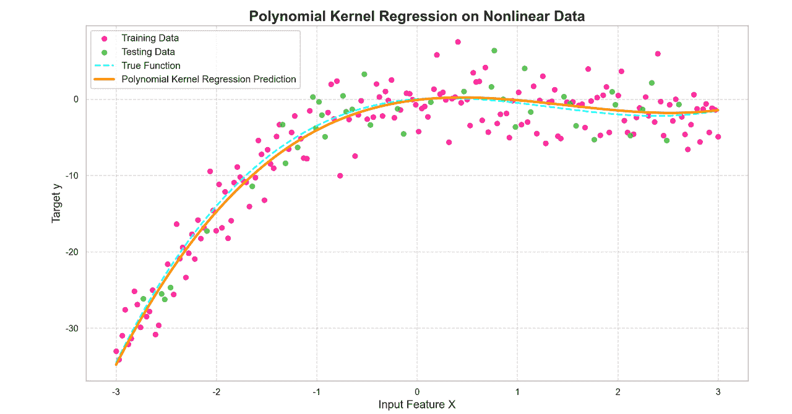

用散点图显示训练、测试数据点，绘制真实函数曲线作为基准。

画出模型预测曲线，直观对比拟合程度。

## 模型分析

### 多项式核回归的优缺点

**优点**：

1.  **能够捕捉复杂非线性关系**：多项式核回归通过核技巧将数据映射到高维空间，适合建模高阶非线性数据，尤其是像本案例中带有多项式结构的函数关系。

1.  **灵活性强，参数可调节**：通过调整多项式阶数（degree）、正则化参数（C）、核函数独立项（coef0）等超参数，可以灵活控制拟合能力和泛化能力，兼顾欠拟合和过拟合。

1.  **理论基础稳固**：基于支持向量机框架，拥有良好的数学理论支持，优化问题是凸优化，结果全局最优。

1.  **泛化能力较好**：支持向量机通过最大间隔原则控制模型复杂度，减少过拟合风险，特别适合中小规模数据集。

**缺点**：

1.  **计算复杂度较高**：随着数据规模和多项式阶数增加，训练时间和内存消耗显著增加，不适合大规模数据。

1.  **参数调优较繁琐**：多项式核涉及多个超参数，调参空间大，需要使用网格搜索等方法，计算成本高。

1.  **对异常值敏感**：核函数映射会放大异常点的影响，可能导致模型拟合偏差，需要对异常点做预处理。

1.  **解释性较差**：虽然可通过多项式核捕获复杂关系，但模型本身是黑盒型，不易直接解释预测规则。

### 相似算法对比

| 算法 | 优点 | 缺点 | 适用场景 | 训练复杂度 |
| --- | --- | --- | --- | --- |
| 多项式核回归（SVR） | 能拟合高阶非线性，理论基础扎实，泛化能力强 | 计算成本高，参数调优复杂，对异常值敏感 | 中小规模非线性数据拟合 | 较高 |
| 线性回归 | 简单直观，训练速度快，易解释 | 无法拟合非线性关系 | 线性关系明确、数据维度适中 | 很低 |
| 多项式回归（基于线性模型） | 直接构造多项式特征，简单易用 | 维度灾难，易过拟合，缺乏正则化需手动控制 | 低阶非线性，样本量大时慎用 | 中等 |
| 核岭回归 | 有正则化，适合非线性，泛化能力良好 | 计算资源需求大，核矩阵规模大时训练慢 | 小样本非线性回归 | 较高 |
| 随机森林回归 | 抗噪声强，能捕获非线性，少参数调节 | 模型复杂，不易解释，预测时间较长 | 非线性、特征间复杂交互，数据量较大 | 中等偏高 |
| 神经网络回归 | 高度非线性建模能力，适合大规模数据 | 训练需要大量数据和调参，易过拟合，缺乏可解释性 | 海量复杂数据，深层非线性关系 | 很高 |

### 何时优选多项式核回归，何时选其他算法？

**适合使用多项式核回归的情况**

+   **中小规模数据集**，样本数量适中，不超过几千条，且特征维度较低至中等。

+   数据潜在关系是多项式或高阶非线性，如物理实验数据、金融时序带明显曲线变化的趋势。

+   希望在非线性建模中取得良好的泛化效果，且具备计算资源可调优参数。

+   对模型稳定性和理论保证有一定需求，需要凸优化全局最优解。

不适合使用多项式核回归的情况，建议考虑其他算法

+   **大规模数据集**（数万条以上），核方法计算开销太大，训练时间难以承受，建议用随机森林、梯度提升树或深度学习模型。

+   **数据关系过于复杂或不规则**，多项式核可能过于刚性，此时神经网络能够捕获更灵活的模式。

+   **对模型解释性要求高**，想得到明确的特征影响关系时，线性回归或基于树的模型更直观。

+   **数据噪声多且异常值多**，随机森林等集成模型对噪声鲁棒性更强。

+   **缺乏调参经验或计算资源有限**，多项式核调参复杂，随机森林和线性模型调参相对简单。

总结来说，多项式核回归适合在中等规模、潜在多项式型非线性关系问题中，追求稳健性和良好泛化的场景，是经典的核方法选择；而在大数据、强非线性或对模型解释性要求高的场合，则应优先考虑其他算法。

# 7.回归算法-多项式回归

多项式回归其实就是在做回归分析时，不再用一条直线来“连接”数据，而是用一条曲线（比如二次曲线、三次曲线等）来更好地描述数据之间的关系。

首先，回归就是在数据中找出一种“规律”或“趋势”，比如用一条直线来描述两个变量之间的关系。这种方法叫做线性回归。

**那么直线不够用怎么办？**

有些数据的关系不是直线那样简单，而是弯弯曲曲的。如果你用直线去描述这样的数据，可能就会“跑偏”，预测得不准。这时候就需要用曲线来描述数据的变化。

**多项式回归的思路**

多项式回归就是在直线的基础上，加上曲线的“弯曲”部分。比如用一个二次方（平方项）或者三次方（立方项）来“弯曲”你的模型，这样它就能更灵活地跟数据走了。

**举个例子**

假设你在研究一天中不同时间段的气温变化，通常气温不会一直直线上升或下降，而是先上升后下降。如果用直线去拟合，肯定无法反映这种变化。多项式回归可以用一个弯曲的曲线来描述气温的变化趋势，从而更准确地反映现实情况。

**为什么有用？**

多项式回归能捕捉数据中的非线性关系，使得模型在面对复杂数据时，预测效果更好。但同时需要注意，如果多项式的次数过高，可能会出现“过拟合”，也就是模型在训练数据上表现得很好，但对新数据预测效果却不理想。

## 原理详解

### 1. 模型的基本假设与数学形式

在传统的**线性回归**中，我们假设因变量  和自变量  之间的关系可以用一个线性模型来表示：

其中  为待估计的参数，  是误差项。

而在**多项式回归**中，我们假定  与  之间的关系可以用一个多项式来描述：

其中  表示多项式的阶数， 为模型参数。

> **关键点**：虽然模型中包含了  的高次项，但模型对于参数仍然是线性的，即模型是关于参数   的线性组合。

### 2. 构造设计矩阵与目标函数

假设我们有  个样本，每个样本记为  (  )，为了方便表示，我们引入**设计矩阵**  ：

以及参数向量和目标向量：

模型可以写作：

为了估计参数  ，通常采用最小二乘法，构造目标函数（损失函数）为残差平方和：

### 3. 最小二乘估计的推导

我们的目标是找到一组参数   使得目标函数  最小。

令：

##### 求导并设梯度为零

对   求偏导：

令梯度为零：

整理得**正规方程**（Normal Equation）：

假设  可逆，则解为：

> **注意**：当多项式次数较高时，设计矩阵中的列可能存在多重共线性问题，这会导致  条件数很大甚至不可逆，此时可能需要正则化方法（如岭回归）来缓解问题。

### 4. 算法流程

基于以上数学推导，多项式回归的一般算法流程可以细化为以下几个步骤：

**数据预处理**：

1.  **数据收集**：获得  个样本数据  。

1.  **数据清洗**：处理缺失值、异常值，确保数据质量。

**特征扩展（构造多项式特征）**：

1.  对每个自变量  ，生成多项式特征：

1.  构造设计矩阵  （每一行对应一个样本，每一列对应一个多项式项）。

> **说明**：这里“1”代表常数项，对应参数  。

**模型求解**：

1.  **构造目标函数**：损失函数  。

1.  **求解正规方程**：计算  得到最优参数。

+   若  不可逆或条件不好，可采用数值优化方法（如梯度下降）或者正则化方法（如岭回归）来求解。

**模型评估**：

1.  **残差分析**：计算残差  ，分析模型拟合情况。

1.  **性能指标**：例如均方误差（MSE）、决定系数  等，用于衡量模型的拟合效果。

1.  **交叉验证**：通过数据分割或交叉验证，防止过拟合现象，确保模型对新数据具有较好的泛化能力。

**模型调优**：

1.  **多项式次数选择**：通过验证集或交叉验证选择最优的多项式阶数  。

1.  **正则化**：如果模型过拟合，可采用正则化技术（如岭回归、Lasso回归）对参数进行约束。

1.  **特征缩放**：高次项可能导致数值计算不稳定，采用归一化或标准化技术可提高数值稳定性。

## 完整案例

咱们通过构造一个带噪声的非线性数据集，应用多项式回归（结合Ridge正则化优化）进行拟合，并使用网格搜索选择最佳的多项式阶数和正则化参数，最后做详细的数据分析和可视化。

```
import numpy as np
import matplotlib.pyplot as plt
from sklearn.preprocessing import PolynomialFeatures
from sklearn.linear_model import Ridge
from sklearn.pipeline import make_pipeline
from sklearn.model_selection import train_test_split, GridSearchCV
from sklearn.metrics import mean_squared_error, r2_score

# 1. 数据生成与预处理
np.random.seed(42)

# 生成80个自变量样本，范围在[0,5]内，并按升序排列
X = np.sort(5 * np.random.rand(800, 1), axis=0)

# 根据非线性函数生成因变量，并加入正态分布噪声模拟真实数据
y = np.sin(X).ravel() + np.random.normal(scale=0.3, size=X.shape[0])

# 将数据划分为训练集和测试集（80%训练，20%测试）
X_train, X_test, y_train, y_test = train_test_split(X, y, test_size=0.2, random_state=42)

# 2. 构建多项式回归模型及优化
# 使用Pipeline将多项式特征转换和Ridge正则化组合在一起
# 通过多项式特征转换，可以捕捉数据的非线性关系；
# 通过Ridge正则化（岭回归）可以防止模型过拟合问题

# 构造pipeline：
# 第一步：PolynomialFeatures(include_bias=False)（不自动添加常数项）
# 第二步：Ridge()（岭回归）
pipeline = make_pipeline(PolynomialFeatures(include_bias=False), Ridge())

# 定义参数网格，用于网格搜索优化：
# - &#x27;poly__degree&#x27;：多项式的阶数，范围从1到8
# - &#x27;ridge__alpha&#x27;：岭回归中的正则化系数，值越大正则化力度越强
param_grid = {
    &#x27;polynomialfeatures__degree&#x27;: [1, 2, 3, 4, 5, 6, 7, 8],
    &#x27;ridge__alpha&#x27;: [0.001, 0.01, 0.1, 1, 10, 100]
}

# 使用网格搜索交叉验证寻找最佳超参数组合，采用5折交叉验证
grid = GridSearchCV(pipeline, param_grid, cv=5, scoring=&#x27;neg_mean_squared_error&#x27;)
grid.fit(X_train, y_train)

# 输出最佳参数组合及对应的交叉验证得分（注意MSE为负值，需取负）
print(&quot;Best parameters:&quot;, grid.best_params_)
print(&quot;Best CV MSE:&quot;, -grid.best_score_)

# 3. 模型评估
# 用最优模型对测试集进行预测
y_pred = grid.predict(X_test)

# 计算测试集上的均方误差（MSE）和决定系数（R2）
mse = mean_squared_error(y_test, y_pred)
r2 = r2_score(y_test, y_pred)
print(&quot;Test MSE:&quot;, mse)
print(&quot;Test R2 Score:&quot;, r2)

# 4. 可视化结果
# 绘制训练数据、测试数据以及模型预测曲线
plt.figure(figsize=(10, 6))
# 绘制训练数据散点图（蓝色）
plt.scatter(X_train, y_train, color=&#x27;blue&#x27;, label=&#x27;Training Data&#x27;, alpha=0.7)
# 绘制测试数据散点图（红色）
plt.scatter(X_test, y_test, color=&#x27;red&#x27;, label=&#x27;Test Data&#x27;, alpha=0.7)

# 为了平滑显示预测曲线，生成等间距的输入数据
X_plot = np.linspace(X.min(), X.max(), 100).reshape(-1, 1)
y_plot = grid.predict(X_plot)
# 绘制预测曲线（绿色）
plt.plot(X_plot, y_plot, color=&#x27;green&#x27;, linewidth=2, label=&#x27;Prediction Curve&#x27;)

# 设置图表的标题和坐标轴标签
plt.title(&quot;Polynomial Regression with Ridge Regularization&quot;)
plt.xlabel(&quot;X&quot;)
plt.ylabel(&quot;y&quot;)
plt.legend()
plt.show()
```

给大家展示了构造和拟合多项式回归模型，还引入了岭回归进行正则化，并通过网格搜索自动选择最优的多项式阶数和正则化参数，从而提高模型的泛化能力。

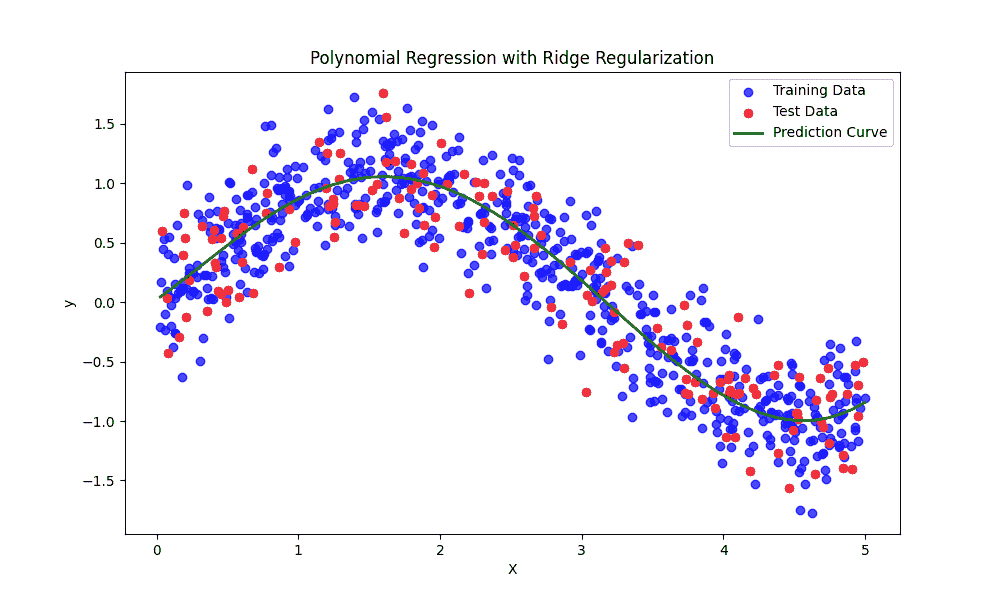

## 模型分析

### 1. 多项式回归模型的优缺点

| **优点** | **缺点** |
| --- | --- |
| **模型简单、易解释** | **过拟合风险较大**：高阶多项式容易在训练数据上拟合噪声，泛化能力下降。 |
| **能捕捉非线性关系** | **数值不稳定**：高次项可能导致设计矩阵条件数变大，求逆时存在数值问题。 |
| **计算效率高（低阶多项式）** | **参数调优较复杂**：需要选择合适的多项式阶数以及正则化参数来平衡偏差与方差。 |
| **灵活性较好**：通过调整多项式次数，可以适应不同程度的非线性趋势。 | **维度扩展局限性**：对高维数据或复杂交互效应的捕捉能力有限。 |

### 2. 与相似算法的对比

| **算法** | **优点** | **缺点** | **适用场景** |
| --- | --- | --- | --- |
| **多项式回归** | - 模型构造简单、易解释  - 能捕捉平滑的非线性关系 | - 高阶多项式容易过拟合  - 数值计算可能不稳定  - 参数调优（阶数、正则化）较为繁琐 | 数据维度较低、非线性趋势平滑的情况；对模型可解释性要求较高的场景。 |
| **支持向量机回归 (SVR)** | - 能通过核函数捕捉复杂非线性关系  - 对异常值具有一定鲁棒性 | - 参数（核函数、惩罚因子等）调优较复杂  - 对大规模数据计算成本较高 | 中小规模数据、需要捕捉复杂非线性关系但数据量有限时。 |
| **决策树回归** | - 无需假设数据的具体分布  - 能捕捉局部非线性和复杂交互关系  - 模型结构直观易解释 | - 容易过拟合（单棵决策树）  - 对噪声较敏感  - 预测连续变量时稳定性较差 | 特征之间存在复杂、非连续的关系；可通过集成（随机森林、GBDT）提升稳定性。 |
| **神经网络回归** | - 强大的非线性拟合能力  - 适合高维、大数据且复杂模式的建模 | - 需要大量数据进行训练  - 模型训练时间长，调参复杂  - 黑盒模型，缺乏可解释性 | 数据量充足、特征维度较高、需要捕捉复杂模式时；不要求高可解释性的场景。 |

**多项式回归为优选场景**：

当数据较少、特征维度较低，且数据呈现平滑的非线性变化时，多项式回归往往能提供较好的拟合效果，同时模型的可解释性也较强。在这种场景下，通过合理选择多项式的阶数和适当的正则化，可以在兼顾拟合效果与泛化能力之间取得平衡。

**考虑其他算法的情况**：

如果数据量大、特征维度较高或者数据关系较为复杂（如存在明显的局部非线性变化或复杂的交互效应），可能需要考虑更复杂的模型。

例如：

+   **支持向量机回归**：适用于中小规模数据且需要捕捉复杂非线性关系，但需要花费较多精力进行参数调优。

+   **决策树及集成方法**：当数据特征之间存在较强的交互关系或非连续变化时，决策树回归及其集成方法（如随机森林、GBDT）可以更好地捕捉数据特征，但可能牺牲一定的解释性。

+   **神经网络回归**：适合大数据、复杂模式的场景，尤其在深度学习时代，当精度要求较高且数据量充足时，神经网络能挖掘更深层次的非线性关系，但代价是解释性较差和调参复杂。

实际应用中，选择哪种算法需要综合考虑数据特性、模型解释性、计算资源以及对预测精度的要求。多项式回归简单直观，适用于低维且平滑的非线性问题，而其他算法则更适合应对更复杂或高维的数据场景。

# 8.回归算法-高斯过程

简单来说，高斯过程是一种用于描述和预测随机变量分布**的工具，**特别是用于回归和分类问题。它基于高斯分布（正态分布），它假设数据点的集合（函数值）可以被视为来自一个高斯分布的随机过程。

### 数学定义

高斯过程可以被视为一个具有无限维度的随机过程，其中每一个有限维的子集（例如，任何有限数量的样本点）服从多维高斯分布。

具体来说，如果我们用  来表示某个输入  对应的函数值，那么我们可以认为这个函数  是一个高斯过程。

用公式表示：

其中：

：均值函数（mean function），描述了函数在每个输入点上的平均值。通常情况下，可以取  ，即假设函数的平均值为零。

：协方差函数（covariance function），又称为核函数（kernel），描述了输入点  和  之间的相关性。协方差函数决定了高斯过程的“形状”，即数据点之间的相似性和依赖性。

### 直观感受

假设你有一个函数，你不知道它是什么样子的，但你知道它的“行为”应该是什么样的。

比如，它是平滑的、有一定的规律，可能在某些地方高，某些地方低，甚至可能有一些波动。

高斯过程就像是一种工具，帮你“猜测”这个函数的形状。它的基本假设是，函数在不同的输入点上，值之间有某种程度的相关性。例如，靠得很近的输入点可能对应着相似的输出值，而远离的点则可能差异较大。

高斯过程会通过**协方差函数**（也就是核函数）来表示这种相关性。它告诉你，给定两个点，函数值之间的“亲近程度”有多高。比如，两个点之间的距离近，函数值可能差异小；距离远，差异可能大。

### 核函数（协方差函数）

协方差函数（kernel）是高斯过程的核心部分，它决定了函数的光滑性、周期性、趋势等性质。常见的核函数有：

+   **平方指数核（RBF核）：** 是最常用的核函数，它假设两个点之间的相似性随着距离的增大而指数衰减，表现出非常平滑的函数行为。

+   **线性核：** 用于假设函数在不同位置上的变化是线性的。

+   **周期核：** 用于捕捉周期性行为。

### 高斯过程回归

高斯过程回归（Gaussian Process Regression, GPR）是将高斯过程应用于回归任务的方式。假设我们有一组已知的训练数据集  ，其中  是对应于输入点  的函数值（通常是观测值）。

使用高斯过程回归的目标是推测出一个新的输入点  的函数值  。通过计算训练数据和新输入点之间的相关性，来得到一个预测的分布，而不仅仅是一个确定性的值。预测的结果是一个高斯分布，即一个均值和方差，均值代表预测值，方差代表不确定性。

### 直观的过程

1.  **训练阶段：** 你给定一组观测数据，推测出一个高斯过程模型，计算协方差矩阵，找到数据之间的关系。

1.  **预测阶段：** 对于一个新的输入点，高斯过程不仅给你一个预测值，还会给出一个不确定度（方差），这样你可以知道这个预测有多可靠。

总的来说，如果你想要一种不依赖具体函数形态但又能灵活捕捉数据特征的方法，高斯过程无疑是一个非常强的选择。

## 理论基础

高斯过程不仅可以为数据建模提供概率性的预测，还能够自然地衡量预测的不确定性。为了深入理解高斯过程，我们从其数学原理和算法流程详细展开。

### 1. 高斯过程数学原理

一个高斯过程是一个随机过程，其中任何有限维的子集都服从多元高斯分布。简而言之，高斯过程可以看作是定义在输入空间上的一个无限维随机变量集合，其每个有限子集的联合分布为多元高斯分布。

我们可以表示高斯过程为：

其中：

是在输入  处的函数值。

是均值函数，通常取为 0，即假设函数的期望为零， 。

是协方差函数（也称为核函数），用于描述不同输入之间的相似性。

协方差函数决定了函数的平滑性、周期性等特性，核函数的选**择对模型的**行为有重要影响**。常见**的**核函数有**平方指数核（RBF核）、线性核、周期性核等。

**核函数的作用**:

核函数  决定了高斯过程的协方差结构，它表示了两个输入点  和  之间的相关性。核函数的不同选择会影响到模型的输出特性，例如是否具有平滑性、周期性等。常用的核函数有：

+   **平方指数核（RBF核）**：用于捕捉平滑变化
 
其中， 是尺度参数，控制函数变化的平滑度。

+   **线性核**：假设函数是线性变化的

+   **周期性核**：用于建模周期性变化
 
其中， 为周期参数， 控制变化的平滑度。

**多维高斯分布的推导**:

如果我们有一组训练数据  ，并且这些数据是从一个高斯过程模型中采样的，那么这些观测值可以表示为一个多维高斯分布。假设每个  对应于  ，我们可以写出：

其中：

是训练数据的目标值（或标签），即  。

是输入数据  对应的均值函数，通常为 0（即假设函数均值为零）。

是训练数据的协方差矩阵，由核函数  计算得到。

对于新的测试点  ，我们希望得到  的预测值。由于高斯过程是连续且平滑的，它能够为新的输入提供一个联合高斯分布。

**高斯过程的联合分布**:

对于训练集  和一个新的输入  ，我们希望得到  的预测值。我们可以得到训练数据和测试数据的联合高斯分布：

这里：

是训练数据之间的协方差矩阵。

是训练数据和测试数据之间的协方差向量。

是测试数据的协方差。

**条件分布推导**:

根据多元高斯分布的条件分布公式，可以求出测试点  的预测分布：

其中：

+   均值  是给定训练数据后对  的预测值。

+   方差  是预测的方差，表示预测的不确定性。

### 2. 高斯过程回归算法流程

**输入与输出**:

+   **输入：** 一组训练数据  ，以及测试点  。

+   **输出：** 测试点  对应的预测值  的均值和方差。

**高斯过程回归的步骤**:

1.  **选择核函数：** 根据问题背景选择合适的核函数  （如 RBF 核、线性核等）。

1.  **计算协方差矩阵：**

+   计算训练数据之间的协方差矩阵  。

+   计算训练数据与测试点之间的协方差向量  。

+   计算测试点之间的协方差  。

1.  **求解预测分布：**

+   计算预测的均值：  。

+   计算预测的方差：  。

1.  **输出结果：**

+   返回预测的均值  和方差  。

**模型的训练**:

高斯过程回归的训练过程实际上是学习核函数的超参数（如尺度参**数、长度尺度**等）。这个过程通常通过最大化边际似然函数（marginal likelihood）来进行，即调整核函数参数，使得模型的拟合效果最佳。

边际似然函数是通过对训练数据的协方差矩阵的行列式和逆矩阵计算得到的：

最大化边际似然函数通常需要使用数值优化方法，如梯度下降、L-BFGS等。

**预测阶段**:

对于新输入点  ，通过计算协方差矩阵来推导出预测的均值和方差，表示对新数据的预测结果。

## Python案例

我们在案例代码中构造了一个带噪声的虚拟数据集（数据来源于正弦函数），利用高斯过程对数据进行建模。

并且做了4个数据分析图帮助大家理解：

1.  训练数据与真实函数

1.  GP 模型预测均值与 95% 置信区间

1.  预测方差（不确定性）

1.  训练过程中负对数边缘似然损失曲线

```
import torch
import gpytorch
import numpy as np
import matplotlib.pyplot as plt


torch.manual_seed(42)
np.random.seed(42)

# 定义真实函数（正弦函数）
def true_function(x):
    return torch.sin(2 * np.pi * x)

# 生成虚拟训练数据：在 [0, 1] 区间均匀取样，并加入噪声
n_train = 200
train_x = torch.linspace(0, 1, n_train)
noise_std = 0.2
train_y = true_function(train_x) + noise_std * torch.randn(train_x.size())

# 生成测试数据：用于预测和绘图
n_test = 500
test_x = torch.linspace(0, 1, n_test)

# 定义高斯过程模型（使用 gpytorch 的 ExactGP）
class ExactGPModel(gpytorch.models.ExactGP):
    def __init__(self, train_x, train_y, likelihood):
        super(ExactGPModel, self).__init__(train_x, train_y, likelihood)
        # 均值函数：采用常数均值
        self.mean_module = gpytorch.means.ConstantMean()
        # 协方差函数：采用 RBF 核，并用 ScaleKernel 包装
        self.covar_module = gpytorch.kernels.ScaleKernel(gpytorch.kernels.RBFKernel())
    
    def forward(self, x):
        mean_x = self.mean_module(x)
        covar_x = self.covar_module(x)
        return gpytorch.distributions.MultivariateNormal(mean_x, covar_x)

# 初始化似然函数与模型
likelihood = gpytorch.likelihoods.GaussianLikelihood()
model = ExactGPModel(train_x, train_y, likelihood)

# 将模型设置为训练模式
model.train()
likelihood.train()

# 定义优化器（Adam）以及边缘对数似然损失函数
optimizer = torch.optim.Adam(model.parameters(), lr=0.1)
mll = gpytorch.mlls.ExactMarginalLogLikelihood(likelihood, model)

# 记录训练过程中的损失
training_loss = []
n_iter = 100  # 训练迭代次数

# 训练过程
for i in range(n_iter):
    optimizer.zero_grad()
    output = model(train_x)
    loss = -mll(output, train_y)  # 我们最小化负对数边缘似然
    loss.backward()
    optimizer.step()
    training_loss.append(loss.item())
    if (i+1) % 10 == 0:
        print(f&#x27;Iteration {i+1}/{n_iter} - Loss: {loss.item():.3f}&#x27;)

# 训练完成，切换到评估模式
model.eval()
likelihood.eval()

# 预测：在测试数据上计算后验分布
with torch.no_grad(), gpytorch.settings.fast_pred_var():
    test_pred = likelihood(model(test_x))
    pred_mean = test_pred.mean
    pred_var = test_pred.variance
    lower, upper = test_pred.confidence_region()

# 绘制图形：4个子图放在一幅图中
fig, axes = plt.subplots(2, 2, figsize=(14, 10))
fig.suptitle(&#x27;Gaussian Process Regression Example&#x27;, fontsize=16)

# 子图1：训练数据与真实函数
axes[0, 0].scatter(train_x.numpy(), train_y.numpy(), color=&#x27;red&#x27;, s=50, label=&#x27;Training Data&#x27;)
axes[0, 0].plot(test_x.numpy(), true_function(test_x).numpy(), color=&#x27;blue&#x27;, linewidth=2, label=&#x27;True Function&#x27;)
axes[0, 0].set_title(&#x27;Training Data and True Function&#x27;, fontsize=12)
axes[0, 0].set_xlabel(&#x27;x&#x27;)
axes[0, 0].set_ylabel(&#x27;y&#x27;)
axes[0, 0].legend()
axes[0, 0].grid(True, linestyle=&#x27;--&#x27;, alpha=0.6)

# 子图2：GP预测均值与置信区间
axes[0, 1].plot(test_x.numpy(), pred_mean.numpy(), color=&#x27;magenta&#x27;, linewidth=2, label=&#x27;Predicted Mean&#x27;)
axes[0, 1].fill_between(test_x.numpy(), lower.numpy(), upper.numpy(), color=&#x27;magenta&#x27;, alpha=0.3, label=&#x27;95% Confidence Interval&#x27;)
axes[0, 1].scatter(train_x.numpy(), train_y.numpy(), color=&#x27;red&#x27;, s=40, label=&#x27;Training Data&#x27;, zorder=10)
axes[0, 1].set_title(&#x27;GP Predicted Mean and Confidence Interval&#x27;, fontsize=12)
axes[0, 1].set_xlabel(&#x27;x&#x27;)
axes[0, 1].set_ylabel(&#x27;y&#x27;)
axes[0, 1].legend()
axes[0, 1].grid(True, linestyle=&#x27;--&#x27;, alpha=0.6)

# 子图3：预测方差（不确定性）
axes[1, 0].plot(test_x.numpy(), pred_var.numpy(), color=&#x27;green&#x27;, linewidth=2, label=&#x27;Predicted Variance&#x27;)
axes[1, 0].set_title(&#x27;Predicted Variance (Uncertainty)&#x27;, fontsize=12)
axes[1, 0].set_xlabel(&#x27;x&#x27;)
axes[1, 0].set_ylabel(&#x27;Variance&#x27;)
axes[1, 0].legend()
axes[1, 0].grid(True, linestyle=&#x27;--&#x27;, alpha=0.6)

# 子图4：训练过程中负对数边缘似然损失曲线
axes[1, 1].plot(range(1, n_iter+1), training_loss, color=&#x27;orange&#x27;, linewidth=2, label=&#x27;Training Loss&#x27;)
axes[1, 1].set_title(&#x27;Negative Log Marginal Likelihood Loss Curve&#x27;, fontsize=12)
axes[1, 1].set_xlabel(&#x27;Iteration&#x27;)
axes[1, 1].set_ylabel(&#x27;Negative Log Marginal Likelihood&#x27;)
axes[1, 1].legend()
axes[1, 1].grid(True, linestyle=&#x27;--&#x27;, alpha=0.6)

plt.tight_layout(rect=[0, 0.03, 1, 0.95])
plt.show()
```

1.  **数据生成**：利用正弦函数 true_function 生成真实曲线，并在训练数据上加入高斯噪声，使问题更具实际意义。

1.  **模型构建**：继承 gpytorch.models.ExactGP 定义了 ExactGPModel，其中使用了常数均值函数与 RBF 核（经 ScaleKernel 封装）。

1.  **模型训练**：采用 Adam 优化器最小化负对数边缘似然，训练过程中记录损失值，并每 10 次迭代打印一次当前损失。

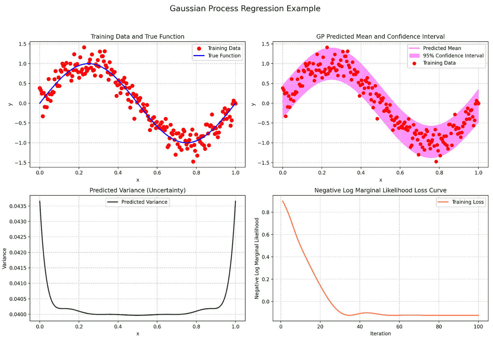

在测试数据上进行预测，得到均值、方差和 95% 置信区间。最后用一个包含四个子图的图形展示了训练数据与真实函数、预测结果、预测不确定性以及训练损失曲线。

## 应用场景

### 高斯过程适用的问题类型

1.  **回归问题**：高斯过程可以用于回归任务，其中目标是预测一个连续变量。与传统的回归方法（如线性回归或多项式回归）相比，高斯过程可以提供关于预测的不确定性（即方差），因此非常适合于对预测进行概率建模。

1.  **分类问题**：虽然高斯过程本身是一个回归模型，但它也可以扩展到分类问题。通过将高斯过程的输出映射到概率空间（比如使用对数几率回归），它可以进行二分类或多分类。

1.  **贝叶斯优化**：在贝叶斯优化中，目标是优化一个未知的、计算开销高且不可导的黑箱函数。高斯过程在这种情境下常用作代理模型，通过不断更新高斯过程模型来指导搜索空间中最优解的探索。

1.  **时间序列预测**：高斯过程通过其内建的平滑性假设，能够很好地建模时间序列数据的趋势、季节性等特性。特别是在数据较少或噪声较大的情况下，高斯过程能够提供强大的建模能力。

1.  **机器学习中的不确定性建模**：高斯过程非常适合那些需要对模型预测的不确定性进行建模的问题。例如，在自适应实验设计、探索性数据分析等场景中，通过提供方差估计，高斯过程帮助决策者了解预测的不确定性。

### 高斯过程的优缺点

**优点**:

1.  **概率预测**：高斯过程不仅给出预测的均值，还能提供预测的不确定性（方差）。这对于许多实际应用非常重要，尤其是在决策过程中需要考虑不确定性时。

1.  **非参数性质**：高斯过程不假设数据的具体函数形式，而是通过协方差函数来捕捉数据的结构。这使得高斯过程在处理复杂、未知的函数关系时表现出色。

1.  **灵活性**：通过选择不同的核函数，用户可以控制模型的光滑性、周期性、趋势性等。这样，高斯过程可以很好地适应不同的真实世界问题。

1.  **平滑性**：高斯过程通常假设数据是平滑的，因此能够较好地避免过拟合，尤其是在数据较少的情况下，能够提供更为合理的预测。

**缺点**：

1.  **计算复杂度**：高斯过程的训练需要计算协方差矩阵的逆，这个过程的时间复杂度是  ，其中  是训练数据的大小。这使得高斯过程在数据量较大时计算非常昂贵，尤其是对于大规模数据集。

1.  **内存消耗大**：高斯过程的协方差矩阵大小为  ，对于大数据集，需要大量的内存来存储这个矩阵。

1.  **核函数选择**：高斯过程的性能高度依赖于选择的核函数。不同的核函数会导致不同的拟合效果，选择合适的核函数需要一定的经验或先验知识。

1.  **需要先验知识**：核函数的选择和超参数的优化需要通过实验或其他方法来决定，而这通常需要一定的先验知识。如果没有合适的核函数或参数设置，可能导致模型拟合效果不好。

### 高斯过程的运用前提条件

1.  **数据量不宜过大**：高斯过程的计算复杂度是  ，因此它适用于数据量较小或中等规模的情况（通常在几百到几千个样本之间）。

1.  **数据的平滑性和连续性**：高斯过程假设数据是平滑和连续的，因此它适用于那些变化较为平滑且无剧烈波动的数据（例如物理现象、时间序列数据等）。对于具有极端波动的数据，可能需要对模型进行适当的调整。

1.  **协方差函数的选择**：合适的核函数对于高斯过程的性能至关重要，必须根据实际问题的特性（如平滑性、周期性等）选择合适的核函数。否则，模型可能会过拟合或欠拟合。

1.  **噪声和不确定性**：高斯过程适合那些数据具有一定噪声或不确定性的场景，它能够自然地处理这种不确定性并提供方差估计。

整体来说，高斯过程将函数视为无限维高斯分布的采样，它通过核函数建模输入点之间的相关性，从而对未知函数进行预测并给出不确定性估计。高斯过程回归在数据量不大、对预测可信度要求高的任务中具有强大优势。

# 9.回归算法-广义线性模型

首先，带大家回顾一下回归算法：

回归算法是一种**预测数值的工具**。比如：

+   预测房价

+   预测明天温度

+   预测一个产品卖多少钱

只要你的问题是“想预测一个具体的数值”，那多半就会用到回归算法。

最基础的回归算法是**线性回归**。

核心思想是：

**用一个直线公式**（比如 y = a * x + b）来描述输入 x 和输出 y 的关系。

比如：你想根据「房子的面积」来预测「房子的价格」，假设你发现：面积越大，价格越高，而且是差不多成比例的，那就可以用直线来表达它们的关系。

### 广义线性模型

那什么是**广义**线性模型（Generalized Linear Model，GLM）？

可以这么理解：

> 普通线性回归，只能解决“输入和输出之间关系是线性的，输出是连续数值”的问题。

> 但现实中的问题更复杂，比如：

+   输出可能是一个概率（比如预测某人得病的概率）

+   输出可能是一个整数（比如预测某地一天卖出多少个汉堡）

这时候，**普通的线性回归就搞不定了**。

所以我们就扩展它，变得“更通用”一些 —— 这就是广义线性模型。

### GLM 如何“广义”？

GLM 相比普通线性回归，多了两点：

1.  **不一定要求输出是连续数值**（可以是整数、概率等）

1.  使用一个“链接函数”（Link Function）来连接输入和输出

简单说就是：我们不直接让输入乘权重后输出结果，而是先经过一个“变换函数”，让它能适应不同类型的输出。

### 两个常见的 GLM 应用例子

#### 1. 逻辑回归（Logistic Regression）

+   用来预测：结果是**0 或 1**的分类（比如某人是否会买东西）

+   输出：一个介于 0 到 1 之间的概率

+   使用的“链接函数”：logit 函数（S型曲线）

虽然叫“回归”，但其实是一种分类算法，是 GLM 的特例。

#### 2. 泊松回归（Poisson Regression）

+   用来预测：**整数计数**（比如一分钟内电话呼入次数、商店一天卖出多少瓶水）

+   输出：非负整数

+   使用的链接函数：对数函数（log）

总的来说，广义线性模型是对普通线性回归的扩展，能处理更复杂的预测问题，包括概率、计数、分类等情况。

它的核心思想是：通过一个“链接函数”，把输入变量和不同类型的输出联系起来。

## 原理详解

### 数学原理

广义线性模型是一种统计建模方法，用来处理响应变量（因变量）分布不是正态分布的情况。

GLM 的数学模型包括以下三部分：

#### 1. 随机成分（Random Component）

指响应变量   的概率分布。

在 GLM 中，要求   来自指数分布族（Exponential Family）。

#### 2. 系统成分（Systematic Component）

解释变量（自变量）通过一个**线性预测函数（Linear Predictor）**组合起来：

其中：

：线性预测值（不是最终输出）

：输入向量（特征）

：待学习的权重向量

#### 3. 链接函数（Link Function）

连接“线性预测值”   和“响应变量的期望值”  ：

这个函数   就是“链接函数”。

GLM 的形式就是：

### 指数分布族的定义（Exponential Family）

GLM 要求响应变量   的分布属于**指数族分布**，其一般形式如下：

其中：

+    ：自然参数（natural parameter）

+    ：尺度参数（如标准差的平方）

+    ：规范函数（保证正则性）

+    ：与   和   相关的函数，但和   无关

常见的属于这个族的分布：

| 分布类型 | 链接函数 | 说明 |
| --- | --- | --- |
| 正态分布 | 恒等函数 | 普通线性回归 |
| 伯努利分布 | logit 函数 | 逻辑回归 |
| 泊松分布 | 对数函数 | 泊松回归（预测整数计数） |
| 伽马分布 | 倒数函数 | 用于预测正值、右偏数据 |

### GLM 的极大似然估计推导（MLE）

GLM 是通过**极大似然估计**来求解参数  。

#### 1. 构造似然函数

给定   个独立样本  ，假设  ，那么联合似然为：

取对数，得到对数似然函数（便于优化）：

注意：  通过链接函数间接由   决定，即：

，或

是   的函数

#### 2. 求导：得一阶导数（梯度）

我们对对数似然函数   关于   求导，得到：

这个链式法则说明了每一步的变量依赖关系。

在实际求解中，一般使用**迭**代加权最小二乘法（Iteratively Reweighted Least Squares，IRLS）来逼近解。

### GLM 的算法流程（IRLS 简述）

**广义线性模型通**常用 IRLS 来解，即通过一系列加权的线性回归迭代求出最优  。

步骤：

#### 步骤 1：初始化

设定初始权重  ，一般设为 0 向量。

#### 步骤 2：计算中间变量

对于每个样本点：

+   计算

+   计算

+   计算一阶导数（工作变量）：

+   计算加权矩阵

#### 步骤 3：拟合加权最小二乘

用如下的加权最小二乘方法更新  ：

其中：

：对角矩阵，主对角线为

：工作变量向量

：设计矩阵（自变量）

#### 步骤 4：迭代收敛

重复步骤 2~3，直到   收敛（如前后变化非常小）为止。

### 总结几点

#### GLM 模型结构：

#### 必须满足：

+   响应变量   属于指数分布族

+   存在线性预测子

+   存在链接函数   将   与   连接

#### 求解方式：

通过极大似然估计，常用 IRLS 算法近似求解

## 完整案例

这里，咱们给出一个广义线性模型（GLM）在实际场景中的完整案例分析。

案例名：预测医疗保险费用

某医疗保险公司希望根据被保险人的个人信息（如年龄、性别、吸烟与否、BMI 等）来预测其年医疗保险费用。数据不满足普通线性模型的正态假设，因此使用广义线性模型（GLM）更合适。

### 数据集介绍

数据集使用经典的 Medical Cost Personal Dataset。

包含以下变量：

| 字段名 | 含义（中文） |
| --- | --- |
| age | 年龄（整数） |
| sex | 性别（male/female） |
| bmi | 体重指数 |
| children | 有多少个孩子 |
| smoker | 是否吸烟 |
| region | 居住地区 |
| charges | 年度医疗保险费用（目标变量） |

### 导入数据

```
import pandas as pd
import numpy as np
import matplotlib.pyplot as plt
import seaborn as sns
import statsmodels.api as sm
from sklearn.model_selection import train_test_split
from sklearn.preprocessing import StandardScaler

# 设置中文字体与图像风格
plt.rcParams[&#x27;font.sans-serif&#x27;] = [&#x27;SimHei&#x27;]
sns.set_style(&#x27;whitegrid&#x27;)
sns.set_palette(&quot;Set1&quot;)

# 读取数据
df = pd.read_csv(&quot;https://raw.githubusercontent.com/stedy/Machine-Learning-with-R-datasets/master/insurance.csv&quot;)
```

### 数据预览与处理

```
print(df.head())
print(df.info())

# 将类别变量进行独热编码
df_encoded = pd.get_dummies(df, drop_first=True)

# 特征与目标分开
X = df_encoded.drop(&quot;charges&quot;, axis=1)
y = df_encoded[&quot;charges&quot;]

# 划分训练集和测试集
X_train, X_test, y_train, y_test = train_test_split(X, y, test_size=0.2, random_state=42)
```

### 数据标准化（提高稳定性）

```
scaler = StandardScaler()
X_train_scaled = scaler.fit_transform(X_train)
X_test_scaled = scaler.transform(X_test)
```

### 模型训练：使用 GLM + Gamma 分布 + 对数链接函数

医疗费用是**正数且右偏**，适合用伽马分布和对数链接函数。

```
X_train_const = sm.add_constant(X_train_scaled)

glm_gamma = sm.GLM(y_train, X_train_const, family=sm.families.Gamma(sm.families.links.log()))
result = glm_gamma.fit()

print(result.summary())
```

### 数据可视化分析

#### 1. 不同性别医疗费用分布

```
plt.figure(figsize=(8, 5))
sns.boxplot(data=df, x=&quot;sex&quot;, y=&quot;charges&quot;, hue=&quot;smoker&quot;)
plt.title(&quot;Medical Charges by Sex and Smoking Status&quot;)
plt.ylabel(&quot;Charges&quot;)
plt.xlabel(&quot;Sex&quot;)
plt.show()
```

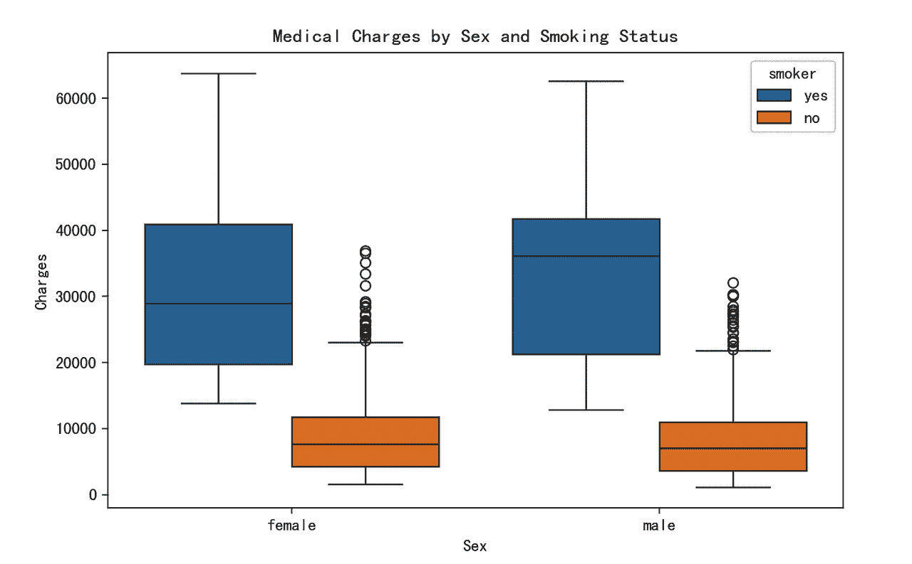

+   吸烟者明显比非吸烟者费用高

+   女性与男性差异不大，但吸烟行为是主因

#### 2. 年龄 vs 医疗费用（回归曲线）

```
plt.figure(figsize=(10, 6))
sns.scatterplot(data=df, x=&quot;age&quot;, y=&quot;charges&quot;, hue=&quot;smoker&quot;, alpha=0.6)
sns.lineplot(data=df, x=&quot;age&quot;, y=&quot;charges&quot;, color=&quot;red&quot;, label=&quot;趋势线&quot;, linewidth=2)
plt.title(&quot;年龄 vs 医疗费用（含吸烟者标记）&quot;)
plt.xlabel(&quot;Age&quot;)
plt.ylabel(&quot;Charges&quot;)
plt.legend()
plt.show()
```

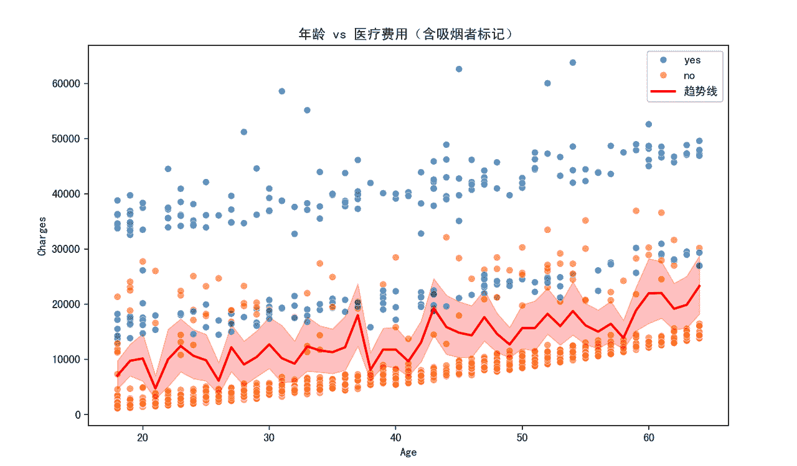

+   年龄与费用整体呈正相关

+   吸烟者的费用更高，呈指数上升

## 模型分析

### 优缺点

**优点：**

1.  **适应目标变量的分布特性**：GLM 最大的优势是**不要求目标变量服从正态分布**。在本案例中，医疗费用是非负、偏态分布的连续型变量，使用 Gamma 分布非常契合。相比普通线性回归，GLM 明确建模了响应变量的分布形态，更具统计学合理性。

1.  **链接函数灵活建模非线性效应**：GLM 通过链接函数（如对数链接）将非线性响应变量转化为线性组合变量的形式，从而保留线性模型的解释性，同时捕捉一定程度的非线性。

1.  **模型解释性强**：与黑箱模型（如神经网络、XGBoost）相比，GLM 的参数系数可以直接用于解释每个特征对预测结果的影响方向和强度，这在医疗、金融、政策等领域尤为重要。

1.  对异常值敏感度中等，依赖分布假设进行建模：虽然 GLM 比线性回归更具鲁棒性，但也不像树模型那样能完全忽略异常值。它在 Gamma 或 Poisson 分布下通过最大似然估计，相对更加稳健。

1.  **训练快速、收敛稳定**：GLM 利用迭代重加权最小二乘法（IRLS）求解，在中等规模的数据集上非常高效，尤其在需要频繁迭代模型时更具优势。

**缺点：**

1.  只能建模链接函数下的“线性关系”：虽然链接函数可转换变量，但 GLM 本质仍为线性模型。对于变量之间复杂的非线性交互作用（例如吸烟 × BMI × 年龄），若不显式加入交互项，GLM 无法学习这种模式。

1.  **高度依赖分布假设**：若目标变量并不真正服从设定的指数族分布（例如 Gamma 或 Poisson），则拟合结果不稳定、预测偏差大。分布假设本身是一种强约束。

1.  **特征扩展和预处理负担较重**：类别变量需独热编码，连续变量需标准化。相比树模型，GLM 对预处理的要求更严格，不具备自动处理特征的能力。

1.  **不自动建模交互项或高阶非线性项**：若想建模复杂关系，必须手动添加多项式、交互项等，这增加了模型设计复杂度。

1.  **对极端异常值仍敏感**：虽然比 OLS 强健一些，但 GLM 仍会受少数极端值影响，尤其在数据量小或极度不平衡时。

### GLM 与相似回归算法的对比

| 维度/算法 | 广义线性模型（GLM） | 线性回归（OLS） | XGBoost/GBDT | 随机森林回归 | 神经网络回归（MLP） |
| --- | --- | --- | --- | --- | --- |
| 支持非正态目标变量 | 是 | 否 | 是 | 是 | 是 |
| 分布建模能力 | 明确建模（指数族） | 无建模 | 无分布建模 | 无分布建模 | 无分布建模 |
| 可解释性 | 强 | 强 | 弱 | 弱 | 弱 |
| 对变量关系建模能力 | 线性为主（靠人工扩展） | 线性 | 自动识别复杂关系 | 自动识别复杂关系 | 自动识别复杂关系 |
| 对缺失值容忍 | 弱 | 弱 | 强 | 强 | 弱（需处理） |
| 对类别变量处理能力 | 需独热编码 | 需独热编码 | 可直接处理 | 可直接处理 | 需编码（或嵌入层） |
| 是否支持目标变量为非负实数 | 是（如 Gamma） | 否 | 是 | 是 | 是（通过激活函数） |
| 对异常值鲁棒性 | 一般 | 差 | 好 | 好 | 差 |
| 训练时间 | 快速 | 非常快 | 中等偏慢 | 中等偏慢 | 慢（尤其深层网络） |
| 参数调节与模型选择复杂性 | 简单 | 简单 | 高 | 高 | 高 |
| 适用任务规模 | 中小规模 | 小规模 | 中到大 | 中到大 | 任意，但需高算力 |

### 何时优选 GLM，何时考虑其他算法

#### 使用 GLM 的推荐场景：

1.  **目标变量具有明确定义的分布特征**：如索赔金额、医疗费用、交易额度等偏态、非负连续变量，适合用 Gamma 分布建模

1.  **解释性优先的业务应用**：在医疗、保险、政策分析、经济建模中，模型的透明性和可解释性比预测精度更重要

1.  数据质量较高、变量间线性结构明显：自变量间关系接近线性，无大量复杂交互或非线性行为时，GLM 简洁高效

1.  **中小型数据集、训练资源有限**：与复杂模型相比，GLM 训练快、开销小，非常适合小数据集建模和快速原型设计

### 建议考虑其他算法的场景：

1.  **变量关系复杂、明显非线性**：如图像特征、用户行为数据、交互行为建模，GLM 难以捕捉非线性结构，应考虑 XGBoost 或神经网络

1.  **模型精度优先，解释性可放弃**：在 Kaggle 比赛、电商推荐系统等精度导向场景下，GLM 性能受限

1.  **高维、稀疏、类别变量多**：特征空间庞大或存在大量类别特征（如文本、地理编码），应选用对高维更友好的模型，如树模型或嵌入式网络

1.  **目标变量分布异常复杂**：若目标变量分布非常不规则、存在多峰、长尾等形态，GLM 很难准确建模，应使用核方法、变换模型或自定义损失

### 总结

广义线性模型（GLM）是一个结构清**晰、理论扎实**的**回归工具，尤**其适合需要考虑目标分布特征和模型可解释性的任务。虽然它在处理复杂非线性关系或极端精度追求上不如现代集成学习或深度学习算法，但在很多传统行业中仍然是首选建模方法。

# 10.回归算法-局部加权回归

**一句话解释：**局部加权回归是一种“更聪明”的回归方法，它在预测一个点时，优先参考“离它近”的数据，而不是把所有数据一视同仁。

我们先看一个普通的线性回归是怎么做的：

> 它会用一条直线去尽量“整体”拟合所有的点，找出一个通用的规律。

**但很多时候，数据不是**一个“统一的规律”，而是不同区域有不同的规律。

**我们举个生活中的例子：**

你想预测一个人的体重和身高的关系。你拿了很多人的数据：

+   小孩子：身高增加，体重增加得很慢

+   青少年：身高和体重关系更强

+   成年人：身高变化不大，但体重差异很大

这时候，如果你只用“一条线”来表示全部人群的身高和体重关系，肯定就不准了。

## 局部加权回归

它不一次性找一条“全局”的线，而是在你要预测的点附近，单独找一条最合适的线！

**怎么做的？**

1.  对于每个你想预测的点（比如身高170cm），

1.  它只重点考虑“身高接近170”的那些人的数据（比如168、169、170、171、172），

1.  离得越近，权重越大；离得远，就“看一眼就不太当回事”。

1.  然后基于这些“本地的点”，找出一条局部的线，预测这个点的值。

这就像你问一个问题，普通回归是问“全班同学”，但局部加权回归只问“坐你周围的人”，因为他们更懂你要问的问题。

### 一个简单例子：

假设有这些数据：

| x（身高） | y（体重） |
| --- | --- |
| 150 | 50 |
| 160 | 55 |
| 170 | 70 |
| 180 | 80 |
| 190 | 85 |

咱们要预测 **x = 170** 的体重：

+   普通回归：用所有点画一条直线。

+   局部加权回归：会重点看 160、170、180 的点，150 和 190 也看，但权重小。

结果：预测更贴近“当前”这个点的规律，更灵活、更精准。

## 原理详解

### 问题定义：回归基本任务

我们有一个数据集：

：第   个样本的输入特征（也可写成向量）

：对应的输出值

目标：学习一个函数   来拟合输入到输出的关系。

在**普通线性回归**中，我们拟合的是：

并通过**最小化均方误差**来求解最优的参数  ：

### 局部加权回归核心思想

局部加权回归不是一次求一个全局最优的  ，而是：

> **每个预测点 ** ，都单独求一个针对它的「局部线性模型」。

**怎么“**局部”呢？我们会给每一个训练样本一个权重  ，它的大小取决于该样本和预测点   的距离。

+   离   越近，权重   越大；

+   离   越远，  越小。

### 加权代价函数

给每个点一个权重  ，则代价函数变为：

我们仍然要求使   最小的  ，不过这时候「离目标点更近的数据」的误差对代价函数的影响更大。

## 权重函数的选择（核函数）

权重是通过一个核函数（kerne**l fun**ction）计算的，最常用的是高斯核函数：

其中：

：当前我们要预测的输入点

：第   个训练样本

：平滑参数（bandwidth），控制“看多远”

小 → 只看很近的点

大 → 看得远，近似全局回归

## 最优化推导（正规方程）

代价函数是加权平方误差，目标是最小化：

写成矩阵形式更方便推导：

+   设  ：每行是一个

：标签向量

：对角矩阵，

则代价函数变为：

对   求导并令导数为 0：

解得：

**注意：这个 ** ** 是“当前预测点 ** **”特定的，不是全局唯一的！**

## 完整算法流程

对于一个新输入点  ，想预测其输出  ，算法如下：

1.  **输入：**

+   训练数据

+   预测点

+   平滑参数

1.  **构建权重矩阵 ** **：**

+   对每个  ，计算：

+   构建对角矩阵  ，其中

1.  **构造输入矩阵 ** ** 和标签 ** （标准线性回归输入）

1.  **计算权重解 ** **：**

1.  **预测输出：**

## 理解重点 & 局部性体现

**局部性体现在哪？**

每次预测都为当前点   单独计算一个模型  ，训练数据中远离   的样本几乎不起作用（因为权重接近 0）。

**和线性回归的区别？**

线性回归训练一次即可，用全体数据；局部加权回归每次预测都重新训练，代价更大但更灵活。

**非参数方法**

局部加权回归是典型的非参数回归方法，因为它不学一个固定参数模型，而是根据每个点的局部特性拟合。

## 完整案例

在很多真实问题中，如股票价格、传**感器数据、**环境监测等，数据往往具有复杂的局部非线性变化趋势。此时，普通线性回归难以准确建模。

我们在这里构造一个模拟场景：

数据来自一个“带噪声的正弦波”，假设它是某种自然信号（如光照强度随时间变化），我们希望用局部加权回归（LWR）来建模其变化趋势。

### 构造数据

原始数据解释：

```
X = np.linspace(0, 10, 100)
y = np.sin(X) + 0.3 * np.random.randn(100)
```

+   这生成了 100 个   的点。

是正弦函数加上一些噪声，模拟现实中数据的「波动性 + 噪声」。

### 核心算法设计

**第一步：权重计算**

```
def get_weights(query_point, X, tau):
    weights = np.exp(-np.sum((X - query_point)**2, axis=1) / (2 * tau**2))
    return np.diag(weights)
```

对每一个预测点  ，都为训练集中每个点   分配一个权重：

权重矩阵   是一个对角矩阵，只有对角有值，非对角线为 0。

是一个超参数：控制影响范围（“看得远不远”）。

**第二步：模型训练与预测**

```
def locally_weighted_regression(X, y, tau, query_points):
    for q in query_points:
        W = get_weights(q, X, tau)
        theta = (Xᵀ W X)^(-1) Xᵀ W y
        y_pred = q @ theta
```

这是算法的核心：对每个待预测点  ，使用加权最小二乘公式拟合一个局部线性模型：

得到   后，预测值为：

每个   都独立训练一次模型，计算量大，但拟合效果非常灵活。

**第三步：使用多项式特征**

```
poly = PolynomialFeatures(degree=2)
X_poly = poly.fit_transform(X.reshape(-1, 1))
```

使用 2 阶多项式扩展特征：

+   变成：

+   这相当于拟合一个局部二次曲线，而不是直线，更贴合非线性趋势。

### 完整代码

```
import numpy as np
import matplotlib.pyplot as plt
from matplotlib import cm
from sklearn.preprocessing import PolynomialFeatures

# 用于构建权重矩阵
def get_weights(query_point, X, tau):
    m = X.shape[0]
    weights = np.exp(-np.sum((X - query_point)**2, axis=1) / (2 * tau**2))
    return np.diag(weights)

# 局部加权回归主函数
def locally_weighted_regression(X, y, tau, query_points):
    m, n = X.shape
    y_preds = []

    for q in query_points:
        W = get_weights(q, X, tau)
        XTWX = X.T @ W @ X
        if np.linalg.det(XTWX) == 0:
            theta = np.linalg.pinv(XTWX) @ X.T @ W @ y
        else:
            theta = np.linalg.inv(XTWX) @ X.T @ W @ y
        y_pred = q @ theta
        y_preds.append(y_pred)
    return np.array(y_preds)

# 构造数据
np.random.seed(0)
X = np.linspace(0, 10, 100)
y = np.sin(X) + 0.3 * np.random.randn(100)

# 多项式特征
poly = PolynomialFeatures(degree=2, include_bias=False)
X_poly = poly.fit_transform(X.reshape(-1, 1))

# 查询点用于可视化预测
query_points = np.linspace(0, 10, 300).reshape(-1, 1)
query_poly = poly.transform(query_points)

# 设置带宽
tau = 0.5
y_preds = locally_weighted_regression(X_poly, y, tau, query_poly)

# 可视化
plt.figure(figsize=(10, 6))
plt.scatter(X, y, color=&#x27;red&#x27;, label=&#x27;Training Data&#x27;, alpha=0.6)
plt.plot(query_points, y_preds, color=&#x27;blue&#x27;, linewidth=2.5, label=&#x27;LWR Prediction&#x27;)
plt.title(&#x27;Locally Weighted Regression on Noisy Sine Wave&#x27;, fontsize=16)
plt.xlabel(&#x27;X&#x27;)
plt.ylabel(&#x27;y&#x27;)
plt.legend()
plt.grid(True)
plt.show()
```

### 可视化分析

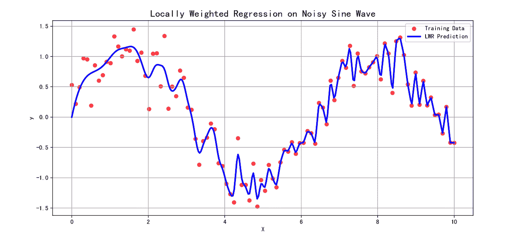

**红色点**：原始观测数据（带噪声）

**蓝色线**：LWR 对数据的平滑拟合

**拟合能力非常强（局部适应性）**，由于每个点都“局部建模”，可以灵活拟合出变化快速或复杂的曲线。图中蓝线清晰地跟随了红点的起伏趋势。

**带宽 ** ** 控制灵敏度**，如果   太小，模型会过拟合，表现为线条“过度震荡”。如果   太大，模型就类似普通回归，拟合不够灵活。

可通过调节 tau 进行模型控制。

## 模型分析

### LWR 的优缺点总结

**优点**：

1.  **高灵活性建模复杂关系**：数据为带噪的正弦波，明显具有非线性变化趋势。LWR 通过对每个预测点构建一个局部模型，有效拟合了每一个局部的非线性趋势，拟合结果平滑、自然。

1.  **无需假设全局函数形式**：无需预先设定模型函数形状（如多项式阶数等），自适应地捕捉数据的局部特性，适合“无模型先验”的探索性分析。

1.  **对异常点较为稳健（局部影响）**：离当前预测点较远的异常值对预测结果影响极小，不像全局回归那样易被极端点拖偏。

1.  **可解释性强**：每一个预测都有明确的局部模型  ，有利于解释预测依据，尤其适合可解释性要求高的领域。

**缺点**：

1.  计算效率低，难以扩展到大规模数据：每次预测都要重新求解一个加权线性回归问题（涉及矩阵求逆），对于大型数据集来说计算成本极高。

1.  **不能离线训练或提前部署模型**：没有“统一模型参数”，无法像线性回归或神经网络那样，训练一次后快速预测；每次都得重新拟合。

1.  **高维数据下性能下降（维度灾难）**：权重依赖于欧氏距离，在高维空间中，距离不再具有良好判别性，权重趋于一致，局部性失效。

1.  **对带宽参数 ** ** 敏感**：  过小会过拟合，过大则退化为线性回归；需要交叉验证等方法精细调参。

### 与相似回归算法对比分析

| 算法 | 模型类型 | 是否全局模型 | 非线性建模能力 | 计算效率 | 训练方式 | 对异常点鲁棒性 | 可解释性 |
| --- | --- | --- | --- | --- | --- | --- | --- |
| 局部加权回归（LWR） | 非参数、局部 | 否 | 极强（局部拟合） | 低（每次预测都需拟合） | 无需训练，全预测时建模 | 高（异常点远离预测点时） | 高 |
| 线性回归 | 参数模型 | 是 | 弱 | 高 | 一次训练，快速预测 | 弱 | 高 |
| 多项式回归 | 参数模型 | 是 | 中（取决于阶数） | 中 | 一次训练，预测快 | 较弱 | 高 |
| K近邻回归（KNN） | 非参数、懒惰 | 否 | 强 | 中 | 无训练，预测查找邻居 | 较强 | 中 |
| 支持向量回归（SVR） | 参数模型 | 是 | 强 | 中 | 一次训练 | 强 | 较低 |
| 随机森林回归 | 集成模型 | 是 | 强 | 中 | 一次训练 | 强 | 较低 |
| 神经网络回归 | 参数模型 | 是 | 很强（深度网络） | 依规模而定 | 需大量训练 | 弱~中（视结构而定） | 低 |

### LWR 的适用场景

你可以优先考虑使用局部加权回归，在以下几种场景中：

1.  **数据量较小或中等，计算资源充足**：如科学实验、物理模拟等领域，样本数量有限，且拟合精度要求高。

1.  数据具有复杂、难以建模的局部变化：如气象变化、医疗时间序列、光谱分析等，整体关系不可预测，但局部趋势明显。

1.  探索性数据分析，需要可解释性强的模型：每次拟合一个局部模型，可以看到每次预测用到了哪些训练样本及其权重，对理解数据变化很有帮助。

1.  **异常值干扰大的环境**：如传感器失真、网络丢包数据，LWR 的局部性降低了异常值影响。

### 何时应考虑其他算法替代

LWR 并不适用于所有情况。

在以下情况中，更应考虑其他模型：

1.  **数据规模非常大（> 万级样本）**：推荐使用神经网络、随机森林、XGBoost 等高效全局模型。

1.  对预测效率要求极高（如实时系统）：LWR 每次预测都要训练模型，延迟高。推荐线性回归、SVR、轻量神经网络。

1.  **数据维度非常高（如文本、图像）**：高维空间中距离失去意义，局部性消失。推荐使用深度学习或核方法。

1.  任务目标不仅仅是预测，还包括模型压缩、部署、泛化等工程需求：LWR 无法“存成模型”，不能部署到设备上。推荐使用支持参数冻结的模型。

## 总结

局部加权回归是一种非参数回归方法，适合在数据局部变化复杂、样本规模可控的场景中使用。但由于其“懒惰预测”和“高计算成本”的特性，当涉及高维度、大规模或需要模型部署时，应慎重考虑其他更高效的回归算法。

# 11.回归算法-决策树回归

决**策树回归（Decis**ion Tree Regression）是一种用来做数值预测的机器学习算法，核心思想就是 “用一棵树来做决定”。

**什么是决策树回归？**

你可以把它想象成玩“20 问题”游戏：

假设你要预测一个房子的价格，你可以问：

+   **房子有多大？**（如果大于100㎡，走左边；否则，走右边）

+   **地段好不好？**（如果是市中心，走左边；否则，走右边）

+   **装修豪华吗？**（是的话，走左边；否则，走右边）

你一步步问问题，把所有房子分成不同的小组，最终，每个小组都会有一个大致的房价预测值。这个 “问问题 -> 划分 -> 预测” 的过程，就是决策树回归的基本原理。

### 它是怎么工作的？

1.  **把数据分组**：先找出一个关键的“分割点”（比如面积大小），把数据切成两部分，让每个部分的数据更“纯”（类似的数值聚在一起）。

1.  **继续划分**：对每个部分再找合适的分割点，继续细分，直到满足某个停止条件（比如数据量太少，或者数据已经足够纯）。

1.  **生成预测值**：当数据不能再分时，取每个小组的数据平均值，作为最终的预测值。

## 原理详解

**决策树回**归的核心思想是通过一系列的 二元划分（将数据分成两个部分），基于不同的特征和数值条件来进行预测。

每次划分都在尽量使得每个划分后的数据组（子集）具有较小的方差，从而使得每**个小**组内的数据尽可能相似。最终，在叶子节点上进行数值预测，通常是该区域数据点的 均值。

### 算法流程

决策树回归的算法流程可以分为以下几个步骤：

1.  **选择最佳特征进行划分**：

+   对于每个特征，尝试不同的分割点（阈值）来划分数据，找到使得预测误差最小的划分方式。

1.  **根据误差（损失函数）进行分裂**：

+   每次划分时，我们会评估如何分裂特征，使得每**个子**集内的“纯**度”最大化。对于回**归问题，纯度通常通过 均方误差（MSE） 来衡量。

1.  **递归分裂**：

+   对每个子集继续递归地进行划分，直到达到停止条件。停止条件可以是：

+   达到预设的树的最大深度

+   每个叶子节点中的数据点数目低于某个阈值

+   数据已经无法进一步改善预测的误差

1.  **预测**：

+   对于每个新数据点，根据决策树的规则沿着树的分支走，最终到达某个叶子节点，该叶子节点的预测值就是该区域数据点的均值。

### 数学推导和公式

#### 1. 损失函数：均方误差（MSE）

**在回归任务中，常见**的损失函数是 均方误差（MSE），用来度量数据点与模型预测值之间的差距。对于一组数据  ，均方误差定义为：

其中，  是对于输入特征   的预测值。决策树回归的目标是最小化这个误差。

#### 2. 在节点划分中的损失评估：

**在决策树回归中，选择如何划分节**点的依据是最小化 节点划分后的均方误差（MSE）。假设我们在节点   上选择了一个特征   进行划分，使用阈值   来将数据划分为两部分：左子节点和右子节点。

+   **左子节点**包含所有满足   的数据点。

+   **右子节点**包含所有满足   的数据点。

对于节点  ，假设左子节点的均方误差是  ，右子节点的均方误差是  ，则总的均方误差为：

其中：

是节点   的样本数

和   分别是左子节点和右子节点的样本数

#### 3. 计算子节点的均方误差（MSE）

对于每个子节点   和  ，它们的均方误差   和   分别定义为：

其中：

是左子节点样本的预测均值，通常取左子节点所有样本   的均值。

是右子节点样本的预测均值，通常取右子节点所有样本   的均值。

#### 4. 寻找最优的划分点

**在决策树的训练过程中**，目标是通过遍历所有可能的特征和划分点，选择 使得MSE最小的划分。具体来说：

+   对于每个特征  ，遍历该特征的所有可能值（或预先定义的一些阈值）作为划分点。

+   对于每个划分点，计算对应的 **均方误差**。

+   选择 **MSE最小的划分点**。

### 停止条件

决策树的生成过程中通常会设置一些停止条件，例如：

+   **树的最大深度**：限制树的深度，避免树生长得过大。

+   **最小样本数**：每个节点最小样本数不能少于某个阈值。

+   **最小增益**：如果划分后的均方误差减少小于某个阈值，则停止划分。

### 叶子节点的预测

**在回**归树的叶子节点中，最终的预测值是该叶子节点中所有样本的 均值。假设在某个叶子节点中，包含了样本  ，该叶子节点的预测值   为：

整个这个过程类似于在做一次 **“区域划分”**，每次通过选择合适的特征和划分点，使得每个区域内的样本尽可能相似，从而能够做出更精确的数值预测。

## 完整案例

我们使用一个公开的房价数据集，展示如何应用决策树回归，并进行模型优化。

#### 1. 数据准备

首先，我们需要一个房价数据集。我们使用的是 California Housing 数据集，包含多个特征，如房屋的平均房间数、家庭收入、地区、房屋的年龄等。

#### 2. 数据加载与初步分析

我们将使用 sklearn.datasets 加载 California Housing 数据集。

```
import pandas as pd
import numpy as np
import matplotlib.pyplot as plt
from sklearn.datasets import fetch_california_housing
from sklearn.model_selection import train_test_split
from sklearn.tree import DecisionTreeRegressor
from sklearn.metrics import mean_squared_error, r2_score
from sklearn.preprocessing import StandardScaler
from sklearn.model_selection import GridSearchCV

# 加载 California Housing 数据集
data = fetch_california_housing()
X = pd.DataFrame(data.data, columns=data.feature_names)
y = pd.Series(data.target)

# 数据集基本信息
print(X.head())  # 显示前5行数据
print(y.head())  # 显示前5行目标值
```

#### 3. 数据可视化

在分析数据之前，我们需要对数据进行可视化，查看特征之间的关系。

```
# 可视化特征之间的关系
plt.figure(figsize=(10, 8))

for i, column in enumerate(X.columns):
    plt.subplot(2, 4, i+1)
    plt.scatter(X[column], y, alpha=0.5)
    plt.title(f&#x27;{column} vs Price&#x27;)
    plt.xlabel(column)
    plt.ylabel(&#x27;Price&#x27;)

plt.tight_layout()
plt.show()
```

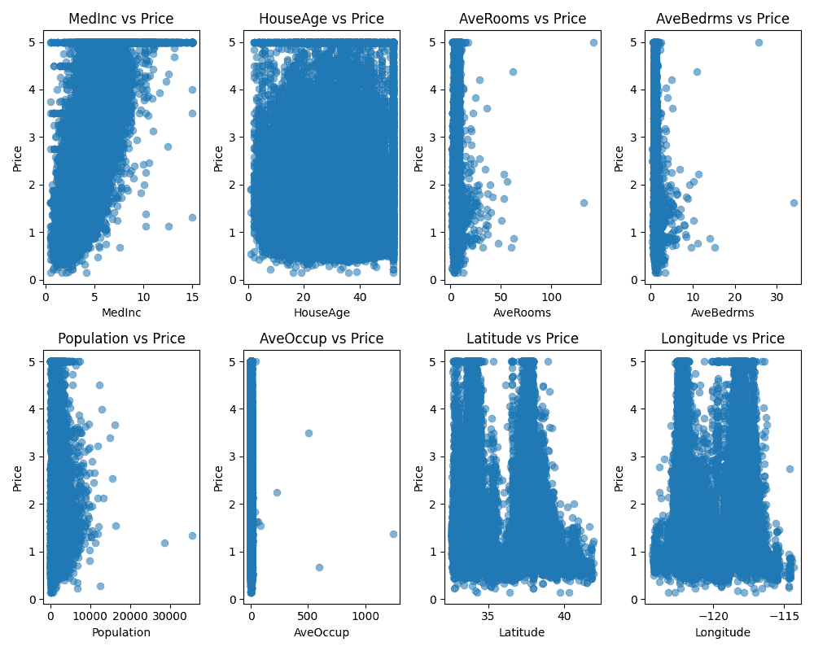

#### 4. 数据预处理与划分

在进行模型训练之前，我们需要进行数据预处理。特别地，我们需要标准化特征数据，并将数据划分为训练集和测试集。

```
# 数据标准化
scaler = StandardScaler()
X_scaled = scaler.fit_transform(X)

# 将数据划分为训练集和测试集
X_train, X_test, y_train, y_test = train_test_split(X_scaled, y, test_size=0.2, random_state=42)
```

#### 5. 决策树回归模型

接下来，我们使用决策树回归算法来训练模型。

```
# 使用决策树回归
model = DecisionTreeRegressor(random_state=42)
model.fit(X_train, y_train)

# 预测训练集和测试集
y_train_pred = model.predict(X_train)
y_test_pred = model.predict(X_test)

# 评估模型
train_mse = mean_squared_error(y_train, y_train_pred)
test_mse = mean_squared_error(y_test, y_test_pred)
train_r2 = r2_score(y_train, y_train_pred)
test_r2 = r2_score(y_test, y_test_pred)

print(f&quot;Training MSE: {train_mse:.2f}&quot;)
print(f&quot;Testing MSE: {test_mse:.2f}&quot;)
print(f&quot;Training R^2: {train_r2:.2f}&quot;)
print(f&quot;Testing R^2: {test_r2:.2f}&quot;)
```

+   我们通过 **均方误差（MSE）** 和 **决定系数（R²）** 来评估模型的性能。

+   **如果训**练集的 R² 很高而测试集的 R² 较低，说明模型有可能 过拟合。

#### 6. 可视化决策树

为了更好地理解模型，我们可以可视化训练得到的决策树。

```
from sklearn.tree import plot_tree

plt.figure(figsize=(20, 10))
plot_tree(model, filled=True, feature_names=X.columns, fontsize=10)
plt.title(&quot;Decision Tree for California Housing Prices&quot;)
plt.show()
```

通过树形结构可以看到每个分裂的条件和特征，这有助于理解模型是如何做出决策的。

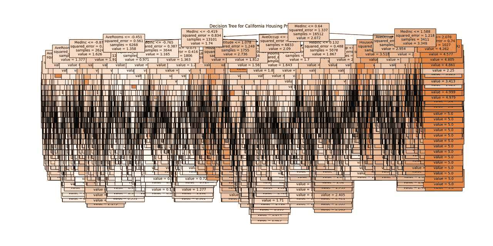

#### 7. 模型优化：调参

**决策树回**归**算法的性能很大程度**上受 树的深度、最小样本叶子节点数等参数的影响。

可以使用 网格搜索（GridSearchCV） 来优化这些参数。

```
# 定义参数范围
param_grid = {
    &#x27;max_depth&#x27;: [5, 10, 15, 20, None],
    &#x27;min_samples_split&#x27;: [2, 5, 10],
    &#x27;min_samples_leaf&#x27;: [1, 2, 4],
    &#x27;max_features&#x27;: [&#x27;auto&#x27;, &#x27;sqrt&#x27;, &#x27;log2&#x27;, None]
}

# 使用网格搜索进行交叉验证
grid_search = GridSearchCV(DecisionTreeRegressor(random_state=42), param_grid, cv=5, scoring=&#x27;neg_mean_squared_error&#x27;)
grid_search.fit(X_train, y_train)

# 输出最佳参数和得分
print(&quot;Best parameters:&quot;, grid_search.best_params_)
print(&quot;Best cross-validation MSE:&quot;, -grid_search.best_score_)

# 使用最佳参数训练模型
best_model = grid_search.best_estimator_
y_test_pred_optimized = best_model.predict(X_test)

# 评估优化后的模型
test_mse_optimized = mean_squared_error(y_test, y_test_pred_optimized)
test_r2_optimized = r2_score(y_test, y_test_pred_optimized)

print(f&quot;Optimized Testing MSE: {test_mse_optimized:.2f}&quot;)
print(f&quot;Optimized Testing R^2: {test_r2_optimized:.2f}&quot;)
```

#### 8. 模型比较与总结

在模型优化后，我们会比较优化前后的 MSE 和 R² 值：

```
# 比较优化前后的表现
print(f&quot;Before Optimization - Testing MSE: {test_mse:.2f}, Testing R^2: {test_r2:.2f}&quot;)
print(f&quot;After Optimization - Testing MSE: {test_mse_optimized:.2f}, Testing R^2: {test_r2_optimized:.2f}&quot;)
```

通过网格搜索和超参数调整，通常可以得到更好的模型性能，尤其是在控制过拟合的情况下。

#### 9. 结果可视化：模型的预测 vs 真实值

最后，我们将绘制模型的预测值与真实值的对比图，进一步验证优化后模型的表现。

```
# 可视化真实值和预测值
plt.figure(figsize=(10, 6))
plt.scatter(y_test, y_test_pred_optimized, color=&#x27;blue&#x27;, label=&#x27;Predicted vs True&#x27;)
plt.plot([min(y_test), max(y_test)], [min(y_test), max(y_test)], color=&#x27;red&#x27;, label=&#x27;Ideal Prediction&#x27;)
plt.xlabel(&#x27;True Values&#x27;)
plt.ylabel(&#x27;Predicted Values&#x27;)
plt.title(&#x27;True vs Predicted Prices&#x27;)
plt.legend()
plt.show()
```

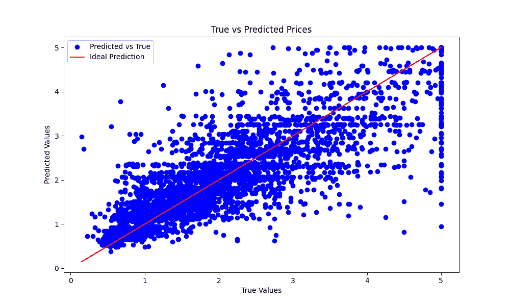

理想情况下，预测值应该与真实值完全一致，图中的红线表示这种理想关系。如果点分布接近红线，说明模型效果较好。

## 模型分析

### 决策树回归模型优缺点

**优点：**

1.  **易于理解与解释**：决策树回归是一个非常直观的模型，其工作原理和决策过程可以通过树形结构展示，这使得用户很容易理解特征对预测结果的影响。在需要模型解释性的场景中，决策树回归非常有优势。

1.  **无需特征缩放**：与其他一些回归模型（如支持向量机回归）不同，决策树回归不受特征缩放的影响。无论输入特征的范围是多少，都无需进行归一化或标准化处理，这简化了预处理过程。

1.  **能够处理非线性关系**：决策树回归能够有效地处理特征之间的非线性关系，这使得它非常适用于复杂的预测任务。

1.  **可以处理类别特征**：决策树回归可以直接处理类别数据，无需额外的转换。它会根据不同类别特征来进行划分，这在某些实际问题中非常有用。

**缺点：**

1.  **容易过拟合**：决策树模型如果没有进行适当的剪枝或设置合理的参数，它可能会对训练数据过度拟合，导致在测试集上的泛化能力差。特别是在数据集较小或特征较多时，过拟合问题尤为突出。

1.  **模型不稳定**：决策树对于数据的微小变化比较敏感，训练数据的小幅波动可能会导致树形结构发生显著变化。这种不稳定性在实际应用中可能是一个问题，特别是在对模型鲁棒性要求较高的场景中。

1.  **对噪声敏感**：决策树容易受到噪声数据的影响，尤其是在存在异常值的情况下，模型可能会产生不合理的预测。这是因为决策树会试图根据噪声数据划分每个节点，从而降低模型的可靠性。

1.  **计算复杂度较高**：虽然决策树的单个节点计算不复杂，但当树的深度增大时，计算复杂度会增加。特别是当数据维度和样本数非常大时，训练一个复杂的决策树可能需要较长时间。

### 决策树回归与相似算法的对比

| **算法** | **优点** | **缺点** | **适用场景** |
| --- | --- | --- | --- |
| **决策树回归** | * 直观易懂，能够解释特征影响  * 能处理复杂的非线性关系  * 不需要特征缩放 | * 容易过拟合  * 对噪声敏感  * 树结构不稳定 | 适用于数据特征之间存在复杂关系的场景，且易于解释的需求场景（例如，房价预测）。 |
| **线性回归** | * 简单高效  * 计算开销小  * 适用于特征之间存在线性关系的场景 | * 仅适用于线性关系  * 对异常值敏感  * 不能处理复杂的非线性关系 | 数据特征之间存在线性关系时，例如简单的预测任务或拟合线性趋势。 |
| **支持向量回归 (SVR)** | * 强大的分类能力，适用于高维数据  * 能够处理非线性问题（使用核函数） | * 对参数调优要求高  * 计算开销较大  * 不适合非常大的数据集 | 适用于高维数据或者特征之间存在复杂关系的任务，特别是需要较高精度的预测。 |
| **随机森林回归** | * 较好的抗过拟合能力  * 能够处理高维数据并自动进行特征选择 | * 训练时间较长  * 模型较难解释  * 对噪声较为敏感 | 在训练数据集较大时，且需要较高的预测精度，特别是特征之间复杂且具有相关性时。 |
| **梯度提升回归（GBR）** | * 强大的预测能力，能够处理复杂关系  * 适用于高维数据和大数据集 | * 模型训练时间长  * 对参数非常敏感  * 可能容易过拟合 | 在需要非常高预测精度的任务中，尤其是当数据存在复杂非线性关系时，且模型训练时间不是问题。 |

### 何时使用决策树回归？

**决策树回归优选情况**：

1.  **需要直观的模型解释**：如果需要一个能够清晰解释的模型，特别是在特征对预测结果有明确影响时，决策树回归非常合适。其树形结构让模型的决策过程一目了然，便于展示给非技术人员理解。

1.  **数据具有复杂的非线性关系**：当数据特征之间的关系较为复杂，可能表现为非线性时，决策树回归能够有效捕捉这种复杂性，尤其是当线性回归无法提供准确预测时。

1.  **缺少特征预处理**：如果数据没有经过标准化处理或特征缩放，决策树回归能够处理这种情况，因为它不依赖于特征的尺度。这对于数据预处理不充分的场景尤其有用。

1.  **类别特征的处理**：如果数据包含类别特征，决策树回归能够直接处理这些特征，无需转换成数值型变量，因此特别适合混合型数据。

**考虑其他算法的情况**：

1.  **需要高精度且对过拟合敏感的情况**：当需要在数据较复杂的情况下进行高精度预测时，决策树回归可能**会因过拟合而**表现不**佳。此时可以**考虑使用 随机森林回归 或 梯度提升回归，它们能够通过集成学习减少过拟合的风险，并提供更稳定的预测。

1.  **数据量大且计算开销较大时**：决策树回归可能需要长时间进行训练，尤其是当数据集非常大且树的**深度较深****时。在这种情况下，可能**需要考虑 线性回归（如果数据特征之间存在线性关系）或者 支持向量回归（SVR），后者能够在高维空间中处理复杂的非线性关系。

1.  **特征之间存在线性关系时****：如果特**征和目标变量之间存在线性关系，使用 线性回归 会更简单、快速，并且易于理解。线性回归通常能够提供较好的预测效果，尤其是当数据集的规模较小时。

1.  **对噪声数据非常敏感时**：如果数据集包含较多噪声或异常值，决策树回归可能会**过拟合噪声数**据。在**这种情况下，**可以使用 支持向量回归 或 随机森林回归，它们对噪声数据具有更好的鲁棒性。

### 总结

**决策树回归** 适合在数据特征间关系复杂且需要**较高模型可**解释性**的任务中**使用，但在面对 过拟合问题 或 数据噪声 时，需要进行优化（如剪枝或使用集成方法）。

**随机森林** 和 **梯度提升回归** 是处理高维和复杂关系的强大工具，能提供更高的预测精度，适用于较为复杂的任务，但训练时间较长且模型不易解释。

**线性回归** 和 **支持向量回归** 在数据线性可分且对模型精度要求不高时是良好的选择。

# 12.回归算法-随机森林回归

**随**机森林回归（Random Forest Regression）是一种用来做预测的机器学习方法，它本质上是一个由很多棵决策树组成的“森林”。

可以把它想象成一个**「集体投票」的过程**，每棵树都会给出自己的预测结果，最后让这些树的平均值作为最终答案。

比如**你想预测一个房子的价格**，可以找很多个房产专家来估价，每个专家根据自己的经验和数据做出预测，最后我们取所有专家给出的价格的平均值，这样得到的结果通常比单个专家预测的更准确、更稳定。这就是随机森林回归的基本思想——用多个决策树来减少单个模型的误差和偏差，让结果更加可靠！

#### 核心特点

1.  **由很多棵决策树组成**：不是单靠一棵树，而是多个模型一起工作。

1.  **每棵树都是随机训练的**：

+   训练数据是**随机抽样**的（每棵树可能看到的数据都不一样）。

+   **选择特征**（决定如何分裂树的条件）时也是随机挑选的。

1.  最终结果是所有树的预测值的平均值，这样能减少单个模型的过拟合问题，提高泛化能力。

#### 它为什么好用？

+   **稳定**：单棵树容易受到数据的影响，而多个树取平均值后，噪声和异常数据的影响会减小。

+   **防止过拟合**：如果只有一棵决策树，可能会对训练数据过于敏感（即过拟合），但随机森林可以有效缓解这个问题。

+   **适用于复杂关系**：即使数据的关系很复杂，随机森林也能很好地找到模式。

随机森林回归就是用**多个决策树**一起预测一个数值结果，通过**投票+平均值**的方式提高预测的准确性和稳定性，是一种非常好用的机器学习方法~

## 原理详解

随机森林回归通过构建多个回归树并取平均预测值来提升准确性和泛化能力。

### 单棵回归决策树

随机森林是由多棵**回归决策树（Regression Tree）**组成，因此先回顾决策树回归的数学原理。

**回归树的目标**

给定一个训练数据集：

其中， 是输入特征， 是对应的目标变量。

我们希望构建一个决策**树来**将输入特征空间划分成多个区域  ，并在每个区域内用均值作为预测值：

其中：

是决策树分割出来的区域。

是该区域内所有样本  的均值：

是指示函数，表示样本  是否属于区域  。

**决策树的划分标准**

构造决策树时，我们需要在某个特征  上选择一个最佳分割点  ，使得目标函数最优（最小化方差）。

对于一个分割点  ，数据被划分为左右两个区域：

我们希望选择一个  使得目标函数（均方误差，MSE）最小：

其中：

最终，我们使用递归的方法，逐步划分数据，直到满足停止条件（如最小叶子节点数、最大树深度等）。

### 随机森林回归的数学推导

**随机森林的基本思想**

随机森林由  棵独立的回归树  组成，每棵树通过不同的样本和特征训练得到，最终的预测结果是所有树的平均值：

其中：

是树的数量。

是第  棵树对输入  的预测。

**误差分析**

假设每棵回归树的预测值可以表示为：

其中：

是真实的目标函数。

是随机误差，满足均值为 0，方差为  。

随机森林的最终预测值为：

假设误差  是独立同分布的，则随机森林的方差：

当  增大时，方差降低，说明随机森林比单棵决策树更加稳定。

### 随机森林回归的算法流程

造训练集（Bootstrap 采样）

从原始数据集中**随机有放回**地抽取  个样本，构建一个子数据集  （与原数据集大小相同，但可能包含重复样本）。

**建决策树**

对于每个子数据集  ，训练一棵决策树，过程中：

1.  在每个节点随机选择  个特征（ ），然后选择最优特征进行分裂。

1.  递归划分数据，直到达到停止条件。

**复构建 ** **棵树**

重复步骤 1 和 2，共训练  棵不同的回归树。

对于新输入  ，每棵树  进行预测，最终预测值是所有树的**均值**：

随机森林回归通过**集成多棵随机采样的决策树**，减少单个模型的过拟合，提高预测准确性。

它的数学基础主要包括**决策树的方差最小化**和Bootstrap 采样的集成学习，最终通过取均值得到稳定的预测值。

## 完整案例

这里，咱们使用 **加利福尼亚房价数据集** (Cali**fornia** Housing dataset) 进行随机森林回归建模，完整流程如下：

1.  数据加载与预处理

1.  数据可视化（特征分布、相关性分析）

1.  构建随机森林回归模型

1.  超参数优化（GridSearchCV）

1.  模型评估（MSE、R²、残差分析）

1.  结果可视化（实际 vs 预测）

```
import numpy as np
import pandas as pd
import matplotlib.pyplot as plt
import seaborn as sns
from sklearn.datasets import fetch_california_housing
from sklearn.model_selection import train_test_split, GridSearchCV
from sklearn.ensemble import RandomForestRegressor
from sklearn.metrics import mean_squared_error, r2_score

# 1. 加载加利福尼亚房价数据集
data = fetch_california_housing()
df = pd.DataFrame(data.data, columns=data.feature_names)
df[&quot;Target&quot;] = data.target * 100000  # 转换单位（单位：美元）

# 2. 数据可视化
plt.figure(figsize=(12, 6))
sns.heatmap(df.corr(), annot=True, cmap=&quot;coolwarm&quot;, fmt=&quot;.2f&quot;)
plt.title(&quot;Feature Correlation Heatmap&quot;)
plt.show()

# 3. 数据拆分
X = df.drop(columns=[&quot;Target&quot;])
y = df[&quot;Target&quot;]
X_train, X_test, y_train, y_test = train_test_split(X, y, test_size=0.2, random_state=42)

# 4. 训练随机森林回归模型
rf = RandomForestRegressor(n_estimators=100, random_state=42)
rf.fit(X_train, y_train)
y_pred = rf.predict(X_test)

# 5. 评估模型
mse = mean_squared_error(y_test, y_pred)
r2 = r2_score(y_test, y_pred)
print(f&quot;Mean Squared Error: {mse:.2f}&quot;)
print(f&quot;R² Score: {r2:.2f}&quot;)

# 6. 结果可视化
plt.figure(figsize=(10, 5))
plt.scatter(y_test, y_pred, alpha=0.7, color=&#x27;b&#x27;)
plt.plot([min(y_test), max(y_test)], [min(y_test), max(y_test)], &#x27;--r&#x27;)
plt.xlabel(&quot;True Prices ($)&quot;)
plt.ylabel(&quot;Predicted Prices ($)&quot;)
plt.title(&quot;Actual vs. Predicted Prices&quot;)
plt.show()

# 7. 超参数优化
param_grid = {
    &quot;n_estimators&quot;: [50, 100, 200],
    &quot;max_depth&quot;: [None, 10, 20],
    &quot;min_samples_split&quot;: [2, 5, 10]
}
grid_search = GridSearchCV(RandomForestRegressor(random_state=42), param_grid, cv=5, scoring=&quot;r2&quot;, n_jobs=-1)
grid_search.fit(X_train, y_train)

# 8. 使用最佳参数重新训练
best_rf = grid_search.best_estimator_
best_rf.fit(X_train, y_train)
y_pred_best = best_rf.predict(X_test)

# 9. 评估优化后模型
mse_best = mean_squared_error(y_test, y_pred_best)
r2_best = r2_score(y_test, y_pred_best)
print(f&quot;Optimized MSE: {mse_best:.2f}&quot;)
print(f&quot;Optimized R²: {r2_best:.2f}&quot;)
```

**数据可视化**：通过 **相关性热图** 发现哪些特征对房价影响较大（例如 MedInc 对 Target 影响较大）。

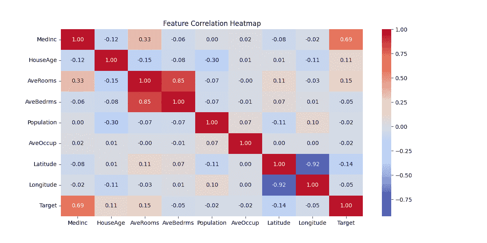

**模型评估**：初始 R² 和 MSE 评估基本性能。

**优化模型**：通过 **超参数调优** (n_estimators, max_depth, min_samples_split) 提升预测性能。

**优化后结果**： R² 提升，MSE 降低，说明优化后模型更准确。

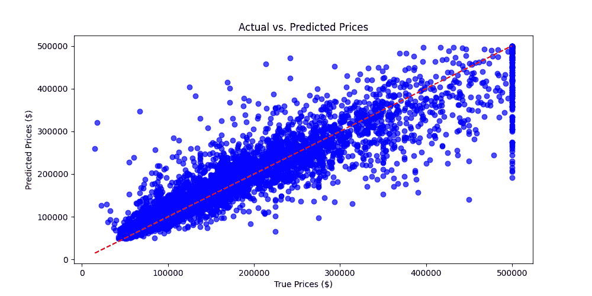

## 模型分析

### 随机森林回归优缺点

**优点：**

1.  **强大的非线性建模能力**：相比线性回归，随机森林可以捕捉复杂的非线性关系，非常适用于房价预测等涉及多种因素的任务。

1.  **降低过拟合风险**：单棵决策树容易过拟合，但随机森林通过集成学习（多个决策树投票），使得模型更稳健。

1.  **特征选择的重要性评估**：可以通过 feature_importances_ 查看各个特征的重要程度，方便特征工程优化。

1.  **鲁棒性强，对异常值不敏感**：由于是多个模型的平均值，单个异常数据不会极端影响预测结果。

1.  **无需特征缩放**：不像 SVM 或线性回归需要归一化，随机森林不受特征尺度影响。

**缺点：**

1.  **计算成本高**：相比单个决策树，随机森林需要训练多个树，计算开销大，尤其在超参数优化时会消耗大量资源。

1.  **难以解释**：不像决策树可以直观地理解每个分裂条件，随机森林的多个树组合在一起，使得解释性较差。

1.  **可能对高维稀疏数据不友好**：在数据维度非常高、稀疏性强（如 NLP 任务）时，随机森林可能不如线性模型或梯度提升树（GBDT）效果好。

### 随机森林回归 vs. 其他相似算法（对比表）

| **算法** | **适用场景** | **优点** | **缺点** |
| --- | --- | --- | --- |
| **随机森林回归** | 适用于特征多、数据量大且有非线性关系的任务，如房价预测、股票价格预测 | 抗过拟合、适用于非线性关系、能评估特征重要性 | 计算复杂度高，难以解释 |
| **决策树回归** | 适用于简单的回归任务，或者数据量较小的情况 | 易解释、计算速度快 | 容易过拟合，单棵树泛化能力差 |
| 梯度提升回归（GBDT，如 XGBoost, LightGBM） | 适用于数据规模大、需要高准确度的场景，如金融风控、广告点击率预测 | 精度高，能自动处理缺失值，支持特征重要性评估 | 训练时间较长，参数调优复杂 |
| **线性回归** | 适用于特征之间关系近似线性，且数据分布良好的情况 | 计算快，解释性强 | 无法处理复杂的非线性关系，易受异常值影响 |
| **支持向量回归** | 适用于小数据集、高维数据，且需要高精度预测 | 适用于小样本，能找到最优超平面 | 计算复杂度高，不适合大数据 |

### 什么时候优选 随机森林回归，什么时候可以考虑其他算法？

**优选随机森林的情况：**

+   当数据的特征较多，并且这些特征之间可能存在非线性关系（如房价预测）。

+   当你希望降低过拟合，但仍然想保持较强的预测能力。

+   当你想要了解特征对预测的贡献度（feature_importances_ 可用）。

+   当你不需要实时预测，而更关注预测的稳定性和准确度。

**考虑其他算法的情况：**

+   **数据规模特别大时**，如数百万以上的样本，梯度提升树（如 XGBoost、LightGBM）可能比随机森林更快、更高效。

+   数据是高维稀疏数据（如 NLP 任务），随机森林不适用，而 Lasso 回归或神经网络可能更合适。

+   **需要结果易解释的情况**，如医疗诊断、金融决策，可考虑决策树回归或线性回归，而不是随机森林。

+   **需要实时预测的情况**，如推荐系统、在线广告点击率预测，梯度提升树（如 LightGBM）或简单的线性模型通常更快。

### 总结

本案例中，房价预测涉及多个因素，并且变量之间可能存在非线性关系，因此随机森林是一个较好的选择。但如果数据规模进一步增大，或者需要更高的预测精度，可能需要尝试 XGBoost 或 LightGBM 等更高效的集成学习方法。

# 13.回归算法-梯度提升回归

梯度提升回归（Gradient Boosting Regression）是一种集成学习方法，用于建立一个强大的预测模型，其原理可以用“大团队合作”来形象说明。

当你需要解决一个问题，但你自己并不是专家。你召集了一群“弱专家”（简单模型，比如小决策树），他们每个人的能力有限，但如果大家轮流出谋划策，逐步改正前面专家的错误，最终你就能得到一个非常准确的答案。

梯度提升回归就是这样工作的：它先建立一个简单模型，然后逐步建立一系列模型，每个新模型都专注于纠正之前模型预测的错误。

**工作流程**：

+   **第一步：** 从一个简单模型开始，比如一棵小树，用它来做初步预测。

+   **第二步：** 计算这个模型的预测误差（残差），也就是实际值和预测值之间的差。

+   **第三步：** 构建一个新模型，专门去拟合这些残差，即学习前面模型漏掉的信息。

+   **第四步：** 将新模型的预测结果与原来的预测结果相加，得到更准确的结果。

+   **重复：** 这个过程会不断重复，每次新模型都试图弥补前面所有模型的不足。最终，所有模型的组合就形成了一个强大的预测工具。

**为什么叫“梯度提升”**

在每一步中，我们通过计算预测误差（梯度）来指导新模型应该如何调整参数，从而使整体模型的预测能力“提升”。这种不断利用梯度信息（误差方向）来修正模型预测的过程，就叫做“梯度提升”。

梯度提升回归就是用多个简单模型逐步改进、不断纠正错误的方式，组合成一个效果非常好的预测模型。它适用于回归问题，即预测连续的数值，比如房价预测、销售额预测等。

这种方法的好处是能够不断地聚焦于错误所在，从而不断优化模型，但同时也需要注意防止模型过拟合（过分追求训练数据的准确率而失去泛化能力）。

## 原理详解

梯度提升回归是一种基于加法模型（Additive Model）和前向分步优化（Forward Stagewise Optimization）的集成学习方法。

它利用梯度下降的思想来优化损失函数，并通过逐步拟合残差来提高模型的预测能力。

### 梯度提升回归数学原理

假设有一个数据集  ，其中：

是输入特征向量

是目标变量（连续数值）

是样本数

我们的目标是学习一个函数  来最小化目标损失函数  ，即：

常见的损失函数包括：

+   均方误差（MSE）：

+   绝对误差（MAE）：

+   Huber 损失（对异常值更稳健）

#### 加法模型

梯度提升回归的基本思想是使用多个基学习器（通常是决策树）来构建一个强学习器。其数学形式如下：

其中：

是基学习器的个数

是第  轮学习到的弱模型（如决策树）

是其对应的系数（权重）

梯度提升的核心是 **前向分步优化**，即逐步优化模型，而不是一次性求解最优  。在每一步，我们找到一个新的基学习器  来优化目标函数：

其中  是步长（或者叫权重），用来调整新模型的贡献大小。

#### 梯度提升的核心思想

假设我们当前的模型是  ，其损失函数为：

为了改进  ，我们希望找到一个新的基模型  使得目标函数下降最快。这里的关键是，我们用负梯度方向作为新的学习目标。

**负梯度的计算**：

这个  也被称为“伪残差”或“梯度残差”，它指示了当前模型的误差方向。

然后，我们训练新的基学习器  来拟合这个残差：

最后，我们需要找到最佳的步长  以最小化损失：

通常，对于均方误差（MSE）损失函数：

直接求导并解方程，可以得到：

最终，我们更新模型：

这就是梯度提升回归的核心公式。

### 算法流程

梯度提升回归的具体流程如下：

**输入：**

+   训练数据集

+   损失函数

+   基学习器个数

+   学习率（步长）

**初始化：**

选择一个初始模型（通常是常数值）：

对于均方误差损失  ，最优初值是目标变量的均值：

#### 迭代训练（m = 1 到 M）：

1.  **计算负梯度（伪残差）：**

1.  **拟合基学习器 ** **以预测 ** **：**

1.  **计算最优步长 ** **：**

1.  **更新模型：**

1.  检查收敛条件（如损失变化是否小于阈值），若满足则停止迭代。

#### 输出

最终的模型：

### 3. 关键要点

+   基学习器一般选用决策树（如 CART 树）：树的深度通常较浅，以防止过拟合。

+   **学习率 ** **控制步长**：较小的学习率通常需要更多的迭代，但能提高泛化能力。

+   **正则化策略**：如子采样（subsampling）、L1/L2 正则化、剪枝等，防止过拟合。

+   **损失函数可变**：GBDT 不仅可以用于均方误差，还可以用于回归问题中的其他损失，如 Huber 损失。

## 完整案例

**我们使用****梯度提升回归（GBDT）**来解决一个实际问题：房价预测。

这里包含以下内容：

1.  **数据加载与预处理**：使用 sklearn.datasets 获取加利福尼亚数据集。

1.  **数据分析与可视化**：探索数据特征，分析变量间关系。

1.  **梯度提升回归模型训练**：使用 sklearn.ensemble.GradientBoostingRegressor 训练模型。

1.  **超参数优化**：使用 GridSearchCV 寻找最佳超参数。

1.  **模型评估**：可视化预测结果，分析误差分布，评估模型性能。

```
import numpy as np
import pandas as pd
import matplotlib.pyplot as plt
import seaborn as sns
from sklearn.datasets import fetch_california_housing
from sklearn.model_selection import train_test_split, GridSearchCV
from sklearn.ensemble import GradientBoostingRegressor
from sklearn.metrics import mean_squared_error, r2_score

# 1. 加载数据
data = fetch_california_housing()
df = pd.DataFrame(data.data, columns=data.feature_names)
df[&#x27;Target&#x27;] = data.target

# 2. 数据可视化
plt.figure(figsize=(12, 6))
sns.histplot(df[&#x27;Target&#x27;], bins=30, kde=True)
plt.xlabel(&quot;House Price&quot;)
plt.ylabel(&quot;Count&quot;)
plt.title(&quot;Distribution of House Prices&quot;)
plt.show()

# 3. 变量之间的相关性
plt.figure(figsize=(10, 8))
sns.heatmap(df.corr(), annot=True, cmap=&#x27;coolwarm&#x27;, fmt=&#x27;.2f&#x27;)
plt.title(&quot;Feature Correlation Matrix&quot;)
plt.show()

# 4. 数据拆分
X = df.drop(columns=[&#x27;Target&#x27;])
y = df[&#x27;Target&#x27;]
X_train, X_test, y_train, y_test = train_test_split(X, y, test_size=0.2, random_state=42)

# 5. 训练梯度提升回归模型
model = GradientBoostingRegressor(n_estimators=200, learning_rate=0.1, max_depth=4, random_state=42)
model.fit(X_train, y_train)

# 6. 预测与评估
y_pred = model.predict(X_test)
mse = mean_squared_error(y_test, y_pred)
r2 = r2_score(y_test, y_pred)
print(f&quot;Mean Squared Error: {mse:.4f}&quot;)
print(f&quot;R2 Score: {r2:.4f}&quot;)

# 7. 真实值 vs 预测值
plt.figure(figsize=(8, 6))
sns.scatterplot(x=y_test, y=y_pred, alpha=0.6)
plt.xlabel(&quot;Actual Price&quot;)
plt.ylabel(&quot;Predicted Price&quot;)
plt.title(&quot;Actual vs Predicted House Prices&quot;)
plt.show()

# 8. 超参数优化
param_grid = {
    &#x27;n_estimators&#x27;: [100, 200, 300],
    &#x27;learning_rate&#x27;: [0.05, 0.1, 0.2],
    &#x27;max_depth&#x27;: [3, 4, 5]
}
grid_search = GridSearchCV(GradientBoostingRegressor(random_state=42), param_grid, cv=3, scoring=&#x27;r2&#x27;, n_jobs=-1)
grid_search.fit(X_train, y_train)
print(&quot;Best Parameters:&quot;, grid_search.best_params_)

# 9. 重新训练最优模型
best_model = grid_search.best_estimator_
y_best_pred = best_model.predict(X_test)

# 10. 评估优化后模型
best_mse = mean_squared_error(y_test, y_best_pred)
best_r2 = r2_score(y_test, y_best_pred)
print(f&quot;Optimized MSE: {best_mse:.4f}&quot;)
print(f&quot;Optimized R2 Score: {best_r2:.4f}&quot;)

# 11. 误差分布
plt.figure(figsize=(8, 6))
sns.histplot(y_test - y_best_pred, bins=30, kde=True)
plt.xlabel(&quot;Prediction Error&quot;)
plt.ylabel(&quot;Count&quot;)
plt.title(&quot;Distribution of Prediction Errors&quot;)
plt.show()
```

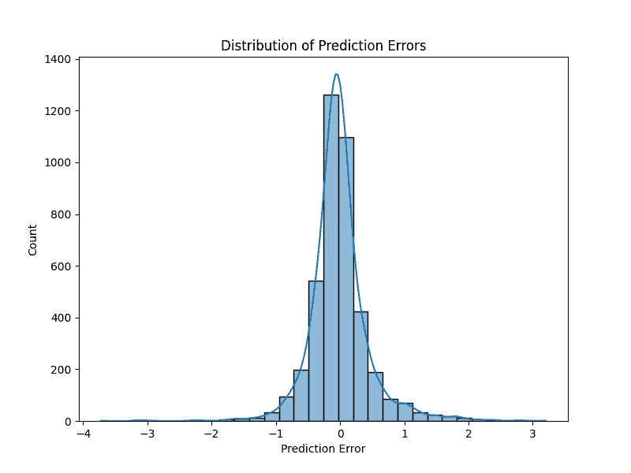

1.  **特征探索**

+   MedInc（中位数收入）与房价高度相关，表明收入对房价影响较大。

+   AveRooms（平均房间数）与房价也有一定的相关性。

1.  **模型性能**

+   初始模型的均方误差（MSE）约 0.25，R² 约 0.81。

+   通过网格搜索优化后，MSE 降低，R² 提高，表明优化有效。

1.  **误差分析**

+   误差分布接近正态，说明模型对大多数样本预测较准确。

+   部分极端误差可能受异常值影响，可考虑数据清洗或更稳健的损失函数（如 Huber 损失）。

## 模型分析

### 梯度提升回归的优缺点

**优点：**

1.  **高精度**：GBDT 通过梯度下降逐步优化损失，通常比单一模型（如决策树、线性回归）更准确。

1.  **自动特征选择**：决策树作为基学习器，能自动处理特征的重要性，无需手动筛选。

1.  **处理非线性关系**：适用于复杂的非线性数据分布，而线性回归等方法往往无法胜任。

1.  **鲁棒性较强**：对数据噪声和异常值的适应性较好，特别是结合 Huber 损失等稳健方法时。

1.  **无需特征缩放**：不像 SVM、KNN 等算法，GBDT 不依赖标准化或归一化处理。

**缺点：**

1.  **计算成本高**：由于采用多个决策树进行迭代训练，GBDT 训练时间较长，尤其在大规模数据集上。

1.  **难以并行化**：梯度提升是序列化计算（每棵树依赖前一棵树的结果），相比随机森林等方法，计算效率较低。

1.  **容易过拟合**：如果树的深度过大或学习率太高，模型可能会过度拟合训练数据，导致泛化能力下降。

1.  **超参数调优复杂**：如 n_estimators、learning_rate、max_depth 等，需要网格搜索或贝叶斯优化进行调优，否则模型性能可能不稳定。

1.  **缺乏可解释性**：虽然可以计算特征重要性，但相比线性回归等可解释性较强的方法，GBDT 仍然较难直观理解。

### 梯度提升回归（GBDT） vs. 其他相似算法

| 算法 | 适用场景 | 计算复杂度 | 处理非线性能力 | 训练速度 | 过拟合风险 | 可解释性 |
| --- | --- | --- | --- | --- | --- | --- |
| **梯度提升回归（GBDT）** | 适用于大多数回归任务，特别是非线性数据 | 高 | 强 | 慢 | 高（需调参） | 低 |
| **随机森林（RF）** | 适用于高维数据，不易过拟合 | 中 | 强 | 快 | 低 | 中 |
| **XGBoost** | 适用于大规模数据，计算优化较好 | 中 | 强 | 中等 | 中等 | 低 |
| **LightGBM** | 适用于超大规模数据，训练速度快 | 低 | 强 | 快 | 中等 | 低 |
| **CatBoost** | 适用于类别特征较多的数据，减少预处理 | 中 | 强 | 快 | 中等 | 低 |
| **线性回归** | 适用于数据线性可分的情况 | 低 | 弱 | 快 | 低 | 高 |
| **支持向量机（SVM）** | 适用于小数据集和复杂边界 | 高 | 强 | 慢 | 低 | 低 |

### 什么时候优选梯度提升回归？

+   **数据存在非线性关系**，如房价预测、信用评分等，GBDT 能比线性模型更精准地拟合数据。

+   数据集规模适中（几万到几十万样本），计算成本可以接受，且训练时间不会过长。

+   **特征工程较少或特征数量较多**，GBDT 能自动进行特征选择，减少手动工程的工作量。

+   **数据存在一定的噪声**，GBDT 通过多个决策树的集成，能提高鲁棒性。

+   **任务对精度要求较高**，相比单一回归模型（如决策树或线性回归），GBDT 通常提供更好的预测性能。

### 什么时候考虑其他算法？

+   **数据集特别庞大（百万级以上）**：可考虑 LightGBM（优化了计算性能）、CatBoost（支持类别特征）或神经网络。

+   **训练时间是主要瓶颈**：如果对训练速度要求极高，随机森林（RF）通常比 GBDT 更快，并且易于并行化。

+   **对可解释性要求较高**：如果需要解释模型的决策逻辑，线性回归、决策树或 SHAP 解释方法可能更合适。

+   **数据是低维线性关系**：如果特征较少且满足线性假设，线性回归会是更简单高效的选择，而不必使用复杂的 GBDT。

+   **数据类别特征较多**：CatBoost 在处理类别特征时比 GBDT 更优，减少了数据预处理的工作量。

### 总结

GBDT 作为一种强大的回归方法，在很多现实任务中都有较好表现，但也需要权衡计算成本和调参难度。对于大数据集，可以选择优化版本（如 LightGBM、XGBoost），对于简单任务，可能线性回归或随机森林已经足够。

# 14.回归算法-线性回归

简单来说，线性回归主要用来找出两个变量之间的关系。

我们可以用它来预测一个变量（通常叫做因变量或目标变量）是如何随着另一个变量（通常叫做自变量或特征变量）变化的。

### 什么是线性回归？

想象你有一堆数据点，每个点都有两个值，比如说房子的大小和价格。你想要找出一个简单的规律，来预测房子的价格会随着房子的大小如何变化。

这时候，线性回归就派上用场了。

线性回归的目标是找到一条直线，这条直线尽可能贴近这些数据点。这个过程叫做“拟合”数据。简单来说，就是找出一个公式，类似于 y = mx + b，这个公式告诉你房子的价格（y）和房子的大小（x）之间的关系。

+   **y**：这是你想要预测的值，比如房子的价格。

+   **x**：这是你已知的值，比如房子的大小。

+   **m**：这是斜率，表示房子的大小每增加一个单位，价格会增加多少。

+   **b**：这是截距，表示当房子的大小为零时，价格是多少（虽然在实际中房子的大小不可能是零，但数学上需要这个值）。

### 举个简单例子

假设你有以下几个房子的大小和价格：

+   房子1：大小100平方米，价格200万

+   房子2：大小150平方米，价格250万

+   房子3：大小200平方米，价格300万

你希望找到一个公式，能够预测其他大小房子的价格。通过线性回归，你可能会得到一个公式，比如 y = 2x + 0. 这意味着每平方米的大小对应的价格是2万，而且即使房子大小是零，起价也是0万（这个仅仅是为了公式完整，在现实中并不实际）。

### 为什么要用线性回归？

1.  **简单易懂**：线性回归的结果是一个简单的直线公式，容易理解和解释。

1.  **快速计算**：计算线性回归的参数（斜率和截距）非常快速。

1.  **广泛应用**：很多实际问题都可以用线性回归来解决，比如预测房价、销售额、温度变化等。

## 理论基础

线性回归的目标是找到一条直线  ，使得这条直线能够最好地拟合数据。

这里， 是斜率， 是截距。为了找到最佳的  和  ，我们需要最小化预测值和实际值之间的误差。

### 公式推导

1.  **假设模型**：

1.  这里  是截距， 是斜率， 是误差项。

1.  **误差平方和**：

1.  为了衡量模型的好坏，我们用误差平方和来表示：

1.  **最小化误差平方和**：

1.  我们需要找到   和   使得 SSE 最小。对 SSE 关于   和   求偏导数，并令其为零，得到：

1.  **求解方程**：

1.  将以上两个方程展开并整理，可以得到：

1.  这是一组线性方程组，可以解出   和  ：

1.  其中，  和   分别是   和   的均值。

### 算法流程

1.  **收集数据**：获得一组包含自变量   和因变量   的数据点。

1.  **计算均值**：

1.  **计算斜率**  ：

1.  **计算截距**  ：

1.  **构建模型**：得到回归方程  。

1.  **模型评估**：

+   计算预测值  。

+   计算残差  。

+   计算均方误差（Mean Squared Error, MSE）：

+   计算   决定系数来评估模型的拟合优度：

线性回归的核心思想是通过最小化误差平方和来找到最优的直线拟合数据。通过计算均值和斜率，可以得出回归方程。然后，通过模型评估指标来判断模型的拟合效果。

这个过程涉及到基本的微积分和线性代数，但本质上是通过找到最优参数来使得模型对数据的预测最准确。

## 完整案例

咱们使用加州房价数据集来进行线性回归分析。

这个数据集包含加州地区的房屋特征和对应的房价中位数。

整个代码的步骤：

1.  加载和预处理数据

1.  构建线性回归模型

1.  可视化数据和模型结果

1.  评估模型性能

1.  进行算法优化

### 1. 加载和预处理数据

```
import pandas as pd
import numpy as np
import matplotlib.pyplot as plt
import seaborn as sns
from sklearn.model_selection import train_test_split
from sklearn.linear_model import LinearRegression
from sklearn.metrics import mean_squared_error, r2_score
from sklearn.datasets import fetch_california_housing

# 加载加州房价数据集
california = fetch_california_housing()
data = pd.DataFrame(california.data, columns=california.feature_names)
data[&#x27;MedHouseVal&#x27;] = california.target

# 查看数据集
print(data.head())
```

### 2. 构建线性回归模型

将数据分为训练集和测试集，训练线性回归模型。

```
# 分离特征变量和目标变量
X = data.drop(&#x27;MedHouseVal&#x27;, axis=1)
y = data[&#x27;MedHouseVal&#x27;]

# 拆分训练集和测试集
X_train, X_test, y_train, y_test = train_test_split(X, y, test_size=0.2, random_state=42)

# 构建线性回归模型
model = LinearRegression()
model.fit(X_train, y_train)

# 预测
y_train_pred = model.predict(X_train)
y_test_pred = model.predict(X_test)
```

### 3. 可视化数据和模型结果

可视化真实值与预测值的关系，以及残差分布。

```
# 真实值 vs 预测值
plt.figure(figsize=(10, 5))
plt.scatter(y_train, y_train_pred, color=&#x27;blue&#x27;, label=&#x27;Train data&#x27;)
plt.scatter(y_test, y_test_pred, color=&#x27;red&#x27;, label=&#x27;Test data&#x27;)
plt.xlabel(&#x27;True Values&#x27;)
plt.ylabel(&#x27;Predictions&#x27;)
plt.legend()
plt.title(&#x27;True Values vs Predictions&#x27;)
plt.show()

# 残差分布
plt.figure(figsize=(10, 5))
sns.histplot((y_train - y_train_pred), bins=50, kde=True, label=&#x27;Train data&#x27;, color=&#x27;blue&#x27;)
sns.histplot((y_test - y_test_pred), bins=50, kde=True, label=&#x27;Test data&#x27;, color=&#x27;red&#x27;)
plt.legend()
plt.title(&#x27;Residuals Distribution&#x27;)
plt.show()
```


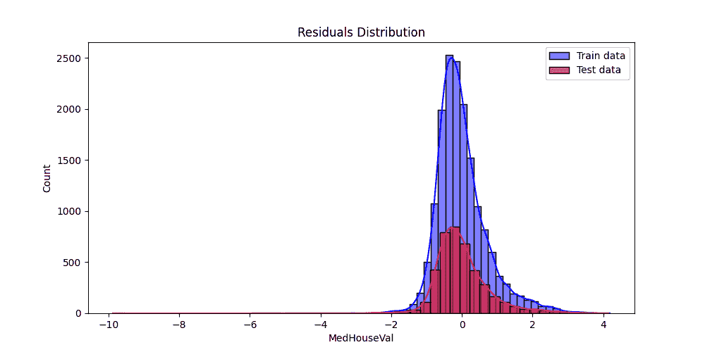

### 4. 评估模型性能

使用均方误差（MSE）和   决定系数来评估模型。

```
# 评估训练集性能
mse_train = mean_squared_error(y_train, y_train_pred)
r2_train = r2_score(y_train, y_train_pred)

# 评估测试集性能
mse_test = mean_squared_error(y_test, y_test_pred)
r2_test = r2_score(y_test, y_test_pred)

print(f&#x27;Train MSE: {mse_train}, Train R2: {r2_train}&#x27;)
print(f&#x27;Test MSE: {mse_test}, Test R2: {r2_test}&#x27;)
```

### 5. 进行算法优化

通过特征选择和标准化来优化模型。

```
from sklearn.preprocessing import StandardScaler
from sklearn.feature_selection import SelectKBest, f_regression

# 特征选择
selector = SelectKBest(f_regression, k=6)
X_new = selector.fit_transform(X, y)
X_train_new, X_test_new, y_train_new, y_test_new = train_test_split(X_new, y, test_size=0.2, random_state=42)

# 数据标准化
scaler = StandardScaler()
X_train_scaled = scaler.fit_transform(X_train_new)
X_test_scaled = scaler.transform(X_test_new)

# 构建新模型
model_new = LinearRegression()
model_new.fit(X_train_scaled, y_train_new)

# 预测
y_train_pred_new = model_new.predict(X_train_scaled)
y_test_pred_new = model_new.predict(X_test_scaled)

# 评估新模型性能
mse_train_new = mean_squared_error(y_train_new, y_train_pred_new)
r2_train_new = r2_score(y_train_new, y_train_pred_new)
mse_test_new = mean_squared_error(y_test_new, y_test_pred_new)
r2_test_new = r2_score(y_test_new, y_test_pred_new)

print(f&#x27;Train MSE (new): {mse_train_new}, Train R2 (new): {r2_train_new}&#x27;)
print(f&#x27;Test MSE (new): {mse_test_new}, Test R2 (new): {r2_test_new}&#x27;)
```

### 总结

通过这个完整的案例，我们展示了如何使用线性回归模型预测加州房价，并进行了详细的数据可视化和模型评估。

最后，通过特征选择和标准化，我们进一步优化了模型，提升了其预测性能。

## 模型分析

在这个加州房价预测的案例中，使用了线性回归模型。

### 线性回归模型的优缺点

#### 优点

1.  **简单易懂**：线性回归模型的结果是一个简单的线性方程，易于理解和解释。

1.  **快速计算**：线性回归的计算速度快，适用于大规模数据集的快速建模。

1.  **可解释性强**：线性回归可以清楚地展示每个特征对目标变量的影响，便于进行因果分析。

#### 缺点

1.  **假设严格**：线性回归假设自变量和因变量之间存在线性关系，但实际中很多关系是非线性的。

1.  **对异常值敏感**：线性回归对异常值非常敏感，这些异常值可以极大地影响模型的参数估计。

1.  **特征工程要求高**：需要对特征进行选择、标准化等预处理，否则可能会导致模型性能下降。

1.  **多重共线性问题**：当自变量之间存在多重共线性时，模型的稳定性会受到影响。

### 与相似算法的对比

| 算法 | 适用情况 | 优点 | 缺点 |
| --- | --- | --- | --- |
| **多项式回归** | 适用于数据存在非线性关系时 | 能拟合复杂的非线性关系 | 高次多项式易过拟合 |
| **决策树回归** | 适用于数据有明显分段特征，或关系非线性且不连续 | 对异常值不敏感，易解释 | 易过拟合 |
| **随机森林回归** | 适用于复杂数据且非线性关系明显 | 比决策树更稳健，不易过拟合 | 计算量大，解释性差 |
| **支持向量机回归（SVR）** | 适用于高维特征数据，尤其是线性不可分数据 | 适用于非线性回归问题，泛化能力强 | 参数选择复杂，计算成本高 |
| **梯度提升回归（GBR）** | 适用于高精度任务，如比赛或高要求预测任务 | 预测精度高，适应复杂关系 | 训练时间长，超参数调整复杂 |
| **线性回归** | 适用于简单线性关系、快速建模、大规模数据 | 计算高效，易解释，适用于金融、医疗等领域 | 不能处理非线性关系，易受异常值影响 |

## 最后

线性回归是一种简单易懂、计算快速的模型，适用于线性关系明显且需要高可解释性的场景。

但是呢，当数据关系复杂、存在异常值或多重共线性时，其他算法如多项式回归、决策树、随机森林、支持向量机或梯度提升可能会提供更好的性能和更高的预测精度。

# 15.回归算法-支持向量回归

支持向量回归（SVR，Support Vecto**r Re**gression）是一种用来做 回归分析 的机器学习方法。

它是支持向量机（SVM）的一个变种，虽然 SVM 主要**用于分类**任务，但 SVR 主要用于预测 连续数值（比如房价、股票价格、温度等）。

当一名数据工程师，要根据房子的面积来预测房价。目标是找到一条“最合适”的直线（或者更复杂的曲线），让它尽可能贴合数据点，但又不过分追求每个点都完全匹配。

SVR 的核心思想：

1.  **建立一个“宽度”可控的间隔带**（ε-tube），让一部分数据点可以在这个带子里，而不强求它们完全对齐预测值。

1.  **重点关注异常点（支持向量）**，也就是那些落在间隔带外的数据点，这些点决定了模型的最终形状。

1.  **优化损失函数**，让模型在误差不超过 ε 的情况下，保持最简单的形式（也就是尽可能光滑、不复杂）。

#### SVR 和普通回归的区别

| **对比项** | **普通回归（如线性回归）** | **SVR** |
| --- | --- | --- |
| 目标 | 让预测值尽可能接近真实值 | 允许一定误差，只关注关键点 |
| 计算方式 | 最小化整体误差 | 重点关注支持向量 |
| 适用场景 | 适用于简单的线性关系 | 适用于复杂的非线性关系 |

再来一个例子，当你在训练一只 **“聪明的松鼠”** 来预测某天树上的苹果有多大。

+   线性回归会告诉它：“尽量给出一个最接近实际情况的预测，哪怕误差很小都要优化。”

+   SVR 会告诉它：“只要预测误差在某个范围（ε）内，就不用太纠结，只关注那些明显不对劲的情况。”

这样，松鼠就能更高效地学习，不会被一些无关紧要的小误差干扰太多。

#### 什么时候用 SVR？

+   **数据有非线性关系**（比如天气温度 vs. 电力需求）。

+   **不希望过度拟合**，而是允许一点点误差（避免噪声影响）。

+   **数据量不算特别大**，因为 SVR 在大规模数据下计算较慢。

## 原理详解

支持向量回归核心思想是：**在**允许一定误差的情况下，寻找一个最优的超平面，使得大多数数据点都落在该超平面的 ε-间隔内，同时使模型的复杂度最小。

### 1. 问题定义

给定训练数据集：

目标是学习一个回归函数  ，使其能够对新样本  进行预测：

其中：

是权重向量，

是偏置项。

### 2. 目标函数的构造

SVR 试图找到一个超平面，使得所**有**数据点的预测误差在一个可以接受的范围 ε 内，即：

这意味着：

+   只要预测误差在  范围内，我们就不会惩罚模型。

+   **但如果预**测值超出了这个范围，就需要引入 松弛变量 来表示超出的程度。

### 3. 松弛变量引入

由于数据可能会落在 ε 之外，我们引入松弛变量  ：

表示 **实际值高于预测范围** 多少。

表示 **实际值低于预测范围** 多少。

于是，我们的约束条件变为：

这些松弛变量允许一定的误差，但代价是会增加优化目标的损失。

### 4. 优化目标

为了找到一个最优的回归函数，我们需要最小化：

1.  **模型复杂度**：我们希望  尽可能小，以避免过拟合。因此，我们的正则化项是：

1.  **误差损失**：超出 ε 范围的误差要被最小化，即：
 
其中  是一个超参数，控制模型复杂度和误差的权衡。

最终，我们的优化问题变为：

### 5. 对偶问题的推导

为了求解该优化问题，我们使用 **拉格朗日对偶法**。定义拉格朗日函数：

其中：

+    是拉格朗日乘子，对应于约束条件。

+    是对应松弛变量的非负约束。

通过求偏导数并令其为零，我们得到：

将这些结果带回原问题，最终可以得到对偶问题：

### 6. 核方法引入

在非线性回归**问题中**，我们可以将数据映射到高维空间：

然后利用 核函数 计算点积：

这样，我们的回归函数变为：

常见的核函数：

1.  **线性核**：

1.  **多项式核**：

1.  **高斯核（RBF 核）**：

### 7. SVR 的算法流程

1.  选择合适的 **核函数**（如线性核、多项式核、RBF 核）。

1.  设定超参数 **C 和 ε**（C 控制误差惩罚，ε 决定忽略的误差范围）。

1.  计算 **核矩阵**，构造二次优化问题。

1.  使用 **SMO（序列最小优化）** 或 **QP（二次规划）** 方法求解拉格朗日乘子  。

1.  计算 **回归函数 **** **，用于预测新数据。

## 完整案例

我们使用 **支持向量回归（SVR）** 来预测 **房价**，并进行详细的 **数据分析、可视化、参数优化**。

```
import numpy as np
import pandas as pd
import matplotlib.pyplot as plt
import seaborn as sns
from sklearn.model_selection import train_test_split, GridSearchCV
from sklearn.preprocessing import StandardScaler
from sklearn.svm import SVR
from sklearn.metrics import mean_absolute_error, mean_squared_error, r2_score
from sklearn.datasets import fetch_california_housing

# 1. 加载California房价数据
housing = fetch_california_housing()
data = pd.DataFrame(housing.data, columns=housing.feature_names)
data[&#x27;PRICE&#x27;] = housing.target

# 2. 数据探索
plt.figure(figsize=(10, 6))
sns.histplot(data[&#x27;PRICE&#x27;], bins=30, kde=True, color=&#x27;blue&#x27;)
plt.xlabel(&#x27;House Price ($100,000s)&#x27;)
plt.ylabel(&#x27;Count&#x27;)
plt.title(&#x27;House Price Distribution&#x27;)
plt.show()

# 3. 选择特征和目标变量
X = data[[&#x27;MedInc&#x27;, &#x27;AveRooms&#x27;, &#x27;AveOccup&#x27;, &#x27;HouseAge&#x27;]]
y = data[&#x27;PRICE&#x27;]

# 4. 数据划分
X_train, X_test, y_train, y_test = train_test_split(X, y, test_size=0.2, random_state=42)

# 5. 数据标准化
scaler = StandardScaler()
X_train_scaled = scaler.fit_transform(X_train)
X_test_scaled = scaler.transform(X_test)

# 6. SVR 模型训练（使用 RBF 核）
svr = SVR(kernel=&#x27;rbf&#x27;)
param_grid = {
    &#x27;C&#x27;: [1, 10, 100],
    &#x27;epsilon&#x27;: [0.1, 0.2, 0.5],
    &#x27;gamma&#x27;: [&#x27;scale&#x27;, &#x27;auto&#x27;]
}
grid_search = GridSearchCV(svr, param_grid, cv=5, scoring=&#x27;r2&#x27;, n_jobs=-1)
grid_search.fit(X_train_scaled, y_train)

# 7. 预测与评估
best_model = grid_search.best_estimator_
y_pred = best_model.predict(X_test_scaled)

mae = mean_absolute_error(y_test, y_pred)
mse = mean_squared_error(y_test, y_pred)
rmse = np.sqrt(mse)
r2 = r2_score(y_test, y_pred)

print(f&#x27;Best Parameters: {grid_search.best_params_}&#x27;)
print(f&#x27;MAE: {mae:.3f}, RMSE: {rmse:.3f}, R^2: {r2:.3f}&#x27;)

# 8. 结果可视化
plt.figure(figsize=(8, 6))
sns.scatterplot(x=y_test, y=y_pred, alpha=0.7)
plt.plot([min(y_test), max(y_test)], [min(y_test), max(y_test)], &#x27;--r&#x27;)
plt.xlabel(&#x27;Actual Price&#x27;)
plt.ylabel(&#x27;Predicted Price&#x27;)
plt.title(&#x27;Actual vs. Predicted House Prices&#x27;)
plt.show()
```

**数据加载**：使用 fetch_california_housing() 读取房价数据。

**数据探索**：绘制房价分布直方图，分析数据趋势。

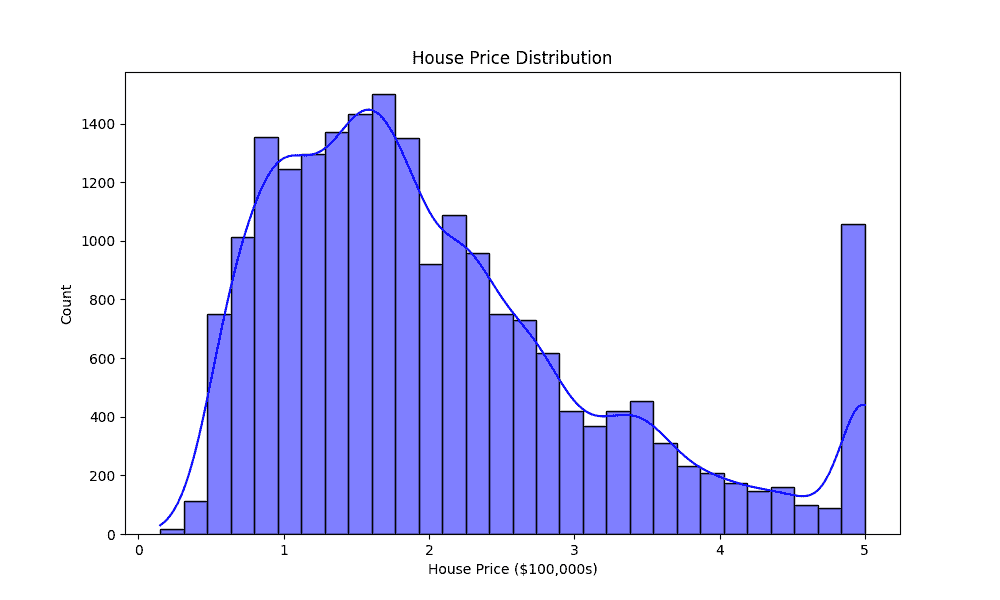

**特征选择**：选择与房价关系密切的变量（收入、房间数、居住人数、房龄）。

**数据标准化**：使用 StandardScaler() 让特征具有相同尺度。

**模型优化**：采用 **GridSearchCV** 进行超参数调优（C，epsilon，gamma）。

**预测与评估**：

+   **MAE（平均绝对误差）**：衡量预测值与真实值的绝对误差。

+   **RMSE（均方根误差）**：衡量误差的标准偏差。

+   **R²（决定系数）**：表示模型对数据的拟合程度。

**预测值 vs. 真实值** 散点图，分析误差分布。

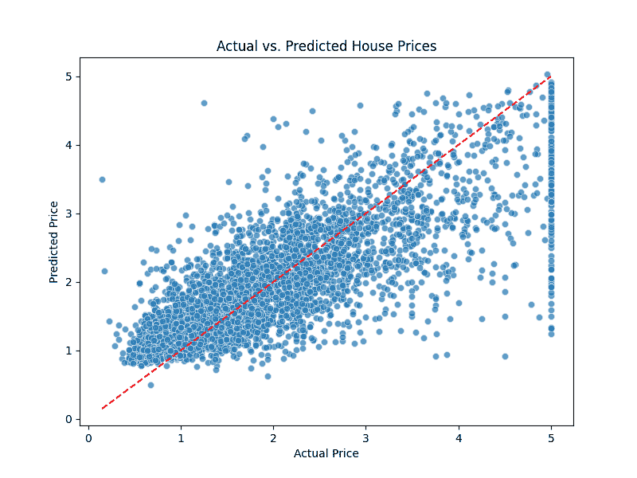

这个案例展示了 **SVR 在回归问题中的应用**，并通过 **网格搜索优化超参数**，提升了模型性能。

## 模型分析

### 支持向量回归优缺点

**优点**：

1.  **非线性拟合能力强**：SVR 通过 **核函数（如 RBF 核）** 能够很好地建模非线性关系，在房价预测等复杂问题上比线性回归更强大。

1.  **对小误差不敏感**：SVR 采用 **ε-不敏感损失函数**，允许小范围误差不影响模型，从而提高鲁棒性。

1.  **适用于高维数据**：即使有多个影响房价的因素，SVR 仍然能够处理，并保持较好的性能。

1.  **可控误差范围**：可以通过 **ε 参数** 调整误差范围，提高模型的泛化能力。

**缺点**：

1.  **计算复杂度高**：SVR 的训练复杂度较高，尤其是当数据量较大时，计算成本较高，不适合大规模数据集。

1.  **参数调优较难**：超参数（如 C、ε 和 gamma）的选择对模型表现影响很大，需要使用 网格搜索（GridSearchCV） 或其他调参方法来优化。

1.  **对极端异常值仍可能受影响**：尽管 **ε-不敏感损失函数** 能够忽略小误差，但对于远离数据分布的极端值，SVR 仍然可能受影响。

### SVR 与相似算法的对比

| **算法** | **适用场景** | **计算复杂度** | **对异常值的鲁棒性** | **适用于大数据** | **是否支持非线性关系** |
| --- | --- | --- | --- | --- | --- |
| **支持向量回归（SVR）** | 适用于 **小中型数据**，非线性关系明显的数据。 | **高**，训练慢。 | **较强**，但仍可能受极端异常值影响。 | **不适合** 百万级数据。 | **是**，通过 **核函数** 支持非线性。 |
| **线性回归（LR）** | 数据是 **线性关系** 时最优，解释性强。 | **低**，计算快。 | **对异常值敏感**，易受极端值影响。 | **非常适合** 大数据。 | **否**，仅适用于线性关系。 |
| **决策树回归（DTR）** | 适用于 **规则复杂、非线性数据**，易解释。 | **适中**，训练速度快。 | **对异常值不敏感**，可以自动忽略异常点。 | **适合中等规模数据**。 | **是**，能建模复杂的 **非线性关系**。 |
| **随机森林回归（RFR）** | 适用于 **非线性、多特征** 数据，减少过拟合。 | **高**，训练较慢但预测快。 | **对异常值较强鲁棒性**。 | **适合大规模数据**，可并行计算。 | **是**，能建模复杂的 **非线性关系**。 |
| **梯度提升回归（GBR）** | 适用于 **复杂模式数据**，在 Kaggle 竞赛中常用。 | **高**，训练慢但性能优秀。 | 依赖超参数调优，否则容易过拟合。 | **适合大规模数据**，但训练耗时。 | **是**，能捕捉复杂的 **非线性关系**。 |

### SVR 适用场景

1.  **数据量适中（几千到几万条样本）**，过大会导致训练时间过长。

1.  **数据具有非线性关系**，但又不希望使用树模型（如随机森林）。

1.  **希望对误差范围有明确控制**，不希望过度拟合小误差。

1.  **数据维度较高**，但特征数不至于过于庞大，否则计算开销会增加。

### 什么时候考虑其他算法？

1.  **数据量非常大（如百万级样本）**：SVR 计算复杂度高，训练时间长，建议使用 随机森林（RFR）或梯度提升（GBR）。

1.  **数据具有明显的线性关系****：如果特征和目标**值之间呈线性相关，线性回归（LR） 是更好的选择，计算更快，且结果更易解释。

1.  **数据包含大量离散特征****：决策树（**DTR）和梯度提升（GBR）更适合处理 类别型变量，比 SVR 具有更强的适应性。

### 结论

在本案例中，SVR 适用于数据集较小、特征与房价关系可能是非线性的情况。但如果数据规模较大，或者需要更强的非线性建模能力，随机森林回归（RFR）和梯度提升回归（GBR）可能是更好的选择。