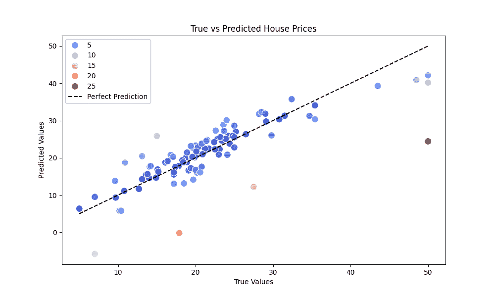
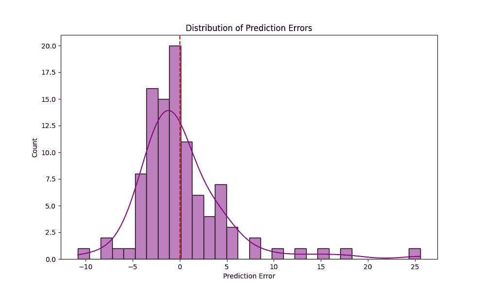
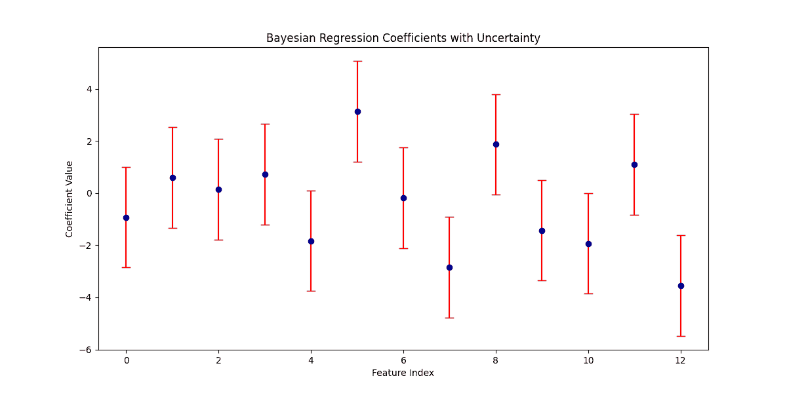

# 01-04回归算法-贝叶斯回归

> 来源：[https://qqs7y1hozd1.feishu.cn/docx/JcRUdQx2ko6MYRxouyXcuTbQnsc](https://qqs7y1hozd1.feishu.cn/docx/JcRUdQx2ko6MYRxouyXcuTbQnsc)

贝叶斯回归，用概率思维来做预测。

先来点直觉理解，假设你想预测一个人的身高，你已经知道他是一个成年男性。

+   **普通回归**：可能会直接给出一个固定的预测值，比如175cm。

+   **贝叶斯回归****：不会****给你一**个死板的答案，而是会告诉你“这个人的身高大概率在170~180cm之间，但也有小概率低于170cm或高于180cm”。

换句话说，贝叶斯回归不仅告诉你预测的结果，还告诉你对这个预测有多大的信心（即不确定性）。

#### 贝叶斯回归的核心思想

贝叶斯回归的核心就是**贝叶斯定理**，这个定理的意思是：

> 用已有的知识（先验）+ 新的数据（证据），来更新我们的信念（后验）

比如：

+   **你一开始**认为成年男性的身高大致在170~180cm之间（先验知识）。

+   **但你看**到这个人平时穿加长裤，站在人群中明显比别人高（新数据）。

+   **于是你调**整你的预测，认为他更有可能接近185cm（后验概率）。

这个不断调整的过程就是贝叶斯回归的核心。

#### 贝叶斯回归 vs 经典回归

| 特点 | 经典回归（最小二乘法） | 贝叶斯回归 |
| --- | --- | --- |
| **结果** | 一个固定的数值（比如175cm） | 一个概率分布（比如大多数在170~180cm之间） |
| **不确定性** | 不提供 | 提供预测的可信度 |
| **数据量要求** | 需要大量数据训练 | 适合数据少的情况（因为可以利用“先验”） |
| **适应性** | 一旦训练完成，模型固定 | 可以随着新数据不断更新预测 |

#### 什么时候用贝叶斯回归？

+   **数据很少**：比如你只有10个人的身高数据，普通回归很难拟合，但贝叶斯回归可以结合先验知识给出更合理的预测。

+   **需要不确定性信息**：如果你做的是医疗预测，你不仅想知道病人是否生病，还想知道你的预测有多可靠。

+   **动态调整预测**：比如你预测股市走势，每天有新的数据进来，贝叶斯回归可以随着数据变化不断调整模型。

用已有数据来修正我们对参数的信念：

+   贝叶斯回归是一种用概率来做预测的回归方法，不同于传统回归，它不仅给出一个预测值，还会告诉你预测的置信度。

+   它利用“先验知识 + 数据”来不断更新预测，特别适用于数据少、需要不确定性分析的情况。

+   **它的数学基础是贝叶斯定理**，核心思想是“不断调整信念，使其更符合现实”。

## 原理详解

贝叶斯回归不像经典最小二乘法或最大似然估计（ML**E）那样**直接求出单一的最优参数，而是通过概率分布刻画参数的不确定性。

核心思想是：

> **利用贝叶斯定理，将“先验知识”与“观测数据”**结合，从而得到后验分布，并以此进行预测。

### 1. 贝叶斯回归的数学建模

假设我们有一个线性回归模型：

其中：

+    是目标变量（观测数据）。

+    是特征矩阵（自变量）。

+    是待估计的参数。

是噪声项，假设服从均值为 0、方差为  的正态分布。

对于传统的最小二乘回归，我们通常直接求解参数  使得误差最小。

但在贝叶斯回归中，我们认为  不是一个固定值，而是一个概率分布。

### 2. 贝叶斯回归的推导

#### 先验分布（Prior Distribution）

在贝叶斯统计中，我们在数据观测之前就可以对参数  施加先验分布，表示我们对其的初始假设。最常见的选择是

**高斯分布**：

其中：

是  的先验均值（通常取 0）。

是  的先验协方差矩阵，表示参数的初始不确定性。

这样，我们假设参数  服从一个先验正态分布，它的分布特征由  和  控制。

#### 似然函数（Likelihood Function）

数据  服从线性模型：

因此，给定  时，目标变量  服从以下正态分布：

这个概率表示**在给定 ** **的情况下，我们如何生成数据 ** ，即数据的“似然”（Likelihood）。

#### 后验分布（Posterior Distribution）

**贝叶斯定理**告诉我们，后验分布可以由先验分布与似然函数通过贝叶斯公式计算：

其中：

+    是**先验**，表示我们在看到数据前对  的认知。

+    是**似然**，表示给定  时，数据  的概率。

+    是归一化项，与  无关，一般不直接计算。

由于  和  都是高斯分布，根据**高斯分布的共轭性质**，后验分布  仍然是一个高斯分布：

其中：

+   **后验均值**：

+   **后验协方差**：

这个公式的含义是：

+   **后验均值 ** ：由先验信息和数据贡献共同决定。

+   **后验协方差 ** ：当数据量增多时，参数的不确定性减少，即协方差变小。

### 3. 预测分布

在贝叶斯回归中，我们不仅关注参数  的后验分布，还关心新输入数据  时的预测输出  的分布。

给定新数据  ，其预测值  的分布为：

因为  和  都是高斯分布，它们的**加权积分仍然是高斯分布**：

即：

+   预测均值：

+   预测方差：

这个结果告诉我们，贝叶斯回归不仅能给出预测值  ，还能给出预测的不确定性  。

### 4. 贝叶斯回归的算法流程

总结贝叶斯回归的计算步骤如下：

#### 1）设定先验分布

设定参数  的先验分布：

通常  。

#### 2）计算后验分布

使用数据  更新  的后验分布：

#### 3）计算预测分布

给定新输入  ，计算预测均值和方差：

## 完整案例

使用贝叶斯回归对**房价预测**进行建模，数据集来自 **sklearn** 的 Boston Housing Dataset（波士顿房价数据）。

1.  **数据预处理**：对数据进行标准化，并拆分训练集和测试集。

1.  **贝叶斯回归建模**：使用 **sklearn** 的 **BayesianRidge** 进行建模。

1.  **预测分析**：对测试数据进行预测，并分析模型性能。

1.  **可视化**：

+   真实值 vs 预测值散点图。

+   误差分布直方图。

+   不确定性分析（预测的置信区间）。

1.  **算法优化**：调优贝叶斯回归的超参数，提高模型表现。

```
import numpy as np
import matplotlib.pyplot as plt
import seaborn as sns
from sklearn.model_selection import train_test_split
from sklearn.preprocessing import StandardScaler
from sklearn.linear_model import BayesianRidge
from sklearn.metrics import mean_squared_error, r2_score
from sklearn.datasets import load_boston

# 1. 读取数据
boston = load_boston()
X, y = boston.data, boston.target

# 2. 数据标准化 &amp; 拆分训练/测试集
scaler = StandardScaler()
X_scaled = scaler.fit_transform(X)
X_train, X_test, y_train, y_test = train_test_split(X_scaled, y, test_size=0.2, random_state=42)

# 3. 训练贝叶斯回归模型
model = BayesianRidge(tol=1e-6, alpha_1=1e-6, lambda_1=1e-6)
model.fit(X_train, y_train)
y_pred = model.predict(X_test)

# 4. 计算误差指标
mse = mean_squared_error(y_test, y_pred)
r2 = r2_score(y_test, y_pred)
print(f&#x27;MSE: {mse:.3f}, R^2: {r2:.3f}&#x27;)

# 5. 预测 vs 真实值 可视化
plt.figure(figsize=(10, 6))
sns.scatterplot(x=y_test, y=y_pred, hue=np.abs(y_test - y_pred), palette=&#x27;coolwarm&#x27;, s=100)
plt.plot([min(y_test), max(y_test)], [min(y_test), max(y_test)], &#x27;--k&#x27;, label=&#x27;Perfect Prediction&#x27;)
plt.xlabel(&#x27;True Values&#x27;)
plt.ylabel(&#x27;Predicted Values&#x27;)
plt.title(&#x27;True vs Predicted House Prices&#x27;)
plt.legend()
plt.show()

# 6. 误差分布
plt.figure(figsize=(10, 6))
sns.histplot(y_test - y_pred, kde=True, bins=30, color=&#x27;purple&#x27;)
plt.axvline(0, color=&#x27;red&#x27;, linestyle=&#x27;--&#x27;)
plt.xlabel(&#x27;Prediction Error&#x27;)
plt.title(&#x27;Distribution of Prediction Errors&#x27;)
plt.show()

# 7. 置信区间可视化
coefs_mean = model.coef_
coefs_std = np.sqrt(1 / model.lambda_)

plt.figure(figsize=(12, 6))
plt.errorbar(range(len(coefs_mean)), coefs_mean, yerr=coefs_std, fmt=&#x27;o&#x27;, color=&#x27;darkblue&#x27;, ecolor=&#x27;red&#x27;, capsize=5)
plt.xlabel(&#x27;Feature Index&#x27;)
plt.ylabel(&#x27;Coefficient Value&#x27;)
plt.title(&#x27;Bayesian Regression Coefficients with Uncertainty&#x27;)
plt.show()
```

1.  **MSE（均方误差）和 ** **（决定系数）**：用于衡量模型的误差和拟合度。

1.  **真实值 vs 预测值散点图**：参考线代表完美预测，点越接近参考线，预测效果越好。



1.  **误差分布直方图**：观察误差的集中程度，误差越集中，模型越稳定。



1.  **回归系数的置信区间**：误差棒表示参数的不确定性，红色表示参数变化范围大，说明该变量对预测影响较大。



#### 算法优化

+   调整 alpha 和 lambda 以减少过拟合/欠拟合。

+   尝试不同的先验分布（Gaussian Process 变体） 以增强适应性。

+   **特征选择**，减少冗余信息，提高模型稳定性。

## 模型分析

### 贝叶斯回归的优缺点分析

**优点**

1.  **提供不确定性估计****：不像普通回归**只给出单一预测值，贝叶斯回归还能提供预测的置信区间，适用于风险敏感的应用（如金融、医疗）。

1.  **适用于小数据集****：在数据**量较小时，贝叶斯回归通过先验分布可以避免过拟合，而传统回归方法容易因数据不足而表现不稳定。

1.  **鲁棒性强**：它引入了正则化（类似于 L2 正则化），在高维特征情况下（特征数远大于样本数）表现更稳定。

1.  **动态更新**：可以随着新数据的加入不断调整参数（在线学习），而不需要完全重新训练整个模型。

**缺点**

1.  **计算成本较高**：贝叶斯回归需要求解**矩阵的逆**（复杂度  ），在大规模数据集上计算代价较高。

1.  **难以选择合适的先验**：如果先验选择不当，可能会影响最终结果，需要额外的领域知识。

1.  **对异常值较敏感**：由于使用了正态分布假设，贝叶斯回归可能会受到异常值的影响，导致预测偏差。

### 贝叶斯回归 vs 其他相似算法

| **算法** | **优点** | **缺点** | **适用场景** |
| --- | --- | --- | --- |
| **贝叶斯回归** | 提供不确定性估计，适用于小数据，具有鲁棒性和动态更新能力 | 计算量大，对异常值敏感，先验选择困难 | 小数据集、不确定性分析、金融/医疗预测 |
| **岭回归（Ridge）** | 计算高效，避免过拟合，适用于高维特征 | 不提供预测不确定性 | 高维特征数据，但不关心不确定性 |
| **Lasso 回归** | 可自动进行特征选择（L1 正则化），适用于高维稀疏数据 | 可能导致特征完全丢失（稀疏性过强） | 高维但特征稀疏的数据集 |
| **高斯过程回归（GPR）** | 提供更强的不确定性建模能力，适用于非线性问题 | 计算成本极高（ ），无法处理大规模数据 | 复杂的非线性问题，小数据集 |
| **随机森林回归（RF）** | 处理非线性关系能力强，不易过拟合 | 不提供明确的概率分布，不适用于不确定性分析 | 高维数据、非线性关系、稳健预测 |
| **XGBoost 回归** | 强大的集成学习方法，适用于大规模数据，精度高 | 计算复杂度高，缺乏不确定性估计 | 大数据、高精度预测 |

### 在什么情况下选择贝叶斯回归？

1.  数据量较少，不能依赖传统深度学习或集成学习方法时。

1.  需要预测的不仅是数值，还包括模型的不确定性（例如医疗风险评估）。

1.  数据特征数较多，但希望有稳定的正则化效果，同时避免 Lasso 过度稀疏化的问题。

1.  可以动态更新模型，不希望每次都重新训练（如金融市场的动态预测）。

### 在什么情况下考虑其他算法？

1.  当数据量非常大时，贝叶斯回归的计算复杂度较高，可以选择 XGBoost 或 随机森林。

1.  当数据特征极其稀疏，可以考虑 Lasso 回归 以自动进行特征选择。

1.  如果数据具有复杂的非线性关系，可以选择 高斯过程回归（GPR） 或 XGBoost。

1.  如果不需要不确定性估计，只关心预测精度，那么 岭回归（Ridge） 或 XGBoost 可能是更好的选择。

贝叶斯回归在小数据集、不确定性估计、动态更新等方面表现优越，但计算复杂度较高。如果数据量大或者关注非线性关系，XGBoost 或深度学习可能是更好的选择。在实际应用中，选择合适的算法需要权衡计算成本、数据特性和业务需求。