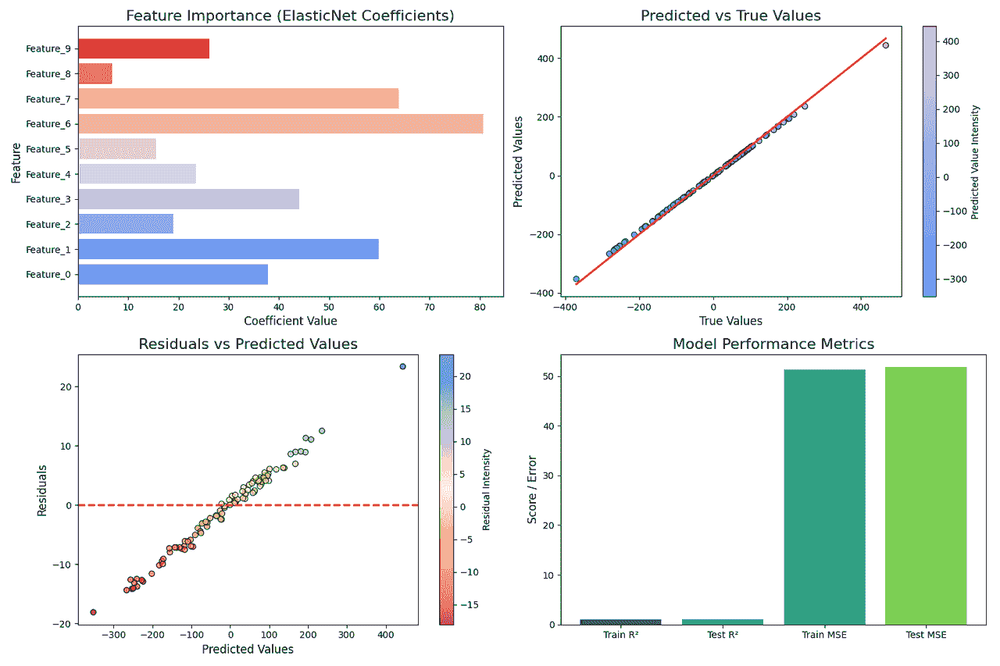

# 01-05回归算法-弹性网络回归

> 来源：[https://qqs7y1hozd1.feishu.cn/docx/AU2mdbVxLoogSQxrTflcCKK7ntf](https://qqs7y1hozd1.feishu.cn/docx/AU2mdbVxLoogSQxrTflcCKK7ntf)

首先说，**回归算法**是一种用于预测连续值的机器学习方法。

例如，如果我们想预测一个人根据他的身高、年龄和饮食习惯可能有多重，这就是一个回归问题。

数学上，回归算法的核心是找到一个公式，将输入（特征）与输出（目标值）联系起来。常见的公式形式是：

其中：

+    ：是输入特征

+    ：是权重（回归系数）

+    ：是偏置

+    ：是预测值

目标是通过训练数据找到最合适的权重和偏置，使得预测值   和真实值尽可能接近。

那么弹性回归网络是什么？

## 弹性网络回归是什么？

弹性网络回归（Elastic Net Regression） 是一种回归算法，结合了两种正则化方法：

1.  **L1 正则化（Lasso）**：让部分不重要的权重变为零，从而实现特征选择。

1.  **L2 正则化（Ridge）**：让权重变得更平滑，避免过拟合。

弹性网络回归的损失函数是：

：控制正则化强度。

：在 L1（特征选择）和 L2（平滑权重）之间进行权衡。

### 案例：选择水果供应商

假设你经营水果店，需要根据以下几个因素选择供应商：

1.  **价格（每斤）** ( )

1.  **配送时间（小时）** ( )

1.  **水果质量评分（1-10 分）** ( )

你的目标是预测每个供应商的**综合满意度评分**（连续值，1-10 分），你手上有一些历史数据可以用来训练模型。

| 供应商 | 价格 ( ) | 配送时间 ( ) | 质量评分 ( ) | 满意度 ( ) |
| --- | --- | --- | --- | --- |
| A | 5 | 24 | 9 | 8.5 |
| B | 6 | 36 | 8 | 7.0 |
| C | 4 | 48 | 7 | 6.0 |
| D | 5.5 | 30 | 9 | 8.0 |

现在呢，希望模型能告诉你未来哪个供应商最可能满足你的需求。

### 手动计算一个简单例子

假设我们用一个简单的线性回归模型，不带正则化：

假设通过训练，我们得到了以下权重和偏置：

（价格越高，满意度越低）

（配送时间越长，满意度越低）

（质量越高，满意度越高）

（基础满意度）

现在我们想预测一个新的供应商的数据：

+   价格

+   配送时间

+   质量评分

代入公式：

逐步计算：

1.  合计

预测的满意度为 **9.7**，说明这个供应商可能是个不错的选择。

### 为什么需要弹性网络回归？

如果数据中有很多特征（比如 1000 个特征），可能有以下问题：

1.  **不相关特征**：有些特征可能对结果几乎没有影响，应该忽略。

1.  **多重共线性**：多个特征之间可能高度相关（例如「价格」和「折扣」），这会让模型难以确定权重。

弹性网络回归通过：

+   **L1 正则化**：自动将不重要的特征权重设置为 0（特征选择）。

+   **L2 正则化**：让权重更平滑，避免过拟合。

### 总结4点

+   普通回归：根据历史数据找出一个公式，预测结果。

+   Lasso：更倾向于忽略不重要的特征。

+   Ridge：更倾向于平滑权重，防止过拟合。

+   弹性网络回归：结合了 Lasso 和 Ridge 的优点，既能选特征，又能让模型稳定。

## 公式解析

### 1. 回归算法的数学背景

#### 普通线性回归公式

普通线性回归的目标是找到一个线性模型，使得输入特征   和目标变量   之间的关系最佳拟合，公式如下：

其中：

：输入特征矩阵（形状为  ，  是样本数量，  是特征数量）。

：权重向量（形状为  ）。

：偏置项（标量）。

：模型的预测值。

目标是最小化均方误差（MSE）：

展开后，目标等价于最小化以下目标函数：

#### 引入正则化的需求

普通线性回归可能会出现以下问题：

1.  **过拟合**：模型对训练数据过于敏感，导致泛化能力差。

1.  **多重共线性**：特征之间高度相关，导致权重不稳定。

为解决上述问题，**正则化方法**被引入，常见的有 L1 正则化（Lasso）和 L2 正则化（Ridge）。

### 2. 弹性网络回归的数学推导

#### 损失函数

弹性网络回归结合了 L1 正则化和 L2 正则化，其损失函数为：

其中：

：数据误差（最小化预测值与真实值之间的误差）。

：L1 正则化，倾向于让某些   为 0（特征选择）。

：L2 正则化，倾向于让权重分布平滑。

：正则化强度，控制正则化项与误差项的权衡。

：平衡 L1 和 L2 的比例。

#### 优化问题

弹性网络回归的问题可以写为：

#### 转化为矩阵形式

假设没有偏置项  （可以通过扩展特征向量加入   来处理），简化后的目标函数为：

将误差项展开：

因此，目标函数可以写为：

### 3. 弹性网络回归的求解

#### 梯度计算

目标函数的梯度分两部分：

1.  **误差项的梯度**：

1.  **正则化项的梯度**：

+   L2 正则化（  的梯度）为  。

+   L1 正则化（  的梯度）为非光滑问题，使用次梯度求解，次梯度为：

#### 梯度下降法

将梯度合并，更新规则为：

其中：

：学习率。

：目标函数的梯度。

#### 坐标下降法（Coordinate Descent）

**由于 L1** 正则化项导致目标函数不可导，弹性网络回归通常使用坐标下降法进行优化。方法如下：

1.  对每个权重   逐一优化，固定其他权重不变。

1.  更新公式为（推导略）：

其中   是软阈值函数（Soft Thresholding）：

### 4. 弹性网络的直观理解

+   当  ，弹性网络退化为 Ridge 回归（L2 正则化）。

+   当  ，弹性网络退化为 Lasso 回归（L1 正则化）。

+   在   时，弹性网络既能处理稀疏性（特征选择），又能避免多重共线性。

### 总结弹性网络回归

弹性网络回归的损失函数结合了数据误差和两种正则化：

通过梯度下降或坐标下降进行优化，最终得到一个权衡稀疏性和稳定性的模型。

## 完整案例

我们可以用一个包含多个特征的数据集来展示回归算法中的「弹性网络回归」的应用。

我们使用一个模拟的数据集，并依次进行以下步骤：

1.  生成数据集，使用多个特征进行建模。

1.  对数据进行弹性网络回归。

1.  可视化回归结果以及数据特征之间的关系。

```
import numpy as np
import pandas as pd
import matplotlib.pyplot as plt
import seaborn as sns
from sklearn.datasets import make_regression
from sklearn.model_selection import train_test_split
from sklearn.preprocessing import StandardScaler
from sklearn.linear_model import ElasticNet
from sklearn.metrics import r2_score, mean_squared_error

# 1. 生成模拟数据集
X, y = make_regression(n_samples=500, n_features=10, noise=0.1, random_state=42)
X = pd.DataFrame(X, columns=[f&quot;Feature_{i}&quot; for i in range(10)])
y = pd.Series(y, name=&quot;Target&quot;)

# 2. 划分训练集和测试集
X_train, X_test, y_train, y_test = train_test_split(X, y, test_size=0.2, random_state=42)

# 3. 数据标准化
scaler = StandardScaler()
X_train_scaled = scaler.fit_transform(X_train)
X_test_scaled = scaler.transform(X_test)

# 4. 弹性网络回归模型
elastic_net = ElasticNet(alpha=0.1, l1_ratio=0.5, random_state=42)
elastic_net.fit(X_train_scaled, y_train)

# 5. 模型预测
y_pred_train = elastic_net.predict(X_train_scaled)
y_pred_test = elastic_net.predict(X_test_scaled)

# 6. 计算评价指标
r2_train = r2_score(y_train, y_pred_train)
r2_test = r2_score(y_test, y_pred_test)
mse_train = mean_squared_error(y_train, y_pred_train)
mse_test = mean_squared_error(y_test, y_pred_test)

# 7. 可视化分析
plt.figure(figsize=(15, 10))

# 图 1: 特征重要性（回归系数）
plt.subplot(2, 2, 1)
coef = elastic_net.coef_
colors = sns.color_palette(&quot;coolwarm&quot;, len(coef))
plt.barh(X.columns, coef, color=colors)
plt.title(&#x27;Feature Importance (ElasticNet Coefficients)&#x27;, fontsize=16)
plt.xlabel(&#x27;Coefficient Value&#x27;, fontsize=12)
plt.ylabel(&#x27;Feature&#x27;, fontsize=12)

# 图 2: 预测值与真实值的关系
plt.subplot(2, 2, 2)
plt.scatter(y_test, y_pred_test, c=y_pred_test, cmap=&#x27;cool&#x27;, alpha=0.7, edgecolor=&#x27;k&#x27;)
plt.plot([min(y_test), max(y_test)], [min(y_test), max(y_test)], color=&#x27;red&#x27;, linewidth=2)
plt.title(&#x27;Predicted vs True Values&#x27;, fontsize=16)
plt.xlabel(&#x27;True Values&#x27;, fontsize=12)
plt.ylabel(&#x27;Predicted Values&#x27;, fontsize=12)
plt.colorbar(label=&quot;Predicted Value Intensity&quot;)

# 图 3: 预测残差图
plt.subplot(2, 2, 3)
residuals = y_test - y_pred_test
plt.scatter(y_pred_test, residuals, c=residuals, cmap=&#x27;Spectral&#x27;, alpha=0.7, edgecolor=&#x27;k&#x27;)
plt.axhline(y=0, color=&#x27;red&#x27;, linestyle=&#x27;--&#x27;, linewidth=2)
plt.title(&#x27;Residuals vs Predicted Values&#x27;, fontsize=16)
plt.xlabel(&#x27;Predicted Values&#x27;, fontsize=12)
plt.ylabel(&#x27;Residuals&#x27;, fontsize=12)
plt.colorbar(label=&quot;Residual Intensity&quot;)

# 图 4: R^2 与 MSE 比较
plt.subplot(2, 2, 4)
metrics = [&#x27;Train R²&#x27;, &#x27;Test R²&#x27;, &#x27;Train MSE&#x27;, &#x27;Test MSE&#x27;]
values = [r2_train, r2_test, mse_train, mse_test]
colors = sns.color_palette(&quot;viridis&quot;, len(metrics))
plt.bar(metrics, values, color=colors)
plt.title(&#x27;Model Performance Metrics&#x27;, fontsize=16)
plt.ylabel(&#x27;Score / Error&#x27;, fontsize=12)

plt.tight_layout()
plt.show()
```

1.  **生成数据集**：我们使用 make_regression 生成一个包含500个样本和10个特征的模拟数据集。特征名称设置为 Feature_0 到 Feature_9，目标变量为 y。

1.  **模型构建**：将数据分为训练集和测试集后，使用 ElasticNet 进行回归建模。模型中的 alpha 和 l1_ratio 分别控制正则化强度和Lasso与Ridge的权重比。

1.  **模型评估**：通过 R² 和均方误差（MSE）评价模型的性能，并将结果可视化。



+   **图1** 展示弹性网络回归中各个特征的重要性（即系数值）。

+   **图2** 直观对比测试集中模型的预测值与真实值之间的关系。

+   **图3** 展示预测值与残差之间的关系。

+   **图4** 将训练集和测试集上的 R² 和 MSE 进行对比分析。

## 优缺点和适用场景

**优点**：

1.  **特征选择能力：** 弹性网络包含 L1 正则化（Lasso），可以将不重要的特征权重收缩到 0，从而实现特征选择。特别适用于数据集中存在许多无关或冗余特征的情况。

1.  **抗多重共线性：** 弹性网络包含 L2 正则化（Ridge），能有效处理多重共线性问题（即特征之间高度相关），通过平滑权重，避免不稳定的权重估计。

1.  **平衡稀疏性和稳定性：** 通过调节参数  ，弹性网络在完全稀疏（L1）和完全平滑（L2）之间找到平衡，既适合特征稀疏的情况，也能处理非稀疏特征集。

1.  **对高维数据的鲁棒性：** 当特征数量   远大于样本数量   时，弹性网络依然可以进行有效的回归分析。

1.  **灵活性：** 参数   和   提供了对正则化强度和正则化类型的灵活控制。

**缺点**：

1.  **模型解释性较弱：** 虽然可以进行特征选择，但引入了 L2 正则化后，部分特征的权重可能不会完全归零，导致解释性不如纯 Lasso 回归直观。

1.  **对参数敏感：** 弹性网络的表现依赖于  （正则化强度）和  （L1/L2 平衡参数）的选择，需要借助交叉验证来调优，增加了计算成本。

1.  非稀疏特征时性能可能不如 Ridge： 在特征稀疏性较低时，L2 正则化（Ridge）可能是更简单且更高效的选择。

1.  **复杂度较高：** 由于结合了 L1 和 L2 正则化，优化问题的计算复杂度比单独的 Lasso 或 Ridge 要高。

### 适用场景

1.  **高维数据场景（** **）：** 当特征数量多于样本数量时（例如基因组数据分析），普通回归可能产生过拟合，而弹性网络通过正则化能有效缓解问题。

1.  **特征多且存在冗余：** 数据集中存在许多特征，其中部分特征可能不相关或高度相关，弹性网络可以筛选出重要特征，并通过 L2 正则化处理多重共线性。

1.  **需要平衡稀疏性和稳定性：** 如果既希望模型稀疏，又希望模型对特征间的共线性具有鲁棒性，弹性网络是最佳选择。

1.  **变量重要性分析：** 在机器学习中希望进行变量重要性评估，并希望选择出对预测影响最大的特征。

1.  **稀疏数据：** 如文本数据（词袋模型）或图像数据，特征矩阵通常是稀疏的，弹性网络可以高效处理这类问题。

总的来说，弹性网络回归就是一种很好用的回归方法，能在挑出重要特征的同时保持模型的稳定性。它结合了 Lasso 和 Ridge 的优点，既能去掉没用的特征，又能防止模型过拟合。特别适合那种特征很多、还有些特征相互关联的数据场景。