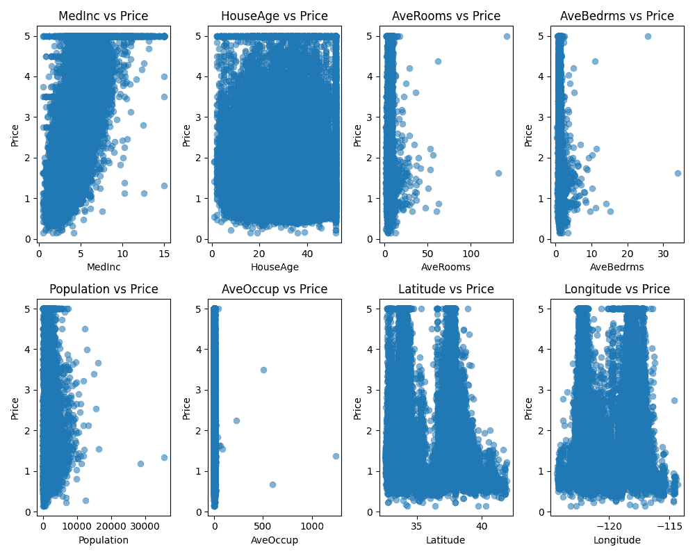
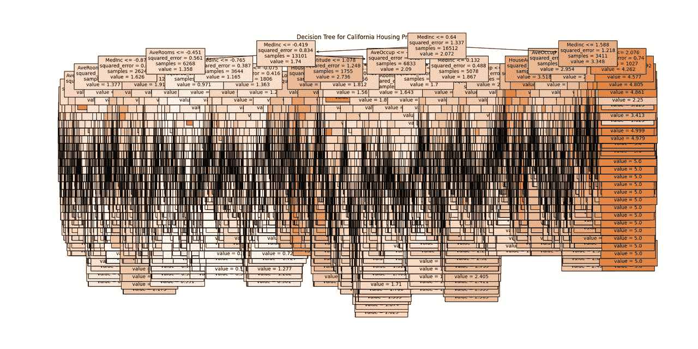
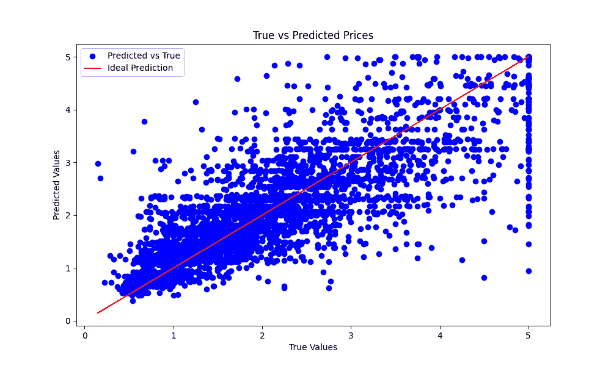

# 01-11回归算法-决策树回归

> 来源：[https://qqs7y1hozd1.feishu.cn/docx/SjI9d0bSHoxTlPx6H0WccIlnnFf](https://qqs7y1hozd1.feishu.cn/docx/SjI9d0bSHoxTlPx6H0WccIlnnFf)

决策树回归（Decision Tree Regression）是一种用来做数值预测的机器学习算法，核心思想就是 “用一棵树来做决定”。

## 什么是决策树回归？

你可以把它想象成玩“20 问题”游戏：

假设你要预测一个房子的价格，你可以问：

+   房子有多大？（如果大于100㎡，走左边；否则，走右边）

+   地段好不好？（如果是市中心，走左边；否则，走右边）

+   装修豪华吗？（是的话，走左边；否则，走右边）

你一步步问问题，把所有房子分成不同的小组，最终，每个小组都会有一个大致的房价预测值。这个 “问问题 -> 划分 -> 预测” 的过程，就是决策树回归的基本原理。

### 它是怎么工作的？

1. 把数据分组：先找出一个关键的“分割点”（比如面积大小），把数据切成两部分，让每个部分的数据更“纯”（类似的数值聚在一起）。

1. 继续划分：对每个部分再找合适的分割点，继续细分，直到满足某个停止条件（比如数据量太少，或者数据已经足够纯）。

1. 生成预测值：当数据不能再分时，取每个小组的数据平均值，作为最终的预测值。

## 原理详解

决策树回归的核心思想是通过一系列的 二元划分（将数据分成两个部分），基于不同的特征和数值条件来进行预测。

每次划分都在尽量使得每个划分后的数据组（子集）具有较小的方差，从而使得每个小组内的数据尽可能相似。最终，在叶子节点上进行数值预测，通常是该区域数据点的 均值。

### 算法流程

决策树回归的算法流程可以分为以下几个步骤：

1. 选择最佳特征进行划分：

+   对于每个特征，尝试不同的分割点（阈值）来划分数据，找到使得预测误差最小的划分方式。

1. 根据误差（损失函数）进行分裂：

+   每次划分时，我们会评估如何分裂特征，使得每个子集内的“纯度”最大化。对于回归问题，纯度通常通过 均方误差（MSE） 来衡量。

1. 递归分裂：

+   对每个子集继续递归地进行划分，直到达到停止条件。停止条件可以是：

+   达到预设的树的最大深度

+   每个叶子节点中的数据点数目低于某个阈值

+   数据已经无法进一步改善预测的误差

1. 预测：

+   对于每个新数据点，根据决策树的规则沿着树的分支走，最终到达某个叶子节点，该叶子节点的预测值就是该区域数据点的均值。

### 数学推导和公式

#### 1. 损失函数：均方误差（MSE）

在回归任务中，常见的损失函数是 均方误差（MSE），用来度量数据点与模型预测值之间的差距。对于一组数据  ，均方误差定义为：

其中，  是对于输入特征   的预测值。决策树回归的目标是最小化这个误差。

#### 2. 在节点划分中的损失评估：

在决策树回归中，选择如何划分节点的依据是最小化 节点划分后的均方误差（MSE）。假设我们在节点   上选择了一个特征   进行划分，使用阈值   来将数据划分为两部分：左子节点和右子节点。

+   左子节点包含所有满足   的数据点。

+   右子节点包含所有满足   的数据点。

对于节点  ，假设左子节点的均方误差是  ，右子节点的均方误差是  ，则总的均方误差为：

其中：

是节点   的样本数

和   分别是左子节点和右子节点的样本数

#### 3. 计算子节点的均方误差（MSE）

对于每个子节点   和  ，它们的均方误差   和   分别定义为：

其中：

是左子节点样本的预测均值，通常取左子节点所有样本   的均值。

是右子节点样本的预测均值，通常取右子节点所有样本   的均值。

#### 4. 寻找最优的划分点

在决策树的训练过程中，目标是通过遍历所有可能的特征和划分点，选择 使得MSE最小的划分。具体来说：

+   对于每个特征  ，遍历该特征的所有可能值（或预先定义的一些阈值）作为划分点。

+   对于每个划分点，计算对应的 均方误差。

+   选择 MSE最小的划分点。

### 停止条件

决策树的生成过程中通常会设置一些停止条件，例如：

+   树的最大深度：限制树的深度，避免树生长得过大。

+   最小样本数：每个节点最小样本数不能少于某个阈值。

+   最小增益：如果划分后的均方误差减少小于某个阈值，则停止划分。

### 叶子节点的预测

在回归树的叶子节点中，最终的预测值是该叶子节点中所有样本的 均值。假设在某个叶子节点中，包含了样本  ，该叶子节点的预测值   为：

整个这个过程类似于在做一次 “区域划分”，每次通过选择合适的特征和划分点，使得每个区域内的样本尽可能相似，从而能够做出更精确的数值预测。

## 完整案例

我们使用一个公开的房价数据集，展示如何应用决策树回归，并进行模型优化。

### 1. 数据准备

首先，我们需要一个房价数据集。我们使用的是 California Housing 数据集，包含多个特征，如房屋的平均房间数、家庭收入、地区、房屋的年龄等。

### 2. 数据加载与初步分析

我们将使用 `sklearn.datasets` 加载 California Housing 数据集。

```
import pandas as pd
import numpy as np
import matplotlib.pyplot as plt
from sklearn.datasets import fetch_california_housing
from sklearn.model_selection import train_test_split
from sklearn.tree import DecisionTreeRegressor
from sklearn.metrics import mean_squared_error, r2_score
from sklearn.preprocessing import StandardScaler
from sklearn.model_selection import GridSearchCV

# 加载 California Housing 数据集
data = fetch_california_housing()
X = pd.DataFrame(data.data, columns=data.feature_names)
y = pd.Series(data.target)

# 数据集基本信息
print(X.head())  # 显示前5行数据
print(y.head())  # 显示前5行目标值
```

### 3. 数据可视化

在分析数据之前，我们需要对数据进行可视化，查看特征之间的关系。

```
# 可视化特征之间的关系
plt.figure(figsize=(10, 8))

for i, column in enumerate(X.columns):
    plt.subplot(2, 4, i+1)
    plt.scatter(X[column], y, alpha=0.5)
    plt.title(f'{column} vs Price')
    plt.xlabel(column)
    plt.ylabel('Price')

plt.tight_layout()
plt.show()
```



### 4. 数据预处理与划分

在进行模型训练之前，我们需要进行数据预处理。特别地，我们需要标准化特征数据，并将数据划分为训练集和测试集。

```
# 数据标准化
scaler = StandardScaler()
X_scaled = scaler.fit_transform(X)

# 将数据划分为训练集和测试集
X_train, X_test, y_train, y_test = train_test_split(X_scaled, y, test_size=0.2, random_state=42)
```

### 5. 决策树回归模型

接下来，我们使用决策树回归算法来训练模型。

```
# 使用决策树回归
model = DecisionTreeRegressor(random_state=42)
model.fit(X_train, y_train)

# 预测训练集和测试集
y_train_pred = model.predict(X_train)
y_test_pred = model.predict(X_test)

# 评估模型
train_mse = mean_squared_error(y_train, y_train_pred)
test_mse = mean_squared_error(y_test, y_test_pred)
train_r2 = r2_score(y_train, y_train_pred)
test_r2 = r2_score(y_test, y_test_pred)

print(f"Training MSE: {train_mse:.2f}")
print(f"Testing MSE: {test_mse:.2f}")
print(f"Training R^2: {train_r2:.2f}")
print(f"Testing R^2: {test_r2:.2f}")
```

+   我们通过 均方误差（MSE） 和 决定系数（R²） 来评估模型的性能。

+   如果 训练集的 R² 很高而测试集的 R² 较低，说明模型有可能 过拟合。

### 6. 可视化决策树

为了更好地理解模型，我们可以可视化训练得到的决策树。

```
from sklearn.tree import plot_tree

plt.figure(figsize=(20, 10))
plot_tree(model, filled=True, feature_names=X.columns, fontsize=10)
plt.title("Decision Tree for California Housing Prices")
plt.show()
```

通过树形结构可以看到每个分裂的条件和特征，这有助于理解模型是如何做出决策的。



### 7. 模型优化：调参

决策树回归算法的性能很大程度上受 树的深度、最小样本叶子节点数等参数的影响。

可以使用 `GridSearchCV` 来优化这些参数。

```
# 定义参数范围
param_grid = {
    'max_depth': [5, 10, 15, 20, None],
    'min_samples_split': [2, 5, 10],
    'min_samples_leaf': [1, 2, 4],
    'max_features': ['auto', 'sqrt', 'log2', None]
}

# 使用网格搜索进行交叉验证
grid_search = GridSearchCV(DecisionTreeRegressor(random_state=42), param_grid, cv=5, scoring='neg_mean_squared_error')
grid_search.fit(X_train, y_train)

# 输出最佳参数和得分
print("Best parameters:", grid_search.best_params_)
print("Best cross-validation MSE:", -grid_search.best_score_)

# 使用最佳参数训练模型
best_model = grid_search.best_estimator_
y_test_pred_optimized = best_model.predict(X_test)

# 评估优化后的模型
test_mse_optimized = mean_squared_error(y_test, y_test_pred_optimized)
test_r2_optimized = r2_score(y_test, y_test_pred_optimized)

print(f"Optimized Testing MSE: {test_mse_optimized:.2f}")
print(f"Optimized Testing R^2: {test_r2_optimized:.2f}")
```

### 8. 模型比较与总结

在模型优化后，我们会比较优化前后的 MSE 和 R² 值：

```
# 比较优化前后的表现
print(f"Before Optimization - Testing MSE: {test_mse:.2f}, Testing R^2: {test_r2:.2f}")
print(f"After Optimization - Testing MSE: {test_mse_optimized:.2f}, Testing R^2: {test_r2_optimized:.2f}")
```

通过网格搜索和超参数调整，通常可以得到更好的模型性能，尤其是在控制过拟合的情况下。

### 9. 结果可视化：模型的预测 vs 真实值

最后，我们将绘制模型的预测值与真实值的对比图，进一步验证优化后模型的表现。

```
# 可视化真实值和预测值
plt.figure(figsize=(10, 6))
plt.scatter(y_test, y_test_pred_optimized, color='blue', label='Predicted vs True')
plt.plot([min(y_test), max(y_test)], [min(y_test), max(y_test)], color='red', label='Ideal Prediction')
plt.xlabel('True Values')
plt.ylabel('Predicted Values')
plt.title('True vs Predicted Prices')
plt.legend()
plt.show()
```



理想情况下，预测值应该与真实值完全一致，图中的红线表示这种理想关系。如果点分布接近红线，说明模型效果较好。

## 模型分析

### 决策树回归模型优缺点

### 优点：

1. 易于理解与解释：决策树回归是一个非常直观的模型，其工作原理和决策过程可以通过树形结构展示，这使得用户很容易理解特征对预测结果的影响。在需要模型解释性的场景中，决策树回归非常有优势。

1. 无需特征缩放：与其他一些回归模型（如支持向量机回归）不同，决策树回归不受特征缩放的影响。无论输入特征的范围是多少，都无需进行归一化或标准化处理，这简化了预处理过程。

1. 能够处理非线性关系：决策树回归能够有效地处理特征之间的非线性关系，这使得它非常适用于复杂的预测任务。

1. 可以处理类别特征：决策树回归可以直接处理类别数据，无需额外的转换。它会根据不同类别特征来进行划分，这在某些实际问题中非常有用。

### 缺点：

1. 容易过拟合：决策树模型如果没有进行适当的剪枝或设置合理的参数，它可能会对训练数据过度拟合，导致在测试集上的泛化能力差。特别是在数据集较小或特征较多时，过拟合问题尤为突出。

1. 模型不稳定：决策树对于数据的微小变化比较敏感，训练数据的小幅波动可能会导致树形结构发生显著变化。这种不稳定性在实际应用中可能是一个问题，特别是在对模型鲁棒性要求较高的场景中。

1. 对噪声敏感：决策树容易受到噪声数据的影响，尤其是在存在异常值的情况下，模型可能会产生不合理的预测。这是因为决策树会试图根据噪声数据划分每个节点，从而降低模型的可靠性。

1. 计算复杂度较高：虽然决策树的单个节点计算不复杂，但当树的深度增大时，计算复杂度会增加。特别是当数据维度和样本数非常大时，训练一个复杂的决策树可能需要较长时间。

### 决策树回归与相似算法的对比

| 算法 | 优点 | 缺点 | 适用场景 |
| --- | --- | --- | --- |
| 决策树回归 | 直观易懂，能够解释特征影响；能处理复杂的非线性关系；不需要特征缩放 | 容易过拟合；对噪声敏感；树结构不稳定 | 适用于数据特征之间存在复杂关系的场景，且易于解释的需求场景（例如，房价预测）。 |
| 线性回归 | 简单高效；计算开销小；适用于特征之间存在线性关系的场景 | 仅适用于线性关系；对异常值敏感；不能处理复杂的非线性关系 | 数据特征之间存在线性关系时，例如简单的预测任务或拟合线性趋势。 |
| 支持向量回归 (SVR) | 强大的分类能力，适用于高维数据；能够处理非线性问题（使用核函数） | 对参数调优要求高；计算开销较大；不适合非常大的数据集 | 适用于高维数据或者特征之间存在复杂关系的任务，特别是需要较高精度的预测。 |


# 决策树回归与集成算法选择指南

## 算法对比

| 算法 | 优点 | 缺点 | 适用场景 |
|------|------|------|----------|
| **随机森林回归** | 较好的抗过拟合能力<br>能够处理高维数据并自动进行特征选择 | 训练时间较长<br>模型较难解释<br>对噪声较为敏感 | 在训练数据集较大时，且需要较高的预测精度，特征之间复杂且具有相关性时。 |
| **梯度提升回归（GBR）** | 强大的预测能力，能够处理复杂关系<br>适用于高维数据和大数据集 | 模型训练时间长<br>对参数非常敏感<br>可能容易过拟合 | 在需要非常高预测精度的任务中，尤其是当数据存在复杂非线性关系时，且模型训练时间不是问题。 |

## 何时使用决策树回归？

### 决策树回归优选情况

1. 需要直观的模型解释：如果需要一个能够清晰解释的模型，特别是在特征对预测结果有明确影响时，决策树回归非常合适。其树形结构让模型的决策过程一目了然，便于展示给非技术人员理解。

2. 数据具有复杂的非线性关系：当数据特征之间的关系较为复杂，可能表现为非线性时，决策树回归能够有效捕捉这种复杂性，尤其是当线性回归无法提供准确预测时。

3. 缺少特征预处理：如果数据没有经过标准化处理或特征缩放，决策树回归能够处理这种情况，因为它不依赖于特征的尺度。这对于数据预处理不充分的场景尤其有用。

4. 类别特征的处理：如果数据包含类别特征，决策树回归能够直接处理这些特征，无需转换成数值型变量，因此特别适合混合型数据。

### 考虑其他算法的情况

1. 需要高精度且对过拟合敏感的情况：当需要在数据较复杂的情况下进行高精度预测时，决策树回归可能会因过拟合而表现不佳。此时可以考虑使用 随机森林回归 或 梯度提升回归，它们能够通过集成学习减少过拟合的风险，并提供更稳定的预测。

2. 数据量大且计算开销较大时：决策树回归可能需要长时间进行训练，尤其是当数据集非常大且树的深度较深时。在这种情况下，可能需要考虑 线性回归（如果数据特征之间存在线性关系）或者 支持向量回归（SVR），后者能够在高维空间中处理复杂的非线性关系。

3. 特征之间存在线性关系时：如果特征和目标变量之间存在线性关系，使用 线性回归 会更简单、快速，并且易于理解。线性回归通常能够提供较好的预测效果，尤其是当数据集的规模较小时。

4. 对噪声数据非常敏感时：如果数据集包含较多噪声或异常值，决策树回归可能会过拟合噪声数据。在这种情况下，可以使用 支持向量回归 或 随机森林回归，它们对噪声数据具有更好的鲁棒性。

## 总结

**决策树回归** 适合在数据特征间关系复杂且需要较高模型可解释性的任务中使用，但在面对 过拟合问题 或 数据噪声 时，需要进行优化（如剪枝或使用集成方法）。

**随机森林** 和 **梯度提升回归** 是处理高维和复杂关系的强大工具，能提供更高的预测精度，适用于较为复杂的任务，但训练时间较长且模型不易解释。

**线性回归** 和 **支持向量回归** 在数据线性可分且对模型精度要求不高时是良好的选择。
