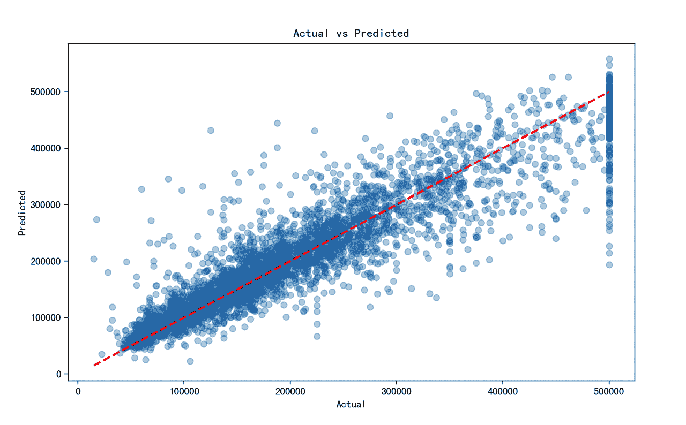
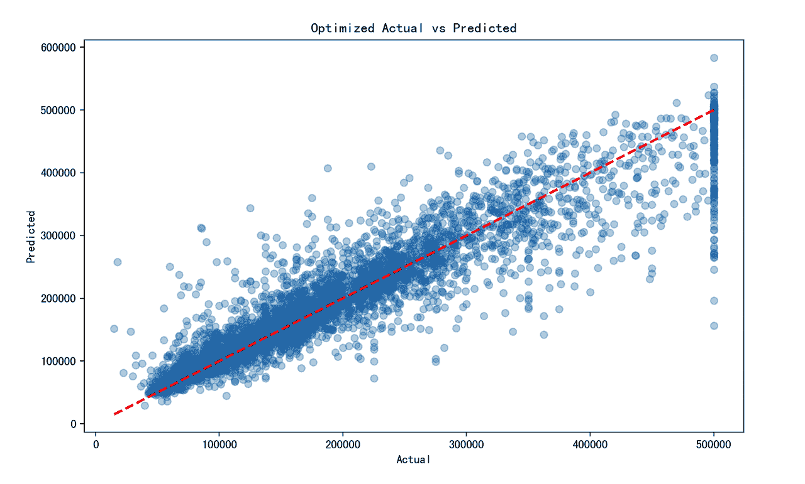
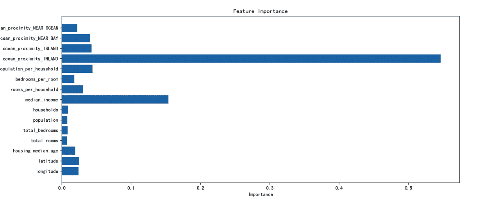

# 02-05分类算法-XGBoost

> 来源：[https://qqs7y1hozd1.feishu.cn/docx/WIFRdOzqioRt5KxOOm8csVN0neY](https://qqs7y1hozd1.feishu.cn/docx/WIFRdOzqioRt5KxOOm8csVN0neY)

XGBoost，全称为 eXtreme Gradient Boosting，XGBoost 是一种提升（Boosting）算法。

它通过将多个简单的模型（通常是决策树）组合在一起，逐步改进模型的预测能力。简单来说，XGBoost就是通过让一群“弱小的”模型一起工作，最终变得“很强大”。而且 XGBoost 用于回归、分类等任务。

下面，给出大家4个 XGBoost 的优点，大家可以很好的有一个大致印象~

+   **高效：** 算法速度快，计算资源利用效率高。

+   **准确：** 可以处理复杂的数据，生成高质量的预测。

+   **灵活：** 可以处理各种类型的数据，包括缺失值和类别变量。

+   **可扩展：** 适用于大规模数据集，可以在分布式环境中运行。

假设我们要预测一个学生的考试成绩。

我们可以使用XGBoost来建立模型：

+   第一步，我们用一些简单的规则（比如，学生是否参加了补习班，是否每天学习超过2小时等）建立一个初步的预测模型。这是我们的一棵“决策树”。

+   第二步，我们观察这棵树预测的误差（比如，某些学生的成绩预测过高或过低），然后再建立一棵新的决策树，专门来纠正这些误差。

+   重复这个过程，建立多棵决策树，每棵树都修正前面树的错误。

+   最终，我们把所有树的预测结果综合起来，就得到了一个非常准确的预测模型。

## 理论基础

基础原理这部分，我会从 XGBoost 的数学原理、公式推理和算法流程三大部分和大家进行阐述~

### 目标函数

**XGBoost 的**目标函数由两个部分组成：损失函数和正则化项。

目标函数的表达式为：

其中：

+    是真实值

+    是预测值

+    是损失函数，通常为均方误差 (MSE) 或对数损失

+    是第  棵树

+    是正则化项，用于控制模型的复杂度

### 梯度提升

XGBoost 通过逐步添加树来最小化损失函数，每一步都是在前一步的基础上改进预测。

假设我们已经有了  棵树，第  棵树的目标是最小化下述的增量损失函数：

其中：

是前  棵树的预测值

是第  棵树的预测值

### 泰勒展开

为了简化目标函数，我们对损失函数进行二阶泰勒展开：

其中：

+    是一阶导数（梯度）

+    是二阶导数（Hessian）

将常数项去掉后，简化为：

### 树模型和正则化

XGBoost 中每棵树的模型可以表示为：

其中：

+    是叶子节点的索引函数，将输入  映射到叶子节点

+    是叶子节点的权重

正则化项定义为：

其中：

是叶子节点的数量

和  是正则化参数，控制树的复杂度

### 最优化目标

将树模型和正则化项代入简化的目标函数：

对同一个叶子节点的样本求和：

其中：

是第  个叶子节点的梯度之和

是第  个叶子节点的 Hessian 之和

通过对  求导并令其为零，得到最优的叶子节点权重：

将最优权重代入目标函数，得到最小化后的目标值：

### 树的分裂

为了找到最优的分裂点，XGBoost 计算每个候选分裂点的增益：

其中：

和  分别是左子节点的梯度和 Hessian 之和

和  分别是右子节点的梯度和 Hessian 之和

选择增益最大的分裂点进行分裂。

### 算法流程

XGBoost 的整体算法流程：

**1. 初始化：** 初始化预测值  为一个常数值（通常为目标值的平均值）。

**2. 迭代：** 对于每一棵树  ，进行以下步骤：

a. 计算梯度和 Hessian： 计算每个样本的梯度  和 Hessian  。

**b. 构建树：** 逐层分裂节点，计算每个候选分裂点的增益，选择增益最大的分裂点，直至达到预设的叶子节点数或增益小于阈值。

**c. 计算叶子节点权重：** 根据梯度和 Hessian 计算每个叶子节点的权重  。

**3. 更新预测值：** 更新每个样本的预测值  。

通过以上步骤，不断迭代构建新的树，每棵树都在前一棵树的基础上改进，最终得到一个强大的模型。

好了，在所有的理论之后，后面给大家分享一个比较合适的案例，大家可以根据代码以及注释的内容进行学习~

## 完整案例

来到了案例部分~

整个代码实现过程，通过数据预处理、特征工程、模型训练和优化以及可视化展示结果。我们选择Kaggle上的房价预测数据集（House Prices - Advanced Regression Techniques）来进行演示。

数据集获取，👸号「深夜努力写Python」后台回复『数据集』即可~

**导入库和数据集**

```
import numpy as np
import pandas as pd
import xgboost as xgb
from sklearn.model_selection import train_test_split, GridSearchCV, cross_val_score
from sklearn.metrics import mean_squared_error
import matplotlib.pyplot as plt
import seaborn as sns

# 导入数据集
train_data = pd.read_csv(&#x27;housing.csv&#x27;)
train_data.head()
```

**数据预处理**

```
# 检查缺失值
train_data.isnull().sum()

# 填充缺失值
train_data[&#x27;total_bedrooms&#x27;].fillna(train_data[&#x27;total_bedrooms&#x27;].median(), inplace=True)

# 创建特征
train_data[&#x27;rooms_per_household&#x27;] = train_data[&#x27;total_rooms&#x27;] / train_data[&#x27;households&#x27;]
train_data[&#x27;bedrooms_per_room&#x27;] = train_data[&#x27;total_bedrooms&#x27;] / train_data[&#x27;total_rooms&#x27;]
train_data[&#x27;population_per_household&#x27;] = train_data[&#x27;population&#x27;] / train_data[&#x27;households&#x27;]

# 将分类特征转换为数值
train_data = pd.get_dummies(train_data, columns=[&#x27;ocean_proximity&#x27;], drop_first=True)

# 定义特征和标签
X = train_data.drop(&#x27;median_house_value&#x27;, axis=1)
y = train_data[&#x27;median_house_value&#x27;]
```

**数据集划分**

```
# 划分训练集和测试集
X_train, X_test, y_train, y_test = train_test_split(X, y, test_size=0.2, random_state=42)
```

**模型训练**

```
# 创建XGBoost回归模型
xgb_reg = xgb.XGBRegressor()

# 训练模型
xgb_reg.fit(X_train, y_train)
```

**模型评估**

```
# 预测
y_pred = xgb_reg.predict(X_test)

# 均方根误差
rmse = np.sqrt(mean_squared_error(y_test, y_pred))
print(f&quot;RMSE: {rmse:.4f}&quot;)

# 可视化实际值与预测值的关系
plt.figure(figsize=(10, 6))
plt.scatter(y_test, y_pred, alpha=0.3)
plt.plot([y_test.min(), y_test.max()], [y_test.min(), y_test.max()], &#x27;r--&#x27;, lw=2)
plt.xlabel(&#x27;Actual&#x27;)
plt.ylabel(&#x27;Predicted&#x27;)
plt.title(&#x27;Actual vs Predicted&#x27;)
plt.show()
```



**模型优化（超参数调优）**

```
# 参数网格
param_grid = {
    &#x27;max_depth&#x27;: [3, 5, 7],
    &#x27;learning_rate&#x27;: [0.01, 0.1, 0.2],
    &#x27;n_estimators&#x27;: [100, 200, 300],
    &#x27;subsample&#x27;: [0.8, 1],
    &#x27;colsample_bytree&#x27;: [0.8, 1]
}

# 网格搜索
grid_search = GridSearchCV(estimator=xgb_reg, param_grid=param_grid, scoring=&#x27;neg_mean_squared_error&#x27;, cv=3, verbose=1)
grid_search.fit(X_train, y_train)

# 最优参数
best_params = grid_search.best_params_
print(f&quot;Best parameters: {best_params}&quot;)

# 使用最优参数训练模型
xgb_reg_optimized = xgb.XGBRegressor(**best_params)
xgb_reg_optimized.fit(X_train, y_train)

# 预测
y_pred_optimized = xgb_reg_optimized.predict(X_test)

# 均方根误差
rmse_optimized = np.sqrt(mean_squared_error(y_test, y_pred_optimized))
print(f&quot;Optimized RMSE: {rmse_optimized:.4f}&quot;)

# 可视化实际值与预测值的关系（优化后）
plt.figure(figsize=(10, 6))
plt.scatter(y_test, y_pred_optimized, alpha=0.3)
plt.plot([y_test.min(), y_test.max()], [y_test.min(), y_test.max()], &#x27;r--&#x27;, lw=2)
plt.xlabel(&#x27;Actual&#x27;)
plt.ylabel(&#x27;Predicted&#x27;)
plt.title(&#x27;Optimized Actual vs Predicted&#x27;)
plt.show()
```



**特征重要性**

```
# 特征重要性
importance = xgb_reg_optimized.feature_importances_
features = X.columns

# 可视化
plt.figure(figsize=(10, 6))
plt.barh(features, importance)
plt.xlabel(&#x27;Importance&#x27;)
plt.ylabel(&#x27;Features&#x27;)
plt.title(&#x27;Feature Importance&#x27;)
plt.show()
```



整个代码的过程中，展示了如何使用XGBoost算法对房价数据集进行预测。通过数据预处理、特征工程、模型训练、评估、优化和特征重要性可视化，完整地展示了机器学习项目的流程。通过超参数调优，可以显著提高模型的预测性能。在实际项目中，大家可以根据需要调整数据预处理和模型优化的步骤和参数，获得更好的效果。

## 模型分析

**使用XGBoost模型的优缺点**

**优点**：

+   **高效性**：XGBoost在计算上非常高效，支持并行和分布式计算，能够处理大型数据集。

+   **性能优越**：它通常在结构化数据集上表现出色，具有较高的预测准确率。

+   **自动化特征选择**：通过树模型自动选择重要特征，减少了手动特征选择的工作量。

+   **防止过拟合**：通过内置的正则化参数（如(\gamma)和(\lambda)）控制模型复杂度，防止过拟合。

+   **灵活性**：支持多种目标函数和自定义目标函数，适用于分类和回归问题。

+   **处理缺失值**：自动处理缺失值，推测出合适的分支方向。

**缺点**：

+   **参数调优复杂**：需要调整多个超参数以获得最佳性能，调优过程可能较为复杂和耗时。

+   **对内存要求较高**：在处理非常大的数据集时，内存占用较高，可能需要大量内存。

+   **对数据预处理敏感**：尽管XGBoost自动处理缺失值，但数据标准化、归一化等预处理仍然重要，影响模型性能。

### 与相似算法的对比

| **对比项** | XGBoost vs. Random Forest | XGBoost vs. GBDT |
| --- | --- | --- |
| **算法类别** | 都是基于决策树的集成学习方法 | 都属于提升法（Boosting） |
| **基学习器** | 决策树 | 决策树 |
| **主要区别** | XGBoost 使用提升法（Boosting），每棵树依赖于前一棵树；随机森林使用袋装法（Bagging），每棵树独立训练 | XGBoost 是 GBDT 的高效实现，加入了正则化、并行计算等优化 |
| **处理问题类型** | 分类和回归 | 分类和回归 |
| **特征选择能力** | 都具有较强的特征选择能力 | 都具有较强的特征选择能力 |
| **性能** | XGBoost 在大规模、高维数据上通常比随机森林表现更好 | XGBoost 在计算效率和优化上优于传统 GBDT |
| **计算复杂度** | XGBoost 计算复杂度较高，但可以通过并行计算提高效率；随机森林计算复杂度较低 | XGBoost 计算效率更高，优化了内存使用和计算资源 |
| **超参数调优** | 随机森林超参数较少，较容易调优 | XGBoost 拥有更多可调参数，使得调优更灵活 |
| **并行计算** | 随机森林天生支持并行，每棵树可独立训练 | XGBoost 通过优化支持并行计算，但仍是串行提升的方式 |
| **正则化处理** | 随机森林没有显式的正则化 | XGBoost 引入 L1、L2 正则化，降低过拟合风险 |
| **适用场景** | 适用于解释性要求高、数据关系复杂但不强依赖顺序的任务 | 适用于对计算性能要求高、需要精细调优的任务，如金融、推荐系统等 |

+   **何时选择 XGBoost**：当数据量大、特征多、需要高精度预测时，XGBoost 是更好的选择。

+   何时选择 Random Forest：当计算资源有限，且需要解释性强的模型时，随机森林更适合。

+   **何时选择 GBDT**：XGBoost 是 GBDT 的优化版本，如果使用传统 GBDT，建议切换到 XGBoost 以获得更高的计算效率和优化能力。

## 最后

以上阐述了整个的XGBoost。XGBoost作为一种强大的集成学习算法，在许多应用场景中表现出色，尤其适用于大规模结构化数据集。

通过高效的实现、强大的特征选择能力和防止过拟合的机制，成为机器学习比赛和实际应用中的热门选择。然而，在数据规模较小、计算资源受限或非结构化数据的情况下，其他算法可能更为适用。

因此，根据具体的应用场景和需求，选择合适的算法至关重要。