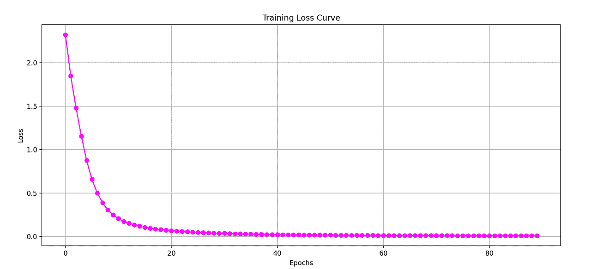
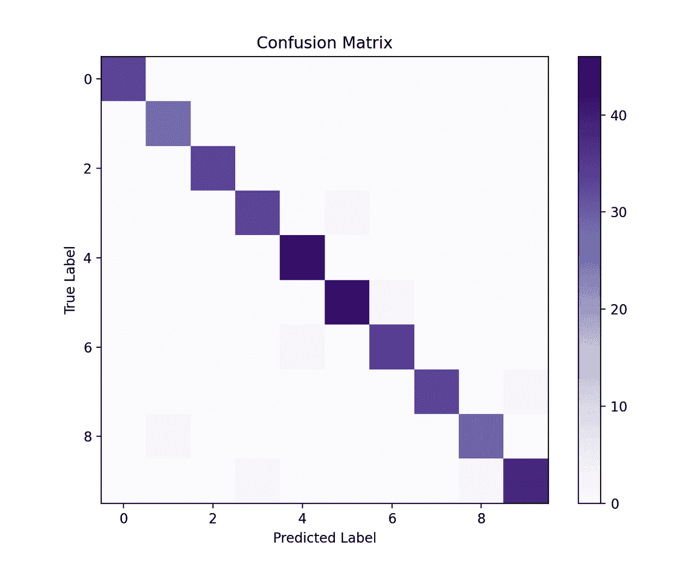
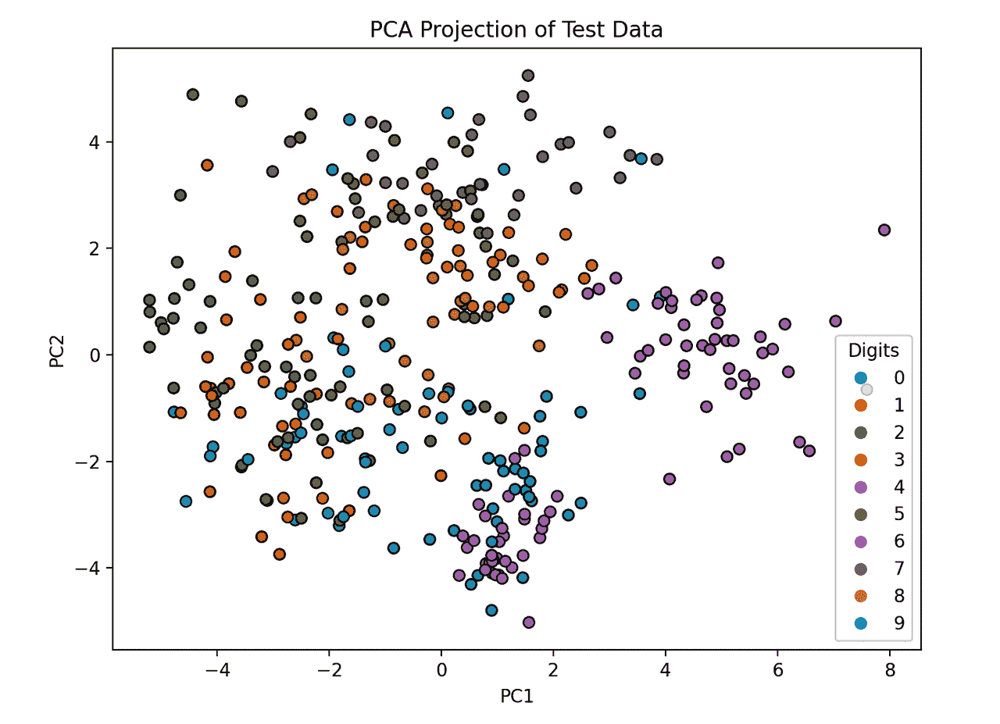

# 02-06分类算法-多层感知机分类器

> 来源：[https://qqs7y1hozd1.feishu.cn/docx/MSQ0dcvscobkQ7x0KBbchWWonhf](https://qqs7y1hozd1.feishu.cn/docx/MSQ0dcvscobkQ7x0KBbchWWonhf)

这里，给大家介绍的是，分类算法中的多层感知机分类器~

#### 什么是“分类算法”？

先说分类算法，它就是一种**把东西分组的工具**。

比如你看到一张图片，能判断它是猫还是狗；医生看到一些体**检指标，**判断一个人有没有某种病……这就是分类任务，算法的目标是：

给定一些信息（特征），判断它属于哪一类。

#### 什么是多层感知机（MLP）分类器？

MLP，全名是**多层感知机****（Mul**tilayer Perceptron），其实就是一种神经网络模型。你可以把它理解为一个模仿人脑“神经元”运作的数学模型，用来“学会”如何分辨不同的东西。

**简单理解：**它就像是一个会学习的“大公式”，我们把样本给它（比如猫的图片、狗的图片），它通过里面的一堆“神经元”和“数学计算”来学会：以后再看到一个新东西，就知道它该归到哪一类。

## MLP的结构

可以想象 MLP 是由几层“神经元”组成的：

+   输入层：接收你提供的数据（比如图片像素、身高体重等）

+   隐藏层：中间负责“加工理解”的部分，可能有好几层

+   输出层：最后给出“预测结果”（比如是“猫”还是“狗”）

**每一层都**有很多“节点”互相连接，像一张网一样，所以也叫神经网络。

举个简单的例子，假设我们有一组数据，要判断一个人是否适合参加马拉松比赛。你提供的数据可能是：

+   年龄

+   平时锻炼频率

+   体重

+   心肺功能评分

这些数据输入到 MLP，它就会“学习”哪些特征对应“适合”和“不适合”。

最终它就能根据这些特征判断一个新人的情况是不是“适合”。

总的来说，多层感知机分类器 就是一种通过“模仿人脑”的方法，把你提供的数据输入进去，它就能学会如何分门别类，预测新数据属于哪一类。

## 原理详解

### 1. 基础概念与结构

#### 1. 感知机（Perceptron）

感知机是最基本的神经网络单元，表示为：

其中：

：输入向量

：权重向量

：偏置项

：激活函数，例如 sigmoid、ReLU、tanh

#### 2. 多层感知机（MLP）

一个典型的 MLP 包含以下结构：

+   **输入层**：输入特征

+   **一个或多个隐藏层**：神经元带激活函数

+   **输出层**：最终的分类概率或标签

用数学表示，每一层都执行：

其中：

：第   层的输出（激活值）

：线性组合

：第   层的权重矩阵

：第   层的偏置向量

：激活函数

### 2. 前向传播推导

**假设结构如下**：

+   输入：

+   隐藏层：一层，激活函数为 ReLU

+   输出层：Softmax，用于分类（多类）

#### 1. 隐藏层计算：

#### 2. 输出层计算（Softmax）：

这里：

：每个类别的预测概率

：分类类别总数

---

### 3. 损失函数

我们用交叉熵损失（Cross Entropy Loss），常用于分类：

设目标标签为 one-hot 向量  ，预测为  ，损失为：

如果目标标签是类别  ，那么  ，其余为 0，损失简化为：

### 4. 反向传播

我们对每一层参数求损失函数的梯度，从输出层向输入层反向传播。

#### 1. 输出层梯度（Softmax + CrossEntropy 联合推导）

对于 softmax + cross entropy，输出层的梯度简化为：

#### 2. 输出层权重与偏置的梯度：

#### 3. 反向传播到隐藏层：

令：

然后传播回隐藏层：

其中：

：Hadamard积（对应元素相乘）

：ReLU 的导数，满足：

#### 4. 隐藏层权重与偏置梯度：

---

### 5. 参数更新（梯度下降）

使用梯度下降进行参数更新，学习率为  ：

可选优化器：SGD、Adam、RMSProp 等。

---

## 完整算法流程

MLP 分类训练：

1.  **初始化权重**：用正态分布或 Xavier/He 初始化

1.  **前向传播**：逐层计算输出值

1.  **计算损失函数**：使用交叉熵

1.  **反向传播**：

+   从输出层开始计算梯度

+   一层层往回传导梯度

1.  **更新参数**：使用梯度下降或其他优化器

1.  **重复步骤2-5**，直到损失收敛或达到最大迭代次数

## 完整案例

这里给出一个完整的案例代码，整体分为以下几大部分：

1.  **数据准备与预处理**

1.  **初始模型训练与评估**

1.  超参数优化（Grid Search）

1.  **训练过程可视化分析**

1.  **分类性能分析**

1.  **特征空间可视化（PCA 投影）**

1.  **算法改进与优化方向**

**代码实现：**

```
import numpy as np
import matplotlib.pyplot as plt
from sklearn.datasets import load_digits
from sklearn.model_selection import train_test_split, GridSearchCV
from sklearn.neural_network import MLPClassifier
from sklearn.preprocessing import StandardScaler
from sklearn.metrics import confusion_matrix, classification_report
from sklearn.decomposition import PCA

# 1. 加载手写数字数据集
digits = load_digits()
X = digits.data  # 特征矩阵
y = digits.target  # 标签向量

# 2. 划分训练集和测试集
X_train, X_test, y_train, y_test = train_test_split(
    X, y, test_size=0.2, random_state=42)

# 3. 数据标准化
scaler = StandardScaler()
X_train_scaled = scaler.fit_transform(X_train)
X_test_scaled = scaler.transform(X_test)

# 4. 训练初始 MLP 模型
mlp = MLPClassifier(hidden_layer_sizes=(100,), activation=&#x27;relu&#x27;,
                    solver=&#x27;adam&#x27;, max_iter=200, random_state=42, verbose=True)
mlp.fit(X_train_scaled, y_train)

# 5. 网格搜索优化超参数
param_grid = {
    &#x27;hidden_layer_sizes&#x27;: [(50,), (100,), (100, 50)],
    &#x27;alpha&#x27;: [0.0001, 0.001, 0.01]
}
grid = GridSearchCV(
    MLPClassifier(activation=&#x27;relu&#x27;, solver=&#x27;adam&#x27;, max_iter=200, random_state=42),
    param_grid, cv=3, verbose=2, n_jobs=-1
)
grid.fit(X_train_scaled, y_train)
best = grid.best_estimator_

# 6. 在测试集上评估最佳模型
y_pred = best.predict(X_test_scaled)
cm = confusion_matrix(y_test, y_pred)

# 7. 可视化：训练损失曲线
plt.figure(figsize=(8, 6))
plt.plot(best.loss_curve_, marker=&#x27;o&#x27;, color=&#x27;magenta&#x27;)
plt.title(&quot;Training Loss Curve&quot;)
plt.xlabel(&quot;Epochs&quot;)
plt.ylabel(&quot;Loss&quot;)
plt.grid(True)

# 8. 可视化：混淆矩阵
plt.figure(figsize=(8, 6))
plt.imshow(cm, interpolation=&#x27;nearest&#x27;, cmap=plt.cm.Purples)
plt.title(&quot;Confusion Matrix&quot;)
plt.xlabel(&quot;Predicted Label&quot;)
plt.ylabel(&quot;True Label&quot;)
plt.colorbar()

# 9. 可视化：PCA 降维散点图
pca = PCA(n_components=2)
X_pca = pca.fit_transform(X_test_scaled)
plt.figure(figsize=(8, 6))
scatter = plt.scatter(
    X_pca[:, 0], X_pca[:, 1], c=y_test, cmap=&#x27;tab10&#x27;, edgecolor=&#x27;k&#x27;
)
plt.legend(*scatter.legend_elements(), title=&quot;Digits&quot;)
plt.title(&quot;PCA Projection of Test Data&quot;)
plt.xlabel(&quot;PC1&quot;)
plt.ylabel(&quot;PC2&quot;)

plt.show()

# 10. 打印分类报告
print(&quot;Classification Report:\n&quot;, classification_report(y_test, y_pred))
```

### 1. 初始模型训练与评估

构建基础 MLPClassifier

```
mlp = MLPClassifier(hidden_layer_sizes=(100,), activation=&#x27;relu&#x27;,
                    solver=&#x27;adam&#x27;, max_iter=200, random_state=42, verbose=True)
mlp.fit(X_train_scaled, y_train)
```

+   hidden_layer_sizes=(100,)：一个隐藏层，含 100 个神经元

+   activation='relu'：ReLU 激活函数，加快训练、缓解梯度消失

+   **solver='adam'**：Adam 优化器，自适应学习率

+   **max_iter=200**：最多迭代 200 个 epoch

+   **verbose=True**：打印训练过程中的损失值

**初步观察**

+   训练过程中损失（loss）迅速下降，从 ~2.5 下降至 ~0.005，说明网络能够较好拟合训练数据。

+   若早期训练就收敛（loss did not improve），提示模型容量已经足够或学习率偏低。

### 2. 超参数优化

**1. 定义待调参数空间**

```
param_grid = {
    &#x27;hidden_layer_sizes&#x27;: [(50,), (100,), (100, 50)],
    &#x27;alpha&#x27;: [0.0001, 0.001, 0.01]
}
```

+   hidden_layer_sizes：测试单层 50、100 及双层 (100,50)

+   **alpha**：L2 正则化强度，防止过拟合

2. 执行 GridSearchCV

```
grid = GridSearchCV(
    MLPClassifier(activation=&#x27;relu&#x27;, solver=&#x27;adam&#x27;, max_iter=200, random_state=42),
    param_grid, cv=3, verbose=2, n_jobs=-1)
grid.fit(X_train_scaled, y_train)
best = grid.best_estimator_
```

+   **cv=3**：3 折交叉验证

+   **n_jobs=-1**：并行计算

+   **输出**：选出在验证集上表现最好的模型 best

**3. 优化意义**

+   隐层结构和正则化强度是影响 MLP 性能的关键因素。

+   Grid Search 能系统化地探索参数空间，找到接近全局最优的配置。

### 3. 训练过程可视化分析

1. 损失曲线（Loss Curve）



如果损失快速下降并趋于平稳，说明学习率和模型容量合适；如果震荡或下降缓慢，则可能需要调整优化器参数（如学习率、batch size）。

2. 混淆矩阵（Confusion Matrix）



行表示真实标签，列表示预测标签。对角线元素（True Positive）越多，说明分类越准确；离对角线远的错误越多，说明模型在某些类别上分辨困难。

通过混淆矩阵可发现，数字 “1” 和 “7” 容易混淆，“9” 和 “4” 容易误判……可针对弱项做数据增强或重采样。

### 4. 分类性能分析

```
print(&quot;Classification Report:\n&quot;, classification_report(y_test, y_pred))
```

**指标**：

+   **Precision**（精确率）：预测为某类时，有多少比例是真正该类

+   **Recall**（召回率）：真实为某类时，有多少比例被正确预测

+   **F1-score**：精确率和召回率的调和平均

**分析**：

+   每个数字类别的 F1-score 大多接近 0.98–1.00，整体性能非常优秀。

+   **若某类**明显偏低，可考虑对该类进行过采样或在数据集中增加样本多样性。

### 5. 特征空间可视化（PCA 投影）

```
pca = PCA(n_components=2)
X_pca = pca.fit_transform(X_test_scaled)
scatter = plt.scatter(
    X_pca[:, 0], X_pca[:, 1], c=y_test, cmap=&#x27;tab10&#x27;, edgecolor=&#x27;k&#x27;
)
plt.legend(*scatter.legend_elements(), title=&quot;Digits&quot;)
plt.title(&quot;PCA Projection of Test Data&quot;)
plt.xlabel(&quot;PC1&quot;)
plt.ylabel(&quot;PC2&quot;)
```



+   将 64 维数据通过 PCA 降到 2 维，方便可视化。

+   不同类别在 PC1–PC2 空间中有清晰的簇状分布，说明原始特征对分类任务是可区分的。

+   若某些类别簇混合严重，可考虑**非线性降维**（如 t-SNE、UMAP）以更直观地观察类间干扰。

### 6. 算法改进与优化方向

1.  **网络结构优化**

+   **更深层次**：尝试更多隐藏层，如 (100, 100, 50)；

+   **宽度调整**：增大每层神经元数量，提高模型表达能力。

1.  **优化器与学习率调度**

+   **AdamW**：改进版的 Adam，单独正则化权重；

+   **学习率衰减**：在训练过程中动态降低学习率（learning_rate='adaptive' 或使用 ReduceLROnPlateau）；

1.  **正则与防过拟合**

+   **更强的 L2 正则化**：增加 alpha；

+   **Dropout 层**：随机丢弃部分神经元；

+   **Early Stopping**：在验证集上不再提升时提前停训。

1.  **数据增强与扩充**

+   对图像数据进行**旋转**、**平移**、**噪声**，提高模型鲁棒性。

1.  **更高级的网络**

+   对于图像分类，可引入**卷积神经网络（CNN）**，效果通常优于 MLP。

## 模型分析

### 使用多层感知机分类器的优点

1.  **强大的非线性建模能力**：MLP 属于前馈神经网络，可以学习数据中的复杂非线性关系。在手写数字这类图像任务中，特征间存在高度非线性交互，MLP 具有天然优势。

1.  **通用性强**：只要输入是数值型特征，MLP 可以处理几乎所有分类问题。它不像 CNN 那样只适合图像，也不像决策树那样只能处理结构化数据。

1.  **支持多分类问题**：本例中 0–9 共 10 类，MLP 可以通过 Softmax 层处理多类输出。

1.  **可自定义结构和激活函数**：用户可以根据任务需求设置隐藏层数量、宽度和激活函数，构建轻量或深度模型。

1.  **内置早停机制**：early_stopping=True 能在验证性能不再提升时自动中止训练，防止过拟合。

### 使用 MLPClassifier 的局限性

1.  **训练成本较高**：相比于支持向量机（SVM）、随机森林等传统方法，MLP 的训练时间较长，特别是在特征维度较高、网络较深时。

1.  **参数多、调优复杂**：需要调整层数、节点数、学习率、正则项、优化器等多个超参数，调参成本高。

1.  **对特征缩放敏感**：输入数据需要标准化（如使用 StandardScaler），否则训练不收敛或效果很差。

1.  **不具备可解释性**：与决策树、逻辑回归相比，MLP 是“黑箱模型”，难以解释特征对预测的具体影响。

1.  **容易过拟合小数据集**：对于样本数较少的问题，MLP 容易记住训练数据，泛化能力差。

### 与相似算法的对比分析

| 算法 | 是否非线性建模 | 训练速度 | 对特征缩放敏感 | 易调参数性 | 可解释性 | 小数据集表现 | 大数据集表现 | 多分类能力 |
| --- | --- | --- | --- | --- | --- | --- | --- | --- |
| MLPClassifier（多层感知机） | 强 | 中等偏慢 | 敏感 | 难 | 差 | 可能过拟合 | 强 | 支持 |
| SVM | 核技巧 | 较慢 | 敏感 | 较难 | 一般 | 好 | 慢 | 支持 |
| KNN | 简单非线性 | 快 | 敏感 | 简单 | 强 | 好 | 慢 | 支持 |
| 随机森林 | 弱非线性 | 快 | 不敏感 | 简单 | 好 | 稳定 | 好 | 支持 |
| 逻辑回归 | 线性 | 快 | 敏感 | 简单 | 非常好 | 好 | 弱 | 支持 |
| CNN | 强 | 慢 | 敏感 | 难 | 差 | 易过拟合 | 极强 | 支持 |

### MLPClassifier 是首选的场景

+   任务涉及明显的 **非线性关系**，如图像分类、语音识别、文本向量分类。

+   **数据量中等或较大**，能提供足够训练样本避免过拟合。

+   模型精度比模型可解释性更重要的任务。

+   有能力进行调参、验证，并可视化网络训练过程。

### 更适合使用其他算法的场景

+   **小样本、低维数据集**：逻辑回归或 KNN 通常比 MLP 更快且不易过拟合。

+   **要求可解释性高的任务**：如医疗诊断、信用评分等，应优先选用逻辑回归或决策树。

+   **训练时间非常有限**：随机森林训练更快，且无需特征缩放。

+   **图像识别精度要求极高**：可使用 CNN 取代 MLP，前者对空间信息建模能力更强。

### 总结

多层感知机是一个强大的分类工具，适合处理高维、非线性、复杂任务，但在训练时间、调参复杂性、解释性方面存在劣势。它是通用神经网络的基础形式，适合用作基线模型，也常被用于较小规模任务中的深度学习尝试。