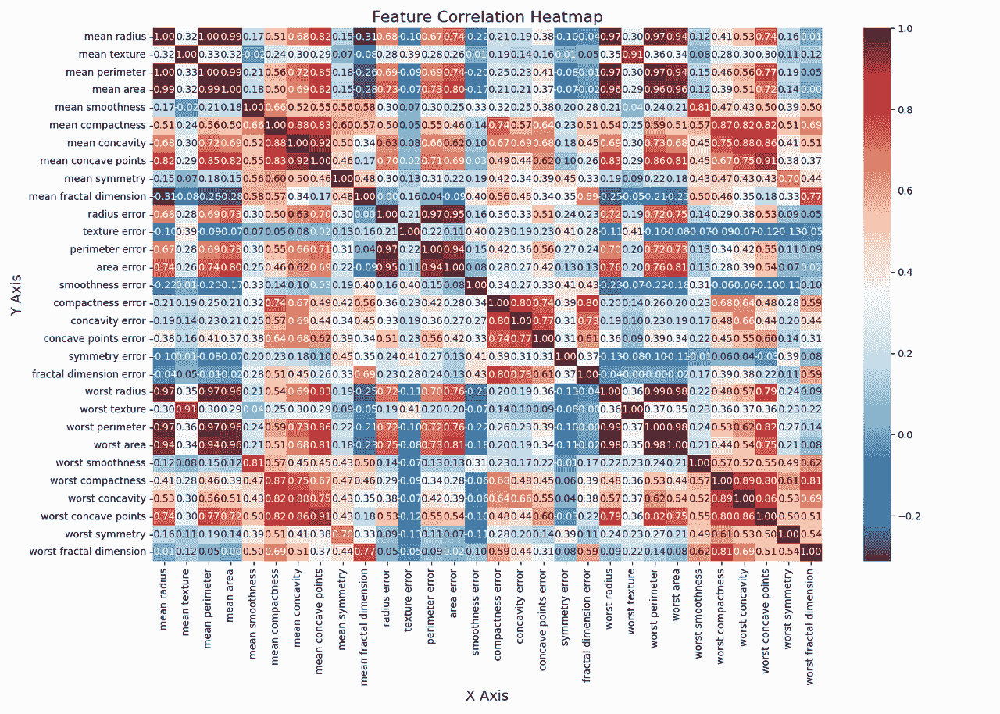
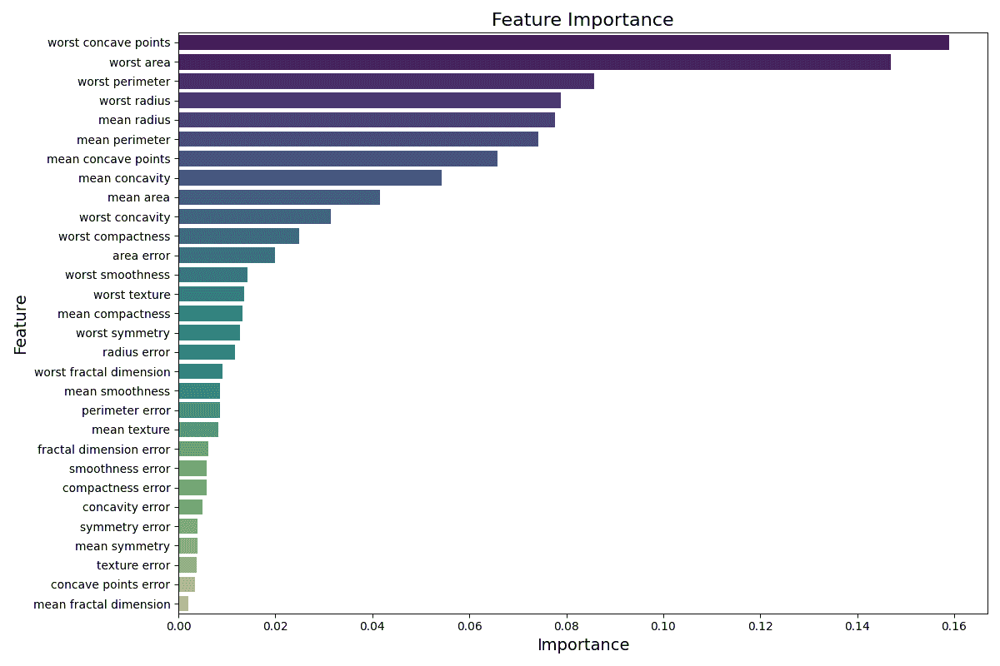
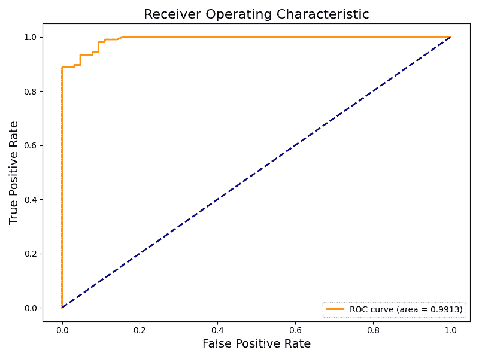
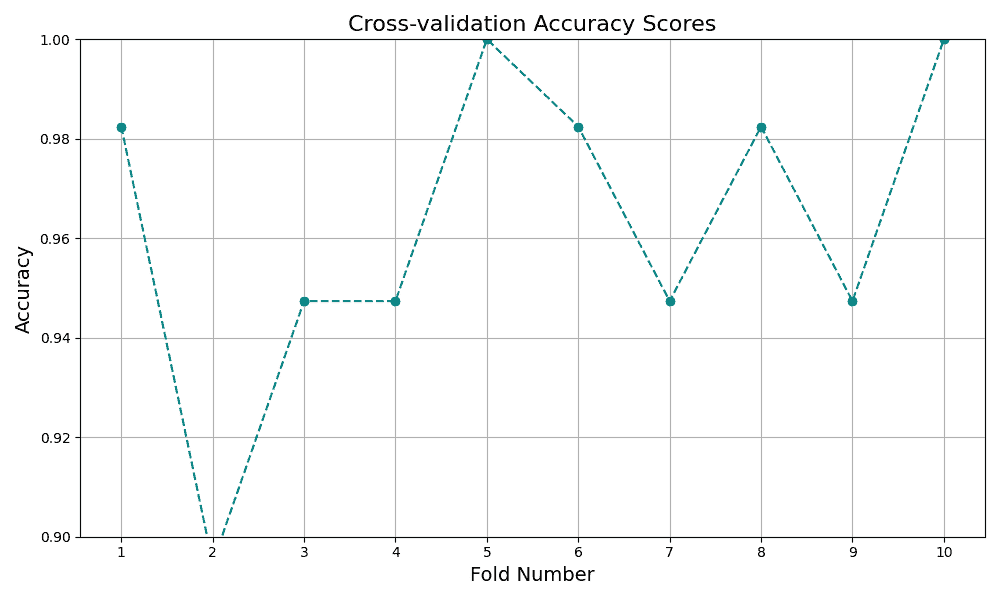

# 03-08集成算法-随机森林

> 来源：[https://qqs7y1hozd1.feishu.cn/docx/XVWLdAoYwobmGHx1TpTcPpZxnsf](https://qqs7y1hozd1.feishu.cn/docx/XVWLdAoYwobmGHx1TpTcPpZxnsf)

随机森林（Random Forest）是一种很重要的“集成学习”算法。它就像一个“智慧委员会”，由很多棵“决策树”组成，每棵树都是一个“小专家”。

当你有一个问题要解决时，比如判断一封邮件是“垃圾邮件”还是“正常邮件”，每棵决策树都会给出自己的判断，然后随机森林会“投票”，选择票数最多的那个结果作为最终答案。

**为什么要用随机森林？**

1.  **降低过拟合风险**：单棵决策树很容易“记住”训练数据（过拟合），但多棵树一起投票，能互相“纠错”，结果更稳健。

1.  **对特征不敏感**：决策树能自动选择重要特征，随机森林又通过随机挑选特征，让模型不依赖某几个变量，更加通用。

1.  **易于并行**：每棵树可以独立训练，天然适合多核/分布式环境，加速很容易。

1.  **效果好、调参少**：对初学者友好，默认参数往往就能得到不错的效果。

**随机森林是如何工作的？**

1.  有放回抽样（Bootstrap）：从原始数据集中随机抽取子集，允许重复，让每棵树看到的数据都不一样。

1.  **随机特征选择**：在每个节点分裂时，不是用所有特征去找最优分裂，而是随机抽取一部分特征，再在这部分里选最好的分裂。

1.  **生成多棵树**：重复步骤 1 和 2，生成许多棵“不同”的决策树。

1.  **投票/平均**：分类问题采用“多数投票”，回归问题则对所有树的预测取“平均值”。

```
简单伪代码：
for i in 1..N棵树:
    1. 从原始数据中有放回抽样，得到训练子集 D_i
    2. 在构建树的每个分裂节点，随机选取 m 个特征（m &lt; 总特征数）
    3. 在这 m 个特征中找最优分裂，生成决策树 T_i
最终模型 = {T_1, T_2, …, T_N}
预测时：
    - 分类：多数树投“正”或“负”，看谁多
    - 回归：所有树结果取平均
```

**何时使用随机森林？**

+   你有分类或回归问题，想快速得到一个“好用”的基线模型。

+   数据特征较多，且不知道哪些特征最重要。

+   容忍模型稍慢，但更看重稳定和准确。

总之，随机森林是机器学习中最常用、最易上手的算法之一，特别适合初学者用来快速建模和验证思路。

## 原理详解

#### 1. Bagging（Bootstrap Aggregating）

通过对原始训练集进行有放回抽样（bootstrap），生成   个不同的子训练集，每个子集训练一棵决策树，然后对这些树的输出取平均（回归）或多数投票（分类）。

**方差减少**：假设每棵树对某输入   的预测为随机变量  ，**则 **Bagging 模型的预测

期望： （无偏假设下）。

**方差**：

设  ， （ ），则

+   当树之间相关性   较低时，方差显著下降。

+   Bagging 的关键在于“去相关”（降低  ）和“多模型平均”（增加  ）。

#### 2. 随机子特征选择（Feature Randomness）

+   **动机**：在每个节点分裂时，随机选取   个特征（通常   或  ），再从中选择最佳分裂。

+   **效果**：进一步降低树之间的相关性  ，提升整体方差降低效果。

#### 3. 一般化误差（Generalization Error）界

Breiman 在原始论文中给出了随机森林的一致性和误差上界（略去严格证明，展示核心思想）：

其中

称为“分类器强度”（strength），衡量单棵树分类正确的能力；

为树之间的平均相关性。

要想降低总体误差，需要提升  （单树质量）并降低  （多样性）。

### 核心公式

#### 1. 回归场景下的误差分解

对随机森林回归模型  ，其均方误差（MSE）：

+   **偏差**（Bias）主要由单棵树的偏差决定，随机森林并不能显著降低偏差。

+   **方差**（Variance）可通过   和   大幅降低。

#### 2. 分类场景下的投票误差

设二分类中每棵树的正确率为  ，树与树之间相互独立（理想化），则多数投票错误概率：

随着   增大（且  ），该错误率呈指数级下降（大数定律/切比雪夫不等式）。

#### 3. Gini 不纯度与信息增益

在决策树节点分裂时，随机森林常用 Gini 指数衡量分裂质量：

若在节点   上按特征   和分裂点   分为   与  ，则分裂后不纯度：

随机森林在每个节点仅在随机挑选的   个特征中计算  ，选最大者。

### 算法流程

**1. 输入**：训练集  ，树的数量  ，每节点特征子集大小  。

**2. 初始化**：令森林  。

**3. 对 ** ** 到 ** ** 重复**：

1.  **Bootstrap 样本**：从   中有放回地抽取   个样本，得到  。

1.  **构建决策树 ** ：从根节点开始，对当前节点数据集  ：

1.  随机选取   个特征子集。

1.  对每个候选特征，遍历可能分裂点，计算不纯度下降  （或回归中方差下降）。

1.  选择使   最大的特征及分裂点，分裂节点。

1.  递归上述步骤，直到满足停止条件（如最大深度、最小样本数）。

1.  **将 ** ** 加入森林**： 。

**4. 输出**：随机森林模型  。

### OOB（Out‑Of‑Bag）误差估计

+   **定义**：对于第   个样本，记其在第   棵树的 Bootstrap 采样中是否被抽中。若未被抽中，则该树对该样本可视为“袋外”（OOB）预测。

+   **估计**：对每个样本  ，收集所有对其 OOB 的树  ，进行投票或平均，得到  。

+   **OOB 误差**：
 
其中   为损失函数（分类用 0–1 损失，回归用平方损失）。

+   **优点**：无需额外验证集，即可获得无偏误差估计。

### 小结

**核心思想**：Bagging + 随机特征选择，兼顾“强度”与“多样性”，实现方差大幅度降低。

**关键公式**：

+   Bagging 方差： 。

+   分类多数投票错误率随   指数下降。

+   Gini 不纯度   决定节点最优分裂。

**完整流程**：从数据 Bootstrap，到每节点随机选特征，再到多数投票/平均。

通过以上数学原理与公式推导，你可以深刻理解随机森林为何“稳健且高效”，并在实际中灵活调整树的数量  、子特征数   等超参数以达到最佳效果。

## 完整案例

这里，给大家一个使用随机森林进行乳腺癌数据分类的完整案例，代码中包含数据预处理、特征工程、模型训练、超参数调优、结果评估与多种可视化展示。

这里的代码，大家可以了解如何利用随机森林进行分类问题求解，同时对模型进行优化，提高其泛化能力。

```
import numpy as np
import pandas as pd
import matplotlib.pyplot as plt
import seaborn as sns

from sklearn.datasets import load_breast_cancer
from sklearn.model_selection import train_test_split, GridSearchCV, cross_val_score
from sklearn.ensemble import RandomForestClassifier
from sklearn.metrics import confusion_matrix, classification_report, roc_curve, auc, roc_auc_score
from sklearn.preprocessing import StandardScaler


# 1. 数据加载与预处理
# 载入乳腺癌数据集，该数据集包含 569 个样本，每个样本有 30 个特征和二分类标签（良性/恶性）
data = load_breast_cancer()
X = pd.DataFrame(data.data, columns=data.feature_names)
y = pd.Series(data.target)

# 输出数据集基本信息
print(&quot;数据集特征形状: &quot;, X.shape)
print(&quot;数据集标签分布:\n&quot;, y.value_counts())

# 数据预处理：标准化特征数据
scaler = StandardScaler()
X_scaled = scaler.fit_transform(X)

# 将标准化后的数据转换为DataFrame便于后续处理和可视化
X_scaled = pd.DataFrame(X_scaled, columns=data.feature_names)

# 2. 数据探索性分析（Exploratory Data Analysis, EDA）
# 分析数据集的基本统计量、相关性和分布情况，帮助我们更好地理解数据
print(&quot;\n数据集描述统计信息:\n&quot;, X.describe())

# 可视化数据特征间的相关性热力图
plt.figure(figsize=(14, 10))
corr = X.corr()
sns.heatmap(corr, annot=True, fmt=&quot;.2f&quot;, cmap=&quot;RdBu_r&quot;)
plt.title(&quot;Feature Correlation Heatmap&quot;, fontsize=16)
plt.xlabel(&quot;X Axis&quot;, fontsize=14)
plt.ylabel(&quot;Y Axis&quot;, fontsize=14)
plt.tight_layout()
plt.show()

# 可视化标签分布情况：良性与恶性样本比例
plt.figure(figsize=(6, 4))
sns.countplot(x=y, palette=&quot;bright&quot;)
plt.title(&quot;Label Distribution&quot;, fontsize=16)
plt.xlabel(&quot;X Axis&quot;, fontsize=14)
plt.ylabel(&quot;Y Axis&quot;, fontsize=14)
plt.xticks([0, 1], [&#x27;Malignant&#x27;, &#x27;Benign&#x27;])
plt.tight_layout()
plt.show()

# 3. 划分训练集和测试集
# 为了评估模型的泛化能力，将数据集随机分为训练集和测试集，其中测试集占比 30%
X_train, X_test, y_train, y_test = train_test_split(X_scaled, y, test_size=0.3, random_state=42, stratify=y)
print(&quot;\n训练集样本数: &quot;, X_train.shape[0])
print(&quot;测试集样本数: &quot;, X_test.shape[0])

# 4. 构建基础随机森林分类器
# 初步构建随机森林模型，并进行训练和预测
rf = RandomForestClassifier(random_state=42)
rf.fit(X_train, y_train)
y_pred = rf.predict(X_test)

# 输出分类报告和混淆矩阵
print(&quot;\nInitial Model Classification Report:\n&quot;, classification_report(y_test, y_pred))
cm = confusion_matrix(y_test, y_pred)
print(&quot;Confusion Matrix:\n&quot;, cm)

# 可视化混淆矩阵
plt.figure(figsize=(6, 5))
sns.heatmap(cm, annot=True, fmt=&quot;d&quot;, cmap=&quot;YlGnBu&quot;, cbar=True)
plt.title(&quot;Confusion Matrix&quot;, fontsize=16)
plt.xlabel(&quot;Predicted Label&quot;, fontsize=14)
plt.ylabel(&quot;True Label&quot;, fontsize=14)
plt.tight_layout()
plt.show()

# 5. 随机森林超参数调优
# 通过 GridSearchCV 网格搜索方法寻找最佳超参数组合
param_grid = {
    &#x27;n_estimators&#x27;: [50, 100, 200],
    &#x27;max_depth&#x27;: [None, 5, 10, 20],
    &#x27;min_samples_split&#x27;: [2, 5, 10],
    &#x27;min_samples_leaf&#x27;: [1, 2, 4],
    &#x27;bootstrap&#x27;: [True, False]
}

# 采用 5 折交叉验证
grid_search = GridSearchCV(estimator=RandomForestClassifier(random_state=42),
                           param_grid=param_grid,
                           cv=5,
                           n_jobs=-1,
                           verbose=1,
                           scoring=&#x27;accuracy&#x27;)

# 训练调优
grid_search.fit(X_train, y_train)

# 输出最佳超参数及最佳得分
print(&quot;\nBest Parameters:&quot;, grid_search.best_params_)
print(&quot;Best CV Accuracy: {:.4f}&quot;.format(grid_search.best_score_))

# 6. 使用最优参数构建优化后的随机森林模型
best_rf = grid_search.best_estimator_
best_rf.fit(X_train, y_train)
y_pred_best = best_rf.predict(X_test)

# 输出优化后模型的分类报告和混淆矩阵
print(&quot;\nOptimized Model Classification Report:\n&quot;, classification_report(y_test, y_pred_best))
cm_best = confusion_matrix(y_test, y_pred_best)
print(&quot;Optimized Confusion Matrix:\n&quot;, cm_best)

# 可视化优化后模型的混淆矩阵
plt.figure(figsize=(6, 5))
sns.heatmap(cm_best, annot=True, fmt=&quot;d&quot;, cmap=&quot;PuBu&quot;, cbar=True)
plt.title(&quot;Optimized Confusion Matrix&quot;, fontsize=16)
plt.xlabel(&quot;Predicted Label&quot;, fontsize=14)
plt.ylabel(&quot;True Label&quot;, fontsize=14)
plt.tight_layout()
plt.show()

# 7. 模型的重要性分析（Feature Importance）
# 随机森林模型可以计算各个特征的重要性，下面绘制特征重要性图，帮助理解哪些特征对分类任务贡献最大
importances = best_rf.feature_importances_
indices = np.argsort(importances)[::-1]
features = X.columns

# 可视化特征重要性
plt.figure(figsize=(12, 8))
sns.barplot(x=importances[indices], y=features[indices], palette=&quot;viridis&quot;)
plt.title(&quot;Feature Importance&quot;, fontsize=16)
plt.xlabel(&quot;Importance&quot;, fontsize=14)
plt.ylabel(&quot;Feature&quot;, fontsize=14)
plt.tight_layout()
plt.show()


# 8. ROC 曲线与 AUC 分数评估
# 计算 ROC 曲线，并绘制 ROC 曲线图，评估模型分类效果
y_proba = best_rf.predict_proba(X_test)[:, 1]  # 获取正例概率
fpr, tpr, thresholds = roc_curve(y_test, y_proba)
roc_auc = auc(fpr, tpr)
print(&quot;\nOptimized Model ROC AUC: {:.4f}&quot;.format(roc_auc))

# 可视化 ROC 曲线
plt.figure(figsize=(8, 6))
plt.plot(fpr, tpr, color=&#x27;darkorange&#x27;, lw=2, label=&#x27;ROC curve (area = %0.4f)&#x27; % roc_auc)
plt.plot([0, 1], [0, 1], color=&#x27;navy&#x27;, lw=2, linestyle=&#x27;--&#x27;)
plt.title(&quot;Receiver Operating Characteristic&quot;, fontsize=16)
plt.xlabel(&quot;False Positive Rate&quot;, fontsize=14)
plt.ylabel(&quot;True Positive Rate&quot;, fontsize=14)
plt.legend(loc=&quot;lower right&quot;)
plt.tight_layout()
plt.show()


# 9. 交叉验证与模型稳定性评估
# 采用交叉验证进一步评估模型的稳定性和鲁棒性
cv_scores = cross_val_score(best_rf, X_scaled, y, cv=10, scoring=&#x27;accuracy&#x27;)
print(&quot;\nCross-validation Accuracy Scores:\n&quot;, cv_scores)
print(&quot;Mean CV Accuracy: {:.4f}&quot;.format(np.mean(cv_scores)))

# 可视化交叉验证结果
plt.figure(figsize=(10, 6))
plt.plot(range(1, 11), cv_scores, marker=&#x27;o&#x27;, linestyle=&#x27;--&#x27;, color=&#x27;teal&#x27;)
plt.title(&quot;Cross-validation Accuracy Scores&quot;, fontsize=16)
plt.xlabel(&quot;Fold Number&quot;, fontsize=14)
plt.ylabel(&quot;Accuracy&quot;, fontsize=14)
plt.xticks(range(1, 11))
plt.ylim(0.90, 1.00)
plt.grid(True)
plt.tight_layout()
plt.show()
```

#### 1. 数据加载与预处理

首先，我们从 scikit-learn 库中加载了乳腺癌数据集。该数据集包括569个样本和30个数值特征，以及二分类标签（0代表恶性，1代表良性）。

数据加载后，我们输出了数据的基本形状和标签分布，可以看到数据集的样本量及各类别的样本数。

为了消除特征之间量纲差异对模型训练的影响，采用 StandardScaler 对数据进行了标准化处理，使得各特征具有零均值和单位方差。

这一步是数据预处理中的关键步骤，有助于后续模型的快速收敛与准确预测。

#### 2. 数据探索性分析（EDA）

EDA 部分，我们首先输出了数据集的描述统计信息，包含各特征的均值、标准差、最小值、四分位数和最大值等。

接着，通过相关性热力图展示了各特征之间的相关系数。

从图中可以直观地观察到哪些特征具有较强相关性，这对于后续特征选择和降维提供了直观依据。

另外，我们还使用 countplot 展示了标签分布情况，验证了数据集的类别均衡性，为模型训练打下坚实基础。



#### 3. 划分训练集和测试集

为了评估模型的泛化能力，我们将数据集按照 70% 训练集和 30% 测试集的比例进行划分。

在划分时采用了 stratify 参数保证训练集和测试集在标签分布上的一致性，避免由于样本分布不均衡导致模型评估偏差。

#### 4. 构建基础随机森林分类器

在构建基础模型时，我们直接使用默认参数构建了随机森林分类器，并在训练集上训练模型。

随后，使用测试集进行预测，并通过 classification_report 和混淆矩阵展示了模型在准确率、精确率、召回率和 F1 分数等方面的表现。

混淆矩阵可视化直观展示了真实标签与预测标签之间的对应关系，为后续模型调优提供了参考。

#### 5. 随机森林超参数调优

随机森林模型中存在多个超参数会影响模型性能。

本案例采用 GridSearchCV 方法，对 n_estimators（决策树数量）、max_depth（树最大深度）、min_samples_split（内部节点再划分所需最小样本数）、min_samples_leaf（叶节点最小样本数）以及 bootstrap（是否采用自助采样）进行了全面搜索。

通过 5 折交叉验证，我们找到了最佳的超参数组合，并在训练集上进行了再训练。

该步骤不仅提高了模型的准确性，同时也有效防止了过拟合现象。

#### 6. 使用最优参数构建优化后的随机森林模型

利用 GridSearchCV 得到的最佳超参数构建新的随机森林模型，并在训练集上训练。

随后对测试集进行预测，并输出了优化后模型的分类报告和混淆矩阵。

对比初始模型与优化后模型的结果，可以看到优化后的模型在各项指标上均有所提升，证明了超参数调优的重要性。

#### 7. 模型的重要性分析（Feature Importance）

随机森林模型的一个重要特性是能够计算各个特征的重要性。

通过绘制特征重要性图，我们可以直观地看到哪些特征对最终分类结果的贡献较大。

这对于理解模型决策过程、后续特征选择和降维都有很大帮助。

在实际场景中，可以依据特征重要性决定是否进行特征筛选或数据降维，进一步提高模型效率和解释性。



#### 8. ROC 曲线与 AUC 分数评估

ROC 曲线和 AUC 分数是评估二分类模型的重要指标。

ROC 曲线反映了模型在不同阈值下的真阳性率（TPR）和假阳性率（FPR）的变化情况，AUC 分数越接近1，说明模型对正负样本的区分能力越强。

本案例中，绘制了 ROC 曲线，并计算了 AUC 分数，从图形上可以清楚看到模型的分类效果。



#### 9. 交叉验证与模型稳定性评估

为了进一步验证模型的鲁棒性，我们对整个数据集使用了 10 折交叉验证。

交叉验证可以有效评估模型在不同数据划分下的表现，避免单次数据划分带来的偶然性。

通过绘制折数与准确率的折线图，可以直观感受到各折准确率的一致性。如果准确率较为稳定，则说明模型具有较好的泛化能力。



在整个案例中，我们详细演示了如何通过数据预处理、模型构建、超参数调优、特征重要性分析、ROC 曲线评估与交叉验证等多个环节，对随机森林模型进行综合优化。

## 模型分析

### 使用随机森林模型的优缺点

**优点：**

1.  **稳健性高，抗过拟合能力强**：随机森林是集成多个决策树的结果，每棵树在训练时都引入了随机性（如 bootstrap 抽样、特征随机子集），极大降低了单棵树可能过拟合训练集的问题。

1.  **对高维数据处理友好**：即使存在大量特征，它也能自动评估每个特征的重要性，减少人工选择特征的成本。

1.  **适用于分类与回归问题**：灵活性很强，适合多种监督学习任务，在实际业务中应用广泛。

1.  **处理缺失数据的能力较好**：虽然不是专门设计来处理缺失数据的算法，但它对部分缺失数据具有一定的容忍性。

1.  **可解释性较强**（相对深度学习）：虽然不能像单棵决策树一样完全解释，但可以通过特征重要性、PDP、SHAP 等方式理解模型的决策逻辑。

**缺点：**

1.  **训练和预测速度较慢**：当树的数量很大、数据量很大时，训练与预测时间明显上升，特别在实时系统中可能不适用。

1.  **模型体积大，不易部署到边缘设备**：随着树的数量增加，模型也会变得“臃肿”，在资源受限的环境下部署困难。

1.  **对极端不平衡样本敏感**：虽然比单棵树鲁棒一些，但在类别极度不平衡时仍可能偏向多数类，需要使用 SMOTE、样本加权等手段处理。

1.  **决策边界不够平滑**：决策树本质上是「if-else」型划分，导致边界呈阶梯状，不如 SVM、神经网络那样平滑。

### 与其他相似算法对比

| 算法 | 优点 | 缺点 | 适用场景 |
| --- | --- | --- | --- |
| 随机森林（Random Forest） | 鲁棒性强，易于实现，特征重要性解释性好 | 模型大、慢，对实时要求高的任务不适用 | 标准分类任务、不要求实时性、重视解释性的企业应用 |
| **梯度提升树（Gradient Boostin**g, XGBoost/LightGBM） | 更强的预测性能、更小的偏差，可调参精细 | 易过拟合、调参复杂、对噪声敏感 | Kaggle 比赛、精度优先的任务，如金融风控、CTR 预估 |
| 决策树（Decision Tree） | 模型简单直观，容易解释，训练速度快 | 易过拟合、泛化能力差 | 小型项目、解释性强需求的可视化建模、教学场景 |
| 逻辑回归（Logistic Regression） | 快速、简单、参数可解释，适合线性问题 | 表达能力弱、对非线性问题无能为力 | 特征可解释性要求高的问题，如医学、金融、政府数据等 |
| **支持向量机（SVM）** | 对小样本、特征数较多数据效果好，支持核函数处理非线性 | 训练慢，不适合大数据集 | 文本分类、生物信息、图像识别中的小样本任务 |
| **神经网络（NN, DNN）** | 可拟合复杂函数，表达能力强，适合大规模数据 | 黑盒模型、训练依赖大量数据与资源 | 深度学习场景，如图像、语音、序列建模，或需要端到端自动特征学习的任务 |

### 随机森林适用与非适用场景总结

**适合使用随机森林的场景**：

+   **中等规模结构化数据任务**：如企业CRM、金融评分、医疗风险建模。

+   对模型解释性有一定要求的业务应用：能输出特征重要性，方便产品经理或业务人员理解模型。

+   样本数量不均衡但不极端的分类任务：有一定稳健性，辅以平衡策略效果更佳。

+   特征数目较多、但不需要强特征交互建模的情况：其特征随机选择机制对高维数据有天然适应能力。

**不建议使用随机森林的情况**：

+   **需要实时预测或资源受限环境**：如在线广告推荐、边缘设备部署，模型体积与预测速度成为瓶颈。

+   **需要非常高预测精度的极限应用**：如竞赛、深度金融风控，推荐考虑 Boosting 类模型或神经网络。

+   需要捕捉复杂的非线性特征交互关系：如图像、语音等深度学习任务领域，使用神经网络更具优势。

+   **样本极度不平衡或类别稀缺问题**：更适合使用 Focal Loss 的深度学习模型或使用 SMOTE 的 Boosting。

## 最后

随机森林是一种非常可靠、稳健的机器学习算法，特别适合初期建模、商业应用、对解释性有要求的结构化数据分析任务。在实际生产环境中，往往将其作为 baseline 模型或辅助模型，与其他模型（如 XGBoost、神经网络）配合使用，形成强大的集成系统。

如果大家计划部署到生产环境，还可以考虑：利用模型剪枝、转为更轻量版本（如随机森林 -> 单棵树 ensemble）；

或者使用 ONNX、joblib 导出优化版本部署。