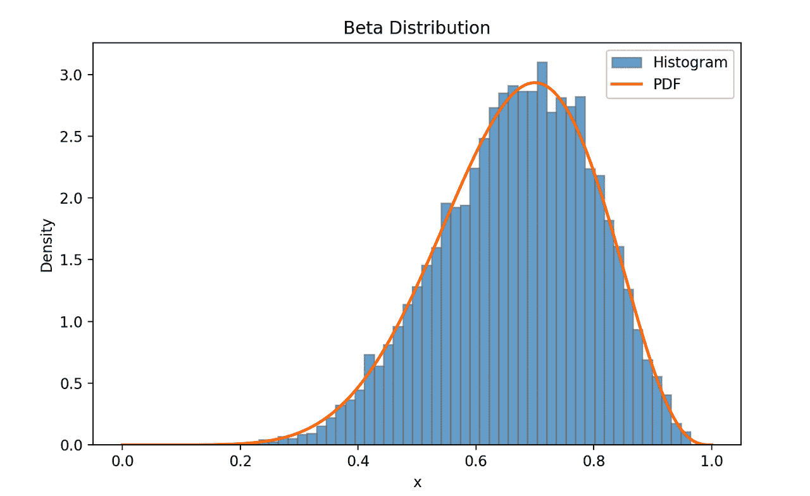

# 04-01概率分布-Beta分布

> 来源：[https://qqs7y1hozd1.feishu.cn/docx/JrvVdMnaKogPx5xY0wKchr86nmz](https://qqs7y1hozd1.feishu.cn/docx/JrvVdMnaKogPx5xY0wKchr86nmz)

在日常生活和科学研究中，我们经常会遇到“概率”这样一个概念：比如投掷一枚硬币，正面朝上的概率是 0.5；抛掷一个六面骰子，出现“6”的概率是 1/6。

很多时候，我们对某件事的“未知概率”抱有一种不确定的主观信念，比如：“这个网站的用户明天会有多少人注册？”或者“这位候选人在选举中获胜的概率是多少？”

**Beta 分布**正是一种用来描述这种“对未知概率”的不确定程度的概率分布。它是定义在区间   上的连续分布，通过两个参数   和  （均大于 0）来控制分布的形状。

+   当   和   都小于 1 时，分布在 0 和 1 附近呈现“U 型”，意味着我们更倾向于相信概率接近 0 或接近 1，却对中间值不太相信。

+   当   时，Beta(1,1) 就是区间   上的均匀分布，表示对所有概率值一视同仁，没有偏好。

+   当   且相等时，分布在 0.5 附近呈现山峰；如果  ，山峰偏向 1，说明我们更相信概率较大；反之则偏向 0。

### 简单例子：抛硬币的“信念更新”

1.  **初始信念**：假设我们一开始并不知道这枚硬币是否公平，于是我们可以选择一个无偏的先验分布 Beta(1,1)，即在 0~1 任何值都认为一样可能。

1.  **观察数据**：我们连续抛了 10 次，结果出现了 7 次正面，3 次反面。

1.  **更新先验**：在 Beta 分布的性质下，看到   次正面、  次反面后，后验分布为
 
代入  ，得到后验为 Beta(8,4)。

1.  **解读**：Beta(8,4) 表示当前我们对“硬币出现正面的真实概率”更倾向于认为在 0.6~0.8 之间，因为该分布在这个区间有较高的密度。

大家可以直观感受到 Beta 分布的本质：它是一种“先验—更新—后验”框架中的核心分布，用于用观测数据来不断修正对“成功概率”的信念。

## 公式推导

### 1. 定义与归一化常数

Beta 分布在区间   上的概率密度函数（PDF）定义为：

其中   是 Beta 函数，用于保证分布的总面积为 1：

Beta 函数与 Gamma 函数  （一个广义阶乘函数）之间有如下关系：

Gamma 函数满足：

**推导归一化常数**

1.  从 Beta 函数的定义出发：

1.  利用 Gamma 函数的欧拉积分表达式，并做变量替换，可以得到：

1.  通过二重积分和变量替换（令  ， ， ），可将
  与 Beta 函数联系起来，从而证明

### 2. 一阶矩、二阶矩（均值与方差）

利用 Beta 分布的 PDF，可以推导出它的均值和方差：

1.  **均值**

1.  **方差**

**推导要点**

+   均值推导中，利用 Beta 函数的递推性质：

+   方差推导则需要计算二阶矩  ，同样利用 Beta 函数递推并结合均值公式即可。

### 3. 后验更新（Beta–Bernoulli 共轭性）

当我们将 Beta 分布作为 Bernoulli（或二项分布）参数   的先验分布时，观测到   次成功、  次失败后，后验分布仍然是一个 Beta 分布：

这种共轭性质（conjugacy）让贝叶斯推断的数值计算变得极其简洁。

## Python实现

下面，咱们用 Python 来生成 Beta 分布的随机样本，进行可视化，以及在机器学习任务（如 A/B 测试）中应用 Beta 分布进行贝叶斯推断。

```
import numpy as np
import matplotlib.pyplot as plt
from scipy.stats import beta

# 生成 Beta 分布样本
alpha, beta_param = 8, 4
samples = np.random.beta(alpha, beta_param, size=10000)

# 绘制直方图 + PDF 曲线
plt.figure(figsize=(8, 5))
plt.hist(samples, bins=50, density=True, alpha=0.6, edgecolor=&#x27;gray&#x27;, label=&#x27;Histogram&#x27;)
x = np.linspace(0, 1, 200)
pdf = beta.pdf(x, alpha, beta_param)
plt.plot(x, pdf, linewidth=2, label=&#x27;PDF&#x27;)
plt.title(&#x27;Beta Distribution&#x27;)
plt.xlabel(&#x27;x&#x27;)
plt.ylabel(&#x27;Density&#x27;)
plt.legend()
plt.show()
```



### 机器学习应用示例：贝叶斯 A/B 测试

那么，在 A/B 测试中，我们经常关心哪种版本（A 或 B）的转化率更高。我们可以用 Beta 分布作为两组的先验，然后基于观测数据更新后验，并比较两者的分布。

```
import numpy as np
from scipy.stats import beta

# 假设版本 A：观测到 120 次转化 / 1000 次展示
#      版本 B：观测到 150 次转化 / 1100 次展示
a_success, a_trials = 120, 1000
b_success, b_trials = 150, 1100

# 设定非信息先验 Beta(1,1)
a_alpha_post = 1 + a_success
a_beta_post  = 1 + (a_trials - a_success)
b_alpha_post = 1 + b_success
b_beta_post  = 1 + (b_trials - b_success)

# 在 [0,1] 区间上比较两个后验分布
x = np.linspace(0, 1, 200)
a_pdf = beta.pdf(x, a_alpha_post, a_beta_post)
b_pdf = beta.pdf(x, b_alpha_post, b_beta_post)

import matplotlib.pyplot as plt
plt.figure(figsize=(8, 5))
plt.plot(x, a_pdf, label=&#x27;Version A&#x27;)
plt.plot(x, b_pdf, label=&#x27;Version B&#x27;)
plt.title(&#x27;A/B Test Posterior Distributions&#x27;) 
plt.xlabel(&#x27;Conversion Rate&#x27;)
plt.ylabel(&#x27;Density&#x27;)
plt.legend()
plt.show()

# 计算 P(A &gt; B) 的概率（蒙特卡洛模拟）
samples_a = np.random.beta(a_alpha_post, a_beta_post, size=1000000)
samples_b = np.random.beta(b_alpha_post, b_beta_post, size=1000000)
prob_a_beats_b = np.mean(samples_a &gt; samples_b)
print(f&quot;Probability that A is better than B: {prob_a_beats_b:.3f}&quot;)
```

xxx(img/04_概率分布-Beta分布-2.png)

+   这段代码中，我们先用 Beta(1,1) 作为先验，再根据各自的转化数据更新后验。

+   绘制得到两条后验密度曲线，可以直观比较哪一个版本的转化率更高。

+   最后用蒙特卡洛模拟计算“版本 A 的转化率高于版本 B”的概率。

通过上述内容，大家可以在以下几个层面上掌握 Beta 分布：

1.  **直观层面**：它是描述区间   上不确定概率的一种分布，有多种形状；

1.  **数学层面**：它的 PDF 包含 Beta 函数（与 Gamma 函数关联），可推导均值、方差和后验更新公式；

1.  **实践层面**：在 Python 中轻松生成样本、可视化，并在 A/B 测试、贝叶斯推断等机器学习任务中。