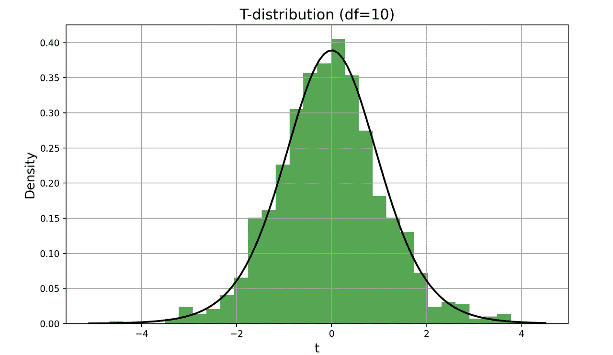

# 04-03概率分布-t分布

> 来源：[https://qqs7y1hozd1.feishu.cn/docx/GmDXdoe0Toe3bWxETI4c5uVenAf](https://qqs7y1hozd1.feishu.cn/docx/GmDXdoe0Toe3bWxETI4c5uVenAf)

t 分布（Student’s t-distribution）是一种非常常见的概率分布，它是由英国统计学家 William Sealy Gosset 在 1908 年提出的。

t 分布主要用于在样本量较小的情况下进行假设检验。它在实际应用中尤其重要，因为我们往往无法获得一个完整的数据集，只能基于样本数据进行推断。

**直观的例子：**

当一个统计学家，想要研究某个城市中成年男性的平均身高。你并没有调查所有的成年男性，而是从中随机抽取了 30 名男性作为样本。你对这 30 名男性的身高做了统计，得到了他们的平均身高和样本标准差。

假设要通过这个样本来推测全体成年男性的平均身高。在理论上，若我们能够获得全体成年男性的身高数据并计算出均值，那它是一个常数。但在实际中我们只能依赖样本均值，这时候如何量化这种不确定性呢？

这就是 t 分布的作用所在。t 分布帮助我们评估样本均值与真实均值之间的差距，并在这种不确定性下做出合理的推断。

#### t分布与正态分布的关系

t 分布与正态分布非常相似，但它的尾部更厚。换句话说，t 分布比正态分布更容易产生极端值（即偏离均值的值）。

+   **正态分布：** 当我们有一个足够大的样本量时，依据中心极限定理，样本均值近似服从正态分布，且其均值为总体均值，标准差为样本标准差除以样本大小的平方根。

+   **t 分布：** 当样本量小于 30 或者我们无法假定总体标准差已知时，t 分布被用来描述样本均值与总体均值的差异，特别是在总体标准差未知的情况下。t 分布的形状取决于样本量（自由度），自由度越大，t 分布就越接近正态分布。

#### t 分布的特点：

+   **均值为 0：** t 分布的均值通常为 0，这意味着它是对称的。

+   **方差大于 1：** 与正态分布相比，t 分布的方差通常会更大，尤其是在样本量较小的时候。

+   **重尾性质：** t 分布的尾部比正态分布更重，这意味着它对极端值更敏感。随着自由度的增加，t 分布会逐渐趋近于正态分布。

+   **自由度：** 自由度是指在计算统计量时，独立的样本数量。自由度越大，t 分布的形状越接近标准正态分布。自由度的计算通常是样本量减去 1（n-1）。

### 公式推导

**t 分布可以通过标准化的**方式定义，它依赖于样本均值与总体均值的差异，以及样本标准差来计算。

#### 1) t统计量的计算

t 分布的核心公式是 t 统计量的计算，它是样本均值与总体均值的差异，除以样本标准差的标准误差。

具体公式：

其中：

是样本均值。

是总体均值（通常是我们推测的值）。

是样本的标准差。

是样本量。

#### 2) t分布的概率密度函数（PDF）

t 分布的概率密度函数（PDF）公式如下：

其中：

是自由度。

是 Gamma 函数，它是阶乘的广义形式，适用于非整数。

#### 3) t分布的累积分布函数（CDF）

t 分布的累积分布函数（CDF）给出了某个 t 值对应的累积概率，公式为：

由于该积分没有简单的解析解，通常通过数值方法（如数值积分或查表法）计算。

### Python实现：如何生成 t 分布数据

接下来，我们用 Python 来生成 t 分布数据，并可视化其形态。

我们使用 numpy 和 matplotlib 库来进行生成和绘图。

```
import numpy as np
import matplotlib.pyplot as plt
from scipy.stats import t

# 设置参数
df = 10  # 自由度
size = 1000  # 生成的样本数量

# 生成 t 分布样本数据
data = t.rvs(df, size=size)

# 绘制 t 分布的直方图
plt.figure(figsize=(10, 6))
plt.hist(data, bins=30, density=True, alpha=0.6, color=&#x27;g&#x27;)

# 绘制 t 分布的概率密度函数（PDF）
xmin, xmax = plt.xlim()
x = np.linspace(xmin, xmax, 100)
pdf = t.pdf(x, df)
plt.plot(x, pdf, &#x27;k&#x27;, linewidth=2)

# 添加标题和标签
plt.title(f&#x27;T-distribution (df={df})&#x27;, fontsize=16)
plt.xlabel(&#x27;t&#x27;, fontsize=14)
plt.ylabel(&#x27;Density&#x27;, fontsize=14)
plt.grid(True)
plt.show()
```



+   使用 scipy.stats.t.rvs 来生成 t 分布的随机样本。

+   t.pdf 用于计算 t 分布的概率密度函数（PDF）。

+   使用 matplotlib 绘制了直方图和理论概率密度曲线。

### t 分布在机器学习中的应用

在机器学习中，t 分布通常应用于假设检验，特别是当我们进行小样本学习时。

在回归分析、异常值检测和模型的统计推断中，t 分布可以帮助我们判断模型的可靠性。

#### 1) 应用实例：t 检验

在机器学习中，t 检验（t-test）可以用来比较两个样本的均值是否存在显著差异。这在很多任务中都很有用，比如比较两种不同算法的效果、测试不同特征对模型的影响等。

假设我们有两个模型 A 和 B，它们分别在两组不同的测试数据上进行训练和评估。我们想知道这两个模型的平均性能是否显著不同。我们可以使用 t 检验来计算它们的均值差异是否显著。

#### 2) Python 实现：t 检验

```
from scipy import stats

# 假设模型 A 和 B 的评估得分
model_a_scores = np.array([88, 90, 85, 87, 92, 91, 89, 90, 86, 93])
model_b_scores = np.array([80, 82, 79, 81, 83, 78, 77, 80, 79, 82])

# 进行 t 检验
t_stat, p_value = stats.ttest_ind(model_a_scores, model_b_scores)

# 输出结果
print(f&quot;T-statistic: {t_stat:.3f}&quot;)
print(f&quot;P-value: {p_value:.3f}&quot;)

# 判断是否拒绝零假设
if p_value &lt; 0.05:
    print(&quot;拒绝零假设：模型 A 和模型 B 的性能存在显著差异。&quot;)
else:
    print(&quot;无法拒绝零假设：模型 A 和模型 B 的性能没有显著差异。&quot;)
```

+   ttest_ind 是用于两组独立样本之间的 t 检验函数。它返回 t 统计量和 p 值。

+   p 值小于 0.05 时，我们可以拒绝零假设，认为两个模型之间存在显著差异。

### 最后

t 分布在小样本推断中起到了至关重要的作用。整个内容咱们通过例子、公式推导、Python 实现和机器学习应用的介绍，希望帮助到大家全面了解了 t 分布的定义、性质、计算方式以及其在实际中的应用。