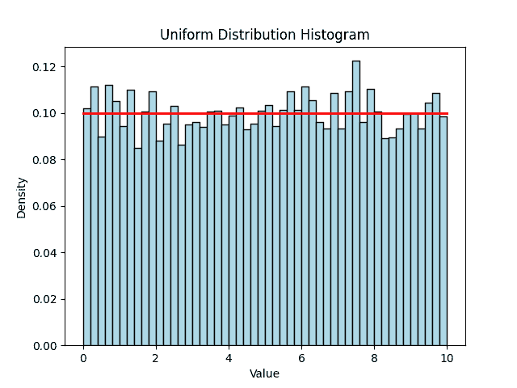
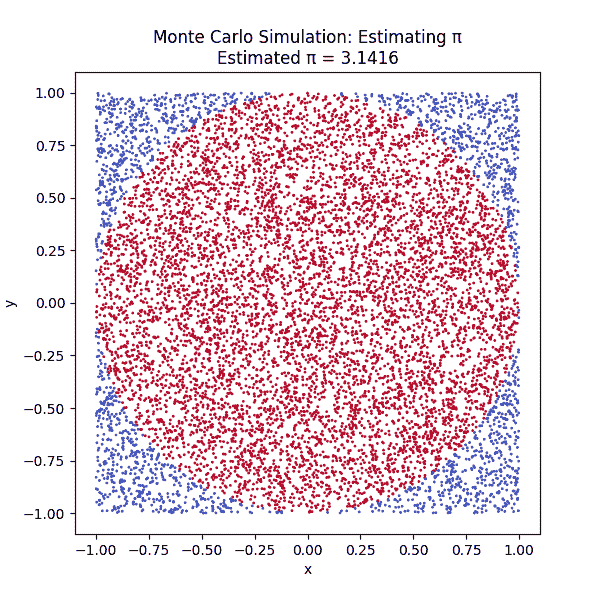

# 04-09概率分布-均匀分布

> 来源：[https://qqs7y1hozd1.feishu.cn/docx/WPZWdlCVVoJKamxykITcYgpXnJb](https://qqs7y1hozd1.feishu.cn/docx/WPZWdlCVVoJKamxykITcYgpXnJb)

简单来说均匀分布是一种非常基础的概率分布模型，表示某个事件在一个给定范围内发生的概率是相同的。

## 直观解释

均匀分布可以分为**离散型均匀分布**和**连续型均匀分布**。

+   **离散型均匀分布**：发生的事件是有限的离散点。例如，在掷骰子时，结果只能是1到6之间的整数，每个结果出现的概率相等。

+   **连续型均匀分布**：事件的可能值是无限多的，可以在某个区间内的任意点发生。例如，如果我们在0到1的区间上随机选择一个数，这个数可能是区间内的任意一个小数，并且每个数被选择的概率相同。

**本质和特点**

+   **无偏性**：在均匀分布中，所有可能的结果出现的概率是一样的。比如掷骰子时，无论是1还是6，每个数字出现的概率都是1/6。

+   **一致性**：均匀分布的概率分布在整个范围内都是一致的，没有任何一个区间或点具有更高或更低的概率密度。

+   **区间确定性**：对于连续型均匀分布，结果必须落在指定的区间内，区间之外的概率为0。

**实际例子**

+   **离散型均匀分布**：扔硬币时，正面和反面出现的概率都是50%；抽取扑克牌时，任意一张牌被抽中的概率都是一样的。

+   **连续型均匀分布**：想象你在一个0到10的直线上随机选择一个点，这个点可能是5.5，也可能是7.8，在这个区间内的每一个点出现的概率是一样的。

**离散型均匀分布**

对于离散型均匀分布，可以用柱状图来展示每个可能结果出现的概率。例如，假设你掷一个六面骰子，其结果是1到6之间的整数，每个结果的概率都是1/6。

其概率质量函数（PMF）可以用如下的柱状图来表示：

```
import matplotlib.pyplot as plt
import numpy as np

# 定义骰子面
faces = np.array([1, 2, 3, 4, 5, 6])
# 定义每个面出现的概率
probabilities = np.ones(6) / 6

# 绘制柱状图
plt.bar(faces, probabilities, color=&#x27;skyblue&#x27;, edgecolor=&#x27;black&#x27;)
plt.title(&#x27;Discrete Uniform Distribution: Fair Dice&#x27;)
plt.xlabel(&#x27;Dice Face&#x27;)
plt.ylabel(&#x27;Probability&#x27;)
plt.ylim(0, 0.2)
plt.show()
```


这张图展示了每个骰子面出现的概率都是1/6，形成了一个等高的柱状图。

**连续型均匀分布**

对于连续型均匀分布，概率密度函数（PDF）是一个常数，因为在给定区间内每个点的概率密度都是相等的。假设我们有一个均匀分布在区间   上的随机变量，它的概率密度函数可以用如下的图形表示：

```
import matplotlib.pyplot as plt
import numpy as np

# 定义区间 [a, b]
a, b = 0, 10
x = np.linspace(a - 2, b + 2, 1000)
y = np.where((x &gt;= a) &amp; (x &lt;= b), 1 / (b - a), 0)

# 绘制概率密度函数图
plt.plot(x, y, color=&#x27;blue&#x27;, linewidth=2)
plt.title(&#x27;Continuous Uniform Distribution PDF&#x27;)
plt.xlabel(&#x27;x&#x27;)
plt.ylabel(&#x27;Probability Density&#x27;)
plt.ylim(0, 0.15)
plt.show()
```


这张图展示了在 区间内概率密度为1/(b-a)，在区间外概率密度为0。

## 公式推导

### 离散型均匀分布

对于一个离散型均匀分布，其随机变量 可以取n个不同的值，每个值的概率相等为：

其中， 是离散型随机变量可能取的值之一，n是这些可能值的总数。

**推导期望值和方差**

**期望值（均值）**：

期望值是随机变量的加权平均值，对于离散型均匀分布，期望值可以通过求和来计算：

对于n个可能值均匀分布的情况，期望值是：

**方差**：

方差表示数据的离散程度，计算公式为：

对于离散型均匀分布，有：

最终方差为：

### 连续型均匀分布

对于一个在区间 上的连续型均匀分布，随机变量X的概率密度函数（PDF）为：

**推导期望值和方差**

**期望值（均值）**：

对于连续型均匀分布，期望值计算为：

期望值为区间 的中点。

**方差**：

方差的计算过程如下：

最终方差为：

## Python实现

**生成均匀分布的数据**

使用numpy库中的np.random.uniform()函数，可以轻松生成连续型均匀分布的数据。

```
import numpy as np
import matplotlib.pyplot as plt

# 生成均匀分布的数据
a, b = 0, 10  # 定义区间 [a, b]
n_samples = 10000  # 生成样本数
data = np.random.uniform(a, b, n_samples)

# 绘制直方图
plt.hist(data, bins=50, density=True, edgecolor=&#x27;black&#x27;, color=&#x27;lightblue&#x27;)
plt.title(&#x27;Uniform Distribution Histogram&#x27;)
plt.xlabel(&#x27;Value&#x27;)
plt.ylabel(&#x27;Density&#x27;)

# 绘制理论的概率密度函数
x = np.linspace(a, b, 1000)
y = np.ones_like(x) / (b - a)
plt.plot(x, y, &#x27;r-&#x27;, lw=2)

plt.show()
```



**蒙特卡罗模拟估计圆周率π**

在蒙特卡罗模拟中，均匀分布常用于随机抽样，以下是用均匀分布估计π值的一个具体例子：

```
import numpy as np
import matplotlib.pyplot as plt

# 蒙特卡罗方法估计圆周率π
def estimate_pi(n_samples):
    inside_circle = 0


    points_x = []
    points_y = []
    for _ in range(n_samples):
        x, y = np.random.uniform(-1, 1), np.random.uniform(-1, 1)
        points_x.append(x)
        points_y.append(y)
        if x**2 + y**2 &lt;= 1:
            inside_circle += 1
    pi_estimate = (inside_circle / n_samples) * 4
    return pi_estimate, points_x, points_y

# 估计π值
n_samples = 10000
pi_estimate, points_x, points_y = estimate_pi(n_samples)
print(f&quot;Estimated π after {n_samples} samples: {pi_estimate}&quot;)

# 绘制模拟图
plt.figure(figsize=(6, 6))
plt.scatter(points_x, points_y, s=1, c=np.sqrt(np.array(points_x)**2 + np.array(points_y)**2) &lt;= 1, cmap=&#x27;coolwarm&#x27;)
plt.title(f&#x27;Monte Carlo Simulation: Estimating π\nEstimated π = {pi_estimate}&#x27;)
plt.xlabel(&#x27;x&#x27;)
plt.ylabel(&#x27;y&#x27;)
plt.show()
```



在整个这个示例中，我们通过在单位正方形内生成均匀分布的点，并统计落在单位圆内的点数，最终估计出了圆周率π的值。此方法直观且展示了均匀分布在实际问题中的应用。