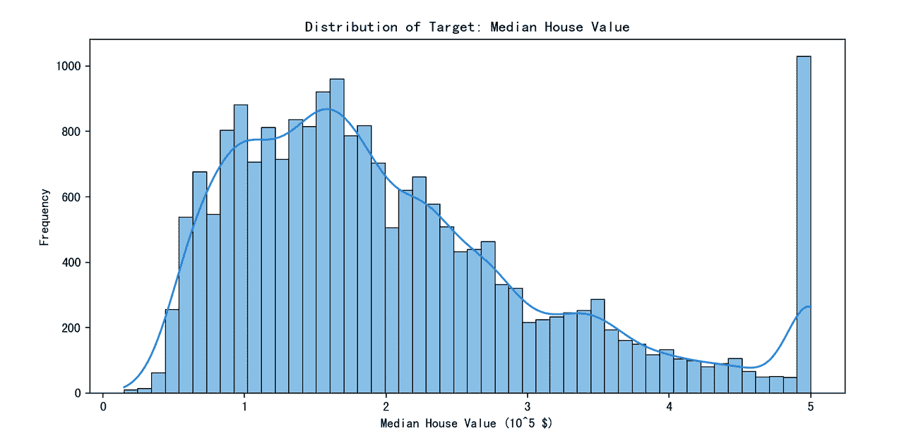
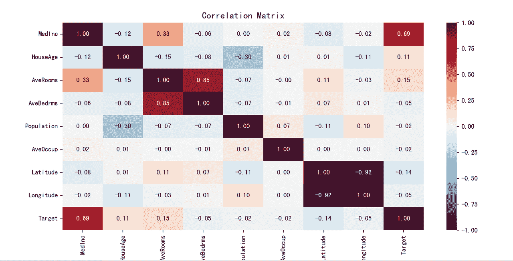
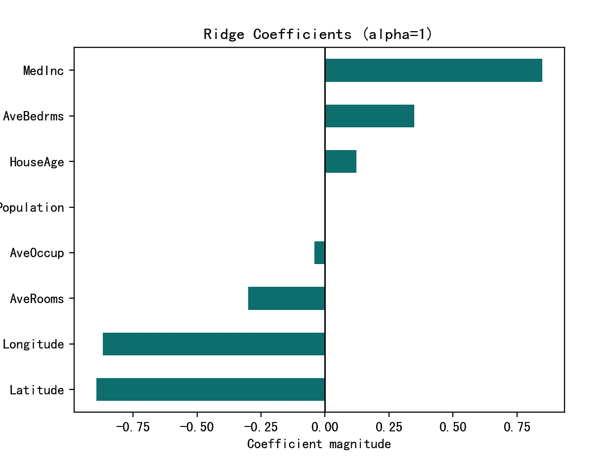
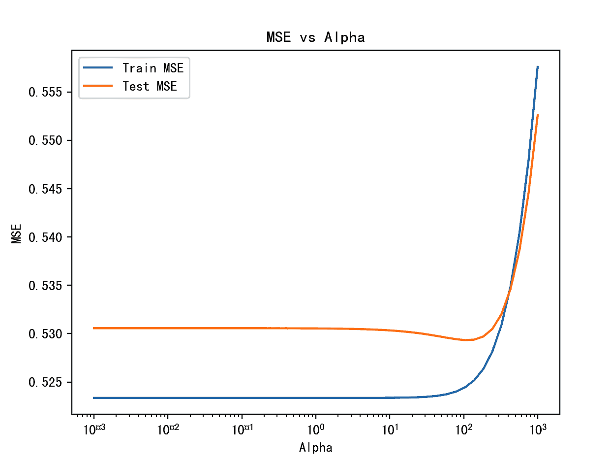
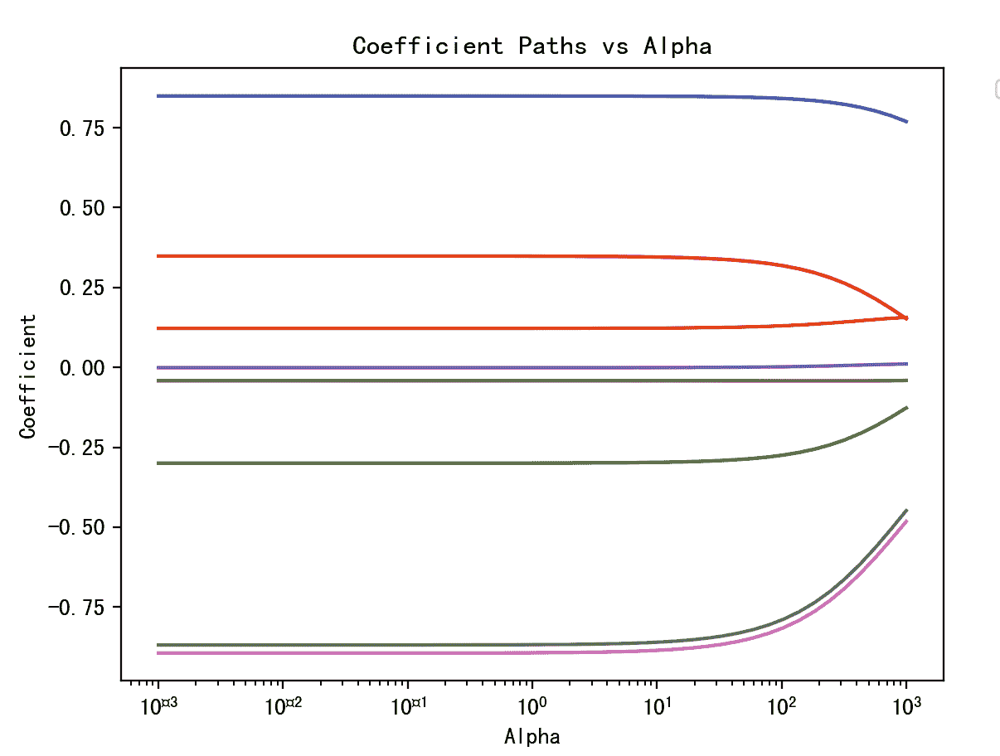
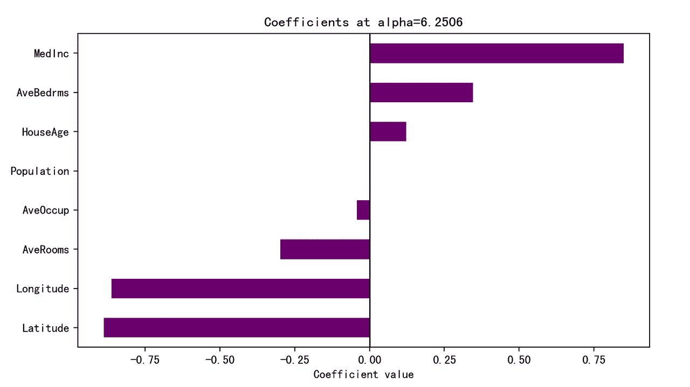
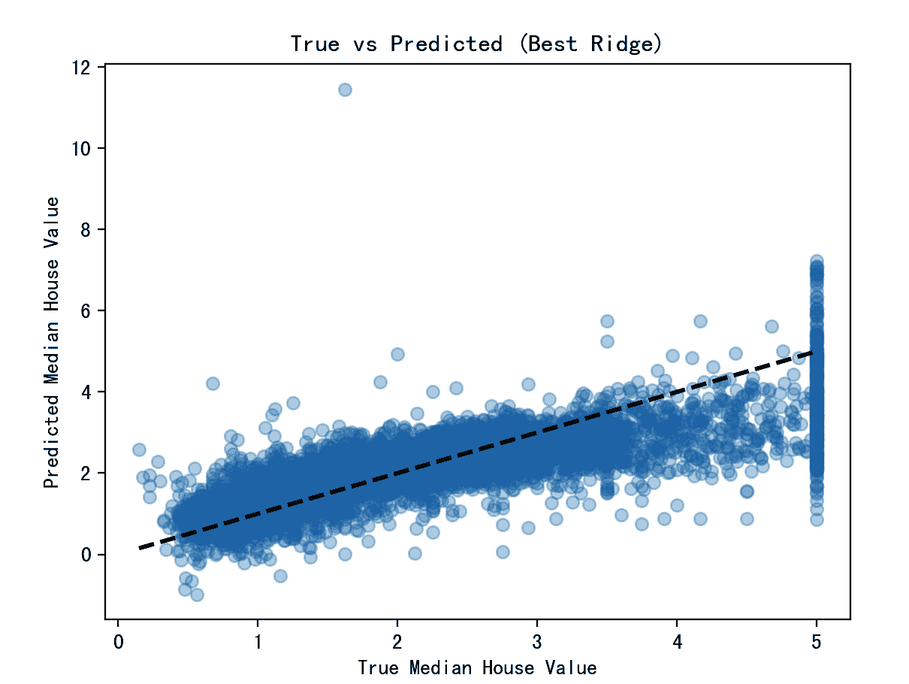
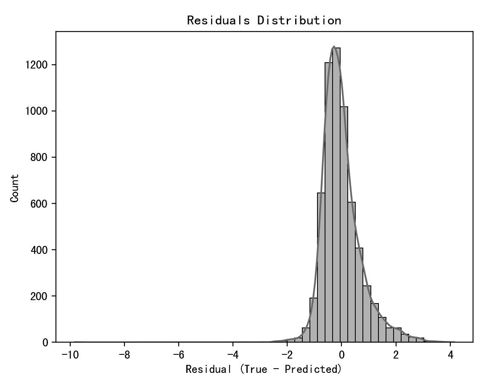

# 05-02特征选择方法-L2 正则化

> 来源：[https://qqs7y1hozd1.feishu.cn/docx/XRLudOAoro53dOxHgECcJsDlnfb](https://qqs7y1hozd1.feishu.cn/docx/XRLudOAoro53dOxHgECcJsDlnfb)

在机器学习里，我们常常会有一大堆特征（也叫“变量”、“属性”），比如：

想预测一个人是否会生病，可能有年龄、体重、饮食习惯、锻炼频率、睡眠时间、基因信息……几十上百个特征！

**特征选择**的目的就是：从这些一大堆特征里，找出那些对最终结果最有用的，扔掉没啥用的，让模型更简单、运行更快、不容易过拟合。

## L2 正则化是啥？

`L2` 正则化（也叫 `Ridge Regression` 岭回归）是一种防止模型“过拟合”的方法。

+   它会在模型的“损失函数”后面，加上一项惩罚项（也叫“正则项”）。

+   这个惩罚项跟模型里的参数有关，它会鼓励这些参数尽量“小一点”。

模型就像学生在做题，如果你总是把所有细节都记下来（即每个特征都用得很复杂），你可能考得很好，但换一套题就懵了（这就是过拟合）。

## L2 正则化怎么用在特征选择？

严格来说，`L2` 正则化不是直接做特征选择的工具，但它有一个“隐形的特征选择效果”：

+   它不会直接把某个特征“完全删掉”（不像 `L1` 正则化那样能让某些特征系数变成0），

+   但它会让不重要的特征的系数变得很小，也就是对结果没啥贡献。

+   最终你可以根据系数的大小来判断哪些特征“几乎没用”，然后考虑删掉它们。

所以，`L2` 正则化虽然不会让某个特征彻底归零，但它会压缩不重要特征的权重，达到“变相筛选特征”的目的。

## 原理详解

我们从一个简单的线性回归模型开始：

给定样本数据集：

其中：

+     是第   个样本的输入特征向量（共   个特征），

+     是对应的输出（标签），

+     是样本数量。

我们希望学到一个线性函数来预测输出：

### 损失函数：普通最小二乘（OLS）

最小二乘法的目标是最小化预测值和真实值的误差平方和：

这个优化目标在参数过多（特征过多）或样本过少时容易过拟合。

### L2 正则化的引入

为了解决过拟合，我们在损失函数中加入一个惩罚项，限制参数的大小。这个惩罚项就是 `L2` 正则化项：

`L2` 正则化目标函数（带惩罚项）：

其中：

+    ，表示所有参数的平方和。

+     是正则化强度，越大对参数的惩罚越强。

+    （偏置项）通常**不参与惩罚**。

### 为什么 L2 正则化有效？

**优化目标是“两难平衡”：**

+   拟合训练数据（误差要小）；

+   控制模型复杂度（参数要小）；

在数学上，就是最小化：

我们以矩阵形式简化推导。

### L2 正则化的矩阵形式和解析解（Ridge 解）

令：

+   训练数据矩阵  ，每行是一个样本；

+   标签向量  ；

+   参数向量  ；

+   假设  （或者已经将数据中心化，即均值为0）；

#### OLS 损失函数（矩阵形式）：

#### 加上 `L2` 正则化后的损失函数：

对   求导并设为0，得到解析解：

整理得：

即：

这是 `L2` 正则化的解析解，也叫 `Ridge` 回归解。

### 算法流程（梯度下降视角）

对于不能解析解的情况（如数据太大或用于非线性模型），使用梯度下降求解。

**梯度下降的基本流程：**

1.  初始化权重  ，设初值（如0）；

1.  重复直到收敛：

+   计算梯度；

+   更新权重；

+   其中   是学习率。

### 特征选择角度下的解读

虽然 `L2` 正则化不会把特征系数直接压到 `0`（即不做显式删除），但它确实会：

+   把“对结果影响小”的特征的权重   压得非常小；

+   对“冗余或共线”的特征起到平衡作用（比如两个特征高度相关，`L2` 会让它们的权重更均衡）；

+   实际上起到“软特征选择”的作用。

与之相对的是 `L1` 正则化（`Lasso`），它的正则项是  ，它可以将某些   压到 `0`，实现“硬特征选择”。

## 完整案例

使用 `L2` 正则化进行特征选择和预测。

**案例目标**：

+   使用岭回归预测加州房价中位数（`MedHouseVal`）。

+   利用 `L2` 正则化控制模型复杂度，提高泛化能力。

+   通过可视化分析监督模型训练与调参过程。

+   展示如何优化正则化参数(`alpha`)并体现其对特征系数分布的影响。

### 数据集

```
import numpy as np
import pandas as pd
import matplotlib.pyplot as plt
import seaborn as sns

from sklearn.datasets import fetch_california_housing
from sklearn.model_selection import train_test_split, GridSearchCV
from sklearn.linear_model import Ridge
from sklearn.preprocessing import StandardScaler
from sklearn.metrics import mean_squared_error, r2_score

# 加载数据集
housing = fetch_california_housing()
X = pd.DataFrame(housing.data, columns=housing.feature_names)
y = housing.target
```

+   加州数据包含 8 个特征，如 `MedInc`（收入中位数）、`HouseAge`（房龄）、`AveRooms`（平均房间数）等，目标是每户平均房价中位数。

+   使用 `pandas.DataFrame` 方便后续探索与特征处理。

### 数据基本检查与探索性分析（EDA）

**数据形状与描述统计**：

```
print(X.shape, y.shape)
print(X.describe().T)
```

查看样本数、特征数、变量分布范围（均值、中位数、方差等）。了解特征量纲差异，有助于后续标准化设计。

**目标变量分布**：

```
sns.histplot(y, bins=50, kde=True, color='#3498db')
plt.title("Distribution of Target: Median House Value")
plt.xlabel("Median House Value (10^5 $)")
plt.ylabel("Frequency")
plt.show()
```

了解目标变量是否偏态分布。通过图可判断是否需要转换目标（如 `log` 转换）来平滑模型误差。



### 特征之间与目标的 Correlation Heatmap

```
df = X.copy(); df['Target'] = y
corr = df.corr()

sns.heatmap(corr, annot=True, fmt=".2f", cmap='RdBu_r', vmin=-1, vmax=1)
plt.title("Correlation Matrix", fontsize=14)
plt.show()
```

+   较强正相关的特征（如收入、房间数）对预测重要，负相关特征（如居民密度）则可能成为噪声。

+   揭示共线性问题，为正则化提供背景理由。



### 数据预处理

**分割训练集和测试集**：

```
X_train, X_test, y_train, y_test = train_test_split(
    X, y, test_size=0.3, random_state=42)

print("训练集大小:", X_train.shape)
print("测试集大小:", X_test.shape)
```

**特征标准化**：

```
scaler = StandardScaler()
X_train_scaled = scaler.fit_transform(X_train)
X_test_scaled = scaler.transform(X_test)
```

岭回归对特征缩放敏感，目标是对所有系数施加统一惩罚。标准化后效果更稳定。

### 初始模型：岭回归（`alpha=1`）

```
ridge = Ridge(alpha=1.0, random_state=0)
ridge.fit(X_train_scaled, y_train)

y_train_pred = ridge.predict(X_train_scaled)
y_test_pred = ridge.predict(X_test_scaled)

mse_train = mean_squared_error(y_train, y_train_pred)
r2_train = r2_score(y_train, y_train_pred)
mse_test = mean_squared_error(y_test, y_test_pred)
r2_test = r2_score(y_test, y_test_pred)

print(f"训练集 MSE: {mse_train:.4f}, R2: {r2_train:.4f}")
print(f"测试集  MSE: {mse_test:.4f}, R2: {r2_test:.4f}")
```

MSE 和 R² 分别衡量模型误差和拟合程度。初步判断是否过拟合或欠拟合。

### 可视化特征系数

```
coef = pd.Series(ridge.coef_, index=X.columns).sort_values()
coef.plot(kind='barh', color='teal')
plt.axvline(0, color='black', linewidth=1)
plt.title("Ridge Coefficients (alpha=1)")
plt.xlabel("Coefficient magnitude")
plt.show()
```

可视化各特征在模型中的线性权重。体现哪些特征被赋予更高影响力，哪些被压缩。



### 调参优化：网格搜索交叉验证选择最佳 `alpha`

```
alphas = np.logspace(-3, 3, 50)
param_grid = {'alpha': alphas}

grid = GridSearchCV(Ridge(random_state=0), param_grid, cv=5, scoring='neg_mean_squared_error', n_jobs=-1)
grid.fit(X_train_scaled, y_train)

best_alpha = grid.best_params_['alpha']
print("最佳 alpha:", best_alpha)

best_ridge = grid.best_estimator_
y_test_pred_best = best_ridge.predict(X_test_scaled)

mse_test_best = mean_squared_error(y_test, y_test_pred_best)
r2_test_best = r2_score(y_test, y_test_pred_best)

print(f"优化后测试集 MSE: {mse_test_best:.4f}, R2: {r2_test_best:.4f}")
```

通过 5 折交叉验证，寻找使测试 `MSE` 最小的 `alpha`，提升模型泛化能力。

### `MSE` 随 `alpha` 变化趋势图

```
mse_train_list, mse_test_list = [], []
for a in alphas:
    model = Ridge(alpha=a)
    model.fit(X_train_scaled, y_train)
    mse_train_list.append(mean_squared_error(y_train, model.predict(X_train_scaled)))
    mse_test_list.append(mean_squared_error(y_test, model.predict(X_test_scaled)))
    
plt.plot(alphas, mse_train_list, label='Train MSE')
plt.plot(alphas, mse_test_list, label='Test MSE')
plt.xscale('log'); plt.xlabel('Alpha'); plt.ylabel('MSE')
plt.legend(); plt.title('MSE vs Alpha')
plt.show()
```



### 系数随 `alpha` 变化趋势图

```
coef_df = pd.DataFrame(index=alphas, columns=X.columns)
for a in alphas:
    model = Ridge(alpha=a)
    model.fit(X_train_scaled, y_train)
    coef_df.loc[a] = model.coef_

# 绘制 selected features’ coefficient vs alpha
selected = coef_df.columns
plt.plot(alphas, coef_df[selected])
plt.xscale('log')
plt.xlabel('Alpha'); plt.ylabel('Coefficient')
plt.title('Coefficient Paths vs Alpha')
plt.legend(bbox_to_anchor=(1.05, 1), loc='upper left')
plt.show()
```

特征系数被压缩的动态过程，越大惩罚 ~ 越接近 `0`。



### 最优 `alpha` 下的系数可视化

```
coef_best = pd.Series(best_ridge.coef_, index=X.columns).sort_values()
coef_best.plot(kind='barh', color='purple')
plt.axvline(0, color='black', linewidth=1)
plt.title(f"Coefficients at alpha={best_alpha:.4f}")
plt.xlabel("Coefficient value")
plt.show()
```

+   展示调参后每个特征的最终权重分布。

+   对比初始模型，可以直观感受正则化压缩的作用。



### 真实值 vs 预测值散点图

```
plt.scatter(y_test, y_test_pred_best, alpha=0.3)
plt.plot([y.min(), y.max()], [y.min(), y.max()], 'k--', linewidth=2)
plt.xlabel('True Median House Value')
plt.ylabel('Predicted Median House Value')
plt.title('True vs Predicted (Best Ridge)')
plt.show()
```

理想情况下点应沿对角线分布。散点偏差衡量预测残差。可以进一步计算残差分布。



### 残差分布图

```
residuals = y_test - y_test_pred_best
sns.histplot(residuals, bins=50, kde=True, color='gray')
plt.title('Residuals Distribution')
plt.xlabel('Residual (True - Predicted)')
plt.show()
```

正态分布的残差表明模型假设合理，无系统性偏差。若存在偏斜或多峰，可能需进一步特征工程或非线性处理。



## 模型分析

### 优缺点分析

**优点：**


# L2 正则化

## 优点

1. 防止过拟合，提升泛化能力：L2 正则化通过惩罚参数平方和，使模型在面对高维数据或多重共线性（特征高度相关）时更加稳定，能有效控制模型复杂度。

2. 保留全部特征，做“软特征选择”：L2 正则化不会直接将特征系数压为 0，而是把对输出贡献小的特征的系数缩小。这在你不希望舍弃任何信息时非常重要，尤其适用于解释性强的模型场景。

3. 数学解稳定，解法可解析：与普通最小二乘法相比，L2 正则化通过矩阵的正则化操作，避免了矩阵奇异（无法求逆）的问题，使计算更加稳定。

4. 适用于共线性严重的数据集：在存在多个相关特征的情况下，L2 正则化比 OLS 更可靠，它会平滑地分摊这些特征的系数。

## 缺点

1. 不能实现显式特征选择（系数不为零）：L2 不会将权重压缩为 0，不能直接舍弃无用特征。因此无法实现“硬特征选择”（Hard Feature Selection）。

2. 模型解释性差于 L1：因为所有特征都被保留，即使某些特征的系数非常小，也会参与预测，这可能会干扰后续的解释或部署。

3. 不适合稀疏建模需求：如果你的目标是构建一个具有较少非零系数的稀疏模型，L2 并不适合，应该考虑 L1 或 ElasticNet。

## 与其他特征选择方法对比

| 方法 | 正则项形式 | 是否稀疏（系数为0） | 抗多重共线性 | 模型稳定性 | 特征选择方式 | 适合场景 |

| --- | --- | --- | --- | --- | --- | --- |

| L2（Ridge） |  | 否 | 强 | 高 | 软选择 | 特征较多但都重要，共线性明显 |

| L1（Lasso） |  | 是 | 弱 | 不稳定 | 硬选择 | 特征多，目标是稀疏建模 |

| ElasticNet |  | 是（部分） | 中等 | 中等 | 混合选择 | 有部分冗余特征，需平衡稳定性与稀疏性 |

| 树模型（RF/XGBoost）特征重要性 | 基于分裂增益 | 是（通过选择） | 强 | 高 | 嵌入式选择 | 非线性关系显著、特征重要性排序 |

| 过滤法（如卡方、方差筛选） | 不依赖模型 | 是 | 弱 | 弱 | 过滤式选择 | 初步粗筛，辅助建模 |

## 在什么情况下选择 L2 正则化？

### 优选 L2 正则化的场景

+ 特征数量适中，但存在显著的共线性问题（如多个变量高度相关）。

+ 所有特征都有潜在价值，不希望直接删除特征。

+ 你希望模型保持稳定并具备良好的泛化能力。

+ 建模目标是回归预测而非特征压缩。

+ 在解释性要求不高、目标是提升预测性能的场景。

### 考虑使用其他特征选择方法的场景

+ 目标是压缩模型、提高稀疏性：使用 L1 正则化（Lasso）。

+ 部分特征对预测影响为零或接近零：考虑 ElasticNet，结合 L1 和 L2。

+ 面对非线性数据或高阶特征交互复杂：考虑 树模型（如随机森林、XGBoost）特征重要性排序。

+ 快速粗筛、去除低方差或低信息量特征：使用 过滤式方法（如方差阈值法、互信息法）。

## 总结

L2 正则化是一种简单而强大的特征选择策略，尤其适合线性模型中处理特征多样性和多重共线性的场景。它的优雅在于平滑地压缩权重而非直接舍弃特征，适用于那些不希望彻底删除特征但又希望防止模型过拟合的场合。

如果你追求的是“特征压缩”与“模型解释性”，则 L1 正则化或 ElasticNet 更合适。但如果你希望的是“预测稳定性”和“所有特征都保留但影响不均”，L2 正则化是首选方案之一。
