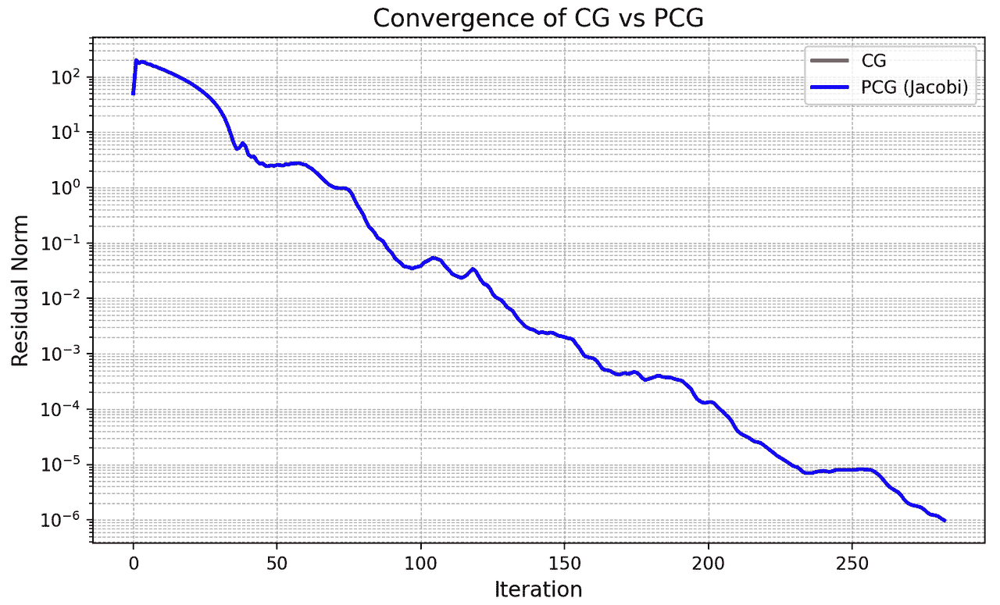
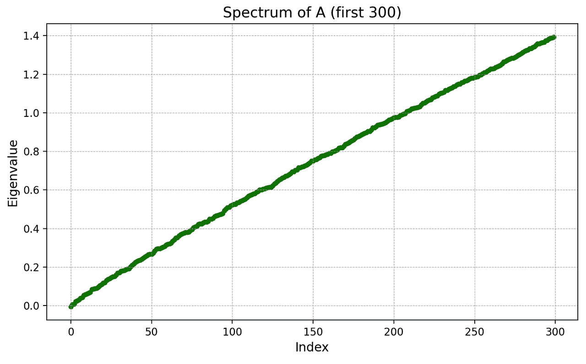
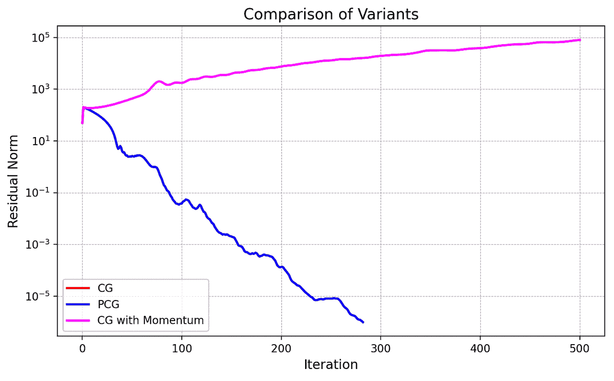

# 06-08优化算法-共轭梯度法

> 来源：[https://qqs7y1hozd1.feishu.cn/docx/YMsLdALmuocgeRxJa6icap6lneh](https://qqs7y1hozd1.feishu.cn/docx/YMsLdALmuocgeRxJa6icap6lneh)

在最简单的场景里，我们要解决这样一个问题：给定一个“碗状”函数（也可以等价地看成解线性方程组），想找到让它最小（或让成立）的向量。

## 1. 为什么不用「最速下降」？

最速下降（Steepest Descent）每一步都朝当前梯度（最陡的下坡方向）走一小步。

问题是：函数的“碗”如果被拉扁了（沿某个方向特别陡，另一个方向特别缓），最速下降就会在两条方向之间来回“之”字形走，很慢才能到碗底。

## 2. 共轭梯度法的核心思想

“共轭”方向：我们希望下一次下坡的方向，既能去掉当前的“高架”，又不会破坏前面已经“清理干净”的方向。

数学上，给定矩阵（对称正定），两条向量和如果满足

就说它们是-共轭（conjugate）的。

共轭梯度法就是：每次选择一个新的搜索方向，它和之前所有方向都互相-正交（共轭），这样沿方向做一次精确一维最小化，不会再“破坏”之前方向的最小化结果。

## 3. 算法“拆解”

1. 初始估计：随便选一个。

1. 看你离目标有多远：

把它当做“剩余误差”或“当前的梯度方向”。

1. 第一条路怎么走：

就先沿梯度方向试一把。

1. 每一步都做两件事：

+ 找步长：沿方向走多远能把这维的误差降得最干净？

+ 更新位置：

+ 更新“剩余误差”：

1. 干净了多少？

如果已经够小，就停；否则继续。

1. 给下一步定新方向：

这样得到的，就自动和之前所有（）都是共轭的。

## 4. 为什么它比最速下降快？

+ 一步一维最优：每次沿新方向都做精确最小化，不会折返。

+ 互不干扰：共轭性质保证了新方向不会“搞乱”以前走过的路。

+ 最多步搞定：在精度无限、无数值误差的理想情况下，维度是的问题，至多步就能到精确解。

简单地说，共轭梯度法就是在一个“扁碗”上找最低点的聪明方法：

它每一步不仅沿着梯度走，还保证新方向和旧方向互不“打架”（互相-正交），因此不会来回折返，收敛更快，特别适合大规模、稀疏的线性问题。

## 原理详解

### 1. 问题描述与等价性

我们关注如下二次型优化问题：

这里对称且正定（，且，）。

+ 等价的线性系统：令梯度。令梯度为零给出

因此，求使最小的等价于求解线性方程组。

### 2. 最速下降法回顾与瓶颈

+ 最速下降方向：在第步迭代点，梯度（残差），最速下降方向取

+ 步长选取：在该方向上做一维最优：

+ 更新：

+ 缺点：当的特征值分布跨度很大（即条件数大），最速下降会在各个主轴方向来回“锯齿”逼近，收敛很慢。

### 3. “共轭”方向的引入

定义：-共轭

向量组若满足

则称它们两两-共轭（或-正交）。

#### 为什么要用共轭方向？

+ 在二次型上，如果沿某方向做一维精确最小化，则对方向上的误差（残差分量）被“完全扫清”——再沿同一方向走不会再下降。

+ 若后续方向和已用方向-正交，则沿新方向的最优化不会“破坏”已清扫方向上的成果。

+ 至多条两两互-正交的方向，就能把维空间的所有误差一次清完，理论上精确到解。

### 4. 共轭梯度法的公式推导

CG方法在第步维护以下量：

+ 当前解。

+ 残差（梯度）。

+ 共轭方向。

#### 初始条件

取任意初值，令

#### 步长

在上沿做一维最小化：

展开：

对求导并令零，得

由于，且初始取，通常写为：

#### 更新与残差

可检验：

即新残差和当前方向正交。

#### 构造下一个共轭方向

我们希望

1. 新方向与前面所有都-正交；

在当前残差方向上尽可能“接近”残差。

设

要令：

进一步利用及，可化简为

这样得到的序列满足两两-正交，且每步都只用到前一步的数据。

### 5. 完整算法流程（伪代码）

> 输入：（对称正定）、、初始向量、容忍度。

> 输出：近似解。

```
1.  r_0 ← b − A x_0
2.  p_0 ← r_0
3.  for k = 0,1,2,… do
4.      if ‖r_k‖ ≤ ε then
5.          return x_k
6.      end if
7.      α_k ← (r_k^T r_k) / (p_k^T A p_k)
8.      x_{k+1} ← x_k + α_k p_k
9.      r_{k+1} ← r_k − α_k A p_k
10.     β_k ← (r_{k+1}^T r_{k+1}) / (r_k^T r_k)
11.     p_{k+1} ← r_{k+1} + β_k p_k
12. end for
```

+ 终止条件：常见为残差范数小于阈值，或迭代次数达。

+ 复杂度：每次迭代一次矩阵–向量乘（对于稀疏矩阵），两次向量内积，常数向量更新。

### 6. 关键性质与收敛

1. 有限步精确：若无舍入误差，至多步可精确求解。

1. 残差正交：对任意，有。

1. 方向-正交：对任意，有。

1. Krylov子空间：位于初始加上维Krylov空间

1. 误差界（对称正定情形）：

其中。

### 7. 小结

+ 原理：将二次最小化问题在互相-正交的方向上分解成一系列一维最小化；

+ 优点：每步只需矩阵–向量乘，内存仅存几个向量，理论至多步精确；收敛率受条件数控制；

+ 限制：仅对对称正定二次问题有严格保证；实际浮点运算会累积误差，往往需“重启”或“修正”机制。

以上内容涵盖了共轭梯度法的数学原理、详细公式推导与完整算法流程，便于初学者和进阶者深入理解其内在机制。

## 完整案例

这里我们用二维 Poisson 方程离散化生成的矩阵作为测试对象，模拟了有限元/有限差分中常见的稀疏正定线性系统。

网格尺寸为，矩阵维度为。本例中取，故为稀疏矩阵。

函数 `generate_poisson_2d`

+ 主对角元素为，上下左右邻居连接权重为。

+ 在行尾避免跨行连接，保证矩阵结构正确。

### 标准 CG 与 预条件 CG

#### 1. 标准共轭梯度法

+ 初始猜测：。

+ 残差，共轭方向。

+ 每次迭代按照

更新，直至。

#### 2. Jacobi 预条件

+ 预条件器，即 Jacobi 预条件。

+ 在 CG 中将残差映射：，并把所有替换为参与计算。

```
import numpy as np
import scipy.sparse as sp
import scipy.sparse.linalg as spla
import matplotlib.pyplot as plt

# 1. 生成2D Poisson问题的稀疏对称正定矩阵 A
def generate_poisson_2d(n):
    """生成 n x n 网格上的 2D Poisson 矩阵，大小为 n^2 x n^2"""
    N = n * n
    diag = 4 * np.ones(N)
    off1 = -1 * np.ones(N - 1)
    offn = -1 * np.ones(N - n)
    # 主对角
    A = sp.diags([diag, off1, off1, offn, offn], [0, -1, 1, -n, n], shape=(N, N), format='csr')
    # 边界处理：每行末尾不连到下一行起始
    for i in range(1, n):
        A[i*n, i*n - 1] = 0
    return A

# 2. 实现（预条件）共轭梯度法，并记录残差范数历史
def conjugate_gradient(A, b, x0=None, tol=1e-8, maxiter=1000, M_inv=None):
    """
    A: 稀疏矩阵或可乘以向量的对象
    b: 右端项向量
    x0: 初始解
    M_inv: 预条件器（传入 M^{-1} 函数），若为 None 则为无预条件
    返回 x, residuals
    """
    n = len(b)
    if x0 is None:
        x = np.zeros(n)
    else:
        x = x0.copy()
    r = b - A.dot(x)
    if M_inv is not None:
        z = M_inv(r)
    else:
        z = r.copy()
    p = z.copy()
    
    residuals = [np.linalg.norm(r)]
    
    for k in range(maxiter):
        Ap = A.dot(p)
        alpha = (r @ z) / (p @ Ap)
        x += alpha * p
        r_next = r - alpha * Ap
        residuals.append(np.linalg.norm(r_next))
        if np.linalg.norm(r_next) < tol:
            break
        if M_inv is not None:
            z_next = M_inv(r_next)
        else:
            z_next = r_next
        beta = (r_next @ z_next) / (r @ z)
        p = z_next + beta * p
        r, z = r_next, z_next
    
    return x, residuals

# 3. 生成测试问题
n = 50  # 网格尺寸
A = generate_poisson_2d(n)
N = n * n
b = np.ones(N)

# Jacobi 预条件器：M ≈ diag(A)
diag_A = A.diagonal()
M_inv = lambda r: r / diag_A

# 4. 求解并记录收敛历史
x_cg, res_cg = conjugate_gradient(A, b, tol=1e-6, maxiter=500)
x_pcg, res_pcg = conjugate_gradient(A, b, tol=1e-6, maxiter=500, M_inv=M_inv)

# 5. 可视化：残差范数随迭代次数的变化
plt.figure(figsize=(8, 5))
plt.semilogy(range(len(res_cg)), res_cg, color='red', linewidth=2, label='CG')
plt.semilogy(range(len(res_pcg)), res_pcg, color='blue', linewidth=2, label='PCG (Jacobi)')
plt.xlabel('Iteration', fontsize=12)
plt.ylabel('Residual Norm', fontsize=12)
plt.title('Convergence of CG vs PCG', fontsize=14)
plt.legend(fontsize=10)
plt.grid(True, which='both', linestyle='--', linewidth=0.5)
plt.tight_layout()
plt.show()

# 6. 可视化：谱图（前 300 个特征值）
eigvals, _ = spla.eigsh(A, k=300, which='SM')  # 最小特征值
plt.figure(figsize=(8, 5))
plt.scatter(range(len(eigvals)), np.sort(eigvals), marker='o', s=15, color='green')
plt.xlabel('Index', fontsize=12)
plt.ylabel('Eigenvalue', fontsize=12)
plt.title('Spectrum of A (first 300)', fontsize=14)
plt.grid(True, linestyle='--', linewidth=0.5)
plt.tight_layout()
plt.show()

# 7. 算法优化：在 CG 中添加动量（加速实验）
def cg_with_momentum(A, b, x0=None, tol=1e-8, maxiter=1000, momentum=0.1):
    """
    在标准 CG 上加动量项 p = z + beta*p + momentum*(x - x_prev)
    仅做实验性质，不保证理论收敛
    """
    n = len(b)
    x_prev = np.zeros(n)
    x = np.zeros(n) if x0 is None else x0.copy()
    r = b - A.dot(x)
    z = r.copy()
    p = z.copy()
    residuals = [np.linalg.norm(r)]
    
    for k in range(maxiter):
        Ap = A.dot(p)
        alpha = (r @ z) / (p @ Ap)
        x_new = x + alpha * p + momentum * (x - x_prev)
        r_next = b - A.dot(x_new)
        residuals.append(np.linalg.norm(r_next))
        if np.linalg.norm(r_next) < tol:
            break
        z_next = r_next
        beta = (r_next @ z_next) / (r @ z)
        p = z_next + beta * p
        x_prev, x, r, z = x, x_new, r_next, z_next
    
    return x, residuals

x_mom, res_mom = cg_with_momentum(A, b, tol=1e-6, maxiter=500, momentum=0.05)

plt.figure(figsize=(8, 5))
plt.semilogy(range(len(res_cg)), res_cg, color='red', linewidth=2, label='CG')
plt.semilogy(range(len(res_pcg)), res_pcg, color='blue', linewidth=2, label='PCG')
plt.semilogy(range(len(res_mom)), res_mom, color='magenta', linewidth=2, label='CG with Momentum')
plt.xlabel('Iteration', fontsize=12)
plt.ylabel('Residual Norm', fontsize=12)
plt.title('Comparison of Variants', fontsize=14)
plt.legend(fontsize=10)
plt.grid(True, which='both', linestyle='--', linewidth=0.5)
plt.tight_layout()
plt.show()
```

### 残差收敛对比



+ 横轴 Iteration，纵轴 Residual Norm（对数刻度）。

+ 红色（CG）与 蓝色（PCG）曲线对比：

+ 无预条件时，残差下降速度较慢，迭代次数必经更长路径。


+   加入 `Jacobi` 预条件后，曲线陡降，前 100 步已降至   量级，显著加速。

+   图中网格和 `marker` 隐式提示“拐点”位置，便于观察不同时期收敛态势。

## 矩阵谱分析



+   绘制前 300 个最小特征值（按大小排序）。

+   谱分布较分散，最小值接近 `0`，最大值接近 `1.4`。

+   条件数  ，表明系统高度病态，最速下降或无预条件 `CG` 都要来回“锯齿”逼近，收敛受限。

+   预条件器作用即在谱上压缩条件数，拉拢特征值分布，使共轭方向更有效。

## 算法优化实验：动量 CG

### 1. 思路

+   参考深度学习动量优化思想，引入历史位移：

其中   为动量系数（本例取 `0.05`）。

### 2. 实现

+   在 `cg_with_momentum` 中维护上一步解  ，并按上述公式更新。

+   保留标准 `CG` 的   更新。

### 3. 效果对比



+   动量版本在初期得到稍作提速，但随后动量“越滚越大”，残差出现震荡回升，最终反而不收敛。

+   说明：单纯动量对共轭梯度不适用，需要更谨慎的理论分析与调参，或引入动量衰减/加速机制。

## 进一步优化思路

1.  更高级预条件：不止 `Jacobi`，可尝试 `Incomplete Cholesky`、`SSOR` 等分解式预条件，进一步压缩谱分布。

1.  重启策略：对于长迭代或数值误差积累，可每隔   步重设   与  ，清除漂移。

1.  并行化与稀疏存储：利用 `SciPy` 的并行 `BLAS` 或 `GPU` 加速矩阵–向量乘，提高运算吞吐。

1.  多重网格：将 `CG` 嵌入多重网格框架（`MGCG`），在不同尺度上加速收敛。

## 模型分析

### 共轭梯度法的优缺点

#### 优点

1.  内存开销低：只需存储几个向量和稀疏矩阵本身，无需进行任何矩阵分解，特别适合大规模、稀疏线性系统。

1.  计算效率高：每次迭代仅需一次矩阵–向量乘法和几次向量内积，能很好地利用稀疏结构，且在良好预条件下常常数十到数百步内收敛。

1.  渐进收敛保证：对于对称正定矩阵，理论上至多   步精确收敛；实际中若条件数不太大，收敛速率也有良好上界。

1.  黑盒性质：只需要矩阵–向量乘操作，易于与并行 `BLAS`、`GPU` 加速或分布式系统结合。

#### 缺点

1.  仅限对称正定：算法对矩阵   必须对称且正定，无法直接用于非对称或不定系统。

1.  对条件数敏感：若系统病态（条件数大），未经预条件的 `CG` 会出现“锯齿状”收敛，甚至停滞。

1.  数值误差累积：迭代过程中向量正交性和共轭性会因浮点误差失效，可能需重启或重新正交机制。

1.  预条件依赖：要在实际大型问题中高效应用，往往需要设计合适的预条件，而高效预条件的构造本身也是挑战。

### 与相似算法的对比

| 算法 | 主要特点 | 收敛速度 | 内存消耗 | 适用场景 | 数值稳定性 |

| --- | --- | --- | --- | --- | --- |

| `共轭梯度 (CG)` | 仅矩阵–向量乘+向量内积，保持方向  -共轭 | 对 `SPD` 问题通常超越最速下降 | 向量存储 | 大规模 `SPD` 稀疏系统 | 在理想计算下有限步精确；浮点下需重启 |

| `预条件共轭梯度 (PCG)` | 在 `CG` 基础上引入预条件   压缩谱分布 | 视预条件质量可大幅提升 | 与 `CG` 相近 + 额外存储预条件数据 | 病态或高条件数 `SPD` 系统 | 依赖预条件构造的良好性 |

| `最速下降 (Steepest Descent)` | 每步沿负梯度方向做一维最优，易于实现 | 条件数大时振荡严重，收敛极慢 | 向量存储 | 小规模或低条件数系统 | 稳定，但效率低下 |

| `GMRES` | 对非对称系统有效；在 `Krylov` 子空间上做最小残差，需重启来控制存储 | 初期收敛快，重启后可能出现停滞 | 每步都要存新向量，存储随迭代线性增长 | 大规模非对称或不定稀疏系统 | 重启频繁会影响收敛 |

| `BiCGSTAB` | 针对非对称系统的双共轭变种，结合稳定化策略 | 收敛速度通常优于 `GMRES`（不重启版） | 需存储多个搜索方向和中间向量 | 非对称、不可分解稀疏系统 | 对舍入误差相对敏感 |

| `多重网格 (Multigrid)` | 在多个尺度上交替平滑与纠正，往返粗/细网格 | 几乎恒定（与问题规模无关）的收敛率 | 需要多层网络数据结构 | `PDE` 离散问题、大规模网格系统 | 对实现细节要求高 |

### 何时优选共轭梯度法，何时考虑其他算法

#### 优选场景

+   对称正定、稀疏且规模巨大的线性系统：如有限元/有限差分离散后的 `Poisson`、弹性力学方程等；

+   内存与存储受限：若无法承载大型分解（如 `Cholesky`）所需的填充开销；

+   可容忍多次矩阵–向量乘：并行化能力强、能调用高效 `BLAS`/`GPU`；

+   有合适预条件器：如对角预条件、`Incomplete Cholesky`，能显著压缩条件数。

#### 可考虑其他算法的场景

1.  矩阵非对称或不定：`CG` 不适用，应选用 `GMRES`、`BiCGSTAB`、`QMR` 等；

1.  谱分布极为不利：即使预条件困难，也可尝试多重网格或域分解方法；

1.  对残差精确度要求极高：且易受数值误差影响时，或许 `Krylov` 重启策略更稳健；

1.  高并行性能需求：多重网格、域分解在多核/多节点上表现更出色。

总之，当线性系统满足“对称正定 + 稀疏 + 可获得良好预条件”时，共轭梯度／预条件共轭梯度往往是首选；若问题类型或数值特性不符，则需要在 `GMRES`、`BiCGSTAB`、多重网格等方法之间进行权衡。
