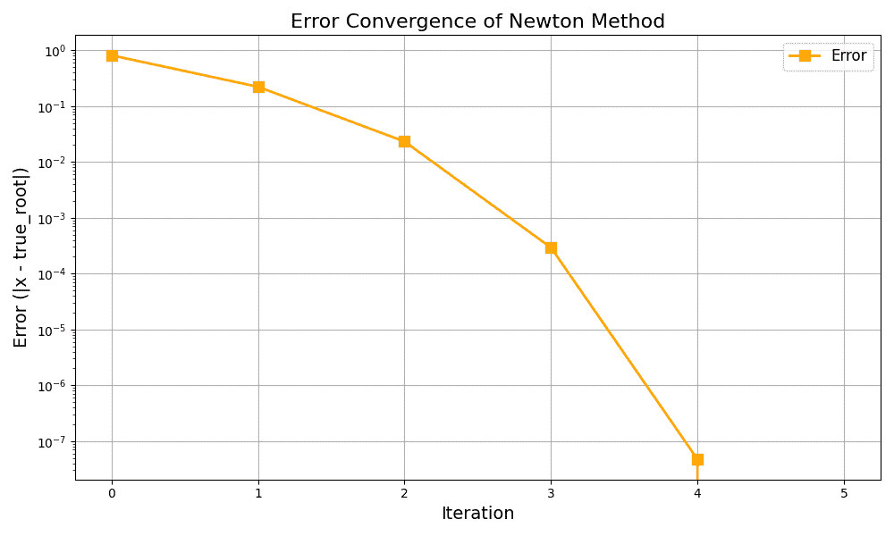

# 06-09优化算法-牛顿方法

> 来源：[https://qqs7y1hozd1.feishu.cn/docx/LzPgdzl7PoQ3J6xqtUScNzS6nHc](https://qqs7y1hozd1.feishu.cn/docx/LzPgdzl7PoQ3J6xqtUScNzS6nHc)

**牛顿方法****（Newton'**s Method），又称牛顿-拉夫森方法，是一种用来求解非线性方程的数值方法，特别适用于找到一个函数的根（即找到  的解）。它是基于函数的导数来逐步逼近方程解的。

### 数学定义

假设你有一个非线性方程  ，你希望找到这个方程的根。

牛顿方法的迭代公式：

其中：

+    是第   次迭代的值。

+    是函数在  的函数值。

+    是函数在  的导数值。

从初始猜测  开始，每次迭代计算新的  值，逐步逼近方程的根。

其实很容易理解，牛顿方法可以理解为一种“智能猜答案”的过程。假设你有一个问题，比如一个抛物线（函数曲线）和  轴的交点是什么（也就是函数的根）。你不知道准确的答案，但你可以随便猜一个值  ，接着用这个方法逐步改进你的猜测，让答案越来越接近真实的解。

具体来说，牛顿方法通过利用函数的切线来调整猜测。假设你从某个位置  开始，如果你知道函数在  点的值和斜率（导数），你可以用这个信息来画出一条切线。切线就是一条直线，它在  处与函数曲线相切。然后，你看这条切线在哪个位置与  轴相交，这个交点会给你一个新的  。通过这样的过程，你不断调整自己的猜测，最终得到接近正确答案的结果。

简单总结：

1.  随便猜个数字（初始值）。

1.  用这个数字算函数值和导数，得出一个新猜测。

1.  新猜测更接近正确答案。

1.  重复几次，你的猜测就会非常接近方程的根。

牛顿方法通常收敛得非常快，但它对初始值要求较高，可能会失败或者发散，如果初始值离根太远或者导数为零。

## 理论基础

**牛顿方法的核心思想是**：利用一个初始猜测点，通过不断地利用该点的切线逼近根，从而找到方程的根。具体来说，它利用了泰勒级数展开的思想，只保留了一级展开（即线性近似），通过线性逼近来找到非线性方程的根。

假设你有一个连续可微的函数  ，希望找到它的根（即  的解）。假设我们从某个  开始猜测，这时函数在  处的切线方程是：

这里  是  在  处的导数值，切线是函数曲线的线性近似。

为了找到函数的根，切线和  轴的交点可以作为新的近似值。因为切线在  轴上的交点是  ，所以我们可以令上面的切线方程  ，解出新的  值：

这可以整理为：

得到新的迭代公式：

这一公式表明，我们通过  的切线找到一个新的  ，这个  会比  更接近根。然后，我们可以用同样的方法在  处继续迭代，重复这一过程，直到我们找到满足一定精度的根。

### 牛顿方法收敛性

牛顿方法通常收敛得非常快，尤其**当初始猜**测值  足够接近根时。它的收敛速度是二次收敛，这意味着每次迭代误差大约会以平方的速度减小。

数学上，如果初始猜测足够好，牛顿方法的误差  满足：

其中  是某个常数， ， 是根的精确值。也就是说，误差会迅速减小。

然而，牛顿方法对初始点的选择非常敏感，如果初始点选择得不好（比如离根太远或者函数导数在某些点接近 0），可能会导致算法发散或失效。

### 牛顿方法的算法流程

以下是牛顿方法的详细算法流程，逐步说明如何从初始猜测值开始，逐步逼近方程的根。

**第一步：选择初始猜测值**

选择一个初始点  ，这通常是对方程根的初步猜测。初始点的选择非常重要，它影响到算法是否能够成功找到根以及收敛速度。

**第二步：计算函数值和导数值**

计算函数在初始猜测点  的值  和导数值  。

表示函数在点  处的值。

表示函数在点  处的导数（即切线的斜率）。

**第三步：检查导数是否为零**

如果导数  ，意味着在此点处切线是水平的（平行于  轴），无法进行进一步的迭代（因为分母为 0）。此时需要重新选择初始点或者使用其他方法。

**第四步：更新新的猜测值**

通过牛顿迭代公式更新新的猜测值  ：

**第五步：检查收敛性**

检查新的猜测值  是否足够接近真实解。这通常通过以下两种方式之一进行：

1.  **误差检查**：判断新旧两个迭代值的差距是否足够小，即：
 
其中  是设定的一个很小的容差值，表示所要求的精度。如果满足该条件，算法收敛，输出当前的  作为近似解。

1.  **函数值检查**：判断函数值  是否足够接近 0，即：
 
如果函数值足够接近 0，认为当前解  已经非常接近根，可以停止迭代。

**第六步：重复迭代**

如果没有满足收敛条件，将新的  作为下一个迭代的初始值，继续迭代：

+   计算  和  。

+   使用公式更新：

+   重复上述步骤，直到满足收敛条件。

### 牛顿法完整过程

1.  **选择初始值**  。

1.  **计算函数值**  和导数值  。

1.  **检查导数是否为 0**：如果  ，则无法继续，选择新的初始值或使用其他方法。

1.  **更新迭代值**：使用迭代公式更新新的  ：

1.  **检查收敛性**：判断  或  是否小于预设的容差  。如果满足条件，输出  作为近似解。

1.  **重复**：如果未收敛，继续下一次迭代。

这个流程重复执行，直到找到一个足够精确的根。

### 注意项

+   牛顿方法对初始点  非常敏感。如果初始点选择不好，可能导致算法发散，无法找到根。

+   如果在某个点处  ，无法进行进一步迭代，因此要避免这种情况。

+   牛顿方法适合那些**函数光滑且导数变化平稳**的场景，如果函数的导数变化剧烈，可能会导致收敛困难。

通过这些步骤，牛顿方法能有效地找到方程的根，特别是当初始猜测点接近真实根时，收敛速度非常快。

## 完整案例

这里的案例，包含数据分析和可视化。将虚拟数据集应用于牛顿方法，并绘制两张复杂的图形来展示收敛过程和误差的变化，大家更容易理解。

### 案例说明

1.  我们将求解一个非线性方程 f(x)=x3−2x2−5=0f(x) = x^3 - 2x^2 - 5 = 0。

1.  使用牛顿方法求解此方程，并分析牛顿法的迭代过程。

```
import numpy as np
import matplotlib.pyplot as plt

# 牛顿方法函数定义
def newton_method(f, f_prime, x0, tol=1e-6, max_iter=100):
    &quot;&quot;&quot;
    使用牛顿法求解 f(x) = 0，返回根和收敛过程中的 x 值序列。
    
    参数:
    f: 目标函数
    f_prime: 目标函数的导数
    x0: 初始猜测值
    tol: 允许的误差范围
    max_iter: 最大迭代次数
    
    返回:
    x_vals: 牛顿法迭代过程中 x 值的列表
    &quot;&quot;&quot;
    x = x0
    x_vals = [x]  # 用于存储迭代过程中的x值
    
    for i in range(max_iter):
        fx = f(x)
        fpx = f_prime(x)
        
        # 防止导数为0的情况，避免分母为0
        if abs(fpx) &lt; 1e-10:
            print(&quot;导数过小，无法继续迭代。&quot;)
            break
        
        # 更新x值
        x_new = x - fx / fpx
        x_vals.append(x_new)
        
        # 检查是否满足精度要求
        if abs(x_new - x) &lt; tol:
            break
        
        x = x_new
        
    return x_vals

# 定义非线性方程 f(x) = x^3 - 2x^2 - 5
def f(x):
    return x**3 - 2*x**2 - 5

# 定义导数 f&#x27;(x)
def f_prime(x):
    return 3*x**2 - 4*x

# 设置初始猜测值
x0 = 3.5

# 使用牛顿方法进行求解，获取迭代过程中的 x 值序列
x_vals = newton_method(f, f_prime, x0)

# 计算对应的误差（相对于最终解）
true_root = x_vals[-1]  # 最终解
errors = [abs(x - true_root) for x in x_vals]

# ---- 图1：收敛过程 ----
plt.figure(figsize=(10, 6))
iterations = np.arange(len(x_vals))

plt.plot(iterations, x_vals, &#x27;-o&#x27;, color=&#x27;magenta&#x27;, label=&#x27;x values&#x27;, markersize=8, linewidth=2)
plt.title(&#x27;Convergence of Newton Method&#x27;, fontsize=16)
plt.xlabel(&#x27;Iteration&#x27;, fontsize=14)
plt.ylabel(&#x27;x values&#x27;, fontsize=14)
plt.grid(True)
plt.axhline(y=true_root, color=&#x27;green&#x27;, linestyle=&#x27;--&#x27;, label=f&#x27;True root: {true_root:.6f}&#x27;)
plt.legend(loc=&#x27;upper right&#x27;, fontsize=12)
plt.tight_layout()

# ---- 图2：误差收敛 ----
plt.figure(figsize=(10, 6))
plt.plot(iterations, errors, &#x27;-s&#x27;, color=&#x27;orange&#x27;, label=&#x27;Error&#x27;, markersize=8, linewidth=2)
plt.title(&#x27;Error Convergence of Newton Method&#x27;, fontsize=16)
plt.xlabel(&#x27;Iteration&#x27;, fontsize=14)
plt.ylabel(&#x27;Error (|x - true_root|)&#x27;, fontsize=14)
plt.yscale(&#x27;log&#x27;)  # 使用对数坐标来更好地展示误差收敛
plt.grid(True)
plt.legend(loc=&#x27;upper right&#x27;, fontsize=12)
plt.tight_layout()

# 显示图形
plt.show()
```

1.  **newton_method()** 函数实现了牛顿方法，能够根据函数和其导数逐步逼近方程的根。该函数优化了对导数为 0 的处理，以防止分母为 0。

1.  **f(x)** 和 **f'(x)** 定义了我们要解决的非线性方程和其导数。

1.  **x0 = 3.5** 设置了初始猜测值，我们从该点开始迭代。

**收敛过程图**：展示迭代过程中 xx 值的变化。图中还添加了一条水平虚线，标示出最终求解的根。


**误差收敛图**：展示了误差随着迭代次数的变化情况，使用对数坐标系更直观地展示误差收敛情况。



1.  **收敛过程图**：展示了牛顿方法在几次迭代内快速收敛到根。

1.  **误差收敛图**：展示了误差随着迭代次数快速减小，呈现二次收敛的特性，最终误差接近零。

以上，就是咱们今天给大家分享的，如何使用牛顿方法求解复杂的非线性方程，并通过可视化分析其收敛速度和误差变化。在大家的实验中，可以根据问题复杂性选择合适的初始猜测值，以获得快速收敛效果。

## 应用场景

牛顿方法主要适用于**求解非线性方程**，特别是那些可以轻松求得导数并且导数不为零的函数。

具体适用的问题类型包括：

1.  **非线性方程的根**：求解  形式的非线性方程，比如多项式方程、超越方程等。

1.  **优化问题**：牛顿方法的扩展可以用于寻找函数的极值（最大值或最小值），因为求解  可以找到函数的驻点，扩展为多元的牛顿法可以用于无约束优化。

1.  **方程组求解**：通过向量和矩阵的推广，可以用于求解非线性方程组。

1.  **数值分析中的迭代求解**：在数值分析领域，牛顿方法也用于某些迭代求解问题，比如求平方根、倒数等。

### 牛顿方法的优缺点

**优点**：

1.  **收敛速度快**：当初始猜测值较好时，牛顿方法具有二次收敛的性质，收敛速度非常快。每次迭代误差的平方倍减少。

1.  **应用广泛**：牛顿方法可以推广到多元方程组、多维优化问题，适用范围较广。

1.  **高精度**：能够通过多次迭代达到较高精度的解，只需要少量的迭代步数。

**缺点**：

1.  **对初始值敏感**：初始值离真实解太远时，可能会导致迭代失败，甚至发散。

1.  **需要求导数**：必须能计算函数的导数，且要求导数在迭代点附近不为零。因此，不适合那些难以求导或导数接近零的函数。

1.  **局部收敛**：牛顿方法通常是局部收敛的，只有在初始猜测点靠近实际根时，才表现出快速收敛的特性。否则可能会进入无解或错误解的区域。

1.  **可能无法收敛**：在某些情况下，牛顿方法可能无法收敛，例如导数为零或函数极其不规则的情况。

### 牛顿方法的运用前提条件

1.  **函数是可微的**：牛顿方法需要用到函数的导数，因此要求函数在整个迭代过程中是连续可导的。

1.  **初始值选择合理**：为了保证快速收敛和避免发散，初始猜测值需要合理选择，通常初始值需要足够接近实际根。

1.  **导数不为零**：要求函数在迭代过程中导数  ，否则会导致计算错误或停止迭代。

1.  **函数性质良好**：函数的导数变化平缓，没有剧烈的跳变或振荡，否则牛顿法可能出现不稳定的情况。