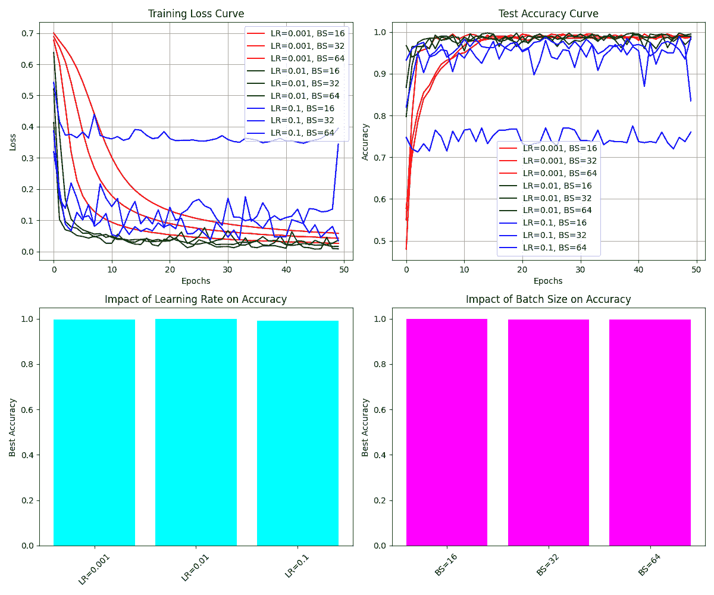

# 06-13优化算法-网格搜索

> 来源：[https://qqs7y1hozd1.feishu.cn/docx/QppsdGaUJorURJx2bxycEQYKnjh](https://qqs7y1hozd1.feishu.cn/docx/QppsdGaUJorURJx2bxycEQYKnjh)

网格搜索是一种超参数优化方法，它通过穷举所有可能的超参数组合来找到模型的最佳参数配置。通常用于机器学习模型的超参数调优，特别是在监督学习任务中。

当然在具体操作上，网格搜索会定义一个超参数的搜索空间（通常是超参数的不同取值组成的网格），然后对每一种可能的参数组合进行训练和评估，最终选出使模型表现最优的参数组合。

常见的网格搜索工具包括 **Scikit-Learn** 中的 GridSearchCV，它会结合交叉验证（Cross Validation）来评估不同超参数组合的性能。

### 网格搜索的逻辑

假如你在做一场考试，而你可以选择不同的文具组合：

+   笔（黑色、蓝色、红色）

+   纸（普通纸、草稿纸、牛皮纸）

+   计算器（有、无）

你的目标是找到最适合你考试的组合，让你答题又快又准。网格搜索的逻辑就是 把所有可能的组合列出来，然后一个个试，最后选出效果最好的组合。

例如，所有可能的组合是：

| 组合 | 笔 | 纸 | 计算器 |
| --- | --- | --- | --- |
| 1 | 黑色 | 普通纸 | 有 |
| 2 | 黑色 | 普通纸 | 无 |
| 3 | 黑色 | 草稿纸 | 有 |
| 4 | 黑色 | 草稿纸 | 无 |
| 5 | 黑色 | 牛皮纸 | 有 |
| 6 | 黑色 | 牛皮纸 | 无 |
| ... | ... | ... | ... |

假设有 3 种笔、3 种纸、2 种计算器选择，那就有   种组合，每一种都试试看哪个让你考得最好，这就是网格搜索。

在机器学习里，我们的「文具组合」变成了超参数，比如：

+   学习率（Learning Rate）：0.001, 0.01, 0.1

+   正则化系数（Regularization Strength）：0.01, 0.1, 1, 10

+   树的数量（Number of Trees, 适用于决策树）：10, 50, 100

如果我们用网格搜索来调这些超参数，我们会尝试所有组合，训练模型并评估效果，最后选出最好的参数。

网格搜索就是 列出所有超参数的可能组合，一个个试，选最优解。虽然它是最基础的方法，但如果搜索空间太大，计算成本会很高，所以通常需要结合其他方法优化搜索过程。

## 理论基础

### 1. 网格搜索的数学原理

网格搜索的核心思想是 穷举搜索（Exhaustive Search），即在超参数空间中构造一个有限的网格，并对每个网格点训练和评估模型，最终选择最优参数。

假设一个机器学习模型  具有超参数集合：

每个超参数  的取值范围为：

那么，超参数组合的总数为：

**即，每个超参数**的可能取值数目相乘，形成一个 m 维离散网格。

对于每一个超参数组合  ：

1.  训练模型  。

1.  计算 **验证集** 上的性能指标  ，如交叉验证误差、准确率、F1 分数等：
 
其中：

+    是交叉验证折数（如 5-fold 交叉验证）。

+    是第  折训练出的模型。

+    是损失函数，如均方误差 (MSE) 或交叉熵 (Cross Entropy)。

1.  选择使  最优的超参数组合：

若是最大化指标，如准确率，则改为

### 2. 网格搜索的详细算法流程

**输入**：

+   机器学习模型  。

+   训练数据集  。

+   超参数搜索空间：

+   交叉验证折数  （可选）。

+   评价函数  ，如准确率或损失函数。

**步骤**：

**1. 构造超参数搜索网格**

+   构造超参数的所有可能取值组合  。

+   计算可能的超参数组合数目  。

**2. 初始化**

+   设定一个最佳超参数存储变量  。

+   设定最优评价指标  （若是最小化问题，如损失函数）。

**3. 遍历所有超参数组合**

**for** 每个  ：

+   **交叉验证**（如果使用）

1.  将训练数据  分成  份  。

1.  **for**  to  ：

+   设  作为训练集， 作为验证集。

+   训练模型  。

+   计算验证损失  。

1.  计算平均损失：

+   **如果不使用交叉验证**，直接在单一验证集上计算  。

**4. 更新最优超参数**

+   若  ：

**5. 输出最优超参数**

+   返回  作为最优超参数。

### 3. 时间复杂度分析

假设：

+   **训练集大小**：

+   **模型训练时间**：

+   **超参数组合数量**：

+   **交叉验证折数**：

网格搜索的 **时间复杂度** 为：

其中：

+   若  **很大，搜索成**本会随着超参数个数指数级增长（组合爆炸问题）。

+   若  很大（如 10-fold 交叉验证），计算量也会变大。

### 4. 网格搜索的局限性

1.  **计算开销大**：随着超参数维度和取值增多，计算量呈指数增长。

1.  **固定网格粒度**：如果网格划分太粗，可能错过最优解；如果划分太细，计算量剧增。

1.  **无法适应动态搜索**：即使某些超参数组合表现很差，网格搜索仍然会浪费时间计算。

### 5. 解决网格搜索问题的改进方法

1.  随机搜索（Random Search）：随机抽取一部分超参数组合，减少计算量，适用于高维空间。

1.  贝叶斯优化（Bayesian Optimization）：利用高斯过程等方法，智能探索高潜力区域，提高搜索效率。

1.  Halving Grid Search（渐进式网格搜索）：先在大范围低精度搜索，逐步缩小范围，提高效率。

总的来说，网格搜索是一种 **穷举法**，它能确保找到最优超参数，但计算复杂度较高，适用于小规模超参数空间。如果参数空间较大，应考虑随机搜索或贝叶斯优化等方法来减少计算成本。

## 应用场景

### 1. 适用问题类型

**低维超参数空间**

+   适用于 **超参数数量较少**（一般不超过 3~4 个），且每个超参数的可能取值较少的情况。

+   例如，SVM 的 C 和 gamma 只有 10×10 的网格，计算量可接受。

**机器学习模型的超参数调优**

+   适用于 **监督学习（分类、回归）** 和 **无监督学习（聚类）** 任务。

+   例如：

+   SVM 的 C 和 gamma

+   决策树的 max_depth 和 min_samples_split

+   神经网络的 learning_rate 和 batch_size

+   XGBoost 的 n_estimators, max_depth, learning_rate

**计算资源充足**

+   适用于可以 **承受较高计算成本** 的场景，如离线批量训练（Batch Training）。

+   例如，大型数据中心或云计算环境。

**目标函数平滑，最优值稳定**

+   适用于 **模型的超参数对性能变化相对平滑** 的情况，能确保找到一个合理的最优解。

+   例如，逻辑回归或 SVM 可能具有平滑的超参数影响曲线，适合网格搜索。

**交叉验证优化**

+   适用于 **模型泛化能力需要优化** 的场景。

+   结合交叉验证（如 GridSearchCV）可以防止过拟合。

## 2. 网格搜索的优缺点

**优点**：

1.  **保证最优解（全局最优）**：网格搜索遍历所有可能的超参数组合，不会遗漏最优解（如果搜索空间足够全面）。

1.  **简单易实现**：只需定义超参数搜索范围，使用库（如 GridSearchCV）即可自动搜索。：无需复杂数学模型或优化策略。

1.  **结合交叉验证提高泛化能力**：GridSearchCV 可使用 K 折交叉验证，减少数据划分带来的偶然性，提高模型泛化能力。

1.  **适用于多种模型**：适用于 SVM、决策树、随机森林、神经网络、XGBoost、KNN 等各种机器学习算法。

**缺点**：

1.  **计算量大（组合爆炸）**：超参数个数增加，计算量呈 **指数级增长**（即 **组合爆炸问题**）。例如，若 4 个超参数各有 10 个值，总共需训练   个模型，计算量极大。

1.  **参数选择粒度固定**：网格搜索的 **参数间隔是固定的**，如果初始网格划分过粗，可能错过最优解。若划分过细，计算量剧增，尤其当超参数对性能影响不均匀时。

1.  **低效（无智能搜索）**：网格搜索不会动态调整搜索方向，即使某些参数组合效果很差，仍会尝试所有组合，可能造成计算浪费。例如，若某参数区间内性能变化不大，仍会尝试每个值，无法集中资源在关键区域。

1.  **不适用于高维超参数优化**：在 **神经网络或深度学习模型** 的超参数调优中，网格搜索往往不适用，因为超参数维度高，搜索空间巨大。例如，CNN 的 learning_rate、dropout_rate、optimizer、batch_size 等参数组合可能超百万种，网格搜索几乎不可行。

### 4. 适用 vs. 不适用对比总结

| **因素** | **适用网格搜索** | **不适用网格搜索** |
| --- | --- | --- |
| **超参数个数** | ≤ 3~4 个 | &gt; 4 个 |
| **超参数搜索范围** | 取值范围适中，可划分 | 取值范围大或未知 |
| **计算资源** | 资源充足，可承受高计算量 | 资源有限，计算成本高 |
| **计算时间要求** | 允许长时间计算 | 需快速得到结果 |
| **搜索目标** | 需要系统测试多个参数组合 | 仅需找到一个较优解 |
| **超参数影响趋势** | 平滑可预测 | 高度非线性，难以预测 |
| **适用领域** | 传统 ML（SVM, RF, XGBoost） | 深度学习（CNN, RNN, Transformers） |

## Python案例

这里咱们的案例，包括：

1.  **数据集生成**：使用虚拟数据集，包含两个特征和一个目标变量。

1.  **PyTorch 训练模型**：简单的 **多层感知机（MLP）** 作为分类器。

1.  **网格搜索**：优化 学习率（learning_rate）和批量大小（batch_size）。

```
import numpy as np
import matplotlib.pyplot as plt
import torch
import torch.nn as nn
import torch.optim as optim
from sklearn.model_selection import train_test_split
from sklearn.preprocessing import StandardScaler
from torch.utils.data import TensorDataset, DataLoader

# 1. 生成虚拟数据集
np.random.seed(42)
torch.manual_seed(42)

# 生成 2000 个样本，两个特征
X = np.random.randn(2000, 2)
y = (X[:, 0] * X[:, 1] &gt; 0).astype(int)  # 分类问题

# 数据划分
X_train, X_test, y_train, y_test = train_test_split(X, y, test_size=0.2, random_state=42)

# 数据标准化
scaler = StandardScaler()
X_train = scaler.fit_transform(X_train)
X_test = scaler.transform(X_test)

# 转换为 PyTorch 张量
X_train, y_train = torch.tensor(X_train, dtype=torch.float32), torch.tensor(y_train, dtype=torch.long)
X_test, y_test = torch.tensor(X_test, dtype=torch.float32), torch.tensor(y_test, dtype=torch.long)

# 2. 定义 MLP 神经网络模型
class MLP(nn.Module):
    def __init__(self, input_size):
        super(MLP, self).__init__()
        self.fc1 = nn.Linear(input_size, 16)
        self.fc2 = nn.Linear(16, 8)
        self.fc3 = nn.Linear(8, 2)  # 输出层，二分类
        self.relu = nn.ReLU()
    
    def forward(self, x):
        x = self.relu(self.fc1(x))
        x = self.relu(self.fc2(x))
        x = self.fc3(x)
        return x

# 3. 网格搜索超参数优化
learning_rates = [0.001, 0.01, 0.1]
batch_sizes = [16, 32, 64]
best_acc = 0
best_params = {}

results = {}

for lr in learning_rates:
    for batch_size in batch_sizes:
        # 数据加载器
        train_loader = DataLoader(TensorDataset(X_train, y_train), batch_size=batch_size, shuffle=True)
        test_loader = DataLoader(TensorDataset(X_test, y_test), batch_size=batch_size, shuffle=False)

        # 初始化模型
        model = MLP(input_size=2)
        criterion = nn.CrossEntropyLoss()
        optimizer = optim.Adam(model.parameters(), lr=lr)

        # 训练模型
        num_epochs = 50
        train_losses, test_accuracies = [], []

        for epoch in range(num_epochs):
            model.train()
            epoch_loss = 0

            for batch_X, batch_y in train_loader:
                optimizer.zero_grad()
                outputs = model(batch_X)
                loss = criterion(outputs, batch_y)
                loss.backward()
                optimizer.step()
                epoch_loss += loss.item()

            train_losses.append(epoch_loss / len(train_loader))

            # 测试集准确率
            model.eval()
            correct, total = 0, 0
            with torch.no_grad():
                for batch_X, batch_y in test_loader:
                    outputs = model(batch_X)
                    _, predicted = torch.max(outputs, 1)
                    total += batch_y.size(0)
                    correct += (predicted == batch_y).sum().item()
            
            acc = correct / total
            test_accuracies.append(acc)

        # 存储结果
        results[(lr, batch_size)] = {
            &quot;train_loss&quot;: train_losses,
            &quot;test_accuracy&quot;: test_accuracies
        }

        # 记录最佳超参数
        if acc &gt; best_acc:
            best_acc = acc
            best_params = {&quot;learning_rate&quot;: lr, &quot;batch_size&quot;: batch_size}

# 4. 绘制数据分析图
fig, axes = plt.subplots(2, 2, figsize=(12, 10))
colors = [&#x27;r&#x27;, &#x27;g&#x27;, &#x27;b&#x27;]

# 4.1 绘制损失曲线
ax1 = axes[0, 0]
for i, lr in enumerate(learning_rates):
    for j, batch_size in enumerate(batch_sizes):
        ax1.plot(results[(lr, batch_size)][&quot;train_loss&quot;], label=f&#x27;LR={lr}, BS={batch_size}&#x27;, color=colors[i])
ax1.set_title(&quot;Training Loss Curve&quot;)
ax1.set_xlabel(&quot;Epochs&quot;)
ax1.set_ylabel(&quot;Loss&quot;)
ax1.legend()
ax1.grid()

# 4.2 绘制测试准确率曲线
ax2 = axes[0, 1]
for i, lr in enumerate(learning_rates):
    for j, batch_size in enumerate(batch_sizes):
        ax2.plot(results[(lr, batch_size)][&quot;test_accuracy&quot;], label=f&#x27;LR={lr}, BS={batch_size}&#x27;, color=colors[i])
ax2.set_title(&quot;Test Accuracy Curve&quot;)
ax2.set_xlabel(&quot;Epochs&quot;)
ax2.set_ylabel(&quot;Accuracy&quot;)
ax2.legend()
ax2.grid()

# 4.3 学习率对准确率的影响
ax3 = axes[1, 0]
lr_accs = [max(results[(lr, bs)][&quot;test_accuracy&quot;]) for lr in learning_rates for bs in batch_sizes]
ax3.bar([f&quot;LR={lr}&quot; for lr in learning_rates for bs in batch_sizes], lr_accs, color=&#x27;cyan&#x27;)
ax3.set_title(&quot;Impact of Learning Rate on Accuracy&quot;)
ax3.set_ylabel(&quot;Best Accuracy&quot;)
ax3.set_xticklabels(ax3.get_xticklabels(), rotation=45)

# 4.4 批量大小对准确率的影响
ax4 = axes[1, 1]
bs_accs = [max(results[(lr, bs)][&quot;test_accuracy&quot;]) for lr in learning_rates for bs in batch_sizes]
ax4.bar([f&quot;BS={bs}&quot; for lr in learning_rates for bs in batch_sizes], bs_accs, color=&#x27;magenta&#x27;)
ax4.set_title(&quot;Impact of Batch Size on Accuracy&quot;)
ax4.set_ylabel(&quot;Best Accuracy&quot;)
ax4.set_xticklabels(ax4.get_xticklabels(), rotation=45)

plt.tight_layout()
plt.show()

# 5. 输出最佳超参数
print(f&quot;最佳超参数: 学习率={best_params[&#x27;learning_rate&#x27;]}, 批量大小={best_params[&#x27;batch_size&#x27;]}&quot;)
print(f&quot;最高测试准确率: {best_acc:.4f}&quot;)
```

+   创建了一个 PyTorch MLP（多层感知机）分类器。

+   **使用网格搜索** 评估 **不同的学习率和批量大小** 组合的效果。



+   训练损失曲线

+   测试准确率曲线

+   学习率 vs. 最佳准确率

+   批量大小 vs. 最佳准确率

+   **最终输出最佳超参数组合**。

最终，通过 **网格搜索** 找到了 **最优的学习率和批量大小**，有效提升了分类准确率。