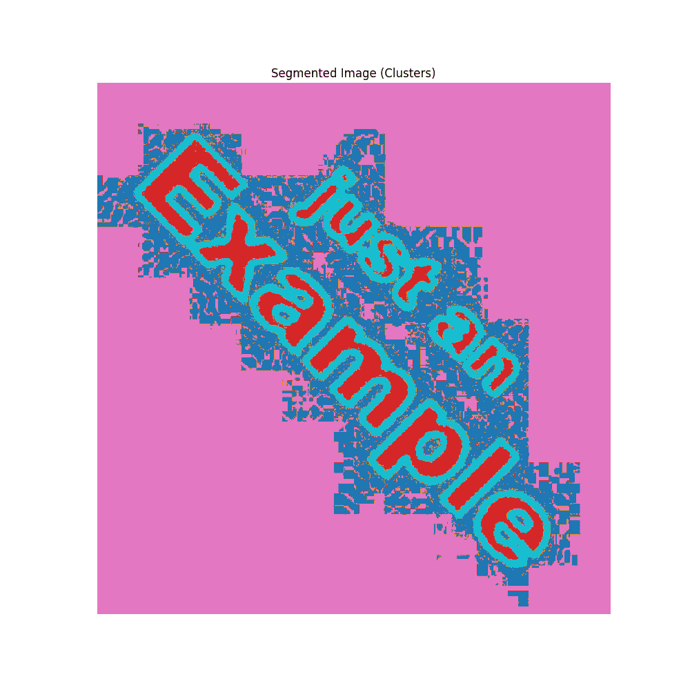
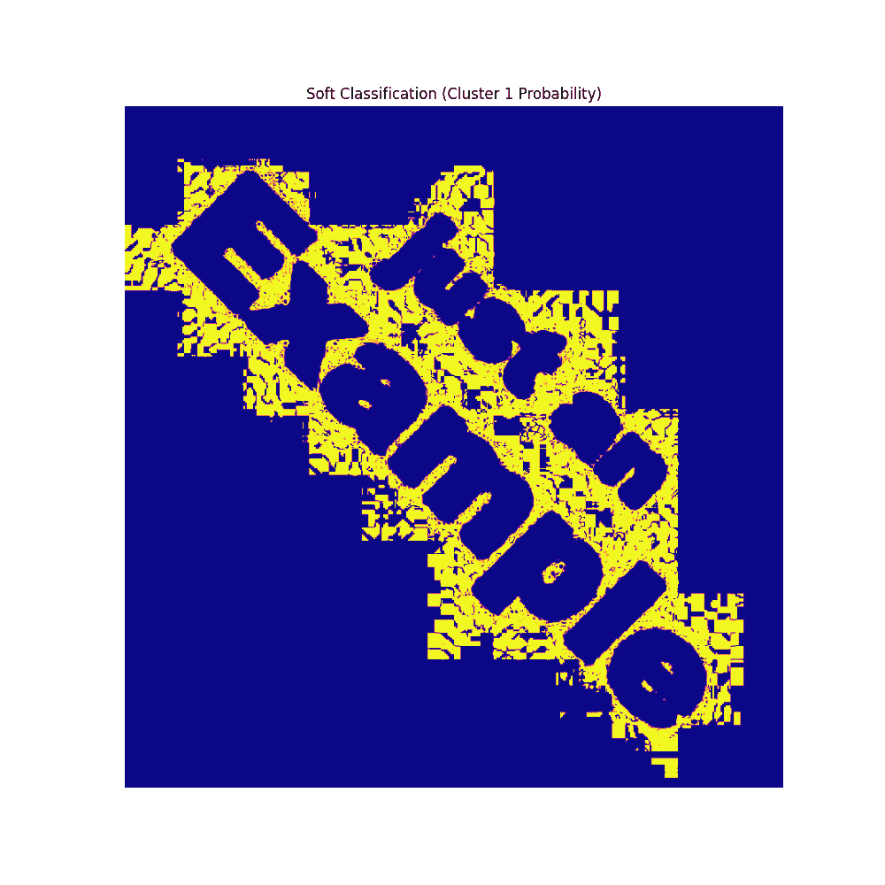
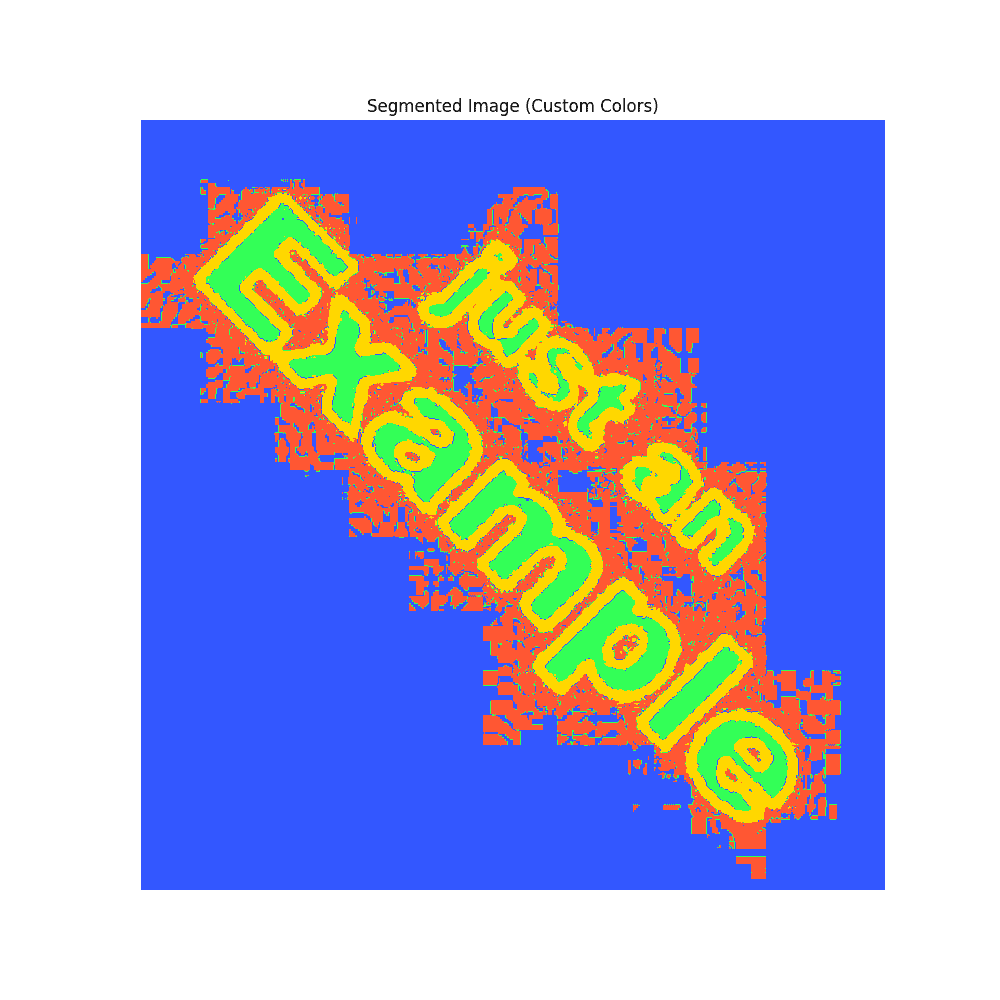

# 07-03聚类算法-GMM

> 来源：[https://qqs7y1hozd1.feishu.cn/docx/R74vdVcJAoWcbKxQsgaczmN6nAg](https://qqs7y1hozd1.feishu.cn/docx/R74vdVcJAoWcbKxQsgaczmN6nAg)

这个大家在未来的一个时候，肯定会用上，本文也会从你最实用的角度进行一个完整的分享。

首先呢，咱们先来看什么是聚类算法？

聚类算法是用来给数据分类的一种方法，但和分类不一样的是：

+   分类需要事先知道每个数据的类别，比如"苹果"、"香蕉"；

+   聚类不需要你事先告诉它类别，它会根据数据的特征，自己划分出一些组。

简单理解：聚类算法就像给一堆乱七八糟的物品分组，尽量让每组的东西看起来像一家子。

#### GMM是什么？

GMM（Gaussian Mixture Model，高斯混合模型）是一种比较聪明的聚类算法。

它假设数据来自于几个“高斯分布”（像钟形曲线那样的分布），然后根据这些分布把数据分组。

**特点：**

1.  它不像K-means（另一个常见的聚类算法）那样死板。K-means会把每个点分到某个固定的组里，GMM允许一个点有一定概率属于多个组。

1.  它更适合处理那些“分布有点像钟形曲线”的数据。

#### 一个非常通俗案例

**用GMM分组日常饮料**

想象一下，你去了一家超市，看到一堆饮料。这些饮料的包装上有两个关键信息：

1.  **甜度**（如每100毫升糖含量，单位：克）。

1.  **气泡强度**（如碳酸含量，单位：毫升）。

你的任务是按照饮料的特点，把它们分成两类：

+   一类是“气泡饮料”（比如可乐、雪碧）。

+   一类是“果汁饮料”（比如橙汁、苹果汁）。

#### 数据（假设有以下饮料）

| 饮料编号 | 甜度 (克/100ml) | 气泡强度 (毫升) |
| --- | --- | --- |
| 1 | 10 | 50 |
| 2 | 12 | 45 |
| 3 | 5 | 10 |
| 4 | 4 | 15 |
| 5 | 11 | 55 |
| 6 | 6 | 12 |

#### 如何用GMM分组？

1.  **假设每组数据来源于一个高斯分布**

+   高斯分布形状像个钟，描述了数据分布的规律。

+   比如，“气泡饮料”大多数甜度在10克左右，气泡强度在50毫升附近。

+   “果汁饮料”大多数甜度在5克左右，气泡强度在15毫升附近。

1.  **定义分组数目**：我们假设有2类饮料（气泡饮料和果汁饮料）。

1.  **初始化参数**

+   初始估计每类饮料的高斯分布位置和形状，比如甜度和气泡强度的均值，以及它们的变化范围（标准差）。

+   初始参数可能是：

+   气泡饮料：甜度均值 = 10，气泡强度均值 = 50。

+   果汁饮料：甜度均值 = 5，气泡强度均值 = 15。

1.  **迭代优化**
GMM会根据以下步骤不断优化分组：

+   E步（Expectation，期望步）：计算每种饮料属于两类中的概率。例如，饮料1更可能属于“气泡饮料”，而饮料3更可能属于“果汁饮料”。

+   M步（Maximization，最大化步）：根据概率重新计算每类饮料的均值和标准差。

1.  **停止条件**
当参数基本不变时（比如均值和标准差变化很小），分组结束。

#### 简单计算

这里，咱们手动模拟一下，大家就会更加的清楚~

我们只计算第一步的“概率分配”：

饮料1的甜度 = 10，气泡强度 = 50

+   假设“气泡饮料”的高斯分布均值为甜度10，气泡强度50，标准差较小，饮料1几乎100%属于这类。

+   假设“果汁饮料”的高斯分布均值为甜度5，气泡强度15，饮料1属于这类的概率接近0。

饮料3的甜度 = 5，气泡强度 = 10

+   对“果汁饮料”，均值正好是甜度5，气泡强度15，饮料3的概率接近1。

+   对“气泡饮料”，均值是甜度10，气泡强度50，饮料3的概率接近0。

通过这样的步骤，GMM可以不断优化分组，直到稳定。

#### 总结3点

1.  GMM假设数据来自多个高斯分布。

1.  通过计算每个点属于不同组的概率进行分组。

1.  它比K-means更灵活，适合有重叠区域的数据。

## 核心原理

高斯混合模型（GMM）通过多个高斯分布的线性组合来拟合数据的概率分布。

### 1. 高斯分布公式

单维高斯分布的概率密度函数（PDF）为：

其中：

+    ：均值，决定分布的中心。

+    ：方差，决定分布的宽度。

对于多维数据（如  ），多维高斯分布的公式为：

其中：

+    ：协方差矩阵，描述变量之间的线性关系。

### 2. 混合模型的定义

假设数据来自  个高斯分布的混合，则数据点  的概率为：

其中：

+    ：第  个高斯分布的权重，满足  和  。

+    是所有模型参数。

### 3. 最大似然估计（MLE）

我们希望通过最大化数据的似然函数来估计参数  ：

为了方便计算，取对数得到对数似然：

直接最大化对数似然比较困难，因此我们引入 EM 算法。

### 4. EM算法推导

#### a. 引入隐变量

假设我们不知道每个数据点  属于哪个高斯分布，于是引入隐变量  ，表示  属于第  个分布的指示变量：

。

。

于是联合概率可以写成：

观测数据的边际概率为：

#### b. EM算法分为两步

E步（期望步）：计算隐变量的后验概率

利用当前参数  ，计算数据点  属于第  个分布的后验概率（即责任度）：

其中：

+    ：数据点  属于第  类的概率。

**M步（最大化步）：更新模型参数**

根据 E 步计算的  ，重新估计参数  。

1.  更新权重  ：
 
其中  是属于第  类的“有效样本数”。

1.  更新均值  ：

1.  更新协方差矩阵  ：

### 5. 算法迭代过程

1.  **初始化**：随机初始化均值  、协方差  和权重  。

1.  **E步**：根据当前参数计算每个点的责任度  。

1.  **M步**：利用责任度  更新  。

1.  **收敛**：重复 E 步和 M 步，直到对数似然函数  收敛。

### 6. 总结一下核心公式

1.  责任度：

1.  权重更新：

1.  均值更新：

1.  协方差更新：

### 7. GMM优势与局限

**优势**：

+   能处理复杂的分布（非球形、非均匀）。

+   输出是概率分布，可以处理软分类问题。

**局限**：

+   对参数初始化较为敏感。

+   计算复杂度较高，可能陷入局部最优。

通过以上公式和推理，咱们可以清楚理解 GMM 的理论基础~

## 优缺点和适用场景

**优点**：

1.  **适用于复杂数据分布**：GMM假设数据来自多个高斯分布的混合，因此可以处理复杂分布的数据，而不像K-Means要求数据具有球形分布。

1.  **软分类**：GMM输出每个数据点属于某个簇的概率，而非硬性地将数据点划分到某个类中。这种柔性更适合处理边界模糊的分类问题。

1.  **参数估计灵活**：可以估计每个簇的均值、协方差矩阵、权重等参数，适合不同形状和规模的簇。

1.  **适合高维数据**：通过协方差矩阵，GMM能够自然地捕获数据在不同维度上的相关性。

1.  **概率模型**：GMM是一种生成式模型，可以用于密度估计、异常检测等任务，而不仅仅是聚类。

**缺点**：

1.  **对初始化敏感**：参数的初始值会极大影响结果，可能陷入局部最优。

1.  **计算复杂度高**：每次迭代涉及全数据的概率计算和矩阵运算，对大规模数据较慢。

1.  **假设高斯分布**：数据需要接近高斯分布。如果数据远离高斯分布，模型效果会降低。

1.  **需要预先指定簇数 ** ：簇数是一个超参数，选择错误可能导致模型效果较差。

1.  **可能过拟合**：如果数据维度较高或者簇数过多，GMM容易过拟合，导致泛化能力下降。

### 适用场景

1.  **数据分布复杂但具有高斯特性**：如果数据的分布复杂，但每个子集看起来像高斯分布，可以使用GMM来建模。

1.  **需要软分类**：比如区分客户购买倾向强弱，而不是硬性划分为“购买”或“不购买”。

1.  **高维相关性分析**：数据的不同特征之间存在相关性时，协方差矩阵可以捕获这种关系。

1.  **聚类、密度估计和异常检测**：GMM不仅可以用于聚类，还能估计数据的密度分布并检测异常点。

## 完整案例

下面，是一个基于 **图像分割** 案例的代码示例，使用 GMM 对图像像素进行聚类，将图像分成多个部分，并生成可视化图形。最终会展示：

1.  原始图像。

1.  分割后的图像（每个像素属于不同簇的标记）。

1.  使用簇的概率分布生成的软分类图像。

```
import numpy as np
import matplotlib.pyplot as plt
from sklearn.mixture import GaussianMixture
from skimage import io
from matplotlib.colors import ListedColormap

import ssl

# 忽略 SSL 验证（如需要，可以打开）
# ssl._create_default_https_context = ssl._create_unverified_context

# 加载图片（可以更换图片 URL）
image_url = &quot;https://upload.wikimedia.org/wikipedia/commons/thumb/a/a9/Example.jpg/800px-Example.jpg&quot;
image = io.imread(image_url)

# 显示原始图片
plt.figure(figsize=(10, 10))
plt.imshow(image)
plt.title(&quot;Original Image&quot;)
plt.axis(&quot;off&quot;)
plt.show()

# 将图片数据展平成二维 (宽×高, RGB)
image_data = image.reshape(-1, 3)

# 使用 GMM 进行聚类（假设分成 4 类）
n_clusters = 4
gmm = GaussianMixture(n_components=n_clusters, random_state=42)
gmm.fit(image_data)

# 获取每个像素的簇标签
labels = gmm.predict(image_data)

# 重构分割图像
segmented_image = labels.reshape(image.shape[:2])

# 显示分割图像
plt.figure(figsize=(10, 10))
plt.imshow(segmented_image, cmap=&#x27;tab10&#x27;)
plt.title(&quot;Segmented Image (Clusters)&quot;)
plt.axis(&quot;off&quot;)
plt.show()

# 获取每个像素属于每个簇的概率
probabilities = gmm.predict_proba(image_data)

# 根据每个簇的概率生成软分类图像（示例：显示第一个簇的概率）
soft_image = probabilities[:, 0].reshape(image.shape[:2])

# 显示软分类图像
plt.figure(figsize=(10, 10))
plt.imshow(soft_image, cmap=&#x27;plasma&#x27;)  # 使用炫酷的 plasma 色图
plt.title(&quot;Soft Classification (Cluster 1 Probability)&quot;)
plt.axis(&quot;off&quot;)
plt.show()

# 为分割图像设置更复杂的色彩映射（自定义调色板）
custom_cmap = ListedColormap([&quot;#FF5733&quot;, &quot;#33FF57&quot;, &quot;#3357FF&quot;, &quot;#FFD700&quot;])
plt.figure(figsize=(10, 10))
plt.imshow(segmented_image, cmap=custom_cmap)
plt.title(&quot;Segmented Image (Custom Colors)&quot;)
plt.axis(&quot;off&quot;)
plt.show()
```

1.  **数据准备**：使用 skimage.io 加载在线图像。将图像数据展平为二维数组（每个像素为一个样本，RGB值为特征）。

1.  **聚类分析**：使用 sklearn.mixture.GaussianMixture 进行聚类。predict 方法得到每个像素的簇标签，predict_proba 得到每个像素属于每个簇的概率。

+   **原始图像**：显示原始图像。


+   **分割图像**：显示每个像素的簇标签。



+   **软分类图像**：显示某个簇的概率分布。



+   **自定义色彩映射**：为分割图像添加的颜色。



这里有几点，大家注意下，可以更加好玩一些：

+   替换 image_url 为其他在线图像链接，效果更明显。

+   调整 n_clusters 改变分簇数目。

+   可以尝试其他炫酷的色彩映射，例如 inferno、viridis、magma 等。

运行后将获得复杂且炫酷的图像分析结果，结合 GMM 聚类算法展示了强大的图像分割功能。