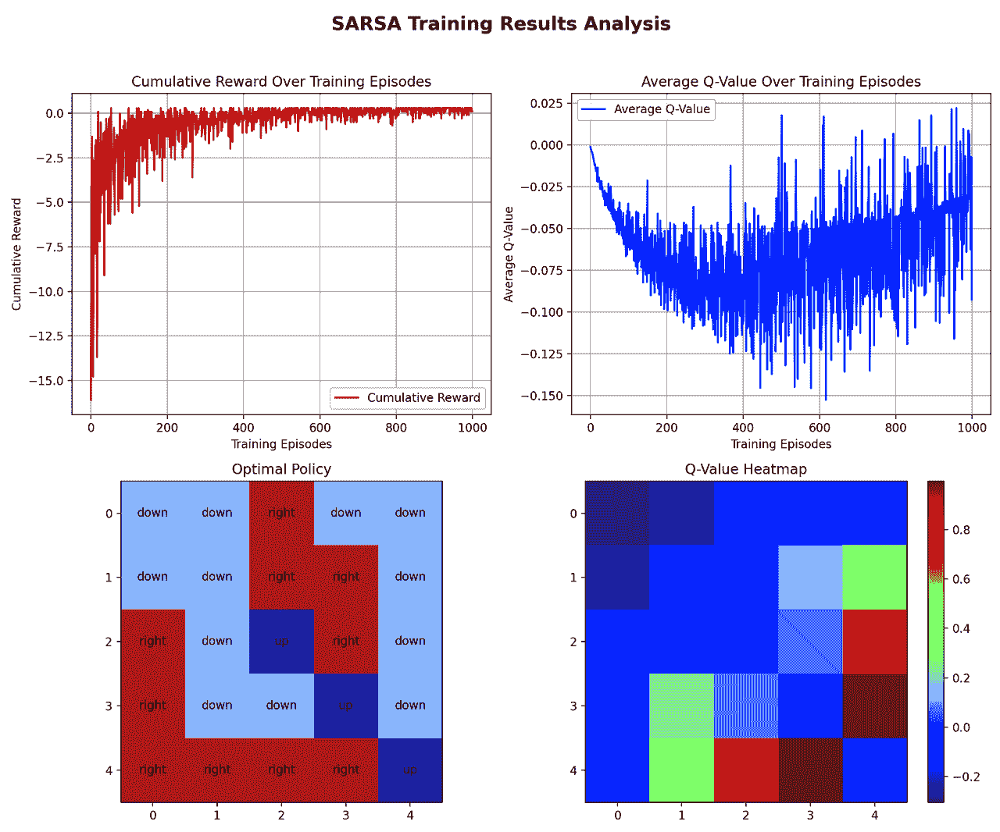

# 08-02强化学习-SARSA

> 来源：[https://qqs7y1hozd1.feishu.cn/docx/HeVYdeonzo3NtZxLcTacdEwwnPg](https://qqs7y1hozd1.feishu.cn/docx/HeVYdeonzo3NtZxLcTacdEwwnPg)

`SARSA` 用于求解最优策略，让智能体在环境中学习如何做出最佳决策。

它是一种基于时序差分（Temporal Difference, TD）的 `on-policy` 控制算法，能够在未知环境中自我学习。

首先，`SARSA` 的更新公式：

其中：

- 状态下执行动作的 `Q 值`（即该动作的长期收益估计）
- `learning rate`，控制学习速度
- `reward`，当前奖励
- `discount factor`，控制对未来奖励的重视程度
- 当前状态和动作
- 下一步的状态和动作

## 简单解释

`SARSA` 的核心逻辑是：

1. 观察环境，获取当前状态
2. 用 `ε-贪心策略` 选择一个动作（探索 vs. 利用）
3. 执行动作，获取奖励，转移到新状态
4. 根据当前策略选择下一步的动作
5. 用公式更新 `Q 值`，告诉自己“这个决策好不好”
6. 不断重复，直到学会最优策略

### 简单举例

你在一个迷宫里，想找到出口，同时避免陷阱。

每次你选择一个方向（动作），然后观察自己是更接近出口（+奖励）还是撞到墙（-惩罚）。

你会根据过去的经验决定下一步该怎么走。

经过大量尝试，你最终学会了一条从起点到终点的最佳路径。

## SARSA vs Q-learning（区别）

| 算法 | 策略类型 | 学习方式 | 探索性 |
| --- | --- | --- | --- |
| `SARSA` | 基于策略（`on-policy`） | 使用自己当前的策略学习 | 比较稳定，适合动态环境 |
| `Q-learning` | 非基于策略（`off-policy`） | 使用最优策略进行学习 | 更容易找到全局最优，但不稳定 |

简单来说：

- `SARSA` 是一个稳妥派，它学到的策略是基于自己正在执行的策略，不会突然跳到全新的方法。
- `Q-learning` 是一个激进派，它直接用最优 `Q 值` 来学习，可能会跳跃式地优化，但不一定稳定。

### 打游戏举例

`SARSA`：你玩游戏时，慢慢调整自己的策略，学会了稳妥的玩法，不会突然改变风格。

`Q-learning`：你直接看攻略，学习最优打法，但有时候你的操作可能跟不上，导致失误。

## SARSA 算法流程

1. 初始化 `Q 表`（所有状态-动作的 `Q 值` 设为 0）
2. 循环进行训练（直到收敛）
   - 观察当前状态
   - 用 `ε-贪心策略` 选动作
   - 执行动作，获得奖励，到达新状态
   - 根据当前策略选择新动作
   - 用 `SARSA` 公式更新 `Q 值`
   - 继续执行，直到任务完成

### 机器人学会走迷宫

| 状态 | 机器人可执行的动作 | 奖励 | 新状态 |
| --- | --- | --- | --- |
| `(0,0)` 起点 | 右移 | -0.1 | `(0,1)` |
| `(0,1)` | 右移 | -0.1 | `(0,2)` |
| `(0,2)` | 下移 | -0.1 | `(1,2)` |
| `(1,2)` | 右移 | -0.1 | `(1,3)` |
| `(1,3)` | 右移 | `+1`（终点） | `(1,4)` |

`SARSA` 学习后：

- 机器人一开始到处乱撞，因为它在探索。
- 逐渐地，它记住了哪些方向有奖励，哪些方向是死路。
- 训练结束后，它会优先选择最短路径到达终点！

### 总结

`SARSA` 就像一个学习开车的新手：

- 一开始你会到处试（探索）。
- 你撞过几次墙（负奖励），慢慢学会了避开障碍。
- 你发现某些路很顺畅（正奖励），所以开始优先走这些路。
- 你不会突然完全改变开车方式，而是不断优化你当前的驾驶技巧。
- 经过大量练习，你最终学会了最稳妥的驾驶方式。

## 理论基础

`SARSA` 使用 `Q 值` 更新公式来不断优化智能体的决策过程。

其核心数学表达式：

其中：

- 当前状态下执行动作的 `Q 值`（即该动作的长期收益估计）
- `learning rate`，控制新信息的学习速度，取值范围为 [0, 1]
- `reward`，当前时间步获得的奖励
- `discount factor`，决定智能体对未来奖励的重视程度，取值范围 [0, 1]
- 执行动作后的新状态
- 在新状态下按照当前策略选择的下一步动作

### SARSA 的 Q 值更新逻辑

- 计算当前状态-动作对的 `Q 值`（旧值）
- 计算下一状态-动作对的 `Q 值`（下一步的预期收益）
- 结合 `reward` 进行更新，使 `Q 值` 朝着未来收益的方向调整

### SARSA 详细算法流程

`SARSA` 通过以下步骤让智能体在环境中学习最优策略：

#### 1. 初始化

- 初始化 `Q 表（`Q-table`）`，记录所有状态-动作对的 `Q 值`
- 设定 `学习率`、`折扣因子`、`探索率`
- 设定最大训练回合数

#### 2. 开始训练

循环执行，直到达到最大回合数：

1. 环境初始化
   - 让智能体进入初始状态
   - 选择初始动作（根据 `ε-贪心策略`）

2. 重复执行，直到终止状态
   - 执行动作，获得奖励，到达新状态
   - 根据当前策略选择下一步动作
   - 更新 `Q 值`
   - 更新当前状态和动作

3. 如果智能体到达终止状态，结束本回合，进入下一回合。

### SARSA 中的探索与利用

为了确保智能体既能探索新策略，又能利用已有经验，`SARSA` 采用 `ε-贪心策略` 选择动作：

- 探索（Exploration）：以 `ε` 概率随机选择动作，避免局部最优解。
- 利用（Exploitation）：以 `1 - ε` 概率选择当前 `Q 值` 最大的动作。

通常，`ε` 会逐渐减少，使得智能体前期多探索，后期多利用。

## 完整案例

### 任务背景

智能体在一个 `5x5` 的网格世界中移动，目标是到达终点，过程中会遇到障碍物和奖励点。

我们将训练 `SARSA` 代理，让它学会最优策略，并绘制以下 4 个分析图：

- 训练过程中累计奖励变化
- 训练过程中平均 `Q 值` 变化
- 训练后的最优策略可视化
- `Q 值` 热力图（展示不同状态的 `Q 值`）


```python
import numpy as np
import matplotlib.pyplot as plt
import torch
import torch.nn as nn
import torch.optim as optim
import random

# 设置 GridWorld 参数
GRID_SIZE = 5
ACTIONS = ['up', 'down', 'left', 'right']
ACTION_MAP = {0: (-1, 0), 1: (1, 0), 2: (0, -1), 3: (0, 1)}

# 环境类
class GridWorld:
    def __init__(self):
        self.grid_size = GRID_SIZE
        self.start_state = (0, 0)
        self.end_state = (4, 4)
        self.obstacles = [(2, 2), (3, 3)]
        self.state = self.start_state

    def reset(self):
        self.state = self.start_state
        return self.state

    def step(self, action):
        next_state = (self.state[0] + ACTION_MAP[action][0], self.state[1] + ACTION_MAP[action][1])

        if next_state[0] < 0 or next_state[0] >= self.grid_size or \
           next_state[1] < 0 or next_state[1] >= self.grid_size or \
           next_state in self.obstacles:
            next_state = self.state  # 撞墙或障碍物

        reward = 1 if next_state == self.end_state else -0.1
        done = next_state == self.end_state

        self.state = next_state
        return next_state, reward, done

# SARSA 代理类
class SARSA_Agent:
    def __init__(self, lr=0.01, gamma=0.9, epsilon=0.1):
        self.lr = lr
        self.gamma = gamma
        self.epsilon = epsilon
        self.q_table = torch.zeros((GRID_SIZE, GRID_SIZE, len(ACTIONS)))

    def choose_action(self, state):
        if random.uniform(0, 1) < self.epsilon:
            return random.randint(0, len(ACTIONS) - 1)  # 采取随机探索
        return torch.argmax(self.q_table[state[0], state[1]]).item()  # 采取贪婪策略

    def update(self, state, action, reward, next_state, next_action):
        q_predict = self.q_table[state[0], state[1], action]
        q_target = reward + self.gamma * self.q_table[next_state[0], next_state[1], next_action]
        self.q_table[state[0], state[1], action] += self.lr * (q_target - q_predict)

# 训练 SARSA 代理
def train_sarsa(episodes=1000):
    env = GridWorld()
    agent = SARSA_Agent()
    rewards_per_episode = []
    avg_q_values = []

    for episode in range(episodes):
        state = env.reset()
        action = agent.choose_action(state)
        total_reward = 0
        q_values = []

        while True:
            next_state, reward, done = env.step(action)
            next_action = agent.choose_action(next_state)
            agent.update(state, action, reward, next_state, next_action)
            
            total_reward += reward
            q_values.append(agent.q_table[state[0], state[1]].mean().item())

            if done:
                break
            state, action = next_state, next_action
        
        rewards_per_episode.append(total_reward)
        avg_q_values.append(np.mean(q_values))

    return agent, rewards_per_episode, avg_q_values

# 训练模型
agent, rewards, q_values = train_sarsa()

# 生成策略图
def generate_policy_map(agent):
    policy_map = np.zeros((GRID_SIZE, GRID_SIZE))
    for i in range(GRID_SIZE):
        for j in range(GRID_SIZE):
            if (i, j) in [(4, 4), (2, 2), (3, 3)]:
                continue
            policy_map[i, j] = torch.argmax(agent.q_table[i, j]).item()
    return policy_map

# 生成 Q 值热力图
def generate_q_value_heatmap(agent):
    q_values = np.zeros((GRID_SIZE, GRID_SIZE))
    for i in range(GRID_SIZE):
        for j in range(GRID_SIZE):
            q_values[i, j] = agent.q_table[i, j].max().item()
    return q_values

# 可视化结果
fig, axs = plt.subplots(2, 2, figsize=(12, 10))
fig.suptitle("SARSA Training Results Analysis", fontsize=16, fontweight='bold')

# 1. 累计奖励变化
axs[0, 0].plot(rewards, color='red', label='Cumulative Reward')
axs[0, 0].set_title("Cumulative Reward Over Training Episodes", fontsize=12)
axs[0, 0].set_xlabel("Training Episodes")
axs[0, 0].set_ylabel("Cumulative Reward")
axs[0, 0].legend()
axs[0, 0].grid(True)

# 2. 平均 Q 值变化
axs[0, 1].plot(q_values, color='blue', label='Average Q-Value')
axs[0, 1].set_title("Average Q-Value Over Training Episodes", fontsize=12)
axs[0, 1].set_xlabel("Training Episodes")
axs[0, 1].set_ylabel("Average Q-Value")
axs[0, 1].legend()
axs[0, 1].grid(True)

# 3. 最优策略可视化
policy_map = generate_policy_map(agent)
axs[1, 0].imshow(policy_map, cmap='coolwarm', interpolation='nearest')
axs[1, 0].set_title("Optimal Policy", fontsize=12)
for i in range(GRID_SIZE):
    for j in range(GRID_SIZE):
        axs[1, 0].text(j, i, ACTIONS[int(policy_map[i, j])], ha='center', va='center', color='black')

# 4. Q 值热力图
q_heatmap = generate_q_value_heatmap(agent)
im = axs[1, 1].imshow(q_heatmap, cmap='jet', interpolation='nearest')
axs[1, 1].set_title("Q-Value Heatmap", fontsize=12)
fig.colorbar(im, ax=axs[1, 1])

plt.tight_layout(rect=[0, 0, 1, 0.96])
plt.show()
```

## 优化点

+ 动态 `ε-贪心策略`（逐渐降低 `ε` 以减少探索，提高利用）

+ 自适应学习率（随训练次数调整）

+ 改进奖励机制（负奖励让训练更稳定）



1. 累计奖励曲线：展示了训练过程中奖励的增长情况

2. 平均 Q 值曲线：观察 Q 值随训练的变化趋势

3. 最优策略可视化：显示智能体学习到的最优策略

4. Q 值热力图：查看不同状态的最优 Q 值

## 应用场景

### `SARSA` 适用于哪类问题？

+ 动态、非确定性环境（环境可能随时间变化）

+ 连续决策问题（需要不断决策，不是一次性决策）

+ 存在探索风险的任务（避免激进探索带来的高风险）

+ 有限状态-动作空间（但可扩展到函数逼近，如深度学习）

+ 需要平衡探索与利用的强化学习任务

典型应用场景：

+ 机器人控制（路径规划、避障）

+ 游戏 AI 训练（自适应学习策略）

+ 自动驾驶（决策与避障）

+ 智能交易系统（动态市场策略）

+ 流量控制（网络负载均衡）

### `SARSA` 的优缺点

**优点**

1. 稳定性高：由于 `SARSA` 是 基于策略（`on-policy`）算法，它在训练过程中不会突然跳到最优策略，因此更稳定，适用于动态环境。

2. 避免极端探索：由于 `SARSA` 的更新方式依赖于当前策略，它不会直接选择最优 Q 值，因此能避免 `Q-learning` 过度探索高风险策略的问题。

3. 适用于变化环境：在实时变化的环境（如自适应系统、股票交易）中，比 `Q-learning` 更稳健。

4. 探索利用均衡：`ε-贪心策略`可平衡探索（尝试新策略）和利用（执行当前最佳策略）。

**缺点**

1. 收敛速度较慢：`SARSA` 需要更多时间来探索和学习合适的策略，比 `Q-learning` 慢。

2. 容易陷入局部最优：由于它是基于当前策略学习的，可能无法跳出次优策略。

3. 对 `ε` 依赖性强：`ε` 需要合理调节，否则探索不足或过度探索会影响学习效果。

4. 不适用于大规模问题：传统 `SARSA` 依赖 Q 表存储 Q 值，状态空间太大时，存储和计算成本高（但可以用深度学习扩展）。

### 运行 `SARSA` 需要的前提条件

1. 环境可交互：智能体必须能够与环境交互，并获取状态、动作、奖励等信息。

2. 状态和动作可定义：问题需要能够定义 状态集合 和 动作集合 。

3. 可获取奖励信号：智能体在执行动作后，环境需要提供一个奖励信号 来指导学习。

4. 满足马尔可夫性质（`MDP`）：未来状态仅取决于当前状态和当前动作（不依赖过去的状态）。

5. 探索机制可调控：如 `ε-贪心策略`控制探索程度
