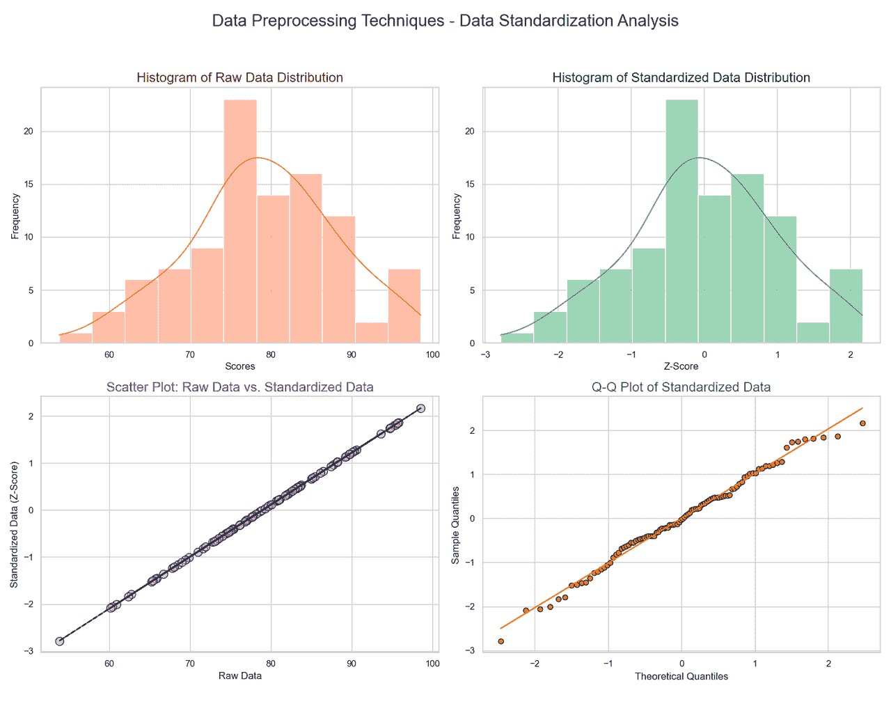

# 09-04数据预处理方法-数据标准化

> 来源：[https://qqs7y1hozd1.feishu.cn/docx/By88dE1gtoG4rmxivCGc1iDdnHh](https://qqs7y1hozd1.feishu.cn/docx/By88dE1gtoG4rmxivCGc1iDdnHh)

简单来说，数据标准化其实就是把数据转换到同一个尺度上，让各个数据特征之间可以平等地比较和运算，不会因为量纲（单位）或者数值范围不同而影响分析或模型训练的结果。

#### 为什么需要数据标准化？

+   **消除量纲影响**：不同的特征可能原本单位和数值范围差距很大（比如身高、体重、收入），不进行标准化的话，数值大的特征会对模型产生过大的影响。

+   **提高模型稳定性**：很多算法（如梯度下降优化算法、支持向量机、K近邻算法等）都对数据的尺度敏感，标准化后的数据能帮助算法更快、更好地收敛。

+   **方便比较**：经过标准化处理后的数据一般会以零为中心，标准差为1，这样不同数据之间就可以直接比较了。

#### 数据标准化的常见方法

最常用的方法就是**Z-Score标准化**（也称为标准差标准化），计算公式为：

其中：

+    是原始数据

+    是数据的均值

+    是数据的标准差

通过这个公式，原始数据会转变为新的数据  ，它表示原数据距离均值的标准差倍数。这样处理后的数据大致分布在[-3, 3]的范围内（根据正态分布的特性）。

### 举例说明

假设我们有一组简单的数据，表示三个学生的数学成绩：70分、80分、90分。下面我们用 Z-Score 标准化方法来处理这组数据。

1.  **计算均值 ** ：

1.  **计算标准差 ** ：

1.  **对每个数据进行标准化**：

+   对于70分：

+   对于80分：

+   对于90分：

+   **结果说明**：经过标准化后，70分对应的标准分数大约是-1.225，说明它比平均成绩低了1.225个标准差；90分对应的标准分数大约是1.225，说明它比平均成绩高了1.225个标准差；80分正好是平均值，所以标准分数为0。

+   **直观理解**：通过标准化，原本70、80、90的成绩就变成了一个统一的标准，可以更直观地看到每个数据相对于整体的偏离程度。如果再加入其他不同量纲的数据（比如英语成绩），这种处理方式就能保证各项特征在模型中有类似的影响力，而不会因为数值大小不同而“抢占风头”。

这种处理方式对于很多机器学习算法来说非常重要，极大程度上能够帮助算法更好地学习和预测。

## 公式解析

在机器学习或数据分析中，不同特征可能具有不同的量纲和数值范围。这会导致某些特征对模型训练起主导作用，而忽略了其他特征。

为了解决这一问题，我们通常希望将数据转换到同一尺度下，使得数据满足零均值和单位方差。

标准化后的数据可以直接比较，并且能提高许多算法（如梯度下降法、支持向量机、K近邻算法等）的性能和稳定性。

### Z-Score标准化公式

给定一个数据集：

Z-Score标准化的公式为：

其中：

+     表示原始数据中的第   个样本；

+     是所有样本的均值：

+     是样本的标准差，计算方式为：

### 详细公式推导

#### 1. 目标：数据变换为零均值、单位方差

我们希望经过变换后的数据   满足：

+   均值为 0：

+   方差为 1：

#### 2. 均值归一化（中心化）

首先，对原始数据做中心化：

这样变换后的数据   均值为：

#### 3. 缩放到单位方差

接下来，需要对中心化后的数据进行缩放，使得它们的方差为 1。

计算中心化后数据的标准差：

然后，将中心化后的数据除以标准差：

变换后的数据   的方差为：

这样，就满足了零均值和单位方差的要求。

### 步骤总结

1.  **计算均值**：

1.  **计算标准差**：

1.  **标准化数据**：
对每个  ，计算

经过以上步骤，所有   构成的新数据集具有均值0、方差1。

### Min-Max归一化

除了Z-Score标准化，另一种常见的方法是Min-Max归一化，它将数据缩放到指定区间（通常为 ）。

公式为：

这种方法适用于对数据的最值敏感的情况，但与Z-Score标准化不同，它不能保证数据呈正态分布。

总的来说，**Z-Score标准化**通过减去均值和除以标准差，将数据转换为零均值、单位方差，使得数据在同一尺度上比较，减少量纲和数值范围差异的影响。

## 完整案例

代码中先生成一组模拟学生成绩数据，再使用 Z-Score 标准化方法对数据进行预处理~

```
import numpy as np
import matplotlib.pyplot as plt
import seaborn as sns
import scipy.stats as stats


# 生成模拟数据：100个学生的数学成绩，均值80，标准差10
np.random.seed(42)  # 保证结果可复现
data = np.random.normal(loc=80, scale=10, size=100)

# 数据标准化（Z-Score方法）
mu = np.mean(data)
sigma = np.std(data)
z_data = (data - mu) / sigma

# 创建一个2x2的子图，共4个图形
fig, axes = plt.subplots(2, 2, figsize=(15, 12))
fig.suptitle(&quot;Data Preprocessing Techniques - Data Standardization Analysis&quot;, fontsize=20, color=&#x27;navy&#x27;)

# 图1：原始数据直方图（带核密度估计曲线）
sns.histplot(data, kde=True, color=&quot;coral&quot;, ax=axes[0, 0])
axes[0, 0].set_title(&quot;Histogram of Raw Data Distribution&quot;, fontsize=16, color=&#x27;darkred&#x27;)
axes[0, 0].set_xlabel(&quot;Scores&quot;)
axes[0, 0].set_ylabel(&quot;Frequency&quot;)

# 图2：标准化数据直方图（带核密度估计曲线）
sns.histplot(z_data, kde=True, color=&quot;mediumseagreen&quot;, ax=axes[0, 1])
axes[0, 1].set_title(&quot;Histogram of Standardized Data Distribution&quot;, fontsize=16, color=&#x27;darkgreen&#x27;)
axes[0, 1].set_xlabel(&quot;Z-Score&quot;)
axes[0, 1].set_ylabel(&quot;Frequency&quot;)

# 图3：原始数据与标准化数据散点图（并添加参考拟合直线）
axes[1, 0].scatter(data, z_data, color=&quot;orchid&quot;, edgecolor=&#x27;black&#x27;, s=100, alpha=0.7)
axes[1, 0].set_title(&quot;Scatter Plot: Raw Data vs. Standardized Data&quot;, fontsize=16, color=&#x27;purple&#x27;)
axes[1, 0].set_xlabel(&quot;Raw Data&quot;)
axes[1, 0].set_ylabel(&quot;Standardized Data (Z-Score)&quot;)
# 添加拟合直线作为参考
m, b = np.polyfit(data, z_data, 1)
axes[1, 0].plot(data, m * data + b, color=&quot;black&quot;, linestyle=&quot;--&quot;)

# 图4：标准化数据 Q-Q 图，检验是否服从正态分布
stats.probplot(z_data, dist=&quot;norm&quot;, plot=axes[1, 1])
axes[1, 1].set_title(&quot;Q-Q Plot of Standardized Data&quot;, fontsize=16, color=&#x27;teal&#x27;)
# 修改 Q-Q 图中散点和直线的样式
qq_points = axes[1, 1].get_lines()[0]
qq_points.set_markerfacecolor(&#x27;gold&#x27;)
qq_points.set_markeredgecolor(&#x27;black&#x27;)
qq_line = axes[1, 1].get_lines()[1]
qq_line.set_color(&#x27;red&#x27;)
axes[1, 1].set_xlabel(&quot;Theoretical Quantiles&quot;)
axes[1, 1].set_ylabel(&quot;Sample Quantiles&quot;)

plt.tight_layout(rect=[0, 0.03, 1, 0.95])
plt.show()
```

**数据生成与标准化**：使用 np.random.normal 生成了 100 个均值为 80、标准差为 10 的数据，并通过公式

得到标准化后的数据。



+   **直方图**：使用 seaborn 的 histplot 绘制原始数据和标准化数据的分布，并显示核密度估计曲线，使分布更直观。

+   **散点图**：绘制原始数据与标准化数据之间的关系，同时添加了线性拟合直线，以展示二者的线性变换关系。

+   **Q-Q 图**：利用 scipy.stats.probplot 绘制标准化数据的 Q-Q 图，用于验证数据是否符合正态分布。

大家可以直观地理解数据标准化前后的数据分布和特征