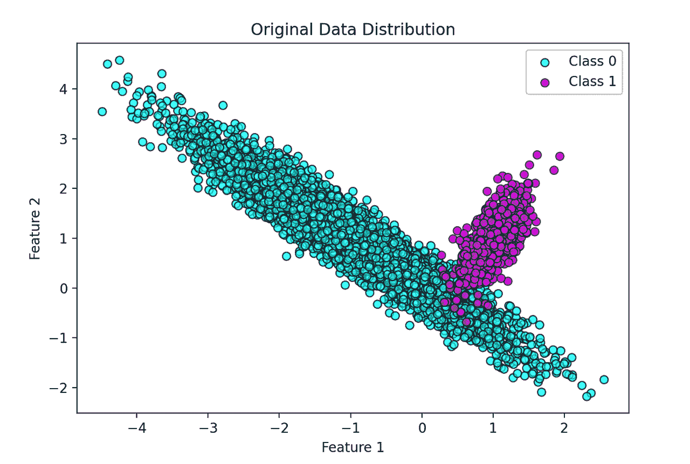
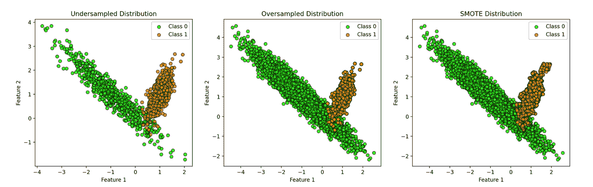
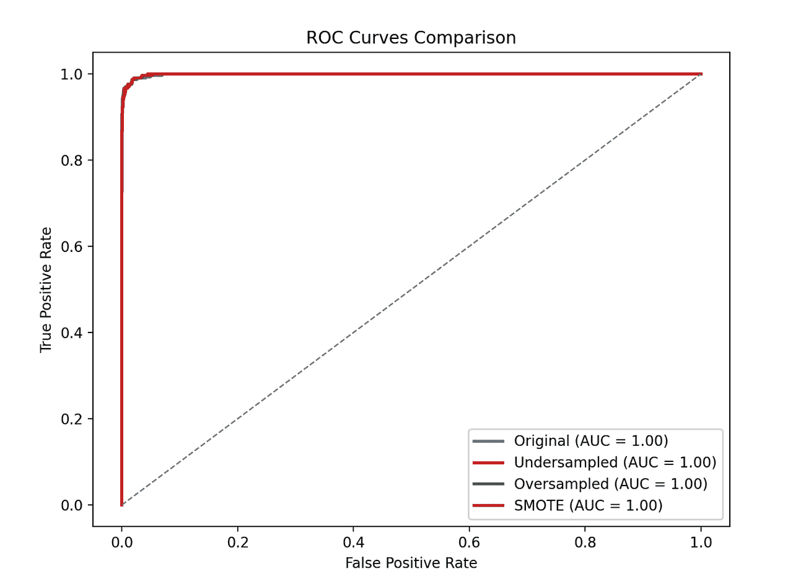

# 09-07数据预处理方法-数据平衡

> 来源：[https://qqs7y1hozd1.feishu.cn/docx/OLNAddICtoLX48x8QpjcFfP8nic](https://qqs7y1hozd1.feishu.cn/docx/OLNAddICtoLX48x8QpjcFfP8nic)

## 什么是“数据平衡”？

打个比方：

你在做一个“识别猫和狗”的AI模型。你收集了1000张猫的照片，但只有100张狗的照片。你把这数据喂给模型，它大概率会学会“猫”的特征，而对“狗”就学不太好，因为“狗”的例子太少了。

这时候就出现了一个问题：**数据不平衡**！

简单来说：

> 数据平衡就是让每一类数据的数量尽量差不多，防止模型偏心某一类。

## 为什么要做数据平衡？几点原因：

+ **防止模型“偏心”**：如果大多数数据是“猫”，模型就会“偷懒”学会总是猜猫。

+ **提升小类别的识别能力**：比如狗虽然数据少，但我们也希望模型能学会识别。

+ **提高整体模型效果**：平衡数据后，模型学得更全面，预测也更准。

## 常见的数据平衡方法有哪些？

### 欠采样（下采样）Undersampling

+ 把“多的那一类”删掉一部分，和“少的那一类”差不多多。

+ 例子：猫有1000张，狗有100张 → 把猫删到只剩100张。

+ 优点：简单快速。

+ 缺点：可能浪费了很多有用的数据。

### 过采样（上采样）Oversampling

+ 把“少的那一类”复制几份，让数量变多。

+ 例子：猫有1000张，狗有100张 → 把狗的图复制成1000张。

+ 优点：保留所有数据。

+ 缺点：可能过拟合（模型太记住某些样本）。

### 合成少数类样本（`SMOTE`等）

+ 不直接复制，而是通过“插值”生成一些新样本，让少的类变多。

+ 就像“把两个狗照片之间的特征混合”生成新的狗图。

+ 优点：比复制更智能。

+ 缺点：需要理解和调整算法。

数据平衡就是在数据预处理阶段，让“每种情况的数据”都尽量平均一些，这样模型才能“公平地学习”，不给任何一类“开小灶”或者“冷落”。

## 原理详解

### 二分类问题设定

设训练数据集为：

其中：

+ `x_i` 为第 `i` 个样本的特征向量，维度为 `d`

+ `y` 是标签，取值为 0 或 1（表示两个类别）

假设类别 1（正类）的样本数为 `N_pos`，类别 0（负类）的样本数为 `N_neg`。

如果 `N_pos` 或 `N_neg` 为 0，或者两者比例悬殊，我们称数据是**不平衡的**。

目标是：对原始数据集 `X` 进行处理，使得处理后的数据集 `X'` 满足 `N_pos = N_neg`。

### 欠采样（Undersampling）

从样本数量较多的类别中**随机删除样本**，以减小其数量，从而与少数类匹配。

#### 数学表达

若 `N_neg > N_pos`，则从负类中随机选取 `N_pos` 个样本，使得新的数据集为：

注意：

+ 该方法基于概率采样，常使用均匀分布抽样。

+ 假设原始负类数据为 `X_neg`，则：

可能丢弃有代表性的数据，导致信息损失。

### 过采样（Oversampling）

从样本数量较少的类别中**重复抽样**（有放回），生成更多样本以匹配多数类数量。

#### 数学表达

若 `N_pos < N_neg`，则从正类中有放回地采样 `N_neg` 个样本，构建扩展集合 `X_dup`：

则新的数据集为：

不丢数据，但可能导致过拟合（模型记住重复样本）。

### SMOTE（合成少数类样本）

使用**少数类样本之间的线性插值**生成“虚拟”新样本。

#### 数学基础

对于每一个少数类样本 `x_i`，从其 `k` 个最近邻（同属少数类）中随机选一个 `x_j`，生成新样本：

`x_new = x_i + gap * (x_j - x_i)`

即：

+ 从原点 `x_i` 朝着邻居 `x_j` 的方向前进 `gap` 的比例，生成新样本。

#### 公式说明

1. 给定样本 `x_i`

1. 找到 `k` -近邻集合

1. 从集合中随机选一个邻居 `x_j`

1. 生成：

`x_new = x_i + gap * (x_j - x_i)`

这个过程等价于在 `x_i` 和 `x_j` 之间做一个线段插值。也可以扩展为：

+ 多点插值（混合多个邻居）

+ 加入扰动项（提高多样性）

### 算法流程

1. 对每个少数类样本 `x_i`：

+ 找到其 `k` 个最近邻

+ 随机选一个邻居

+ 使用插值公式生成新样本

1. 重复上述过程直到生成指定数量的新样本

### 优点

+ 比简单过采样更有多样性，减少重复样本的问题

+ 保持特征空间分布结构

### 多分类场景的扩展

设数据有 `C` 个类别，每类样本数为 `N_c`，定义：

+ 最大类别数：`N_max = max(N_c)`

+ 平衡目标：`N_c = N_max` 对每类都进行过采样；或 `N_c = N_min` 对每类都欠采样；或自定义比例

`SMOTE` 也可以推广到多分类，通常只对样本较少的类别做合成。

### 评估数据平衡效果的指标（理论上）

虽然数据平衡本身不是模型评估方法，但其影响可以通过以下指标体现：

+ `G-Mean`（几何均值）

+ `Balanced Accuracy`

+ `F1-score`、`AUC` 等也是间接反映数据平衡影响的指标。

## 完整案例

给出一个不平衡的数据集，然后进行每一步的处理，最后针对 `SMOTE` 算法的优化思路。

### 1. 生成高维不平衡数据集

```
X, y = make_classification(
    n_samples=10000,
    n_features=2,
    n_redundant=0,
    n_clusters_per_class=1,
    weights=[0.9, 0.1],
    flip_y=0,
    random_state=42
)
```

构造一个二分类的合成数据集，总样本数 10000，特征数 2，正负样本比例为 10%:90%（模拟现实中常见的类别不平衡场景）。

参数：

+ `n_samples`：样本总数。

+ `n_features`：特征维度为 2，便于后面绘制散点图。

+ `weights`：类别权重，`[0.9,0.1]` 表示类别 0 占 90%，类别 1 占 10%。

+ `flip_y=0`：不引入标签噪声，保持「纯净」分布。

### 2. 划分训练集和测试集

```
X_train, X_test, y_train, y_test = train_test_split(
    X, y,
    test_size=0.3,
    stratify=y,
    random_state=42
)
```

将数据集按 `stratify=y` 划分，后续对训练集做平衡处理，用测试集评估模型泛化性能。

### 3. 可视化原始训练集分布

```
plt.figure(figsize=(6, 5))
plt.scatter(X_train[y_train==0, 0], X_train[y_train==0, 1], 
            label='Class 0', alpha=0.6, c='cyan', edgecolor='k')
plt.scatter(X_train[y_train==1, 0], X_train[y_train==1, 1], 
            label='Class 1', alpha=0.6, c='magenta', edgecolor='k')
plt.title('Original Data Distribution')
plt.xlabel('Feature 1')
plt.ylabel('Feature 2')
plt.legend()
plt.show()
```

绘制训练集在二维特征空间中的散点分布。分别标记两类，边缘黑色突出点的形状；`alpha=0.6` 保证叠加后仍可分辨。



直观展示类别不平衡：大部分点集中在类别 0（青色），类别 1（洋红）稀疏。

### 4. 欠采样

```
idx_major = np.where(y_train==0)[0]
idx_minor = np.where(y_train==1)[0]
idx_major_down = np.random.choice(idx_major, size=len(idx_minor), replace=False)
X_rus = np.vstack((X_train[idx_major_down], X_train[idx_minor]))
y_rus = np.hstack((y_train[idx_major_down], y_train[idx_minor]))
```

从多数类中随机选择与少数类等量的样本，丢弃其余多数类样本。

**步骤**：

1. `idx_major`/`idx_minor` 分别获取多数类和少数类样本的索引。

1. `np.random.choice` 在多数类索引中随机采样，与少数类数量相同。

1. 垂直合并多数类降采样后与少数类，形成平衡后的训练集 `X_rus`, `y_rus`。

**风险与权衡**：快速简便，但可能丢失多数类的关键信息，导致模型整体性能下降。

### 5. 过采样（Random Oversampling）

```
idx_minor_up = np.random.choice(idx_minor, size=len(idx_major), replace=True)
X_ros = np.vstack((X_train[idx_major], X_train[idx_minor_up]))
y_ros = np.hstack((y_train[idx_major], y_train[idx_minor_up]))
```

对少数类样本进行有放回重复采样，使得其数量补足到多数类水平。

**步骤**：

1. 在少数类索引中有放回地抽样，使样本数等于多数类。

1. 与原多数类样本合并，生成平衡后的训练集 `X_ros`, `y_ros`。

**优点与缺点**：保留所有原始样本，但复制容易导致过拟合（模型过度记忆某些少数类样本特征）。

### 6. 自定义 SMOTE 实现

```
def custom_smote(X, y, k=5):
    X_min = X[y==1]
    X_maj = X[y==0]
    n_generate = len(X_maj) - len(X_min)
    nn = NearestNeighbors(n_neighbors=k+1).fit(X_min)
    neighbors = nn.kneighbors(X_min, return_distance=False)[:, 1:]
    synthetic = []
    for _ in range(n_generate):
        idx = random.randint(0, len(X_min)-1)
        nn_idx = random.choice(neighbors[idx])
        diff = X_min[nn_idx] - X_min[idx]
        gap = np.random.rand()
        synthetic.append(X_min[idx] + gap * diff)
    X_smt = np.vstack((X, synthetic))
    y_smt = np.hstack((y, np.ones(len(synthetic))))
    return X_smt, y_smt

X_smt, y_smt = custom_smote(X_train, y_train, k=5)
```

**算法核心**：

1. **邻居选择**：对少数类样本构建 `k` -近邻图。

1. **线性插值**：在随机选取的样本 `x_i` 与其邻居 `x_j` 间，以随机比例 `gap` 插值，生成合成样本：

`x_new = x_i + gap * (x_j - x_i)`

1. **样本数补齐**：重复插值直到少数类数量与多数类持平。

**优点**：比简单复制更具多样性，缓解过拟合；保留原始多数类全部信息。

**参数**：`k` 邻居数量，影响合成样本的多样性与质量。

### 7. 平衡后数据分布可视化对比

```
fig, axs = plt.subplots(1, 3, figsize=(18, 5))
# 分别绘制 X_rus, X_ros, X_smt 三种方法的散点图
plt.show()
```

并排对比三种平衡方法后的训练集分布。



+ 欠采样后稀疏但对称；

+ 过采样后少数类“堆积”在原位置；

+ `SMOTE` 后少数类沿决策边界形成“云团”，覆盖更广区域。

### 8. 训练逻辑回归并比较性能

```
def evaluate_and_plot(X_tr, y_tr, label):
    model = LogisticRegression()
    model.fit(X_tr, y_tr)
    y_pred = model.predict(X_test)
    y_prob = model.predict_proba(X_test)[:, 1]
    print(classification_report(y_test, y_pred))
    fpr, tpr, _ = roc_curve(y_test, y_prob)
    roc_auc = auc(fpr, tpr)
    plt.plot(fpr, tpr, lw=2, label=f'{label} (AUC = {roc_auc:.2f})')

plt.figure(figsize=(8, 6))
evaluate_and_plot(...)  # 分别对四种训练集调用
plt.plot([0,1], [0,1], '--', lw=1, color='gray')
plt.title('ROC Curves Comparison')
plt.xlabel('False Positive Rate')
plt.ylabel('True Positive Rate')
plt.legend()
plt.show()
```

**流程**：

1. 对原始、欠采样、过采样、`SMOTE` 四个训练集分别训练 `LogisticRegression`。

1. 在同一张图上绘制 ROC 曲线，比较 `AUC` 值。

1. 打印详细的 `precision`、`recall`、`f1-score` 等指标。



定量评估不同平衡策略对分类性能的提升与侧重点。例如：

+ 欠采样可能提升少数类 `recall` 但整体 `precision` 略降；

+ 过采样 `precision`、`recall` 均提升但存在过拟合风险；

+ `SMOTE` 通常取得最优的 `AUC` 平衡。

### 9. SMOTE 算法优化：动态选择 `k` -neighbors

```
best_auc = 0
best_k = None
for k in [3, 5, 7, 9]:
    X_opt, y_opt = custom_smote(X_train, y_train, k=k)
    model = LogisticRegression().fit(X_opt, y_opt)
    y_prob = model.predict_proba(X_test)[:, 1]
    roc_auc = auc(*roc_curve(y_test, y_prob)[:2])
    print(f'k_neighbors={k}, AUC={roc_auc:.4f}')
    if roc_auc > best_auc:
        best_auc, best_k = roc_auc, k
print(f'Optimal k_neighbors: {best_k}, Best AUC: {best_auc:.4f}')
```

**优化目标**：寻找最优的邻居数 `k`，使得 `SMOTE` 生成的样本既有足够多样性，又不过度偏离少数类分布。

根据实验输出选择 `AUC` 最高时的 `k` 值。

+ 可引入更多候选 `k` 或结合交叉验证；

+ 考虑 `Borderline-SMOTE`、`ADASYN` 等变种；

+ 在高维空间可使用 `PCA` 降维后再合成。

### 完整代码


```
import numpy as np
import matplotlib.pyplot as plt
from sklearn.datasets import make_classification
from sklearn.model_selection import train_test_split
from sklearn.neighbors import NearestNeighbors
from sklearn.linear_model import LogisticRegression
from sklearn.metrics import classification_report, roc_curve, auc
import random

# 1. 生成高维不平衡数据集
X, y = make_classification(n_samples=10000, n_features=2, n_redundant=0,
                           n_clusters_per_class=1, weights=[0.9, 0.1],
                           flip_y=0, random_state=42)

# 2. 划分训练集和测试集
X_train, X_test, y_train, y_test = train_test_split(X, y, 
                                                    test_size=0.3, 
                                                    stratify=y, 
                                                    random_state=42)

# 3. 可视化原始训练数据分布
plt.figure(figsize=(6, 5))
plt.scatter(X_train[y_train==0, 0], X_train[y_train==0, 1], 
            label='Class 0', alpha=0.6, c='cyan', edgecolor='k')
plt.scatter(X_train[y_train==1, 0], X_train[y_train==1, 1], 
            label='Class 1', alpha=0.6, c='magenta', edgecolor='k')
plt.title('Original Data Distribution')
plt.xlabel('Feature 1')
plt.ylabel('Feature 2')
plt.legend()
plt.show()

# 4. 欠采样
idx_major = np.where(y_train==0)[0]
idx_minor = np.where(y_train==1)[0]
idx_major_down = np.random.choice(idx_major, size=len(idx_minor), replace=False)
X_rus = np.vstack((X_train[idx_major_down], X_train[idx_minor]))
y_rus = np.hstack((y_train[idx_major_down], y_train[idx_minor]))

# 5. 过采样
idx_minor_up = np.random.choice(idx_minor, size=len(idx_major), replace=True)
X_ros = np.vstack((X_train[idx_major], X_train[idx_minor_up]))
y_ros = np.hstack((y_train[idx_major], y_train[idx_minor_up]))

# 6. 自定义SMOTE
def custom_smote(X, y, k=5):
    X_min = X[y==1]
    X_maj = X[y==0]
    n_min, _ = X_min.shape
    n_maj = X_maj.shape[0]
    n_generate = n_maj - n_min

    nn = NearestNeighbors(n_neighbors=k+1).fit(X_min)
    neighbors = nn.kneighbors(X_min, return_distance=False)[:, 1:]

    synthetic = []
    for _ in range(n_generate):
        idx = random.randint(0, n_min - 1)
        nn_idx = random.choice(neighbors[idx])
        diff = X_min[nn_idx] - X_min[idx]
        gap = np.random.rand()
        synthetic.append(X_min[idx] + gap * diff)
    X_smt = np.vstack((X, np.array(synthetic)))
    y_smt = np.hstack((y, np.ones(len(synthetic))))
    return X_smt, y_smt

X_smt, y_smt = custom_smote(X_train, y_train, k=5)

# 7. 可视化平衡后数据分布
fig, axs = plt.subplots(1, 3, figsize=(18, 5))
for ax, (Xb, yb, title) in zip(axs, 
                               [(X_rus, y_rus, 'Undersampled Distribution'),
                                (X_ros, y_ros, 'Oversampled Distribution'),
                                (X_smt, y_smt, 'SMOTE Distribution')]):
    ax.scatter(Xb[yb==0, 0], Xb[yb==0, 1], 
               label='Class 0', alpha=0.6, c='lime', edgecolor='k')
    ax.scatter(Xb[yb==1, 0], Xb[yb==1, 1], 
               label='Class 1', alpha=0.6, c='orange', edgecolor='k')
    ax.set_title(title)
    ax.set_xlabel('Feature 1')
    ax.set_ylabel('Feature 2')
    ax.legend()
plt.show()

# 8. 训练逻辑回归并比较性能
def evaluate_and_plot(X_tr, y_tr, label):
    model = LogisticRegression()
    model.fit(X_tr, y_tr)
    y_pred = model.predict(X_test)
    y_prob = model.predict_proba(X_test)[:, 1]
    report = classification_report(y_test, y_pred, output_dict=True)
    fpr, tpr, _ = roc_curve(y_test, y_prob)
    roc_auc = auc(fpr, tpr)

    print(f'---- {label} ----')
    print(classification_report(y_test, y_pred))
    plt.plot(fpr, tpr, lw=2, label=f'{label} (AUC = {roc_auc:.2f})')

plt.figure(figsize=(8, 6))
evaluate_and_plot(X_train, y_train, 'Original')
evaluate_and_plot(X_rus, y_rus, 'Undersampled')
evaluate_and_plot(X_ros, y_ros, 'Oversampled')
evaluate_and_plot(X_smt, y_smt, 'SMOTE')
plt.plot([0, 1], [0, 1], linestyle='--', lw=1, color='gray')
plt.title('ROC Curves Comparison')
plt.xlabel('False Positive Rate')
plt.ylabel('True Positive Rate')
plt.legend()
plt.show()

# 9. 算法优化：动态选择 k_neighbors
best_auc = 0
best_k = None
for k in [3, 5, 7, 9]:
    X_opt, y_opt = custom_smote(X_train, y_train, k=k)
    model = LogisticRegression()
    model.fit(X_opt, y_opt)
    y_prob = model.predict_proba(X_test)[:, 1]
    fpr, tpr, _ = roc_curve(y_test, y_prob)
    roc_auc = auc(fpr, tpr)
    print(f'k_neighbors={k}, AUC={roc_auc:.4f}')
    if roc_auc > best_auc:
        best_auc = roc_auc
        best_k = k
print(f'Optimal k_neighbors: {best_k}, Best AUC: {best_auc:.4f}')
```

以上代码完整覆盖了：

1. 数据平衡的三种经典方法：欠采样、过采样、自定义 `SMOTE`；
2. 对比可视化，帮助直观理解平衡前后的数据分布差异；
3. 量化评估（`分类报告`、`ROC`/`AUC`）展示模型表现；
4. `SMOTE` 参数优化，体现算法实用性与可调优空间。

# 模型分析

上面使用的数据平衡方法，主要是围绕欠采样、过采样和 `SMOTE` 进行的。

## 优缺点

**优点**：

1. **有效提升少数类的识别能力**：原始数据集中类别极不平衡（90% vs 10%），如果不做处理，模型会倾向多数类，忽略少数类。而数据平衡方法显著提升了少数类的`recall`和`F1-score`。

2. **增强模型的泛化能力**：使用如 `SMOTE` 这类合成方法，不仅增加了少数类样本数量，还拓展了少数类在特征空间的覆盖范围，使得模型能学习到更广泛的判别边界。

3. **减少过拟合风险**：相比简单重复样本的随机过采样，`SMOTE` 更容易生成分布合理的合成样本，减少模型过拟合于某几个样本点的问题。

4. **可视化直观分析，便于调试**：由于示例数据是二维的，使用平衡处理前后的可视化可以清晰地看到数据的分布变化，增强了方法的解释性。

**缺点**：

1. **引入噪声风险**：`SMOTE` 在特征空间中合成的新样本并不一定真实可靠，特别是在类别边界模糊的区域，可能导致混淆、降低精度。

2. **计算复杂度增加**：`SMOTE` 需要查找最近邻，插值生成新样本，在高维数据集上计算成本较高；如果使用更复杂的平衡方法如 `ADASYN`，训练耗时可能更长。

3. **参数敏感性问题**：如邻居数对 `SMOTE` 效果有重要影响，如果选取不当，可能造成生成样本质量低劣，反而拉低整体模型性能。

4. **对高维稀疏数据效果有限**：在文本、图像等高维数据中，`SMOTE` 效果不如在结构化数据中明显，有时需要配合降维等预处理手段。

## 相似算法的对比

| 方法名称 | 核心思想 | 优点 | 缺点 | 适用场景 |
| --- | --- | --- | --- | --- |
| `Random Undersampling` | 从多数类中随机删除样本，使类均衡 | 快速、简单，节省存储空间 | 可能丢失有价值信息，影响模型表现 | 多数类样本量极大，训练资源有限的情况 |
| `Random Oversampling` | 对少数类进行复制补齐样本数 | 保留所有原始数据，简单易行 | 易导致过拟合，缺乏多样性 | 少数类样本较少但特征重要、不希望丢失的情况 |
| `SMOTE` | 通过 `K` 近邻在少数类样本之间合成新样本 | 增强多样性，缓解过拟合 | 可能引入噪声样本，参数敏感 | 少数类样本太少、希望生成多样性数据时优选 |
| `Borderline-SMOTE` | 只在决策边界的少数类样本附近插值 | 更关注判别边界，提升 `recall` | 对边界判断依赖性强，若边界不明显则不稳定 | 类别重叠明显或关注模型 `recall` 的场景 |
| `ADASYN` | 自动控制样本生成数量，边界难分类样本生成更多样本 | 针对性强、生成样本分布更贴近实际 | 计算复杂度更高，容易过度偏向边界区域 | 类别区分困难、希望改进边界判别能力时使用 |
| `Tomek Links` 清洗 | 清除边界重叠样本（多为易混样本） | 降低噪声、增强分类边界清晰度 | 可能删除真实但难分类的数据，导致 `recall` 下降 | 作为其他方法的补充清洗步骤，优化边界 |

## 何时优选 SMOTE 类方法？何时考虑其他算法？

### 优选 SMOTE 的情况：

+   少数类样本极度稀缺，无法获得更多实际数据；
+   希望生成新的、合理分布的样本而非简单复制；
+   对 `recall` 和 `F1-score` 要求高，例如医学、反欺诈场景；
+   多数类信息充分，不希望因欠采样而损失重要模式。

### 考虑其他算法的情况：

+   多数类样本过多、训练资源有限 → 选择 `Random Undersampling`；
+   少数类样本重要、但数量尚可 → 可使用 `Random Oversampling`；
+   类别严重重叠，判别边界模糊 → `Borderline-SMOTE` 更有效；
+   对边界样本学习更敏感，希望动态控制生成样本 → 使用 `ADASYN`；
+   模型训练前需清理噪声数据 → 可配合 `Tomek Links` 进行清洗。

## 总结

在本案例中，`SMOTE` 和 `Oversampling` 显著提升了少数类的识别能力，验证了数据平衡预处理在类别不均衡问题中的有效性。然而，没有一种方法是完美适用所有情况的。最佳策略往往是结合问题场景、数据分布和资源限制综合考虑，并通过实验验证选出最优方案。

数据平衡不只是简单地“让样本数量一样”，它本质是对特征空间的重构与优化，只有理解其背后数学逻辑和模型表现之间的关系，才能真正发挥其价值。
