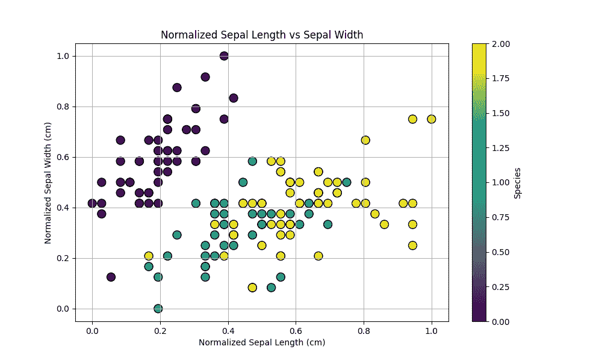

# 09-11数据预处理方法-特征缩放

> 来源：[https://qqs7y1hozd1.feishu.cn/docx/Zy41d2nMfolsYyxJ4ZIcCohBnZb](https://qqs7y1hozd1.feishu.cn/docx/Zy41d2nMfolsYyxJ4ZIcCohBnZb)

特征缩放（Feature Scaling）是数据预处理中常见且非常重要的步骤之一，目的是调整数据特征的尺度，使得它们在一个标准的范围内。

这样做可以有效地提高机器学习模型（尤其是基于距离度量的模型，如KNN、SVM、K-Means等）的表现。

特征缩放通常包括两种常见方法：标准化（Standardization）和归一化（Normalization）。

## 一、标准化

标准化是指将数据转换为均值为0，标准差为1的分布。标准化后，数据将遵循正态分布（或接近正态分布），这有助于某些机器学习算法更好地处理数据。

假设我们有一个特征向量，表示一个样本中的多个特征，每个特征值。标准化的目标是将每个特征值转换为均值为0、标准差为1的值。

1. 计算均值（Mean）：均值反映了数据的中心位置。我们首先需要计算该特征的均值：

这里 是数据点的个数， 是第 个数据点的值。

1. 计算标准差（Standard Deviation）：标准差 描述了数据的离散程度，即数据点与均值的偏差。标准差的计算公式为：

其中， 是每个数据点与均值的差的平方，求和后除以样本数 后开平方得出标准差。

1. 标准化（Standardization）：通过减去均值并除以标准差，我们可以将数据标准化。标准化后的特征 的公式为：

这样得到的新特征 的均值将为0，标准差将为1。

### 公式推理

通过标准化处理后，数据的均值为0，标准差为1，具体推理如下：

+ 均值：标准化后的数据 的均值可以通过公式推导得出：

由于 ，因此 。

+ 标准差：标准化后的数据 的标准差为：

由于标准差 已经通过公式计算得到，因此 。

### 算法流程

1. 计算均值（ ）和标准差（ ）。

1. 对每个数据点进行标准化：

1. 返回标准化后的数据集。

## 二、归一化

归一化是将数据按比例缩放到一个固定范围内，常见的范围是 [0, 1] 或 [-1, 1]。

归一化适用于没有明确正态分布的特征数据，尤其是当特征具有不同的量级时，归一化可以帮助算法更好地训练模型。

归一化的目标是将数据点映射到一个固定的范围内。最常见的归一化方式是将特征缩放到 [0, 1] 的范围内。

假设我们有一个特征 ，归一化的步骤如下：

1. 计算最小值和最大值：首先计算数据的最小值 和最大值 ：

1. 归一化公式：然后将每个特征 转换为 [0, 1] 之间的数值。归一化公式为：

其中， 为归一化后的数据， 和 分别为该特征的最小值和最大值。

1. 结果范围：通过上述公式，归一化后的数据 将落在 [0, 1] 区间内，即：

+ 对于最小值 ，

+ 对于最大值 ，

### 公式推理

归一化后，数据 的范围为 [0, 1]，推理过程如下：

+ 最小值：对于 ，归一化后的值 为：

+ 最大值：对于 ，归一化后的值 为：

+ 其他值：对于介于 和 之间的其他数据点，归一化后的值将落在 [0, 1] 之间。

### 算法流程

1. 计算最小值（ ）和最大值（ ）。

1. 对每个数据点进行归一化：

1. 返回归一化后的数据集。

### 总结一下

+ 标准化：通过减去均值并除以标准差，转换为均值为0、标准差为1的分布，适用于数据符合正态分布或需要保留原始分布形态的情况。

+ 归一化：通过最小值和最大值将数据线性映射到指定的范围（如[0, 1]），适用于特征量级差异较大或没有明确分布的数据。

选择合适的特征缩放方法可以显著提高机器学习算法的性能，尤其是当数据具有不同的量级或者对距离计算非常敏感时，特征缩放显得尤为重要。

## 完整案例

我们使用经典的鸢尾花数据集（Iris dataset），这是一个广泛用于机器学习分类和回归任务的数据集。

鸢尾花数据集包含150个样本，分别属于3个鸢尾花品种（Setosa, Versicolor, Virginica），每个样本有4个特征（萼片长度、萼片宽度、花瓣长度和花瓣宽度）。

我们通过标准化和归一化两种特征缩放方法，分析它们对机器学习模型性能的影响，并进行相应的可视化和优化。

### 加载数据

首先，我们需要加载鸢尾花数据集，并进行必要的预处理。

```python
import numpy as np
import pandas as pd
import matplotlib.pyplot as plt
from sklearn.datasets import load_iris
from sklearn.preprocessing import StandardScaler, MinMaxScaler
from sklearn.model_selection import train_test_split
from sklearn.ensemble import RandomForestClassifier
from sklearn.metrics import accuracy_score

# 加载鸢尾花数据集
iris = load_iris()
X = iris.data
y = iris.target
feature_names = iris.feature_names
target_names = iris.target_names

# 将数据转为DataFrame以便更好的操作
data = pd.DataFrame(X, columns=feature_names)
data['species'] = pd.Categorical.from_codes(y, target_names)

print(data.head())
```

### 输出示例

```text
   sepal length (cm)  sepal width (cm)  petal length (cm)  petal width (cm) species
0                5.1               3.5                1.4               0.2  Setosa
1                4.9               3.0                1.4               0.2  Setosa
2                4.7               3.2                1.3               0.2  Setosa
3                4.6               3.1                1.5               0.2  Setosa
4                5.0               3.6                1.4               0.2  Setosa
```

### 数据可视化

接下来，我们通过散点图可视化数据特征，帮助我们理解数据的分布。由于数据集有多个特征，我们只选取其中两个特征进行展示。

```python
plt.figure(figsize=(10, 6))
plt.scatter(data['sepal length (cm)'], data['sepal width (cm)'], c=y, cmap='viridis', edgecolor='k', s=100)
plt.title('Sepal Length vs Sepal Width')
plt.xlabel('Sepal Length (cm)')
plt.ylabel('Sepal Width (cm)')
plt.colorbar(label='Species')
plt.grid(True)
plt.show()
```

这张图展示了花萼长度与花萼宽度之间的关系，其中每个点的颜色代表不同的鸢尾花种类。可以看到，数据呈现出明显的聚类趋势，不同品种的鸢尾花在这两个特征的空间中有所区分。

### 特征缩放

现在，我们将进行标准化和归一化处理，并查看其对数据分布的影响。

#### 标准化

标准化是将数据转化为均值为0，标准差为1的分布。在某些机器学习模型中，标准化能让数据集的特征更符合模型假设。

```python
# 标准化处理
scaler = StandardScaler()
X_standardized = scaler.fit_transform(X)

# 标准化后的数据可视化
X_standardized_df = pd.DataFrame(X_standardized, columns=feature_names)
plt.figure(figsize=(10, 6))
plt.scatter(X_standardized_df['sepal length (cm)'], X_standardized_df['sepal width (cm)'], c=y, cmap='viridis', edgecolor='k', s=100)
plt.title('Standardized Sepal Length vs Sepal Width')
plt.xlabel('Standardized Sepal Length (cm)')
plt.ylabel('Standardized Sepal Width (cm)')
plt.colorbar(label='Species')
plt.grid(True)
plt.show()
```

#### 归一化

归一化是将数据按比例缩放到固定范围内，通常是 [0, 1]。归一化常用于距离计算比较敏感的算法，如KNN、SVM等。

```python
# 归一化处理
min_max_scaler = MinMaxScaler()
X_normalized = min_max_scaler.fit_transform(X)

# 归一化后的数据可视化
X_normalized_df = pd.DataFrame(X_normalized, columns=feature_names)
plt.figure(figsize=(10, 6))
plt.scatter(X_normalized_df['sepal length (cm)'], X_normalized_df['sepal width (cm)'], c=y, cmap='viridis', edgecolor='k', s=100)
plt.title('Normalized Sepal Length vs Sepal Width')
plt.xlabel('Normalized Sepal Length (cm)')
plt.ylabel('Normalized Sepal Width (cm)')
plt.colorbar(label='Species')
plt.grid(True)
plt.show()
```



### 模型训练与评估

标准化和归一化后的数据可以用于训练机器学习模型。我们选择了随机森林分类器来评估不同特征缩放方法对模型性能的影响。

#### 数据集划分

我们将数据集划分为训练集和测试集，其中80%的数据用于训练，20%的数据用于测试。

```python
# 划分数据集，80%训练集，20%测试集
X_train, X_test, y_train, y_test = train_test_split(X_standardized, y, test_size=0.2, random_state=42)

# 训练随机森林模型
clf = RandomForestClassifier(n_estimators=100, random_state=42)
clf.fit(X_train, y_train)

# 预测与评估
y_pred = clf.predict(X_test)
accuracy = accuracy_score(y_test, y_pred)

print(f'Accuracy (Standardized): {accuracy:.4f}')
```

#### 对比不同的特征缩放方法

我们还可以用归一化后的数据进行同样的训练与评估，来对比两种特征缩放方法的效果。

```python
# 使用归一化后的数据进行训练与评估
X_train_normalized, X_test_normalized, y_train, y_test = train_test_split(X_normalized, y, test_size=0.2, random_state=42)

clf.fit(X_train_normalized, y_train)
y_pred_normalized = clf.predict(X_test_normalized)
accuracy_normalized = accuracy_score(y_test, y_pred_normalized)

print(f'Accuracy (Normalized): {accuracy_normalized:.4f}')
```

通过以上分析与实验，我们可以得出以下几点结论：

1. 特征缩放的重要性：对于一些基于距离的算法（如KNN、SVM等），特征缩放显得尤为重要。标准化和归一化两种方法能显著改善模型的训练效果和精度。

1. 对比不同的缩放方法：在本示例中，标准化和归一化对随机森林的影响不大，因为随机森林对特征的尺度不敏感。然而，对于其他算法（如KNN和SVM），归一化和标准化将发挥更大作用。

1. 优化与调参：通过调整算法的超参数（如树的数量、深度等），可以进一步提高模型的准确度。

总的来说，数据预处理和特征缩放在机器学习模型中起着至关重要的作用。通过合理选择特征缩放方法和进行算法优化，可以显著提升模型性能，特别是当数据的特征具有不同的量纲或数值范围时，特征缩放能够确保模型的稳定性和精度。

## 模型分析

### 优缺点分析

我们使用数据预处理中的特征缩放技术，特别是标准化（Standardization）和归一化（Normalization），来处理鸢尾花数据集，并使用了随机森林模型进行训练。对于特征缩放的优缺点，我们可以从以下几个角度进行分析：

#### 优点

1. 提高模型效率和准确性：特征缩放在许多基于距离计算的模型（如KNN、SVM）中至关重要。它能够确保模型在训练时，所有特征对目标变量的影响更加平衡。即使对于像随机森林这样的树模型，特征缩放也能保证特征值范围的一致性，避免某些特征在训练中主导模型的决策过程。

1. 帮助算法更快收敛：在一些优化算法中（如梯度下降法），特征缩放能够加速模型的收敛速度，尤其是在使用神经网络、逻辑回归等基于梯度优化的算法时，特征缩放可以有效减少训练时间，提高效率。

1. 避免数值溢出或梯度消失问题：对于一些敏感的算法（如支持向量机、K-means等），数据如果没有进行特征缩放，特征值差异较大可能会导致数值溢出或梯度消失的问题。通过标准化或归一化，特征值统一范围，避免了此类问题。

1. 提高模型的泛化能力：通过特征缩放，模型能够更好地识别各个特征之间的关系，避免模型过度依赖某些特征的巨大数值范围而降低泛化能力。它有助于减少过拟合现象，尤其是当数据集的特征之间存在较大差异时。

#### 缺点

1. 对某些算法效果不明显：对于基于树的模型，如决策树、随机森林、XGBoost等，特征缩放通常不会对模型性能产生太大影响。这些算法本身并不依赖于特征的尺度，它们通过划分数据的不同特征来进行决策，因此特征的范围或分布对它们的训练影响较小。

1. 可能会损失数据的原始特征信息：特征缩放虽然能加速模型训练和提高效果，但在某些情况下，缩放过程可能会导致原始数据的分布信息丢失。例如，在某些特征对预测结果有重要影响时，标准化或归一化可能会改变这些特征的本质属性。

1. 增加计算开销：特征缩放需要计算每个特征的均值、标准差或最大值、最小值等统计量。这一过程对于数据集较大的情况下可能会增加计算的复杂度，尤其是在特征数量非常多时。

1. 对异常值敏感：特征缩放，尤其是归一化，可能会受到异常值的影响。特别是最大值和最小值的变化较大的时候，异常值可能会极大地影响缩放后的数据分布，导致模型出现偏差。标准化的情况下，虽然均值和标准差对异常值的影响较小，但在某些极端情况下，仍然可能会影响模型的性能。

### 与相似算法的对比

在实际应用中，特征缩放可能与一些其他算法（如决策树、XGBoost、KNN、SVM等）结合使用，下面的表格对这些算法进行了对比，帮助理解何时采用特征缩放可能是优选，何时可能需要考虑其他算法。

| 算法 | 是否依赖特征缩放 | 优点 | 缺点 | 适用场景 |

| --- | --- | --- | --- | --- |

| 随机森林 | 不依赖特征缩放 | 对特征缩放不敏感，能处理非线性问题，强大的特征选择能力，适应性强 | 模型训练时间较长，容易过拟合，尤其是在树的数量过多时 | 数据特征有非线性关系时，且对特征尺度不敏感，特别是多类分类任务 |


# 特征缩放与机器学习算法选择指南

## 算法特征缩放对比

| 算法 | 依赖特征缩放 | 优点 | 缺点 | 适用场景 |
| --- | --- | --- | --- | --- |
| 支持向量机 | 依赖特征缩放 | 适合高维空间，能处理复杂的非线性决策边界，具有较好的泛化能力 | 对参数和特征缩放敏感，训练时间长，尤其在数据量大时 | 特征维度高、数据线性不可分时，尤其适用于文本分类、图像分类等 |
| K最近邻 | 依赖特征缩放 | 简单、直观，适用于小规模数据，能处理非线性问题 | 计算量大，尤其在数据量很大的时候，效果不稳定 | 当数据量较小且特征之间的关系复杂时，适用于分类、回归任务 |
| 决策树 | 不依赖特征缩放 | 可解释性强，模型容易理解，处理缺失数据能力强，适用于大数据 | 容易过拟合，尤其是在树深度过大时 | 特征之间无序列关系时，数据规模较大且决策过程需要解释时 |
| XGBoost | 不依赖特征缩放 | 强大的集成学习能力，适用于大规模数据，常用于解决复杂的分类任务 | 对参数调节敏感，训练时间长，计算复杂 | 大规模数据、复杂特征关系、非线性数据时，适用于分类与回归 |
| 线性回归 | 依赖特征缩放 | 模型简单，计算速度快，易于解释，适用于大规模数据 | 对异常值非常敏感，且无法处理复杂的非线性关系 | 特征之间线性关系较强时，尤其在预测任务中效果较好 |

## 何时选择使用特征缩放与其他处理方式

1. 优选情况：

   - 数据量较小且特征差异较大时：特征缩放能确保每个特征在训练过程中都能均衡地影响模型，避免某些特征因数值范围大而主导模型，特别是使用如KNN、SVM这类基于距离的模型时。
   - 使用神经网络或基于梯度优化的算法时：神经网络、逻辑回归等梯度优化算法对特征缩放十分敏感，标准化或归一化能够加速训练过程，提高模型收敛速度。
   - 距离度量非常重要的任务：例如KNN、SVM、聚类等任务，特征缩放能够保证模型对各个特征的权重更加均衡，从而提升效果。

2. 可以考虑其他算法：

   - 特征之间的关系复杂且非线性时：对于基于树的算法（如随机森林、XGBoost、决策树等），特征缩放的影响较小，甚至不需要进行特征缩放。在这些情况下，选择如XGBoost、随机森林等算法往往能得到不错的结果。
   - 数据中存在大量异常值时：归一化尤其容易受到异常值的影响，因此在数据存在大量异常值的情况下，可能更适合使用决策树类模型，或者在使用标准化时，先对异常值进行处理。
   - 特征具有强线性关系时：在线性回归等模型中，如果数据的特征间关系较为线性且不涉及复杂的非线性决策边界，特征缩放可能对结果影响不大，甚至可以跳过。

总结而言，特征缩放在许多基于距离计算的算法中是必不可少的，但对于树模型等不依赖距离计算的算法，特征缩放的效果则相对较小。在选择算法时，需要根据数据特征、任务要求以及算法本身的特性，合理选择是否进行特征缩放和选择合适的算法。
