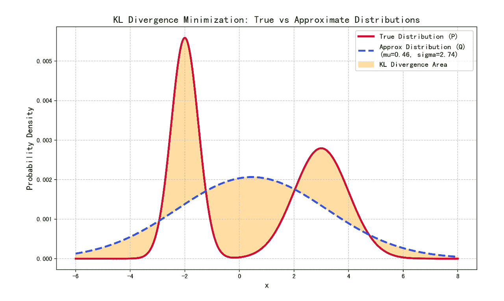
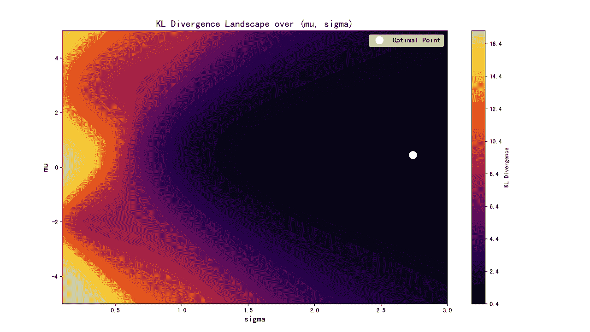

# 10-02损失函数-KL散度

> 来源：[https://qqs7y1hozd1.feishu.cn/docx/J4M6dd84LoEQ6zx5X0lcOAfzn4g](https://qqs7y1hozd1.feishu.cn/docx/J4M6dd84LoEQ6zx5X0lcOAfzn4g)

KL散度的全称是 Kull**bac**k-Leibler Divergence，也叫 相对熵。

KL散度是用来衡量「两个概率分布之间有多不一样」的一个工具。

打个比方：

+   假设你有两个袋子：袋子P和袋子Q。

+   每个袋子里都有颜色球：红、绿、蓝，每种颜色的球数量不一样。

+   KL散度就是告诉你：如果你以为你是在用Q袋子抓球，其实你在用P袋子，那么你每次抓错的‘代价’有多大？

### 关键词

+   它不是对称的（ ）。

+   它越小，说明两个分布越相似；KL散度为0，表示两个分布一模一样。

+   它是个**非负数**（≥0）。

+   它常用作**损失函数**，比如在机器学习中的分类模型、变分自编码器里。

## KL散度的数学定义

对于两个概率分布 P(x) 和 Q(x)，KL散度定义为：

如果是连续型分布，就变成积分形式：

其中：

+   P(x)：真实分布（你实际使用的袋子）

+   Q(x)：估计分布（你以为你在用的袋子）

## 从信息论角度理解

KL散度可以理解为「用错误分布 Q 去描述真实分布 P 所造成的信息损失」。

信息量的单位：**比特（bit）** 或 **纳特（nat）**，取决于对数底是2还是e。

### 信息量直观解释：

+   事件概率越小，信息量越大。

+   概率为 p 的事件，它带来的信息量是

那么，用 Q(x) 估计 P(x) 的代价就是：

整理后：

## 推导过程（从交叉熵和熵出发）

#### 熵（Entropy）：

表示分布 P 的**平均信息量**。

#### 交叉熵（Cross Entropy）：

表示：如果真实分布是 P，你用 Q 来编码，会花费多少信息量。

#### KL散度与它们的关系：

即：

> KL散度 = 你“错误估计”所付出的额外信息代价

## 一个例子

假设：

+   真实分布 P：

+   猫：70%

+   狗：30%

+   模型估计的分布 Q：

+   猫：60%

+   狗：40%

计算 KL(P‖Q)：

计算后：

这个值告诉你：「你用 Q 去估计 P，平均每次预测多花了 0.07 nat 的信息量」。

## KL散度作为损失函数的意义

#### 举个场景：分类模型

+   模型输出一个预测分布 Q（比如 [0.1, 0.7, 0.2] 表示三类的概率）

+   真实标签用 one-hot 编码的分布 P（比如 [0, 1, 0]）

那么：

由于只有一个类是1，其它为0，就变成：

所以，KL散度最终退化成了交叉熵损失函数。

## KL散度的算法流程

KL散度在实际应用中的步骤：

### 1. 得到两个分布：

+   真值分布 P（可能是标签）

+   模型估计分布 Q（通过 softmax 输出）

### 2. 对每个样本计算 KL 散度：

### 3. 对整个数据集取平均作为总损失

## 小结

| 项目 | 内容 |
| --- | --- |
| 名称 | Kullback-Leibler Divergence（KL散度） |
| 本质 | 衡量两个概率分布的“差距” |
| 公式 |  |
| 最小值 | 0（当P=Q） |
| 方向性 | 非对称（注意 P 和 Q 的顺序） |
| 与交叉熵关系 | KL = 交叉熵 - 熵 |
| 用途 | 模型损失函数、分布拟合、VAE中正则项等 |

## 完整案例

设想我们有两个连续概率分布：

+   **真实分布 P**：是一个混合正态分布，代表真实数据分布。

+   **拟合分布 Q**：是一个单一正态分布，我们希望通过调整Q的参数，使得它尽可能逼近P。

我们将通过KL散度度量Q相对于P的差异，并使用梯度下降优化Q的参数（均值和标准差），使KL散度最小。

最终将展示拟合效果及KL散度的变化过程。

```
import numpy as np
import matplotlib.pyplot as plt
from scipy.stats import norm
from scipy.optimize import minimize

np.random.seed(42)

# 1. 定义真实分布 P: 混合高斯分布
def true_distribution(x):
    # 50% N(-2, 0.5^2) + 50% N(3, 1^2)
    return 0.5 * norm.pdf(x, loc=-2, scale=0.5) + 0.5 * norm.pdf(x, loc=3, scale=1)

# 2. 定义拟合分布 Q: 单高斯分布，参数待优化
def approx_distribution(x, mu, sigma):
    return norm.pdf(x, loc=mu, scale=sigma)

# 3. 离散点区间及采样
x_vals = np.linspace(-6, 8, 1000)

# 真实分布概率值
p_vals = true_distribution(x_vals)
p_vals = p_vals / np.sum(p_vals)  # 归一化概率

# 4. 定义KL散度计算函数
def kl_divergence(p, q):
    epsilon = 1e-10  # 防止log(0)
    return np.sum(p * np.log(p / (q + epsilon)))

# 5. 定义目标函数，用于优化Q的参数 (mu, sigma) 使KL散度最小
def objective(params):
    mu, sigma = params
    if sigma &lt;= 0:
        return np.inf  # 标准差必须大于0
    q_vals = approx_distribution(x_vals, mu, sigma)
    q_vals = q_vals / np.sum(q_vals)  # 归一化
    return kl_divergence(p_vals, q_vals)

# 6. 初始参数及优化
init_params = [0, 1]  # 初始均值和标准差
result = minimize(objective, init_params, method=&#x27;L-BFGS-B&#x27;, bounds=[(-5,5), (0.1,5)])

opt_mu, opt_sigma = result.x

print(f&quot;Optimized mu: {opt_mu:.4f}, sigma: {opt_sigma:.4f}&quot;)

# 7. 计算拟合后的概率分布
q_opt_vals = approx_distribution(x_vals, opt_mu, opt_sigma)
q_opt_vals /= np.sum(q_opt_vals)

# 8. 绘制真实分布与拟合分布
plt.figure(figsize=(12, 7))
plt.plot(x_vals, p_vals, label=&quot;True Distribution (P)&quot;, color=&#x27;crimson&#x27;, linewidth=3)
plt.plot(x_vals, q_opt_vals, label=f&quot;Approx Distribution (Q) \n(mu={opt_mu:.2f}, sigma={opt_sigma:.2f})&quot;,
         color=&#x27;royalblue&#x27;, linewidth=3, linestyle=&#x27;--&#x27;)
plt.fill_between(x_vals, p_vals, q_opt_vals, color=&#x27;orange&#x27;, alpha=0.3, label=&quot;KL Divergence Area&quot;)
plt.title(&quot;KL Divergence Minimization: True vs Approximate Distributions&quot;, fontsize=16, color=&#x27;darkgreen&#x27;)
plt.xlabel(&quot;x&quot;, fontsize=14)
plt.ylabel(&quot;Probability Density&quot;, fontsize=14)
plt.legend(fontsize=12)
plt.grid(True, linestyle=&#x27;--&#x27;, alpha=0.6)
plt.show()

# 9. 可视化KL散度优化过程（使用离线模拟）
# 为了展示优化过程，我们做一步步扫描
mus = np.linspace(-5, 5, 50)
sigmas = np.linspace(0.1, 3, 50)
KL_matrix = np.zeros((len(mus), len(sigmas)))

for i, mu in enumerate(mus):
    for j, sigma in enumerate(sigmas):
        q_temp = approx_distribution(x_vals, mu, sigma)
        q_temp /= np.sum(q_temp)
        KL_matrix[i, j] = kl_divergence(p_vals, q_temp)

plt.figure(figsize=(14, 8))
cp = plt.contourf(sigmas, mus, KL_matrix, levels=50, cmap=&#x27;inferno&#x27;)
plt.colorbar(cp, label=&#x27;KL Divergence&#x27;)
plt.plot(opt_sigma, opt_mu, &#x27;wo&#x27;, markersize=12, label=&quot;Optimal Point&quot;)
plt.title(&quot;KL Divergence Landscape over (mu, sigma)&quot;, fontsize=16, color=&#x27;darkblue&#x27;)
plt.xlabel(&quot;sigma&quot;, fontsize=14)
plt.ylabel(&quot;mu&quot;, fontsize=14)
plt.legend(fontsize=12)
plt.show()
```

**1. 定义真实分布 P**

+   使用两个高斯分布的混合模型：50%权重的 和50%权重的 。

+   混合分布真实反映复杂数据的多模态特征。

**2. 定义拟合分布 Q**

+   选择一个单一的正态分布 ，参数   和   需要通过最小化KL散度拟合真实分布。

+   该选择简单且有代表性，适合说明问题。

**3. 离散采样和归一化**

+   在区间 均匀采样1000个点，用于数值积分。

+   对概率密度归一化，使其和为1，近似概率分布。

**4. KL散度计算函数**

+   使用数值方法计算   对   的KL散度，加入   避免对零取对数。

+   KL散度越小，  越接近  。

**5. 优化目标函数**

+   目标是寻找   和  ，使KL散度最小。

+   对   设定下界  ，保证标准差为正。

**6. 调用 ****scipy**.optimize.minimize 优化参数

+   选择 L-BFGS-B 方法，适合带约束的连续优化。

+   初始猜测  ， 。

**7. 绘制真实分布与拟合分布**



+   真实分布和拟合分布

+   用橙色填充两分布间的差异区域，形象表示KL散度。

**8. KL散度优化过程可视化**



+   构造   和   的网格，计算KL散度形成二维热力图。

+   标记最优点，直观体现最优解的位置。

## 模型分析

### 优缺点分析

**优点：**

+   **非对称性反映真实信息损失：** KL散度度量的是从真实分布P到近似分布Q的信息损失，这种不对称特性在很多场景中非常符合实际需求，如在变分推断中更关注模型近似对真实分布的覆盖程度。

+   **概率分布细节捕获能力强：** KL散度对P中概率为零而Q中非零的情况惩罚较轻，对P中有质量的区域Q分布预测不准则惩罚严重，因此适合保证模型覆盖真实重要概率区域。

+   **在训练中梯度易计算：** 对于参数化模型，KL散度具有良好的解析形式，便于导数计算，支持优化算法快速收敛。

**缺点：**

+   **不对称性带来的偏差：** 由于是非对称的，KL(P||Q)和KL(Q||P)差异很大，有时会导致模型倾向于忽略P的某些区域（覆盖不足问题）。

+   **对Q中概率为零敏感：** 如果Q在P有概率的位置上估计为零，会导致KL散度趋于无穷大，影响训练稳定性。

+   不能直接衡量两个分布的“距离”： KL散度不是严格意义上的距离度量（不满足对称性和三角不等式），在某些任务中不够直观。

### KL散度与其他相似算法对比

| 特性/算法 | KL散度 | JS散度 | 交叉熵 | Wasserstein距离 |
| --- | --- | --- | --- | --- |
| 对称性 | 否 | 是 | 否 | 是 |
| 值域 | [0, +∞) | [0, 1] | [0, +∞) | [0, +∞) |
| 稳定性 | 对Q=0敏感 | 更稳定，避免无穷大 | 对Q=0敏感 | 对分布重叠度不敏感 |
| 计算复杂度 | 低 | 中等 | 低 | 高 |
| 应用场景 | 概率模型训练、变分推断 | GAN训练、信息论应用 | 分类任务损失函数 | 生成模型优化，实际距离度量 |
| 对零概率处理 | 需要平滑 | 自然平滑 | 需要平滑 | 不敏感 |

### 适用场景

**KL散度优选场景**

+   **概率分布已知或能很好参数化时：** 如变分自编码器、贝叶斯推断中，模型需要以最小信息损失为目标。

+   **对真实分布覆盖度要求高：** 关注模型覆盖真实分布重点区域，避免遗漏重要信息。

+   对模型梯度友好，训练效率要求高： KL散度在解析求导上更简单，方便高效训练。

**其他算法优先考虑场景**

+   分布支持不同或部分重叠时，避免无穷散度： JS散度和Wasserstein距离更稳健，适合GAN等生成模型。

+   需要对称距离度量，方便直观解释时： JS散度和Wasserstein距离可作为度量分布差异的更自然选择。

+   实际场景强调生成样本质量和分布平滑时： Wasserstein距离由于考虑概率质量转移，更符合人类感知。

## 总结

这个案例，直观展示了如何使用KL散度度量两个复杂概率分布的差异，并用优化算法拟合近似分布。

KL散度作为信息论中的核心度量，在机器学习中应用广泛，但其非对称性与对零概率的敏感性限制了部分应用场景。在具体应用时，应根据问题需求权衡选择KL散度或其他替代算法。