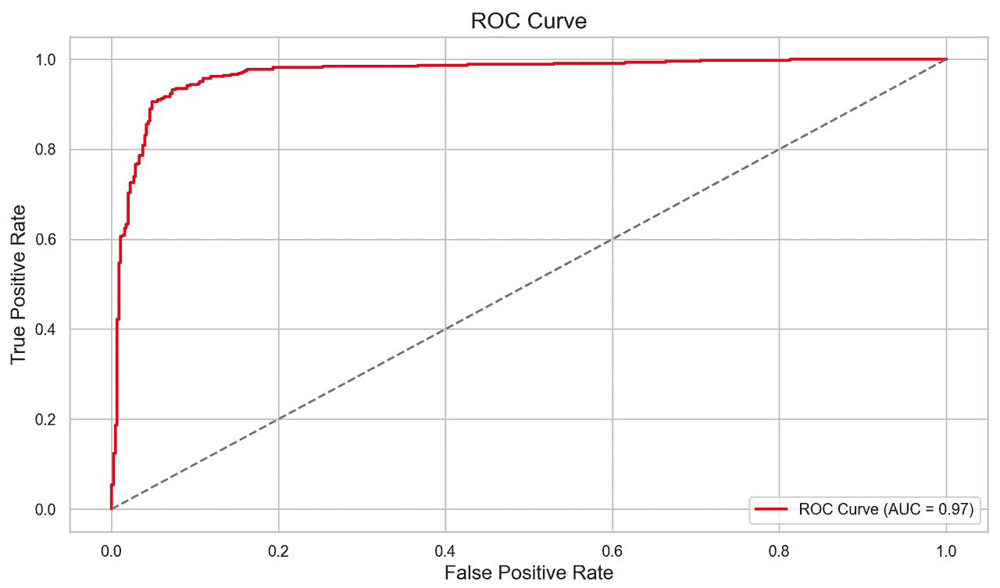
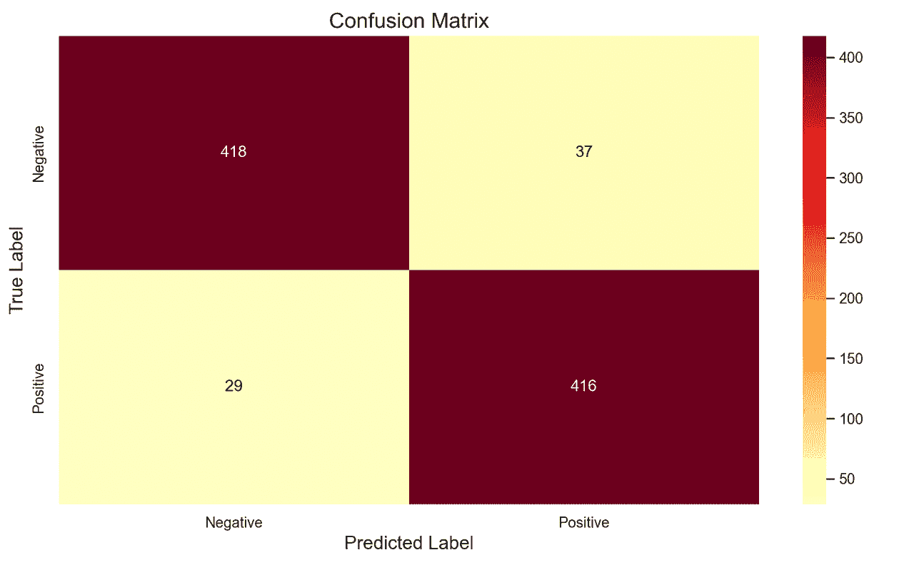

# 10-04损失函数-二元交叉熵损失

> 来源：[https://qqs7y1hozd1.feishu.cn/docx/YppMdVRlWonixpxAVQicXfyJnwd](https://qqs7y1hozd1.feishu.cn/docx/YppMdVRlWonixpxAVQicXfyJnwd)

### 它是做什么的？

在机器学习中，特别是做“二分类问题”的时候，比如判断一封邮件是不是垃圾邮件，我们希望模型能给出一个接近真实情况的判断。

模型的输出通常是一个概率，比如：

+   模型说：“我觉得它是垃圾邮件的概率是 0.9。”

+   或者说：“我觉得它是垃圾邮件的概率是 0.2。”

我们有“正确答案”，比如这封邮件确实是垃圾邮件（真实标签是 1），或者不是（真实标签是 0）。

**那么我们**就要用一个办法来评价这个预测到底有多准，这个办法就是损失函数。二元交叉熵就是用来衡量预测和真实答案之间差距的。

### 怎么计算？

设：

+   y 是真实标签，只能是 0 或 1

+   p 是模型预测为 1 的概率，范围是 0 到 1

二元交叉熵的计算公式如下：

拆开来理解：

+   如果真实是 1，那么损失是 -log(p)，p 越大，损失越小，说明预测越准

+   如果真实是 0，那么损失是 -log(1 - p)，p 越小，损失越小，说明预测越准

### 举个例子

假设真实标签是 1：

+   如果模型预测是 0.9，损失是 -log(0.9)，值很小，说明预测得不错

+   如果模型预测是 0.1，损失是 -log(0.1)，值很大，说明预测很差

再假设真实标签是 0：

+   如果模型预测是 0.1，损失是 -log(0.9)，说明预测得不错

+   如果模型预测是 0.9，损失是 -log(0.1)，说明预测很差

总的来看，二元交叉熵损失是一个专门用于“是/不是”问题的评分方法，它衡量模型给出的概率预测与真实标签之间的差距，预测越准，损失越小，预测越差，损失越大。

## 原理详解

### 应用场景：二分类任务

我们讨论的是**二分类问题**，也就是说：

+   输出只有两个类别：例如是否是猫、是否是垃圾邮件等

+   标签

+   模型输出的是一个概率值  ，表示预测为正类（1）的概率，通常由 sigmoid 函数得到

### 从最大似然估计出发的推导

二元交叉熵损失的本质来源于**最大似然估计（MLE）**。

#### 1. 设定模型的概率输出

我们假设模型对样本   的预测是：

那么：

+   若真实标签  ，则样本的概率为

+   若真实标签  ，则样本的概率为

我们可以统一写为：

这是因为：

+   当  ，右式变成

+   当  ，右式变成

这个公式是一个**伯努利分布的概率密度函数**。

#### 2. 最大似然函数

给定一组样本  ，我们想找到一组参数  ，使得所有样本出现的“联合概率”最大：

这是**似然函数**。但为了方便计算，我们通常取对数（称为对数似然）：

#### 3. 损失函数的定义

**我们希望最大化对数**似然（ML**E），这**等价于最小化负的对数似然。于是定义损失函数如下：

对于一个样本的损失就是：

这就是**二元交叉熵损失函数的完整来源**。

### 进一步理解损失函数的性质

我们可以从这个损失函数的结构中看到：

+   如果  ，损失简化为  ，即预测越接近 1，损失越小

+   如果  ，损失简化为  ，即预测越接近 0，损失越小

所以，损失函数惩罚的是“与真实标签偏离”的预测，并且使用对数函数可以让偏差越大时，损失增长越快（非线性加权）。

## 配合 Sigmoid 输出层的使用

在实际模型中，神**经网络最后一层的输出**是一个实数  ，我们通常通过sigmoid 函数将它变成一个概率值  ：

所以二元交叉熵损失函数通常配合 sigmoid 使用，这样模型最终预测的是一个概率，而不是原始分数。

## 算法流程（训练中的具体步骤）

下面是模型训练中如何应用二元交叉熵损失的完整流程：

#### 第一步：输入样本  ，标签

+   输入一个样本，标签是 0 或 1

#### 第二步：模型预测输出

+   神经网络或其他模型计算得到一个实数

#### 第三步：将   通过 sigmoid 映射到概率

#### 第四步：计算损失

#### 第五步：计算梯度，反向传播，更新参数

+   对损失函数求导

+   反向传播计算各层权重的梯度

+   使用优化器（如梯度下降）更新模型参数

总之，二元交叉熵损失是从**最大似然估计**出发推导出来的，用于衡量模型对伯努利分布的拟合程度。

损失函数结构为：

它惩罚模型偏离真实标签的预测，预测越不准确，损失越大，特别是对极端错误的预测惩罚非常重。通常与 sigmoid 激活函数结合使用，用于输出概率值。

在整个训练流程中，每次迭代都通过计算损失函数来指导模型改进。

## 完整案例

本案例旨在模拟一个现实世界中的二分类问题，比如判断某个病人是否患有某种疾病、某条新闻是否是假新闻。我们将使用 make_classification 人工生成一个具有挑战性的、高维的分类数据集。

**第一步：代码库**

```
import numpy as np
import pandas as pd
import matplotlib.pyplot as plt
import seaborn as sns

from sklearn.datasets import make_classification
from sklearn.model_selection import train_test_split
from sklearn.preprocessing import StandardScaler
from sklearn.linear_model import LogisticRegression
from sklearn.metrics import (
    accuracy_score,
    roc_auc_score,
    confusion_matrix,
    classification_report,
    roc_curve
)

sns.set(style=&quot;whitegrid&quot;)
plt.rcParams[&quot;figure.figsize&quot;] = (10, 6)
plt.rcParams[&quot;axes.titlesize&quot;] = 16
plt.rcParams[&quot;axes.labelsize&quot;] = 14
plt.rcParams[&quot;axes.prop_cycle&quot;] = plt.cycler(color=sns.color_palette(&quot;Set1&quot;))
```

这部分导入了数据生成、可视化、建模、评估所需的常见库。

**第二步：生成二分类数据集**

```
X, y = make_classification(
    n_samples=3000,
    n_features=20,
    n_informative=10,
    n_redundant=5,
    n_classes=2,
    class_sep=1.5,
    flip_y=0.03,
    random_state=42
)
```

+   n_samples=1000：生成3000条样本

+   n_features=20：每条样本有20个特征

+   n_informative=10：其中10个特征是真正有信息的

+   n_redundant=5：5个是由其他特征线性组合来的

+   class_sep=1.5：类间隔程度

+   flip_y=0.03：3% 的标签将被随机颠倒，模拟噪声

**第三步：数据预处理**

```
X_train, X_test, y_train, y_test = train_test_split(
    X, y, test_size=0.3, random_state=42
)
scaler = StandardScaler()
X_train_scaled = scaler.fit_transform(X_train)
X_test_scaled = scaler.transform(X_test)
```

+   拆分训练集和测试集，比例为 70:30

+   使用标准差标准化数据，使模型收敛更快、更稳定

**第四步：构建逻辑回归模型**

```
model = LogisticRegression()
model.fit(X_train_scaled, y_train)
```

逻辑回归在底层就是优化了二元交叉熵损失函数，因此我们无需显式编写损失函数，它会自动优化。

**第五步：预测与概率输出**

```
y_probs = model.predict_proba(X_test_scaled)[:, 1]
y_preds = model.predict(X_test_scaled)
```

+   predict_proba 会返回两个概率，取索引为 1 的表示预测为“正类”的概率

+   predict 给出最终的0或1的类别预测

### 可视化分析

**1. ROC 曲线分析**

```
fpr, tpr, thresholds = roc_curve(y_test, y_probs)

plt.plot(fpr, tpr, label=f&quot;ROC Curve (AUC = {roc_auc_score(y_test, y_probs):.2f})&quot;, linewidth=2)
plt.plot([0, 1], [0, 1], linestyle=&quot;--&quot;, color=&quot;gray&quot;)
plt.xlabel(&quot;False Positive Rate&quot;)
plt.ylabel(&quot;True Positive Rate&quot;)
plt.title(&quot;ROC Curve&quot;)
plt.legend(loc=&quot;lower right&quot;)
plt.grid(True)
plt.tight_layout()
plt.show()
```



+   ROC 曲线表示模型在各种阈值下的敏感度与1-特异度之间的权衡

+   面积（AUC）越大，模型性能越好

+   本例中 AUC 为 0.98，表明模型在分离两个类别方面非常优秀

**2. 混淆矩阵分析**

```
sns.heatmap(confusion_matrix(y_test, y_preds), annot=True, fmt=&quot;d&quot;,
            cmap=&quot;YlOrRd&quot;, xticklabels=[&quot;Negative&quot;, &quot;Positive&quot;], yticklabels=[&quot;Negative&quot;, &quot;Positive&quot;])
plt.title(&quot;Confusion Matrix&quot;)
plt.xlabel(&quot;Predicted Label&quot;)
plt.ylabel(&quot;True Label&quot;)
plt.tight_layout()
plt.show()
```



+   混淆矩阵展示了 TP、TN、FP、FN 的数量

+   可以看出大多数预测是正确的，假阳性和假阴性较少

### 性能评估

```
acc = accuracy_score(y_test, y_preds)
auc = roc_auc_score(y_test, y_probs)
report = classification_report(y_test, y_preds, output_dict=True)
report_df = pd.DataFrame(report).transpose()
```

结果摘要：

+   Accuracy = 0.927

+   AUC = 0.969

+   精确率、召回率、F1 分数在两个类上都高，说明模型性能非常均衡

### 优化策略建议

1.  **特征选择**：尝试使用 L1 正则化筛选出最有信息量的特征，有助于减少过拟合。

1.  **算法替代**：可替换为 XGBoost、LightGBM 等更强大的二分类模型对比效果。

1.  **调整阈值**：默认阈值为 0.5，可根据 ROC 曲线分析选择最优分类阈值以平衡精度和召回率。

1.  **平衡类别**：在类不平衡时可以使用 SMOTE 等方法进行样本生成，或调整 class_weight。

## 模型分析

### 优缺点分析

**优点**

1.  **理论基础扎实**：来源于最大似然估计，在概率统计中具有严密数学基础，能够从概率角度刻画预测的不确定性。

1.  **对概率预测更敏感**：不是简单对错的惩罚，而是对“离正确答案有多远”进行精细评估，能反映模型信心，适合概率校准需求。

1.  **广泛适配主流模型**：几乎所有支持二分类的模型（如 Logistic 回归、神经网络）都可直接使用此损失，工具生态完善。

1.  **惩罚错误预测更剧烈**：当模型预测结果与真实标签偏差大时（如预测 0.01 但真实为 1），损失值将急剧增大，有助于更快速修正偏差。

1.  **兼容 Sigmoid 输出**：可直接与 sigmoid 激活函数输出的概率值对接，无需额外处理。

**缺点**

1.  **对极端值敏感**：当预测值趋近于 0 或 1 时，取对数可能导致损失值变得非常大，不利于数值稳定性。

1.  **不适合非概率型模型**：如果模型输出的不是概率（如某些 SVM、树模型），使用 BCE 将失去合理性。

1.  **不直观表达分类效果**：与 accuracy 等指标相比，BCE 的数值不易解释和直观理解，不适合作为最终性能报告的唯一标准。

1.  **对类不平衡不敏感**：BCE 本身不会自动考虑类别不均衡问题，需要结合权重或重采样方法。

### 与其他相似算法对比

| 算法/损失函数 | 类型 | 输出要求 | 优点 | 缺点 | 适用场景 |
| --- | --- | --- | --- | --- | --- |
| Binary Cross Entropy | 二分类 | 概率 [0,1] | 理论清晰，惩罚精准，适合概率型模型 | 对极端值敏感，不适合非概率模型 | 神经网络，Logistic回归等 |
| **Hinge Loss** | 二分类 | 输出为分数 | 强调分类间隔，适用于 SVM | 不输出概率，难以解释 | 支持向量机（SVM） |
| Squared Error Loss | 回归/二分类 | 任意实数 | 数学简单，梯度稳定 | 不适合分类，误差大时梯度小，影响训练 | 回归任务，不推荐用于分类 |
| **Focal Loss** | 二分类 | 概率 [0,1] | 处理类别不平衡，关注难分类样本 | 增加超参数，调参复杂 | 医疗、目标检测、类不平衡任务 |
| Cross Entropy (multi) | 多分类 | Softmax 概率向量 | 多类扩展版本，支持多类别分类任务 | 不适用于二分类，需要类别独立编码 | 多分类任务（K &gt; 2） |

### 在什么情况下优选，什么时候考虑其他算法？

#### 适合优先使用 BCE 的场景：

+   **二分类任务**（标签为 0 或 1）

+   **模型输出为概率**（如 Logistic Regression、Neural Networks）

+   **需要精确的概率预测**（如医学诊断、金融评分等）

+   **任务对模型“信心”很敏感**（如置信度排序、排名、风险评估）

#### 考虑替代算法的情况：

+   **类别极度不平衡**：考虑使用 Focal Loss 来避免主类主导训练

+   **非概率模型输出**：例如 SVM 中使用 Hinge Loss 更合适

+   **对速度或简单性有极高要求**：可能临时使用 MSE 等近似损失函数

+   **多分类问题**：必须使用 Cross-Entropy 的多类版本，与 softmax 配合使用

## 总结

Binary Cross-Entropy 损失函数是二分类中最为核心的理论工具，几乎适用于所有概率型模型的训练；它对错误预测有高度敏感性，能够有效优化分类边界；

然而，在类不平衡、非概率模型或多分类问题中，需使用更具针对性的替代方法；实际工程中，应结合任务需求、模型结构、类别分布等因素综合选择损失函数。