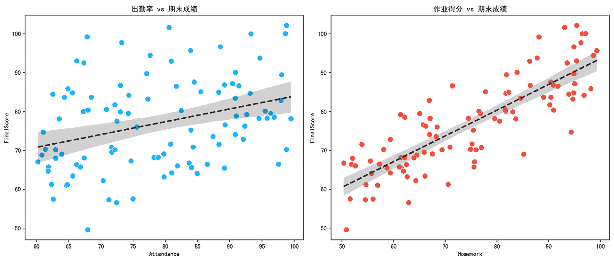
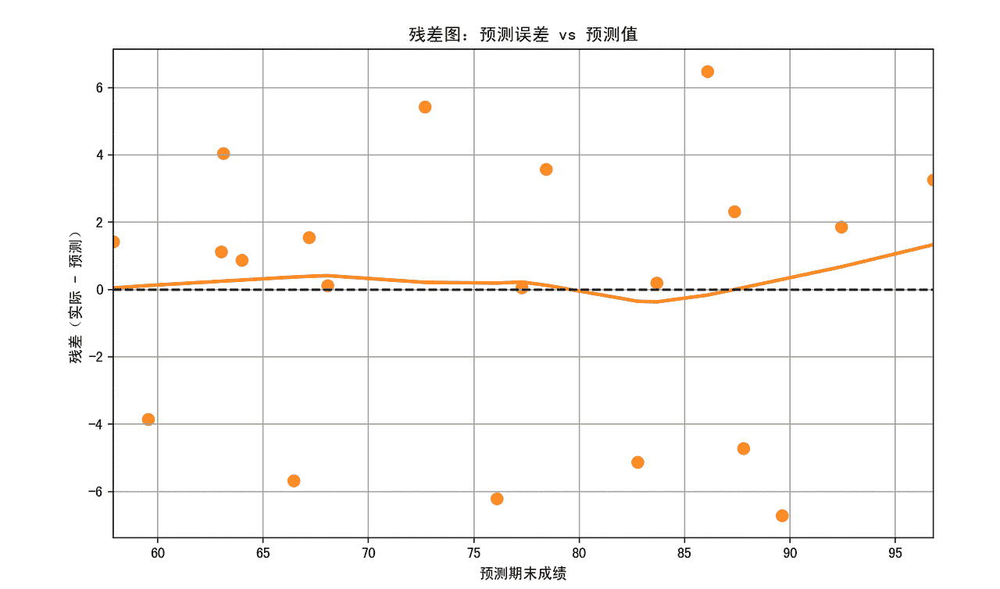

# 10-09损失函数-平均绝对误差

> 来源：[https://qqs7y1hozd1.feishu.cn/docx/HiwIdPwI8oJtXmxYIRzcuu4CnZf](https://qqs7y1hozd1.feishu.cn/docx/HiwIdPwI8oJtXmxYIRzcuu4CnZf)

**平均绝对误差是什么？**

MAE 是一种最简单、最直观的损失函数。

我们有很多预测值（比如预测了 100 个房价），也有这些房价的真实值。每一个预测值和真实值之间都会有个差距，我们把这个差距拿出来，一个个加起来，再除以总数量，就得到了 MAE。

就像做了 10 次实验，每次偏差多少，最后平均一下，看看你整体偏差有多大。

### 举个简单例子：

假设你预测了3个房子的价格，分别是：

+   预测值：

+   真实值：

每个预测和真实值的差（绝对值）是：

+   第1个：|100 - 110| = 10 万

+   第2个：|150 - 140| = 10 万

+   第3个：|200 - 195| = 5 万

把这三个误差加起来是：10 + 10 + 5 = 25 万

平均一下：25 ÷ 3 ≈ **8.33 万**

这就是 MAE。

## MAE 核心原理

### 1. MAE 的数学定义

设：

+    ：第   个样本的真实值

+    ：第   个样本的预测值

+    ：样本总数

那么：

**也就是说，我们把每个预测值和真**实值之间的“绝对误差”求出来，然后平均。

### 2. 为什么要用“绝对值”？

我们知道预测值可能比真实值大（正误差），也可能小（负误差）。

如果我们不加绝对值，直接求差值之和，正负会相互抵消，导致总误差看起来很小甚至为 0，但实际错误可能很大。

举例：

+   真实值：

+   预测值：

误差：

没有绝对值：20 + (-20) = 0（错误地以为完全没错）

有绝对值：|20| + |−20| = 40 → 说明总共错了 40

## MAE 的优化算法流程

虽然 MAE 的计算很简单，但在模型训练过程中，我们希望找到一组预测函数的参数，使得 MAE 最小。

这就涉及到如何优化它，通常使用梯度下降法来优化模型参数。

### 1. 梯度下降优化中的问题

对于 MAE，由于其使用了**绝对值****，其导**数在误差为 0 的地方（也就是预测值正好等于真实值时）不可导。

我们回顾：

+   MAE 公式中误差项是：

+   对它求导（梯度）时，数学上：

这意味着，MAE 的梯度是一个分段函数，不连续，不可导，会让梯度下降过程变得不稳定。

所以在深度学习中，有时会选择更平滑的 MSE 或 Huber 损失。

### 2. 算法流程（用来优化 MAE）

虽然 MAE 不可导，但我们仍可以使用一种近似的方式进行训练，比如用**次梯度（Subgradient）**代替普通导数：

训练模型的步骤（假设我们用的是线性模型 y = wx + b）：

1.  初始化参数

1.  对每一个样本，计算预测值

1.  计算误差

1.  计算梯度（次梯度）：

1.  用这个“符号”值来更新参数，朝着误差减少的方向调整

1.  重复直到收敛

注意：因为导数不是连续的，这种优化可能更慢、更容易卡在某些点。

## 完整案例

案例名称：预测学生成绩

某校教师希望根据学生的平时表现（如出勤率、平时作业得分）预测其最终考试成绩，以便更早干预学业困难学生。

**这里，我们使**用一个简化的虚拟数据集，建立线性模型，使用 平均绝对误差 来评估模型预测准确性。

+   **输入变量（特征）**：出勤率（%）、平时作业平均分（满分100）

+   **目标变量**：期末成绩（满分100）

为什么使用**平均绝对误差**？

+   MAE 单位与预测目标一致，容易解释（如“平均偏差 5 分”）。

+   对极端错误更有鲁棒性，适合教育场景中对学生公平评估。

```
import numpy as np
import pandas as pd
import matplotlib.pyplot as plt
import seaborn as sns
from sklearn.linear_model import LinearRegression
from sklearn.metrics import mean_absolute_error, mean_squared_error
from sklearn.model_selection import train_test_split


# 1. 生成模拟数据（100 名学生）
np.random.seed(42)
attendance = np.random.uniform(60, 100, 100)          # 出勤率：60% ~ 100%
homework_score = np.random.uniform(50, 100, 100)      # 平时作业：50 ~ 100
final_score = 0.4 * attendance + 0.6 * homework_score + np.random.normal(0, 5, 100)

df = pd.DataFrame({
    &#x27;Attendance&#x27;: attendance,
    &#x27;Homework&#x27;: homework_score,
    &#x27;FinalScore&#x27;: final_score
})

# 2. 数据分布（增强美观和信息量）
plt.figure(figsize=(14, 6))

plt.subplot(1, 2, 1)
sns.scatterplot(data=df, x=&#x27;Attendance&#x27;, y=&#x27;FinalScore&#x27;, color=&#x27;deepskyblue&#x27;, s=80)
sns.regplot(data=df, x=&#x27;Attendance&#x27;, y=&#x27;FinalScore&#x27;, scatter=False, color=&#x27;black&#x27;, line_kws={&#x27;linestyle&#x27;: &#x27;--&#x27;})
plt.title(&#x27;出勤率 vs 期末成绩&#x27;)

plt.subplot(1, 2, 2)
sns.scatterplot(data=df, x=&#x27;Homework&#x27;, y=&#x27;FinalScore&#x27;, color=&#x27;tomato&#x27;, s=80)
sns.regplot(data=df, x=&#x27;Homework&#x27;, y=&#x27;FinalScore&#x27;, scatter=False, color=&#x27;black&#x27;, line_kws={&#x27;linestyle&#x27;: &#x27;--&#x27;})
plt.title(&#x27;作业得分 vs 期末成绩&#x27;)

plt.tight_layout()
plt.show()


# 3. 构造训练集和测试集
X = df[[&#x27;Attendance&#x27;, &#x27;Homework&#x27;]]
y = df[&#x27;FinalScore&#x27;]
X_train, X_test, y_train, y_test = train_test_split(X, y, test_size=0.2, random_state=42)

# 4. 拟合线性回归模型
model = LinearRegression()
model.fit(X_train, y_train)

# 5. 预测测试集
y_pred = model.predict(X_test)

# 6. 残差图（Residual Plot）
residuals = y_test - y_pred
plt.figure(figsize=(10, 6))
sns.residplot(x=y_pred, y=residuals, lowess=True, color=&#x27;darkorange&#x27;, scatter_kws={&#x27;alpha&#x27;:0.7, &#x27;s&#x27;:60})
plt.axhline(0, linestyle=&#x27;--&#x27;, color=&#x27;black&#x27;)
plt.title(&#x27;残差图：预测误差 vs 预测值&#x27;)
plt.xlabel(&#x27;预测期末成绩&#x27;)
plt.ylabel(&#x27;残差（实际 - 预测）&#x27;)
plt.grid(True)
plt.show()
```

代码中，模拟了 100 名学生的数据：

+   出勤率与作业得分共同决定期末成绩（权重分别为 0.4 和 0.6）。

+   加入随机噪声，模拟不可预测因素（如临时发挥失常等）。

训练一个多元线性回归模型，学习「出勤率+作业得分」与「期末成绩」的线性关系。



**1. 数据分布图**：每个变量与目标之间的关系用散点图表示，加入了回归趋势线（黑色虚线），帮助观察变量对成绩的线性影响。



**2. 残差图**：水平线 = 0：表示预测值 = 实际值，散点越接近 0 线，误差越小。如果残差呈随机分布（无明显模式），说明线性模型拟合得当

## 模型分析

### 优缺点

**优点：**

+   **直观易理解**：它的单位和原始数据一样（元），没有平方或开方。

+   **鲁棒性好**：对极端离群值不敏感，能防止模型对异常样本过度拟合。

+   **更贴近商业用途**：比如房价、销售额等场景，使用 MAE 更符合直觉。

**缺点：**

+   **不可导点**：在误差为0的位置，不可导，使得在使用梯度下降等方法时不够平滑。

+   **对误差方向不敏感**：正错和负错在 MAE 中效果一样，可能无法区分“高估”或“低估”。

### MAE 与其他损失函数对比

| 损失函数 | 定义公式 | 特点 | 适用场景 |
| --- | --- | --- | --- |
| **MAE** (平均绝对误差) |  | 不敏感于异常值，误差线性增长 | 销售额预测、稳健统计 |
| **MSE** (均方误差) |  | 对大误差惩罚更大（平方） | 回归模型、优化更稳定 |
| **Huber 损失** | 结合 MAE 和 MSE，误差小时像 MSE，大时像 MAE | 平衡鲁棒性与可导性 | 既要抗离群又要平滑优化的场合 |

### 什么时候该使用 MAE？

**MAE 是优选的情况：**

+   **异常值较多**：比如市场价格、用户评分中，存在极端值时。

+   **对方向不敏感**：只关心误差大小，不关心高估或低估。

+   **结果要“实打实”解释**：比如“平均误差 1 万元”比“MSE 10000000”更直观。

**不建议使用 MAE 的情况：**

+   **对大误差特别敏感的场景**：比如航天器控制，误差平方影响重大。

+   **需要二阶导数优化**：比如神经网络训练中，MSE 更平滑、易求导。

+   **需要区分误差方向（高估/低估）**：MAE 会丢失这一信息。

## 总结

损失函数 是训练模型的评分标准，MAE（平均绝对误差） 是一种简单、稳定、不敏感于异常值的评估指标。

适用于 销售预测、房价估值等场景，相比 MSE 更稳定但收敛慢；相比 Huber 更易理解但不如其灵活。