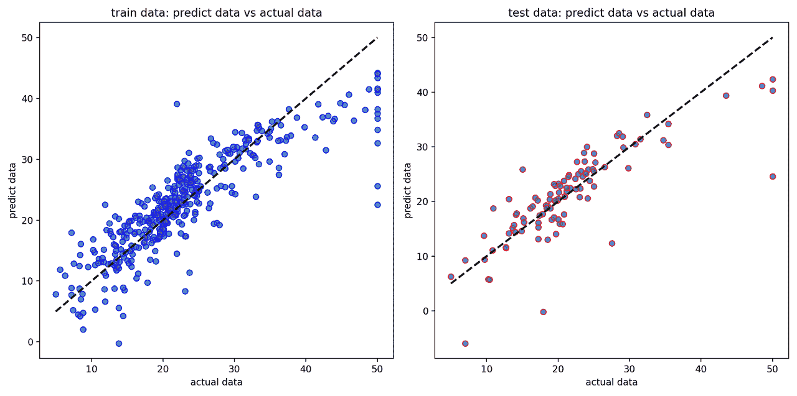
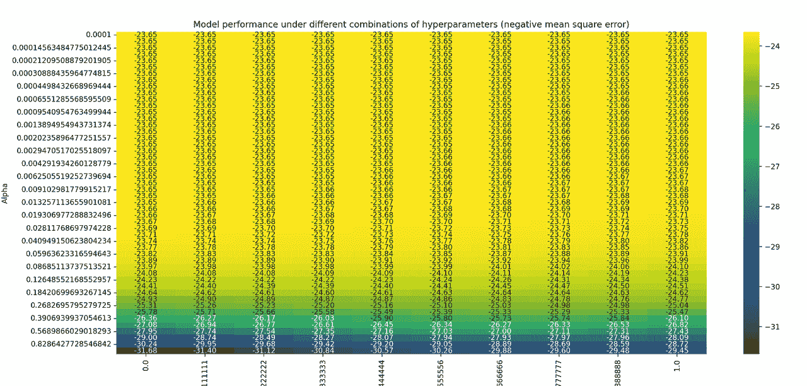

# 11-01正则化方法-弹性网络正则化

> 来源：[https://qqs7y1hozd1.feishu.cn/docx/UMtAdnxGVoQUNqx17GJc9zvwnsb](https://qqs7y1hozd1.feishu.cn/docx/UMtAdnxGVoQUNqx17GJc9zvwnsb)

弹性网络正则化 主要是为了防止模型过拟合并提高模型的泛化能力。

那其次，再来谈谈正则化：

正则化 用来防止模型过拟合。过拟合是指模型在训练数据上表现很好，但在新数据上表现不佳。正则化通过添加额外的信息（通常是一些约束或惩罚）来让模型在训练时不过于“记住”训练数据的细节，而是学到更普遍的规律。

那么，弹性网络正则化是什么？

弹性网络正则化是将两种常见的正则化方法：L1正则化（Lasso）和L2正则化（Ridge）结合起来的一种方法。

+   **L1正则化（Lasso）**：通过增加一个参数，使得一些不重要的特征的系数变为零，这样可以进行特征选择。

+   **L2正则化（Ridge）**：通过增加一个参数，使得所有特征的系数变得更小，这样可以减少模型的复杂度。

弹性网络正则化结合了这两者的优点，可以同时进行特征选择和防止模型过于复杂。

所以，这个时候就知道为什么要选择弹性网络正则化了！

1.  **特征选择**：L1正则化会将不重要的特征的系数缩减为零，从而自动进行特征选择。

1.  **稳定性**：L2正则化会使得所有特征的系数变小，防止某些特征的系数过大，从而增加模型的稳定性。

1.  **处理多重共线性**：当多个特征之间高度相关时，L1和L2单独使用可能效果不好，而弹性网络可以更好地处理这种情况。

**也**就是说，弹性网络正则化是结合了L1和L2正则化优点的一种方法，可以有效防止模型过拟合，并提高模型的泛化能力。

## 理论基础

弹性网络正则化 结合了L1正则化（Lasso）和L2正则化（Ridge）的优点，通过引入两个正则化参数来控制L1和L2正则化的比例，进而实现特征选择和防止模型复杂度过高。

#### 1. 线性回归模型

首先考虑一个线性回归模型：

其中：

+    是响应变量向量（维度为  ）。

+    是特征矩阵（维度为  ）。

+    是待估计的回归系数向量（维度为  ）。

+    是误差项（维度为  ）。

#### 2. 损失函数

线性回归模型的普通最小二乘（OLS）损失函数为：

#### 3. L1 正则化（Lasso）

Lasso的目标函数是将L1正则化项加入到损失函数中：

其中  是L1范数，  是正则化参数。

#### 4. L2 正则化（Ridge）

Ridge的目标函数是将L2正则化项加入到损失函数中：

其中  是L2范数的平方，  是正则化参数。

#### 5. 弹性网络正则化（Elastic Net）

弹性网络正则化结合了Lasso和Ridge正则化，通过引入两个正则化参数来控制L1和L2正则化的比例，其目标函数为：

为了简化问题，一般会引入一个混合参数   和一个总正则化参数  ，其中  ， 。

目标函数变为：

其中：

+     是控制整体正则化强度的参数。

+     控制L1和L2正则化的比例， 时为Lasso， 时为Ridge。

### 弹性网络正则化过程推导

为了更清楚地理解弹性网络的优化过程，我们对目标函数求导。

考虑无偏估计的情况，即对   求导并设置导数为零。

目标函数：

将其展开：

对   求导：

其中   是符号函数，表示   的符号（正、负、零）。

令导数为零，得到优化条件：

这个方程在实际中通常通过迭代优化算法（如坐标下降法）来求解。

### 整体算法流程

1.  **数据准备**：准备特征矩阵  和响应变量  。

1.  **参数初始化**：选择混合参数   和总正则化参数  ，初始化回归系数  。

1.  **迭代优化**：

+   **坐标下降法**：针对每一个回归系数  ，固定其他系数，更新  ：

+   **收敛判断**：检查更新前后回归系数的变化，若变化小于预设阈值，则认为算法收敛。

1.  **模型评估**：使用交叉验证等方法评估模型性能，根据需要调整   和   参数。

1.  **模型应用**：使用优化后的回归系数   进行预测。

弹性网络正则化，结合L1和L2正则化的优点，可以同时进行特征选择和防止模型过拟合。其目标函数通过引入两个正则化参数来控制L1和L2正则化的比例，并通过迭代优化算法求解。

## 完整案例

我们来举例一个弹性网络正则化的应用、分析和优化。这次我们选择Kaggle上的房价预测数据集（House Prices: Advanced Regression Techniques），这个数据集包含许多特征，并且任务是预测房屋价格。

#### 1. 数据集介绍

该数据集包含79个特征，如房屋的面积、建造年份、位置、装修质量等，目标是预测房屋的最终售价。

数据集，在公众号「深夜努力写Python」，后台回复『数据集』即可获取~

#### 2. 实验步骤

1.  数据加载和预处理

1.  特征工程

1.  弹性网络模型训练

1.  超参数调优

1.  模型评估和可视化

1.  算法优化与讨论

#### 3. 实验代码

**导入必要的库**

```
import numpy as np
import pandas as pd
import matplotlib.pyplot as plt
import seaborn as sns
from sklearn.model_selection import train_test_split, GridSearchCV
from sklearn.linear_model import ElasticNet
from sklearn.metrics import mean_squared_error, r2_score
from sklearn.preprocessing import StandardScaler, OneHotEncoder
from sklearn.compose import ColumnTransformer
from sklearn.pipeline import Pipeline
import warnings

warnings.filterwarnings(&#x27;ignore&#x27;)
```

**数据加载和预处理**

```
# 数据加载
train_df = pd.read_csv(&#x27;BostonHousing.csv&#x27;)

# 目标变量和特征
X = train_df.drop(&#x27;medv&#x27;, axis=1)
y = train_df[&#x27;medv&#x27;]

# 数据分割
X_train, X_test, y_train, y_test = train_test_split(X, y, test_size=0.2, random_state=42)

# 特征工程
numeric_features = X.select_dtypes(include=[&#x27;int64&#x27;, &#x27;float64&#x27;]).columns
categorical_features = X.select_dtypes(include=[&#x27;object&#x27;]).columns

# 数值特征标准化，分类特征独热编码
preprocessor = ColumnTransformer(
    transformers=[
        (&#x27;num&#x27;, StandardScaler(), numeric_features),
        (&#x27;cat&#x27;, OneHotEncoder(), categorical_features)
    ])

# 建立弹性网络模型的pipeline
elastic_net = Pipeline(steps=[
    (&#x27;preprocessor&#x27;, preprocessor),
    (&#x27;regressor&#x27;, ElasticNet())
])
```

**弹性网络模型训练和超参数调优**

```
# 超参数调优
param_grid = {
    &#x27;regressor__alpha&#x27;: np.logspace(-4, 0, 50),
    &#x27;regressor__l1_ratio&#x27;: np.linspace(0, 1, 10)
}

grid_search = GridSearchCV(elastic_net, param_grid, cv=5, scoring=&#x27;neg_mean_squared_error&#x27;, n_jobs=-1)
grid_search.fit(X_train, y_train)

# 最优模型
best_model = grid_search.best_estimator_
y_pred_train = best_model.predict(X_train)
y_pred_test = best_model.predict(X_test)

# 模型评估
mse_train = mean_squared_error(y_train, y_pred_train)
mse_test = mean_squared_error(y_test, y_pred_test)
r2_train = r2_score(y_train, y_pred_train)
r2_test = r2_score(y_test, y_pred_test)

print(f&#x27;Best parameters: {grid_search.best_params_}&#x27;)
print(f&#x27;Training MSE: {mse_train}&#x27;)
print(f&#x27;Test MSE: {mse_test}&#x27;)
print(f&#x27;Training R^2: {r2_train}&#x27;)
print(f&#x27;Test R^2: {r2_test}&#x27;)
```

**可视化分析**

```
# 可视化预测结果
plt.figure(figsize=(12, 6))

# 训练集预测值 vs 真实值
plt.subplot(1, 2, 1)
plt.scatter(y_train, y_pred_train, alpha=0.7, edgecolors=&#x27;b&#x27;)
plt.plot([y_train.min(), y_train.max()], [y_train.min(), y_train.max()], &#x27;k--&#x27;, lw=2)
plt.xlabel(&#x27;actual data&#x27;)
plt.ylabel(&#x27;predict data&#x27;)
plt.title(&#x27;train data: predict data vs actual data&#x27;)

# 测试集预测值 vs 真实值
plt.subplot(1, 2, 2)
plt.scatter(y_test, y_pred_test, alpha=0.7, edgecolors=&#x27;r&#x27;)
plt.plot([y_test.min(), y_test.max()], [y_test.min(), y_test.max()], &#x27;k--&#x27;, lw=2)
plt.xlabel(&#x27;actual data&#x27;)
plt.ylabel(&#x27;predict data&#x27;)
plt.title(&#x27;test data: predict data vs actual data&#x27;)

plt.tight_layout()
plt.show()

# 参数效果分析
results = pd.DataFrame(grid_search.cv_results_)
scores_matrix = results.pivot(index=&#x27;param_regressor__alpha&#x27;, columns=&#x27;param_regressor__l1_ratio&#x27;, values=&#x27;mean_test_score&#x27;)

plt.figure(figsize=(10, 8))
sns.heatmap(scores_matrix, annot=True, fmt=&quot;.2f&quot;, cmap=&#x27;viridis&#x27;)
plt.title(&#x27;Model performance under different combinations of hyperparameters (negative mean square error)&#x27;)
plt.xlabel(&#x27;L1 ratio&#x27;)
plt.ylabel(&#x27;Alpha&#x27;)
plt.show()
```





过完整体代码后，我们可以直观地看到弹性网络模型在训练集和测试集上的表现，以及不同超参数组合对模型性能的影响。

## 模型分析

#### 弹性网络正则化模型的优缺点

**优点**：

1.  **特征选择**：弹性网络正则化包含L1正则化（Lasso）的成分，能够将一些不重要的特征系数缩减为零，实现特征选择，简化模型。

1.  **处理多重共线性**：相比单纯的Lasso或Ridge，弹性网络在处理多重共线性（特征之间高度相关）时表现更好。L2正则化成分可以分散权重，避免某些特征权重过大。

1.  **稳定性**：由于L2正则化成分，模型更加稳定，防止回归系数过大，从而减小过拟合风险。

1.  **灵活性**：通过调节混合参数 ，可以在L1和L2正则化之间进行权衡，从而灵活适应不同数据集和任务需求。

**缺点**：

1.  **计算复杂度**：相比单独使用Lasso或Ridge，弹性网络的计算复杂度更高，尤其是在高维数据和大规模数据集上，计算开销较大。

1.  **参数选择复杂**：需要同时调节两个正则化参数（  和  ），参数调优过程较复杂且耗时。

1.  **可能的过拟合**：尽管弹性网络结合了L1和L2的优点，但在特征数远大于样本数的情况下，仍然存在过拟合风险。

与相似算法的对比

| **对比项** | **Lasso（L1正则化）** | **Ridge（L2正则化）** | 弹性网络（Elastic Net） |
| --- | --- | --- | --- |
| **正则化方式** | 使用   范数（系数的绝对值和） | 使用   范数（系数的平方和） | 结合了   和   范数（系数的绝对值和与平方和） |
| **特征选择** | 能进行特征选择，能够将一些特征系数缩减为零 | 无法进行特征选择，所有特征都会包含在模型中 | 能够进行特征选择，并处理多重共线性问题 |
| **适用场景** | 适用于高维数据，特征较少且独立的情况 | 适用于处理特征相关性较高的情况，尤其是多重共线性问题 | 适用于特征较多且存在多重共线性的情况，结合了Lasso和Ridge的优点 |
| **优点** | - 能进行特征选择  - 产生稀疏模型，适用于高维数据集  - 模型简洁，易于解释 | - 防止过拟合，均匀分配权重  - 适用于多重共线性  - 模型稳定 | - 结合Lasso和Ridge的优点  - 既能进行特征选择又能处理共线性问题 |
| **缺点** | - 对特征高度相关的数据选择不稳定  - 可能随机选择其中一个特征  - 无法处理多重共线性 | - 不能进行特征选择  - 模型较为复杂，可能不简洁 | - 计算复杂度较高  - 参数调优过程复杂 |
| **模型稀疏性** | 由于 正则化，模型会变得更加稀疏 | 不会产生稀疏模型，所有特征都会被包含 | 稀疏性较低，但在Lasso和Ridge之间平衡 |
| **计算复杂度** | 计算复杂度较低 | 计算复杂度较低 | 计算复杂度较高 |
| **调参** | 只需调节一个正则化参数（ ） | 只需调节一个正则化参数（ ） | 需要调节两个正则化参数（  和  ） |

#### 适用场景

**弹性网络的优选场景**

1.  **特征数量多且存在多重共线性**：当特征数量多且存在多重共线性时，弹性网络能够有效地进行特征选择和处理共线性。

1.  **需要特征选择**：当需要进行特征选择以降低模型复杂度时，弹性网络是一个好的选择。

1.  **不同特征间差异较大**：当不同特征的重要性差异较大时，弹性网络能够通过正则化控制权重，使模型更平衡。

**考虑其他算法的场景**

1.  **计算资源有限**：如果计算资源有限，可以考虑使用Lasso或Ridge，因为它们的计算复杂度较低。

1.  **数据维度较低且无共线性**：当数据维度较低且不存在共线性时，Lasso或Ridge可能更适合。Lasso在这种情况下可以简化模型，而Ridge可以稳定回归系数。

1.  **仅需处理多重共线性**：如果只需要处理多重共线性而不关心特征选择，Ridge回归可能是更简单的选择。

## 最后

通过对弹性网络正则化模型的优缺点分析，以及与Lasso和Ridge的对比，我们可以更好地理解在什么情况下选择弹性网络。在特征数量多、存在多重共线性并且需要特征选择时，弹性网络是优选；

而在计算资源有限、数据维度较低或仅需处理共线性时，Lasso或Ridge可能是更好的选择。