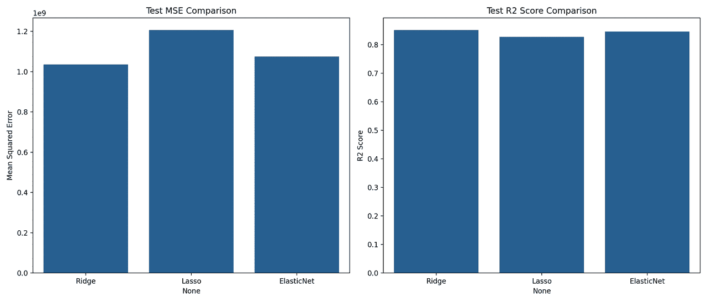
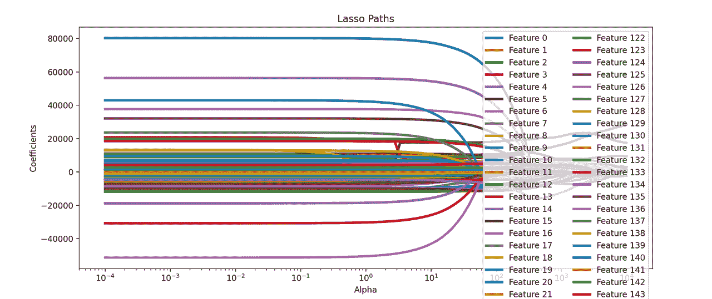

# 11-02正则化方法-正则化

> 来源：[https://qqs7y1hozd1.feishu.cn/docx/UrD9dfTEHo9K6zxRN4ocM54qnv4](https://qqs7y1hozd1.feishu.cn/docx/UrD9dfTEHo9K6zxRN4ocM54qnv4)

当你在学习如何骑自行车。在刚开始的时候，你可能会有很多小动作，比如不停地调整方向或车速，这样你觉得能保持平衡。但是随着你骑得越来越多，你会发现不需要做这么多小动作，反而简单、稳定的骑行更能让你保持平衡。

同样，在训练机器学习模型时，模型一开始可能会记住所有训练数据的细节，这就像你不停地做小动作，这样虽然在训练数据上表现很好，但遇到新数据时却容易“摔车”，也就是泛化能力变差。为了避免这种情况，正则化方法会告诉模型：“别学得太复杂，学点简单、稳定的东西就好。” 这样即使模型对训练数据的“记忆”少了一些，但它在新数据上的表现会更好。

正则化方法（Regularization Techniques）是一种在机器学习模型训练过程中用于防止过拟合的方法。它通过在模型的损失函数中添加一个惩罚项，来限制模型参数的过度复杂化，从而提高模型在新数据上的泛化能力。

正则化的方法有很多种，比如 L1 正则化、L2 正则化、Dropout 等，每种方法都通过不同的方式来控制模型的复杂度，帮助模型学得更加稳健。

## 理论基础

### 数学原理

正则化方法的核心思想是在模型的损失函数中加入一个惩罚项，这个惩罚项与模型参数的大小有关。

通过调整惩罚项的权重，控制模型的复杂度，从而避免过拟合。常用的正则化方法有 L1 正则化 和 L2 正则化。

#### 1. L2 正则化（Ridge Regression）

L2 正则化在损失函数中加入了模型参数（权重）的平方和惩罚项。假设我们有一个线性回归模型：

其中，  是权重向量，  是输入特征向量，  是偏置项，  是预测值。

对于给定的训练集  ，模型的原始损失函数（比如均方误差损失）为：

在 L2 正则化下，损失函数变为：

其中，  是权重向量的 L2 范数的平方：

是正则化强度的超参数，控制正则化项的影响程度。

效果：增加了权重值的平方和，使得模型倾向于将权重尽可能小化，但不至于让它们变为零。适用于避免多重共线性问题。

#### 2. L1 正则化（Lasso Regression）

L1 正则化在损失函数中加入了模型参数的绝对值和惩罚项。对应的损失函数为：

其中，  是权重向量的 L1 范数：

效果：L1 正则化倾向于使部分权重变为零，从而实现特征选择。这在高维度数据中特别有用，可以通过稀疏性降低模型复杂度。

#### 3. Elastic Net 正则化

Elastic Net 是 L1 和 L2 正则化的组合，损失函数如下：

其中   和   是控制 L1 和 L2 正则化项的超参数。

效果：同时具有 L1 和 L2 正则化的优点，既能进行特征选择，又能防止模型的参数过大。

### 算法流程

下面以 L2 正则化为例，详细说明加入正则化项后的模型训练流程。

#### 1. 初始化参数

+ 初始化模型的权重  和偏置  。
+ 设置正则化强度参数  。

#### 2. 前向传播（计算预测值）

+ 对于每一个训练样本  ，计算模型的预测值：

#### 3. 计算损失函数

+ 计算包含正则化项的总损失：

#### 4. 反向传播（计算梯度）

+ 计算损失函数对每个权重  的偏导数（梯度）：

+ 计算损失函数对偏置  的偏导数：

#### 5. 更新参数

+ 使用梯度下降或其他优化算法更新参数：

其中，  是学习率。

#### 6. 重复迭代

+ 重复步骤 2 到 5，直到损失函数收敛或达到预设的迭代次数。

#### 7. 模型评估

+ 在测试集上评估模型的性能，检查是否避免了过拟合，是否提升了泛化能力。

#### 8. 调节正则化参数

+ 根据模型在验证集上的表现，调整正则化参数  ，并重复训练过程，直到找到最优的正则化强度。

以上所有的流程，正则化方法可以有效地控制模型的复杂度，避免过拟合，提高模型在新数据上的表现。

## 完整案例

这里案例中，我们使用Kaggle上的《Ames Housing》数据集，它包含了美国爱荷华州Ames市房屋的详细信息。这个数据集具有更多的特征，可以很好地展示正则化在处理高维数据时的作用。

数据集获取：👸号「深夜努力写Python」后台回复『数据集』进行获取~

### 1. 导入必要的库和加载数据集

首先，我们加载和处理Ames Housing数据集。

可以使用 `pandas` 处理数据，使用 `scikit-learn` 进行模型构建和正则化。

```python
import numpy as np
import pandas as pd
import matplotlib.pyplot as plt
import seaborn as sns
from sklearn.model_selection import train_test_split, GridSearchCV
from sklearn.preprocessing import StandardScaler, PolynomialFeatures
from sklearn.linear_model import Ridge, Lasso, ElasticNet
from sklearn.metrics import mean_squared_error, r2_score

# 忽略警告信息
import warnings
warnings.filterwarnings('ignore')

# 加载Ames Housing数据集
train_path = './house-prices-advanced-regression-techniques/train.csv'
test_path = './house-prices-advanced-regression-techniques/test.csv'

train_data = pd.read_csv(train_path)
test_data = pd.read_csv(test_path)

# 查看数据集的基本信息
print(train_data.info())
print(test_data.info())

# 打印数据集的前几行
print(train_data.head())
print(test_data.head())

# 选择特征和目标变量
X = train_data.drop(columns=['SalePrice', 'Id'])
y = train_data['SalePrice']

# 将分类变量转为哑变量
X = pd.get_dummies(X, drop_first=True)

# 填补缺失值
X.fillna(X.mean(), inplace=True)

from sklearn.model_selection import train_test_split
from sklearn.preprocessing import StandardScaler

# 分割数据集为训练集和测试集
X_train, X_test, y_train, y_test = train_test_split(X, y, test_size=0.3, random_state=42)
```

### 2. 数据标准化

由于我们有大量的特征，标准化可以确保所有特征在相同的尺度上，从而避免模型受到不同特征尺度的影响。

```python
# 数据标准化
scaler = StandardScaler()
X_train_scaled = scaler.fit_transform(X_train)
X_test_scaled = scaler.transform(X_test)
```

### 3. 应用正则化模型

我们将继续尝试 `Ridge`、`Lasso` 和 `ElasticNet` 模型，并通过网格搜索优化正则化参数。

```python
# 定义正则化模型
ridge = Ridge()
lasso = Lasso()
elastic_net = ElasticNet()

# 定义网格搜索的参数
param_grid = {
    'alpha': np.logspace(-4, 4, 50)
}

# 网格搜索以找到最佳参数
ridge_cv = GridSearchCV(ridge, param_grid, cv=5, scoring='neg_mean_squared_error')
lasso_cv = GridSearchCV(lasso, param_grid, cv=5, scoring='neg_mean_squared_error')
elastic_net_cv = GridSearchCV(elastic_net, param_grid, cv=5, scoring='neg_mean_squared_error')

# 训练模型
ridge_cv.fit(X_train_scaled, y_train)
lasso_cv.fit(X_train_scaled, y_train)
elastic_net_cv.fit(X_train_scaled, y_train)

# 获取最佳模型
ridge_best = ridge_cv.best_estimator_
lasso_best = lasso_cv.best_estimator_
elastic_net_best = elastic_net_cv.best_estimator_

# 预测和评估
models = {'Ridge': ridge_best, 'Lasso': lasso_best, 'ElasticNet': elastic_net_best}
results = {}

for name, model in models.items():
    y_train_pred = model.predict(X_train_scaled)
    y_test_pred = model.predict(X_test_scaled)
    results[name] = {
        'Train MSE': mean_squared_error(y_train, y_train_pred),
        'Test MSE': mean_squared_error(y_test, y_test_pred),
        'Train R2': r2_score(y_train, y_train_pred),
        'Test R2': r2_score(y_test, y_test_pred),
        'Best Alpha': model.alpha
    }

# 转换结果为DataFrame
results_df = pd.DataFrame(results).T
print(results_df)
```

### 4. 数据分析和可视化

接下来，我们通过可视化分析模型性能，观察正则化效果。

```python
# 可视化模型性能
plt.figure(figsize=(14, 6))

# 绘制 MSE
plt.subplot(1, 2, 1)
sns.barplot(x=results_df.index, y='Test MSE', data=results_df)
plt.title('Test MSE Comparison')
plt.ylabel('Mean Squared Error')

# 绘制 R2 分数
plt.subplot(1, 2, 2)
sns.barplot(x=results_df.index, y='Test R2', data=results_df)
plt.title('Test R2 Score Comparison')
plt.ylabel('R2 Score')

plt.tight_layout()
plt.show()
```



+ 通过图表，我们可以看到不同正则化方法在测试集上的表现。
+ 低 MSE 和高 R2 表明模型在测试数据上的表现更好。

```python
# 绘制正则化路径（Lasso）
lasso_path = Lasso(max_iter=10000)
alphas = np.logspace(-4, 4, 100)
coefs = []

for alpha in alphas:
    lasso_path.set_params(alpha=alpha)
    lasso_path.fit(X_train_scaled, y_train)
    coefs.append(lasso_path.coef_)

coefs = np.array(coefs)

# 正则化路径图
plt.figure(figsize=(10, 6))
for i in range(coefs.shape[1]):
    plt.plot(alphas, coefs[:, i], label=f'Feature {i}', linewidth=3)

plt.xscale('log')
plt.xlabel('Alpha')
plt.ylabel('Coefficients')
plt.title('Lasso Paths')
plt.axis('tight')
plt.legend(loc='best', ncol=2)
plt.show()
```



Lasso 路径图展示了特征的系数如何随着  增大而逐渐被压缩为零，说明 Lasso 可以用于特征选择。

#### 算法优化：

1. 超参数调优：通过更精细的超参数网格和更多的交叉验证，可以进一步优化模型性能。
2. 特征选择：Lasso 和 ElasticNet 可以自动选择重要的特征，从而简化模型，提高预测性能。

以上，通过Ames Housing数据集的示例，我们展示了如何在高维数据集上应用正则化技术，并分析了不同正则化方法的效果。我们还通过可视化展示了正则化路径，解释了其在特征选择中的作用。这个流程同样适用于更大、更复杂的数据集。

## 模型分析

### 适用问题类型

正则化方法适用于以下类型的问题：

1. 高维数据：特征数量远大于样本数量（“小样本、大特征”问题），如基因数据、文本数据、图像数据等。高维数据容易导致模型过拟合，正则化可以减少模型的复杂度，防止过拟合。
2. 多重共线性问题：当输入特征之间存在强烈的线性相关性时，正则化可以稳定回归系数的估计，避免系数不稳定或过大。
3. 模型复杂度控制：在构建复杂模型（如神经网络）时，正则化可以防止模型学得过于复杂，从而提高其泛化能力。

### 优点

1. 防止过拟合：通过增加惩罚项，抑制模型参数的大小，减少模型对训练数据的依赖，从而提高对新数据的泛化能力。
2. 模型简化：L1 正则化可以使一些不重要的特征的权重变为零，从而进行特征选择，简化模型。
3. 稳定性和鲁棒性：正则化可以增强模型在噪声数据或不完整数据下的鲁棒性，减少模型的波动。
4. 适用于高维数据：正则化特别适合处理高维数据，可以防止模型过拟合到高维空间中的噪声。

### 缺点

1. 模型偏差引入：正则化会引入一定的偏差，可能导致模型对某些重要特征的权重估计不足，影响预测效果。
2. 超参数调优复杂：正则化强度参数（如  ）的选择较为敏感，往往需要通过交叉验证等方法进行调优，这增加了模型构建的复杂性。
3. 计算开销：在非常大的数据集或复杂模型（如深度神经网络）中，正则化的计算会增加模型训练的时间和资源消耗。

### 运用前提条件

1. 高维数据或复杂模型：正则化特别适合在高维数据集或复杂模型（如神经网络）中使用。
2. 过拟合倾向：当模型在训练数据上表现良好但在验证或测试数据上表现较差时，正则化可以帮助改善泛化能力。
3. 特征相关性高：如果特征之间存在较强的相关性（多重共线性），正则化可以帮助稳定模型参数。
4. 需要控制模型复杂度：当希望控制模型的复杂度或进行特征选择时，正则化是一种有效的方法。

### 实际应用案例

文本分类：

+ 问题描述：在文本分类问题中，如垃圾邮件过滤器，常常需要处理数以万计的文本特征（如单词或短语）。这些特征中有很多可能是冗余的或不相关的。
+ 应用正则化：L1 正则化可以自动选择重要的文本特征，将权重较小的特征归零，从而简化模型，提高分类效果。

图像识别：

+ 问题描述：在图像识别任务中，神经网络往往需要处理非常高维的像素数据，容易导致模型过拟合。
+ 应用正则化：L2 正则化在训练神经网络时被广泛应用，通过限制权重的大小，防止模型过度拟合训练数据，从而提升对新图像的识别准确率。

金融风控模型：

+ 问题描述：在金融风险控制模型中，通常有大量的特征（如用户行为、交易历史等），而这些特征之间可能存在共线性。
+ 应用正则化：通过使用 Elastic Net 正则化，可以同时解决共线性问题并进行特征选择，构建更加稳健的金融风控模型。

## 最后


正则化方法在实际中的用处非常多，无论是提高模型的泛化能力、进行特征选择，还是处理高维数据，正则化都是非常有必要的。
