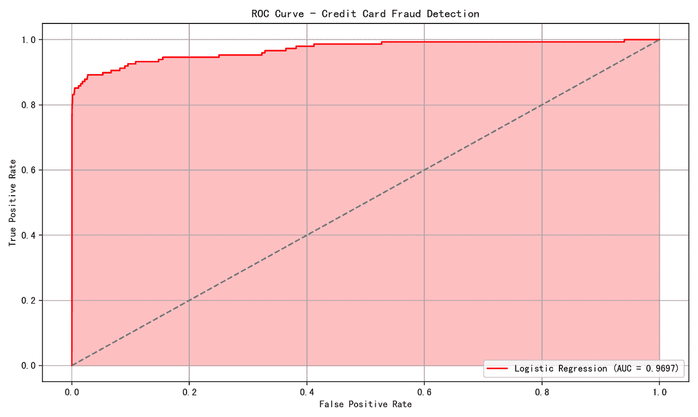

# 12-01机器学习模型评估方法-AUC

> 来源：[https://qqs7y1hozd1.feishu.cn/docx/Q6shdXpzmosdASxmhYecxPiZnpe](https://qqs7y1hozd1.feishu.cn/docx/Q6shdXpzmosdASxmhYecxPiZnpe)

AUC 是「Area Under Curve」的缩写，中文意思是「曲线下面积」。在机器学习里，AUC 通常指的是 ROC 曲线下面积，也就是「AUC-ROC」。

通俗点说：我们用模型来判断某个东西是不是“正例”（比如判断一封邮件是不是垃圾邮件），模型会给出一个“分数”或者“概率”。然后我们根据这个分数来决定它到底是“正例”还是“负例”。

但是分数不是结果，我们要设一个“阈值”（比如说 0.5）来做判断，大于 0.5 就认为是正例，小于 0.5 就认为是负例。问题是，阈值不同，判断结果也会变。这时候我们就用 AUC 来评估模型在所有“可能阈值”下的整体表现。

简单理解：AUC 表示模型区分正负样本的能力，数值越接近 1 越好。

#### 一个小例子：

假设你有两个样本：

+   样本A是正例（1），模型打分 0.9；

+   样本B是负例（0），模型打分 0.2。

这时，模型判断对了，AUC 就等于 1（100% 正确区分）。

如果反过来：

+   A 得 0.2，B 得 0.9，那模型就完全错了，AUC 就是 0。

如果 A 得 0.6，B 得 0.6，打了一样的分数，那模型就没法区分，AUC 是 0.5。

### AUC 数学原理

AUC 是 ROC 曲线下面积，那 ROC 曲线是什么？

ROC 曲线是在不同阈值下，真阳性率（True Positive Rate, TPR） 和 假阳性率（False Positive Rate, FPR） 的关系图。

+   横轴：FPR = 假阳性 / 所有负例 = FP / (FP + TN)

+   纵轴：TPR = 真阳性 / 所有正例 = TP / (TP + FN)

当我们从高到低遍历所有阈值，计算每个阈值下的 TPR 和 FPR，画出来就是 ROC 曲线。

AUC 就是这条 ROC 曲线下面的面积。

### AUC 的公式推理和计算原理

#### 1. 理解从积分角度的定义（曲线下面积）

AUC 是一条曲线下面积，它可以用积分公式表示为：

这个数学公式表达的是：把 ROC 曲线在 [0,1] 区间下的面积积分计算出来。

但在实际中，我们一般不这么复杂地算，而是用离散点近似计算曲线下的面积（常用梯形法则）。

#### 2. 从概率角度理解 AUC

AUC 也可以理解为这样一个概率：

> 随机抽一个正样本和一个负样本，模型打分让正样本得分更高的概率

用公式写就是：

也就是说，AUC 越接近 1，说明模型越能正确区分正负样本。

#### 3. AUC 的常用计算方法（基于排序）

假设你有：

个正样本；

个负样本。

我们按照模型给出的得分，对所有样本进行排序，记录所有正样本在排序中的排名  。

则：

这个公式的含义：

+   每个正样本的排序名次减去它在正样本里的名次，得到它在负样本中“超过”的个数；

+   所有正样本的“超越”个数总和，除以总的正负样本对数，得到 AUC。

### AUC 计算的流程

**步骤1：准备数据**

+   数据集中每个样本有一个真实标签（0 或 1）；

+   每个样本有一个模型打分（通常是概率）；

步骤2：将样本按打分从高到低排序

+   这一步是为了构造 ROC 曲线；

+   同样用于排序计算 AUC；

步骤3：遍历所有可能的阈值，计算 TPR 和 FPR

+   对每一个分数作为“阈值”，进行正负分类；

+   计算出 TP、FP、TN、FN；

+   计算 TPR = TP / (TP + FN)；

+   计算 FPR = FP / (FP + TN)；

#### 步骤4：画出 ROC 曲线

+   以 FPR 为横轴，TPR 为纵轴，画出所有点；

+   将这些点连起来；

#### 步骤5：计算 ROC 曲线下的面积

+   通过数值积分（比如梯形法）；

+   或通过排序公式快速计算；

下面，咱们通过一个完整的案例来进行理解~

## 完整案例

我们使用一个公开数据集来预测**信用卡交易是否为欺诈**。这是一个非常典型的**类别极度不平衡**问题，非常适合使用 AUC 作为模型评估指标。

数据集在👸号：深夜努力写Python，后台回复「数据集」既可获取~

数据集包含：

+   284,807 条交易记录

+   每条记录有 30 个变量（特征 V1~V28，Time，Amount）

+   标签列为 Class：1 表示欺诈，0 表示正常

```
import pandas as pd
import numpy as np
import matplotlib.pyplot as plt
import seaborn as sns

from sklearn.model_selection import train_test_split
from sklearn.preprocessing import StandardScaler
from sklearn.linear_model import LogisticRegression
from sklearn.metrics import roc_curve, roc_auc_score, confusion_matrix, classification_report


# 1. 加载数据
df = pd.read_csv(&quot;creditcard.csv&quot;)

# 2. 特征缩放
scaler = StandardScaler()
df[&#x27;Amount&#x27;] = scaler.fit_transform(df[&#x27;Amount&#x27;].values.reshape(-1, 1))

# 3. 分离特征和标签
X = df.drop([&#x27;Class&#x27;, &#x27;Time&#x27;], axis=1)
y = df[&#x27;Class&#x27;]

# 4. 划分训练集和测试集（注意保持比例）
X_train, X_test, y_train, y_test = train_test_split(
    X, y, test_size=0.3, stratify=y, random_state=42)

# 5. 使用逻辑回归进行训练
model = LogisticRegression(max_iter=1000, class_weight=&quot;balanced&quot;)
model.fit(X_train, y_train)

# 6. 模型预测：输出概率
y_scores = model.predict_proba(X_test)[:, 1]

# 7. 计算 ROC 曲线与 AUC 分数
fpr, tpr, thresholds = roc_curve(y_test, y_scores)
auc_score = roc_auc_score(y_test, y_scores)

# 8. 绘制 ROC 曲线
plt.figure(figsize=(10, 6))
plt.plot(fpr, tpr, color=&#x27;red&#x27;, label=f&quot;Logistic Regression (AUC = {auc_score:.4f})&quot;)
plt.plot([0, 1], [0, 1], linestyle=&#x27;--&#x27;, color=&#x27;gray&#x27;)
plt.fill_between(fpr, tpr, alpha=0.2, color=&#x27;red&#x27;)
plt.xlabel(&#x27;False Positive Rate&#x27;)
plt.ylabel(&#x27;True Positive Rate&#x27;)
plt.title(&#x27;ROC Curve - Credit Card Fraud Detection&#x27;)
plt.legend(loc=&#x27;lower right&#x27;)
plt.grid(True)
plt.tight_layout()
plt.show()

# 9. 打印混淆矩阵和分类报告
y_pred = model.predict(X_test)
cm = confusion_matrix(y_test, y_pred)
report = classification_report(y_test, y_pred)

print(&quot;Confusion Matrix:\n&quot;, cm)
print(&quot;\nClassification Report:\n&quot;, report)
print(f&quot;AUC Score: {auc_score:.4f}&quot;)
```

#### Step 1：加载数据

我们从 CSV 文件中加载信用卡交易数据，每一行是一次交易记录。

```
df = pd.read_csv(&quot;creditcard.csv&quot;)
```

#### Step 2：特征缩放

特征“Amount”数值范围差异较大，使用 StandardScaler 标准化处理（均值0、方差1），使模型训练更稳定。

```
df[&#x27;Amount&#x27;] = scaler.fit_transform(df[&#x27;Amount&#x27;].values.reshape(-1, 1))
```

#### Step 3：准备特征和标签

+   去掉无用特征 Time（按时间排序并无帮助）

+   Class 是我们要预测的目标（1为欺诈）

```
X = df.drop([&#x27;Class&#x27;, &#x27;Time&#x27;], axis=1)
y = df[&#x27;Class&#x27;]
```

#### Step 4：数据划分

+   我们使用 train_test_split 将数据集按 7:3 划分；

+   stratify=y 表示保持原始类别分布，防止正负样本比例失衡。

```
X_train, X_test, y_train, y_test = train_test_split(...)
```

#### Step 5：训练模型（逻辑回归）

+   逻辑回归是一种经典的二分类算法；

+   我们使用 class_weight="balanced" 自动对少数类样本加权处理，提升效果。

```
model = LogisticRegression(max_iter=1000, class_weight=&quot;balanced&quot;)
model.fit(X_train, y_train)
```

#### Step 6：模型打分

+   不仅预测类别，还输出每个样本为“正例”的概率（用来画 ROC）

```
y_scores = model.predict_proba(X_test)[:, 1]
```

#### Step 7：计算 ROC 曲线和 AUC 值

+   ROC 曲线衡量模型在不同阈值下的表现；

+   AUC 是这条曲线下面积，用于综合评价模型性能。

```
fpr, tpr, thresholds = roc_curve(y_test, y_scores)
auc_score = roc_auc_score(y_test, y_scores)
```

#### Step 8：绘制 ROC 曲线



+   红色线条表示模型性能；

+   灰色虚线表示随机分类的水平。

```
plt.plot(fpr, tpr, color=&#x27;red&#x27;, ...)
```

#### Step 9：打印性能评估

虽然 AUC 衡量的是“排序能力”，我们也补充了准确率、召回率、F1 值、混淆矩阵来进一步验证模型表现。

### AUC 优缺点分析

**优点：**

1.  **对类别不平衡鲁棒性强：**
不受正负样本比例影响，适用于大部分现实场景。

1.  评价的是排序能力而不是分类能力：
AUC 衡量的是模型输出的概率是否合理，而不是在特定阈值下是否准确。

1.  **无需指定阈值：**
比如你不知道使用 0.5 作为判断标准是否合理时，AUC 提供了一个全局评价视角。

1.  **图形可视化好：**
ROC 曲线易于解释和展示，在业务报告中很常用。

**缺点：**

1.  **不能反映特定业务代价：**
比如医疗场景中错判一个病人比漏判 10 个正常人严重，AUC 无法体现这种「代价差异」。

1.  **不能用于模型部署阈值选择：**
AUC 虽然评估排序好坏，但部署模型时仍需选一个合适的阈值。

1.  不适用于高类不平衡但对 recall 有极高要求的场景：
比如刑侦、金融反欺诈场景，更关注召回率（Recall）而不是排序整体性能。

### AUC 适用场景

+   信用评分、欺诈识别、广告点击预测、医疗诊断等：当你关心的是「模型能否把正例排在负例前面」时，AUC 是最佳选择。

+   **类别分布极不平衡时**：如 99.9% 是负类，准确率无意义，此时 AUC 非常关键。

+   模型对输出概率可靠性要求高的任务：比如推荐系统、电商订单转化率建模等。

在这个案例中，我们使用信用卡欺诈检测作为背景任务，用逻辑回归训练模型，使用 AUC-ROC 方法全面评估模型在正负样本区分上的能力；

AUC 是机器学习中最常用也最强大的评估指标之一，尤其在数据不平衡的现实世界问题中，它的重要性不可替代。