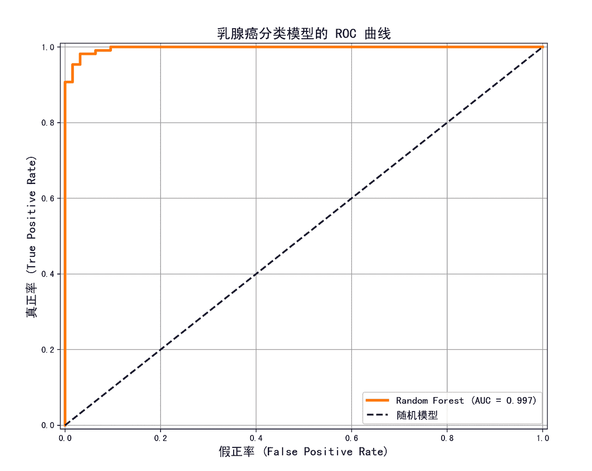
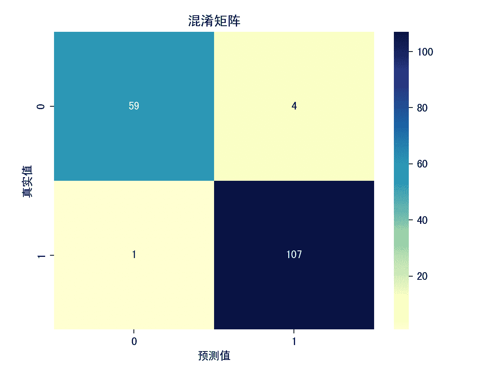
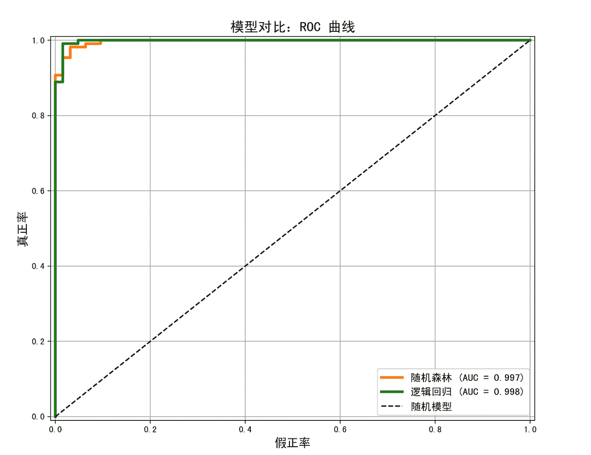

# 12-03机器学习模型评估方法-ROC 曲线

> 来源：[https://qqs7y1hozd1.feishu.cn/docx/EtaBd9bQUozyzKxOJ0VcaDv9nD1](https://qqs7y1hozd1.feishu.cn/docx/EtaBd9bQUozyzKxOJ0VcaDv9nD1)

#### 什么是 ROC 曲线？

ROC 曲线，全称是 **接收者操作特征曲线**（Receiver Operating Cha**racterist**ic Curve），是评估二分类模型性能的一种常见方法。

通俗来讲：ROC 曲线就像是给你的分类模型画一条“体检曲线”，看看在各种判断标准下，它能把“病人”和“正常人”分开的能力强不强。

#### 生活中的例子（简单举例）

假设你有一个模型来预测某人是否患有某种病，输出的结果是一个 0~1 之间的概率值，比如：

+   A 的预测值是 0.95 → 很可能有病

+   B 的预测值是 0.1 → 很可能没病

你需要定一个“阈值”（比如 0.5），大于等于这个值你就判为“有病”，否则就是“没病”。

那问题来了：你怎么知道这个“阈值”选得好不好**？换不同的阈**值，预测效果会怎样？这就是 ROC 曲线要回答的问题。

### ROC 曲线的核心概念

#### 二分类问题的四种预测结果

ROC 曲线的核心是四种预测情况：

| 实际情况 | 模型预测是阳性 | 模型预测是阴性 |
| --- | --- | --- |
| 实际为阳性（1） | **真正 (TP)** | **假负 (FN)** |
| 实际为阴性（0） | **假正 (FP)** | **真负 (TN)** |

#### 两个重要指标

+   真正率**（Tr**ue Positive Rate, TPR）：也叫召回率

+   意思是：真正预测成阳性的比例（病人被正确识别出来的比例）

+   假正率（False Positive Rate, FPR）：

+   意思是：实际为阴性的样本被错误地判为阳性的比例（正常人被误诊为病人的比例）

#### ROC 曲线的本质

**ROC** 曲线**就是以**不同的“阈值”下，模型对应的 TPR 和 FPR 的点连接起来，画出的一条曲线。

横轴是 FPR（误报率），纵轴是 TPR（查全率）：

通过改变阈值，记录下每一个 (FPR, TPR) 对，就能画出整条 ROC 曲线。

### ROC 曲线的数学原理与公式推导

#### 1. 模型输出的“打分”视角

假设你的模型输出的是概率分数  **，表示**“属于正类（1）”的可能性。你可以用不同的阈值   来决定：

+     → 判为正类

+     → 判为负类

每次换一个阈值  ，就可以重新计算一组 TP、FP、TN、FN，进而算出 TPR 和 FPR。

#### 2. ROC 曲线就是函数

我们可以把 FPR 看成输入，TPR 看成输出，随着阈值的变化，曲线从 (0,0) 开始，最终到达 (1,1)。

特别情况：

+   完美分类器：ROC 曲线从 (0,0) → (0,1) → (1,1)，弯成直角，表示完美识别。

+   随机分类器：ROC 曲线是对角线 (0,0) → (1,1)，表示分类器跟扔硬币一样。

#### 3. ROC 曲线下的面积 AUC（Area Under Curve）

AUC 是 ROC 曲线下的面积，介于 0~1 之间，是 ROC 的量化指标：

+   AUC = 1 → 完美分类器

+   AUC = 0.5 → 跟随机猜差不多

+   AUC < 0.5 → 模型反着用了还行（预测方向反了）

数学上，AUC 的概率解释是：

> AUC 等于一个正样本得分大于一个负样本得分的概率。

公式化表示为：

其中   是一个正样本，  是一个负样本，  是模型的打分函数。

### ROC 曲线的绘制流程（算法步骤）

**输入：**

+   一个二分类模型，对每个样本给出概率打分（不是0或1的硬预测）

+   每个样本的真实标签（1表示正类，0表示负类）

**步骤：**

1.  **对所有样本按模型打分降序排序**

1.  遍历所有可能的阈值（例如每一个预测值都作为阈值）

1.  对于每个阈值  ：

+   计算混淆矩阵 TP, FP, TN, FN

+   计算 TPR 和 FPR

1.  以 FPR 为横轴，TPR 为纵轴，画出 ROC 曲线

1.  **计算曲线下的面积（AUC）**，常用梯形积分方法近似

## 完整案例

我们使用乳腺癌数据集，它是一个二分类问题，目标是预测肿瘤是“良性”还是“恶性”。

我们将使用一个复杂一点的模型（随机森林），并结合：

+   训练、测试划分

+   ROC 曲线绘制

+   AUC 计算

+   多模型对比

### 第一步：依赖库

```
import numpy as np
import pandas as pd
import matplotlib.pyplot as plt
import seaborn as sns
from sklearn.datasets import load_breast_cancer
from sklearn.ensemble import RandomForestClassifier
from sklearn.model_selection import train_test_split
from sklearn.metrics import roc_curve, auc, RocCurveDisplay, confusion_matrix, classification_report
from sklearn.preprocessing import StandardScaler
```

+   matplotlib 和 seaborn 用于绘图

+   roc_curve 和 auc 是绘制 ROC 曲线和计算 AUC 的核心工具

+   load_breast_cancer 是 scikit-learn 内置的数据集

+   RandomForestClassifier 是复杂且常用的模型，用于分类

### 第二步：加载并查看数据

```
# 加载乳腺癌数据集
data = load_breast_cancer()
X = pd.DataFrame(data.data, columns=data.feature_names)
y = pd.Series(data.target)  # 0 是恶性，1 是良性

# 查看数据维度和基本信息
print(X.shape)
print(X.head())
print(data.target_names)  # [&#x27;malignant&#x27; &#x27;benign&#x27;]
```

+   X 是包含多个肿瘤特征的输入数据

+   y 是目标变量（是否为恶性）

+   本案例中我们把 “是否为恶性” 作为模型输出的目标（正类为 1）

### 第三步：划分训练集与测试集，并标准化

```
# 数据划分
X_train, X_test, y_train, y_test = train_test_split(X, y, test_size=0.3, random_state=42)

# 特征缩放
scaler = StandardScaler()
X_train_scaled = scaler.fit_transform(X_train)
X_test_scaled = scaler.transform(X_test)
```

+   划分比例是 70% 训练，30% 测试

+   随机种子设为 42，确保结果可重复

+   标准化能提升模型表现，尤其是对距离敏感的模型

### 第四步：训练模型并输出预测概率

```
# 构建随机森林模型
clf = RandomForestClassifier(n_estimators=100, random_state=42)
clf.fit(X_train_scaled, y_train)

# 预测概率值
y_proba = clf.predict_proba(X_test_scaled)[:, 1]  # 只取正类概率
```

+   predict_proba() 会返回两个概率值：[负类概率，正类概率]

+   我们只需要正类（即恶性肿瘤）的预测概率来绘制 ROC 曲线

### 第五步：计算 ROC 曲线和 AUC

```
# ROC 曲线计算
fpr, tpr, thresholds = roc_curve(y_test, y_proba)
roc_auc = auc(fpr, tpr)

print(f&quot;AUC值为: {roc_auc:.4f}&quot;)
```

+   roc_curve 计算出在不同阈值下的 FPR 和 TPR

+   auc 用来计算 ROC 曲线下的面积，值越接近 1 表示模型性能越好

### 第六步：绘制 ROC 曲线

```
plt.figure(figsize=(10, 8))
sns.set(style=&quot;whitegrid&quot;)

# ROC 曲线
plt.plot(fpr, tpr, color=&#x27;darkorange&#x27;, lw=3, label=f&quot;Random Forest (AUC = {roc_auc:.3f})&quot;)

# 随机参考线
plt.plot([0, 1], [0, 1], color=&#x27;navy&#x27;, lw=2, linestyle=&#x27;--&#x27;, label=&#x27;随机模型&#x27;)

plt.xlim([-0.01, 1.01])
plt.ylim([-0.01, 1.01])
plt.xlabel(&#x27;假正率 (False Positive Rate)&#x27;, fontsize=14)
plt.ylabel(&#x27;真正率 (True Positive Rate)&#x27;, fontsize=14)
plt.title(&#x27;乳腺癌分类模型的 ROC 曲线&#x27;, fontsize=16)
plt.legend(loc=&#x27;lower right&#x27;, fontsize=12)
plt.grid(True)
plt.show()
```



+   加入随机猜测参考线（对角线）

### 第七步：查看混淆矩阵与报告（对比）

```
# 使用默认0.5阈值做预测
y_pred = (y_proba &gt;= 0.5).astype(int)

# 混淆矩阵
cm = confusion_matrix(y_test, y_pred)
sns.heatmap(cm, annot=True, fmt=&#x27;d&#x27;, cmap=&#x27;YlGnBu&#x27;)
plt.title(&quot;混淆矩阵&quot;)
plt.xlabel(&quot;预测值&quot;)
plt.ylabel(&quot;真实值&quot;)
plt.show()

# 分类报告
print(classification_report(y_test, y_pred, target_names=data.target_names))
```



+   虽然 ROC 曲线与阈值无关，但真实预测还是基于某个阈值（通常是 0.5）

+   混淆矩阵展示了 TP、FP、TN、FN

+   classification_report 给出了精确率、召回率、F1 分数

### 第八步：扩展对比，添加另一个模型（逻辑回归）

```
from sklearn.linear_model import LogisticRegression

# 训练逻辑回归
lr = LogisticRegression()
lr.fit(X_train_scaled, y_train)
y_proba_lr = lr.predict_proba(X_test_scaled)[:, 1]

# ROC 曲线计算
fpr_lr, tpr_lr, _ = roc_curve(y_test, y_proba_lr)
roc_auc_lr = auc(fpr_lr, tpr_lr)

# 绘图对比
plt.figure(figsize=(10, 8))
plt.plot(fpr, tpr, color=&#x27;darkorange&#x27;, lw=3, label=f&quot;随机森林 (AUC = {roc_auc:.3f})&quot;)
plt.plot(fpr_lr, tpr_lr, color=&#x27;forestgreen&#x27;, lw=3, label=f&quot;逻辑回归 (AUC = {roc_auc_lr:.3f})&quot;)
plt.plot([0, 1], [0, 1], &#x27;k--&#x27;, label=&#x27;随机模型&#x27;)

plt.xlim([-0.01, 1.01])
plt.ylim([-0.01, 1.01])
plt.xlabel(&#x27;假正率&#x27;, fontsize=14)
plt.ylabel(&#x27;真正率&#x27;, fontsize=14)
plt.title(&#x27;模型对比：ROC 曲线&#x27;, fontsize=16)
plt.legend(loc=&#x27;lower right&#x27;, fontsize=12)
plt.grid(True)
plt.show()
```



+   对比两个模型的 ROC 曲线可以直观看出哪个模型性能更好

+   AUC 更高的模型在分类上总体表现更强

### 使用 ROC 优缺点分析

**优点：**

1.  **不受样本类别不均衡影响**：ROC 只关注比率，不关心正负样本数量本身，非常适合不平衡数据。

1.  **全面评估模型性能**：相比只用 accuracy 或 precision，ROC 曲线考虑了各种阈值情况。

1.  **可视化对比多个模型**：直观对比不同模型或参数下的性能。

1.  **数学意义清晰**：AUC 表示任意一个正负样本被正确排序的概率，具备清晰概率解释。

**缺点：**

1.  **不反映具体业务代价**：ROC 不考虑正负样本的“代价差异”（比如误诊成本更高时）。

1.  **对阈值不敏感**：ROC 本质是阈值无关的，有时你关心的是某个特定阈值下的表现（如精准率）。

1.  **多分类问题难扩展**：ROC 曲线最适合二分类，扩展到多分类较复杂。

### 什么时候优选使用 ROC 曲线？

ROC 曲线是以下情况下的首选评估方法：

+   当你有 **二分类问题**，尤其是医疗诊断、欺诈检测等应用中；

+   当你的正负样本 **严重不平衡**，例如恶性肿瘤检测，恶性仅占 1%；

+   当你需要比较 **多个模型的整体性能** 时；

+   当你不关心某个特定阈值的精确率，而想全面评估模型预测能力时；

**不适用情况**：

+   如果你更关心精确率而不是召回率；

+   如果你希望针对特定阈值进行优化；

+   如果是多分类问题且类间不对称，应使用 PR 曲线或多类 AUC 方法。

### 总结

通过乳腺癌预测这个真实案例，我们完整地展示了 ROC 曲线的应用流程，从数据处理、模型训练到可视化对比，再到 AUC 的数学意义，提供了一整套分析方法。