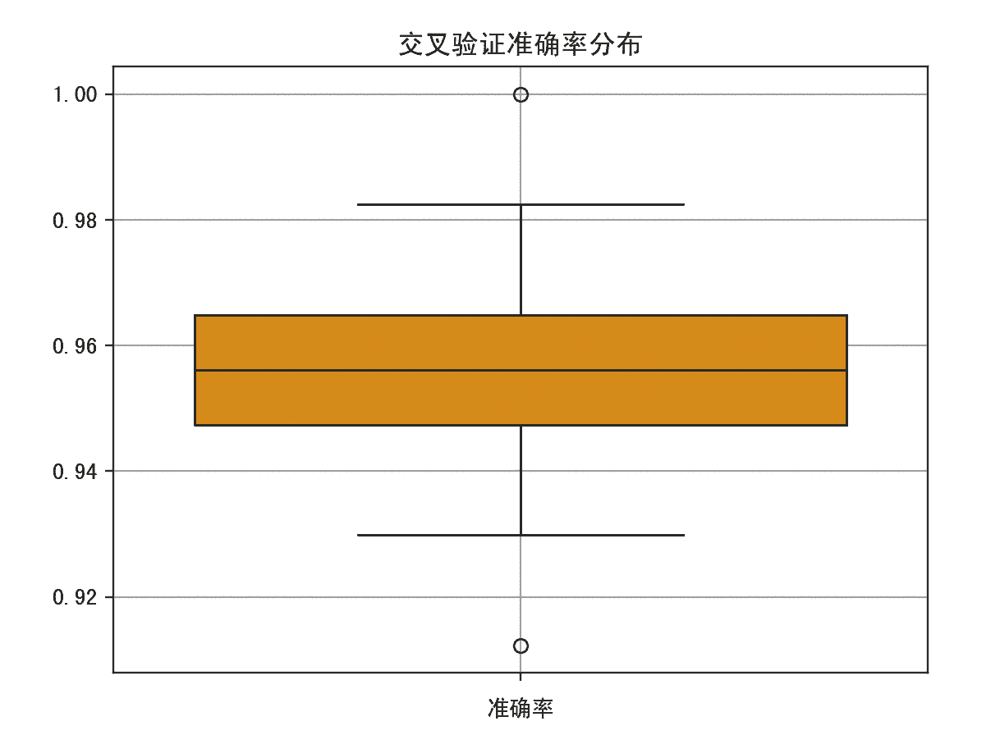
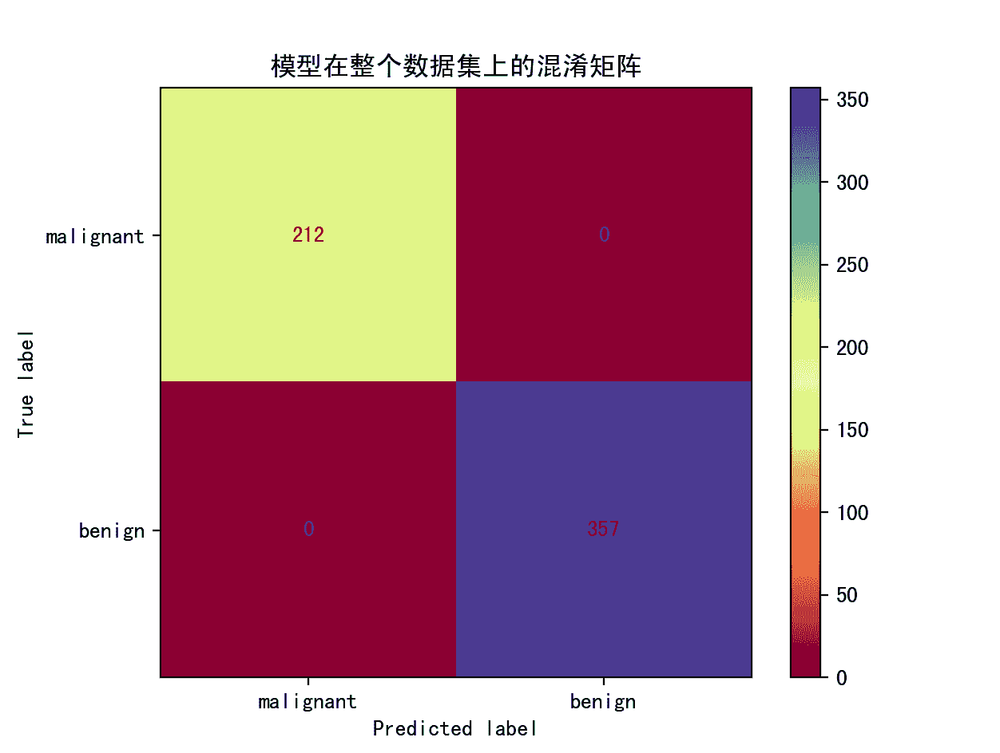

# 12-05机器学习模型评估方法-交叉验证

> 来源：[https://qqs7y1hozd1.feishu.cn/docx/RrExd0NUjop9rOxThuLcyTXgnfd](https://qqs7y1hozd1.feishu.cn/docx/RrExd0NUjop9rOxThuLcyTXgnfd)

交叉验证（Cross Validation）是一种用来评估机器学习模型好不好的方法。它的主要目标是更公平、全面地测试模型在没见过的数据上的表现。

#### 为什么要交叉验证？

**当你训**练了一个模型，你当然希望它不仅在训练数据上表现好，还能在新数据上也表现好（泛化能力强）。

如果你只在训练数据上测试，那就像是“学生做自己写的题目”，成绩当然高，但不代表真的学懂。

再举一个生活中的例子：

当年的你正在准备一场考试，你有一本练习题本（数据集）。你不能只做前几页就说“我准备好了”。

而一个更合理的做法是：

+   把题本分成几份（比如5份）；

+   每次拿其中一份做测试题（当作“考试”），其他几份用来练习（训练模型）；

+   重复5次，每一份轮流当“考试题”；

+   看看你在每一份考试中的平均表现，这样才能知道你是否真正掌握了。

这就是交叉验证的核心思想。

#### 举个例子：

假设你有 100 个样本。你决定用 5 折交叉验证（5-fold cross validation）：

1.  把 100 个样本分成 5 份（每份 20 个样本）；

1.  第一次：用第1份做测试，其它4份做训练；

1.  第二次：用第2份做测试，其它4份做训练；

1.  依此类推共做5次；

1.  **最后把这**5次测试的结果（比如准确率）平均一下，这个平均值就是你对模型的最终评估。

## 核心原理

### 基本符号定义

+   数据集：

+   模型训练函数：

+   模型性能度量函数（比如准确率、MSE等）：

+   K折交叉验证：将数据分成   份，记为

### 数学表达（K折交叉验证）：

**Step 1：划分数据集**

将数据集   均匀划分为   个子集  ，要求这些子集两两不相交，且并集为原始数据集。

Step 2：进行K轮训练与测试

对于每一个  ：

+   **训练集**：其余   个子集的并集，即：

+   **验证集（测试集）**：第   个子集

+   **训练模型**：使用   得到模型

+   计算第 k 次验证的损失或准确率：

Step 3：计算平均性能（整体交叉验证得分）

这个平均得分   就是我们评价这个模型的指标。

## 交叉验证的算法流程

以下是一个非常细化的算法流程（以 K 折交叉验证为例）：

**输入：**

+   数据集

+   折数

+   模型训练方法（比如逻辑回归、决策树等）

+   性能度量函数

**算法步骤：**

1.  **随机打乱**数据集  ，避免原始数据有顺序偏差；

1.  将数据集划分为大小尽量相同的   个子集：

1.  初始化性能记录列表：

1.  对于   到   做：

+   设

+   设

+   用   训练模型，得到

+   在   上评估性能

+   将   加入到

1.  最终结果：计算   的平均值作为最终模型评估得分

**输出：**

## 交叉验证的变体

1.  **K折交叉验证**（最常见）

1.  **留一交叉验证（LOOCV）**：每次只留一个样本做测试，其余样本训练，重复   次

1.  **分层K折交叉验证**：确保每折中各类样本比例一致（分类任务中常用）

1.  **重复K折交叉验证**：对K折交叉验证重复多次，取平均，更稳定

总结一句话就是，交叉验证就是“把数据分成几份轮流训练测试，然后取平均表现”，它能让我们更可靠地评估模型的“真实水平”。

## 完整案例

我们以乳腺癌预测为实际案例，利用交叉验证来实践一下~

我们使用 sklearn.datasets 提供的乳腺癌诊断数据集（load_breast_cancer()），其中包含30个数值型特征（如肿瘤大小、质地等），目标是预测肿瘤是否为良性（0）或恶性（1）。

### 完整代码

#### 1. 导入依赖库和数据加载

```
from sklearn.datasets import load_breast_cancer
data = load_breast_cancer()
X = data.data
y = data.target
```

数据已经归一化，无需预处理。

#### 2. 构建模型与交叉验证流程

```
from sklearn.ensemble import RandomForestClassifier
from sklearn.model_selection import cross_val_score, StratifiedKFold

clf = RandomForestClassifier(random_state=42, n_estimators=100)
cv = StratifiedKFold(n_splits=10, shuffle=True, random_state=42)
cv_scores = cross_val_score(clf, X, y, cv=cv, scoring=&#x27;accuracy&#x27;)
```

+   StratifiedKFold 确保每折中各类别比例一致（非常适用于分类问题）。

+   cross_val_score 进行模型训练与评分（这里我们用准确率 accuracy）。

#### 3. 可视化交叉验证结果

```
import matplotlib.pyplot as plt
import seaborn as sns

sns.set(style=&quot;whitegrid&quot;, palette=&quot;bright&quot;)
plt.figure()
sns.boxplot(cv_scores, color=&#x27;orange&#x27;)
plt.title(&quot;交叉验证准确率分布&quot;)
plt.xlabel(&quot;准确率&quot;)
plt.grid(True)
plt.show()
```



使用 seaborn 的 boxplot 显示 10 折交叉验证得分分布，强调分布形状，识别异常值或偏态问题。

#### 4. 训练整体模型并评估混淆矩阵

```
from sklearn.metrics import confusion_matrix, ConfusionMatrixDisplay

clf.fit(X, y)
y_pred = clf.predict(X)
cm = confusion_matrix(y, y_pred, labels=clf.classes_)
disp = ConfusionMatrixDisplay(confusion_matrix=cm, display_labels=data.target_names)
disp.plot(cmap=&quot;Spectral&quot;)
plt.title(&quot;模型在整个数据集上的混淆矩阵&quot;)
plt.show()
```



虽然整体训练评估容易造成过拟合，但可辅助验证模型是否明显失衡或误分。

#### 5. 输出评估结果

```
cv_scores.mean(), cv_scores.std()
```

平均准确率为：0.9561，标准差为：0.0238

意味着模型在不同数据划分下性能稳定，泛化能力较强。

## 交叉验证优缺点分析

**优点：**

1.  **更稳健的性能评估**：比单次划分更不易受到数据偏态影响；

1.  **避免过拟合的幻觉**：防止因“好运气”划分带来的虚高准确率；

1.  **适用于小数据集**：能最大化利用数据；

1.  **支持不同评分函数**：灵活选用 F1、ROC AUC 等指标；

**缺点：**

1.  **计算成本高**：对大型数据和复杂模型来说，运行10折就相当于训练模型10次；

1.  **代码复杂度提升**：需要显式构造验证流程；

1.  **模型无法直接用于生产部署**：训练过程中使用的是不同的数据子集，最终部署需重新训练。

### 与其他评估方法的对比

| 方法 | 是否支持泛化误差评估 | 数据使用率 | 适合场景 | 易实现性 | 稳定性 |
| --- | --- | --- | --- | --- | --- |
| 留出法（Holdout） | 一般 | 较低 | 数据量大、训练快速场景 | 高 | 不稳定 |
| K折交叉验证 | 是 | 高 | 小数据集、模型调参 | 中 | 稳定 |
| 留一法（LOOCV） | 是 | 非常高 | 非常小的数据集 | 低 | 非常稳定 |
| 自助法（Bootstrap） | 是 | 可调节 | 数据偏斜、统计推断 | 中等 | 中等 |

### 何时使用交叉验证？

**优选场景：**

+   数据量不大（如数百至几千样本）；

+   高度关注泛化误差；

+   模型选择、调参（如网格搜索）；

+   类别样本分布不均时使用 StratifiedKFold 更优。

**可考虑其他方法的情况：**

+   大规模数据训练场景（可采用留出法 + 多次平均）；

+   模型训练开销极高（如深度神经网络）；

+   需要快速实验（可先用 Holdout 快速验证）；

## 总结

交叉验证，尤其是常用的 **K 折交叉验证**，是机器学习中评估模型最可靠、最广泛使用的方法之一。尽管交叉验证的代价是训练时间加倍，但在模型泛化能力评估方面，它几乎是不可或缺的。