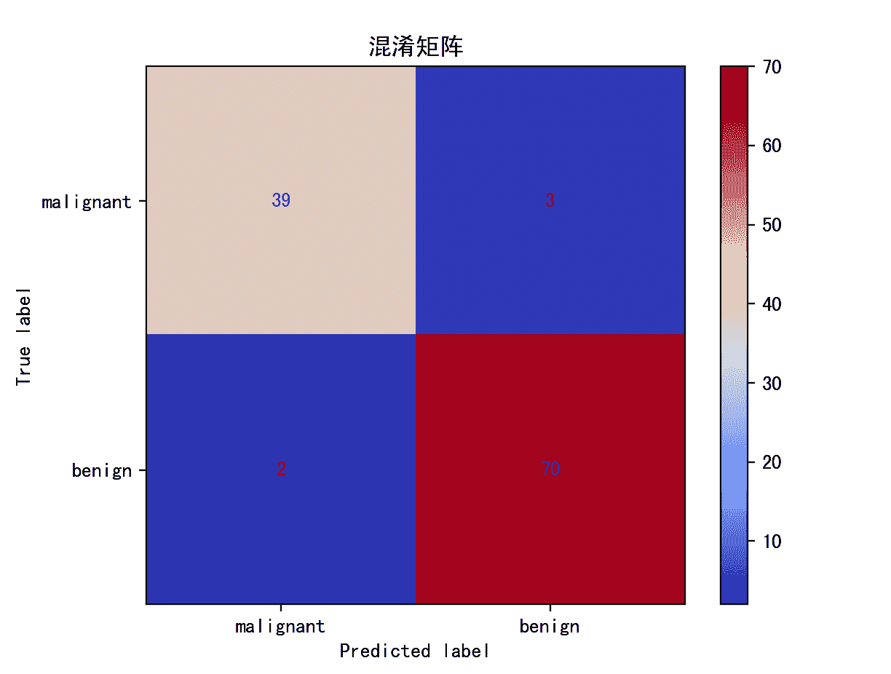

# 12-06机器学习模型评估方法-精确率

> 来源：[https://qqs7y1hozd1.feishu.cn/docx/MMbmdm8lGo1DFRxd57PcSIDbnCf](https://qqs7y1hozd1.feishu.cn/docx/MMbmdm8lGo1DFRxd57PcSIDbnCf)

**假设一**个安检人员，任务是查找行李中有没有违禁品。你查了很多个包，然后标记了其中一些是「可能有违禁品」的。后来你发现：你确实查出来了一些违禁品，但有一些你以为是违禁品的其实不是。

这时候你会问自己：我查出来的这些“可能是违禁品”的包里，到底有多少是真正的违禁品？

这就是精确率要回答的问题：

> 精确率 = 真正是违禁品的包 / 所有你以为是违禁品的包

在机器学习中，我们经常让模型去判断一个东西是不是某个类别，比如判断邮件是不是垃圾邮件。

我们把模型的判断分成4种情况：

| 实际是垃圾邮件 | 实际不是垃圾邮件 |
| --- | --- |
| **你说是** ✔️（判断正确）叫：真正（True Positive, TP） | ❌（判断错）叫：假正（False Positive, FP） |
| **你说不是** ❌（判断错）叫：假负（False Negative, FN） | ✔️（判断正确）叫：真负（True Negative, TN） |

精确率（Precision）就是只看你说是垃圾邮件的那些，看看有多少真的是垃圾邮件：

> 精确率（Precision） = TP / (TP + FP)

也就是你预测为正的样本中，有多少是真正的正例。

那么，为什么精确率重要？

如果你做的是**肿瘤检测**，每判断一个人为「有肿瘤」，他可能就要接受进一步检查。

如果你判断错了（FP），就是把一个健康人当成了生病的人。

**精确率高，**说明你说是「生病的人」，大多数真的患病了，减少了误报，避免过度检查。

## 核心原理

我们定义：

+    ：真正例（True Positive） - 预测为正，实际也为正。

+    ：假正例（False Positive） - 预测为正，实际为负。

+    ：假负例（False Negative） - 预测为负，实际为正。

+    ：真负例（True Negative） - 预测为负，实际也为负。

> 精确率（Precision）就是所有预测为正的样本中，有多少是真正的正例。

公式：

让我们来一步一步拆解这个公式：

#### 步骤1：关注“模型预测为正”的样本

模型预测为正的样本有哪些？

+   **真正例**：模型说它是正的，它确实是正的 → TP

+   **假正例**：模型说它是正的，但它实际上是负的 → FP

所以，模型预测为正的样本总数是：

#### 步骤2：其中哪些是真的？

在这些预测为正的样本中，真正的是正的就是 TP。

所以精确率 = 真正的是正的 / 预测为正的总数：

但要注意：

+   精确率**不考虑**那些模型预测为负的样本（也就是说，跟 TN、FN 没有关系）。

+   精确率关注的是：**你说对的“正例”有多少是真的？**

+   精确率高 ≠ 模型就一定好，需要结合召回率看，下面是常见搭配：

## 精确率相关的常见组合

| 评估指标 | 公式 | 含义 |
| --- | --- | --- |
| 精确率（Precision） |  | 你说是的有多少真的是 |
| 召回率（Recall） |  | 实际是的，你找出了多少 |
| F1 分数 |  | 精确率和召回率的平衡 |

## 计算流程

**给定：**

你有模型的预测结果，以及真实标签。

**步骤：**

1.  **收集预测数据**：对每个样本，记下预测结果和真实结果。

1.  **计算 TP**：统计哪些样本是「预测为正」且「实际为正」。

1.  **计算 FP**：统计哪些样本是「预测为正」但「实际为负」。

1.  **套入公式**：

1.  **输出精确率**：这是模型对正类预测的“可信度”。

## 举个简单例子

你让模型判断哪些邮件是垃圾邮件（正类），共判断了10封邮件如下：

| 邮件编号 | 实际是否垃圾 | 预测是否垃圾 |
| --- | --- | --- |
| 1 | 是 | 是 |
| 2 | 是 | 是 |
| 3 | 否 | 是 |
| 4 | 否 | 是 |
| 5 | 是 | 否 |
| 6 | 否 | 否 |
| 7 | 否 | 否 |
| 8 | 是 | 是 |
| 9 | 否 | 否 |
| 10 | 是 | 是 |

统计：

+   TP = 4（邮件1、2、8、10）

+   FP = 2（邮件3、4）

**说明：你说是**垃圾邮件的那些邮件中，大概有 66.67% 真的是垃圾邮件。

## 完整案例

乳腺**癌是女性中常见的癌症之一，早**期检测对于提高生存率非常重要。我们希望通过机器学习模型，对是否患有乳腺癌进行预测。由于误诊一个健康人（假正例）会导致不必要的心理和经济负担，所以我们特别关注精确率（Precision）。

**目标：**构建一个乳腺癌分类器，并重点评估模型的精确率。

我们使用 sklearn 中的经典乳腺癌数据集：load_breast_cancer()。

+   特征数：30个

+   类别：恶性(Malignant)，良性(Benign)

### 完整代码

```
import numpy as np
import pandas as pd
import matplotlib.pyplot as plt
import seaborn as sns
from sklearn.datasets import load_breast_cancer
from sklearn.model_selection import train_test_split
from sklearn.preprocessing import StandardScaler
from sklearn.ensemble import RandomForestClassifier
from sklearn.metrics import precision_score, confusion_matrix, classification_report, ConfusionMatrixDisplay


# 1. 加载数据集
data = load_breast_cancer()
X = pd.DataFrame(data.data, columns=data.feature_names)
y = pd.Series(data.target, name=&#x27;target&#x27;)

# 2. 数据划分
X_train, X_test, y_train, y_test = train_test_split(
    X, y, test_size=0.2, random_state=42, stratify=y
)

# 3. 标准化处理
scaler = StandardScaler()
X_train_scaled = scaler.fit_transform(X_train)
X_test_scaled = scaler.transform(X_test)

# 4. 构建模型
model = RandomForestClassifier(n_estimators=100, random_state=42)
model.fit(X_train_scaled, y_train)

# 5. 预测
y_pred = model.predict(X_test_scaled)

# 6. 评估精确率
precision = precision_score(y_test, y_pred)
print(f&quot;精确率（Precision）: {precision:.4f}&quot;)

# 7. 显示分类报告
print(&quot;\n分类报告:&quot;)
print(classification_report(y_test, y_pred, target_names=data.target_names))

# 8. 混淆矩阵可视化
cm = confusion_matrix(y_test, y_pred)
disp = ConfusionMatrixDisplay(confusion_matrix=cm, display_labels=data.target_names)
disp.plot(cmap=&#x27;coolwarm&#x27;)
plt.title(&quot;混淆矩阵&quot;)
plt.show()

# 9. 精确率与其他指标条形图
report_dict = classification_report(y_test, y_pred, output_dict=True)
precision_malignant = report_dict[&quot;malignant&quot;][&quot;precision&quot;]
recall_malignant = report_dict[&quot;malignant&quot;][&quot;recall&quot;]
f1_malignant = report_dict[&quot;malignant&quot;][&quot;f1-score&quot;]

# 可视化
metrics = [&#x27;Precision&#x27;, &#x27;Recall&#x27;, &#x27;F1-score&#x27;]
values = [precision_malignant, recall_malignant, f1_malignant]

sns.barplot(x=metrics, y=values, palette=&#x27;Set2&#x27;)
plt.title(&quot;恶性肿瘤类别各项指标&quot;)
plt.ylim(0.8, 1.0)
plt.ylabel(&quot;得分&quot;)
plt.show()
```

#### 步骤1：加载数据

我们使用的是 load_breast_cancer 数据集，这是一个标准医学数据集，有569条记录，每条记录30个特征。

+   **target = 0** 表示恶性（Malignant）

+   **target = 1** 表示良性（Benign）

#### 步骤2：数据划分

使用 train_test_split 按 8:2 的比例划分训练集和测试集，并使用 stratify=y 确保类别比例一致。

#### 步骤3：标准化处理

由于各特征量纲不同，我们用 StandardScaler 对数据进行标准化，使其均值为0，方差为1。

#### 步骤4：构建模型

使用 RandomForestClassifier，这是一个强大的集成模型，适用于非线性分类任务。它不会对数据有太多假设，适合医学数据建模。

#### 步骤5：模型预测

我们对测试数据进行预测，得到预测值 y_pred。

#### 步骤6：精确率计算

使用 precision_score(y_test, y_pred) 来计算精确率，衡量模型对“正类”判断的准确性。

#### 步骤7：分类报告

使用 classification_report 生成详细的 Precision、Recall、F1 分数，可以分别看到在“恶性”和“良性”上的表现。

#### 步骤8：混淆矩阵可视化

通过 ConfusionMatrixDisplay 展示混淆矩阵，颜色使用 coolwarm，红蓝对比鲜明，便于观察模型在各类别的误判情况。



#### 步骤9：恶性类别的各项指标可视化

展示恶性肿瘤的 Precision、Recall 和 F1-score，不同颜色使不同指标之间的差异一目了然。

### 使用精确率的优缺点分析

**优点**：

1.  **控制误报**：当错误地将负类（如健康人）预测为正类（如癌症患者）代价很高时，精确率就是关键指标。

1.  **对不平衡数据友好**：在类别不平衡的情况下，比准确率更有效。

1.  **直观反映预测可信度**：预测为正的结果有多少是对的，一目了然。

**缺点**：

1.  **不考虑漏报（FN）****：精确**率不看你漏掉了多少真正的正例，容易忽略召回率。

1.  **无法独立衡量模型质量**：一个模型精确率很高，但如果召回率极低，仍然是不合格的模型。

1.  **容易被“策略性预测”干扰**：模型可以只预测最有把握的正类，从而虚高精确率。

### 精确率适合的使用场景

**精确率是优选的场景：**

+   **医疗预筛查**：比如癌症初步筛查中，不希望误将健康人判断为“疑似阳性”而让人恐慌。

+   **垃圾邮件过滤**：如果误把正常邮件当垃圾邮件删了，后果可能比漏掉一些垃圾邮件更严重。

+   **金融欺诈检测**：一笔正常交易被误判为欺诈，会导致用户账户冻结、投诉，精确率必须高。

**精确率不适用的场景：**

+   **安全/安防**监控（如机场毒品检查）：此类任务宁愿误报（FP），也不能漏报（FN），需要召回率优先。

+   **疫情追踪模型**：目标是找到尽可能多的感染者，即使会误抓一些未感染者，此时精确率不是第一考虑。

通过这个实际案例，我们深入理解了：

1.  **精确率是什么？**

+   是对模型“预测为正”的结果中，正确的比例。

1.  **如何计算？**

1.  **何时使用精确率？**

+   当**误报的代价很高**时，优先使用精确率。

1.  **如何在实际中使用？**

+   结合混淆矩阵、分类报告、可视化，一步步监控模型性能。

本案例结合实际医学背景，展示了如何利用精确率评估机器学习模型的可靠性，以及如何可视化地解读它在任务中的表现。