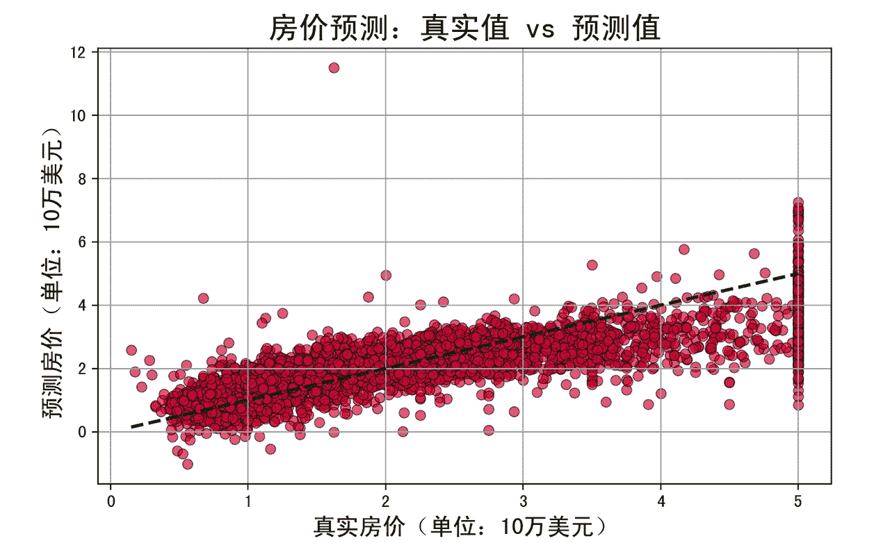
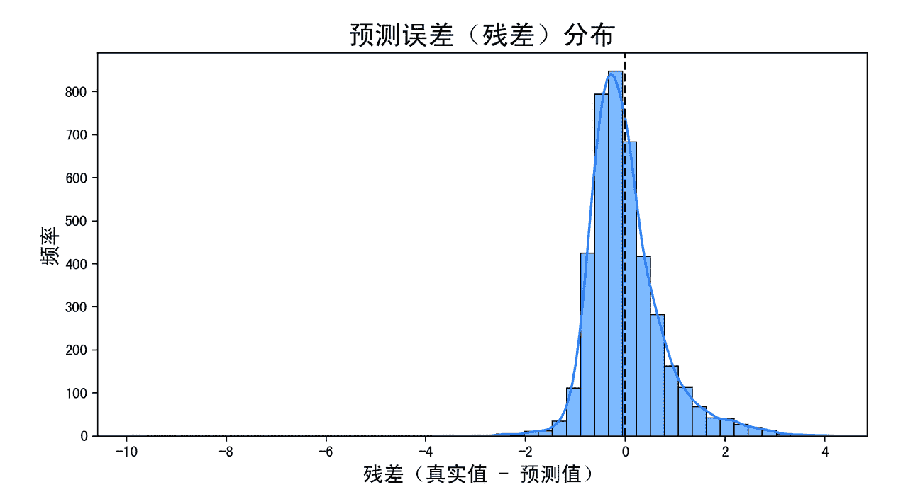

# 12-07机器学习模型评估方法-均方误差

> 来源：[https://qqs7y1hozd1.feishu.cn/docx/HjKpd7DBwoblr5xzxsccZgJpnrf](https://qqs7y1hozd1.feishu.cn/docx/HjKpd7DBwoblr5xzxsccZgJpnrf)

用一句话解释，均方误差（MSE）就是衡量“模型预测值”跟“真实值”之间差距的平均程度，差得越远，MSE 越大。

比如说，有一位老师，你让10个学生预测明天的温度，然后第二天你拿到真实温度了。

你想知道：**哪个学生预测得最准确？**

于是你对每个学生都做了这样几步：

1.  预测值 - 真实值，看看差了多少度。

1.  为了避免有的学生差多了，有的学生差少了直接抵消掉（正负值相互抵消），你把这些差距“平方”。

1.  **最后，你把所**有平方后的结果加起来，然后除以学生人数。

这就是**均方误差（MSE）**。

**举个简单例子**：

假设我们有3个预测值和对应的真实值：

| 真实值（Y） | 预测值（Ŷ） | 误差（Y - Ŷ） | 误差平方（(Y - Ŷ)²） |
| --- | --- | --- | --- |
| 3 | 2 | 1 | 1 |
| 5 | 4 | 1 | 1 |
| 2 | 3 | -1 | 1 |

然后我们求误差平方的平均值：

这个1就是模型的均方误差。如果某个模型的 MSE 比别人低，说明它更“靠谱”。

## 均方误差核心原理

### 定义公式

设：

+    ：第 i 个样本的真实值

+    ：第 i 个样本的预测值

+    ：样本数量

那么均方误差（MSE）定义为：

| 符号 | 含义 |
| --- | --- |
|  | 预测误差（残差） |
|  | 误差平方，防止负数抵消 |
|  | 把每个数据点的误差平方都加起来 |
|  | 求平均，使得误差具有可比性 |

### 为什么要求“平方”？

为什么不用“绝对值”或直接加误差，而是平方？

1.  **避免抵消**：正误差和负误差相加可能变小（如 +3 和 -3 加起来是 0），这不能真实反映误差大小。

1.  **强调大误差**：平方会放大大的误差，模型如果在某些地方预测特别差，就会受到“惩罚”。

1.  **可导性好**：平方函数在数学优化中更方便求导（梯度下降时），这对训练模型非常重要。

## 均方误差的算法流程

我们可以分几步计算 MSE：

**步骤1：收集真实值和预测值**

假设你有 n 个样本，每个样本有：

+   一个真实值

+   一个预测值

步骤2：计算每个样本的误差（残差）

**步骤3：对每个误差取平方**

**步骤4：把所有平方误差加起来**

步骤5：除以样本数量，得到平均值

最后，如果 MSE 越小，说明预测越准确。

如果 MSE 越大，说明预测偏差大。

MSE 单位是**原始变量的平方单位**（如温度是摄氏度，那 MSE 单位是 「 」）。

## 完整案例

我们使用加州房价预测数据集（California Housing Dataset）来建立一个线性回归模型。

我们的目标是预测加州地区各个小区的**房价中位数（Med**HouseVal），并使用 均方误差（MSE） 来衡量预测结果与真实结果之间的误差。

```
import numpy as np
import pandas as pd
import matplotlib.pyplot as plt
import seaborn as sns

from sklearn.datasets import fetch_california_housing
from sklearn.model_selection import train_test_split
from sklearn.linear_model import LinearRegression
from sklearn.metrics import mean_squared_error

# 1. 加载数据
data = fetch_california_housing()
X = pd.DataFrame(data.data, columns=data.feature_names)
y = pd.Series(data.target, name=&quot;MedianHouseValue&quot;)

# 2. 数据展示（探索性分析）
print(X.head())

# 3. 训练测试集划分
X_train, X_test, y_train, y_test = train_test_split(X, y, test_size=0.2, random_state=42)

# 4. 模型构建与训练
model = LinearRegression()
model.fit(X_train, y_train)

# 5. 模型预测
y_pred = model.predict(X_test)

# 6. 计算均方误差
mse = mean_squared_error(y_test, y_pred)
print(f&quot;\n均方误差 MSE：{mse:.4f}&quot;)

# 7. 可视化真实值 vs 预测值
plt.figure()
sns.scatterplot(x=y_test, y=y_pred, color=&quot;crimson&quot;, alpha=0.6, edgecolor=&quot;black&quot;)
plt.plot([y_test.min(), y_test.max()], [y_test.min(), y_test.max()], &#x27;g--&#x27;, linewidth=2)
plt.title(&quot;房价预测：真实值 vs 预测值&quot;, fontsize=18)
plt.xlabel(&quot;真实房价（单位：10万美元）&quot;, fontsize=14)
plt.ylabel(&quot;预测房价（单位：10万美元）&quot;, fontsize=14)
plt.grid(True)
plt.show()

# 8. 残差分析图（误差分布）
residuals = y_test - y_pred
plt.figure()
sns.histplot(residuals, kde=True, color=&quot;dodgerblue&quot;, bins=50)
plt.axvline(x=0, color=&#x27;black&#x27;, linestyle=&#x27;--&#x27;)
plt.title(&quot;预测误差（残差）分布&quot;, fontsize=18)
plt.xlabel(&quot;残差（真实值 - 预测值）&quot;, fontsize=14)
plt.ylabel(&quot;频率&quot;, fontsize=14)
plt.show()
```

#### 1. 数据加载与预处理

我们用的是 sklearn 内置的加州房价数据集，包含人口、收入、房屋年龄等多个特征。

```
X = pd.DataFrame(data.data, columns=data.feature_names)
y = pd.Series(data.target, name=&quot;MedianHouseValue&quot;)
```

+   X 是特征变量，如 MedInc（收入中位数）、HouseAge（房龄）。

+   y 是目标变量，表示区域房价的中位数（单位是 10 万美元）。

#### 2. 数据划分

```
X_train, X_test, y_train, y_test = train_test_split(...)
```

将数据集划分为：

+   80% 训练集用于训练模型

+   20% 测试集用于验证模型的泛化能力

随机种子（random_state=42）是为了确保结果可复现。

#### 3. 模型训练

```
model = LinearRegression()
model.fit(X_train, y_train)
```

我们使用线性回归模型来预测房价。这是一个简单的回归算法，易于解释和部署。

#### 4. 预测与评估

```
y_pred = model.predict(X_test) 
mse = mean_squared_error(y_test, y_pred)
```

+   y_pred 是模型对测试集的预测结果。

+   mean_squared_error() 函数计算预测值与真实值之间的 MSE。

#### 5. 可视化结果（真实值 vs 预测值）

```
sns.scatterplot(x=y_test, y=y_pred, color=&quot;crimson&quot;)
```

我们将真实房价和预测房价，对应画在图中，理想情况是所有点都落在绿色虚线（y = x）上。



#### 6. 残差分析图

```
residuals = y_test - y_pred
sns.histplot(residuals, kde=True, color=&quot;dodgerblue&quot;)
```

残差是指：

我们使用直方图观察残差分布。如果模型表现良好，残差应接近于0并且近似正态分布。



## 模型分析

### 均方误差的优缺点

**优点**：

1.  **数学性质好**：MSE 是可导函数，利于梯度下降算法优化，广泛用于训练过程中的损失函数。

1.  **强调大误差**：由于平方操作，模型对“大偏差”非常敏感，适合对误差容忍度低的场景。

1.  **应用广泛**：在回归任务中，MSE 是最常用、最经典的评价指标之一。

**缺点**：

1.  **单位问题**：MSE 的单位是原始单位的平方，不直观（如房价预测中单位是  ）。

1.  **对异常值敏感**：大误差被平方后会极度放大，导致一个极端值就可能拉高整个 MSE。

1.  **不可解释性较差**：与 MAE 相比，MSE 难以直接解释为“平均错了多少钱”。

### 适用场景讨论：MSE 何时是“优选”？

MSE 非常适合以下几类问题：

1.  大多数预测接近真实值，偶尔有大误差时：MSE 会对这些大误差惩罚很重，有助于模型更精准地对所有数据进行拟合，尤其适合科学计算类问题（如金融风险预测、天气模拟等）。

1.  **模型训练中作为损失函数**：由于 MSE 可导，梯度下降可以轻松找到损失最小的方向。神经网络和线性回归模型都普遍使用 MSE 作为训练损失函数。

1.  **样本集较大，异常值不多**：在大样本集下，极端值的影响可以被稀释，MSE 能比较全面反映整体误差结构。

1.  **你更关心“大错误”的影响**：如果你在某些场景中希望模型特别警惕“错误很离谱的情况”，MSE 是理想选择。比如自动驾驶系统中的障碍物距离预测，错误太大可能带来严重后果。

## 总结

均方误差（MSE）作为机器学习中最基本的模型评估方法之一，具有以下核心价值：

+   **数学原理简单，使用方便**

+   **适合训练过程中的优化目标**

+   **适用于大多数标准回归任务**

在上面的例子中，我们用 MSE 对房价回归模型进行有效评估，通过可视化手段揭示模型性能表现，验证其残差分布特性，为后续模型调优提供基础。

当然，MSE 也有它的缺点，它对异常值太敏感、单位难以解释。因此，在实际工作中，我们往往会配合使用其他指标（如 MAE、R²、RMSE 等）共同评估模型，形成更完整的判断。