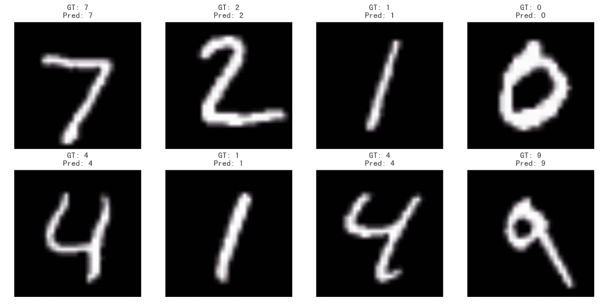

# 13-01神经网络-AlexNet

> 来源：[https://qqs7y1hozd1.feishu.cn/docx/DCpOd0iVFoz55DxQaqscQkO6nTg](https://qqs7y1hozd1.feishu.cn/docx/DCpOd0iVFoz55DxQaqscQkO6nTg)

神经网络是一种模仿人类大脑“神经元连接方式”的计算模型。

它的基本思想是：

+   把输入（比如一张图片）通过一层一层的计算“传递”下去。

+   每一层都会对输入做一些处理，比如找出边缘、颜色、形状。

+   最后一层会给出一个结果，比如“这是猫”或者“这是狗”。

可以理解成：神经网络就是一套复杂的数学“公式+连接”，它自己不会写规则，而是通过大量样本学习出规则。

举个简单例子：

+   如果我们给神经网络看成千上万张“猫”和“狗”的照片，它就会自己学会分辨猫和狗。

+   我们不用告诉它“猫有胡须，狗的耳朵比较大”，它会自动总结出这些特征。

#### AlexNet 是什么？

AlexNet 是 2012 年由 Alex Krizhevsky 提出的一个神经网络模型。

它之所以有名，是因为在当年的图像识别比赛（ImageNet 大赛）上，它的表现远远超过其他方法。

简单来说，AlexNet 就像是神经网络历史上的一个“转折点”：

+   以前大家觉得深度神经网络很难训练，也跑不动。

+   AlexNet 用了更深的结构、更大的数据集和更强的计算能力（主要是 GPU），一举证明了深度学习的威力。

#### AlexNet 的核心特点

1.  **层数更深**：用了 8 层（5 层卷积层 + 3 层全连接层）。

1.  **用 GPU 加速**：当时的突破点之一，大大缩短了训练时间。

1.  **激活函数 ReLU**：相比传统函数，更快收敛，不容易卡住。

1.  **数据增强和 Dropout**：减少过拟合，让模型更能适应新数据。

就是说可以把 AlexNet 想象成一个“超级放大版的猫狗识别器”，它不是靠人写规则，而是靠自己学出来的。

它之所以重要，是因为它向世界证明：只要有足够的数据和算力，神经网络真的可以在复杂任务上超过传统方法。

## 原理详解

#### 全局概览：AlexNet 是什么（用数学对象表述）

任务：多分类（ImageNet 1000 类）。输入图像  ，输出类别概率  （ ）。

模型：一个由**卷**积层（Conv）→ 非线性（ReLU）→ 归一化（LRN）→ 池化（Pool）→ 全连接（FC）→ Softmax组成的复合函数

参数   包含所有卷积核、全连接权重与偏置。

> 常用的 AlexNet 张量尺寸（单卡视角、不考虑原论文的双 GPU 分组计算细节）：输入  。

### 1. 各模块的数学定义与尺寸计算

#### 1.1 卷积层（Conv）

**前向：** 给定第   层输入特征图  ，卷积核  ，偏置  ，步幅  ，填充  ：

输出尺寸：

**AlexNet 关键设置：**

+   Conv1： ,  ,  ，输入   → 输出  。

+   Conv2： ,  ,   →  （在池化后续尺寸基础上）。

+   Conv3/4/5： ,  ,  。

#### 1.2 非线性激活（ReLU）

+   **前向：**  （逐元素）。

+   **性质：** 避免梯度消失、收敛快；导数简单（见反向传播部分）。

#### 1.3 局部响应归一化（LRN, Local Response Normalization）

+   用于模拟“侧抑制”，对同一空间位置在通道维度做归一化。对通道   的激活  ：

+   AlexNet 常用超参： 。

#### 1.4 池化（Max Pooling）

+   **前向（最大池化）：** 在每个通道上以窗口  ，步幅  ：

+   AlexNet 使用   窗口、步幅  。

#### 1.5 全连接（Fully-Connected, FC）

+   将上一层张量展平为向量  ，

#### 1.6 Dropout

+   训练时以概率   将神经元置零（保留率  ），保留的神经元按   缩放，期望不变：

+   推理时不使用掩码与缩放（或采用“训练时不缩放、推理时乘  ”的等价实现）。

#### 1.7 Softmax 与交叉熵

+   **Softmax：** 给定分类打分（logits） ：

+   损**失（**单样本 one-hot 标签  ）：

+   **带权重衰减（** ** 正则）：** 总损失

### 2. AlexNet 的逐层尺寸与结构（典型实现）

#### 2.1 尺寸流（单图推理）

+   输入： 。

+   Conv1（ ,  ,  ,  ）→  
ReLU → LRN → MaxPool（ ,  ）→

+   Conv2（ ,  ,  ,  ）→  
ReLU → LRN → MaxPool（ ,  ）→

+   Conv3（ ,  ,  ,  ）→   → ReLU

+   Conv4（ ,  ,  ,  ）→   → ReLU

+   Conv5（ ,  ,  ,  ）→  
ReLU → MaxPool（ ,  ）→

+   展平 →  
FC6：  → ReLU → Dropout
FC7：  → ReLU → Dropout
FC8：  → Softmax

### 3. 训练目标与优化算法（含动量与权重衰减）

#### 3.1 小批量 SGD（带动量）

+   **梯度（对参数 ** **）：**   由反向传播得到。

+   **动量更新：**

+   其中   为动量系数（如  ），  学习率，  权重衰减；  通常只对权重项（不含偏置、归一化偏置等）施加。

#### 3.2 数据预处理与增强（影响分布与梯度方差）

+   **均值消除：** 像素减去训练集 RGB 通道均值。

+   **随机裁剪/镜像：** 训练时随机裁  （或近似）与水平翻转。

+   **PCA 颜色扰动：** 令 RGB 像素数据的协方差矩阵的主成分为   与特征值  ，采样  （如  ），对每个像素做

### 4. 反向传播的核心推导（逐模块）

> 记号说明：对任一中间变量  ，其损失梯度记为  。链式法则用   表示逐元素乘。

#### 4.1 Softmax + 交叉熵的梯度（关键结论与推导）

+   logits： ，概率  ，损失  。

+   **关键梯度：**

+   **推导要点：**

+   整理即得  。

+   **进一步：** 对 FC8

#### 4.2 全连接层（一般形式）

+   前向： ，后向给定  ：

#### 4.3 ReLU 的梯度

+   前向： ；后向：

#### 4.4 Dropout 的梯度

+   训练时： 。后向：

+   推理时无梯度分支（不使用掩码）。

#### 4.5 最大池化（MaxPool）梯度

+   前向保存每个池化窗口的**argmax** 位置  。后向把梯度路由回该位置：

+   窗口内其他位置梯度为 0。

#### 4.6 卷积层的梯度（重点）

+   前向： 。设后向来自上一层的梯度为  （尺寸  ）。

+   **对偏置：** 每个输出通道 c 的梯度是该通道所有位置梯度之和：

+   **对卷积核 ** **：** 是输入与   的“相关”（cross-correlation）：

+   **对输入 ** **：** 相当于把每个输出通道的   与**翻转**后的卷积核在通道维上做卷积并累加（考虑步幅/填充的反向映射）：

+   其中仅当   为整数且落在  ** 内时取值。**实现中常用“上采样 + 全卷积/转置卷积”的等价计算或 im2col 矩阵化。

#### 4.7 LRN 的梯度（含分子与分母两路）

+   回忆：

+   设损失对   的梯度为  ，则对  ：

+   第一项来自分子  ；第二项来自分母   对所有受影响通道的“反向侧抑制”。

### 5. 损失函数的批量形式与正则化项梯度

#### 5.1 批量交叉熵

+   批大小  ，样本  ：

#### 5.2 权重衰减（ ）梯度

+   对任意权重矩阵  ：

+   实际更新时常与动量/学习率一道合并到优化步骤中（见 3.1）。

### 6. AlexNet 的端到端训练/推理流程（无代码版“可执行思路”）

#### 6.1 初始化

1.  设定层级结构与超参（卷积核大小、步幅、填充、通道数、池化窗口、Dropout 概率等）。

1.  权重初始化：高斯/均匀分布的小方差随机数（可按 He/Xavier 原理：保证前向/反向方差稳定）。

1.  偏置初始化为零或小常数。

#### 6.2 数据通道

1.  读入图像，缩放到固定尺度（如最短边 256）。

1.  随机裁剪  、随机水平翻转。

1.  减去训练集均值；可加 PCA 颜色扰动。

#### 6.3 前向传播（单批次）

1.  Conv1 → ReLU → LRN → MaxPool，记录池化 argmax、LRN 的中间量  。

1.  Conv2 → ReLU → LRN → MaxPool，同上记录必要中间量。

1.  **C**onv3 → ReLU → Conv4 → ReLU → Conv5 → ReLU → MaxPool。

1.  展平 → **FC6 → ReLU → Dropout → FC7 → **ReLU → Dropout → FC8。

1.  **Softmax** 得到  ；计算交叉熵损失（可加   正则）。

#### 6.4 反向传播（单批次）

1.  从 **Softmax+CE** 得到  。

1.  依次对 **FC8、Dropout、ReLU、**FC7、Dropout、ReLU、FC6 回传：

+   每层按 4.2/4.3/4.4 给出  。

1.  将梯度 reshape 成卷积张量形状，依次对 Conv5→Conv4→Conv3→Conv2→Conv1 回传：

+   ReLU：门控梯度（4.3）；

+   池化：按 argmax 路由（4.5）；

+   LRN：用 4.7 的公式回传；

+   卷积：用 4.6 计算对   的梯度。

1.  在每层权重梯度上加上   项  （若在优化器中未合并）。

#### 6.5 参数更新

+   按 3.1 用 **SGD+动量+权重衰减** 更新全部可训练参数；必要时调整学习率（阶梯式或多项式衰减等）。

#### 6.6 推理（测试）

+   关闭 Dropout 与数据增强（仅做中心裁剪/尺度归一化）；前向一次得到概率向量  ，取  。

### 7. 关键细节的进一步理解与数学联系

#### 7.1 为什么 ReLU 有利于优化

Sigmoid 在   大时  ，梯度消失；ReLU 的导数是  ，在激活区间内保持常数，梯度路径更“直”。

#### 7.2 大卷积核 + 大步幅的感受野与下采样

Conv1 的   等价于早期强下采样，快速扩大感受野，降低后续计算量。尺寸公式确保输出为整数（ ）。

#### 7.3 LRN 的“侧抑制”数学效应

同一位置上通道间的二次项   在分母中抑制幅度较大的响应，使网络更关注“相对显著”的通道响应；反向中体现为通道间的耦合梯度（见 4.7 第二项）。

#### 7.4 Dropout 的期望保持与集成效果

训练相当于对指数多的“子网络”做参数共享；按   缩放保证  ，推理等价于对大量子网络的近似平均。

### 8. 典型超参数与实践取值

+   批大小：如 128

+   学习率：如   起步，按验证集下降分段衰减

+   动量  ：0.9

+   权重衰减  ：

+   Dropout：0.5（FC6、FC7）

+   LRN：

### 9. 从零到一的“纸上实现顺序清单”

1.  明确每层尺寸与参数形状（用公式算出  ）。

1.  写出前向：Conv（相关/卷积）、ReLU、LRN、Pool、FC、Softmax。

1.  写出后向：

+   Softmax+CE： 。

+   FC： 。

+   ReLU：门控。

+   Dropout：乘同一批次的掩码并按   缩放。

+   Pool：argmax 路由。

+   LRN：分子直传 + 分母耦合项。

+   Conv：对   求和、对   做相关、对   做带翻转核的“全卷积”。

1.  组合梯度，做 **SGD+动量+权重衰减** 更新。

1.  用数据增强与学习率调度稳定训练，观察训练/验证曲线，按需调整。

### 10. 一眼看懂的核心公式（浓缩）

+   卷积输出尺寸：

+   Softmax+CE 梯度：

+   ReLU 梯度：

+   MaxPool 梯度：路由至 argmax

+   Conv 梯度（核）：

+   LRN：

以上大篇幅的介绍，从模块定义 → 尺寸计算 → 前后向梯度 → 优化与正则 → 端到端流程系统化刻画了 AlexNet。按此逐步实现，便可完整复现其训练与推理机制。

## 完整案例

案例部分，咱们使用Pytroch实现一个简易的AlexNet实现过程，包含训练、可视化和分析，帮助大家对于原理的理解~

```
import torch
import torch.nn as nn
import torch.optim as optim
from torch.utils.data import DataLoader
from torchvision import datasets, transforms
import matplotlib.pyplot as plt

torch.manual_seed(42)

# 1. 数据准备
transform = transforms.Compose([
    transforms.Resize((224, 224)),                # 调整尺寸适配 AlexNet
    transforms.Grayscale(num_output_channels=3), # 转为 3 通道
    transforms.ToTensor()
])

# root 指向 MNIST 数据所在父目录 /MNIST
train_dataset = datasets.MNIST(root=&#x27;./MNIST&#x27;, 
                               train=True, transform=transform, download=True)
test_dataset  = datasets.MNIST(root=&#x27;./MNIST&#x27;, 
                               train=False, transform=transform, download=True)

train_loader = DataLoader(train_dataset, batch_size=64, shuffle=True)
test_loader  = DataLoader(test_dataset, batch_size=64, shuffle=False)

# 2. 定义简化 AlexNet
class SimpleAlexNet(nn.Module):
    def __init__(self, num_classes=10):
        super(SimpleAlexNet, self).__init__()
        self.features = nn.Sequential(
            nn.Conv2d(3, 64, kernel_size=11, stride=4, padding=2),
            nn.ReLU(inplace=True),
            nn.MaxPool2d(kernel_size=3, stride=2),

            nn.Conv2d(64, 192, kernel_size=5, padding=2),
            nn.ReLU(inplace=True),
            nn.MaxPool2d(kernel_size=3, stride=2),

            nn.Conv2d(192, 384, kernel_size=3, padding=1),
            nn.ReLU(inplace=True),
            nn.Conv2d(384, 256, kernel_size=3, padding=1),
            nn.ReLU(inplace=True),
            nn.Conv2d(256, 256, kernel_size=3, padding=1),
            nn.ReLU(inplace=True),
            nn.MaxPool2d(kernel_size=3, stride=2),
        )
        self.classifier = nn.Sequential(
            nn.Dropout(),
            nn.Linear(256*6*6, 4096),
            nn.ReLU(inplace=True),
            nn.Dropout(),
            nn.Linear(4096, 4096),
            nn.ReLU(inplace=True),
            nn.Linear(4096, num_classes),
        )

    def forward(self, x):
        x = self.features(x)
        x = torch.flatten(x, 1)
        x = self.classifier(x)
        return x

device = torch.device(&quot;cuda&quot; if torch.cuda.is_available() else &quot;cpu&quot;)
model = SimpleAlexNet().to(device)

# 3. 损失函数 &amp; 优化器
criterion = nn.CrossEntropyLoss()
optimizer = optim.Adam(model.parameters(), lr=0.001)

# 4. 训练与测试
num_epochs = 3
train_losses, test_accuracies = [], []

for epoch in range(num_epochs):
    model.train()
    running_loss = 0.0
    for images, labels in train_loader:
        images, labels = images.to(device), labels.to(device)
        optimizer.zero_grad()
        outputs = model(images)
        loss = criterion(outputs, labels)
        loss.backward()
        optimizer.step()
        running_loss += loss.item()
    train_losses.append(running_loss / len(train_loader))

    model.eval()
    correct, total = 0, 0
    with torch.no_grad():
        for images, labels in test_loader:
            images, labels = images.to(device), labels.to(device)
            outputs = model(images)
            _, predicted = torch.max(outputs.data, 1)
            total += labels.size(0)
            correct += (predicted == labels).sum().item()
    test_accuracy = 100 * correct / total
    test_accuracies.append(test_accuracy)
    print(f&#x27;Epoch [{epoch+1}/{num_epochs}] | Loss: {train_losses[-1]:.4f} | Test Accuracy: {test_accuracy:.2f}%&#x27;)

# 5. 可视化训练曲线
plt.figure(figsize=(10,5))
plt.plot(range(1,num_epochs+1), train_losses, marker=&#x27;o&#x27;, color=&#x27;orange&#x27;, label=&#x27;Train Loss&#x27;)
plt.plot(range(1,num_epochs+1), test_accuracies, marker=&#x27;s&#x27;, color=&#x27;green&#x27;, label=&#x27;Test Accuracy&#x27;)
plt.title(&#x27;Training Loss &amp; Test Accuracy&#x27;, fontsize=14)
plt.xlabel(&#x27;Epoch&#x27;, fontsize=12)
plt.ylabel(&#x27;Value&#x27;, fontsize=12)
plt.legend()
plt.grid(True)
plt.show()

# 6. 可视化预测结果
classes = [str(i) for i in range(10)]
model.eval()
dataiter = iter(test_loader)
images, labels = next(dataiter)
images, labels = images.to(device), labels.to(device)
outputs = model(images)
_, preds = torch.max(outputs, 1)

plt.figure(figsize=(12,6))
for idx in range(8):
    plt.subplot(2,4,idx+1)
    img = images[idx].cpu().permute(1,2,0)
    plt.imshow(img)
    plt.title(f&quot;GT: {classes[labels[idx]]}\nPred: {classes[preds[idx]]}&quot;, color=&#x27;purple&#x27;)
    plt.axis(&#x27;off&#x27;)
plt.tight_layout()
plt.show()
```

咱们这里，使用 **PyTorch** 实现了一个简化版的 **AlexNet**，用于对 **MNIST 手写数字数据集**进行分类。

1.  **数据准备**

+   将 MNIST 原始的 28×28 灰度图调整为 224×224 的 3 通道图像，以适配 AlexNet 输入。

+   使用 DataLoader 按批加载训练集和测试集。

1.  **模型构建**

+   定义 SimpleAlexNet 类，包含：

+   **卷积特征提取层**：多层卷积 + ReLU + 最大池化

+   **全连接分类器**：线性层 + Dropout，用于将提取的特征映射到 10 类输出

+   支持前向传播。

1.  **训练设置**

+   损失函数：交叉熵损失 (CrossEntropyLoss)

+   优化器：Adam

1.  **训练与测试**

+   训练过程中记录每个 epoch 的训练损失

+   测试集上计算分类准确率

+   可视化训练损失与测试准确率的变化趋势

**结果可视化**

+   训练曲线（损失下降、准确率上升）

+   随机展示部分测试图像的预测结果，与真实标签对比



## 模型分析

### AlexNet 优缺点分析

**优点**：

1.  **结构简单、易理解**：AlexNet 是较早的大型卷积神经网络，结构清晰，卷积 + ReLU + 池化 + 全连接，适合初学者学习卷积网络思想。

1.  **强大的特征提取能力**：多层卷积能够提取低级到高级的图像特征，在复杂图像分类任务中表现良好。

1.  **可迁移性好**：训练好的模型可以用于迁移学习，微调到其他图像分类任务。

1.  **训练稳定**：使用 ReLU 和 Dropout 后收敛速度较快，减少过拟合。

**缺点**：

1.  **参数量大**：AlexNet 的全连接层参数占比很高（尤其是 4096 维的全连接层），在小数据集或算力有限情况下容易过拟合。

1.  **输入要求高**：要求输入图像较大（224x224），对于 MNIST 28x28 灰度图，需要先 resize 和通道扩展，带来额外计算和信息稀释。

1.  **计算量大**：相比现代轻量级网络（如 MobileNet、ResNet-18），训练速度慢，推理效率低。

1.  **结构过时**：缺乏批量归一化（BatchNorm）、残差连接，训练大规模网络时效果不如 ResNet 系列。

### AlexNet 与相似算法对比

| 算法 | 参数量 | 特征提取能力 | 训练速度 | 推理速度 | 优势特点 | 劣势特点 |
| --- | --- | --- | --- | --- | --- | --- |
| AlexNet | 高 | 高 | 中 | 中 | 易理解，经典卷积结构，可迁移学习 | 参数大，计算量大，过时 |
| LeNet-5 | 低 | 低 | 高 | 高 | 适合小型数据集，如 MNIST | 表达能力弱，复杂图像分类性能低 |
| VGG-16 | 很高 | 高 | 低 | 低 | 更深层次特征提取，结构简单 | 参数过多，训练慢 |
| ResNet-18 | 中 | 高 | 高 | 高 | 残差连接，训练深层网络稳定 | 架构复杂度较高，初学者理解困难 |
| MobileNet | 低 | 中 | 高 | 很高 | 轻量级，适合移动端和嵌入式 | 特征提取能力不如深层网络 |

### 适用场景与算法选择

**AlexNet 优选情况**：

1.  **中等规模图像分类任务**：数据量不是特别大，但希望用卷积网络学习图像特征。

1.  **教育与学习**：理解卷积网络原理、卷积 + 池化 + 全连接的基本流程。

1.  **迁移学习**：可以在更大数据集上训练，然后微调到类似任务。

**可以考虑其他算法的情况**：

1.  **小型数据集**：如 MNIST、Fashion-MNIST，LeNet-5 或轻量级网络更高效，避免过拟合。

1.  **大规模复杂图像**：ResNet、DenseNet 更深且训练稳定，特征表达更强。

1.  **移动端/嵌入式场景**：MobileNet、ShuffleNet 等轻量级网络更适合，计算量小、推理快。

1.  **追求最新性能**：现代架构（ResNet、EfficientNet、ViT）通常比 AlexNet 准确率更高。

总结来说，本案例使用 AlexNet 的主要价值在于 学习卷积网络基础结构、训练流程和可视化特征，在 MNIST 这样的简单数据集上可以工作，但如果追求效率或最新性能，可以考虑轻量级网络或深层残差网络。