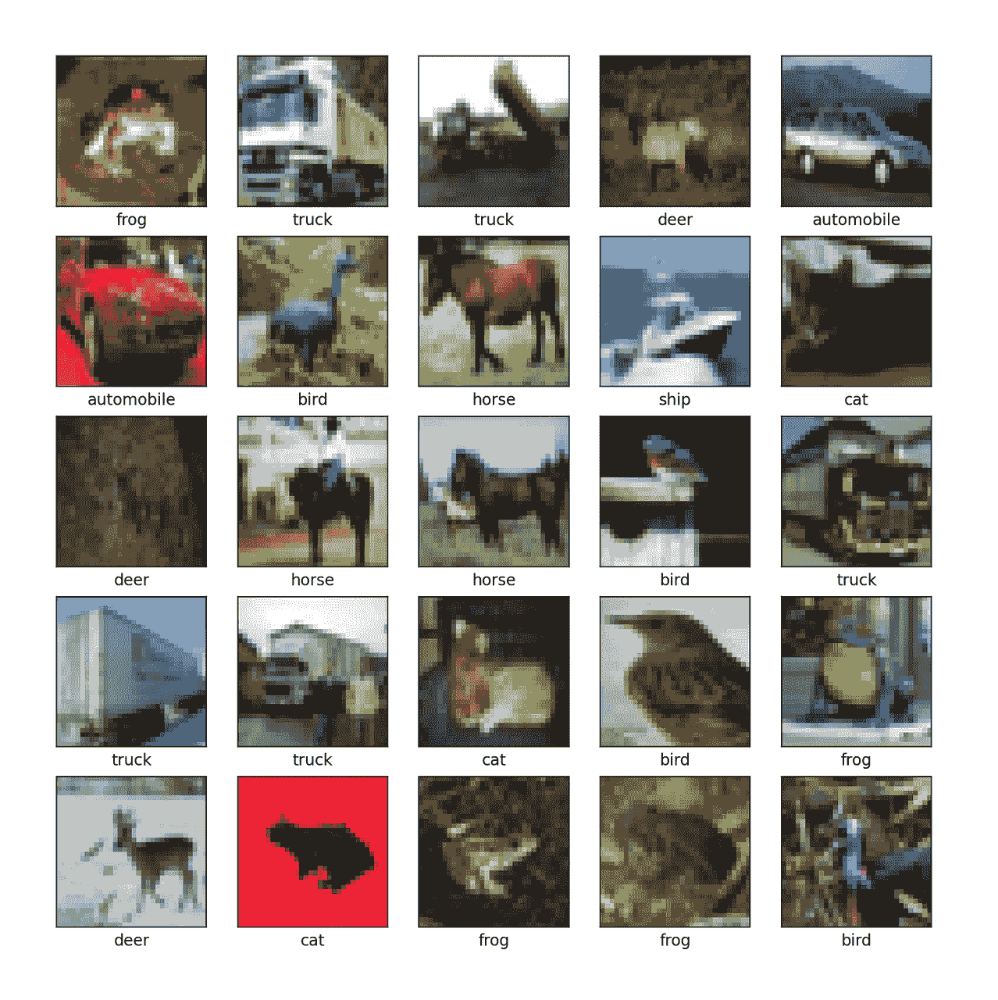
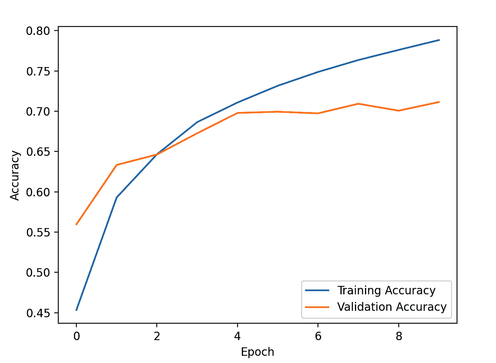
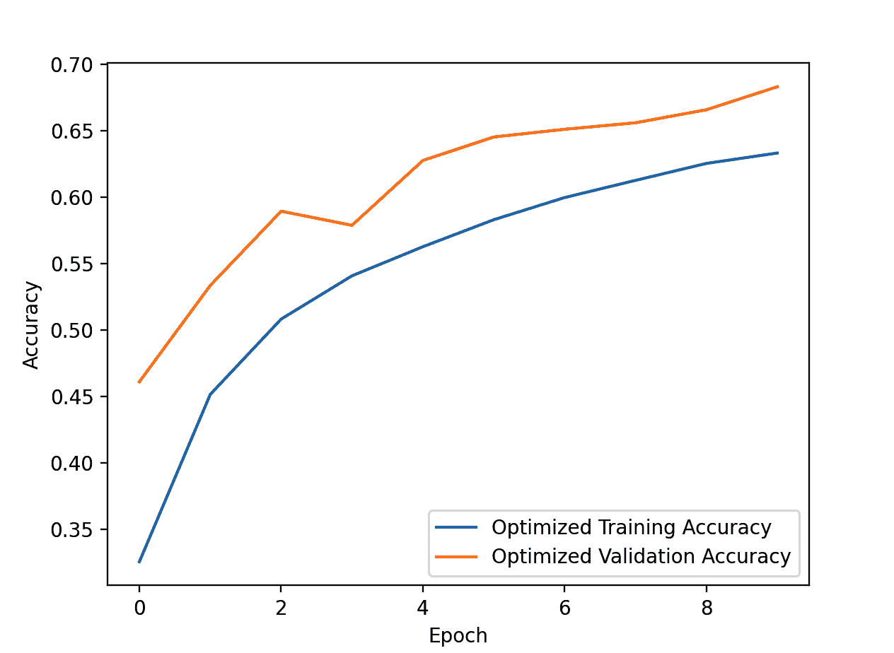

# 13-02神经网络-CNN

> 来源：[https://qqs7y1hozd1.feishu.cn/docx/CruddkuXDoiRWpxo7K1cThpvnzc](https://qqs7y1hozd1.feishu.cn/docx/CruddkuXDoiRWpxo7K1cThpvnzc)

CNN，全称是卷积神经网络（Convolutional Neural Network），它是一种专门用于处理图像数据的神经网络。

**简**单来说，CNN就像是一种能够“看”图像的计算机模型，它可以识别图像中的各种特征，比如边缘、形状、颜色等，最终能够识别出这张图像里有什么东西。

具体的原理、涉及到的公式、案例在下面和大家一起详细学习一下~

## 基本概念

### 基本组成部分

1. 卷积层（Convolutional Layer）：

+   这是CNN的核心部分。想象一下，有一个小方块在图像上面滑动，这个小方块叫做卷积核（filter）。每当卷积核滑动到一个新的位置，它会查看那个位置的像素值，并进行一些计算（比如相乘再相加）。

+   卷积核就像是一个“特征检测器”，不同的卷积核可以检测出不同的特征，比如某个方向的边缘、颜色的变化等。

2. 激活函数（Activation Function）：

+   这个函数会对卷积层的输出进行非线性处理，通常使用的是ReLU（Rectified Linear Unit），它的作用是让结果变得更有表现力。ReLU的操作很简单：把所有小于0的数都变成0，其他的不变。

3. 池化层（Pooling Layer）：

+   池化层的作用是缩小数据的尺寸，同时保留重要信息。最常见的是最大池化（Max Pooling），它会在一个小区域内选择最大的值。这样做不仅可以减少计算量，还可以让模型对位置的变化更有鲁棒性。

4. 全连接层（Fully Connected Layer）：

+   这是CNN的最后几层，和传统的神经网络类似。它把前面的卷积层和池化层提取出来的特征综合起来，最终输出分类结果。

### CNN是如何工作的？

**1. 输入图像**：比如我们输入一张猫的图片。

**2. 卷积层处理**：卷积核在整张图片上滑动，提取出边缘、颜色等低级特征。

**3. 池化层处理**：对特征进行缩小，减少数据量，同时保留重要信息。

**4. 重复几次卷积和池化**：通常会有多次卷积和池化的操作，以提取更复杂的特征。

**5. 全连接层处理**：最后，通过全连接层，综合所有提取到的特征，进行最终的分类。

**6. 输出结果**：比如，这张图像是“猫”的概率是90%，是“狗”的概率是10%。

总的来说，CNN是一种非常非常强大的图像识别工具，它能够自动提取图像中的各种特征，然后利用这些特征进行分类和识别。对于大多数的初学者来说，可以先理解每个组成部分的基本功能，再逐步深入了解具体的数学原理和实现细节。

## 理论基础

下面我来给大家详细介绍CNN卷积神经网络的数学原理、公式推理以及算法流程。

### 1. 卷积层（Convolutional Layer）

**卷积运算**

卷积运算是CNN的核心操作。对于输入图像  和卷积核（过滤器）  ，卷积运算的公式：

其中：

+    是输入图像在位置   的像素值。

+    是卷积核在位置   的权重。

+    是卷积结果在位置   的值。

假设输入图像大小为  ，卷积核大小为  ，没有使用填充（padding），卷积步幅（stride）为 1，那么输出图像的大小为  。

**填充和步幅**

+   **填充（Padding）**：为了保持输入和输出的尺寸不变，通常在输入图像的边缘添加一圈零值，称为零填充。填充大小为  时，输出图像的大小为：

其中， 是步幅。

+   **步幅（Stride）**：步幅决定了卷积核在图像上滑动的步长。步幅为  时，卷积运算的输出大小为：

### 2. 激活函数（Activation Function）

激活函数用于引入非线性。最常用的激活函数是ReLU（Rectified Linear Unit）：

### 3. 池化层（Pooling Layer）

池化层用于降采样，减少数据的尺寸，同时保留重要信息。最常用的是最大池化（Max Pooling），其公式为：

其中：

+    是池化窗口的大小。

+    是输入图像。

+    是池化后的输出图像。

### 4. 全连接层（Fully Connected Layer）

全连接层将输入的特征向量映射到输出的类别上，通常使用的是一个线性变换，公式为：

其中：

+    是输入的特征向量。

+    是权重矩阵。

+    是偏置向量。

+    是输出向量。

### 5. 反向传播（Backpropagation）

反向传播用于调整卷积核和全连接层的权重，以最小化损失函数。损失函数常用交叉熵损失，公式为：

其中：

+    是真实标签。

+    是预测概率。

**反向传播的主要步骤：**

**1. 计算损失函数的梯度**：根据输出与真实标签的差异计算损失。

**2. 反向传播误差**：将误差从输出层传递到输入层，逐层计算每个参数的梯度。

**3. 更新权重**：使用梯度下降法更新每一层的权重。

### 算法流程

**1. 输入图像**：输入一个形状为  的图像。

**2. 卷积层**：

+   对输入图像应用多个卷积核，进行卷积运算，得到特征图。

+   应用激活函数（如ReLU）。

+   如果需要，进行填充和步幅调整。

**3. 池化层**：

+   对特征图进行池化操作，得到下采样后的特征图。

**4. 重复卷积层和池化层**：多次进行卷积和池化操作，以提取更高层次的特征。

**5. 展平**：将最终的特征图展平成一维向量。

**6. 全连接层**：

+   将展平后的向量通过一系列全连接层。

+   应用激活函数。

**7. 输出层**：最后一层全连接层输出分类结果（例如，使用Softmax函数进行多分类任务）。

**8. 计算损失**：使用损失函数计算预测结果与真实标签之间的差异。

**9. 反向传播**：计算损失函数相对于各层参数的梯度，并更新参数。

**10. 迭代训练**：重复以上步骤，直到损失函数收敛，模型训练完成。

总结了以上 10 个步骤，CNN能够自动提取图像中的各种特征，并利用这些特征进行分类和识别。

## 完整案例

这个案例中，使用了真实的数据集进行图像分类，并包括数据分析、可视化以及算法优化的步骤。

数据集市经典的CIFAR-10数据集，该数据集包含60000张32x32的彩色图像，共分为10类，每类6000张图像。

下面，我来分步骤，给大家详细的进行每一步的说明：

**1. 导入库和加载数据**

```
import tensorflow as tf
from tensorflow.keras import datasets, layers, models
import matplotlib.pyplot as plt
import seaborn as sns

# 加载CIFAR-10数据集
(x_train, y_train), (x_test, y_test) = datasets.cifar10.load_data()

# 数据归一化
x_train, x_test = x_train / 255.0, x_test / 255.0

# 类别名称
class_names = [&#x27;airplane&#x27;, &#x27;automobile&#x27;, &#x27;bird&#x27;, &#x27;cat&#x27;, &#x27;deer&#x27;, &#x27;dog&#x27;, &#x27;frog&#x27;, &#x27;horse&#x27;, &#x27;ship&#x27;, &#x27;truck&#x27;]
```

**2. 数据可视化**

```
# 显示训练集中的前25张图片和它们的标签
plt.figure(figsize=(10,10))
for i in range(25):
    plt.subplot(5,5,i+1)
    plt.xticks([])
    plt.yticks([])
    plt.grid(False)
    plt.imshow(x_train[i], cmap=plt.cm.binary)
    plt.xlabel(class_names[y_train[i][0]])
plt.show()
```



**3. 构建CNN模型**

```
model = models.Sequential([
    layers.Conv2D(32, (3, 3), activation=&#x27;relu&#x27;, input_shape=(32, 32, 3)),
    layers.MaxPooling2D((2, 2)),
    layers.Conv2D(64, (3, 3), activation=&#x27;relu&#x27;),
    layers.MaxPooling2D((2, 2)),
    layers.Conv2D(64, (3, 3), activation=&#x27;relu&#x27;),
    layers.Flatten(),
    layers.Dense(64, activation=&#x27;relu&#x27;),
    layers.Dense(10)
])

model.summary()
```

**4. 编译和训练模型**

```
model.compile(optimizer=&#x27;adam&#x27;,
              loss=tf.keras.losses.SparseCategoricalCrossentropy(from_logits=True),
              metrics=[&#x27;accuracy&#x27;])

history = model.fit(x_train, y_train, epochs=10, validation_data=(x_test, y_test))
```

**5. 评估模型性能**

```
plt.plot(history.history[&#x27;accuracy&#x27;], label=&#x27;Training Accuracy&#x27;)
plt.plot(history.history[&#x27;val_accuracy&#x27;], label=&#x27;Validation Accuracy&#x27;)
plt.xlabel(&#x27;Epoch&#x27;)
plt.ylabel(&#x27;Accuracy&#x27;)
plt.legend(loc=&#x27;lower right&#x27;)
plt.show()

test_loss, test_acc = model.evaluate(x_test, y_test, verbose=2)
print(f&quot;Test Accuracy: {test_acc}&quot;)
```



**6. 优化模型**

我们可以通过调整模型架构、改变优化器、进行数据增强等方式来优化模型。在这里，我们进行一些数据增强，并调整模型架构。

```
from tensorflow.keras.preprocessing.image import ImageDataGenerator

datagen = ImageDataGenerator(
    rotation_range=20,
    width_shift_range=0.2,
    height_shift_range=0.2,
    horizontal_flip=True
)

# 对训练数据进行数据增强
datagen.fit(x_train)

# 构建新的CNN模型
optimized_model = models.Sequential([
    layers.Conv2D(32, (3, 3), activation=&#x27;relu&#x27;, input_shape=(32, 32, 3)),
    layers.MaxPooling2D((2, 2)),
    layers.Conv2D(64, (3, 3), activation=&#x27;relu&#x27;),
    layers.MaxPooling2D((2, 2)),
    layers.Conv2D(128, (3, 3), activation=&#x27;relu&#x27;),
    layers.Conv2D(128, (3, 3), activation=&#x27;relu&#x27;),
    layers.Flatten(),
    layers.Dense(128, activation=&#x27;relu&#x27;),
    layers.Dense(10)
])

optimized_model.compile(optimizer=&#x27;adam&#x27;,
                        loss=tf.keras.losses.SparseCategoricalCrossentropy(from_logits=True),
                        metrics=[&#x27;accuracy&#x27;])

# 训练优化后的模型
optimized_history = optimized_model.fit(datagen.flow(x_train, y_train, batch_size=64),
                                        epochs=10, 
                                        validation_data=(x_test, y_test))
```

**7. 评估优化后的模型**

```
plt.plot(optimized_history.history[&#x27;accuracy&#x27;], label=&#x27;Optimized Training Accuracy&#x27;)
plt.plot(optimized_history.history[&#x27;val_accuracy&#x27;], label=&#x27;Optimized Validation Accuracy&#x27;)
plt.xlabel(&#x27;Epoch&#x27;)
plt.ylabel(&#x27;Accuracy&#x27;)
plt.legend(loc=&#x27;lower right&#x27;)
plt.show()

optimized_test_loss, optimized_test_acc = optimized_model.evaluate(x_test, y_test, verbose=2)
print(f&quot;Optimized Test Accuracy: {optimized_test_acc}&quot;)
```



代码中，大家可以看到训练和验证准确率的变化，并通过优化模型提升性能。数据增强、增加卷积层数和调整神经网络结构是常见的优化方法。

大家可以通过这种完整的代码流程，学习如何构建和训练CNN模型，以及通过可视化和优化来提升模型性能。

## 模型分析

我们从CNN的优缺点、以及与其他相似算法的对比，全面的认识CNN以及相似算法模型的适用场景

**优点：**

**1. 特征学习**：CNN能够自动学习图像中的特征，无需手工设计特征。

**2. 位置不变性**：CNN能够识别图像中的物体，即使物体的位置发生变化也能准确识别。

**3. 参数共享**：通过卷积操作，参数共享可以减少模型的参数数量，降低过拟合的风险。

**4. 适用于大规模数据**：CNN模型在大规模数据集上表现出色，能够处理成千上万甚至更多的图像。

**缺点：**

**1. 计算量大**：CNN模型的训练需要大量的计算资源，尤其是在大规模数据集上训练时。

**2. 需要大量数据**：CNN模型需要大量的标记数据来进行训练，否则容易过拟合。

**3. 黑盒模型**：由于CNN模型的复杂性，它往往被视为黑盒模型，难以解释其内部的工作原理。

### 与相似算法的对比

**与传统机器学习算法的对比：**

**1. 特征工程**：传统机器学习算法需要手工设计特征，而CNN能够自动学习特征，减少了特征工程的工作量。

**2. 适用性**：传统机器学习算法在小规模数据集上表现良好，而CNN模型在大规模数据集上表现更好。

**3. 计算复杂度**：CNN模型的计算复杂度更高，但在大规模数据集上的表现往往更好。

与其他深度学习模型的对比（如RNN、Transformer等）：

**1. 数据类型**：CNN主要用于处理图像数据，而RNN和Transformer等模型更适用于处理序列数据。

**2. 计算结构**：CNN主要依赖于卷积和池化操作，而RNN主要依赖于循环结构，Transformer主要依赖于自注意力机制，每种结构都有其适用的场景。

### 何时选择CNN模型

**1. 图像分类任务**：对于图像分类、目标检测等任务，CNN是一种非常有效的选择，尤其是在处理大规模数据集时。

**2. 位置不变性要求高**：如果任务对于物体在图像中的位置不敏感，CNN的特征学习能力可以很好地满足这种需求。

**3. 需要自动学习特征**：如果任务中的特征不容易手工设计，CNN模型能够自动学习到合适的特征表示。

CNN模型在图像分类等任务中表现出色，尤其在大规模数据集上的应用广泛。然而，在某些情况下，如处理小规模数据集或需要解释性的任务中，其他算法可能更合适。