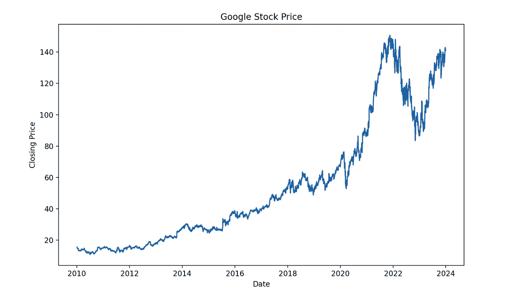
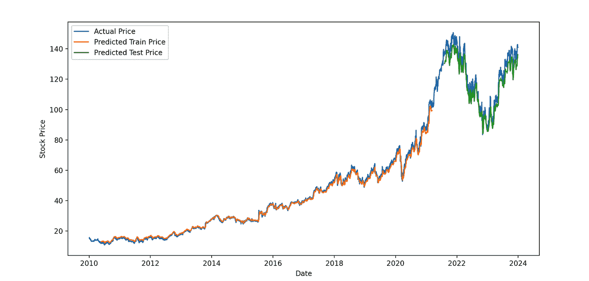
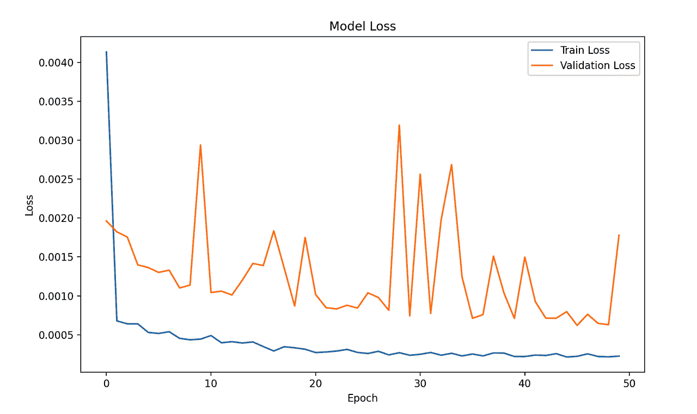

# 13-05神经网络-LSTM

> 来源：[https://qqs7y1hozd1.feishu.cn/docx/Uh2QdlZPQoOpKbxH0pkcTSUinFd](https://qqs7y1hozd1.feishu.cn/docx/Uh2QdlZPQoOpKbxH0pkcTSUinFd)

## 一个简单的例子

想象一下，你在学习一门语言。刚开始学的时候，你会记住很多新的单词和语法（输入门打开），但随着学习的深入，你会逐渐忘记那些不常用的单词和语法（遗忘门打开）。当你在用这门语言交流时，你会根据上下文选择性地使用你记住的单词和语法（输出门打开）。

LSTM 就是这样一个学习过程，能够灵活地记住重要信息并在需要的时候使用这些信息。

好了，咱们下面上硬货，给大家梳理清楚！~

## 理论基础

LSTM 专门设计用于处理和预测时间序列数据。它克服了标准`RNN`的长期依赖问题，能够更好地捕捉长距离的时间依赖性。

### LSTM的数学原理

你提供的`LSTM`的公式和解释总体上是正确的，但是有一些细节可以进一步澄清和细化。以下是一些调整和补充，以确保每一步都准确无误。

### 1. 遗忘门（Forget Gate）

遗忘门控制着当前单元状态中哪些信息需要被丢弃。遗忘门的输出是一个0到1之间的值，表示每个信息保留的程度。

- 是遗忘门的输出。
- 是`sigmoid`激活函数。
- 是遗忘门的权重矩阵。
- 是上一个时刻的隐藏状态和当前输入的连接。
- 是遗忘门的偏置项。

### 2. 输入门（Input Gate）

输入门控制着新信息的加入程度。它包括两个部分：一个`sigmoid`层决定需要更新的信息，另一个`tanh`层生成新的候选记忆单元。

公式：

- 是输入门的输出。
- 是新的候选记忆单元。
- 和 是输入门和候选记忆单元的权重矩阵。
- 和 是输入门和候选记忆单元的偏置项。

### 3. 更新记忆单元状态

通过遗忘门和输入门的作用，更新当前的记忆单元状态。

公式：

- 是当前时刻的记忆单元状态。
- 是上一个时刻的记忆单元状态。

### 4. 输出门（Output Gate）

输出门控制着当前时刻的隐藏状态输出。它决定哪些部分的记忆单元状态将被输出。

公式：

- 是输出门的输出。
- 是当前时刻的隐藏状态。
- 是输出门的权重矩阵。
- 是输出门的偏置项。

### LSTM的算法流程

下面是`LSTM`在处理时间序列数据时的详细算法流程：

1. 初始化：初始化`LSTM`的权重矩阵和偏置项。
2. 输入数据：输入时间序列数据。
3. 计算遗忘门输出：
4. 计算输入门输出：
5. 生成候选记忆单元：
6. 更新记忆单元状态：
7. 计算输出门输出：
8. 计算当前隐藏状态：
9. 输出隐藏状态并更新内部状态。

`LSTM`通过遗忘门、输入门、候选记忆单元和输出门来控制信息的流动和更新，克服了传统`RNN`中梯度消失和梯度爆炸的问题，使其能够更好地捕捉长时间依赖关系。其核心思想是通过门控机制选择性地保留和更新信息，从而实现对时间序列数据的有效建模和预测。

### 应用场景

`LSTM`适用于许多与序列数据相关的问题，特别是在需要捕捉长期依赖关系的情况下。以下是`LSTM`适用的问题类型、优缺点以及运用时的前提条件，以及一个实际中的应用案例。

#### 适用问题类型

1. 自然语言处理（`NLP`）：包括语言建模、文本分类、命名实体识别等任务。
2. 时间序列预测：如股票价格预测、天气预测、交通流量预测等。
3. 音频处理：包括语音识别、语音合成等。
4. 视频分析：如行为识别、视频描述生成等。

#### 运用时的前提条件

1. 大量的序列数据：`LSTM`在大数据集上表现更好，需要足够的数据来进行训练。
2. 适当的特征工程：在应用`LSTM`之前，需要进行适当的特征工程，以准备输入数据。
3. 合适的超参数调优：`LSTM`具有许多超参数，需要进行合适的调优以获得最佳性能。

## Python案例

聊了这么多的基础之后，咱们下面举例一个完整的`LSTM`（长短期记忆网络）示例，它包括数据准备、`LSTM`模型构建、训练、评估和可视化。

使用`Keras`和`TensorFlow`库来实现一个时间序列预测的例子，比如预测股票价格。

### 数据准备

首先，我们需要一个时间序列数据集。这次我们使用的是股票市场数据（比如`Google`的股票价格）。

数据集获取：👸号「深夜努力写Python」后台，回复『数据集』即可拿到~

```
import pandas as pd
import numpy as np
import matplotlib.pyplot as plt

# 加载数据集（公众号后台回复“数据集”即可）
data = pd.read_csv('GOOG.csv')
data['Date'] = pd.to_datetime(data['Date'])
data.set_index('Date', inplace=True)

# 绘制收盘价
plt.figure(figsize=(10, 6))
plt.plot(data['Close'])
plt.title('Google Stock Price')
plt.xlabel('Date')
plt.ylabel('Closing Price')
plt.show()
```



### 数据预处理

为了训练`LSTM`模型，我们需要对数据进行标准化，并将其转化为合适的输入格式。

```
from sklearn.preprocessing import MinMaxScaler

scaler = MinMaxScaler(feature_range=(0, 1))
scaled_data = scaler.fit_transform(data['Close'].values.reshape(-1, 1))

# 创建训练和测试数据集
train_size = int(len(scaled_data) * 0.8)
train_data = scaled_data[:train_size]
test_data = scaled_data[train_size:]

def create_dataset(data, time_step=1):
    X, y = [], []
    for i in range(len(data) - time_step - 1):
        X.append(data[i:(i + time_step), 0])
        y.append(data[i + time_step, 0])
    return np.array(X), np.array(y)


time_step = 100 # 设置时间步长
X_train, y_train = create_dataset(train_data, time_step)
X_test, y_test = create_dataset(test_data, time_step)

# 重塑输入数据为 [样本数, 时间步长, 特征数]
X_train = X_train.reshape(X_train.shape[0], X_train.shape[1], 1)
X_test = X_test.reshape(X_test.shape[0], X_test.shape[1], 1)
```

### 构建`LSTM`模型

```
from tensorflow.keras.models import Sequential
from tensorflow.keras.layers import LSTM, Dense, Dropout

model = Sequential()
model.add(LSTM(units=50, return_sequences=True, input_shape=(time_step, 1)))
model.add(Dropout(0.2))
model.add(LSTM(units=50, return_sequences=False))
model.add(Dropout(0.2))
model.add(Dense(units=1))

model.compile(optimizer='adam', loss='mean_squared_error')
model.summary()
```

### 训练模型

```
history = model.fit(X_train, y_train, epochs=50, batch_size=32, validation_data=(X_test, y_test), verbose=1)
```

### 评估和可视化

```
# 预测
train_predict = model.predict(X_train)
test_predict = model.predict(X_test)

# 反向转换预测值和实际值
train_predict = scaler.inverse_transform(train_predict)
test_predict = scaler.inverse_transform(test_predict)
actual_train = scaler.inverse_transform(y_train.reshape(-1, 1))
actual_test = scaler.inverse_transform(y_test.reshape(-1, 1))

# 修正绘图部分
train_predict_plot = np.empty_like(scaled_data)
train_predict_plot[:, :] = np.nan
train_predict_plot[time_step:len(train_predict) + time_step, :] = train_predict

test_predict_plot = np.empty_like(scaled_data)
test_predict_plot[:, :] = np.nan
test_predict_plot[len(train_predict) + (time_step * 2) + 1:len(scaled_data) - 1, :] = test_predict

# 绘制结果
plt.figure(figsize=(12, 6))
plt.plot(data.index, scaler.inverse_transform(scaled_data), label='Actual Price')
plt.plot(data.index, train_predict_plot, label='Predicted Train Price')
plt.plot(data.index, test_predict_plot, label='Predicted Test Price')
plt.xlabel('Date')
plt.ylabel('Stock Price')
plt.legend()
plt.show()
```



```
# 绘制训练 & 验证损失
plt.figure(figsize=(10, 6))
plt.plot(history.history['loss'], label='Train Loss')
plt.plot(history.history['val_loss'], label='Validation Loss')
plt.title('Model Loss')
plt.xlabel('Epoch')
plt.ylabel('Loss')
plt.legend()
plt.show()
```



### 算法优化

1. 超参数调整：可以通过网格搜索或随机搜索来优化超参数，例如`LSTM`单元数、批次大小和学习率。
2. 模型复杂度：增加或减少`LSTM`层的数量，添加或去掉`Dropout`层，调整每层的单元数等。
3. 正则化：使用`Dropout`或`L2`正则化来防止过拟合。
4. 更多数据：使用更多的历史数据进行训练可以提高模型的准确性。
5. 数据增强：例如，使用滑动窗口法增加训练样本的数量。

### 超参数优化示例

下面是一个使用`Keras Tuner`进行超参数优化的例子：

```
import kerastuner as kt

# 定义模型构建函数
def build_model(hp):
    model = Sequential()
    model.add(LSTM(units=hp.Int('units_1', min_value=50, max_value=200, step=50), return_sequences=True, input_shape=(time_step, 1)))
    model.add(Dropout(hp.Float('dropout_1', min_value=0.1, max_value=0.5, step=0.1)))
    model.add(LSTM(units=hp.Int('units_2', min_value=50, max_value=200, step=50), return_sequences=False))
    model.add(Dropout(hp.Float('dropout_2', min_value=0.1, max_value=0.5, step=0.1)))
    model.add(Dense(units=1))

    model.compile(optimizer='adam', loss='mean_squared_error')
    return model

# 使用随机搜索调优
tuner = kt.RandomSearch(
    build_model,
    objective='val_loss',
    max_trials=5,
    executions_per_trial=3,
    directory='my_dir',
    project_name='stock_price_prediction')

# 运行调优搜索
tuner.search(X_train, y_train, epochs=50, validation_data=(X_test, y_test))

# 最佳模型
best_model = tuner.get_best_models(num_models=1)[0]
best_model.summary()
```

这样，我们可以通过优化超参数来提高模型的性能。

## 模型分析

这里，咱们从模型的优缺点、以及与相似算法的对比，讨论在什么情况下该算法是优选，什么情况下可以考虑其他算法。

### `LSTM` 模型优缺点

#### 优点

1. 处理长时间依赖性：`LSTM`可以有效地捕捉长时间依赖关系，在序列数据中能够记住和利用远距离的相关信息。
2. 梯度消失问题：通过门机制（遗忘门、输入门、输出门），`LSTM`解决了传统`RNN`中的梯度消失问题，使得模型在训练时更稳定。
3. 广泛适用：适用于各种时间序列数据，包括股票预测、天气预报、自然语言处理等。

#### 缺点

1. 计算复杂度高：`LSTM`结构复杂，训练时间长，尤其在大数据集上，计算资源消耗较大。
2. 需要大量数据：`LSTM`需要大量的训练数据才能发挥出最佳效果，对小数据集的泛化能力较差。
3. 参数调优复杂：`LSTM`有较多的超参数，模型优化需要进行大量的实验和调优，过程复杂且耗时。

### 与相似算法的对比

| 算法 | 优点 | 缺点 | 适用场景 |
| --- | --- | --- | --- |
| `LSTM` vs. 简单`RNN` | `LSTM` 能够处理长时间依赖关系，解决梯度消失问题 | `LSTM` 结构复杂，训练时间较长，计算开销较大 | 时间序列预测、语音识别、自然语言处理等任务 |
| `LSTM` vs. `GRU`（门控循环单元） | `LSTM` 有三门控制信息流动，可以捕捉更复杂的依赖关系 | `GRU` 计算量较小，性能接近 `LSTM`，结构简单 | 长时间依赖性问题的序列数据处理（如语音、文本等） |
| `LSTM` vs. 一维卷积神经网络（`1D-CNN`） | `LSTM` 能捕捉时间上的长期依赖关系 | `1D-CNN` 计算效率高，处理短期依赖性数据可能表现更好 | 时间序列数据分析，尤其是在短期依赖性强的任务中（如传感器数据） |

### 选择`LSTM`的情境

#### 适用场景

1. 长时间依赖关系：需要捕捉数据中长期的依赖关系时，如自然语言处理中的句子理解，气象数据中的季节变化。


# LSTM 应用场景与算法对比

## 2. 序列生成
生成类似文本、时间序列数据时，LSTM能够很好地建模数据的顺序和依赖关系。

## 3. 大数据集
在有足够多训练数据的情况下，LSTM能充分学习复杂的模式和特征。

## 考虑其他算法的情境

### 1. 短时间依赖关系
如果数据的依赖关系主要集中在短时间内，1D-CNN或简单RNN可能更适合。

### 2. 计算资源有限
在计算资源受限的情况下，GRU或1D-CNN的计算效率更高。

### 3. 小数据集
在数据量较小的情况下，较为简单的模型（如ARIMA，简单RNN）可能更适合，避免过拟合。

## 最后

LSTM在处理复杂的长时间序列数据方面表现出色，尤其适合需要捕捉长期依赖关系的任务。

但是，LSTM 复杂度和计算资源要求较高，需要大量的训练数据。与其他算法相比，LSTM在处理长时间依赖关系上有明显优势，但在短时间依赖关系或计算资源受限的情况下，其他算法如GRU、1D-CNN可能更为优选。
