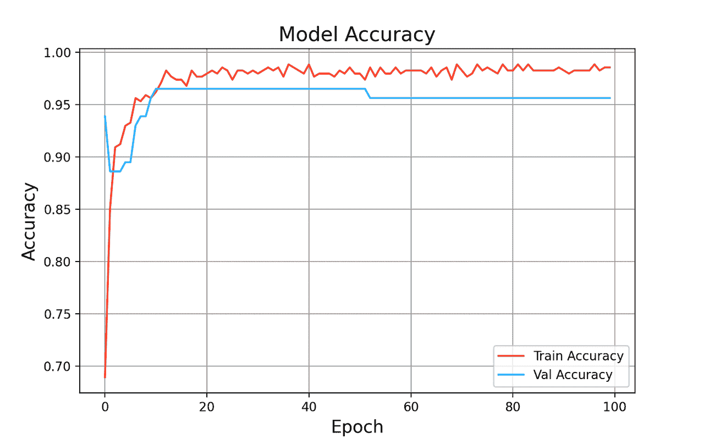
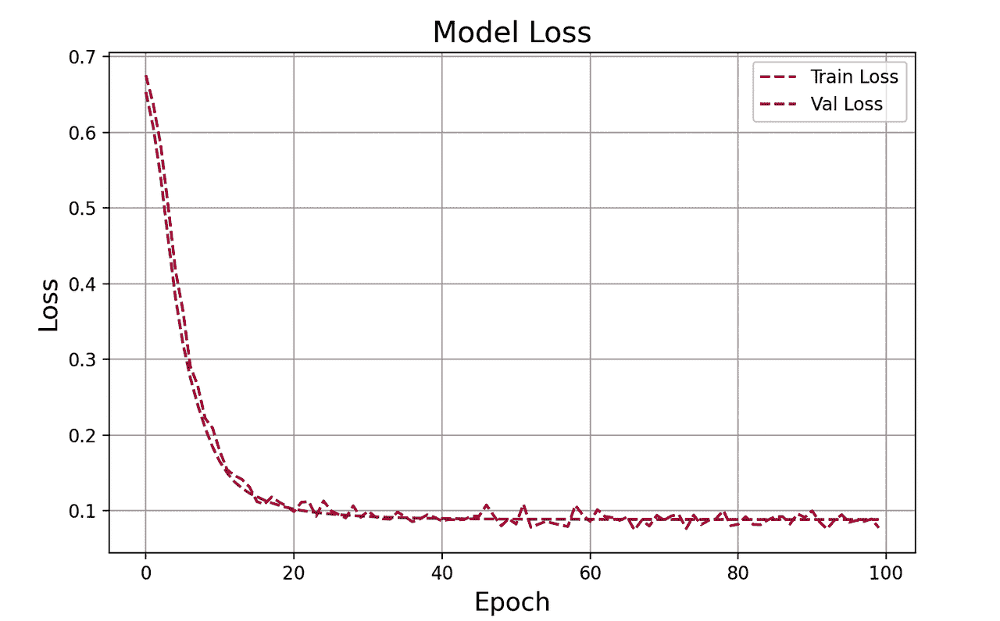
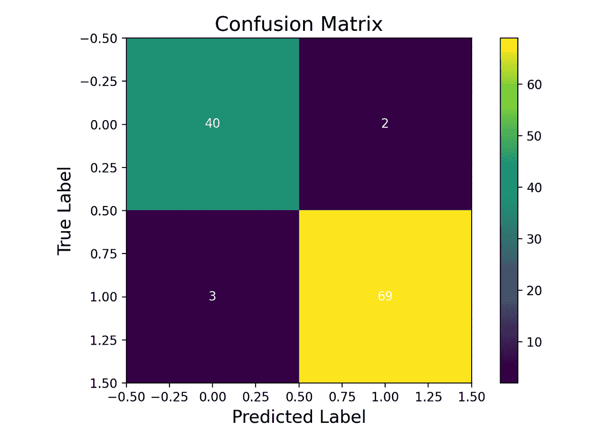
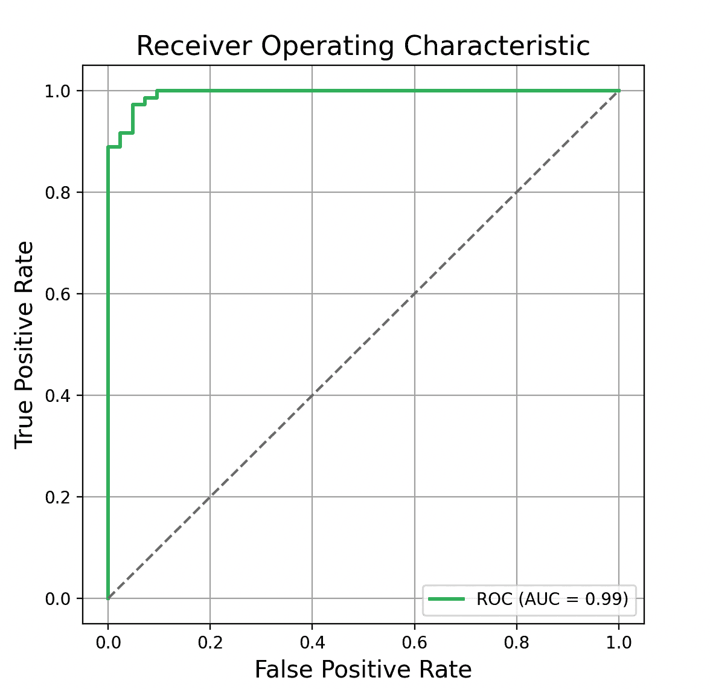
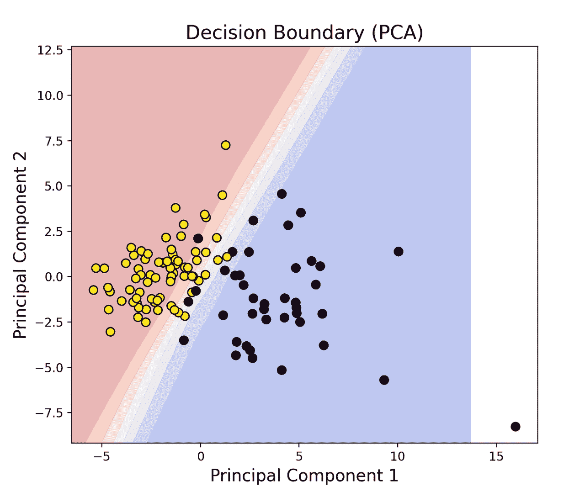

# 13-09神经网络-多层感知机

> 来源：[https://qqs7y1hozd1.feishu.cn/docx/IaTwd4Z2BoGZSax2hrHcTl0pnPg](https://qqs7y1hozd1.feishu.cn/docx/IaTwd4Z2BoGZSax2hrHcTl0pnPg)

人脑里有很多神经元（`Neuron`），它们互相连接，传递信息。神经网络也是一样的，只不过是用数学公式和计算机代码来实现的。

而`感知机（Perceptron）`是最简单的一种神经网络。

它就像是一个小机器人，能接收一些数字，做简单计算，比如加加减减，然后给出一个答案，比如分类成「是」或者「不是」这种二选一问题。

举个例子：

+ 输入：这张图片是猫吗？

+ `感知机`接收特征（比如猫耳朵、猫尾巴等特征的数字），经过计算，最后输出「是」或者「不是」。

但是，单个感知机太简单了，只能处理非常非常简单的任务。

## 什么是多层感知机（`MLP`）？

「多层」感知机（`MLP`）就是把很多感知机组合起来，并且分好几层来处理信息！

它包括三种层次：

+ 输入层（`Input Layer`）：接收原始数据，比如图片里的像素点、文章里的词语。

+ 隐藏层（`Hidden Layers`）：真正「动脑筋」的地方，每一层都在提取、理解更复杂的特征。隐藏层可以有一层，也可以有很多层。

+ 输出层（`Output Layer`）：给出最后的结果，比如「这是一只猫」。

> 想象成一个工厂流水线：输入原料 → 中间经过很多加工 → 最后输出成品。

## 它是怎么工作的？

每一层的节点（神经元）会做下面几件事：

+ 接收前一层传来的数据。

+ 进行加权求和（不同输入有不同重要性，加不同的「权重」）。

+ 加上一个偏置（`bias`）（就像是给结果加一点「自由调整的空间」）。

+ 通过激活函数（`activation function`），比如`ReLU`、`Sigmoid`，决定「要不要激活」，给出输出。

然后这一层的输出，再传给下一层，周而复始，直到输出层。

## 一个超级简单的小例子

假设要判断一个人是不是会喜欢一款游戏，输入是：

+ 年龄

+ 玩游戏的经验

+ 喜欢动作游戏的程度

经过隐藏层的处理，最终输出一个概率，比如 80%：这个人很可能喜欢这款游戏！

## 原理详解

### 1. 问题设定

输入：

+ 输入数据向量： ， 。

输出：

+ 目标输出（如分类或回归结果）： ， 。

### 2. 神经网络结构（层次定义）

层级划分：

+ 第  层：输入层，大小是  。

+ 第  层：隐藏层。

+ 第  层：输出层，大小是  。

每一层  有：

+ 权重矩阵：

+ 偏置向量：

+ 激活输出（经过非线性变换后的输出）：

+ 线性变换结果（未激活前的输出）：

### 3. 单层推导公式

对于第  层（ ）：

线性变换（仿射变换）：

其中：

+     是  的矩阵。

+     是  的偏置向量。

+     是上一层的激活输出。

非线性激活（`Activation`）：

其中   是某个非线性函数（比如 `Sigmoid`、`ReLU`、`Tanh` 等）。

### 4. 整个前向传播（`Forward Propagation`）

从输入到输出，整个计算流程是：

1. 输入数据：

1. 依次通过每一层：

1. 最后得到输出  ，就是网络的最终预测结果。

### 5. 损失函数（`Loss Function`）

为了训练模型，需要定义一个衡量「预测结果」和「真实标签」差距的损失函数（`Loss`）。

常见的例子：

+ 回归问题（比如预测房价）：均方误差（`MSE`）

+ 二分类问题：交叉熵损失（`Cross-Entropy Loss`）

### 6. 训练目标

目标是最小化损失函数在所有样本上的期望值，也就是求：

### 7. 参数更新：反向传播（`Backpropagation`）

为了优化权重和偏置，我们需要计算损失函数关于每一层参数的梯度：

这个过程叫做`反向传播算法`（`Backpropagation`）。

关键推导，定义误差项：

它表示第  层输出前（线性变换前）的损失梯度。

推导过程：

1. 最后一层（输出层）误差：

其中   表示逐元素乘积（`Hadamard`积），  是激活函数的导数。

2. 逐层反向传播（链式法则）：

对于  ：

3. 梯度计算公式：

+ 权重梯度：

+ 偏置梯度：

4. 使用梯度下降法更新参数：

+ 权重更新：

+ 偏置更新：

其中   是学习率（`Learning Rate`）。

### 整个 `MLP` 的算法流程

1. 初始化参数：随机初始化所有  、 。

1. 前向传播：

+ 依层计算  ，再计算  。

1. 计算损失：

+ 根据输出  和标签  算损失  。

1. 反向传播：

+ 逐层计算  。

+ 计算梯度  。

1. 参数更新：

+ 使用梯度下降法更新权重和偏置。

1. 循环训练：

+ 多次重复步骤2-5，直到损失收敛或达到迭代次数。

本质上，`MLP`就是多个仿射变换（线性变换+加偏置）加上非线性映射（激活函数）的组合堆叠。

通过这种组合，可以逼近任意连续函数（依据「万能逼近定理」）。

最终通过优化（`梯度下降`）学习参数，逼近我们想要学习的映射关系。

## 完整案例

这里，我们使用`Wisconsin Breast Cancer Dataset`（来自 `sklearn`）作为例子，利用多层感知机（`MLP`）对肿瘤良恶性进行二分类预测：

+ 输入特征：30 个从肿瘤图像中提取的数值指标

+ 输出：良性（0）或恶性（1）

我们的目标是：

1. 构建并训练一个 `PyTorch` 实现的 `MLP`，包含多层隐藏层、`Dropout`、`L2` 正则化等。

1. 深入分析每步意义，包括数据分布、模型拟合、过拟合/欠拟合、决策边界等。

1. 算法优化：学习率衰减、`Early Stopping`、超参数调优、正则化对比。

### 数据预处理

```
import os
# 禁用 GPU，加速部署不依赖 CUDA 库
os.environ["CUDA_VISIBLE_DEVICES"] = ""

import numpy as np
import matplotlib.pyplot as plt
from sklearn.datasets import load_breast_cancer
from sklearn.model_selection import train_test_split
from sklearn.preprocessing import StandardScaler
import torch
from torch import nn, optim
from torch.utils.data import TensorDataset, DataLoader
```

1. 加载数据

```
data = load_breast_cancer()
X, y = data.data, data.target
```

2. 切分训练/验证/测试集（60% 训练，20% 验证，20% 测试）

```
X_train_full, X_test, y_train_full, y_test = train_test_split(
    X, y, test_size=0.2, random_state=42, stratify=y)
X_train, X_val, y_train, y_val = train_test_split(
    X_train_full, y_train_full, test_size=0.25, random_state=42, stratify=y_train_full)
```

3. 标准化

```
scaler = StandardScaler()
X_train = scaler.fit_transform(X_train)
X_val   = scaler.transform(X_val)
X_test  = scaler.transform(X_test)
```

4. 转为 `PyTorch` 张量 & `DataLoader`

```
def to_loader(X, y, batch_size=32, shuffle=False):
    Xt = torch.tensor(X, dtype=torch.float32)
    yt = torch.tensor(y, dtype=torch.float32).unsqueeze(1)
    ds = TensorDataset(Xt, yt)
    return DataLoader(ds, batch_size=batch_size, shuffle=shuffle)

train_loader = to_loader(X_train, y_train, batch_size=32, shuffle=True)
val_loader   = to_loader(X_val,   y_val,   batch_size=32)
test_loader  = to_loader(X_test,  y_test,  batch_size=32)
```

+ 分层抽样（`stratify=y`）保证类别分布均衡。

+ 标准化对 `MLP` 效果至关重要，可加快收敛并避免梯度消失/爆炸。

### 构建 `MLP` 模型

```
class MLP(nn.Module):
    def __init__(self, input_dim, hidden_dims, dropout_rate=0.3, l2_rate=1e-3):
        super().__init__()
        layers = []
        dims = [input_dim] + hidden_dims
        for i in range(len(hidden_dims)):
            layers.append(nn.Linear(dims[i], dims[i+1]))
            layers.append(nn.ReLU())
            layers.append(nn.Dropout(dropout_rate))
        layers.append(nn.Linear(dims[-1], 1))
        layers.append(nn.Sigmoid())
        self.net = nn.Sequential(*layers)
    
    def forward(self, x):
        return self.net(x)
```

+ 输入层：`input_dim=30`

+ 隐藏层：例如 `[64, 32, 16]` 三层，`ReLU` + `Dropout`

+ 输出层：`Sigmoid` 输出概率

+ 多层隐藏层能提取数据中由浅入深的特征组合。

+ `Dropout`（概率 0.3）帮助缓解过拟合。

+ `L2` 正则化将在优化器中指定（`weight_decay`）。

### 训练函数与优化策略

```
def train_model(hidden_dims=[64,32,16], lr=1e-3, dropout=0.3, l2=1e-3,
                epochs=100, patience=10):
    model = MLP(input_dim=30, hidden_dims=hidden_dims,
                dropout_rate=dropout, l2_rate=l2)
    criterion = nn.BCELoss()
    optimizer = optim.Adam(model.parameters(), lr=lr, weight_decay=l2)
    # 学习率衰减：每个 epoch *0.9
    scheduler = optim.lr_scheduler.LambdaLR(
        optimizer, lr_lambda=lambda epoch: 0.9**epoch)
    
    history = {'train_loss':[], 'val_loss':[], 'train_acc':[], 'val_acc':[]}
    best_val_loss = float('inf'); wait = 0; best_state = None
    
    for epoch in range(epochs):
        # —— Training ——
        model.train()
        total_loss = total_correct = total = 0
        for Xb, yb in train_loader:
            optimizer.zero_grad()
            pred = model(Xb)
            loss = criterion(pred, yb)
            loss.backward(); optimizer.step()
            total_loss += loss.item() * Xb.size(0)
            total_correct += ((pred>=0.5).float()==yb).sum().item()
            total += yb.size(0)
        train_loss = total_loss/total
        train_acc  = total_correct/total
        
        # —— Validation ——
        model.eval()
        v_loss = v_correct = v_total = 0
        with torch.no_grad():
            for Xb, yb in val_loader:
                pred = model(Xb)
                l = criterion(pred, yb)
                v_loss += l.item() * Xb.size(0)
                v_correct += ((pred>=0.5).float()==yb).sum().item()
                v_total += yb.size(0)
        val_loss = v_loss/v_total
        val_acc  = v_correct/v_total
        
        # 记录
        history['train_loss'].append(train_loss)
        history['val_loss'].append(val_loss)
        history['train_acc'].append(train_acc)
        history['val_acc'].append(val_acc)
        
        # 学习率衰减
        scheduler.step()
        
        # Early Stopping
        if val_loss < best_val_loss:
            best_val_loss = val_loss
            best_state   = model.state_dict()
            wait = 0
        else:
            wait += 1
            if wait >= patience:
                print(f"Early stopping at epoch {epoch+1}")
                break
    
    model.load_state_dict(best_state)
    return model, history
```

+ 损失函数：`Binary Cross Entropy` (`nn.BCELoss`) 对二分类最合适。

+ 学习率衰减 和 `Early Stopping` 结合，可防止过拟合并加速收敛。

+ `weight_decay=L2` 正则化在 `Adam` 中设置，简化实现。

### 训练主模型与可视化过程

```
model, history = train_model(
    hidden_dims=[64,32,16], lr=1e-3, dropout=0.3, l2=1e-3,
    epochs=100, patience=10
)
```

准确率（`Accuracy`） 曲线


# 模型可视化与评估

## 训练与验证集曲线

### 准确率曲线

```python
plt.figure(figsize=(8,5))
plt.plot(history['train_acc'], label='Train Accuracy', color='#FF5733')
plt.plot(history['val_acc'],   label='Val Accuracy',   color='#33C1FF')
plt.title('Model Accuracy', fontsize=16)
plt.xlabel('Epoch', fontsize=14)
plt.ylabel('Accuracy', fontsize=14)
plt.legend()
plt.grid(True)
plt.show()
```



+   训练集 vs 验证集准确率 的对比，可看出模型是否出现过拟合（train↑，val↓）或欠拟合（两者都低）。
+   配色凸显两条曲线差异。

### 损失（Loss）曲线

```python
plt.figure(figsize=(8,5))
plt.plot(history['train_loss'], label='Train Loss',   linestyle='--', color='#C70039')
plt.plot(history['val_loss'],   label='Val Loss',     linestyle='--', color='#900C3F')
plt.title('Model Loss', fontsize=16)
plt.xlabel('Epoch', fontsize=14)
plt.ylabel('Loss', fontsize=14)
plt.legend()
plt.grid(True)
plt.show()
```



+   损失函数下降趋势直接反映模型优化过程。
+   `Validation Loss` 若在某处反弹，需考虑 Early Stopping。

## 测试集评估与可视化

### 获取预测与真实标签

```python
model.eval()
probs, preds = [], []
with torch.no_grad():
    for Xb, _ in test_loader:
        p = model(Xb).cpu().numpy().ravel()
        probs.extend(p)
        preds.extend((p>=0.5).astype(int))
probs = np.array(probs)
preds = np.array(preds)
```

### 混淆矩阵（Confusion Matrix）

```python
from sklearn.metrics import confusion_matrix
cm = confusion_matrix(y_test, preds)
plt.figure(figsize=(5,5))
plt.imshow(cm, cmap='viridis', interpolation='nearest')
plt.title('Confusion Matrix', fontsize=16)
plt.xlabel('Predicted Label', fontsize=14)
plt.ylabel('True Label', fontsize=14)
for i in range(2):
    for j in range(2):
        plt.text(j, i, cm[i,j], ha='center', va='center', color='white')
plt.colorbar()
plt.show()
```



+   `TP` / `FN` / `FP` / `TN` 四格直观展示分类性能。
+   大量 `FN` 要注意漏诊风险，`FP` 则会增加二次检查成本。

### ROC 曲线 & AUC

```python
from sklearn.metrics import roc_curve, auc, classification_report
fpr, tpr, _ = roc_curve(y_test, probs)
roc_auc = auc(fpr, tpr)

plt.figure(figsize=(6,6))
plt.plot(fpr, tpr, label=f'ROC (AUC = {roc_auc:.2f})', linewidth=2, color='#28B463')
plt.plot([0,1],[0,1], linestyle='--', color='gray')
plt.title('Receiver Operating Characteristic', fontsize=16)
plt.xlabel('False Positive Rate', fontsize=14)
plt.ylabel('True Positive Rate', fontsize=14)
plt.legend(loc='lower right'); plt.grid(True)
plt.show()

print("Classification Report:")
print(classification_report(y_test, preds, target_names=data.target_names))
```



+   ROC 曲线 展示在不同阈值下 TPR/FPR 的权衡。
+   AUC 越接近 1 越好，0.5 相当于随机猜测。
+   Classification Report 提供 Precision、Recall、F1-score 的详细指标。

### 决策边界可视化（PCA 降维）

为了直观理解，使用 `PCA` 将 30 维特征降到 2 维：

```python
from sklearn.decomposition import PCA
pca = PCA(n_components=2)
X_train_pca = pca.fit_transform(X_train)
X_test_pca  = pca.transform(X_test)
```

训练一个简化版 `MLP`，只针对 2 维输入：

```python
simple_mlp = MLP(input_dim=2, hidden_dims=[32], dropout_rate=0.2, l2_rate=1e-3)
# 同样训练方式，或直接用 sklearn 的 `MLPClassifier` 快速演示
from sklearn.neural_network import MLPClassifier
clf2d = MLPClassifier(hidden_layer_sizes=(32,), max_iter=200, random_state=0)
clf2d.fit(X_train_pca, y_train)
```

绘制决策边界：

```python
xx, yy = np.meshgrid(
    np.linspace(X_train_pca[:,0].min()-1, X_train_pca[:,0].max()+1, 200),
    np.linspace(X_train_pca[:,1].min()-1, X_train_pca[:,1].max()+1, 200)
)
grid = np.c_[xx.ravel(), yy.ravel()]
Z = clf2d.predict_proba(grid)[:,1].reshape(xx.shape)

plt.figure(figsize=(7,6))
plt.contourf(xx, yy, Z, alpha=0.3, cmap='coolwarm')
plt.scatter(X_test_pca[:,0], X_test_pca[:,1], c=y_test, edgecolor='k', s=50)
plt.title('Decision Boundary (PCA)', fontsize=16)
plt.xlabel('Principal Component 1', fontsize=14)
plt.ylabel('Principal Component 2', fontsize=14)
plt.show()
```



+   虽然降维丢失信息，但可直观感受模型如何在二维平面上做出分界。
+   不同颜色深浅表示模型预测概率强弱。

## 8. 算法优化与超参数调优

### 常用优化手段

1.  **网络结构调整**：增加/减少隐藏层数与每层神经元个数
2.  **正则化**：`L1/L2`、`Dropout` 比例
3.  **学习率策略**：固定、衰减、`Warm-up`、`Cosine Annealing`
4.  **优化器选择**：`SGD`、`Momentum`、`Adam`、`AdamW` 等
5.  **`Early Stopping`**：防止过拟合

### 网格搜索示例

```python
import itertools
best_cfg = None; best_acc = 0
for dims in [[64,32],[128,64,32]]:
    for lr in [1e-2, 1e-3]:
        for drop in [0.2,0.3]:
            model, hist = train_model(
                hidden_dims=dims, lr=lr, dropout=drop,
                l2=1e-3, epochs=50, patience=5)
            # 验证集最终准确率
            acc = hist['val_acc'][-1]
            if acc > best_acc:
                best_acc = acc; best_cfg = (dims, lr, drop)
print("Best config:", best_cfg, "Val Accuracy:", best_acc)
```

+   通过小范围网格搜索，快速定位较优超参数组合。
+   真实项目可结合 `Ray Tune`、`Optuna` 等自动化框架。

## 模型分析

### 优缺点分析

**优点：**

+   **强大的非线性建模能力**：`MLP` 通过多层非线性变换（如 `ReLU` 激活），可以拟合高度复杂的数据分布，远超线性模型。
+   **普适性强**：无需假设数据的分布特性（比如正态分布等假设），适用于图像、文本、结构化数据等各种场景。
+   **可灵活调整网络规模**：可以根据问题复杂度自由增加/减少隐藏层数、神经元数量，具备很强的扩展性。
+   通过正则化、`Dropout` 抑制过拟合：本案例中，合理应用 `Dropout` 与 `L2` 正则，使模型在小样本数据上仍然获得高性能。
+   良好的训练和推理速度（小规模任务）：对于乳腺癌这种中小数据集，`MLP` 训练非常快，几十秒就能完成。

**缺点：**

+   **不具备空间局部性或序列建模能力**：与 `CNN`、`RNN` 相比，`MLP` 对图像的局部特征或时间序列依赖建模能力较差（因为每层是全连接的，参数冗余大）。
+   易受输入特征尺度影响，需要标准化：特征标准化是必须步骤，否则训练困难、收敛慢甚至不收敛。
+   **对超参数敏感**：层数、宽度、学习率、正则化强度等超参数若设置不当，容易导致欠拟合或过拟合，需要细致调优。
+   **解释性较弱**：隐藏层特征难以直观解释，与线性回归、决策树等白盒模型相比，`MLP` 属于典型的黑盒模型。

### 与相似算法的对比

| 特性 | 多层感知机（`MLP`） | 支持向量机（`SVM`） | 决策树（`Decision Tree`） | 卷积神经网络（`CNN`） |
| --- | --- | --- | --- | --- |
| 适用数据类型 | 通用（数值、表格、部分文本） | 小型数值型表格数据 | 表格型、离散型特征数据 | 图像、序列、空间数据 |
| 对特征工程要求 | 中等（需要标准化/归一化） | 较高（特征选择、标准化重要） | 较低（自动特征划分） | 低（自动提取局部特征） |
| 非线性建模能力 | 很强 | 较强（核函数支持） | 适中（依赖树深度） | 极强（卷积操作本身具备非线性） |
| 训练时间（小数据集） | 快 | 中等（依赖核函数计算） | 很快 | 中等到慢（取决于网络规模） |
| 过拟合风险 | 高（需要正则化与早停） | 中等 | 高（树过深） | 中等（有大量正则手段） |
| 对噪声敏感性 | 中等（正则化后较稳定） | 较敏感 | 高（极易过拟合噪声） | 低（卷积提取特征更稳健） |
| 可解释性 | 低（黑盒模型） | 中等（特征重要性可分析） | 高（路径清晰） | 很低（黑盒模型） |
| 可扩展性（大规模样本） | 高（通过 `GPU`、分布式优化） | 差（核矩阵计算太大） | 中（可采用随机森林扩展） | 极高（深度学习天然支持大数据处理） |

### 什么情况下优选使用 `MLP`？

+   **数据规模适中**（如几千到几十万样本，不是超大规模）
+   **特征较为稠密或数值型**（如医疗诊断、金融评分）
+   **问题需要学习复杂的非线性关系**（如乳腺癌诊断中，肿瘤特征之间存在复杂交互）
+   **硬件资源有限**但希望使用深度学习
+   **不要求强解释性**，关注预测效果优先

### 什么情况下考虑其他算法？

+   **高维稀疏特征**（如文本 `TF-IDF` 特征） → 优先考虑 `SVM`
+   **对解释性要求高**（如法律、金融监管） → 决策树或浅层模型
+   **输入存在空间局部相关性**（如图像识别） → 卷积神经网络（`CNN`）
+   **时间序列或上下文强依赖任务**（如自然语言处理、时间预测） → 循环神经网络（`RNN`）、`Transformer`
+   **超大规模数据（百万级以上）**，需要高效计算 → 更倾向使用轻量卷积网络、稀疏 `MLP`、`Transformer` 等

### 最后

当面对表格型中小规模数据、希望学习复杂模式且对解释性要求不高时，`MLP` 是极好的选择；若遇到图像/时间序列/需要透明决策过程的场景，应优先考虑其他更专业的模型。
