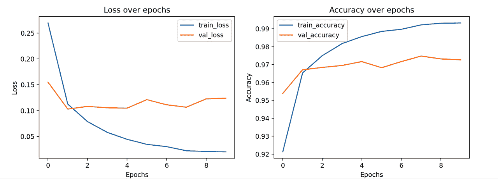

# 13-11神经网络-人工神经网络 ANN

> 来源：[https://qqs7y1hozd1.feishu.cn/docx/Id16dtkn3ohDL6xh21fcIkXOnQh](https://qqs7y1hozd1.feishu.cn/docx/Id16dtkn3ohDL6xh21fcIkXOnQh)

人工神经网络（Artificial Neural Network，ANN）是一种模仿人脑工作方式的计算模型。

ANN 的主要特点是通过大量的简单计算单元（神经元）组成一个复杂的网络，能够处理和分析复杂的数据。

总结三点关于ANN的点：

+ 类比大脑：想象一下大脑是由无数的神经元（神经细胞）组成的，这些神经元通过连接（突触）彼此通信。人工神经网络就是模仿这种结构和工作方式的计算模型。

+ 神经元：在人工神经网络中，每个“神经元”实际上是一个简单的计算单元。它接收输入，进行一些数学运算，然后产生输出。

+ 连接权重：神经元之间的连接是有“权重”的，这些权重决定了信息传递的强度。训练网络的过程就是调整这些权重，使得网络能够更好地处理和分析数据。

基本结构有三层：

+ 输入层：接收外界数据的部分。例如，如果你要识别一张图片，输入层就接收这张图片的像素值。

+ 隐藏层：介于输入层和输出层之间的层，负责处理输入的数据。隐藏层可以有很多层，每层包含许多神经元。

+ 输出层：产生最终结果的部分。例如，在图片识别的例子中，输出层可能会告诉你图片上是什么。

工作方式：

**1. 前向传播**：数据从输入层经过隐藏层，最终到达输出层。这过程中每个神经元进行计算，把结果传递到下一个神经元。

**2. 误差计算**：网络的输出结果和期望结果（真实值）进行比较，计算出误差。

**3. 反向传播**：根据误差，调整每个神经元之间连接的权重，使网络的输出越来越接近期望结果。这一步骤会反复进行，直到误差足够小。

这里，先给大家举一个很简单的例子，帮助有一个初步的印象~

当你在教一个神经网络识别手写数字。输入层接收手写数字的像素值，隐藏层处理这些像素值的模式，输出层给出识别的数字（例如：0到9之间的一个数字）。通过大量的训练数据（很多张手写数字图片），网络会不断调整自己的权重，变得越来越准确。

## 理论基础

人工神经网络的基本单位是神经元，它模仿生物神经元的行为。ANN 通过多个神经元组成层（如输入层、隐藏层、输出层），形成复杂的网络。

下面，咱们从原理、公式的推理以及算法过程详细的和大家聊聊~

### 神经元的数学原理

神经元模型通常包括以下部分：

+ 输入：多个输入

+ 权重：对应的权重

+ 偏置：一个偏置

+ 激活函数：一个非线性函数

+ 输出：输出值

神经元的输出计算如下：

然后，通过激活函数 生成神经元的输出：

常见的激活函数包括：

+ Sigmoid：

+ ReLU：

+ Tanh：

### 前向传播（Forward Propagation）

在 ANN 中，数据从输入层通过隐藏层传递到输出层，这一过程称为前向传播。

**输入层到隐藏层**

假设输入层有  个神经元，隐藏层有  个神经元。连接输入层和隐藏层的权重矩阵  大小为  ，偏置向量  大小为  。

输入向量  大小为  ，隐藏层输出向量  大小为  。

**隐藏层到输出层**

假设隐藏层到输出层的权重矩阵  大小为  ，偏置向量  大小为  。

隐藏层输出向量  大小为  ，输出层输出向量  大小为  。

这里  是最终的输出，取决于问题的类型（分类、回归等），可能使用不同的激活函数或直接输出  。

### 损失函数（Loss Function）

损失函数用于衡量网络输出  与目标值  之间的差异。常见的损失函数包括：

+ 均方误差（MSE）：用于回归问题

+ 交叉熵损失：用于分类问题

### 反向传播（Backpropagation）

反向传播用于计算损失函数对权重和偏置的梯度，从而调整这些参数以最小化损失。

**计算梯度**

**1. 输出层的误差**：

**2. 隐藏层的误差**：

这里  表示元素级别乘积， 是激活函数的导数。

**3. 梯度计算**：

**更新参数**

使用梯度下降更新参数：

这里  是学习率。

### 算法流程

总结人工神经网络的训练过程，通常包括以下步骤：

**1. 初始化**：初始化权重  和偏置  （通常为小的随机数）。

**2. 前向传播**：

+ 输入数据经过网络，计算每层的激活值和输出。

+ 得到最终的输出。

**3. 计算损失**：使用损失函数计算输出与目标值之间的差异。

**4. 反向传播**：

+ 计算输出层和隐藏层的误差。

+ 计算每个权重和偏置的梯度。

**5. 参数更新**：根据梯度更新权重和偏置。

**6. 重复**：对所有训练数据多次重复步骤 2 到 5，直到损失收敛或达到预设的迭代次数。

### 公式总结

+ 神经元输出：

+ 前向传播：

+ 损失函数（以均方误差为例）：

+ 反向传播误差：

+ 梯度：

+ 参数更新：

这些公式和算法步骤共同构成了人工神经网络的核心，指导其学习和预测能力。

大家可以根据原理进行公式的推理。

## 完整案例

为了给大家演示一个详细的ANN实际案例。今天使用 `Keras` 作为深度学习框架，结合 `TensorFlow` 后端。

选择了经典的 **手写数字识别（MNIST）** 数据集，因为它是经典的图像分类问题，适合演示 ANN 的实际应用。

### 项目概述

1. 加载和预处理数据

2. 构建和训练ANN模型

3. 评估模型性能

4. 可视化结果

5. 优化模型

### 1. 加载和预处理数据

首先加载 MNIST 数据集，并进行预处理（归一化和标签编码）。

```
import numpy as np
import matplotlib.pyplot as plt
from tensorflow.keras.datasets import mnist
from tensorflow.keras.utils import to_categorical

# 加载MNIST数据集
(x_train, y_train), (x_test, y_test) = mnist.load_data()

# 数据形状
print(f&#x27;Train data shape: {x_train.shape}, Train labels shape: {y_train.shape}&#x27;)
print(f&#x27;Test data shape: {x_test.shape}, Test labels shape: {y_test.shape}&#x27;)

# 数据归一化
x_train = x_train.astype(&#x27;float32&#x27;) / 255.0
x_test = x_test.astype(&#x27;float32&#x27;) / 255.0

# 将每个图像展平 (28x28 -&gt; 784)
x_train = x_train.reshape((x_train.shape[0], -1))
x_test = x_test.reshape((x_test.shape[0], -1))

# 将标签进行one-hot编码
y_train = to_categorical(y_train)
y_test = to_categorical(y_test)

print(f&#x27;Train data shape after reshape: {x_train.shape}&#x27;)
print(f&#x27;Test data shape after reshape: {x_test.shape}&#x27;)
```

### 2. 构建和训练 ANN 模型

我们构建一个简单的 ANN，使用 `Keras` `Sequential` API。

```
from tensorflow.keras.models import Sequential
from tensorflow.keras.layers import Dense
from tensorflow.keras.optimizers import Adam

# 构建模型
model = Sequential([
    Dense(128, input_shape=(784,), activation=&#x27;relu&#x27;),
    Dense(64, activation=&#x27;relu&#x27;),
    Dense(10, activation=&#x27;softmax&#x27;)  # 输出层10个神经元对应10个类别
])

# 编译模型
model.compile(optimizer=Adam(), 
              loss=&#x27;categorical_crossentropy&#x27;, 
              metrics=[&#x27;accuracy&#x27;])

# 训练模型
history = model.fit(x_train, y_train, epochs=10, batch_size=32, validation_split=0.2)
```

### 3. 评估模型性能

我们在测试数据上评估模型的性能。

```
# 评估模型
test_loss, test_accuracy = model.evaluate(x_test, y_test)
print(f&#x27;Test accuracy: {test_accuracy:.4f}&#x27;)
```

### 4. 可视化结果

我们绘制训练过程中损失和准确性的变化。

```
# 绘制训练损失和准确性
plt.figure(figsize=(12, 4))

plt.subplot(1, 2, 1)
plt.plot(history.history[&#x27;loss&#x27;], label=&#x27;train_loss&#x27;)
plt.plot(history.history[&#x27;val_loss&#x27;], label=&#x27;val_loss&#x27;)
plt.xlabel(&#x27;Epochs&#x27;)
plt.ylabel(&#x27;Loss&#x27;)
plt.legend()
plt.title(&#x27;Loss over epochs&#x27;)

plt.subplot(1, 2, 2)
plt.plot(history.history[&#x27;accuracy&#x27;], label=&#x27;train_accuracy&#x27;)
plt.plot(history.history[&#x27;val_accuracy&#x27;], label=&#x27;val_accuracy&#x27;)
plt.xlabel(&#x27;Epochs&#x27;)
plt.ylabel(&#x27;Accuracy&#x27;)
plt.legend()
plt.title(&#x27;Accuracy over epochs&#x27;)

plt.show()
```



### 5. 模型优化

我们可以通过多种方法优化模型，比如调整网络结构、修改优化器参数、或者进行超参数调整（如学习率、批量大小等）。

**优化建议**

**1. 增加层数或神经元数**：可以尝试增加网络的复杂性。

2. 正则化：使用 `Dropout` 或 L2 正则化防止过拟合。

3. 学习率调整：使用学习率调度器或自适应学习率优化器（如 `Adam`）。

4. 批量归一化：在每层之后添加 Batch Normalization。

**优化示例**：

```
from tensorflow.keras.layers import Dropout
from tensorflow.keras.callbacks import ReduceLROnPlateau, EarlyStopping

# 构建优化后的模型
optimized_model = Sequential([
    Dense(256, input_shape=(784,), activation=&#x27;relu&#x27;),
    Dropout(0.3),
    Dense(128, activation=&#x27;relu&#x27;),
    Dropout(0.3),
    Dense(64, activation=&#x27;relu&#x27;),
    Dense(10, activation=&#x27;softmax&#x27;)
])

# 编译模型
optimized_model.compile(optimizer=Adam(learning_rate=0.001), 
                        loss=&#x27;categorical_crossentropy&#x27;, 
                        metrics=[&#x27;accuracy&#x27;])

# 设置回调函数
reduce_lr = ReduceLROnPlateau(monitor=&#x27;val_loss&#x27;, factor=0.5, patience=5, min_lr=1e-6)
early_stopping = EarlyStopping(monitor=&#x27;val_loss&#x27;, patience=10, restore_best_weights=True)

# 训练优化后的模型
optimized_history = optimized_model.fit(x_train, y_train, epochs=30, batch_size=64, 
                                        validation_split=0.2, callbacks=[reduce_lr, early_stopping])
```

+ **训练曲线**：观察训练和验证损失、准确率的变化，以判断模型是否存在过拟合或欠拟合。

+ **测试性能**：测试准确率可用于衡量模型的泛化能力。

+ **基础 ANN 模型**：简单的全连接神经网络可以解决基本的分类问题，但可能受限于复杂性。

+ **优化模型**：通过增加网络复杂性、使用正则化和调整超参数，可以显著提升模型性能。

## 模型分析

针对 ANN 模型的优缺点、与相似算法的对比，以及适用场景的讨论。

**优点**：

**1. 结构简单**：

+ **实现简单**：基础的 ANN 结构较为简单，适合初学者理解和实现。

+ **计算效率高**：对于中等复杂度的问题，ANN 的训练和推理速度较快。

**2. 处理非线性数据**：

+ **非线性能力**：ANN 可以通过激活函数处理非线性数据，适合各种复杂的数据分布。

+ **特征学习**：通过多层结构，ANN 可以自动学习数据的特征，而不需要人为设计特征。

**3. 广泛适用**：

+ **适用广泛**：ANN 可用于回归、分类、序列预测等多种任务。

**缺点**：

**1. 对超参数敏感**：ANN 对学习率、层数、神经元数等超参数较为敏感，可能需要大量实验来找到合适的参数。

**2. 容易过拟合**：如果模型复杂度过高或数据不足，ANN 容易过拟合，需要正则化和适当的模型复杂度控制。

**3. 对输入形状敏感**：ANN 不能直接处理二维数据（如图像），需要将图像展平为一维向量，可能丢失空间信息。

**4. 有限的空间信息捕捉能力**：ANN 主要使用全连接层，可能无法有效捕捉图像的空间特征。

**与相似算法的对比**

| 算法 | 与 ANN 的相似性 | 主要区别 | 适用场景 |

| --- | --- | --- | --- |

| 人工神经网络（ANN） | 基础神经网络结构，可用于分类和回归 | 结构较为简单，适用于一般模式识别和数据建模 | 图像、文本、时间序列等多种任务 |

| 卷积神经网络（CNN） | ANN 的扩展，专门用于图像处理 | 采用卷积层提取局部特征，减少参数量，提高计算效率 | 复杂图像识别、物体检测、图像生成 |

| 支持向量机（SVM） | 也是一种用于分类和回归的监督学习方法 | 适用于小样本、高维空间，决策边界明确，但计算量大 | 文本分类、小型图像集分类 |

| 随机森林（RF） | 可用于分类和回归，像 ANN 一样具备泛化能力 | 基于决策树集成，非神经网络方法，对异常值不敏感 | 分类任务、回归任务，尤其适合表格数据 |

| 逻辑回归（LR） | 可看作 ANN 的最简单形式（单层感知机） | 仅适用于线性可分问题，无法处理复杂的非线性关系 | 简单的二分类问题 |

**适用场景分析**

**ANN 是优选算法的情况：**

**1. 中小型数据集**：适用于中等复杂度的数据集（如 MNIST 手写数字识别），训练速度较快，易于实现。

**2. 初学者学习**：结构简单，易于理解，适合初学者进行机器学习和深度学习的入门学习。

**3. 非特征工程要求高的数据**：在一些简单数据集中，ANN 可以自动学习特征，无需复杂的特征工程。

**可以考虑其他算法的情况：**

1. 图像处理任务：在处理图像相关任务时，如物体检测、图像分类，CNN 通常比 ANN 更有效。

2. 特征维度高且无明显特征工程：在特征工程较少且维度较高的数据集上，随机森林和 SVM 可能表现更好。

3. 小数据集或线性问题：在小数据集或线性问题上，SVM 和逻辑回归的表现可能更佳，且计算量更小。


### 4. 时间序列或序列预测

在时间序列预测、文本生成等任务中，`RNN` 及其变种（如 `LSTM`、`GRU`）比 `ANN` 更适合。

## 最后

+   `ANN` 适合中小型数据集，简单而有效，适合初学者和简单的分类、回归任务。

+   在图像处理等需要空间特征提取的任务中，`CNN` 是更优的选择。

+   在特征工程不明显的大型数据集上，随机森林和 `SVM` 可能表现更佳。

+   序列预测任务中，`RNN` 及其变种是更合适的选择。

不同算法各有优缺点，根据问题的具体需求、数据特点和计算资源选择最合适的算法。
