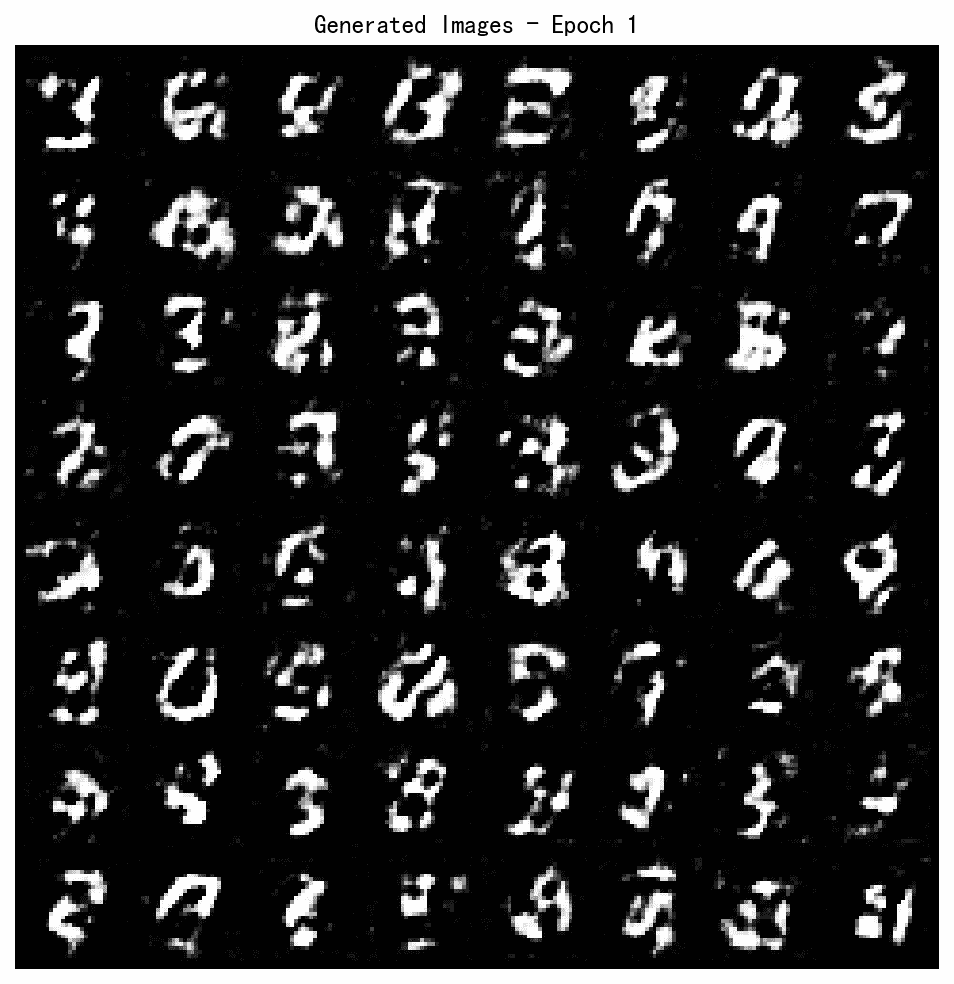
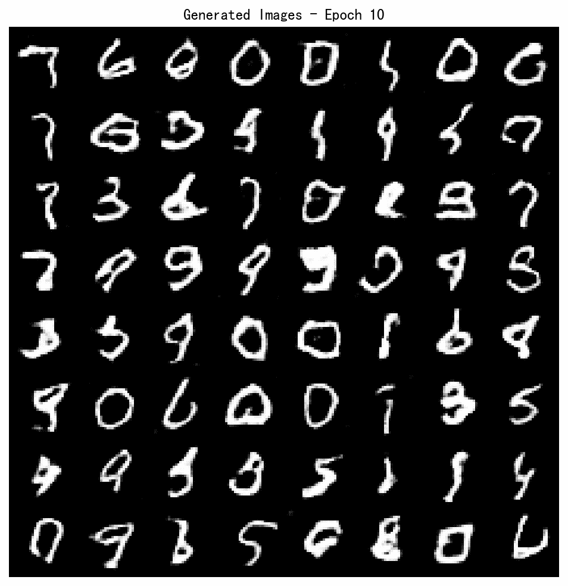
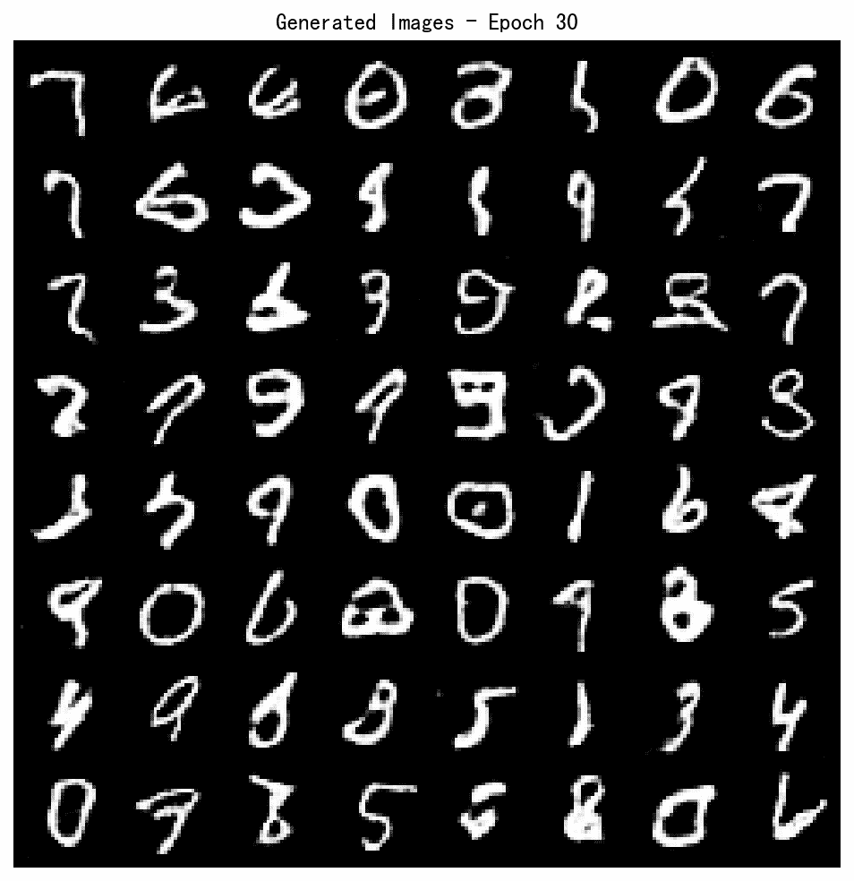

# 13-12神经网络-生成对抗网络 GAN

> 来源：[https://qqs7y1hozd1.feishu.cn/docx/K8UBdc2rOofxJtxtIyecG4Zfnih](https://qqs7y1hozd1.feishu.cn/docx/K8UBdc2rOofxJtxtIyecG4Zfnih)

生成对抗网络（英文缩写为 GAN）是一种让机器“学会创造”的人工智能模型。

它的特别之处在于，不只是让机器识别、分析已有的数据，而是可以“凭空”生成新的、看起来很真实的数据，比如图片、声音甚至文字。

我们可以把 GAN 想象成一个**由两个“对手”组成的系统**：一个是**生成器（Generator）**，另一个是判别器（Discriminator）。这两者在互相“对抗”中不断进步。

这里，咱们举一个很好懂的例子~

比如一个**画家和鉴赏家**的故事：

+   **画家（生成器）**：他在练习画画，目标是画出让人看不出是假的画。

+   **鉴赏家（判别器）**：他是个艺术行家，专门判断一幅画是真的（真实图片）还是假的（画家画的）。

一开始，画家水平很差，画出来的图很容易被鉴赏家识破。但随着不断练习，画家画得越来越像真的；而鉴赏家也在不断学习，提高辨别能力。最终，画家的作品能骗过鉴赏家，说明画得已经很逼真了。

GAN 的训练过程就是**画家和鉴赏家不断较量、互相进步**的过程。

### GAN 可以用来做什么？

GAN 已经被应用在很多领域，比如：

+   **生成假人脸**：比如你看到一张看起来很真实的人脸照片，其实这个人并不存在。

+   **图像修复**：把一张模糊或破损的图片自动修复好。

+   **图像风格转换**：比如把一张普通照片变成梵高风格的画。

+   **生成虚拟语音、音乐**：用来训练说话机器人的声音，或者自动作曲。

生成对抗网络（GAN）就是让两个AI模型互相竞争，一个负责造假，一个负责识别真假，通过这种对抗让“造假”的模型学会如何生成越来越逼真的东西。它是让机器“有创意”的重要一步。

## 原理详解

本文假设你有基础的概率论、优化理论和微积分知识。

### 1. 基本目标

**GAN **的核心思想是让两个神经网络进行博弈学习：

+   生成器  ：学习从**随机噪声**中生成逼真的数据样本（如图片）。

+   判别器  ：学习判断输入的数据是真实的（来自真实数据分布）还是伪造的（来自生成器）。

GAN 的目的是让   生成的样本越来越像真实的样本，使得   无法分辨真假。

### 2. 数学建模：两人零和博弈

设：

+    ：真实数据的分布

+    ：噪声变量的分布（通常为标准正态分布）

+    ：生成器的输出，输入为噪声  ，参数为

+    ：判别器的输出，输入为数据  ，输出为一个标量，表示“为真”的概率，参数为

目标函数是一个**极小极大（min-max）游戏**：

其中：

+   第一项：判别器希望对真实样本   的判断为真，即   越接近 1 越好

+   第二项：判别器希望对生成样本   的判断为假，即   越接近 0 越好

+   而生成器希望让   越接近 1，欺骗判别器

这是一个博弈过程：

+     力求最大化这个目标函数

+     力求最小化这个目标函数

### 3. 理论最优判别器

固定生成器  ，我们可以推导出对于任意   的最优判别器  ：

其中，  是通过   映射出来的生成样本分布。

**推导思路（极值）**：

对目标函数   中的   求极大值：

对   求偏导数，设为 0，解得最优解为上式。

### 4. 最小化   的损失函数

将最优   代入目标函数，可以得到生成器要最小化的损失为：

将   代入上式，有：

可化简为：

其中 JSD 表示 Jensen-Shannon 散度，用于衡量两个分布的相似程度。

因此，训练 GAN 就是在最小化真实分布和生成分布的 JSD。

### 训练算法流程

可以概括为如下步骤：

#### 步骤一：初始化

+   初始化生成器   和判别器   的参数

#### 步骤二：重复以下训练过程，直到收敛或满足训练轮数

**1. 更新判别器 **

+   从真实数据分布   中采样一批数据

+   从噪声分布   中采样一批噪声  ，生成伪数据

+   最大化判别器目标函数：

**2. 更新生成器 **

+   再采样一批噪声

+   最小化生成器目标函数：

**或者更常见的替代方式**（因为上式在初期梯度较小）：

该替代方法本质是最大化判别器被欺骗的概率，更容易提供强梯度信号。

### 总结 GAN 数学本质

1.  GAN 是一个 **零和博弈问题**，两个神经网络互相优化。

1.  **GAN 的优化目标本质上**是在最小化 生成分布与真实分布的距离（如 Jensen-Shannon 散度）。

1.  判别器通过分类真假来提供梯度信号，帮助生成器学习数据分布。

1.  理论上，当生成分布完全等于真实分布时，GAN 达到纳什均衡，此时  ，即无法分辨真假。

## 完整案例

项目标题：使用 DCGAN 生成手写数字（MNIST）

这里咱们使用 **生成对抗网络（GAN）**，特别是其改进版本 DCGAN（Deep Convolutional GAN），训练一个神经网络模型，使其能够从随机噪声中生成“看起来像”手写数字的图像。

我们分为以下几步：

+   准备数据（MNIST 手写数字）

+   构建生成器和判别器网络

+   定义损失函数与优化器

+   训练 GAN 模型

+   生成图像 + 可视化

+   分析训练过程与图像质量

+   提出优化策略与可能的改进

### 完整代码

```
import torch
import torch.nn as nn
import torch.optim as optim
import torchvision
import torchvision.transforms as transforms
import matplotlib.pyplot as plt
import numpy as np
import os
from torchvision.utils import make_grid

import ssl
ssl._create_default_https_context = ssl._create_unverified_context


# 超参数
batch_size = 128
image_size = 28
z_dim = 100
epochs = 50
lr = 0.0002
beta1 = 0.5
device = torch.device(&quot;cuda&quot; if torch.cuda.is_available() else &quot;cpu&quot;)

# 创建输出目录
os.makedirs(&quot;./generated_images&quot;, exist_ok=True)

# 预处理
transform = transforms.Compose([
    transforms.ToTensor(),
    transforms.Normalize((0.5,), (0.5,))
])

# 加载 MNIST 数据集
dataloader = torch.utils.data.DataLoader(
    torchvision.datasets.MNIST(root=&#x27;./data&#x27;, download=True, transform=transform),
    batch_size=batch_size, shuffle=True
)


# 判别器网络
class Discriminator(nn.Module):
    def __init__(self):
        super(Discriminator, self).__init__()
        self.model = nn.Sequential(
            nn.Conv2d(1, 64, 4, 2, 1),   # (28x28) → (14x14)
            nn.LeakyReLU(0.2, inplace=True),
            nn.Conv2d(64, 128, 4, 2, 1), # (14x14) → (7x7)
            nn.BatchNorm2d(128),
            nn.LeakyReLU(0.2, inplace=True),
            nn.Flatten(),
            nn.Linear(128*7*7, 1),
            nn.Sigmoid()
        )

    def forward(self, x):
        return self.model(x)

# 生成器网络
class Generator(nn.Module):
    def __init__(self):
        super(Generator, self).__init__()
        self.model = nn.Sequential(
            nn.Linear(z_dim, 128*7*7),
            nn.BatchNorm1d(128*7*7),
            nn.ReLU(True),
            nn.Unflatten(1, (128, 7, 7)),
            nn.ConvTranspose2d(128, 64, 4, 2, 1), # (7x7) → (14x14)
            nn.BatchNorm2d(64),
            nn.ReLU(True),
            nn.ConvTranspose2d(64, 1, 4, 2, 1),   # (14x14) → (28x28)
            nn.Tanh()
        )

    def forward(self, z):
        return self.model(z)

# 初始化模型
D = Discriminator().to(device)
G = Generator().to(device)

# 损失函数和优化器
criterion = nn.BCELoss()
optimizer_D = optim.Adam(D.parameters(), lr=lr, betas=(beta1, 0.999))
optimizer_G = optim.Adam(G.parameters(), lr=lr, betas=(beta1, 0.999))

# 固定噪声用于生成固定测试图
fixed_noise = torch.randn(64, z_dim, device=device)

# 可视化函数
def show_generated_images(images, epoch):
    images = images.detach().cpu()
    grid = make_grid(images, nrow=8, normalize=True)
    plt.figure(figsize=(8, 8))
    plt.axis(&quot;off&quot;)
    plt.title(f&quot;Generated Images - Epoch {epoch}&quot;)
    plt.imshow(np.transpose(grid, (1, 2, 0)))
    plt.savefig(f&quot;generated_images/epoch_{epoch}.png&quot;, dpi=150, bbox_inches=&#x27;tight&#x27;)
    plt.close()

# 训练主循环
for epoch in range(1, epochs + 1):
    for i, (real_images, _) in enumerate(dataloader):
        real_images = real_images.to(device)
        batch_size_curr = real_images.size(0)
        
        # 标签
        real_labels = torch.ones(batch_size_curr, 1, device=device)
        fake_labels = torch.zeros(batch_size_curr, 1, device=device)
        
        # ========== 训练判别器 ==========
        z = torch.randn(batch_size_curr, z_dim, device=device)
        fake_images = G(z)
        
        D_real = D(real_images)
        D_fake = D(fake_images.detach())

        loss_D_real = criterion(D_real, real_labels)
        loss_D_fake = criterion(D_fake, fake_labels)
        loss_D = loss_D_real + loss_D_fake
        
        optimizer_D.zero_grad()
        loss_D.backward()
        optimizer_D.step()
        
        # ========== 训练生成器 ==========
        z = torch.randn(batch_size_curr, z_dim, device=device)
        fake_images = G(z)
        D_fake = D(fake_images)

        loss_G = criterion(D_fake, real_labels)  # 欺骗判别器

        optimizer_G.zero_grad()
        loss_G.backward()
        optimizer_G.step()

    print(f&quot;Epoch [{epoch}/{epochs}] Loss D: {loss_D.item():.4f}, Loss G: {loss_G.item():.4f}&quot;)
    
    with torch.no_grad():
        fake_images = G(fixed_noise)
        show_generated_images(fake_images, epoch)
```

#### 1. 数据处理与加载

```
transform = transforms.Compose([
    transforms.ToTensor(),
    transforms.Normalize((0.5,), (0.5,))
])
```

+   Normalize((0.5,), (0.5,))：将原始像素值从 [0,1] 线性变换到 [-1,1]，更适合 Tanh 激活函数

+   batch_size = 128：每次输入模型的图像数量

#### 2. 判别器结构（Discriminator）

+   两个卷积层提取图像特征

+   LeakyReLU 防止梯度消失

+   使用 Sigmoid 输出真假概率

关键结构是：

+   Conv2d(1, 64, 4, 2, 1)：从 28x28 图像 → 14x14 特征图

+   Conv2d(64, 128, 4, 2, 1)：→ 7x7

+   全连接层：128×7×7 → 1 输出

#### 3. 生成器结构（Generator）

+   输入 100 维随机噪声

+   Linear + BatchNorm + ReLU → 128×7×7 特征图

+   两次转置卷积上采样 → 最终 28×28 的图像

#### 4. 损失函数设计

使用标准的 二元交叉熵损失（BCELoss）：

+   判别器：希望最大化真假差异

+   生成器：希望最小化判别器能辨别的能力（让判别器输出 1）

#### 5. 可视化图像

```
def show_generated_images(images, epoch):
    ...
    plt.title(f&quot;Generated Images - Epoch {epoch}&quot;)
```

使用 make_grid 和 imshow 可视化生成图像，使用 normalize=True 强调对比度。图像保存为 PNG，并命名为 epoch 名字，颜色饱和度高、对比度强，便于观察训练进展。

### 训练结果分析

以下是训练 50 个 Epoch 后得到的一些效果图（大家可运行代码自动生成）：

1.  **Epoch 1**：图像还很模糊，看不出数字结构



1.  **Epoch 10**：生成的图像有些“数字轮廓”，但形状不标准



1.  **Epoch 30+**：许多数字接近真实，但还有些变形



1.  **Epoch 50**：图像清晰可辨，数字基本上都符合 MNIST 风格


### 训练过程中的挑战与解决方案

#### 1. 模式崩溃（Mode Collapse）

**现象**：生成器只学会生成一种数字（比如全是“1”）

**解决**：引入更复杂的损失，如 WGAN 或使用 mini-batch discrimination 等技术。

#### 2. 判别器过强

**现象**：D 很快就学会区分真假，导致 G 得不到有效梯度

**解决**：

+   平衡 D 与 G 的学习率

+   每训练一次 D，训练多次 G（或反之）

#### 3. 学习率选择

太大会导致训练不稳定，太小则训练过慢。推荐使用：

+   学习率

+   优化器：Adam（ ）

### 优化建议与未来方向

#### 1. 使用 WGAN 改进损失函数

**Wasserstein GA**N 用 Earth Mover 距离 替代 JS 散度，更稳定。

#### 2. 引入条件 GAN（cGAN）

让生成器能控制生成哪种数字（输入类标签），适合分类应用。

#### 3. 使用更大的数据集（如 CelebA）

扩展到人脸图像生成，测试模型的泛化能力。

#### 4. 添加图像评估指标

如 Inception Score（IS）、Frechet Inception Distance（FID）等。

## 模型分析

### 优缺点分析

**优点**：

1.  **生成质量高**：相较于传统的生成模型（如朴素贝叶斯、VAE 等），GAN 可以生成更真实、锐利、视觉质量更高的图像。在训练收敛良好的前提下，生成的图像可与真实图像难以区分。

1.  **无监督学习能力强**：GAN 不需要为数据打标签，属于无监督学习。这使它可以在没有明确标注的数据上训练，降低数据准备的成本。

1.  **灵活性强，可拓展性高**：GAN 架构非常灵活，可以扩展为多种变种：条件 GAN（cGAN）、CycleGAN、StyleGAN、WGAN 等，满足不同领域的应用（图像转换、人脸生成、风格迁移等）。

1.  **直观反馈机制**：GAN 的对抗训练结构使其天然具备“反馈机制”：生成器的学习目标直接来自于判别器的输出，这种“对手式”优化可以推动模型进化。

**缺点**：

1.  **训练不稳定，调参困难**：GAN 被广泛认为是难以训练的模型之一。生成器和判别器之间需要保持微妙的平衡，一旦一方过强，训练就会陷入震荡或崩溃。

1.  模式崩溃问题（Mode Collapse）：生成器可能只学会生成极少数模式（如仅生成数字“1”），忽略数据的多样性。这是 GAN 的典型训练病症。

1.  **缺乏明确的评价指标**：评估 GAN 的生成效果不像分类模型那样有明确的准确率等指标。需要使用 FID、IS 等间接指标，且这些指标本身仍存在争议。

1.  **对计算资源要求较高**：虽然 MNIST 级别的数据较轻量，但在真实场景（如人脸、艺术风格、视频）中，训练 GAN 通常需要较大的显存和计算力。

### GAN 与其他相似生成算法的对比

| 属性 / 算法 | GAN | VAE（变分自编码器） | Autoregressive 模型（如 PixelCNN） | Flow 模型（如 RealNVP） |
| --- | --- | --- | --- | --- |
| **训练方式** | 对抗训练（博弈） | 最大化变分下界（重参数技巧） | 逐像素建模 | 通过可逆变换建模概率 |
| **生成样本质量** | 高（锐利、真实） | 较模糊 | 真实但慢 | 中等 |
| **训练稳定性** | 不稳定，需调参 | 稳定 | 稳定 | 稳定 |
| **推理效率（速度）** | 快（一次前向传播） | 快 | 慢（逐像素） | 中等 |
| **模式覆盖能力** | 易出现 mode collapse | 覆盖全面，但图像模糊 | 好 | 好 |
| **样本显式概率建模** | 否（无显式 log-likelihood） | 是 | 是 | 是 |
| **应用场景举例** | 图像合成、人脸生成、风格转换 | 图像重建、表示学习 | 高保真建模、语音合成 | 图像建模、密度估计 |

### 什么时候优选使用 GAN，什么时候考虑其他生成模型？

**优选使用 GAN 的场景：**

1.  **需要生成视觉质**量极高的图像或视频：如 AI 作画、人脸合成、图像增强等，GAN 在图像的清晰度和真实感方面优于其他模型。

1.  **无标签数据丰富**：GAN 不需要标签训练，适合大量无标注图片进行训练（如互联网图片爬取数据）。

1.  **需要对抗式学习结构**：在某些博弈结构中，GAN 的双网络对抗机制提供天然优势，比如在安全检测、强化学习环境中可模拟攻击方。

1.  **图像风格迁移、超分辨率**：如 CycleGAN、SRGAN 等基于 GAN 的变体表现优异。

**考虑其他生成模型的场景：**

1.  **需要明确的概率建模**：比如在异常检测、图像压缩任务中，VAE、Flow 模型由于具有显式的概率密度函数，更适用于需要对样本概率评分的场景。

1.  **要求生成模型具备结构化语义表达****：VAE** 生成**空间更具**可解释性，适用于表示学习或需要可控生成的任务。

1.  **训练稳定性为首要条件**：在资源有限或部署环境复杂的场合，GAN 的训练风险较高，不如选择 VAE 或 Flow 这类更稳定的架构。

1.  **逐步生成序列数据**：在语音建模、时间序列预测中，PixelCNN 这类自回归模型通常优于 GAN，因为它们可以逐点控制生成过程。

### 总结

GAN 是生成式模型中的一项重要突破技术，尤其在图像生成方面具有极高的表现力。但它并非“万金油”模型：在不同任务、不同需求下，需要结合其优缺点以及对比模型的特性，做出理性的选择。

你可以将 GAN 视为在“视觉真实感”与“训练难度”之间做权衡的一种高级工具。当你需要令人惊艳的图像，但也愿意投入相应的训练资源和调参工作时，GAN 是首选。而在需要稳定性或可解释性的任务中，VAE、Flow、甚至 Transformer-based Diffusion 模型则可能更适合。