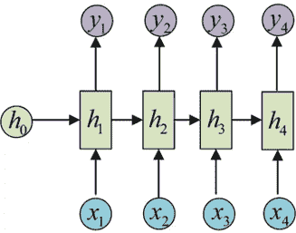
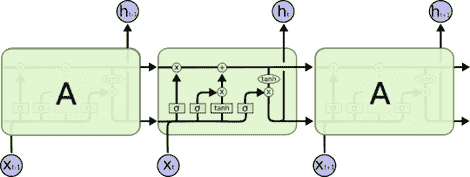
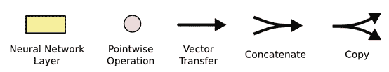
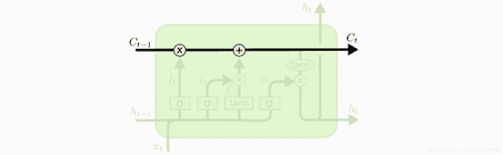
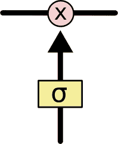
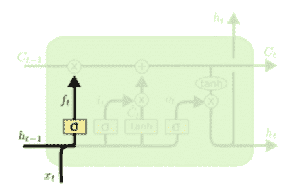
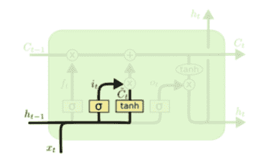
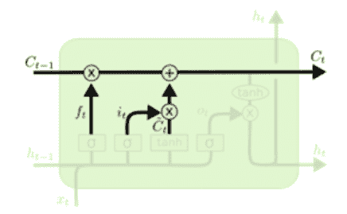
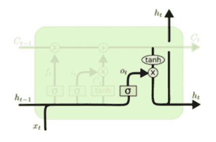
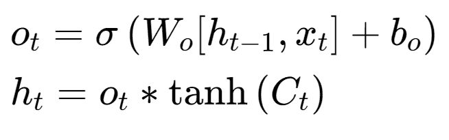

# 【LSTM】深入浅出长短时记忆神经网络（结构、原理）

> 来源：[https://qqs7y1hozd1.feishu.cn/docx/XQ8qdCHdtotYI7xHijbcrw0un3c](https://qqs7y1hozd1.feishu.cn/docx/XQ8qdCHdtotYI7xHijbcrw0un3c)

## 1、LSTM的背景介绍

长短时记忆神经网络（Lon**g Sh**ort-term Memory Networks，简称LSTM）是特殊的RNN，尤其适合顺序序列数据的处理。

> LSTM明确旨在避免长期依赖性问题，成功地解决了原始循环神经网络的缺陷，在语音识别、图片描述、自然语言处理等许多领域中成功应用。

## 2、RNN的不足

如果输入序列的长度很长，很难进行有效的参数更新。通常来说梯度爆炸更容易处理一些。梯度爆炸时可以设置一个梯度阈值，当梯度超过这个阈值的时候可以直接截取。

> **有三种方法应对梯度消失问题：**

> （1）合理的初始化权重值。

> （2）使用 ReLu 代替 sigmoid 和 tanh 作为激活函数。

> （3）使用其他结构的RNNs。

## 3、LSTM的结构和原理

上图中使用的各个元素的图标的含义如下图所示：

**其中：**

+   Neural Network Layer：神经网络层，用于学习；

+   Pointwise Operation：逐点运算操作，如逐点相乘、逐点相加、向量和等；

+   Vector Transfer：向量转移，向量沿箭头方向移动；

+   **Concatenate：**连接，将两个向量连接在一起；

+   **Copy：**复制，将向量复制为两份。

LSTM核心是细胞状态，穿过图的顶部的长横线，长直线称之为细胞状态（Cell State），决定什么样的信息会被保留，什么样的信息会被遗忘，记为 。

细胞状态像传送带一样，它贯穿整个细胞却只有很少的分**支，这样能保证信息不**变的流过整个RNN，细胞状态如下图所示：

> LSTM网络能通过一种被称为门的结构对细胞状态进行删除或者添加信息。

> 门能够有选择性的决定让哪些信息通过。

> 门的结构为一个sigmoid层和一个点乘操作的组合。

> sigmoid层输出0到1之间的数，描述每个部分有多少量可以通过，0代表不允许任何量通过，1表示允许任何量通过。

**LSTM实现了三个门计算，即遗忘门、**输入门和输出门，用来保护和控制细胞状态。

**遗忘门**负责决定保留多少上一时刻的单元状态到当前时刻的单元状态，即决定从细胞状态中丢弃什么信息。该门读取 和** ，然后经过si**gmoid层后，输出一个0-1之间的数 给每个在细胞状态 中的数字逐点相乘。 的值为0表示完全丢弃，1表示完全保留。结构如下图所示：

**输入门**负责决定保留多少当前时刻的输入到当前时刻的单元状态，包含两个部分，第一部分为sigmoid层，该层决定要更新什么值，第二部分为tanh层，该层把需要更新的信息更新到细胞状态里。tanh层创建一个新的细胞状态值向量 ， 会被加入到状态中。

**结构如下图：**

然后就到了更新旧细胞状态的**时间了，将 更新**为 ，把旧状态与 相乘，丢弃确定需要丢弃的信息，再加上  ，这样就完成了细胞状态的更新，结构如下图所示：

**输出门**负责决定当前时刻的单元状态有多少输出，通过一个sigmoid层来确定细胞状态的哪个部分将输出出去。把**细胞状态通过ta**nh进行处理，得到一个-1到1之间的值，并将它和sigmoid门的输出相乘，最终仅仅输出确定输出的部分。结构如下图所示：

输出门的结构

## 4、LSTM的训练过程

> **LSTM的参数训练算**法，依然是反向传播算法。主要有如下三个步骤：

> **第一步：**前向计算每个神经元的输出值。对于LSTM而言，依据前面介绍的算法，分别进行计算。

> **第二步：**确定优化目标函数。在训练早期，输出值和预期值会不一致，于是计算每个神经元的误差项值，构造出损失函数。

> **第三步：**根据损失函数的梯度指引，更新网络权值参数。

与传统RNN类似，LSTM误差项的反向传递包括两个层面：

+   一个是空间上层面的，将误差项向网络的上一层传播。

+   另一个是时间层面上的，沿时间反向传递，即从当前t时刻开始，计算每个时刻的误差。然后跳转第一步，重复做第一、二和三步，直至网络误差小于给定值。