# Transformer入门

> 来源：[https://qqs7y1hozd1.feishu.cn/docx/O2hndfojioJtMnx2DW6caz47nJD](https://qqs7y1hozd1.feishu.cn/docx/O2hndfojioJtMnx2DW6caz47nJD)

## 一、encoder

### 1.1 简介

**encoder，**也就是编码器，**负责将输入序列压缩成指定长度的向量，这个向量就可以看成是这个**序列的语义，然后进行编码，或进行特征提取（可以看做更复杂的编码）。

简单来说就是机器读取数据的过程，将现实问题转化成数学问题。如下图所示：

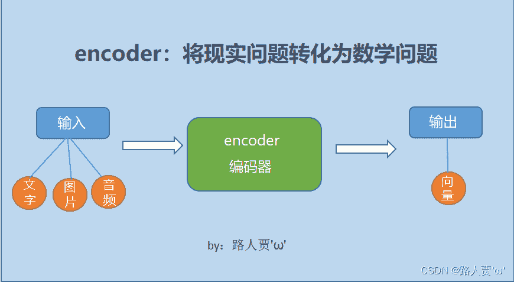

### 1.2 代码实现

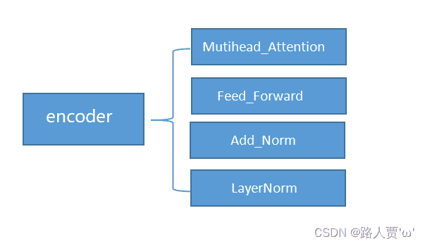

在编码器接口中，我们只指定长度可变的序列作为编码器的输入X。 任何继承这个encoder 基类的模型将完成代码实现。

```
class encoder(nn.Module):
    def __init__(self):
        super(Encoder, self).__init__()
        self.positional_encoding = Positional_Encoding(config.d_model)
        self.muti_atten = Mutihead_Attention(config.d_model,config.dim_k,config.dim_v,config.n_heads)
        self.feed_forward = Feed_Forward(config.d_model)
 
        self.add_norm = Add_Norm()
 
    def forward(self,x): # batch_size * seq_len 并且 x 的类型不是tensor，是普通list
 
        x += self.positional_encoding(x.shape[1],config.d_model)
        # print(&quot;After positional_encoding: {}&quot;.format(x.size()))
        output = self.add_norm(x,self.muti_atten,y=x)
        output = self.add_norm(output,self.feed_forward)
 
        return output
```

Mutihead_Attention()：多头注意力机制：

```
class Mutihead_Attention(nn.Module):
    def __init__(self,d_model,dim_k,dim_v,n_heads):
        super(Mutihead_Attention, self).__init__()
        self.dim_v = dim_v
        self.dim_k = dim_k
        self.n_heads = n_heads
 
        self.q = nn.Linear(d_model,dim_k)
        self.k = nn.Linear(d_model,dim_k)
        self.v = nn.Linear(d_model,dim_v)
 
        self.o = nn.Linear(dim_v,d_model)
        self.norm_fact = 1 / math.sqrt(d_model)
 
    def generate_mask(self,dim):
        # 此处是 sequence mask ，防止 decoder窥视后面时间步的信息。
        # padding mask 在数据输入模型之前完成。
        matirx = np.ones((dim,dim))
        mask = torch.Tensor(np.tril(matirx))
 
        return mask==1
 
    def forward(self,x,y,requires_mask=False):
        assert self.dim_k % self.n_heads == 0 and self.dim_v % self.n_heads == 0
        # size of x : [batch_size * seq_len * batch_size]
        # 对 x 进行自注意力
        Q = self.q(x).reshape(-1,x.shape[0],x.shape[1],self.dim_k // self.n_heads) # n_heads * batch_size * seq_len * dim_k
        K = self.k(x).reshape(-1,x.shape[0],x.shape[1],self.dim_k // self.n_heads) # n_heads * batch_size * seq_len * dim_k
        V = self.v(y).reshape(-1,y.shape[0],y.shape[1],self.dim_v // self.n_heads) # n_heads * batch_size * seq_len * dim_v
        # print(&quot;Attention V shape : {}&quot;.format(V.shape))
        attention_score = torch.matmul(Q,K.permute(0,1,3,2)) * self.norm_fact
        if requires_mask:
            mask = self.generate_mask(x.shape[1])
            attention_score.masked_fill(mask,value=float(&quot;-inf&quot;)) # 注意这里的小Trick，不需要将Q,K,V 分别MASK,只MASKSoftmax之前的结果就好了
        output = torch.matmul(attention_score,V).reshape(y.shape[0],y.shape[1],-1)
        # print(&quot;Attention output shape : {}&quot;.format(output.shape))
 
        output = self.o(output)
        return output
```

**F**eed_Forward() : 两个Linear中连接Relu即可，目的是为模型增添非线性信息，提高模型的拟合能力。

```
class Feed_Forward(nn.Module):
    def __init__(self,input_dim,hidden_dim=2048):
        super(Feed_Forward, self).__init__()
        self.L1 = nn.Linear(input_dim,hidden_dim)
        self.L2 = nn.Linear(hidden_dim,input_dim)
 
    def forward(self,x):
        output = nn.ReLU()(self.L1(x))
        output = self.L2(output)
        return output
```

Add_Norm（）：残差连接以及LayerNorm

```
class Add_Norm(nn.Module):
    def __init__(self):
        self.dropout = nn.Dropout(config.p)
        super(Add_Norm, self).__init__()
 
    def forward(self,x,sub_layer,**kwargs):
        sub_output = sub_layer(x,**kwargs)
        # print(&quot;{} output : {}&quot;.format(sub_layer,sub_output.size()))
        x = self.dropout(x + sub_output)
 
        layer_norm = nn.LayerNorm(x.size()[1:])
        out = layer_norm(x)
        return out
```

1.3 transformer中的使用

1.3.1transformer中encoder的组成

transformer 中 encoder 由 6 个相同的层组成，每个层包含 2 个部分：

Multi-Head Self-Attention

Position-Wise Feed-Forward Network

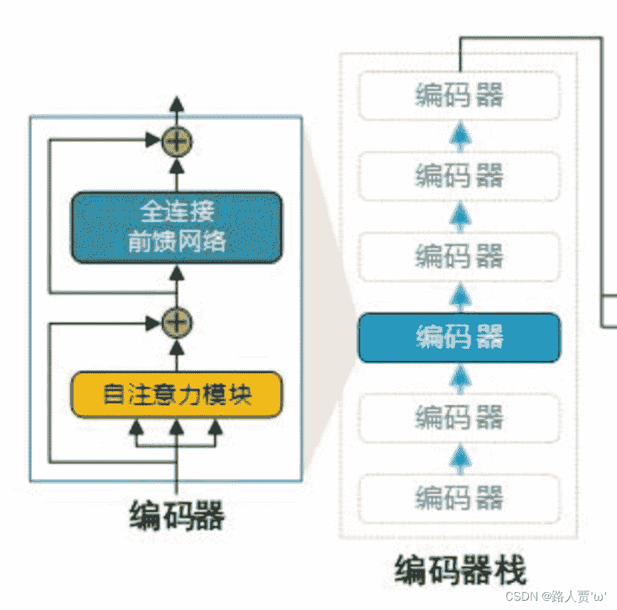

#### 1.3.2 每个Block的组成

自注意力机制 + 残差链接 + LayerNorm + FC + 残差链接 + layer Norm此时的输出 = 一个 Block 的输出；

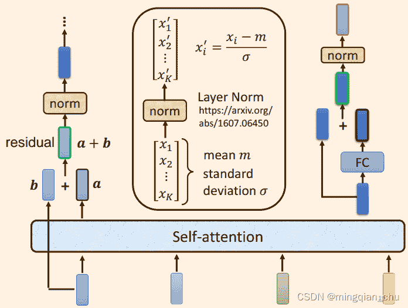

#### 1.3.3 每个Block 中的具体实现步骤

（1）原始的输入向量b 与输出向量a残差相加，得到向量a+b；

【注意】 b是原始的输入向量，下图中输出向量a是考虑整个序列的输入向量得到的结果

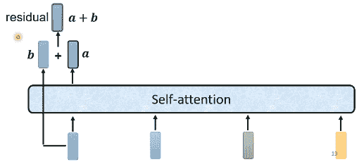

**（2）将向量 a+b 通过 Lay**er Normation 得到向量c ;

也就是下图左边部分：

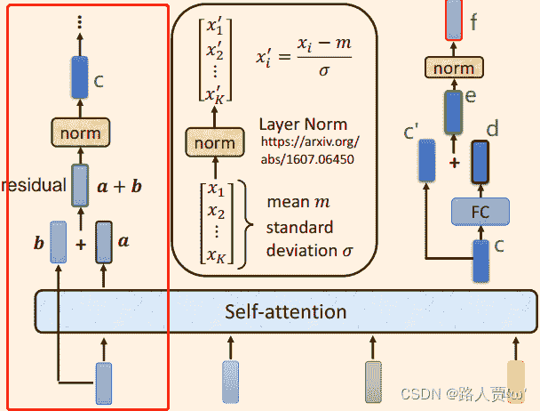

（3）将向量c 通过 FC layer 得到向量d ;

（4）向量c 与向量d 残差相加 ，得到向量e ；

（5）向量e 通过 Layer Norm 输出 向量f；

（6）此时得到的输出向量f 才是 encoder中每个Block中的一个输出向量；

以上步骤就是下图右边部分：

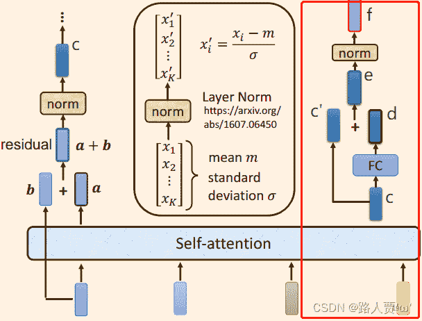

## 二、decoder

### 2.1 简介

decoder，也就是解码器，负责根据encoder部分输出的语义向量c来做解码工作。以翻译为例，就是生成相应的译文。

简单来说，就是就数学问题，并转换为现实世界的解决方案。

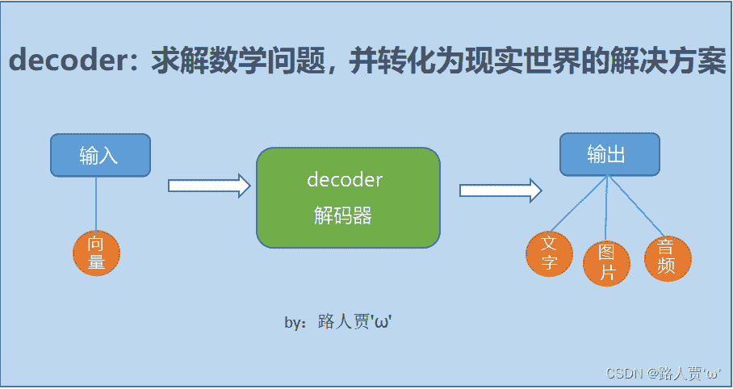

【注意】生成的序列是不定长的。而且上一时刻的输出通常要作为下一时刻的输入。

2.2 代码实现

在上面1.2encoder的代码实现中，我们已经实现了大部分decoder的模块。

但是encoder和decoder实现还是有区别的：

decoder的Muti_head_Attention引入了Mask机制

decoder与encoder中模块的拼接方式不同

```
class Decoder(nn.Module):
    def __init__(self):
        super(Decoder, self).__init__()
        self.positional_encoding = Positional_Encoding(config.d_model)
        self.muti_atten = Mutihead_Attention(config.d_model,config.dim_k,config.dim_v,config.n_heads)
        self.feed_forward = Feed_Forward(config.d_model)
        self.add_norm = Add_Norm()
 
    def forward(self,x,encoder_output): # batch_size * seq_len 并且 x 的类型不是tensor，是普通list
        # print(x.size())
        x += self.positional_encoding(x.shape[1],config.d_model)
        # print(x.size())
        # 第一个 sub_layer
        output = self.add_norm(x,self.muti_atten,y=x,requires_mask=True)
        # 第二个 sub_layer
        output = self.add_norm(output,self.muti_atten,y=encoder_output,requires_mask=True)
        # 第三个 sub_layer
        output = self.add_norm(output,self.feed_forward)
 
        return output
```

2.3 transformer中的使用

2.3.1transformer中decoder的组成

在transformer中decoder 也是由 6 个相同的层组成，每个层包含 3 个部分：

Multi-Head Self-Attention

Multi-Head Context-Attention

Position-Wise Feed-Forward Network

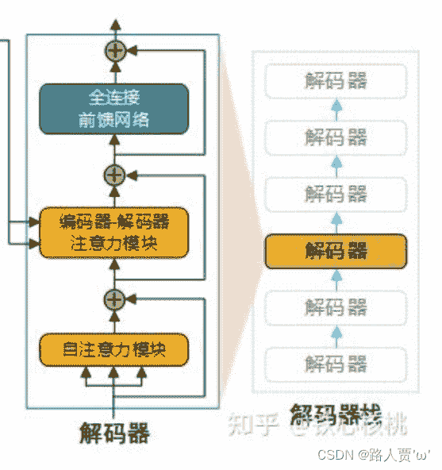

#### 2.3.2 transformer中encoder和decoder的区别

我们先来看看这个图

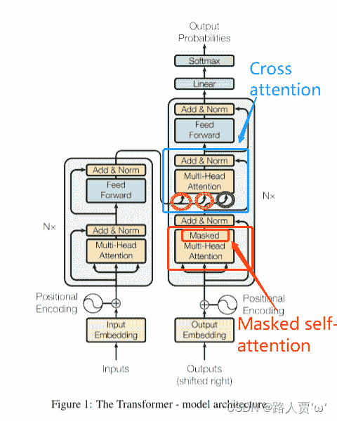

（1）第一级中： 将self attention 模块加入了Masked模块，变成了 Masked self-attention， 这样以来就只考虑解码器的当前输入和当前输入的左侧部分， 不考虑右侧部分； ( 注意，第一级decoder的key， query， value均来自前一层decoder的输出，但加入了Mask操作，即我们只能attend到前面已经翻译过的输出的词语，因为翻译过程我们当前还并不知道下一个输出词语，这是我们之后才会推测到的。)

（2）第二级中：引入了 Cross attention 交叉注意力模块， 在 masked self-attention 和全连接层 之间加入；

（3）Cross attention 交叉注意力模块的输入 Q，K，V 不是来自同一个模块，K,V 来自编码器的输出， Q来自解码器的输出；

【注意】 解码器的输出一个一个产生的

#### 2.3.3  Masked self attention模块

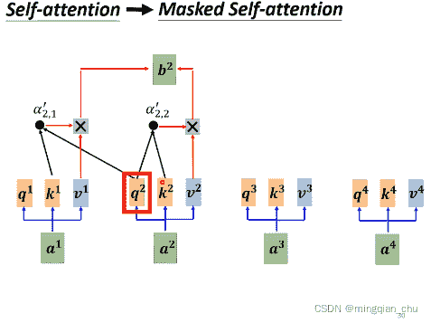

以翻译为例：

输入：我是Daniel

输出：I am Daniel.

这里我们具体讨论decoder的操作，也就是加了 Masked self attention模块后如何得到输出（“I am Daniel”）的过程。

第1步：

初始输入： 起始符</s> + Positional Encoding（位置编码）

中间输入：（我是Daniel）Encoder Embedding

最终输出：产生预测“I”

第2步：

初始输入：起始符</s> + “I”+ Positonal Encoding

中间输入：（我是Daniel）Encoder Embedding

最终输出：产生预测“am”

第3步：

初始输入：起始符</s> + “I”+ “Love”+ Positonal Encoding

中间输入：（我是Daniel）Encoder Embedding

最终输出：产生预测“Daniel”

其实这个原理很简单，主要想表达的就是因为变成了Masked self attention ，所以只考虑输入向量本身， 和输入向量的之前的向量，即左侧向量，而不去考虑后边（右侧）向量。

另外，求相关性的分数时，q，k ，v 同样的也只会考虑当前输入向量的左侧向量部分，而不去考虑输入向量后面的右侧部分。

**这里介绍一下在Decode**r的输入上，对Outputs的Shifted Right操作。

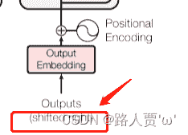

Shifted Right 实质上是给输出添加起始符/结束符，方便预测第1个Token/结束预测过程。

还是看看我们上一个例子~

正常的输出序列位置关系如下：

0-"I"

1-"am"

2-"Daniel"

但在执行的过程中，我们在初始输出中添加了起始符</s>，相当于将输出整体右移1位（Shifted Right），所以输出序列变成如下情况：

0-</s>【起始符】

1-“I”

2-“am”

3-“Daniel”

这样我们就可以通过起始符</s>预测“I”，也就是通过起始符预测实际的第1个输出。

2.3.4  Cross attetion模块

Cross attetion模块称为交叉注意力模块，是因为向量 q , k , v 不是来自同一个模块。

而是将来自解码器的输出向量q 与来自编码器的输出向量 k , v运算。

具体讲来：

向量 q 与向量 k之间相乘求出注意力分数α1 '

注意力分数α1 '再与向量 v 相乘求和，得出向量 b (图中表示为向量 v ) ;

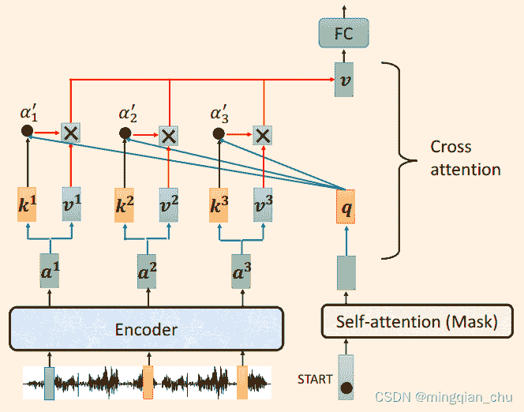

2.3.5  具体实现步骤

（1）经过 Masked self attention:

解码器之前的输出作为当前解码器的输入，并且训练过程中真实标签的也会输入到解码器中，此时这些输入， 通过一个Masked self-attention ，得到输出q向量，注意到这里的q是由解码器产生的；

（2）经过 Cross attention:

将向量q 与来自编码器的输出向量 k , v 运算。具体讲来就是向量 q 与向量 k之间相乘求出注意力分数α1 '，注意力分数α1 '再与向量 v 相乘求和，得出向量 b  ;

（3）经过全连接层：

之后向量 b 便被输入到feed−forward 层， 也即全连接层， 得到最终输出；

三、encoder-decoder

刚才已经分别了解了encoder和decoder，接下来我们再来看看encoder-decoder这个框架吧。

3.1 简介

encoder-decoder 模型主要是 NLP 领域里的概念。它并不特指某种具体的算法，而是一类算法的统称。encoder-decoder 算是一个通用的框架，在这个框架下可以使用不同的算法来解决不同的任务。

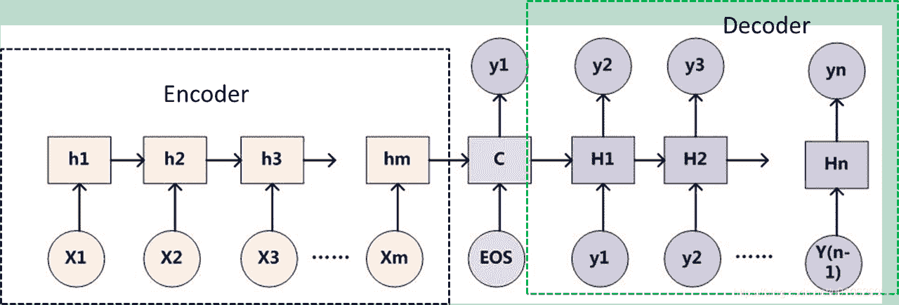

整个过程我们可以看做是一个游戏——《你画我猜》。玩家1从系统中抽取拿到题卡，然后通过画画的方式描述该词。玩家2就通过画来猜出题目中的词是什么。

### 3.2 代码实现

encoder-decoder框架包含了一个编码器和**一个解码器，并且还拥有可选的额外的参数。在**前向传播中，编码器的输出用于生成编码状态，这个状态又被解码器作为其输入的一部分。

```
class EncoderDecoder(nn.Module):
    &quot;&quot;&quot;
    A standard Encoder-Decoder architecture. Base for this and many 
    other models.
    &quot;&quot;&quot;
    def __init__(self, encoder, decoder, src_embed, tgt_embed, generator):
        super(EncoderDecoder, self).__init__()
        self.encoder = encoder
        self.decoder = decoder
        self.src_embed = src_embed
        self.tgt_embed = tgt_embed
        self.generator = generator
        
    def forward(self, src, tgt, src_mask, tgt_mask):
        &quot;Take in and process masked src and target sequences.&quot;
        return self.decode(self.encode(src, src_mask), src_mask,
                            tgt, tgt_mask)
    
    def encode(self, src, src_mask):
        return self.encoder(self.src_embed(src), src_mask)
    
    def decode(self, memory, src_mask, tgt, tgt_mask):
        return self.decoder(self.tgt_embed(tgt), memory, src_mask, tgt_mask)
```

3.3 注意问题

不论输入和输出的长度是什么，中间的“向量c”长度都是固定的（这是它的缺陷所在）。

根据不同的任务可以选择不同的编码器和解码器（例如，CNN、RNN、LSTM、GRU等）

encoder-decoder的一个显著特征就是：它是一个end-to-end的学习算法。

只要符合这种框架结构的模型都可以统称为encoder-decoder模型。

## 注意力机制、自注意力机制、多头注意力机制、通道注意力机制、空间注意力机制

## 一、注意力机制：Attention

### 1.1 什么是注意力机制？

那大家的目光更多停留在是在五个美女身上，还是在张大大身上呢 ？（大大老师骚瑞~ORZ）

同样的，不同的粉丝更加关注的对象也是不同的。

再举几个栗子：

看人-->看脸

看文章-->看标题

看段落-->看开头

这时候大家应该大致知道注意力机制是个什么东西了吧~

注意力机制其实是源自于人对于外部信息的处理能力。由于人每一时刻接受的信息都是无比的庞大且复杂，远远超过人脑的处理能力，因此人在处理信息的时候，会将注意力放在需要关注的信息上，对于其他无关的外部信息进行过滤，这种处理方式被称为注意力机制。

通俗来讲：注意力对于我们人来说可以理解为“关注度”，对于没有感情的机器来说其实就是赋予多少权重(比如0-1之间的小数)，越重要的地方或者越相关的地方就赋予越高的权重。

1.2 如何运用注意力机制？

1.2.1 Query&Key&Value

首先我们来认识几个概念：

查询（Query）： 指的是查询的范围，自主提示，即主观意识的特征向量

键（Key）： 指的是被比对的项，非自主提示，即物体的突出特征信息向量

值（Value） ：  则是代表物体本身的特征向量，通常和Key成对出现

注意力机制是通过Query与Key的注意力汇聚（给定一个 Query，计算Query与 Key的相关性，然后根据Query与Key的相关性去找到最合适的 Value）实现对Value的注意力权重分配，生成最终的输出结果。

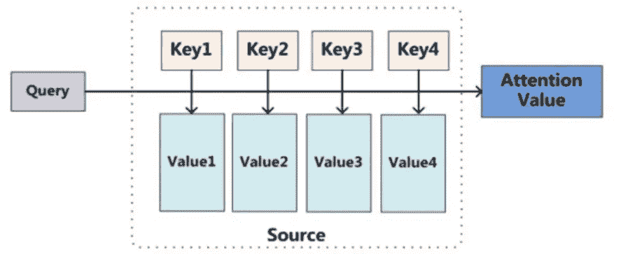

举个例子：

当淘宝购物时，会敲入一句关键词（比如：显瘦），这个就是Query。

搜索系统会根据关键词这个去查找一系列相关的Key（商品名称、图片）。

最后系统会将相应的 Value （具体的衣服）返回给你。

在这个例子中，Query， Key 和 Value 的每个属性虽然在不同的空间，其实他们是有一定的潜在关系的，也就是说通过某种变换，可以使得三者的属性在一个相近的空间中。

#### 1.2.2 注意力机制计算过程

输入Query、Key、Value：

+   **阶段一：**根据Query和Key计算两者之间的相关性或相似性（常见方法点积、余弦相似度，MLP网络），得到注意力得分；

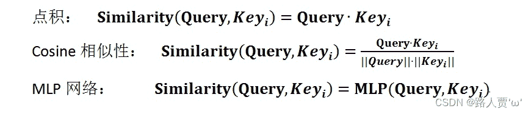

+   **阶段二：**对注意力得分进行缩放scale（除以维度的根号），再softmax函数，一方面可以进行归一化，将原始计算分值整理成所有元素权重之和为1的概率分布；另一方面也可以通过softmax的内在机制更加突出重要元素的权重。一般采用如下公式计算：

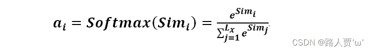

**阶段三：**根据权重系数对Value值进行加权求和，得到Attention Value（此时的V是具有一些注意力信息的，更重要的信息更关注，不重要的信息被忽视了）；

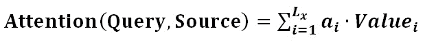

这三个阶段可以用下图表示：

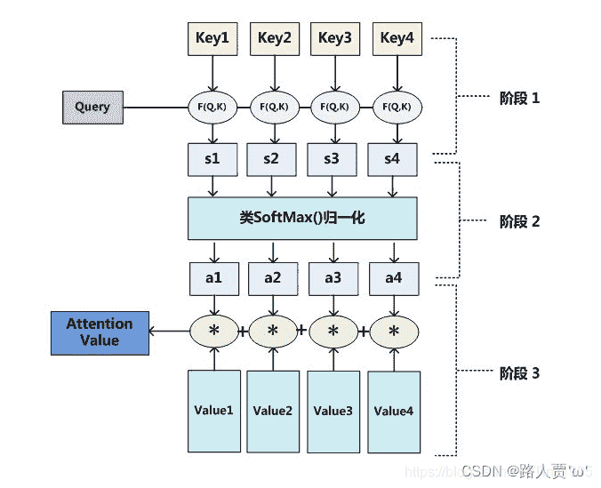

二、自注意力机制：Self-Attention

2.1 什么是自注意力机制？

自注意力机制实际上是注意力机制中的一种，也是一种网络的构型，它想要解决的问题是神经网络接收的输入是很多大小不一的向量，并且不同向量向量之间有一定的关系，但是实际训练的时候无法充分发挥这些输入之间的关系而导致模型训练结果效果极差。比如机器翻译(序列到序列的问题，机器自己决定多少个标签)，词性标注(Pos tagging一个向量对应一个标签)，语义分析(多个向量对应一个标签)等文字处理问题。

针对全连接神经网络对于多个相关的输入无法建立起相关性的这个问题，通过自注意力机制来解决，自注意力机制实际上是想让机器注意到整个输入中不同部分之间的相关性。

自注意力机制是注意力机制的变体，其减少了对外部信息的依赖，更擅长捕捉数据或特征的内部相关性。自注意力机制的关键点在于，Q、K、V是同一个东西，或者三者来源于同一个X，三者同源。通过X找到X里面的关键点，从而更关注X的关键信息，忽略X的不重要信息。不是输入语句和输出语句之间的注意力机制，而是输入语句内部元素之间或者输出语句内部元素之间发生的注意力机制。

注意力机制和自注意力机制的区别：

（1）注意力机制的Q和K是不同来源的，例如，在Encoder-Decoder模型中，K是Encoder中的元素，而Q是Decoder中的元素。在中译英模型中，Q是中文单词特征，而K则是英文单词特征。

（2）自注意力机制的Q和K则都是来自于同一组的元素，例如，在Encoder-Decoder模型中，Q和K都是Encoder中的元素，即Q和K都是中文特征，相互之间做注意力汇聚。也可以理解为同一句话中的词元或者同一张图像中不同的patch，这都是一组元素内部相互做注意力机制，因此，自注意力机制（self-attention）也被称为内部注意力机制（intra-attention）。

### 2.2 如何运用自注意力机制？

其实步骤和注意力机制是一样的。

**第1步：得到Q，K，V的值**

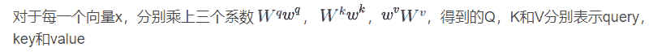

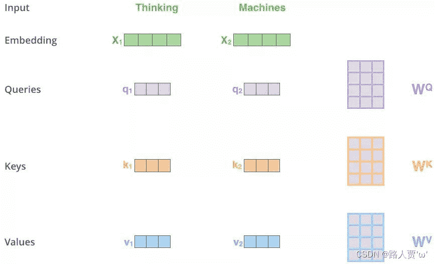

【注意】三个W就是我们需要学习的参数。

**第2步：Matmul**

利**用**得到的Q和K计算每两个输入向量之间的相关性，一般采用点积计算，为每个向量计算一个score：score =q · k


第3步：Scale+Softmax

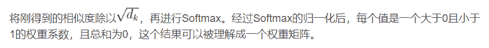

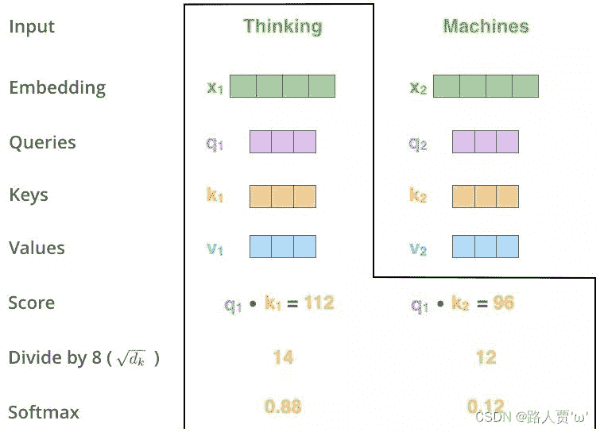

**第4步：Matmul**

使用刚得到的权重矩阵，与V相乘，计算加权求和。

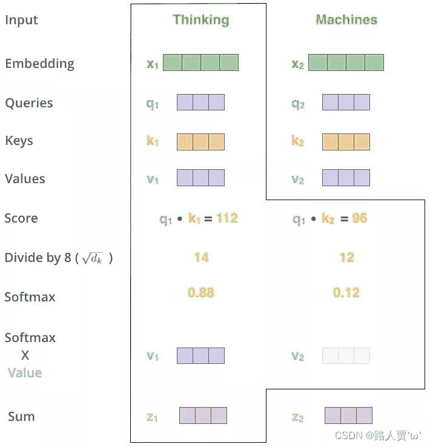

以上是对Thinking Machines这句话进行自注意力的全过程，最终得到z1和z2两个新向量。

其中z1表示的是thinking这个词向量的新的向量表示（通过thinking这个词向量，去查询和thinking machine这句话里面每个单词和thinking之间的相似度）。

也就是说新的z1依然是 thinking 的词向量表示，只不过这个词向量的表示蕴含了 thinking machines 这句话对于 thinking 而言哪个更重要的信息。

2.3 自注意力机制的问题

自注意力机制的原理是筛选重要信息，过滤不重要信息，这就导致其有效信息的抓取能力会比CNN小一些。这是因为自注意力机制相比CNN，无法利用图像本身具有的尺度，平移不变性，以及图像的特征局部性（图片上相邻的区域有相似的特征，即同一物体的信息往往都集中在局部）这些先验知识，只能通过大量数据进行学习。这就导致自注意力机制只有在大数据的基础上才能有效地建立准确的全局关系，而在小数据的情况下，其效果不如CNN。

另外，自注意力机制虽然考虑了所有的输入向量，但没有考虑到向量的位置信息。在实际的文字处理问题中，可能在不同位置词语具有不同的性质，比如动词往往较低频率出现在句首。

三、多头注意力机制：Multi-Head Self-Attention

通过刚才的学习，我们了解到自注意力机制的缺陷就是，模型在对当前位置的信息进行编码时，会过度的将注意力集中于自身的位置，有效信息抓取能力就差一些。 因此就有大佬提出了通过多头注意力机制来解决这一问题。这个也是实际中用的比较多的。

3.1 什么是多头注意力机制？

在实践中，当给定相同的查询、键和值的集合时， 我们希望模型可以基于相同的注意力机制学习到不同的行为， 然后将不同的行为作为知识组合起来， 捕获序列内各种范围的依赖关系 （例如，短距离依赖和长距离依赖关系）。 因此，允许注意力机制组合使用查询、键和值的不同 子空间表示（representation subspaces）可能是有益的。

为此，与其只使用单独一个注意力汇聚， 我们可以用独立学习得到的h组（一般h=8）不同的线性投影（linear projections）来变换查询、键和值。 然后，这h组变换后的查询、键和值将并行地送到注意力汇聚中。 最后，将这h个注意力汇聚的输出拼接在一起， 并且通过另一个可以学习的线性投影进行变换， 以产生最终输出。 这种设计被称为多头注意力（multihead attention）。

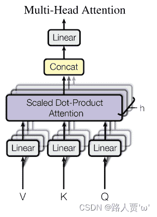

### 3.2 如何运用多头注意力机制？

第1步：定义多组W，生成多组Q、K、V

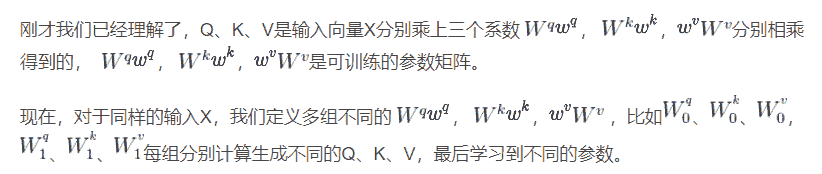


**第2步：定义8组参数**

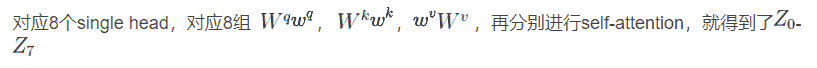

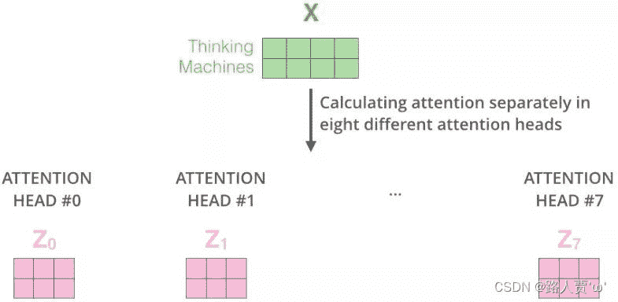

第3步：将多组输出拼接后乘以矩阵w0以降低维度

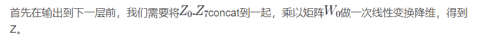


完整流程图如下：


【注意】对于上图中的第2）步，当前为第一层时，直接对输入词进行编码，生成词向量X；当前为后续层时，直接使用上一层输出。

## 四、通道注意力机制：Channel Attention

4.1 什么是通道注意力机制？

对于输入2维图像的CNN来说，一个维度是图像的尺度空间，即长宽，另一个维度就是通道，因此通道注意力机制也是很常用的机制。通道注意力旨在显示的建模出不同通道之间的相关性，通过网络学习的方式来自动获取到每个特征通道的重要程度，最后再为每个通道赋予不同的权重系数，从而来强化重要的特征抑制非重要的特征。

使用通道注意力机制的目的：为了让输入的图像更有意义，大概理解就是，通过网络计算出输入图像各个通道的重要性（权重），也就是哪些通道包含关键信息就多加关注，少关注没什么重要信息的通道，从而达到提高特征表示能力的目的。

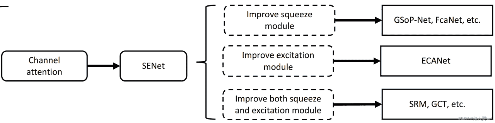

此处出现一个概念，SENet

4.2 SENet

SE注意力机制（Squeeze-and-Excitation Networks）在通道维度增加注意力机制，关键操作是squeeze和excitation。

通过自动学习的方式，即使用另外一个新的神经网络，获取到特征图的每个通道的重要程度，然后用这个重要程度去给每个特征赋予一个权重值，从而让神经网络重点关注某些特征通道。提升对当前任务有用的特征图的通道，并抑制对当前任务用处不大的特征通道。

如下图所示，在输入SE注意力机制之前（左侧白图C2），特征图的每个通道的重要程度都是一样的，通过SENet之后（右侧彩图C2），不同颜色代表不同的权重，使每个特征通道的重要性变得不一样了，使神经网络重点关注某些权重值大的通道。

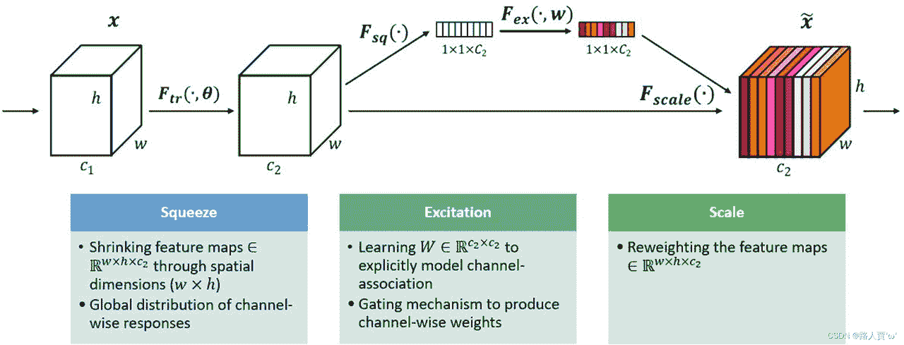

### 4.3 其他通道注意力机制

#### ① ECA

ECA 注意力机制，它是一种通道注意力机制；常常被应用与视觉模型中。支持即插即用，即：它能对输入特征图进行通道特征加强，而且最终ECA模块输出，不改变输入特征图的大小。

背景：ECA-Net认为：SENet中采用的降维操作会对通道注意力的预测产生负面影响；同时获取所有通道的依赖关系是低效的，而且不必要的；

设计：ECA在SE模块的基础上，把SE中使用全连接层FC学习通道注意信息，改为1*1卷积学习通道注意信息；

作用：使用1*1卷积捕获不同通道之间的信息，避免在学习通道注意力信息时，通道维度减缩；降低参数量；（FC具有较大参数量；1*1卷积只有较小的参数量）

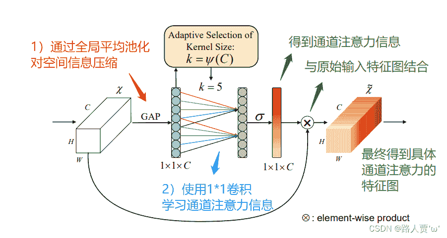

#### ② CBAM

CBAM全称Convolutional Block Attention Module，这是一种用于前馈卷积神经网络的简单而有效的注意模块。是传统的通道注意力机制+空间注意力机制，是 channel(通道) + spatial(空间) 的统一。即对两个Attention进行串联，channel 在前，spatial在后。

给定一个中间特征图，我们的模块会沿着两个独立的维度（通道和空间）依次推断注意力图，然后将注意力图乘以输入特征图以进行自适应特征修饰。 由于CBAM是轻量级的通用模块，因此可以以可忽略的开销将其无缝集成到任何CNN架构中，并且可以与基础CNN一起进行端到端训练。

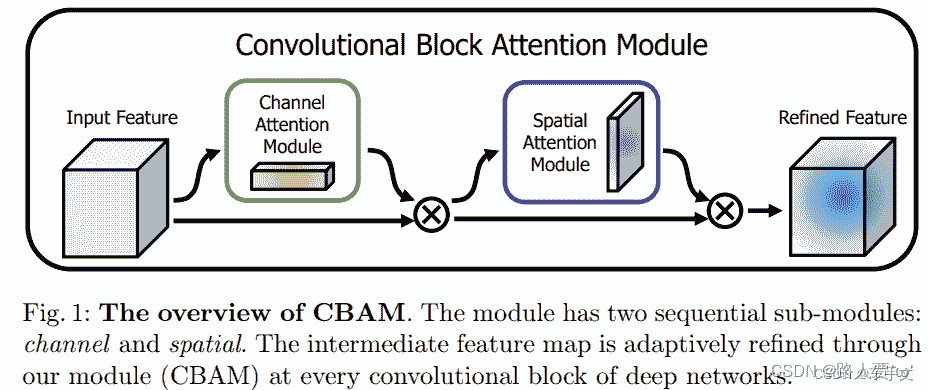

五、空间注意力机制：Spatial Attention

5.1 什么是空间注意力机制？

其实上面那个图就包含空间注意力机制了：绿色长条的是通道注意力机制，而紫色平面则就是空间注意力机制。

不是图像中所有的区域对任务的贡献都是同样重要的，只有任务相关的区域才是需要关心的，比如分类任务的主体，空间注意力模型就是寻找网络中最重要的部位进行处理。空间注意力旨在提升关键区域的特征表达，本质上是将原始图片中的空间信息通过空间转换模块，变换到另一个空间中并保留关键信息，为每个位置生成权重掩膜（mask）并加权输出，从而增强感兴趣的特定目标区域同时弱化不相关的背景区域。

5.2 STN

STN《Spatial Transformer Networks》是15年NIPS上的文章STN引入了一个新的可学习的空间转换模块，提出了空间变换器（Spatial Transformer）的概念，它可以使模型具有空间不变性。这个可微分模块可以插入到现有的卷积结构中，使神经网络能够在Feature Map本身的条件下自动地对特征进行空间变换，而无需任何额外的训练监督或优化过程的修改。主要作用是找到图片中需要被关注的区域，并对其旋转、缩放，提取出固定大小的区域。

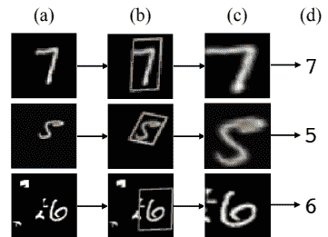

空间采样器的实现主要分成三个部分:

+   1）局部网络（Localisation Network）

+   2）参数化网格采样( Parameterised Sampling Grid)

+   3）差分图像采样（Differentiable Image Sampling）

# Transformer模型结构

## 一、Transformer 整体结构

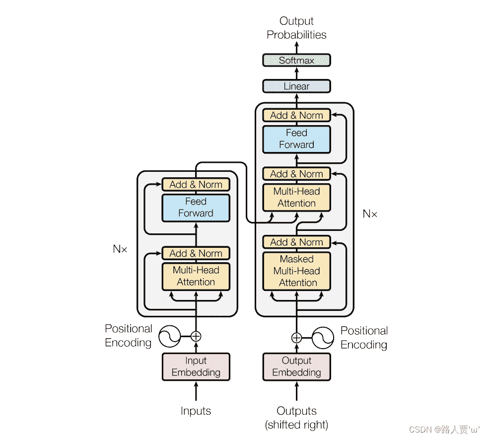

这张图有一定的复杂性，下面做一下通俗翻译

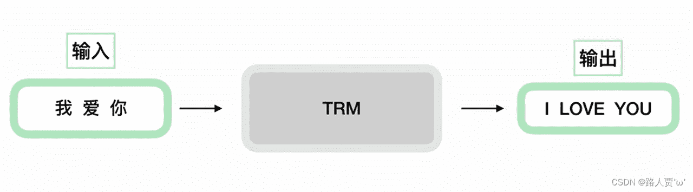

**可以看到 Tr**an**sformer **由 Encode**r 和 Decoder 两**个**部分组成，Encode**r把输入读进去，Decoder得到输出：

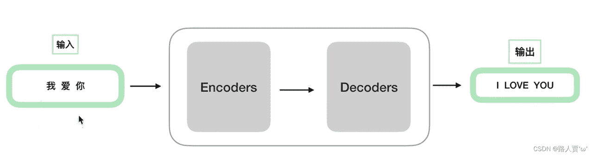

**Encoder **和 **Decoder** 都包含 6 个 block。这6个block结构相同，但参数各自随机初始化。

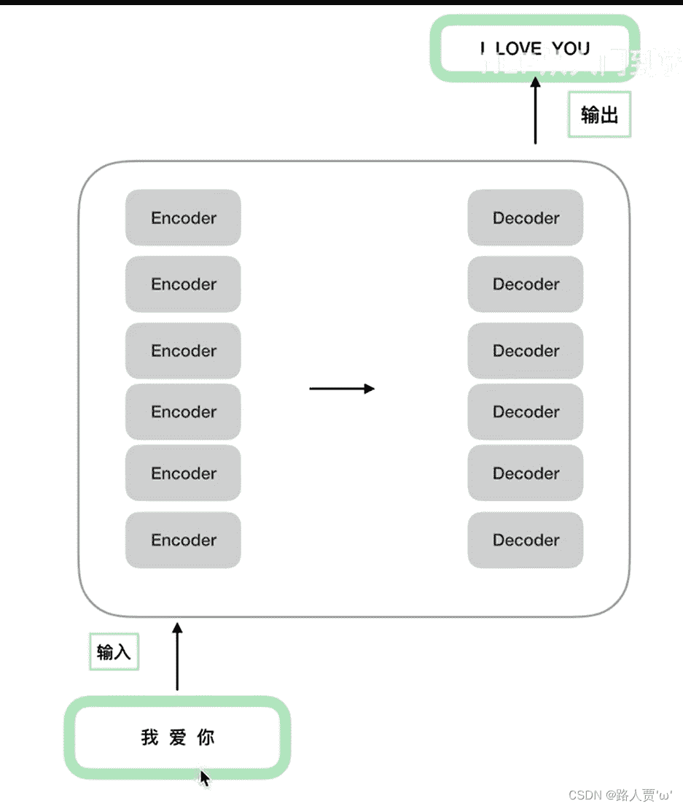

## 二、[编码器](https://so.csdn.net/so/search?q=%E7%BC%96%E7%A0%81%E5%99%A8&spm=1001.2101.3001.7020)：Encoder


**  ** ** Enco**d**er由三个部**分组成：输入、多头注意力、前馈神经网络。

###  2.1输入

**T**ra**nsformer 中单词的输**入表示 x由 Word Embedding 和 Position Embedding相加得到。

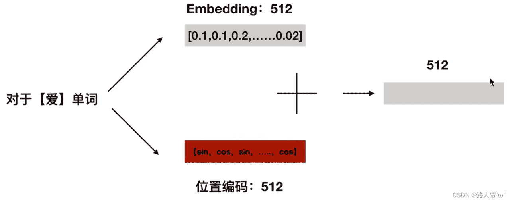

2.1.1词嵌入：Word Embedding层

词嵌入层 负责将自然语言转化为与其对应的独一无二的词向量表达。将词汇表示成特征向量的方法有多种：

（1）One-hot编码

One-hot编码使用一种常用的离散化特征表示方法，在用于词汇向量表示时，向量的列数为所有单词的数量，只有对应的词汇索引为1，其余都为0。

举个例子，“我爱我的祖国”这句话，总长为6，但只有5个不重复字符，用One-hot表示后为6*5的矩阵，如图所示：

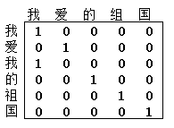

但是这种数据类型十分稀疏，即便使用很高的学习率，依然不能得到良好的学习效果。

（2）数字表示

数字表示是指用整个文本库中出现的词汇构建词典，以词汇在词典中的索引来表示词汇。所以与其叫做“数字表示”，还不如叫“索引表示”。

举个例子，还是“我爱我的祖国”这句话，就是我们整个语料库，那么整个语料库有5个字符，假设我们构建词典{'我':0, '爱':1, '的':2, '祖':3, '':4}，“我爱我的祖国”这句话可以转化为向量：[0, 1, 0, 2, 3, 4]。如图所示。这种方式存在的问题就是词汇只是用一个单纯且独立的数字表示，难以表达出词汇丰富的语义。

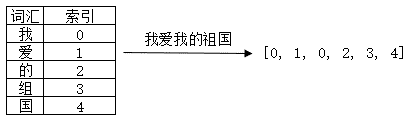

2.1.2位置编码器：Position Embedding层

Transformer 中除了Word Embedding，还需要使用Position Embedding 表示单词出现在句子中的位置。因为 Transformer 不采用 RNN 的结构，而是使用全局信息，因此是无法捕捉到序列顺序信息的，例如将K、V按行进行打乱，那么Attention之后的结果是一样的。但是序列信息非常重要，代表着全局的结构，因此必须将序列的分词相对或者绝对position信息利用起来。

Position Embedding 用 PE表示，PE 的维度与Word Embedding 是一样的。PE 可以通过训练得到，也可以使用某种公式计算得到。在 Transformer 中采用了后者，计算公式如下：

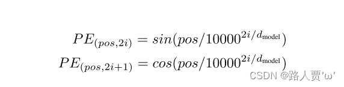

其中 pos 表示positionindex， i 表示dimension index。

###  2.2注意力机制

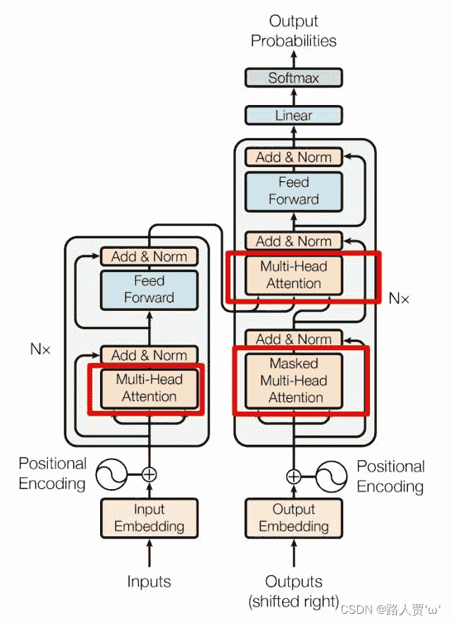

我们再来看一下这个图，图中红色圈中的部分为 Multi-Head Attention，是由多个 Self-Attention组成的，可以看到 Encoder 包含一个 Multi-Head Attention，而 Decoder 包含两个 Multi-Head Attention (其中有一个用到 Masked)。

Multi-Head Attention 上方还包括一个 Add & Norm 层：

Add： 表示残差连接 (Residual Connection) 用于防止网络退化

Norm： 表示 Layer Normalization，用于对每一层的激活值进行归一化

2.2.1自注意力机制：Self-Attention

自注意力机制是注意力机制的变体，其减少了对外部信息的依赖，更擅长捕捉数据或特征的内部相关性。自注意力机制的关键点在于，Q、K、V是同一个东西，或者三者来源于同一个X，三者同源。通过X找到X里面的关键点，从而更关注X的关键信息，忽略X的不重要信息。不是输入语句和输出语句之间的注意力机制，而是输入语句内部元素之间或者输出语句内部元素之间发生的注意力机制。

如何运用自注意力机制？

第1步：得到Q，K，V的值

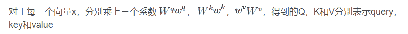


【注意】三个W就是我们需要学习的参数。

**第2步：Matmul**

利用得到的Q和K计算每两个输入向量之间的相关性，一般采用点积计算，为每个向量计算一个score：score =q · k

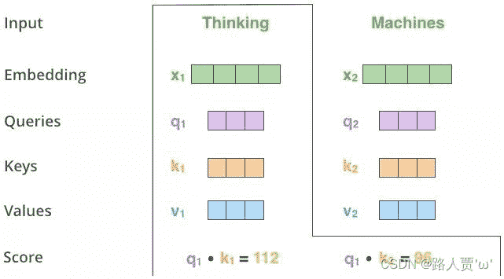

第3步：Scale+Softmax

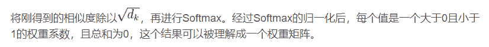


**第4步：Matmul**

使用刚得到的权重矩阵，与V相乘，计算加权求和。


以上是对Thinking Machines这句话进行自注意力的全过程，最终得到z1和z2两个新向量。

其中z1表示的是thinking这个词向量的新的向量表示（通过thinking这个词向量，去查询和thinking machine这句话里面每个单词和thinking之间的相似度）。

也就是说新的z1依然是 thinking 的词向量表示，只不过这个词向量的表示蕴含了 thinking machines 这句话对于 thinking 而言哪个更重要的信息 。

2.2.2多头注意力机制：Multi-Head Attention

与其只使用单独一个注意力汇聚， 我们可以用独立学习得到的h组（一般h=8）不同的线性投影来变换Q、K和V。

然后，这h组变换后的Q、K和V将并行地送到注意力汇聚中。 最后，将这h个注意力汇聚的输出拼接在一起， 并且通过另一个可以学习的线性投影进行变换， 以产生最终输出。 这种设计被称为多头注意力（multihead attention）。


**如何运用多头注意力机制？ **

第1步：定义多组W，生成多组Q、K、V

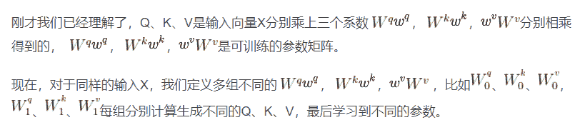

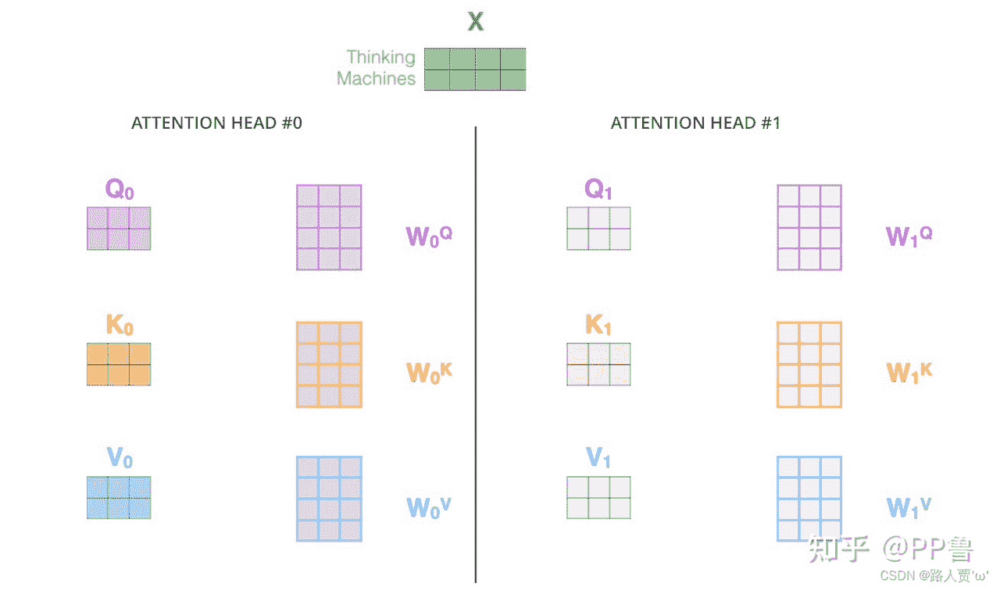

**第2步：定义8组参数**

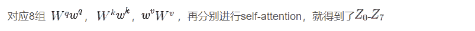


第3步：将多组输出拼接后乘以矩阵w0以降低维度

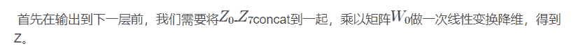


** 完整流程图如下：**


【注意】对于上图中的第2）步，当前为第一层时，直接对输入词进行编码，生成词向量X；当前为后续层时，直接使用上一层输出。

### 2.3残差连接

每个编码器的每个子层（Self-Attention 层和 FFN 层）都有一个残差连接，再执行一个层标准化操作。


把得到的两个词的Attention**值****摞**在一起后，将“加入位置编码后的词向量X”与“摞在一起后输出的Attention值Z” 相加。残差连接减小了梯度消失的影响。加入残差连接，就能保证层次很深的模型不会出现梯度消失的现象。

### 2.4LN和BN

+   **LN：**Layer Normalization，LN是“横”着来的，对同一个样本，不同的特征做归一化。

+   **BN：**Batch Normalization，BN是“竖”着来的，对不同样本，同一特征做归一化。

二者提出的目的都是为了加快模型收敛，减少训练时间。


【注意】在NLP任务中，一般选用的都是LN，不用BN。因为句子长短不一，每个样本的特征数很可能不同，造成很多句子无法对齐，所以不适合用BN。

###  2.5前馈神经网络：FeedForward

在进行了Attention操作之后，Enco**der和Decod**er中的每一层都包含了一个全连接前向网络，对每个position的向量分别进行相同的操作，包括两个线性变换和一个ReLU激活输出：


假设多头注意力部分有两个头，那么输出的两个注意力头Zi分别通过两个Feed Forward，然后接一个残差连接，即Zi和Feed Forward的输出Add对位相加。最后把相加的结果进行一次LN标准化。


## 三、解码器：Decoder


上图红色框框为 Transformer 的 Decoder 结构，与 Encoder 相似，但是存在一些区别。

Decoder 包含两个 Multi-Head Attention 层。

第一个 Multi-Head Attention 层采用了 Masked 操作。

第二个 Multi-Head Attention 层的K, V矩阵使用 Encoder 的编码信息矩阵C进行计算，而Q使用上一个 Decoder的输出计算。

最后有一个 Softmax 层计算下一个翻译单词的概率。

### 3.1第一个 Multi-Head Attention


3.1.1掩码：Mask

Mask 表示掩码，它对某些值进行掩盖，使其在参数更新时不产生效果。Transformer 模型里面涉及两种 mask，分别是 Padding Mask 和 Sequence Mask。其中，Padding Mask 在所有的 scaled dot-product attention 里面都需要用到，而 Sequence Mask 只有在 Decoder 的 Self-Attention 里面用到。

为什么需要Mask？

有一些生成的attention张量中的值计算有可能已知了未来信息而得到的，未来信息被看到是因为训练时会把整个输出结果都一次性进行Embedding，但是理论上解码器的的输出却不是一次就能产生最终结果的，而是一次次通过上一次结果综合得出的，因此，未来的信息可能被提前利用。所以，Attention中需要使用掩码张量掩盖未来信息。

我们可以这么来理解Mask的作用：我们建模目的就是为了达到预测的效果，所谓预测，就是利用过去的信息(此前的序列张量)对未来的状态进行推断，如果把未来需要进行推断的结果，共同用于推断未来，那叫抄袭，不是预测。当然，这么做的话训练时模型的表现会很好，但是在测试(test)时，模型表现会很差。

换句话说，我们是用一句话中的前N − 1 个字预测第N 个字，那么我们在预测第N 个字时，就不能让模型看到第N个字之后的信息，所以这里们把预测第N 个字时，第N 包括)个字之后的字都Masked掉。

我们来举个例子：


如果像Encoder的注意力机制那里一样没有Mask，那么在训练Decoder时，如果要生成预测结果you，就需要用到下面整个句子的所有词（s,I,Love,You,Now）。但是在真正预测的时候，并看不到未来的信息（即还轮不到You和Now呢）。

所以在预测阶段，预测的第一步生成第一个词I的时候，用起始词<start>做self-attention；然后预测的第二步生成第二个词Love的时候，就做<start>和I两个词的self-attention，后面的词被掩盖了。以此往复，预测的每一步在该层都有一个输出Q，Q要送入到中间的Multi-Head Attention层，和encoder部分输出的K，V做attention。

3.1.2具体实现步骤

第一步：是 Decoder 的输入矩阵和 Mask 矩阵，输入矩阵包含 "<Start> I Love You Now" (0, 1, 2, 3, 4) 五个单词的表示向量，Mask 是一个 5×5 的矩阵。在 Mask 可以发现单词 0 只能使用单词 0 的信息，而单词 1 可以使用单词 0, 1 的信息，即只能使用之前的信息。


**第二步：****接**下来的操**作和之前的** Self-Attention 一样，通过输入矩阵X计算得到Q,K,V矩阵。然后计算


**第三步：**


计算 attention scor**e，我们**在 Softmax 之前需要使用Mask矩阵遮挡住每一个单词之后的信息，遮挡操作如下：


**第四步：**


得到输出 **Z**，则单词 1 的输出向量 Z1 是只包含单词 1 信息的。


**第五步：**通过上**述**步**骤**就可以**得**到一个 Mask Self-Attention 的输出矩阵Zi ，然后和 Encoder 类似，通过 Multi-Head Attention 拼接多个输出Zi然后计算得到第一个 Multi-Head Attention 的输出Z，Z与输入X维度一样。

###  3.2第二个 Multi-Head Attention


其实这块与上文 **Encoder** 中 的 Multi-Head Attent**ion 具体实**现细节上完全相同，区别在于Encoder的多头注意力里的Q、K、V


而Decoder的K、V是来自于Encoder的输出，Q是上层Masked Self-Attention的输出。

Encoder 中 的 Multi-Head Attention只有一个输入，把此输入经过三个linear映射成Q 、K 、V ， 而这里的输入有两个：

一个是Decoder的输入经过第一个大模块传过来的值

一个是Encoder最终结果

是把第一个值通过一个linear映射成了Q，然后通过两个linear把第二个值映射成K、V ，其它的与上文的完全一致。这样做的好处是在 Decoder 的时候，每一位单词都可以利用到 Encoder 所有单词的信息 (这些信息无需 Mask)。

3.3Linear和softmax

Decoder最后会输出一个实数向量。那我们如何把浮点数变成一个单词？这便是线性变换层Linear层要做的工作，它之后就是Softmax层。

Linear层是一个简单的全连接神经网络，它可以把Decoder产生的向量投射到一个比它大得多的、被称作对数几率（logits）的向量里。


不妨假设我们的模型从训练集中学习一万个不同的英语单词（我们模型的“输出词表”）。因此对数几率向量为一万个单元格长度的向量——每个单元格对应某一个单词的分数。

接下来的Softmax 层便会把那些分数变成概率（都为正数、上限1.0）。概率最高的单元格被选中，并且它对应的单词被作为这个时间的输出。


这张图片从底部以解码器组件产生的输出向量开始。之后它会转化出一个输出单词。

## Transformer代码（Pytorch）

## 0.导入依赖库

```
#======================0.导入依赖库=============================#
import numpy as np
import torch
import torch.nn as nn
import torch.optim as optim
import matplotlib.pyplot as plt
import math
```

numpy：  科学计算库，提供了矩阵，线性代数，傅立叶变换等等的解决方案, 最常用的是它的N维数组对象

torch：   这是主要的Pytorch库。它提供了构建、训练和评估神经网络的工具

torch.nn：  torch下包含用于搭建神经网络的modules和可用于继承的类的一个子包

torch.optim：  优化器 Optimizer。主要是在模型训练阶段对模型可学习参数进行更新，常用优化器有 SGD，RMSprop，Adam等

matplotlib.pyplot：  matplotlib.pyplot 是一个命令型函数集合，它可以像使用 Matlab 一样使用 matplotlib，pyplot 中的每一个函数都会对画布图像作出相应的改变

math：  调用这个库进行数学运算

1.  数据预处理

本文以一个简单的**德语到英语**的**机器翻译**任务Demo为例。

### 1.1 数据准备

#### 1.1.1 训练集：句子输入部分

```
 # ===1.训练集（句子输入部分）===#
    sentences = [&#x27;ich mochte ein bier P&#x27;, &#x27;S i want a beer&#x27;, &#x27;i want a beer E&#x27;]
```

+   第一个德语句子 'ich** mocht**e ein bier P'  --> 编码端的输入

+   第二个英语句子 'S i** want **a beer' --> 解码端的输入

+   第三个英语句子 'i w**ant a beer E**' --> 解码端的真实标签（答案）

可以通过这个图来理解一下：


P、S、E是什么？

+   **P：**pad字符。如果当前批次的数据量小于时间步数，将填写空白序列的符号。

+   **S：**Start。显示 解码 输入开始 的符号

+   **E：**End。显示 解码 输出开始 的符号

#### 1.1.2 测试集：构建词表

```
#===2.测试集（构建词表）===#
    
    # 编码端的词表
    src_vocab = {&#x27;P&#x27;: 0, &#x27;ich&#x27;: 1, &#x27;mochte&#x27;: 2, &#x27;ein&#x27;: 3, &#x27;bier&#x27;: 4}
    src_vocab_size = len(src_vocab)  # src_vocab_size：实际情况下，它的长度应该是所有德语单词的个数
 
    # 解码端的词表
    tgt_vocab = {&#x27;P&#x27;: 0, &#x27;i&#x27;: 1, &#x27;want&#x27;: 2, &#x27;a&#x27;: 3, &#x27;beer&#x27;: 4, &#x27;S&#x27;: 5, &#x27;E&#x27;: 6}
    tgt_vocab_size = len(tgt_vocab)  # 实际情况下，它应该是所有英语单词个数
```

词嵌入本身是一个look up查表的过程，因此需要构建词表：token及其索引。

现在的实际任务中，一般使用Huggingface Transformers库的Tokenizer等API直接获取。

其实编码端和解码端可以共用一个词表的。

### 1.2 数据构建

#### 1.2.1 实现一个minibatch迭代器

```
def make_batch(sentences):
    input_batch = [[src_vocab[n] for n in sentences[0].split()]] # 输入数据集
    output_batch = [[tgt_vocab[n] for n in sentences[1].split()]] # 输出数据集
    target_batch = [[tgt_vocab[n] for n in sentences[2].split()]] # 目标数据集
    return torch.LongTensor(input_batch), torch.LongTensor(output_batch), torch.LongTensor(target_batch)
```

这段代码主要是把字符串类型的文本转成词表索引，然后再把索引转成tensor类型。

#### 1.2.2 自定义一个MyDataSet去读取这些句子

```
 ​ class MyDataSet(Data.Dataset):
     &quot;&quot;&quot;自定义DataLoader&quot;&quot;&quot;
 ​
     def __init__(self, enc_inputs, dec_inputs, dec_outputs):
         super(MyDataSet, self).__init__()
         self.enc_inputs = enc_inputs
         self.dec_inputs = dec_inputs
         self.dec_outputs = dec_outputs
 ​
     def __len__(self):
         return self.enc_inputs.shape[0]
 ​
     def __getitem__(self, idx):
         return self.enc_inputs[idx], self.dec_inputs[idx], self.dec_outputs[idx]
 ​
 ​
 loader = Data.DataLoader(
     MyDataSet(enc_inputs, dec_inputs, dec_outputs), 2, True)
```

我们需要在自定义的数据集类中继承Dataset类，同时还需要实现两个方法：

__len__方法：  能够实现通过全局的len()  方法获取其中的元素个数

__getitem__方法：  能够通过传入索引的方式获取数据，例如通过dataset[i]  获取其中的第i条数据

最后DataLoader进行封装：dataset，batch_size，shuffle(是否打乱)

## 2.模型整体架构

### 2.1 超参数设置

```
    src_len = 5 # length of source 编码端的输入长度
    tgt_len = 5 # length of target 解码端的输入长度
 
    #===Transformer参数===#
    d_model = 512  # Embedding Size 每一个字符转化成Embedding的大小
    d_ff = 2048  # FeedForward dimension 前馈神经网络映射到多少维度
    d_k = d_v = 64  # dimension of K(=Q), V
    n_layers = 6  # number of Encoder of Decoder Layer  encoder和decoder的个数，这个设置的是6个encoder和decoder堆叠在一起（encoder和decoder的个数必须保持一样吗）
    n_heads = 8  # number of heads in Multi-Head Attention  多头注意力机制时，把头分为几个，这里说的是分为8个
```

重要参数：

src_len ：  编码端的输入长度

tgt_len ：   解码端的输入长度

d_model：   需要定义embeding 的维度，论文中设置的512

d_ff： FeedForward 层隐藏神经元个数，论文中设置的2048

d_k = d_v： Q、K、V 向量的维度，其中 Q 与 K 的维度必须相等，V 的维度没有限制，都设为 64

n_layers：  Encoder 和 Decoder 的个数，也就是图中的Nx

n_heads： 多头注意力中 head 的数量

### 2.2 整体架构

```
class Transformer(nn.Module):
    def __init__(self):
        super(Transformer, self).__init__()
        self.encoder=Encoder().to(device) # 编码层
        self.decoder=Decoder().to(device) # 解码层
       # 输出层，d_model是解码层每一个token输出维度的大小，之后会做一个tgt_vocab_size大小的softmax
        self.projection=nn.Linear(d_model,tgt_vocab_size,bias=False).to(device)
    
    # 实现函数
    def forward(self, enc_inputs,dec_inputs):
        &quot;&quot;&quot;
         Transformers的输入：两个序列（编码端的输入，解码端的输入）
         enc_inputs: [batch_size, src_len]   形状：batch_size乘src_len
         dec_inputs: [batch_size, tgt_len]   形状：batch_size乘tgt_len
         &quot;&quot;&quot;
        # tensor to store decoder outputs
        # outputs = torch.zeros(batch_size, tgt_len, tgt_vocab_size).to(self.device)
 
        # enc_outputs: [batch_size, src_len, d_model], enc_self_attns: [n_layers, batch_size, n_heads, src_len, src_len]
        # 经过Encoder网络后，得到的输出还是[batch_size, src_len, d_model]
        enc_outputs,enc_self_attns=self.encoder(enc_inputs)
 
        # dec_outputs: [batch_size, tgt_len, d_model], dec_self_attns: [n_layers, batch_size, n_heads, tgt_len, tgt_len], dec_enc_attn: [n_layers, batch_size, tgt_len, src_len]
        dec_outputs,dec_self_attns,dec_enc_attns=self.decoder(dec_inputs,enc_inputs,enc_outputs)
 
        # dec_outputs: [batch_size, tgt_len, d_model] -&gt; dec_logits: [batch_size, tgt_len, tgt_vocab_size]
        dec_logits=self.projection(dec_outputs)
        return dec_logits.view(-1,dec_logits.size(-1)),enc_self_attns,dec_self_attns,dec_enc_attns
```

Transformer主要就是**调用Encoder和Decoder。**最后返回dec_logits的维度是[batch_size * tgt_len, tgt_vocab_size]。

主要流程：

输入文本进行词嵌入和位置编码，作为最终的文本嵌入；

文本嵌入经过Encoder编码，得到注意力加权后输出的编码向量以及自注意力权重矩阵；

然后将编码向量和样本的Ground trurh共同输入解码器，经过注意力加权等操作后输出最终的上下文向量，然后映射到词表大小的线性层上进行解码生成文本；

最终返回代表预测结果的logits矩阵。

主要参数：

d_model：解码层每个token输出的维度大小，之后会做一个 tgt_vocab_size 大小的softmax

d_model：预测一个德语单词被翻译成英语，它会对应为那个单词，这里输入就是一个单词在词表中的维度，这里的维度是512，所以在词表中一个单词的维度是512。

如果一句话有n个单词，那么在翻译的整个过程中就会调用n次这个全连接函数。

举个栗子：英语单词有100000个，那么这儿的tgt_vocab_size就是1000000个。到达这儿，就好像是一个分类任务，看这个单词属于这100000个类中的哪一个类，最后全连接分类的结果然后再进行一个softmax就会得到这100000个单词每个单词的概率。哪个单词的概率最大，那么我们就把这个德语单词翻译成那个单词。也就是我们这儿的projection就是那个德语单词被翻译成英语单词的词。

enc_inputs：编码端输入。形状为[batch_size, src_len]，输出由自己的函数内部指定，想要什么指定输出什么，可以是全部tokens的输出，可以是特定每一层的输出；也可以是中间某些参数的输出

enc_outputs：编码端输出。编码端的输入(enc_inputs)通过编码端（encoder）流到编码端的输出(enc_outputs)

enc_self_attns：Q、K转置相乘后softmax的矩阵值，代表每个单词和其他单词的相关性

dec_outputs： 解码端输出，用于后续的linear映射

dec_self_attns： 类比于enc_self_attns是查看每个单词对解码端中输入的其余单词的相关性

dec_enc_attns：解码端中每个单词对encoder中每个单词的相关性

dec_logits.view： 进行view操作主要是为了适应后面的CrossEntropyLoss（交叉熵损失函数） API的参数要求

### 2.3 模型训练

```
model=Transformer().to(device) # 调用Transformer模型
criterion=nn.CrossEntropyLoss(ignore_index=0) # 交叉熵损失函数
optimizer=optim.SGD(model.parameters(),lr=1e-3,momentum=0.99)# 用Adam的话效果不好
 
for epoch in range(epochs):
    for enc_inputs,dec_inputs,dec_outputs in loader:
        &quot;&quot;&quot;
            enc_inputs: [batch_size, src_len]
            dec_inputs: [batch_size, tgt_len]
            dec_outputs: [batch_size, tgt_len]
        &quot;&quot;&quot;
        enc_inputs,dec_inputs,dec_outputs=enc_inputs.to(device),dec_inputs.to(device),dec_outputs.to(device)
 
        # outputs: [batch_size * tgt_len, tgt_vocab_size]
        outputs,enc_self_attns,dec_self_attns,dec_enc_attns=model(enc_inputs,dec_inputs)
 
        # dec_outputs.view(-1):[batch_size * tgt_len * tgt_vocab_size]
        loss=criterion(outputs,dec_outputs.view(-1))
        print(&#x27;Epoch:&#x27;, &#x27;%04d&#x27; % (epoch + 1), &#x27;loss =&#x27;, &#x27;{:.6f}&#x27;.format(loss))
 
        optimizer.zero_grad()
        loss.backward()
        optimizer.step()
```

**这里的损失函数里面设置了一个**参数ignore_index=0，因为"pad"这个单词的索引为0，这样设置以后，就不会计算"pad"的损失（因为本来"pad"也没有意义，不需要计算）

## 3. [编码器](https://so.csdn.net/so/search?q=%E7%BC%96%E7%A0%81%E5%99%A8&spm=1001.2101.3001.7020)（Encoder）

**编码**器**(Enco**d**er）由三个**部分组成：输入、多头注意力、前馈神经网络。


**流程**

+   输入文本的索引tensor，经过词嵌入层得到词嵌入，然后和位置编码线性相加作为输入层的最终输出；

+   随后，每一层的输出最为下一层编码块的输入，在每个编码块里进行注意力计算、前馈神经网络、残差连接、层归一化等操作；

+   最终返回编码器最后一层的输出和每一层的注意力权重矩阵。

### 3.1 Encoder Layer：单个编码器层

作为**Encoder**的组成单元, 每个**Encoder Layer**完成一次对输入的特征提取过程, 即编码过程。

结构如图所示：


```
# ---------------------------------------------------#
# EncoderLayer：包含两个部分，多头注意力机制和前馈神经网络
# ---------------------------------------------------#
class EncoderLayer(nn.Module):
    def __init__(self):
        super(EncoderLayer, self).__init__()
        self.enc_self_attn = MultiHeadAttention()
        self.pos_ffn = PoswiseFeedForwardNet()
 
    def forward(self, enc_inputs, enc_self_attn_mask):
        &quot;&quot;&quot;
        下面这个就是做自注意力层，输入是enc_inputs，形状是[batch_size x seq_len_q x d_model]，需要注意的是最初始的QKV矩阵是等同于这个
        输入的，去看一下enc_self_attn函数.
        &quot;&quot;&quot;
        # enc_inputs to same Q,K,V
        enc_outputs, attn = self.enc_self_attn(enc_inputs, enc_inputs, enc_inputs, enc_self_attn_mask)
        # enc_outputs: [batch_size x len_q x d_model]
        enc_outputs = self.pos_ffn(enc_outputs)
        return enc_outputs, attn
```

**Encoder Layer**包含两个部分：**多头注意力机制**＋**前馈神经网络**

### 3.2 Encoder：编码器

**Encoder****用于对输入进行指定的特征提**取过程，也称为编码，由n个Encoder Layer层堆叠而成。

结构如图所示：


```
# -----------------------------------------------------------------------------#
# Encoder部分包含三个部分：词向量embedding，位置编码部分，自注意力层及后续的前馈神经网络
# -----------------------------------------------------------------------------#
class Encoder(nn.Module):
    def __init__(self):
        super(Encoder, self).__init__()
        # 这行其实就是生成一个矩阵，大小是: src_vocab_size * d_model
        self.src_emb = nn.Embedding(src_vocab_size, d_model)
        # 位置编码，这里是固定的正余弦函数，也可以使用类似词向量的nn.Embedding获得一个可以更新学习的位置编码
        self.pos_emb = PositionalEncoding(d_model)
        # 使用ModuleList对多个encoder进行堆叠，因为后续的encoder并没有使用词向量和位置编码，所以抽离出来；
        self.layers = nn.ModuleList([EncoderLayer() for _ in range(n_layers)])
 
    def forward(self, enc_inputs):
        &quot;&quot;&quot;
        这里我们的enc_inputs形状是： [batch_size x source_len]
        &quot;&quot;&quot;
        # 下面这行代码通过src_emb进行索引定位，enc_outputs输出形状是[batch_size, src_len, d_model]
        enc_outputs = self.src_emb(enc_inputs)
 
        # 这行是位置编码，把两者相加放到了pos_emb函数里面
        enc_outputs = self.pos_emb(enc_outputs.transpose(0, 1)).transpose(0, 1)
 
        # get_attn_pad_mask是为了得到句子中pad的位置信息，给到模型后面，在计算自注意力和交互注意力的时候去掉pad符号的影响
        enc_self_attn_mask = get_attn_pad_mask(enc_inputs, enc_inputs)
        enc_self_attns = []
        for layer in self.layers:
            # 去看EncoderLayer层函数
            enc_outputs, enc_self_attn = layer(enc_outputs, enc_self_attn_mask)
            enc_self_attns.append(enc_self_attn)
        return enc_outputs, enc_self_attns
```

进入Encoder后，首先进行Embedding，然后进行Positional Encoding。Embedding使用了nn.Embedding。n个Encoder Layer存放在nn.ModuleList()里的列表中。

**Encoder **部分包含三个部分：**Word Embedding**＋P**osition Embedding＋**Multi-Head Attention层及后续的Feed Forward层

+   Multi-Head Attention层：  主要就是进行attention的计算，QKV的矩阵运算都在这里。

+   **Feed Forward层：**  就是进行特征的提取，进行向前传播。

### 3.3 Padding Mask：形成一个符号矩阵

```
def get_attn_pad_mask(seq_q, seq_k):
    batch_size, len_q = seq_q.size()
    batch_size, len_k = seq_k.size()
    # eq(zero) is PAD token
    pad_attn_mask = seq_k.data.eq(0).unsqueeze(1)  # batch_size x 1 x len_k, one is masking
    # 最终得到的应该是一个最后n列为1的矩阵，即K的最后n个token为PAD。
    return pad_attn_mask.expand(batch_size, len_q, len_k)  # batch_size x len_q x len_k
```

padding mask的作用：

不同batch之间句子长度可以不一样，但是每个batc**h的长度必须是一样的**：因此出现一个问题，不够长度需要加pad，使得其长度变成一样。

我们看一下这个图：


阴影部分是没有意义的，所以我们希望它是0，以便后续的softmax等操作。

**padding mask的主要作用就是**针对句子不够长的问题，我们加了 pad，因此需要对 pad 进行 遮掩mask。

从代码角度来看：

这个函数最核心的一句代码是seq_k.data.eq(0)，这句的作用是返回一个大小和seq_k一样的tensor，只不过里面的值只有True和False。如果seq_k某个位置的值等于0，那么对应位置就是True，否则即为False。

举个例子：输入为seq_data = [1, 2, 3, 4, 0]，seq_data.data.eq(0)就会返回[False, False, False, False, True]

【注意】由于在 Encoder 和 Decoder 中都需要进行 mask（和矩阵原大小一样，有问题的地方加负无穷） 操作，因此就无法确定这个函数的参数中 seq_len 的值，如果是在 Encoder 中调用的，seq_len 就等于 src_len；如果是在 Decoder 中调用的，seq_len 就有可能等于 src_len，也有可能等于 tgt_len（因为 Decoder 有两次 mask）。

1.  解码器（Decoder）


上图红色框框为 Transformer 的 Decoder 结构，与 Encoder 相似，但是存在一些区别。

Decoder 包含两个 Multi-Head Attention 层。

第一个 Multi-Head Attention 层采用了 Masked 操作。

第二个 Multi-Head Attention 层的K, V矩阵使用 Encoder 的编码信息矩阵C进行计算，而Q使用上一个 Decoder的输出计算。

最后有一个 Softmax 层计算下一个翻译单词的概率。

### 4.1Decoder Layer：单个解码层

**Decoder**模块由6个**Decoder Layer**组成，每个Decoder Layer结构完全一样，如图所示：


```
# -----------------------------------------------------------------------------#
# Decoder Layer包含了三个部分：解码器自注意力、“编码器-解码器”注意力、基于位置的前馈网络
# -----------------------------------------------------------------------------#
class DecoderLayer(nn.Module):
    def __init__(self):
        super(DecoderLayer, self).__init__()
        self.dec_self_attn = MultiHeadAttention()
        self.dec_enc_attn = MultiHeadAttention()
        self.pos_ffn = PoswiseFeedForwardNet()
 
    def forward(self, dec_inputs, enc_outputs, dec_self_attn_mask, dec_enc_attn_mask):
        dec_outputs, dec_self_attn = self.dec_self_attn(dec_inputs, dec_inputs, dec_inputs, dec_self_attn_mask)
        dec_outputs, dec_enc_attn = self.dec_enc_attn(dec_outputs, enc_outputs, enc_outputs, dec_enc_attn_mask)
        dec_outputs = self.pos_ffn(dec_outputs)
        return dec_outputs, dec_self_attn, dec_enc_attn
```

**Decoder Layer**包含了三个部分：解码器自注意力+“编码器-解码器”注意力+基于位置的前馈网络

每个Decoder Layer由三个子层连接结构组成：

第一个子层连接结构：包括一个Multi-Head Attention和Norm层以及一个残差连接。

在训练时，因为有目标数据可用，所以第一个Decoder Layer的Multi-Head Attention的输入来自于目标数据，但是在测试时，已经没有目标数据可用了，那么，输入数据就来自于此前序列的Decoder 模块输出，没有预测过，那么就是起始标志的编码。同时，这里的注意力是自注意力，也就是说Q、K、V都来自于目标数据矩阵变化得来，然后计算注意力，另外，这里计算注意力值时，一定使用Mask操作。后续的5个Decoder Layer的输入数据是前一个Decoder Layer的输出。

第二个子层连接结构：包括一个Multi-Head Attention和Norm层以及一个残差连接。

Encoder的输出的结果将会作为K、V传入每一个Decoder Layer的第二个子层连接结构，而Q则是当前Decoder Layer的上一个子层连接结构的输出。注意，这里的Q、K、V已经不同源了，所以不再是自注意力机制。完成计算后，输出结果作为第三个子层连接结构的输入。

第三个子层连接结构： 包括一个前馈全连接子层和Norm层以及一个残差连接。

完成计算后，输出结果作为输入进入下一个Decoder Layer。如果是最后一个Decoder Layer，那么输出结果就传入输出模块。

### 4.2Decoder：解码器

```
# -----------------------------------------------------------------------------#
# Decoder 部分包含三个部分：词向量embedding，位置编码部分，自注意力层及后续的前馈神经网络
# -----------------------------------------------------------------------------#
class Decoder(nn.Module):
    def __init__(self):
        super(Decoder, self).__init__()
        self.tgt_emb = nn.Embedding(tgt_vocab_size, d_model)
        self.pos_emb = PositionalEncoding(d_model)
        self.layers = nn.ModuleList([DecoderLayer() for _ in range(n_layers)])
 
    def forward(self, dec_inputs, enc_inputs, enc_outputs): # dec_inputs : [batch_size x target_len]
        dec_outputs = self.tgt_emb(dec_inputs)  # [batch_size, tgt_len, d_model]
        dec_outputs = self.pos_emb(dec_outputs.transpose(0, 1)).transpose(0, 1) # [batch_size, tgt_len, d_model]
 
        ## get_attn_pad_mask 自注意力层的时候的pad 部分
        dec_self_attn_pad_mask = get_attn_pad_mask(dec_inputs, dec_inputs)
 
        ## get_attn_subsequent_mask 这个做的是自注意层的mask部分，就是当前单词之后看不到，使用一个上三角为1的矩阵
        dec_self_attn_subsequent_mask = get_attn_subsequent_mask(dec_inputs)
 
        ## 两个矩阵相加，大于0的为1，不大于0的为0，为1的在之后就会被fill到无限小
        dec_self_attn_mask = torch.gt((dec_self_attn_pad_mask + dec_self_attn_subsequent_mask), 0)
 
        ## 这个做的是交互注意力机制中的mask矩阵，enc的输入是k，我去看这个k里面哪些是pad符号，给到后面的模型；注意哦，我q肯定也是有pad符号，但是这里我不在意的，之前说了好多次了哈
        dec_enc_attn_mask = get_attn_pad_mask(dec_inputs, enc_inputs)
 
        dec_self_attns, dec_enc_attns = [], []
        for layer in self.layers:
            dec_outputs, dec_self_attn, dec_enc_attn = layer(dec_outputs, enc_outputs, dec_self_attn_mask, dec_enc_attn_mask)
            dec_self_attns.append(dec_self_attn)
            dec_enc_attns.append(dec_enc_attn)
        return dec_outputs, dec_self_attns, dec_enc_attns
```

**Decoder **部分包含三个部分：**Word Embedding**＋P**osition Embedding＋**Multi-Head Attention层及后续的Feed Forward层

Decoder 和Encoder类似，就是将6个Decoder Layer进行堆叠。第一个Decoder Layer接受目标数据作为输入，后续的Decoder使用前序一个Decoder Layer的输出作为输入，通过这种方式将6个Decoder Layer连接。最后一个Decoder Layer的输出将进入输出模块。

### 4.3 Sequence Mask：屏蔽子序列的mask

**屏蔽子序列的m**ask部分，这个函数就是用来表示Decoder的输入中哪些是未来词，使用一个上三角为1 的矩阵遮蔽未来词，让当前词看不到未来词。


```
def get_attn_subsequent_mask(seq):
    &quot;&quot;&quot;
    seq: [batch_size, tgt_len]
    &quot;&quot;&quot;
    attn_shape = [seq.size(0), seq.size(1), seq.size(1)]
    # attn_shape: [batch_size, tgt_len, tgt_len]
    subsequence_mask = np.triu(np.ones(attn_shape), k=1)  # 生成一个上三角矩阵
    subsequence_mask = torch.from_numpy(subsequence_mask).byte()
    return subsequence_mask  # [batch_size, tgt_len, tgt_len]
```

1.  位置编码（Position Embedding）

Transformer 中需要使用Position Embedding 表示单词出现在句子中的位置。因为 Transformer 不采用 RNN 的结构，而是使用全局信息，因此是无法捕捉到序列顺序信息的，例如将K、V按行进行打乱，那么Attention之后的结果是一样的。但是序列信息非常重要，代表着全局的结构，因此必须将序列的分词相对或者绝对position信息利用起来。


```
class PositionalEncoding(nn.Module):
    def __init__(self, d_model, dropout=0.1, max_len=5000):
        super(PositionalEncoding, self).__init__()
 
        self.dropout = nn.Dropout(p=dropout)
                # 生成一个形状为[max_len,d_model]的全为0的tensor
        pe = torch.zeros(max_len, d_model)
        # position:[max_len,1]，即[5000,1]，这里插入一个维度是为了后面能够进行广播机制然后和div_term直接相乘
        # 注意，要理解一下这里position的维度。每个pos都需要512个编码。
        position = torch.arange(0, max_len, dtype=torch.float).unsqueeze(1)
        # 共有项，利用指数函数e和对数函数log取下来，方便计算
        div_term = torch.exp(torch.arange(0, d_model, 2).float() * (-math.log(10000.0) / d_model))
 
        # 这里position * div_term有广播机制，因为div_term的形状为[d_model/2],即[256],符合广播条件，广播后两个tensor经过复制，形状都会变成[5000,256]，*表示两个tensor对应位置处的两个元素相乘
        # 这里需要注意的是pe[:, 0::2]这个用法，就是从0开始到最后面，补长为2，其实代表的就是偶数位置赋值给pe
        pe[:, 0::2] = torch.sin(position * div_term)
        # 同理，这里是奇数位置
        pe[:, 1::2] = torch.cos(position * div_term)
        # 上面代码获取之后得到的pe:[max_len*d_model]
 
        # 下面这个代码之后，我们得到的pe形状是：[max_len*1*d_model]
        pe = pe.unsqueeze(0).transpose(0, 1)
                # 定一个缓冲区，其实简单理解为这个参数不更新就可以，但是参数仍然作为模型的参数保存
        self.register_buffer(&#x27;pe&#x27;, pe)  
 
    def forward(self, x):
        &quot;&quot;&quot;
        x: [seq_len, batch_size, d_model]
        &quot;&quot;&quot;
        # 这里的self.pe是从缓冲区里拿的
        # 切片操作，把pe第一维的前seq_len个tensor和x相加，其他维度不变
        # 这里其实也有广播机制，pe:[max_len,1,d_model]，第二维大小为1，会自动扩张到batch_size大小。
        # 实现词嵌入和位置编码的线性相加
        x = x + self.pe[:x.size(0), :]
        return self.dropout(x)
```

位置编码的实现直接对照着公式写就行，上面这个代码只是其中一种实现方式。

【注意】pos代表的是单词在句子中的绝对索引位置，例如max_len是128，那么索引就是从0,1,2,…,127，假设d_model是512，即用一个512维tensor来编码一个索引位置，那么0<=2i<512，0<=i<=255，那么2i对应取值就是0,2,4…510，即偶数位置；2i+1的取值是1,3,5…511，即奇数位置。

最后的文本嵌入表征是词嵌入和位置编码相加得到。

1.  注意力机制（Attention）

### 6.1Scaled DotProduct Attention：缩放点积注意力机制


```
class ScaledDotProductAttention(nn.Module):
    def __init__(self):
        super(ScaledDotProductAttention, self).__init__()
 
    def forward(self, Q, K, V, attn_mask):
        # 输入进来的维度分别是Q:[batch_size x n_heads x len_q x d_k]  K:[batch_size x n_heads x len_k x d_k]  V:[batch_size x n_heads x len_k x d_v]
        # matmul操作即矩阵相乘
        # [batch_size x n_heads x len_q x d_k] matmul [batch_size x n_heads x d_k x len_k] -&gt; [batch_size x n_heads x len_q x len_k]
        scores = torch.matmul(Q, K.transpose(-1, -2)) / np.sqrt(d_k)
 
        # masked_fill_(mask,value)这个函数，用value填充源向量中与mask中值为1位置相对应的元素，
        # 要求mask和要填充的源向量形状需一致
        # 把被mask的地方置为无穷小，softmax之后会趋近于0，Q会忽视这部分的权重
        scores.masked_fill_(attn_mask, -1e9) # Fills elements of self tensor with value where mask is one.
        attn = nn.Softmax(dim=-1)(scores)
        context = torch.matmul(attn, V)
        # context:[batch_size,n_heads,len_q,d_k]
        # attn:[batch_size,n_heads,len_q,len_k]
        return context, attn
```

缩放点积注意力机制主要原理就是通过 Q 、K 计算出 scores，然后将 scores 和 V 进行matmul操作，即矩阵相乘，这样得到每个单词的 context vector。

首先将 Q 和 K 的转置相乘，相乘之后得到的 scores 还不能立刻进行 softmax，需要和 attn_mask 相加，把一些需要屏蔽的信息屏蔽掉，attn_mask 是一个仅由 True 和 False 组成的 tensor，并且一定会保证 attn_mask 和 scores 的维度四个值相同（不然无法做对应位置相加）

mask 完了之后，就可以对 scores 进行 softmax 了。然后再与 V 相乘，得到 context。

6.2MultiHead Attention：多头注意力机制

与其只使用单独一个注意力汇聚， 我们可以用独立学习得到的h组（一般h=8）不同的线性投影来变换Q、K和V。

然后，这h组变换后的Q、K和V将并行地送到注意力汇聚中。 最后，将这h个注意力汇聚的输出拼接在一起， 并且通过另一个可以学习的线性投影进行变换， 以产生最终输出。 这种设计被称为多头注意力（multihead attention）。


```
class MultiHeadAttention(nn.Module):
    def __init__(self):
        super(MultiHeadAttention, self).__init__()
        # Wq,Wk,Wv其实就是一个线性层，用来将输入映射为Q、K、V
        # 这里输出是d_k * n_heads，因为是先映射，后分头。
        self.W_Q = nn.Linear(d_model, d_k * n_heads) 
        self.W_K = nn.Linear(d_model, d_k * n_heads)
        self.W_V = nn.Linear(d_model, d_v * n_heads)
        self.linear = nn.Linear(n_heads * d_v, d_model)
        self.layer_norm = nn.LayerNorm(d_model)
 
    def forward(self, Q, K, V, attn_mask):
        # attn_mask:[batch_size,len_q,len_k]
        # 输入的数据形状： Q: [batch_size x len_q x d_model], K: [batch_size x len_k x d_model], 
        # V: [batch_size x len_k x d_model]
        residual, batch_size = Q, Q.size(0)
        # (B, S, D) -proj-&gt; (B, S, D) -split-&gt; (B, S, H, W) -trans-&gt; (B, H, S, W)
 
        # 分头；一定要注意的是q和k分头之后维度是一致的，所以一看这里都是d_k
        # q_s: [batch_size x n_heads x len_q x d_k]
        q_s = self.W_Q(Q).view(batch_size, -1, n_heads, d_k).transpose(1,2)
        # k_s: [batch_size x n_heads x len_k x d_k]
        k_s = self.W_K(K).view(batch_size, -1, n_heads, d_k).transpose(1,2)
        # v_s: [batch_size x n_heads x len_k x d_v]
        v_s = self.W_V(V).view(batch_size, -1, n_heads, d_v).transpose(1,2)
 
        # attn_mask:[batch_size x len_q x len_k] ---&gt; [batch_size x n_heads x len_q x len_k]
        # 就是把pad信息复制n份，重复到n个头上以便计算多头注意力机制
        attn_mask = attn_mask.unsqueeze(1).repeat(1, n_heads, 1, 1)
 
        # 计算ScaledDotProductAttention
        # 得到的结果有两个：context: [batch_size x n_heads x len_q x d_v],
        # attn: [batch_size x n_heads x len_q x len_k]
        context, attn = ScaledDotProductAttention()(q_s, k_s, v_s, attn_mask)
        # 这里实际上在拼接n个头，把n个头的加权注意力输出拼接，然后过一个线性层，context变成
        # [batch_size,len_q,n_heads*d_v]。这里context需要进行contiguous，因为transpose后源tensor变成不连续的
        # 了，view操作需要连续的tensor。
        context = context.transpose(1, 2).contiguous().view(batch_size, -1, n_heads * d_v)
        output = self.linear(context)
        # 过残差、LN，输出output: [batch_size x len_q x d_model]和这一层的加权注意力表征向量
        return self.layer_norm(output + residual), attn
```

代码中有三处地方调用MultiHeadAttention()：

Encoder Layer调用一次，传入的input_Q、input_K、input_V全部都是enc_inputs；

Decoder Layer中两次调用：

第一次传入的全是dec_inputs，

第二次传入的分别是dec_outputs，enc_outputs，enc_outputs

这里需要注意一下：为啥都是d_k而不是d_q呢？


我们要注意的是q和k分头之后维度是一致的，所以这里都是dk

1.  前馈神经网络（PoswiseFeedForward）

完成多头注意力计算后，考虑到此前一系列操作对复杂过程的拟合程度可能不足，所以通过增加全连接层来增强模型的拟合能力。

有两种实现方式：一种是通过卷积的方式实现，一种是通过线性层实现。二者的区别除了原理上，还有代码细节上。

举个栗子：

第一种卷积方式实现要求输入必须是[batch_size,channel,length]，必须是三维tensor

第二种线性层方式实现要求输入是[batch_size,*,d_model]，可以有多个维度

#### 7.1 实现方式1：Conv1d

```
class PoswiseFeedForwardNet(nn.Module):
    def __init__(self):
        super(PoswiseFeedForwardNet, self).__init__()
        self.conv1 = nn.Conv1d(in_channels=d_model, out_channels=d_ff, kernel_size=1)
        self.conv2 = nn.Conv1d(in_channels=d_ff, out_channels=d_model, kernel_size=1)
        self.layer_norm = nn.LayerNorm(d_model)
 
    def forward(self, inputs):
        residual = inputs # inputs : [batch_size, len_q, d_model]
        output = nn.ReLU()(self.conv1(inputs.transpose(1, 2)))
        output = self.conv2(output).transpose(1, 2)
        return self.layer_norm(output + residual)
```

### 7.2 实现方式2：Linear

```
class PoswiseFeedForwardNet(nn.Module):
    def __init__(self):
        super(PoswiseFeedForwardNet, self).__init__()
        self.fc = nn.Sequential(
            nn.Linear(d_model, d_ff, bias=False),
            nn.ReLU(),
            nn.Linear(d_ff, d_model, bias=False))
        
    def forward(self, inputs):              # inputs: [batch_size, seq_len, d_model]
        residual = inputs
        output = self.fc(inputs)
        return nn.LayerNorm(d_model).(output + residual)   # [batch_size, seq_len, d_model]
```

这个方式比较好理解，就是做两次线性变换，残差连接后再跟一个Layer Norm

**Layer Norm的作用：**对x归一化，使x的均值为0，方差为1