# 逐层分解transformer模型

> 来源：[https://qqs7y1hozd1.feishu.cn/docx/RKf1d6pGFoWb80xEHb3crhW6nIg](https://qqs7y1hozd1.feishu.cn/docx/RKf1d6pGFoWb80xEHb3crhW6nIg)

## Transformer 整体结构

首先介绍** ****Transformer**** 的整体结**构，下图是 Transformer 用于中英文翻译的整体结构：

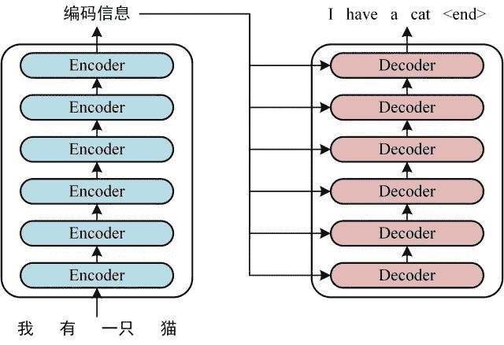

Transformer 的整体结构，左图Encoder和右图Decoder

> 可以看到** ****Transformer **由** ****Encoder** 和** ****Decoder**** **两个部分组成，**Encoder** 和**Decoder** 都包含** 6 个 ****block****。**

+   **Transformer **的工作流程大体如下：

+   **第一步****：获取输**入句子的每一**个单词的表示向量 X****，X由单词的 **Embeddin**g（Embeddin**g就是从原始数据提取出来的Feature） 和单词位置的 Embedding 相加得到。

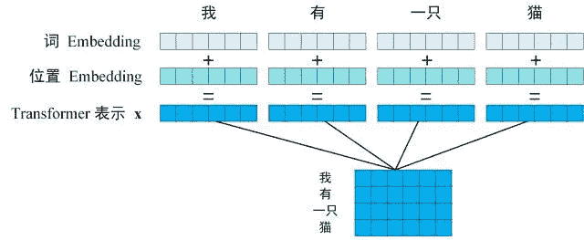

Transformer 的输入表示

+   **第二步**：将得到的单词表示**向量矩阵**** **(如上图**所****示，每一行是一**个单词的表示 x) **传入 Encoder 中，**经过 6 个 Encode**r block **后可以得到句子所有单词的编码信息矩阵 C，

+   如下图。单词向量矩阵用   表示，** n **是句子中单词个数，**d **是表示向量的维度** ( d=512)**。每一个** Encoder block** **输出的矩阵维度与输入完全一致**。

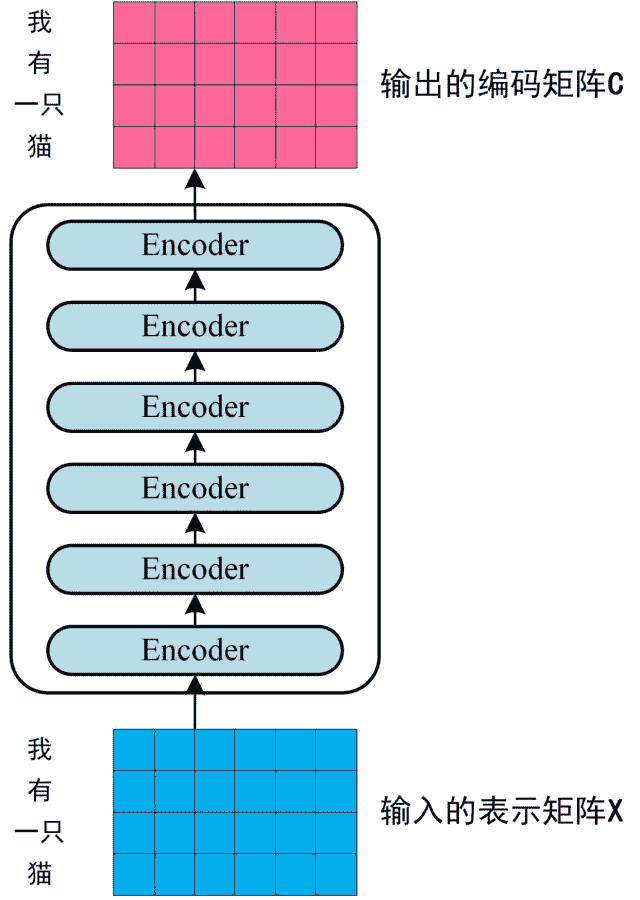

+   **第三步：**将 Encoder 输出的**编码信息矩阵 C**传递到** ****Decoder **中，**Decoder ** 依次会根据当前翻译过的单词 **1~ i**** **翻译下一个单词 **i+1****，如下图****所**示。在使用的过**程****中，翻译**到单词 i+1 的时候**需要通过** Mask (掩盖) 操作遮盖住 i+1 之后的单词。

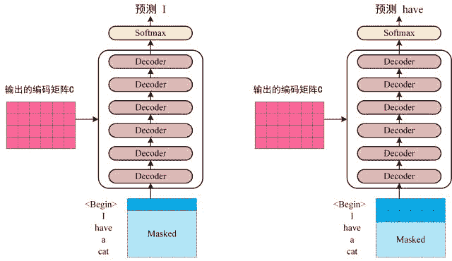

Transofrmer Decoder 预测

> 上图** ****Decoder**接收了** Encoder **的**编码矩阵 C**，然后首先输入一个翻译开始符 **"<Begin>"**，预测第一个单词 **"I"**；然后输入翻译开始符 **"<Begin>"** 和单词** "I"**，预测单词** "have"**，以此类推。这是 **Transformer** 使用时候的大致流程。

## Transformer 的输入

> **Transformer** 中单词的输入表示** x**由**单词 Embedding** 和**位置 Embedding **** **

> **（****P**ositional Encoding）相加得到。

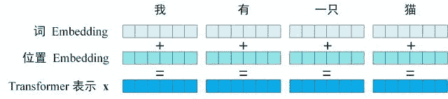

Transformer 的输入表示

### 单词 Embedding

**单词的 Embedding**** ****有很多种方式可以**获**取，例如可****以**采用 Word2Vec、Gl**ove 等算法预训练得**到，也可以在 Transformer 中训练得到。

###  位置 Embedding

> **Transformer** 除了单词的** Embedding****，还需要使用位置 Em****bed**ding 。因为 Tr**ansformer 不**采用 RNN **的结构，不能利用单**词的顺序信息，而这部分信息对于 NLP 来说非常重要。所以 Transformer 中使用位置 Embedding 保存单词在序列中的相对或绝对位置。

位置 Embedding 用** PE**表示，**PE** 的维度与单词 **Embedding** 是一样的。PE 可以通过训练得到，也可以使用某种公式计算得到。在 Transformer 中采用了后者

**计算公式如下：**

其中，**pos ****表示单词在句子中的位置**，**d**** **表**示 ****PE的维度 (与**词** Emb**edding 一样)，2i 表示偶数的维度，2i+1 表示奇数维度 (即 2i≤d, 2i+1≤d)。使用公式计算 PE 有以下的好处：

+   使** PE** 能够适应比**训练集**里面所有句子更长的句子，假设训练集里面最长的句子是有 20 个单词**，突然来了一个长度为** 21 的句子，则使用公式计算的方法可以计算出第 21 位的 Embedding。

+   **可以让模型容易地计算出相对位置**，对于固定长度的间距** k，PE(pos+k) **可以用 **PE(pos)**** **计算得到。

+   因为 **Sin(A+B) = Sin(A)Cos(B) + Cos(A)Sin(B)**, Cos(A+B) = Cos(A)Cos(B) - Sin(A)Sin(B)。

## Self-Attention（自注意力机制）

Transformer 的内部结构图

+   左侧为 **Encoder block**

+   右侧为 **Decoder block**

+   红色圈中的部分为 Multi-**Head Attention**，是由多个 Self-Attention组成的

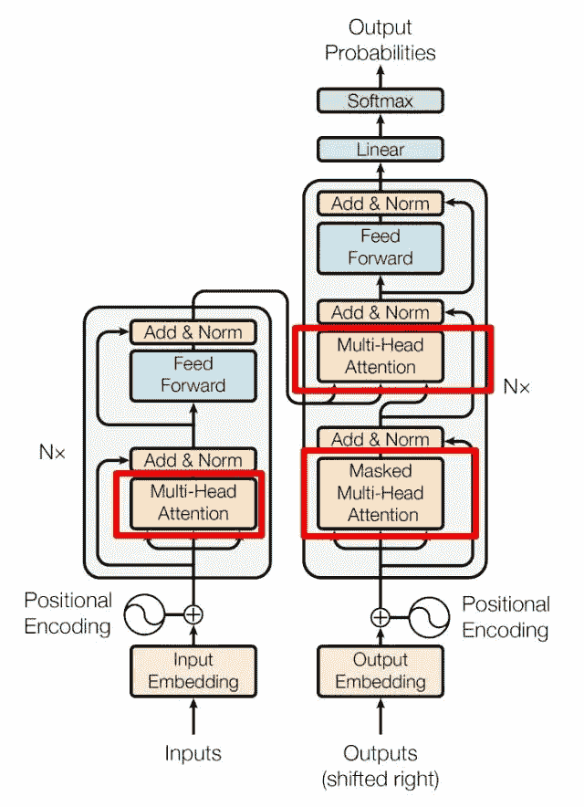

1.  可以看到 **Encoder block **包含一个 Multi-Head Attention

1.  而 **Decoder block **包含两个** M**ulti-Head Attention (其中有一个用到 Masked)。

1.  Multi-H**ead Attention**上方还包括一个 Add & Norm 层

1.  **Add **表示残差连接 (Residual Connection) 用于防止网络退化，

1.  **Norm** 表示 Layer Normali**zat**ion，用于对每一层的激活值进行归一化。

因为 **Self-Attention**是 T**ransformer 的重点，**所以我们重点关注 Multi-Head Attention 以及 Self-Attention，首先详细了解一下 Self-Attention 的内部逻辑。

### Self-Attention 结构

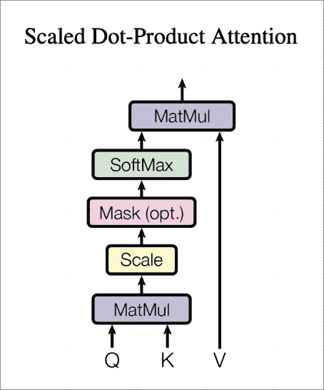

Self-Attention 结构

上图是 **Self-Attention****的结构，在****计算的时候需**要**用到矩阵**Q**(查询),**K(键值)**,V(值)。在实际中，Sel**f-Atte**ntio**n 接收的是输入(单词的表示向量x组成的矩阵X) 或者上一个 Encoder block 的输出。而Q,K,V正是通过 Self-Attention 的输入进行线性变换得到的。

### **Q, K, V 的计算**

> **Self-Attention**的输入用**矩阵X**进行表示，则可以使用**线性变阵矩阵****WQ**,**WK**,**WV**计算得到**Q**,**K**,**V**。计算如下图所示，注意 X, Q, K, V 的每一行都表示一个单词。

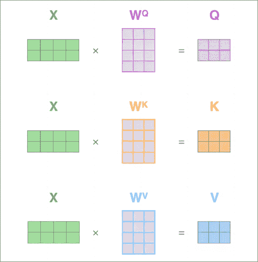

Q, K, V 的计算

### **实现**

```
# self-attention 实现
import numpy as np
from math import sqrt
import torch
from torch import nn


class Self_Attention(nn.Module):
    # input : batch_size * seq_len * input_dim
    # q : batch_size * input_dim * dim_k
    # k : batch_size * input_dim * dim_k
    # v : batch_size * input_dim * dim_v
    def __init__(self, input_dim, dim_k, dim_v):
        super(Self_Attention, self).__init__()
        self.q = nn.Linear(input_dim, dim_k)
        self.k = nn.Linear(input_dim, dim_k)
        self.v = nn.Linear(input_dim, dim_v)
        self._norm_fact = 1 / sqrt(dim_k)

    def forward(self, x):
        Q = self.q(x)  # Q: batch_size * seq_len * dim_k
        K = self.k(x)  # K: batch_size * seq_len * dim_k
        V = self.v(x)  # V: batch_size * seq_len * dim_v

        # Q * K.T() # batch_size * seq_len * seq_len
        atten = nn.Softmax(
            dim=-1)(torch.bmm(Q, K.permute(0, 2, 1))) * self._norm_fact

        # Q * K.T() * V # batch_size * seq_len * dim_v
        output = torch.bmm(atten, V)

        return output


X = torch.randn(4, 3, 2)
print(X)
self_atten = Self_Attention(2, 4, 5)  # input_dim:2, k_dim:4, v_dim:5
res = self_atten(X)
print(res.shape)  # [4,3,5]
```

###  Self-Attention 的输出

得到矩阵 **Q**, **K**, **V**之后就可以计算出 Self-Attention 的输出了。

**计算的公式如下：**

> 公式中计算矩阵**Q**和**K**每一行向量的**内积，为****了**防**止内****积过大，因此除以  **的平方根。Q乘以K的转置后**，得到的**矩阵行列数都为 n，n 为句子单词数，这个矩阵可以表示单词之间的 attention 强度。下图为Q乘以  ，1234 表示的是句子中的单词。

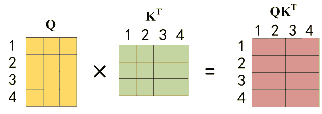

Q乘以K的转置的计算

得到 之后，使用 **Softmax**** 计算每一个单词对**于其他单词的 at**tention** 系数，公式中的 So**ftmax是对**矩阵的每一行进行 Softmax，即每一行的和都变为 1.

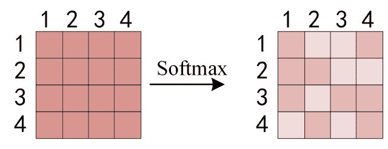

对矩阵的每一行进行 Softmax

得到 **Softmax** 矩阵之后可以和V相乘，得到最终的输出Z。

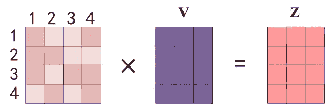

Self-Attention 输出

上图中**Softmax****矩阵的第 1 行表示单**词 1 与其他所有单词的 attention 系数，最终单词 1 的**输出    等于所**有单词 i 的值   根据 attention 系数的比例加在一起得到，如下图所示：

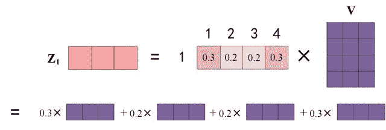

Zi 的计算方法

### Multi-Head Attention

**在上一步，我们已经知道怎么通****过 Self-Att**enti**on计**算得到输出矩阵 Z，而 Multi-Head Attention 是由多个 Self-Attention 组合形成的，下图是论文中 Multi-Head Attention 的结构图。

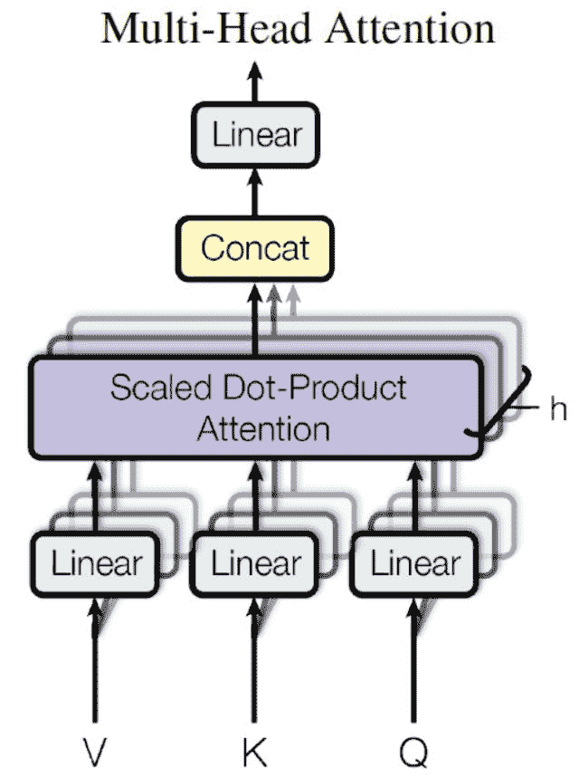

Multi-Head Attention

从上图可以看到 Multi**-Head Attention** 包含多个 Se**l**f-Atte**n****ti**on 层，**首**先将输入**X分别传递****到 h** 个不同 Self-Attention 中，计算得到 h 个输出矩阵Z。下图是 h=8 时的情况，此时会得到 8 个输出矩阵Z。

### 实现

```
#%%   # Muti-head Attention 机制的实现
from math import sqrt
import torch
import torch.nn as nn
```

```
class Self_Attention_Muti_Head(nn.Module):
    # input : batch_size * seq_len * input_dim    # q : batch_size * input_dim * dim_k
    # k : batch_size * input_dim * dim_k    # v : batch_size * input_dim * dim_v
    def __init__(self,input_dim,dim_k,dim_v,nums_head):
        super(Self_Attention_Muti_Head,self).__init__()
        assert dim_k % nums_head == 0
        assert dim_v % nums_head == 0
        self.q = nn.Linear(input_dim,dim_k)
        self.k = nn.Linear(input_dim,dim_k)
        self.v = nn.Linear(input_dim,dim_v)
        self.nums_head = nums_head
        self.dim_k = dim_k
        self.dim_v = dim_v
        self._norm_fact = 1 / sqrt(dim_k)
```

```
    def forward(self,x):
        Q = self.q(x).reshape(-1,x.shape[0],x.shape[1],self.dim_k // self.nums_head) 
        K = self.k(x).reshape(-1,x.shape[0],x.shape[1],self.dim_k // self.nums_head) 
        V = self.v(x).reshape(-1,x.shape[0],x.shape[1],self.dim_v // self.nums_head)
        print(x.shape)
        print(Q.size())
        atten = nn.Softmax(dim=-1)(torch.matmul(Q,K.permute(0,1,3,2))) # Q * K.T() # batch_size * seq_len * seq_len
        
        output = torch.matmul(atten,V).reshape(x.shape[0],x.shape[1],-1) # Q * K.T() * V # batch_size * seq_len * dim_v
        return output
```

```
x=torch.rand(1,3,4)
print(x)
# %%
atten=Self_Attention_Muti_Head(4,4,4,2)
y=atten(x)
print(y.shape)
```

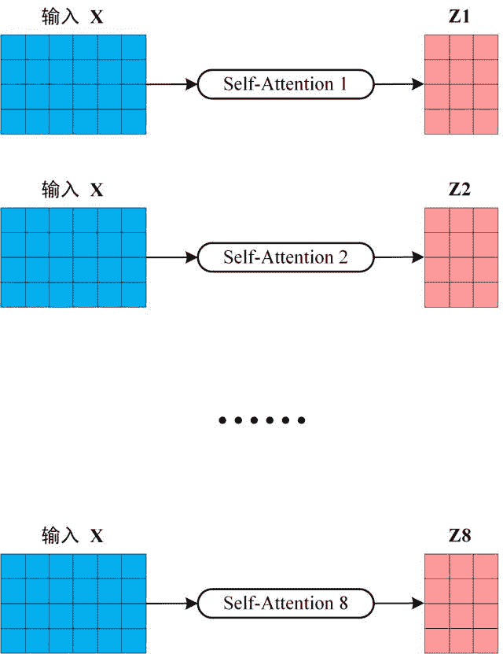

多个 Self-Attention

得到 **8 个输出矩阵**    到   之后，**M**ulti-Hea**d Attenti**on 将它们拼**接在一起 (**Concat)，然后传入一个Linear层，得到 Multi-Head Attention 最终的输出Z。

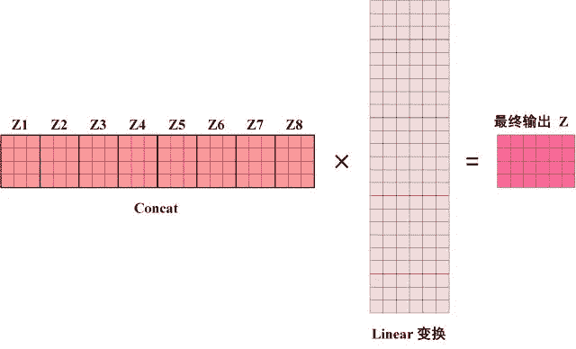

Multi-Head Attention 的输出

可以看到 Mult**i-H**ead A**tte**ntion 输出的矩阵Z与其输入的矩阵X的维度是一样的。

## Encoder 结构

**红色部分**是 Transformer 的** Encoder block** 结构，可以看到是由 Mu**lti-Head A**tt**ention, Add **& **Norm, Feed** Forward, Add & Norm 组成的。刚刚已经了解了 Multi-Head Attention 的计算过程，现在了解一下 Add & Norm 和 Feed Forward 部分。

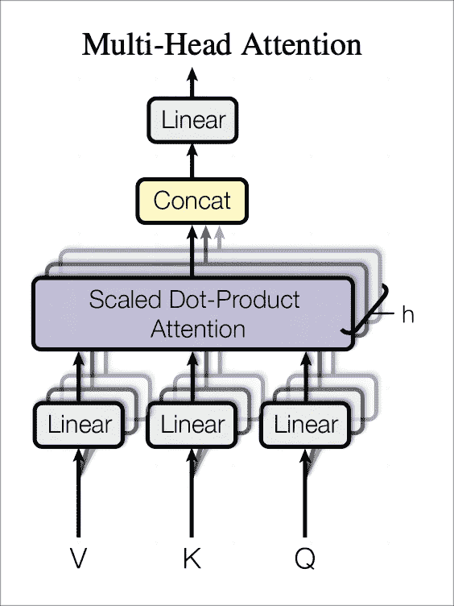

Transformer Encoder block

###  Add & Norm

**Add & Norm **层由 Add 和 Norm 两部分组成，其计算公式如下：

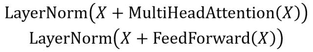

Add &amp;amp;amp;amp; Norm 公式

+   其中** X**表示 Mult**i-Head Atten**tion 或者 F**eed Forward 的输入**，MultiHeadA**tte**ntion(X) 和 FeedForward(X) 表示输出 (输出与输入 X 维度是一样的，所以可以相加)

+   **Add**指 X+MultiHeadAttenti**on(X)，****是一种残差**连接，通常用于解决多层网络训练的问题，可以让网络只关注当前差异的部分，在 ResNet 中经常用到：

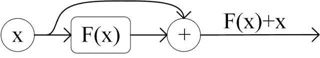

残差连接

### Feed Forward

**Feed Forward **层比较简单，是一个两层的**全连接层**，第一层的**激活函数**为** Relu**，第二层不使用激活函数，对应的公式如下：

**X**是输入，**Feed Forward **最终得到的输出矩阵的维度与X一致。

### 组成 Encoder

> 通过上面描述的** ****Multi-Head At**t**ention, Fee**d Forward,** Add & Norm 就**可**以构造出一个 Encoder** block，Encoder block 接收输入矩阵   ，并输出一个矩阵  。通过多个 Encoder block 叠加就可以组成 Encoder。

+   第一个 **Encoder block **的输入为句子单词的表示**向量矩阵**，

+   后续** ****Encoder block**** 的**输入是前一个 Encoder block 的输出

+   最后一个 **Encoder block** 输出的矩阵就是**编码信息矩阵 C**，这一矩阵后续会用到** Decoder** 中。


## Decoder 结构

**红色部分**为 **Transformer** 的** Decoder block **结构，与 Encoder block 相似，但是存在一些区别：

+   包含两个 Multi-Head Attention 层。

+   第一个 Multi-**Head A**ttention 层采用了 Masked 操作。

+   第二个** **Mul**t**i-**H**ead A**ttentio****n 层的K, V矩阵使用 **Encoder 的编码信息矩阵C进行计算，而Q使用上一个 Decoder block 的输出计算。

+   最后有一个 **Softmax** 层计算下一个翻译单词的概率。

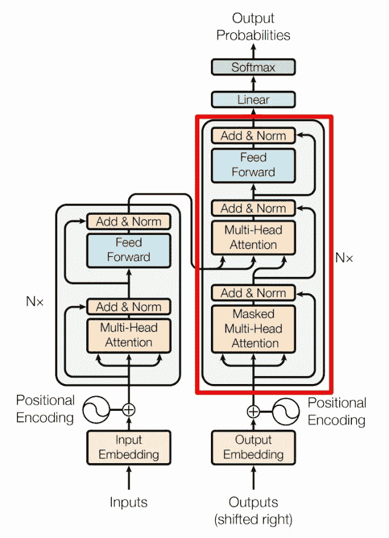

Transformer Decoder block

### 第一个 Multi-Head Attention

> **Decoder block** 的第一个 Multi-Head Attention 采用了 Masked 操作，因为在翻译的过程中是顺序翻译的，即翻译完第 i 个单词，才可以翻译第 i+1 个单词。通过 Masked 操作可以防止第 i 个单词知道 i+1 个单词之后的信息。下面以 "我有一只猫" 翻译成 "I have a cat" 为例，了解一下 Masked 操作。

+   在** Decoder** **的时候，**是需要根据之前**的翻译，求解当前最有可****能**的翻译，如下图所示**。****首先根据输****入** "<Begin>" 预测出第一个单词为 "I"，然后根据输入 "<Begin> I" 预测下一个单词 "have"。

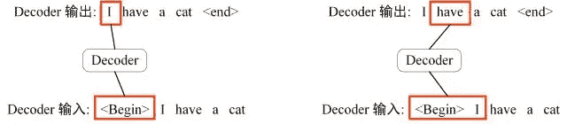

Decoder 预测

+   **Decoder **可以在训练的过程中使用 **Teacher Forcing** 并且**并行化训练**，即将正确的单词序列 (<Be**g**in>** I have **a cat) 和**对应**输出 (I hav**e a **cat <end>) 传递到 Decoder。那么在预测第 i 个输出时，就要将第 i+1 之后的单词掩盖住，

+   注意 **Mask** 操作是在 **Self-Attention** 的** Softmax**** **之前使用的，下面用 0 1 2 3 4 5 分别表示 <Begin> I have a cat <end>。

**第一步**：

1.  是 Decoder 的输入矩阵和 Mask 矩阵，输入矩阵包含 "<Begin> I have a cat" (0, 1, 2, 3, 4) 五个单词的表示向量，Mask 是一个 5×5 的矩阵。在 Mask 可以发现单词 0 只能使用单词 0 的信息，而单词 1 可以使用单词 0, 1 的信息，即只能使用之前的信息。

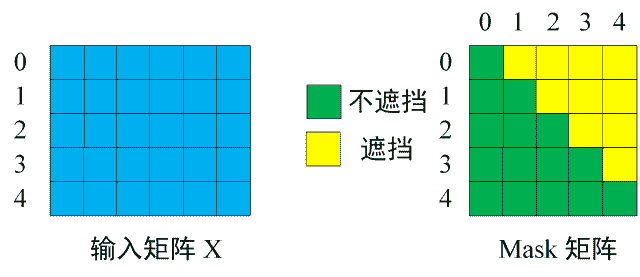

输入矩阵与 Mask 矩阵

**第二步**：

1.  '接下来的操作和之前的 Self-Attention 一样，通过输入矩阵X计算得到Q,K,V矩阵。然后计算Q和

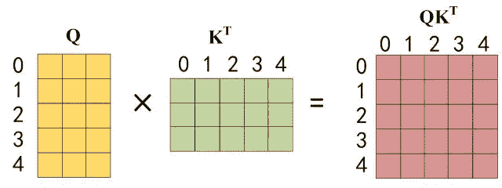

Q乘以K的转置

**第三步**：

1.  在得到  之后需要进行 Softmax，计算 attention score，我们在 Softmax 之前需要使用Mask矩阵遮挡住每一个单词之后的信息，遮挡操作如下：

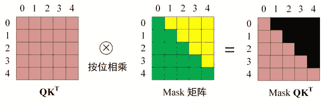

Softmax 之前 Mask

得到 Mask   之后在 Mask  上进行 Softmax，每一行的和都为 1。但是单词 0 在单词 1, 2, 3, 4 上的 attention score 都为 0。

**第四步**：

1.  使用 Mask   与矩阵 V相乘，得到输出 Z，则单词 1 的输出向量    是只包含单词 1 信息的。

**第五步**：

1.  通过上述步骤就可以得到一个 Mask Self-Attention 的输出矩阵    ，然后和 Encoder 类似，通过 Multi-Head Attention 拼接多个输出  然后计算得到第一个 Multi-Head Attention 的输出Z，Z与输入X维度一样。

###  第二个 Multi-Head Attention

+   **Decoder block** 第二个 **Multi-Head Atte**nt**i**on** **变化不大， 主要的区**别****在于其中 Self-Att**ention 的 K, **V****矩阵不是使用 **上一个 Decoder block 的输出计算的，而是使用 Encoder 的编码信息矩阵 C 计算的。

+   根据 **Encoder** 的输出 **C**计算得到 **K**, **V**，根据上一个** Decoder block** 的输出** Z **计算 **Q **(如果是第一个** ****Decoder block** 则使用输入**矩阵 X** 进行计算)，后续的计算方法与之前描述的一致。

+   这样做的好处是在 **Decoder **的时候，每一位单词都可以利用到 Enco**der **所有单词的信息 (这些信息无需 Mask)。

### **Softmax**预测输出单词

**Decoder block **最后的部分是利用 **Softmax** 预测下一个单词，在之前的**网络层****我们可以**得到一个最终的输出 **Z****，**因为 M**as**k 的存在，使**得****单**词 0 的输出 Z0 只包含单词 0 的信息，如下：

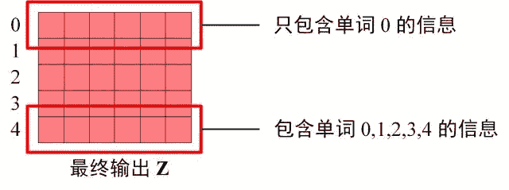

Decoder Softmax 之前的 Z

**Softmax** 根据输出矩阵的每一行预测下一个单词：

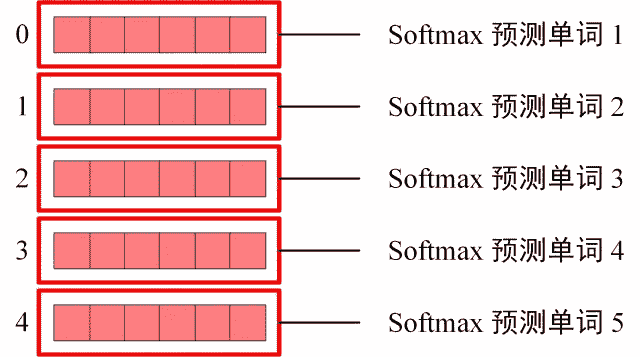

Decoder Softmax 预测

这就是 **Decoder block** 的定义，与** ****Encoder**** **一样，**Decoder** 是由多个** Decoder block** 组合而成。

## Transformer 总结

+   Transformer 与 RNN 不同，可以比较好地并行训练。

+   Transformer 本身是不能利用单词的顺序信息的，因此需要在输入中添加位置 Embedding，否则 Transformer 就是一个词袋模型了。

+   Transformer 的重点是 Self-Attention 结构，其中用到的 Q, K, V矩阵通过输出进行线性变换得到。

+   Transformer 中 Multi-Head Attention 中有多个 Self-Attention，可以捕获单词之间多种维度上的相关系数 attention score。