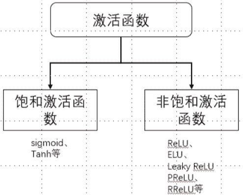
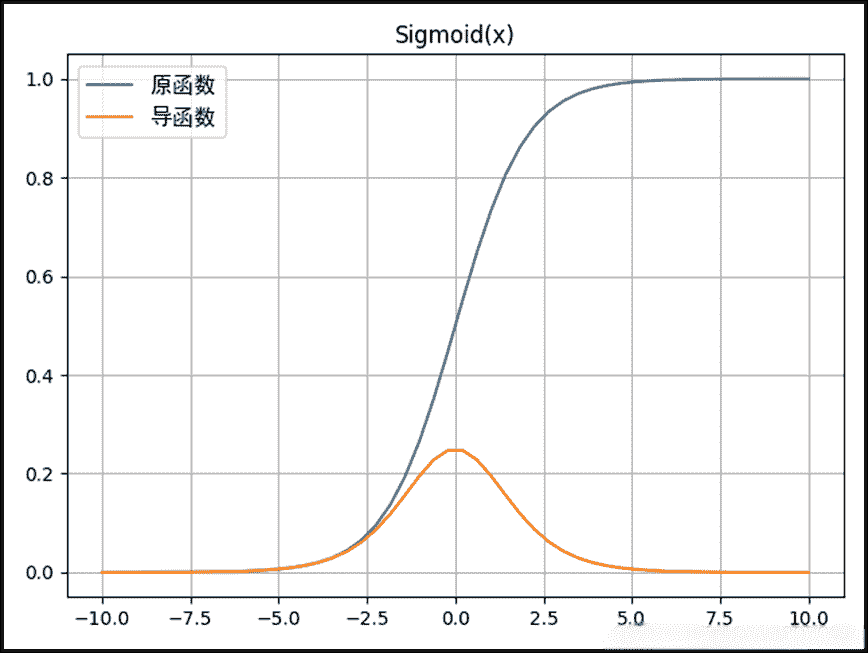
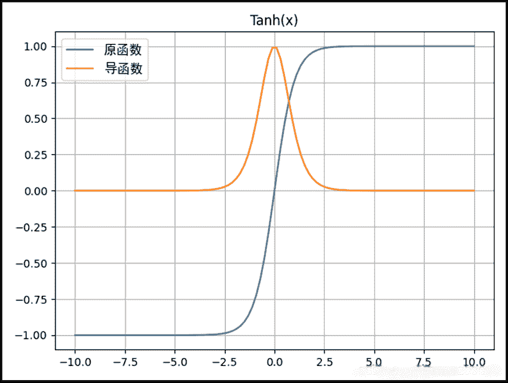
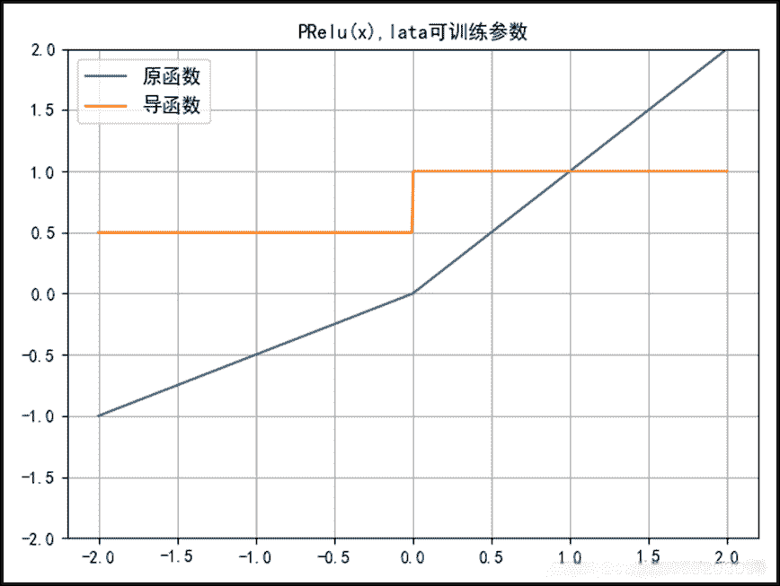
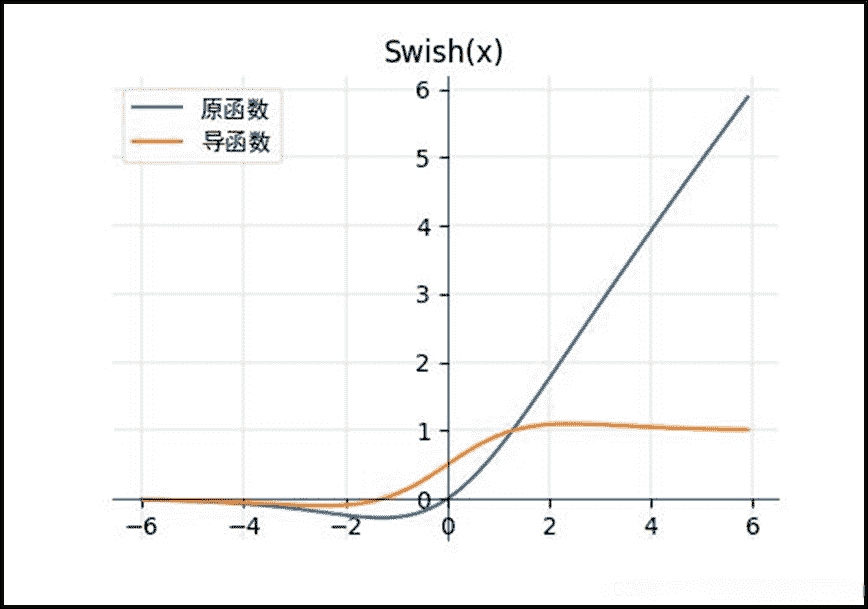
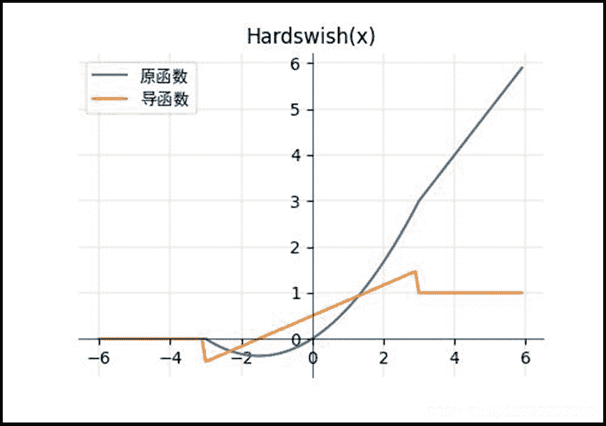
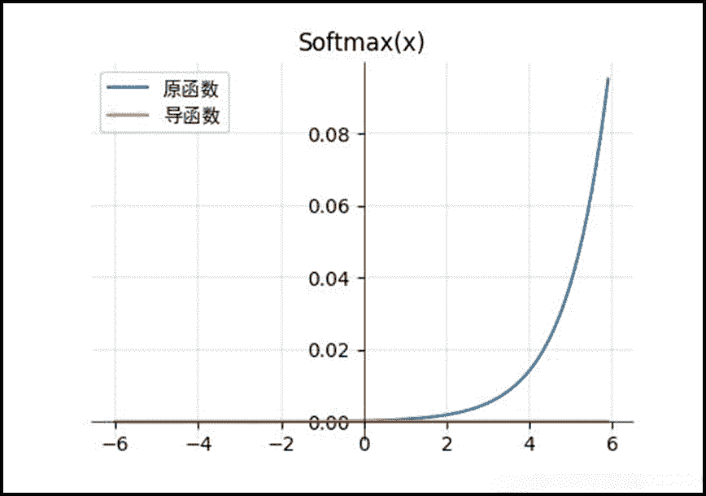

# 【合集】17种常用激活函数详解

> 来源：[https://qqs7y1hozd1.feishu.cn/docx/ShqodL0QGoBfaRxc28icHI31njf](https://qqs7y1hozd1.feishu.cn/docx/ShqodL0QGoBfaRxc28icHI31njf)

## 一、定义以及作用

（什么是激活函数？激活函数有什么用？）

> 在人工神经网络中，激活函数扮演了非常重要的角色，其主要作用是对所有的隐藏层和输出层添加一个非线性的操作，使得神经网络的输出更为复杂、表达能力更强。

> 在神经网络中，激活函数决定来自给定输入集的节点的输出，其中非线性激活函数允**许**网络复制复杂的非线性行为。正如绝大多数神经网络借助某种形式的梯度下降进行优化，激活函数需要是可微分（或者至少是几乎完全可微分的）。

**此外，复杂的激活函数也许产生一些梯度消失或爆炸的问题。****因**此，神经网络倾向于部署若干个特定的激活函数（identity、sigmoid、ReLU 及其变体）。

**（激活函数分类）**

激活函数能分成两类——饱和激活函数和非饱和激活函数。

**饱和的概念:**

**右饱和:**

当x趋向于正无穷时，函数的导数趋近于0，此时称为右饱和

**左饱和:**

当x趋向于负无穷时，函数的导数趋近于0，此时称为左饱和

**饱和函数和非饱和函数:**

一个函数既满足右饱和，又满足左饱和，则称为饱和函数否则称为非饱和函数。



## 二、常用激活函数解析

### 1、Sigmoid函数

#### 1.1 公式

#### 1.2 对应的图像



#### 1.3 优点与不足之处

Sigmoid优点：

> 1、其值域为[0,1]，非常适合作为模型的输出函数用于**输出一个(0,1)范围内**的概率值，可用于将预测概率作为输出的模型，比如用于表示二分类的类别或者用于表示置信度。

> 2、Sigmoid 函数的输出范围是 0 **到 1。由于输出值限定在0到1**，因此它对每个神经元的输出进行了归一化。

> **3、该函数是连续可导的（**即可微），可以提供非常平滑的梯度值，防止模型训练过程中出现突变的梯度（即避免「跳跃」的输出值）。

Sigmoid不足：

> 1**、**从其导数的函数图像上可以看到，其导数的最大值只有0.25，而且当x在[-5,5]的范围外时其导数值就已经几乎接近于0了。这种情况会导致训练过程中神经元处于一种饱和状态，反向传播时其权重几乎得不到更新，从而使得模型变得难以训练，这种现象被称为梯度消失问题。

> 2、其输出不是以0为中心而是都大于0的（这会降低权重更新的效率），这样下一层的神经元会得到上一层输出的全正信号作为输入，所以Sigmoid激活函数不适合放在神经网络的前面层而一般是放在最后的输出层中使用。

> 3、需要进行指数运算（计算机运行得较慢），计算量大及计算复杂度高，训练耗时；指数的越大其倒数就越小，容易产生梯度消失。

#### 1.4 对应pytorch的代码

```
import torch
import torch.nn as nn
 
# Sigmoid函数
print(&#x27;*&#x27;*25+&quot;Sigmoid函数&quot;+&quot;*&quot;*25)
m = nn.Sigmoid()
input = torch.randn(2)
print(&quot;原：&quot;,input)
print(&quot;结果：&quot;,m(input))
print(&#x27;*&#x27;*50)
```

### 2、Tanh函数

#### 2.1 公式

#### 2.2 对应的图像



#### 2.3 优点与不足之处

Tanh优点：

> 1、在分类任务中，**双曲正切函数（Tanh）逐渐取代** Sigmoid 函数作为标准的激活函数，其具有很多神经网络所钟爱的特征。它是完全可微分的，反对称，对称中心在原点。

> 2、输出是S型曲线，具备打破网络层与网络层之间的线性关系。负输入将被强映射为负，而零输入被映射为接近零；tanh 的输出间隔为1且值域是以0为中心的[-1,1]。

> 3、在一般的二元分类问题中，tanh 函数用于隐藏层，而 sigmoid 函数用于输出层，但这并不是固定的，需要根据特定问题进行调整。

Tanh不足：

> 1、当输入较大或较小时，**输出几乎是平滑的并且梯度较小**，这不利于权重更新。

> **2、Tanh函数也需要**进行指数运算，所以其也会存在计算复杂度高且计算量大的问题。

> 3**、当神经****网**络的层数增多的时候，由于在进行反向传播的时候，链式求导，多项相乘，函数进入饱和区（导数接近于零的地方）就会逐层传递，这种现象被称为梯度消失。

#### 2.4 对应pytorch的代码

```
import torch
import torch.nn as nn
# Tanh函数
print(&#x27;*&#x27;*25+&quot;Tanh函数&quot;+&quot;*&quot;*25)
m = nn.Tanh()
input = torch.randn(2)
print(&quot;原：&quot;,input)
print(&quot;结果：&quot;,m(input))
print(&#x27;*&#x27;*50)
```

### 3、ReLU

#### 3.1 公式

，

#### 3.2 对应的图像


#### 3.3 优点与不足之处

ReLU函数：

> 1、ReLU 函数在正输入时是线性的，收敛速度快，计算速度快，同时符合恒等性的特点。当输入为正时，由于导数是1，能够完整传递梯度，不存在梯度消失的问题（梯度饱和问题）。

> 2、计算速度快。ReLU 函数中只存在线性关系且无论是函数还是其导数都不包含复杂的数学运算，因此它的计算速度比 sigmoid 和 tanh 更快。

> 3、当输入大于0时，梯度为1，能够有效避免链式求导法则梯度相乘引起的梯度消失和梯度爆炸；计算成本低。

> 4、当输入为正的时候，导数不为零，从而允许基于梯度的学习（尽管在 x=0 的时候，导数是未定义的）。当输入为负值的时候，ReLU 的学习速度可能会变得很慢，甚至使神经元直接无效，因为此时输入小于零而梯度为零。

ReLU不足：

> 1、ReLU的输入值为负的时候，输出始**终为0，其一阶导数**也始终为0，这样会导致神经元不能更新参数，也就是神经元不学习了，这种现象叫做“Dead Neuron”。为了解决ReLU函数这个缺点，在ReLU函数的负半区间引入一个泄露（Leaky）值，所以称为Leaky ReLU函数。

> 2、与Sigmoid一样，其输出不是以0为中心的（ReLU的输出为0或正数）。

> **3、ReLU在小于0**的时候梯度为零，导致了某些神经元永远被抑制，最终造成特征的学习不充分;这是典型的 Dead ReLU 问题，所以需要改进随机初始化，避免将过多的负数特征送入ReLU。

#### 3.4 对应pytorch的代码

```
import torch
import torch.nn as nn
 
# Relu函数
print(&#x27;*&#x27;*25+&quot;Relu函数&quot;+&quot;*&quot;*25)
m = nn.ReLU()
input = torch.randn(2)
print(&quot;原：&quot;,input)
print(&quot;结果：&quot;,m(input))
print(&#x27;*&#x27;*50)
```

### 4、Leaky ReLU函数

#### 4.1 公式

，

#### 4.2 对应的图像


#### 4.3 改进以及不足之处

Leaky ReLU函数(ReLU的改进)：

> 1、与ReLU函数相比，把x的非常小的线性分量给予负输入（0.01x）来调整负值的零梯度问题；有助于扩大 ReLU 函数的范围，通常𝜆λ的值为 0.01 左右；函数范围是负无穷到正无穷。

> 2、LeakyRelu激活函数通过在负半轴添加一个小的正斜率(使得负轴的信息不会全部丢失)来解决ReLU激活函数的“死区”问题，该斜率参数𝜆λ是手动设置的超参数，一般设置为0.01。通过这种方式，LeakyRelu激活函数可以确保模型训练过程中神经元的权重在输入小于0的情况下依然会得到更新。

> 3、不会出现 Dead ReLu** 问题，但是关于输入函**数f(x) 的部分容易出现梯度爆炸的情况是一样的，所以必要时，也可以搭配 sigmoid 或 tanh 使用。

Leaky ReLU不足：

> 1、经典（以及广泛使用的）ReLU 激活函数的变体，带泄露修正线性单元（Leaky ReLU）的输出对负值输入有很小的坡度。由于导数总是不为零，这能减少静默神经元的出现，允许基于梯度的学习（虽然会很慢）。

> 2、从理论上讲，Leaky ReLU 具有 ReLU 的所有优点，而且 Dead ReLU 不会有任何问题，但在实际操作中，尚未完全证明 Leaky ReLU 总是比 ReLU 更好。

#### 4.4 对应pytorch的代码

```
import torch
import torch.nn as nn
 
# Leaky Relu函数
print(&#x27;*&#x27;*25+&quot;Leaky Relu函数&quot;+&quot;*&quot;*25)
m = nn.LeakyReLU(negative_slope=0.1) #negative_slope是个常数
input = torch.randn(2)
print(&quot;原：&quot;,input)
print(&quot;结果：&quot;,m(input))
print(&#x27;*&#x27;*50)
```

### 5、PReLU函数

#### 5.1 公式

，

PReLU函数的导函数：

####  5.2 对应的图像



####  5.3 改进之处

PReLU函数(ReLU的改进)：

> 1、在负值域，PReLU的斜率较小，这也可以避免Dead ReLU问题。与ELU相比，PReLU在负值域是线性运算。尽管斜率很小，但不会趋于0。

> 2、公式与Leaky ReLu相似，但并不完全一样。𝛼可以是常数，或自适应调整的参数。也就是说，如果让a自适应，那么PReLu会在反向传播时更新参数a。

> 3、参数α通常为0到1之间的数字，并且通常相对较小。

> （1）如果𝛼 = 0，则f(x)变为ReLU。

> （2）如果𝛼 > 0，则f(x)变为leaky ReLU。

> （3）如果𝛼是可学习的参数，则f(x)变为PReLU。

#### 5.4 对应pytorch的代码

```
import torch
import torch.nn as nn
 
# PRelu函数
print(&#x27;*&#x27;*25+&quot;PRelu函数&quot;+&quot;*&quot;*25)
m = nn.PReLU(num_parameters=1) #num_parameters是个可训练参数
input = torch.randn(2)
print(&quot;原：&quot;,input)
print(&quot;结果：&quot;,m(input))
print(&#x27;*&#x27;*50)
```

### 6、RReLU函数

#### 6.1 公式

，

#### 6.2 对应的图像


#### 6.3 改进之处

RReLU函数(ReLU的改进)：

> **1、RReLU和PReLU的**表达式一样，但𝛼α参数不一样，这里的𝛂α是个随机震荡的数，范围（pytorch）：1/8~1/3。(对应图的参数为lower =1/8，upper =1/3)

> 3、RReLU（随机校正线性单元）。在RReLU中，负部分的斜率在训练中被随机化到给定的范围内，然后再测试中被固定。

#### 6.4 对应pytorch的代码

```
import torch
import torch.nn as nn
 
# RRelu函数
print(&#x27;*&#x27;*25+&quot;RRelu函数&quot;+&quot;*&quot;*25)
m = nn.RReLU(lower=0.1, upper=0.3) # 这里的参数属于(lower,upper)之间的震荡随机数
input = torch.randn(2)
print(&quot;原：&quot;,input)
print(&quot;结果：&quot;,m(input))
print(&#x27;*&#x27;*50)
```

### 7、ELU函数

#### 7.1 公式

，

#### 7.2 对应的图像


#### 7.3 改进以及不足之处

ELU函数(ReLU的改进)：(上图的α值为1.0)

> **1、ELU在负**值时是一个指数函数(使激活的平均值接近零)，具有软饱和特性，对噪声更鲁棒，抗干扰能力强；在较小的输入下会饱和至负值，从而减少前向传播的变异和信息。

> 2、均值向零加速学习。通过减少偏置偏移的影响，使正常梯度接近于单位自然梯度，可以使学习更快。

> 3、输出有负值，使得其输出的平均值为0；右侧的正值特性，可以像relu一样缓解梯度消失的问题。

ELU不足：

> 1、**ELu** 也**是为了解决 De****ad ReLu 而提出**的改进型。计算上稍微比 Leaky ReLu 复杂一点，但从精度看似乎并未提高多少。

> 2**、尽**管理论上比 ReLU 要好，但目前在实践中没有充分的证据表明 ELU 总是比 ReLU 好。

#### 7.4 对应pytorch的代码

```
import torch
import torch.nn as nn
# ELU函数
print(&#x27;*&#x27;*25+&quot;ELU函数&quot;+&quot;*&quot;*25)
m = nn.ELU(alpha=1.0) # 这里的参数alpha默认为1
input = torch.randn(2)
print(&quot;原：&quot;,input)
print(&quot;结果：&quot;,m(input))
print(&#x27;*&#x27;*50)
```

### 8、SELU函数

#### 8.1 公式

，

#### 8.2 对应的图像


#### 8.3 改进

SELU函数(ReLU的改进)：(上图的𝛼=1.67 and 𝝀=1.05.)

> 1、当其中参数α=1.67 ， λ=1.**0**5时，在网络权重服从正态分布的条件下，各层输出的分布会向标准正态分布靠拢。这种[自我标准化]的特性可以避免梯度消失和爆炸。

> **2**、SELU激活函数是在自归一化网络中定义的，通过调整均值和方差来实现内部的归一化，这种内部归一化比外部归一化更快，这使得网络收敛得更快。

> 3、SELU是给ELU乘上一个系数，该系数大于**1。在这篇paper Sel**f-Normalizing Neural Networks中，作者提到，SELU可以使得输入在经过一定层数之后变为固定的分布。以前的ReLU、P-ReLU、ELU等激活函数都是在负半轴坡度平缓，这样在激活的方差过大时可以让梯度减小，防止了梯度爆炸，但是在正半轴其梯度简答的设置为了1。而SELU的正半轴大于1，在方差过小的时候可以让它增大，但是同时防止了梯度消失。这样激活函数就有了一个不动点，网络深了之后每一层的输出都是均值为0，方差为1。

#### 8.4 对应pytorch的代码

```
import torch
import torch.nn as nn
 
# SELU函数
print(&#x27;*&#x27;*25+&quot;SELU函数&quot;+&quot;*&quot;*25)
m = nn.SELU() # 这里的参数默认alpha=1.67，scale=1.05
input = torch.randn(2)
print(&quot;原：&quot;,input)
print(&quot;结果：&quot;,m(input))
print(&#x27;*&#x27;*50)
```

### 9、CELU函数

#### 9.1 公式

，

#### 9.2 对应的图像


#### 9.3 官方给的配置

由于没找到什么相关的资料，所以这里就给pytorch官方实现的参数。

CELU函数(ReLU的改进)：(右图的𝛼=1.0.)

**官方配置：**

> alpha – the α value for the CELU formulation. Default: 1.0

> inplace – can optionally do the operation in-place. Default: False

#### 9.4 对应pytorch的代码

```
import torch
import torch.nn as nn
 
# CELU函数
print(&#x27;*&#x27;*25+&quot;CELU函数&quot;+&quot;*&quot;*25)
m = nn.CELU(alpha=1.0) # 这里的参数默认alpha=1.0
input = torch.randn(2)
print(&quot;原：&quot;,input)
print(&quot;结果：&quot;,m(input))
print(&#x27;*&#x27;*50)
```

### 10 、GELU函数

#### 10.1 公式

GELU函数的公式：

>

>

>

#### 10.2 对应的图像


#### 10.3 优点

GELU优点：

> 1、当方差为无穷大，均值为0的时候，GeLU就等价于ReLU了。GELU可以当作为RELU的一种平滑策略。GELU是非线性输出，具有一定的连续性。GELU有一个概率解释，因为它是一个随机正则化器的期望。

> 2、研究学者尝试使用一个依赖于输入本身的概率统计量为激活函数提供随机正则性，同时保持输入信息，得到了一个更好的激活函数，即高斯误差线性单元，形式如下：GELU(x) = x ∗ P(X≤x) = x  ∗  ϕ(x)由于上面这个函数是无法直接计算的，研究者在研究过程中发现GELU函数可以被近似地表示为GELU(x)=0.5∗x∗(1+tanh(√(2/π   )∗(x+0.044715x^3) )

> 3、GELU的实用技巧。首先，建议在使用GELU训练时使用具有动量的优化器，这是深度神经网络的标准。其次，使用对高斯分布的累积分布函数的密切近似是很重要的

#### 10.4 对应pytorch的代码

```
import torch
import torch.nn as nn
 
# GELU函数
print(&#x27;*&#x27;*25+&quot;GELU函数&quot;+&quot;*&quot;*25)
m = nn.GELU()
input = torch.randn(2)
print(&quot;原：&quot;,input)
print(&quot;结果：&quot;,m(input))
print(&#x27;*&#x27;*50)
```

## 11、ReLU6函数

### 11.1 对应的公式

，

### 11.2 对应的图像


### 11.3 改进

ReLU6函数(ReLU的改进)：(右图的𝛼α=1.0.)

> 1、为了在移动设备**float16/int8**的低精度的时候也能有很好的数值分辨率。

**如**果对ReLU的激活范围不加限制，输入范围为0到正无穷，如果激活值非常大，分布在一个很大的范围内，则低精度的float16/int8无法很好地精确描述如此大范围的数值，带来精度损失。

### 11.4 对应pytorch的代码

```
import torch
import torch.nn as nn
print(&#x27;*&#x27;*25+&quot;ReLU6函数&quot;+&quot;*&quot;*25)
m = nn.ReLU6()
input = torch.randn(2)
print(&quot;原：&quot;,input)
print(&quot;结果：&quot;,m(input))
print(&#x27;*&#x27;*50)
```

## 12、Swish函数

### 12.1 公式

Swish函数的公式：

f(x)\doteq x\cdot sigmoid(\beta x)

### 12.2 对应的图像



### 12.3 优点以及不足之处

**Swish优点：(右图的**𝛽β=1.0.)

> 1、和Relu一样，没有上边界，因此不会出现梯度饱和的现象（避免过拟合）。

> 2、有下边界，可以产生更强的**正则化效果**（x左半轴慢慢趋近于0）

> 3、**x<0非单调函数**

### 12.4 对应pytorch的代码

```
import torch
import torch.nn as nn
from torch.nn.modules.module import Module
from torch.nn import functional as F
from torch import Tensor
# Swish函数
# 由于旧版pytorch没找到Swich，自己整了一个
class Swish(Module):
    __constants__ = [&#x27;beta&#x27;]
    beta: int
    def __init__(self, beta: int = 1) -&gt; None:
        super(Swish, self).__init__()
        self.beta = beta
    def forward(self, input: Tensor) -&gt; Tensor:
        return input*torch.sigmoid(input*self.beta)
print(&#x27;*&#x27;*25+&quot;Swish函数&quot;+&quot;*&quot;*25)
m = Swish()
input = torch.randn(2)
print(&quot;原：&quot;,input)
print(&quot;结果：&quot;,m(input))
print(&#x27;*&#x27;*50)
```

## 13、Hardswish函数

### 13.1 公式

，

### 13.2 对应的图像



### 13.3 优点以及不足之处

Hardswich优点：

1、激活函数h-swish是MobileNet V3相较于V2的一个创新，是在谷歌大脑2017年的论文Searching for Activation Functions中swish函数的基础上改进而来，用于替换V2中的部分ReLU6。

2**、选择了ReLU6作为这个近似函数，有两个原因**：在几乎所有的软件和硬件框架上都可以使用ReLU6的优化实现；ReLU6能在特定模式下消除由于近似sigmoid的不同实现而带来的潜在的数值精度损失。

3、作者认为，随着网络的深入，**应用非线性激活函数的成本会降低**，能够更好的减少参数。

### 13.4 对应pytorch的代码

```
import torch
import torch.nn as nn
 
# Hardswish函数
print(&#x27;*&#x27;*25+&quot;Hardswish函数&quot;+&quot;*&quot;*25)
m = nn.Hardswish()
input = torch.randn(2)
print(&quot;原：&quot;,input)
print(&quot;结果：&quot;,m(input))
print(&#x27;*&#x27;*50)
```

## 14、SiLU函数

SiLU函数的公式：

f(x)=x\cdot sigmoid(x)

### 14.2 对应的图像


### 14.3 函数特点

**SiLU函数：**

> **1、Swish激活函**数具备无上界有下界、平滑、非单调的特性，Swish在深层模型上效果优于ReLU。

**表达式：**

> swish(x)=x⋅sigmoid(βx)

> β是个常数或者可训练的参数，当β=1时，我们也称作SiLU激活函数。

### 14.4 对应pytorch的代码

```
import torch
import torch.nn as nn
 
# SiLU函数
print(&#x27;*&#x27;*25+&quot;SiLU函数&quot;+&quot;*&quot;*25)
m = nn.SiLU()
input = torch.randn(2)
print(&quot;原：&quot;,input)
print(&quot;结果：&quot;,m(input))
print(&#x27;*&#x27;*50)
```

## 15、Softplus函数

### 15.1 公式

###  15.2 对应的图像


### 15.3 函数特点

Softplus函数:

> **Softplus函数可以看作是Re**LU函数的平滑，加了1是为了保证非负性。

它是一种和 ReLu 函数功能作用极象的函数，并且在很多新的模型里，作为 ReLu 的替代。相对于ReLu 或 LeakyReLu 来说，Softplus 有个非常「致命」的优点，就是它在0点处是可导的。不过相对于 ReLu 的粗暴简单，这个函数的运算耗费时间相对较多。

### 15.4 对应pytorch的代码

```
import torch
import torch.nn as nn
 
# Softplus函数
print(&#x27;*&#x27;*25+&quot;Softplus函数&quot;+&quot;*&quot;*25)
m = nn.Softplus(beta=1.0)# 这里的参数默认beta=1.0
input = torch.randn(2)
print(&quot;原：&quot;,input)
print(&quot;结果：&quot;,m(input))
print(&#x27;*&#x27;*50)
```

## 16、Mish函数

### 16.1 公式

Mish函数的公式：

f(x)=x\cdot\tanh(\ln(1+e^{x}))

### 16.2 对应的图像


### 16.3 函数特点

**Mish优点：**

> 1、Mish激活函数无边界(即正值可以达到任何高度)避免了由于封顶而导致的饱和。理论上对负值的轻微允许允许更好的梯度流，而不是像ReLU中那样的硬零边界。

> 最后，可能也是最重要的，目前的想法是，平滑的激活函数允许更好的信息深入神经网络，从而得到更好的准确性和泛化。

**Mish函数具有以下几个特点:**

1、无上界有下界（没有上限），这样可以保证没有饱和区域，因此在训练过程中不会有梯度消失的问题，这个和relu后面的激活函数一样。有下限的话能够保证具有一定的regularization effect，这对于神经网络训练来说是一个很好的特性。

**2、非单调性函数，**输入较小负数的时候往往梯度回传也会很小，这样会导致收敛较慢，但是如果输入较大负数的时候不缩小的话，又容易梯度爆炸。这种性质有助于小的负值，从而稳定网络梯度流。

3、无穷阶连续性和光滑性，Mish函数是光滑函数，具有较好的泛化能力和结果的有效优化能力，可以提高结果的质量。

### 16.4 对应pytorch的代码

```
import torch
import torch.nn as nn
from torch.nn.modules.module import Module
from torch.nn import functional as F
from torch import Tensor
 
# Mish函数
class Mish(Module):# 由于我使用是pytorch老版本没有Mish函数，自己整了一个
    __constants__ = [&#x27;beta&#x27;, &#x27;threshold&#x27;]
    beta: int
    threshold: int
    def __init__(self, beta: int = 1, threshold: int = 20) -&gt; None:
        super(Mish, self).__init__()
        self.beta = beta
        self.threshold = threshold
    def forward(self, input: Tensor) -&gt; Tensor:
        return input*torch.tanh(F.softplus(input, self.beta, self.threshold))
    def extra_repr(self) -&gt; str:
        return &#x27;beta={}, threshold={}&#x27;.format(self.beta, self.threshold)
print(&#x27;*&#x27;*25+&quot;Mish函数&quot;+&quot;*&quot;*25)
m = Mish()
# input = torch.randn(2)
input = torch.range(0,2)
print(&quot;原：&quot;,input)
print(&quot;结果：&quot;,m(input))
print(&#x27;*&#x27;*50)
```

## 17、 Softmax函数

### 17.1 公式

### 17.2 对应的图像

这里使用梯度无法求导，所以导函数图像是一个y=0的直线。



### 17.3 优点以及不足之处

Softmax激活函数的特点：

**1、在零点不可微，负输入**的梯度为零，这意味着对于该区域的激活，权重不会在反向传播期间更新。

2、将预测结果转化为非负数、预测结果概率之和等于1。

3、经过使用指数形式的Softmax函数能够将差距大的数值距离拉的更大。在深度学习中通常使用反向传播求解梯度进而使用梯度下降进行参数更新的过程，而指数函数在求导的时候比较方便

**Softmax不足：**

> 使用**指数函数****，当输出值非常**大的话，计算得到的数值也会变的非常大，数值可能会溢出。

### 17.4 对应pytorch的代码

```
import torch
import torch.nn as nn
print(&#x27;*&#x27;*25+&quot;Softmax函数&quot;+&quot;*&quot;*25)
m = nn.Softmax(dim=0) # 维度为0
input = torch.randn(2)
print(&quot;原：&quot;,input)
print(&quot;结果：&quot;,m(input))
print(&#x27;*&#x27;*50)
```

## 三、 绘图代码（部分图像）

```
# https://blog.csdn.net/huadushao/article/details/107094804?ops_request_misc=&amp;request_id=&amp;biz_id=102&amp;utm_term=pytorch%20%E6%B1%82%E5%AF%BC%E5%87%BD%E6%95%B0%E5%9B%BE%E5%83%8F&amp;utm_medium=distribute.pc_search_result.none-task-blog-2~all~sobaiduweb~default-0-107094804.142^v50^control,201^v3^add_ask&amp;spm=1018.2226.3001.4187
import torch
import numpy as np
import matplotlib.pylab as plt
import sys
from matplotlib import pyplot as plt
from IPython import display
from matplotlib import style
from torch.nn.modules.module import Module
from torch.nn import functional as F
from torch import Tensor
 
def xyplot(x_vals, y_vals, name):
    plt.rcParams[&#x27;figure.figsize&#x27;] = (5, 3.5)
    plt.grid(c=&#x27;black&#x27;,linewidth=0.08)
    plt.plot(x_vals.detach().numpy(), y_vals.detach().numpy(), label = name, linewidth=1.5)
    font = {&#x27;family&#x27;: &#x27;SimHei&#x27;}; # 中文字体
    plt.legend(loc=&#x27;upper left&#x27;,prop=font)
    #dark_background, seaborn, ggplot
    # plt.style.use(&quot;seaborn&quot;)
    ax = plt.gca()
    ax.spines[&#x27;right&#x27;].set_color(&quot;none&quot;)
    ax.spines[&#x27;top&#x27;].set_color(&quot;none&quot;)
    ax.spines[&#x27;bottom&#x27;].set_position((&quot;data&quot;,0))
    ax.spines[&#x27;left&#x27;].set_position((&quot;data&quot;,0))
    ax.spines[&#x27;bottom&#x27;].set_linewidth(0.5)
    ax.spines[&#x27;left&#x27;].set_linewidth(0.5)
    ax.xaxis.set_ticks_position(&#x27;bottom&#x27;)
    ax.yaxis.set_ticks_position(&#x27;left&#x27;)
 
 
# 激活函数以及导函数
def func_(y_func,func_n,save_=None,x_low=-6.0,x_top=6.0):
    x = torch.arange(-6.0, 6.0, 0.1, requires_grad=True)
    y = y_func(x)
    xyplot(x, y, &#x27;原函数&#x27;)
```

```
# 激活函数以及导函数
def func_(y_func,func_n,save_=None,x_low=-6.0,x_top=6.0):
    x = torch.arange(-6.0, 6.0, 0.1, requires_grad=True)
    y = y_func(x)
    xyplot(x, y, &#x27;原函数&#x27;)
    
    
    
    #导数
    y.sum().backward()
    xyplot(x, x.grad, &quot;导函数&quot;)
    plt.title(f&quot;{func_n}(x)&quot;)
    if save_ is not None:
        plt.draw()
        plt.savefig(f&quot;./{func_n}.jpg&quot;)
        plt.close()
    plt.show()
 
# 由于我使用的pytorch版本没有Mish函数，所以整了一个
class Mish(Module):
    __constants__ = [&#x27;beta&#x27;, &#x27;threshold&#x27;]
    beta: int
    threshold: int
    def __init__(self, beta: int = 1, threshold: int = 20) -&gt; None:
        super(Mish, self).__init__()
        self.beta = beta
        self.threshold = threshold
    def forward(self, input: Tensor) -&gt; Tensor:
        return input*torch.tanh(F.softplus(input, self.beta, self.threshold))
    def extra_repr(self) -&gt; str:
        return &#x27;beta={}, threshold={}&#x27;.format(self.beta, self.threshold)
 
# 没找到Swich，so再整了一个
class Swish(Module):
    __constants__ = [&#x27;beta&#x27;]
    beta: int
    def __init__(self, beta: int = 1) -&gt; None:
        super(Swish, self).__init__()
        self.beta = beta
    def forward(self, input: Tensor) -&gt; Tensor:
        return input*torch.sigmoid(input*self.beta)
```

```
# RReLU
func_(torch.nn.RReLU(),&quot;RReLU&quot;,True)
# ELU
func_(torch.nn.ELU(),&quot;ELU&quot;,True)
# SELU
func_(torch.nn.SELU(),&quot;SELU&quot;,True)
# CELU
func_(torch.nn.CELU(),&quot;CELU&quot;,True)
# GELU
func_(torch.nn.GELU(),&quot;GELU&quot;,True)
# ReLU6
func_(torch.nn.ReLU6(),&quot;ReLU6&quot;,True)
# Swish
func_(Swish(),&quot;Swish&quot;,True)
# Hardswish
func_(torch.nn.Hardswish(),&quot;Hardswish&quot;,True)
# SiLU
func_(torch.nn.SiLU(),&quot;SiLU&quot;,True)
# Softplus
func_(torch.nn.Softplus(),&quot;Softplus&quot;,True)
# Mish
func_(Mish(),&quot;Mish&quot;,True)
# Softmax
func_(torch.nn.Softmax(),&quot;Softmax&quot;,True)
```